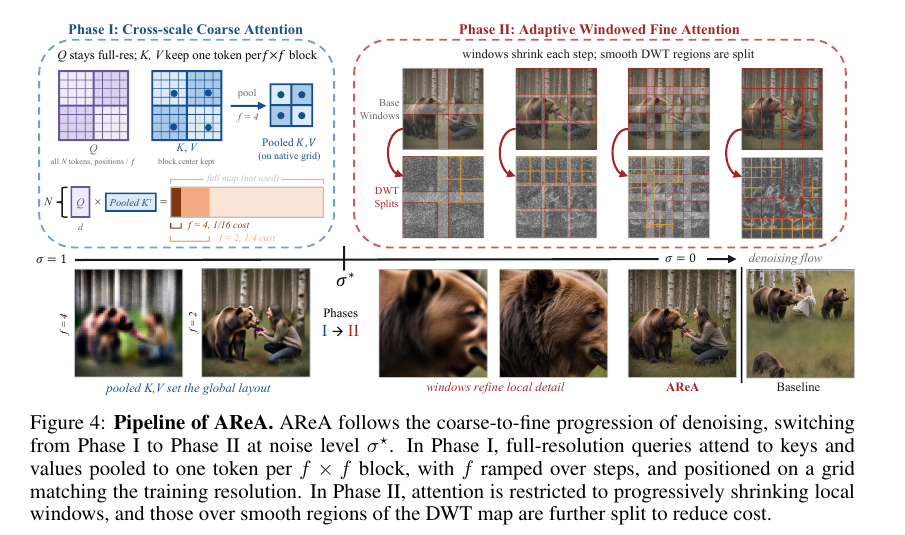

# AReA：讓 Diffusion Transformer 的注意力視野隨去噪由全局收縮至局部

**日期：2026-10-15**　**方向：training-free、attention modulation、高解析度圖像生成**

今天從近期深度學習、JEPA、VAR 與圖像生成論文中篩選後，選讀 AReA，因為它把免訓練高解析度生成的問題直接改寫成「每個去噪步驟需要看多遠」。需先標明：截至 2026-10-15，原始 PDF 標示 **Preprint. Under review**，目前沒有可確認的正式頂會錄用資訊；不應把它當成已發表會議論文。[1] 檢查 AI_Daily 的現有索引後，未見 arXiv:2610.17227，故本篇不與已收錄報告重複。作者專案頁連結了公開程式碼與 Hugging Face demo。[2] [3]

## 論文資訊

- **標題：** *AReA: Adaptive Receptive-Field Attention for Efficient High-Resolution Diffusion Transformers*
- **作者：** Javad Rajabi、Koorosh Roohi、David B. Lindell、Babak Taati
- **機構：** 論文列出 University of Toronto 與 Vector Institute。
- **發表狀態：** arXiv:2610.17227v1，2026-10-12，cs.CV；預印本、審稿中，尚未確認會議／期刊錄用。[1]
- **資源：** [論文](https://arxiv.org/abs/2610.17227)｜[作者專案頁](https://rajabi2001.github.io/area/)｜[官方程式碼](https://github.com/KooroshRH/AReA)｜[Hugging Face demo](https://huggingface.co/spaces/kooroshrh/AReA)。

## 核心貢獻與方法

標準 Diffusion Transformer（DiT）的 self-attention 讓每個影像 token 看見全圖。若影像 latent 有 $N$ 個 tokens，其主要成本約為 $O(N^2)$；解析度提高時，token 數量與 query–key 距離同時超出訓練範圍，可能造成生成變慢、物體重複或構圖崩解。AReA 的觀察是：去噪早期要建立全局布局，後期更需要鄰近位置的細節。論文在 FLUX.1 的分析中發現，跨 24 個 prompts，最受注意的一組 keys（注意力至少為最大值的四分之一）在去噪後期距 query 約縮短 5.5 倍；若把所有 keys 一起平均，距離僅縮短約 1.4 倍。這支持「不是所有步驟都需要全局 attention」的設計動機。[1]

一般 attention 為：

$$
\operatorname{Attn}(Q,K,V)=\operatorname{softmax}\!\left(\frac{QK^{\top}}{\sqrt d}\right)V.
$$

AReA 不訓練新權重，也不改 RoPE 頻率；它改變每個 query 在每個去噪階段能讀取的 $K,V$ 範圍，讓 receptive field 由粗到細演進。[1]

*圖 1。AReA 的 coarse-to-fine pipeline。圖像來源：原論文 Figure 4（arXiv 頁面標示 CC BY 4.0）。[1]*

### Phase I：低成本的全局構圖

早期保留完整解析度的 queries，但把 keys/values 按 $f_t\times f_t$ 區塊降採樣；每區塊以中心 token 作代表，而不是平均池化。降採樣後，query 與 key 的位置座標也映射到同一個粗網格，使相對位置維持在較接近模型訓練時的範圍。每個 query 約只看 $N/f_t^2$ 個 image keys（另保留 text keys），因此影像部分的 attention 成本約降至 full attention 的 $1/f_t^2$。

池化倍率隨去噪逐步下降，從最粗的全局視圖過渡到較細的佈局：

$$
\tilde f_t=f_0+\frac{t-1}{S_c-1}(f_{\min}-f_0),\qquad t=1,\ldots,S_c,\quad f_{\min}=2.
$$

實作會把倍率取整到有效網格除數。Phase I 與 Phase II 的切換依噪聲水準 $\sigma^\star$ 決定，而不是固定套用相同步數；作者在 FLUX.1 的前 8 步、Qwen-Image 的前 20 步使用 Phase I。[1]

### Phase II：逐步收縮的局部視窗

全局構圖形成後，AReA 讓影像 query 只讀取所在的局部 window，並將 window 邊長 $w_t$ 逐步縮到模型原生範圍：

$$
w_t=w_{\text{start}}\left(\frac{w_{\min}}{w_{\text{start}}}\right)^{\frac{t-1}{S_d-1}},\qquad t=1,\ldots,S_d.
$$

$w_{\text{start}}$ 會依 window 數量與計算成本選擇，避免一個 windowed step 反而比全局 attention 更貴。忽略重疊與 text tokens 時，若 latent 網格是 $H\times W$，可用下式估計相對於一次 full attention 的成本：

$$
C(w)\approx\frac{\lceil H/w\rceil\lceil W/w\rceil\,w^4}{(HW)^2}.
$$

AReA 再以當前 hidden states 建立三層 Haar DWT detail map。對細節能量低、內容平滑的視窗，切成四個更小子窗通常不損失太多上下文，且可省運算；高細節區則保留較大的視野。作者另加兩項跨窗資訊補償：**Halo** 為視窗 query 提供邊界鄰近 keys/values，以減少縫線；**global-KV bridge** 則把少量、在全圖中較具辨識性的 tokens 加入每個視窗，避免局部生成重複物件。Bridge 的 token 數依視窗大小設定為

$$
R_t=(\rho w_t)^2,\qquad \rho=0.5.
$$

這些輔助 keys/values 與本地 tokens 共用同一個 softmax；論文的預設 Halo 最大寬度為 8。DWT 切窗不增加基礎 tiling 的成本預算，Phase II 每步也受成本上限約束。[1]

## 實驗結果

作者在 NVIDIA H100 上評估 FLUX.1 與 Qwen-Image。Aesthetic-4K 含 195 個 prompts，另提出 HRGen-1K（1,000 個由大型語言模型生成的挑戰 prompts）。主表測試 2048×4096、6144×2048、4096² 與 5120²；論文也另報告在 6144² 的速度提升。這兩種報告範圍不同，不應把圖表的 6144² 結果誤寫成主表的 Aesthetic-4K 測試點。[1]

- **FLUX.1，4096²：** Base full attention 平均 314 秒，AReA 為 151 秒，約 **2.08×** 加速。ImageReward 從 −0.7177 提至 1.3250，Aesthetic 從 5.80 提至 6.37，CLIP Score 從 25.72 提至 29.71；FID 由 179.8 降至 148.5，patch-FID 由 112.0 降至 58.2。
- **Qwen-Image，4096²：** Base 為 902 秒，AReA 為 487 秒，約 **1.85×** 加速。ImageReward 從 −0.1313 提至 1.4847，Aesthetic 從 5.95 提至 6.49，FID 由 167.9 降至 147.3，patch-FID 由 77.2 降至 55.3。
- **更大畫布：** 論文 Figure 6／摘要報告，在 6144² 相較 full-resolution global attention，FLUX.1 與 Qwen-Image 分別達 **3.2×** 與 **2.9×**；作者專案頁展示跨 FLUX.1、Qwen-Image、FLUX.2 與 Ideogram 4 的生成案例，解析度最高展示至 8K×8K。專案頁示例不等同於主表量化評估。[1] [2]
- **消融：** 拿掉 Phase I 會損害跨視窗的全局構圖；拿掉 Phase II 會增加延遲並使細節較模糊；移除 global-KV bridge 時，FLUX.1 4096² 的 FID 從 148.5 升至 161.25，且質化結果更易出現重複物件。拿掉 DWT split 後，延遲從 151 秒增至 187 秒。[1]

## 相關研究脈絡

- **DyPE** 依 diffusion 進程調整 RoPE positional extrapolation，利用低頻較早收斂、高頻持續變化的現象，改變位置編碼對頻率的配置；AReA 則不改 RoPE，而是縮減每個 query 看見的 keys/values，並因此降低 attention 計算量。[5]
- **SEGA** 從 latent 的空間頻譜能量推導各 RoPE 維度的動態縮放，重點是「哪些頻率需要補償」；AReA 的重點是「哪些空間位置還值得互相注意」。兩者都是 training-free 的推論期調制，但 AReA 直接控制 receptive field。[4]
- **DiffuseHigh（AAAI 2025）** 先生成原生解析度圖像，再逐步上採樣並以結構引導細化；AReA 不以低解析度生成作為構圖錨點，而是在目標解析度直接完成一次去噪流程。[6]

## 評價與研究靈感

**我認為 AReA 最有價值的不是某一組 window 超參數，而是把 attention 的範圍視為可隨生成狀態調度的資源。** 它提供了一個明確的 quality–compute 介面：先為全圖構圖保留稀疏全局視野，再把後續計算花在局部細節；作者的消融也表明全局橋接與細節視窗解決的是不同失敗模式。

但目前仍需保留三項審慎判斷。第一，這是 under-review 預印本，結果尚待獨立複現。第二，完整量化主要落在 FLUX.1、Qwen-Image；切換噪聲水準、window schedule 等需依模型與 sampler 經驗設定。第三，HRGen-1K 是作者自建 LLM-generated benchmark，與外部獨立測試集的證據強度不同。另需注意，Global-KV bridge 仍保留少數遠距離位置，並未完全消除 RoPE distance OOD。[1]

值得延伸的方向：

1. **Energy-based bridge routing：** 以 $\|\nabla_{z_i}E_\theta(z,c)\|_2$ 或局部 compatibility-energy 取代單純的 key deviation，挑選最影響全局相容性的 bridge tokens。假設是：少量高能量梯度位置能比均勻空間抽樣更有效地避免跨窗語義衝突。
2. **JEPA 不確定度調視野：** 以未來 latent 預測分歧 $u_i=\|\hat z^{(1)}_{i,t+\Delta}-\hat z^{(2)}_{i,t+\Delta}\|_2$ 作為路由訊號；預測不確定的區域保留較大的 receptive field 或更多 bridge keys，穩定區域則縮小 window。這能把 AReA 目前以固定 schedule 為主的控制，改成 state-adaptive 的 zero-shot policy。
3. **VAR 的尺度版 AReA：** VAR 沒有 diffusion timestep，但有由粗到細的 next-scale token 序列。可以把 denoising time 換成 scale index，測試粗尺度採全局 K/V、細尺度採局部 window，並以 next-scale entropy 決定何處需要跨尺度 token。這是研究假設，不是本文已驗證的結果。

若要做最小驗證實驗，我會先在 frozen DiT 上只替換 global-KV bridge 的 token selector，比較原始 key deviation、energy-gradient 與 JEPA disagreement 三種選擇器；在相同步數、H100、prompt/seed 下同時報告 latency、FID/patch-FID、CLIP alignment 和物件重複率。這能把「注意力看多遠」與「哪些全局訊息最值得傳」拆成兩個可獨立分析的因素。

## References

[1]: https://arxiv.org/html/2610.17227v1 "AReA: Adaptive Receptive-Field Attention for Efficient High-Resolution Diffusion Transformers"
[2]: https://rajabi2001.github.io/area/ "AReA official project page"
[3]: https://github.com/KooroshRH/AReA "Official AReA implementation"
[4]: https://arxiv.org/html/2605.22668v1 "SEGA: Spectral-Energy Guided Attention for Resolution Extrapolation in Diffusion Transformers"
[5]: https://arxiv.org/html/2510.20766v2 "DyPE: Dynamic Position Extrapolation for Ultra High Resolution Diffusion"
[6]: https://ojs.aaai.org/index.php/AAAI/article/view/32456 "DiffuseHigh, Proceedings of the AAAI Conference on Artificial Intelligence"
