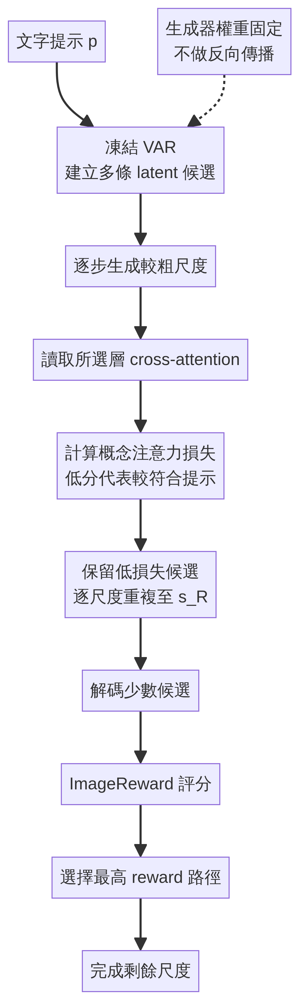

# AI Daily

## ATLAS: Attention-Guided Test-Time Latent Selection for Compositional Visual Autoregressive Generation

**報告日期：** 2026-10-30

**作者：** Hossein Shahabadi、Raya Namazi、Mahdieh Soleymani Baghshah

**研究單位：** Sharif University of Technology

**發表狀態：** arXiv:2610.25390v1，2026-10-18 首次公開。截至本報告日期，官方紀錄未列正式會議或期刊發表資訊，應視為預印本，不宜稱為已錄取頂會論文。[1] [2]

**研究類型：** Visual Autoregressive Model（VAR）、測試時搜尋、免參數更新的注意力引導候選選擇、組合式文字生圖。[1]

### 為什麼選這篇

ATLAS 在最近兩週內公開，且目前未見於 AI_Daily 的 README 或論文索引。它直接對應你近期關注的 VAR、training-free 與 attention modulation，也提出一個值得拆解的問題：VAR 已經按尺度逐步生成，能否在昂貴的完整解碼之前，先用模型內部注意力淘汰較不符合提示詞的生成路徑？[1] [2]

選文時需要保留一項背景：這篇並非指定研究機構的公開頂會論文，而是 Sharif University of Technology 團隊的 arXiv 預印本。它的優勢在於方法與研究興趣高度吻合，且同時提供注意力診斷、組合生成指標和推理成本；以下數字均按作者的實驗設定解讀，不把它們寫成跨模型的普遍保證。[1]

### 核心貢獻

ATLAS 不微調 VAR 權重，也不對候選 latent 做梯度最佳化。它讓凍結的 VAR 從同一提示詞探索多條 latent 軌跡；每完成若干尺度，就讀取指定層的文字—圖像 cross-attention，計算候選對物件、屬性或空間關係的注意力損失，再保留分數較佳的少數分支。到了部分解碼階段，方法用 ImageReward 比較少量候選，最後只完成分數最高的一條路徑。[1]

這將推理時運算從「每條候選都完整生成，再挑最好」移成「先用中間注意力便宜地篩選，最後才局部解碼與排序」。因此，ATLAS 的核心不是改變 attention logits 或直接注入控制訊號，而是把 cross-attention 當成候選路徑的評分器。稱它為 training-free 或 attention-guided selection 是準確的；若稱為 attention modulation，則需說明本文主要是讀取與篩選，並未直接調制注意力權重。[1]

### 技術方法與數學形式

**1. VAR 將影像生成分解成由粗到細的尺度條件分布。** 令 \(r_s\) 是第 \(s\) 個尺度的視覺 token，\(c\) 是文字提示，則生成分布可寫為

$$
p(r_{0:S-1}\mid c)=\prod_{s=0}^{S-1}p(r_s\mid r_{<s},c).
$$

這種因子分解讓 ATLAS 有機會在所有細節都生成前，先比較多條粗尺度軌跡。它不必更動 VAR 原本的尺度生成器，而是在不同尺度之間增加「評分—保留—繼續」的搜尋步驟。[1]

**2. 以概念相關的 cross-attention 損失評估候選。** 令 \(A_{k,s}^{(l)}\) 表示候選 \(k\) 在尺度 \(s\)、Transformer 層 \(l\) 的 cross-attention map。對提示詞中的概念 \(d\)，ATLAS 先選出對應的層集合 \(W_d\)，再計算

$$
\bar A_{k,s}^{W_d}=\frac{1}{|W_d|}\sum_{l\in W_d}A_{k,s}^{(l)},\qquad
\mathcal L_d(k,s;W_d)=\phi_d(\bar A_{k,s}^{W_d},c).
$$

\(\phi_d\) 是概念對應的注意力損失，數值越低表示目前候選的注意力分布越符合該概念要求。論文分別考察 2D separation、color、shape、texture 與 3D footprint 等訊號，並在小型校準資料上選取較適用的層與損失；因此「training-free」指不更新生成器參數，不代表完全沒有離線校準或工程成本。[1]

**3. 依總損失逐尺度淘汰分支。** 令 \(D(p)\) 是提示詞 \(p\) 涉及、且方法能評估的概念集合，候選分數可簡寫為

$$
\ell_{k,s}(p)=\frac{1}{|D(p)|}\sum_{d\in D(p)}\mathcal L_d(k,s;W_d).
$$

ATLAS 按 \(\ell_{k,s}\) 由低至高排序，只讓最低損失的 \(K_{s+1}\) 條路徑繼續生成：

$$
\mathcal K_{s+1}=\operatorname{TopK}_{k\in\mathcal K_s}\bigl(-\ell_{k,s}(p),K_{s+1}\bigr).
$$

其中 \(\mathcal K_s\) 是當前仍保留的候選集合。論文的 Infinity 設定按搜尋預算逐步縮減候選數，並在完成第 3、4、5 個尺度後篩選；Switti 則在第 5、6、7 個尺度後篩選。這些是針對所測骨幹選定的 schedule，不應直接視為任意 VAR 都適用的固定規則。[1]

**4. 用 ImageReward 對部分解碼結果做最後選擇。** 到達部分解碼尺度 \(s_R\) 後，方法對保留的少量候選生成部分圖像 \(D(r_{k,\le s_R})\)，再選出

$$
k^*=\arg\max_{k\in\mathcal K_{s_R}}R_{\mathrm{IR}}\!\left(p,D(r_{k,\le s_R})\right),
$$

其中 \(R_{\mathrm{IR}}\) 是 ImageReward 分數。選定分支才會完成後續尺度。ATLAS 因此同時使用兩種判斷：中間 cross-attention 負責低成本早期篩選，部分解碼後的 ImageReward 負責較高成本的末端排序。它不是單靠注意力就能保證最終美感或語義正確。[1]

### 實驗結果

主要比較使用兩個凍結 VAR 骨幹：Infinity-2B 與 Switti。組合生成評估採 T2I-CompBench 的 Avg.6；這類指標適合檢查屬性綁定、空間關係與複合提示詞，但不能代表所有圖像品質面向。[1] [4]

- 在作者報告的最大搜尋預算 \(N=8\) 下，Infinity 的 Avg.6 為 **0.5303**，相對原模型提升 **10.5%**；Switti 為 **0.5169**，提升 **10.6%**。提升幅度隨搜尋預算增加：Infinity 在 \(N=1,2,8\) 分別為 4.3%、7.3%、10.5%，Switti 分別為 5.2%、7.7%、10.6%。
- GenEval 僅報告 color、color-attribute、position 三類的平均，不是完整 GenEval overall。Infinity 由 **0.563** 升至 **0.625**；Switti 由 **0.451** 升至 **0.501**。[1]
- 在 held-out 注意力診斷中，Infinity 的配對偏好預測準確率為 2D separation **72.9%**、color **62.7%**。Texture 為 60.3%，但統計上未達顯著。這表示注意力訊號的辨識能力依概念而異，不能把一個類別上的有效性外推到所有語義屬性。[1]
- 作者在 A100 40GB 上比較生成時間。搜尋預算 \(n=8\) 時，Infinity 的 ATLAS 為 **6.00 秒**，完成所有候選的 Best-of-N（BoN）為 **12.49 秒**；Switti 分別為 **2.04 秒**與 **5.24 秒**。在 \(n=16\) 時，Infinity 為 **7.02 秒**對 **24.05 秒**，Switti 為 **2.57 秒**對 **9.54 秒**。[1]

時間數字應視為論文特定設定下的成本比較，而不是相同品質條件下的 Pareto 保證。論文的若干品質與效率比較使用不同 run 數或評估設定；文獻基線也不是全部由作者在完全相同資料、提示詞與解碼設定下重跑。證據目前主要是兩個 VAR 骨幹與自動化組合指標，作者也指出仍需要更多提示詞、人類評估及多樣性分析。[1]

### 相關研究脈絡

- **VISTA** 研究 Visual Autoregressive Generation 的測試時組合對齊。兩者都在不重新訓練生成器的情況下利用推理時訊號；ATLAS 的主操作是讀取 cross-attention 並選擇 latent 路徑，和直接對生成狀態施加測試時修正的路線不同，可以比較「挑選既有候選」與「改變候選」各自帶來的品質、延遲與多樣性成本。[3]
- **T2I-CompBench** 提供組合式文字生圖基準，涵蓋屬性綁定、物件關係和複雜組合等能力。ATLAS 的結果因此較能支持「組合提示詞上的改善」，不應簡化成全面提升圖像生成品質。[4]
- **Best-of-N** 是自然的計算配置基線：先完成多張圖，再用 reward model 排序。ATLAS 的設計差異在於把篩選提前至 VAR 的中間尺度，讓大部分候選不用走完整生成路徑；但它仍需保留多條初始分支，且末端仍依賴 ImageReward。[1]

### 評價、限制與研究想法

我認為 ATLAS 最有價值的地方，是把 VAR 的多尺度結構轉成測試時計算分配介面。它不嘗試重新訓練一個更大的生成模型，而是問「哪些分支值得花下一段計算？」這個問題。實驗也比單一漂亮樣例完整，涵蓋注意力診斷、組合基準和生成時間。另一方面，Attention-guided 不等於 attention-modulated：論文目前證明的是注意力可協助排序候選，尚未證明直接改寫注意力就會改善生成。[1]

限制主要有四點。第一，層與注意力損失需校準，選擇最有效 layer/head 可能造成 selection optimism。第二，Texture 等訊號未必可靠。第三，ImageReward 可能偏好自身訓練分布中的圖像風格。第四，搜尋比單一路徑更耗資源，效益取決於生成品質改善能否抵銷候選分支、部分解碼及 reward model 的成本。這些因素令「免訓練」不等於「零成本」，也令「使用凍結模型」不自動等於嚴格 zero-shot 泛化。[1]

對 Energy-based Transformer、JEPA、VAR 與 attention modulation，可延伸三個可檢驗方向；以下均為研究構想，並非 ATLAS 已提出或證實的功能：

1. **Energy × attention 的候選相容性分數。** 將 ATLAS 的概念注意力損失與 EBT 式相容性 energy、JEPA 預測不一致度合併，例如
   $$
   S_k=\lambda_A\ell_{\mathrm{att}}(k)+\lambda_E E_{\mathrm{compat}}(k)+\lambda_J D_{\mathrm{JEPA}}(k)-\lambda_R R_{\mathrm{IR}}(k).
   $$
   低分保留。實驗應比較單用 attention、單用 energy、單用 JEPA disagreement 和融合分數，並在相同延遲預算下衡量組合成功率與多樣性。
2. **以不確定度決定每一尺度的分支寬度。** 若候選間分數差距大，就更積極剪枝；若分數接近或互相矛盾，就暫留更多分支。這可把固定的候選數 schedule 改成 prompt-adaptive VAR，並以 wall-clock、顯存、品質與 diversity 一起評估，而不只比較 NFE。
3. **分離「注意力做選擇」與「注意力做調制」。** 在相同 checkpoint 和總計算量下，對照 ATLAS 的 branch selection、局部 cross-attention bias、value modulation，以及兩者串接。若調制後注意力圖變得更符合提示詞，仍需檢查這種對齊是否真正提高最終人類偏好，而非只讓內部指標自我驗證。

### References

[1]: https://arxiv.org/html/2610.25390v1 "ATLAS: Attention-Guided Test-Time Latent Selection for Compositional Visual Autoregressive Generation"
[2]: https://arxiv.org/abs/2610.25390 "ATLAS arXiv record"
[3]: https://arxiv.org/abs/2608.22521 "VISTA: Test-Time Compositional Alignment for Visual Autoregressive Generation"
[4]: https://arxiv.org/abs/2307.06350 "T2I-CompBench: A Comprehensive Benchmark for Open-world Compositional Text-to-image Generation"
