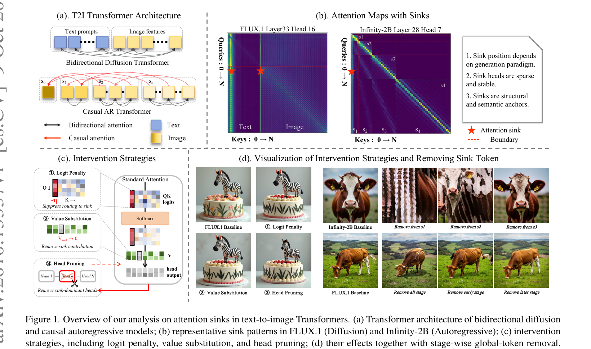

# AI Daily

## 2026-10-13｜Exploring Attention Sinks in Text-to-Image Transformers：圖像生成 Transformer 的注意力匯，究竟是語義錨點還是計算緩衝區？

> **一句話結論：** 這篇最新預印本最值得帶走的不是「T2I 模型也有 attention sink」，而是它用跨架構分析與干預實驗拆開了兩件常被混為一談的事：**某個位置吸收了大量 attention，不代表那個位置本身對生成品質不可或缺；真正更可能有因果作用的，往往是承載該路由的少數 attention heads。**

## 論文基本資訊

| 欄位 | 資訊 |
|---|---|
| 論文標題 | *Exploring Attention Sinks in Text-to-Image Transformers from Diffusion and Autoregressive Models* |
| 作者 | Binglei Li、Mengping Yang、Zhiyu Tan、Wenxu Qian、Junping Zhang、Hao Li [1] [2] |
| 研究單位 | Fudan University、Shanghai Innovation Institute、Shanghai Academy of AI for Science [2] |
| 發表狀態 | arXiv:2610.13337v1，2026-10-09，10 頁；截至查閱日未標示正式會議或期刊收錄 [1] |
| 研究模型 | FLUX.1-dev、Z-Image（雙向 diffusion Transformer）、Infinity-2B（因果 autoregressive Transformer）[2] |
| 評估資料 | GenEval 553 prompts、DPG-Bench 1,065 prompts，共 1,618 prompts；輔助指標為 HPSv2 與 ImageReward [2] |
| 論文連結 | [arXiv 摘要頁][1]、[PDF][2]、[HTML 全文][3] |
| GitHub 去重 | 已檢查 `KaiCobra/AI_Daily` 的 `README.md`、`INDEX.md` 與 `papers/`；完整標題及 `2610.13337` 均未出現。儲存庫雖已有 attention sink 與 Text Template Tokens 主題，但不是同一篇文章。 |

本次選擇它，是因為它同時覆蓋 diffusion 與 visual autoregressive 兩條生成路線，而且直接命中你近期關注的 **attention modulation、training-free intervention、VAR／AR 結構與可解釋性**。它不是 Energy-Based Transformer 或 JEPA 論文，但它把「哪些 attention 路徑值得繼續計算」變成可以量測的問題，很適合作為下一步研究設計的接口。

*圖 1。從論文 PDF 擷取並裁切的必要區域；左上比較雙向 diffusion 與 causal AR，右上標出代表性的 sink，左下是 logit penalty、value substitution、head pruning，右下是移除 sink token 後的視覺結果 [2]。*

## 為什麼這篇值得讀？

Attention sink 最早在大型語言模型中被用來描述一種反直覺現象：某些 token 的語義內容不重要，卻長期吸收過多 attention。T2I Transformer 的情況不能直接套用語言模型的「第一個 token 就是 sink」直覺，因為它同時處理文字與圖像 token，而且可能以雙向 denoising 或 coarse-to-fine／causal AR 生成。

這篇研究的價值在於把問題拆成三層：**sink 是否存在、sink 位於何處、sink 對生成是否有功能上的必要性**。作者先在三個模型上統一計算 incoming attention mass，再按位置、layer、head、生成階段與 prompt distribution 分析，最後用 logit、value、head 三種干預測試生成結果。它因此不只是一組 attention visualization，而是一個可重用的 mechanistic analysis protocol [3]。

## 核心貢獻與主要發現

### 1. Sink 位置由生成架構與 token layout 決定

在 Infinity-2B 中，第一個 token 與每個 coarse-to-fine scale 的 global token 形成明顯 sink；在 FLUX.1 與 Z-Image 中，sink 則出現在文字區域、文字／圖像 modality boundary，以及圖像 token 的空間角落。換句話說，雙向 diffusion 不會自然複製 causal LLM 的固定 position-0 sink。

作者報告的 top-1／top-5 position-wise sink ratio 如下。這裡的 top-1 是某候選位置成為最強 sink 的 attention unit 比例，top-5 則是它進入前五名的比例。

| 模型 | 候選位置 | $\rho_1$ | $\rho_5$ |
|---|---:|---:|---:|
| FLUX.1 | sequence position 0 | 0.32% | 0.56% |
| FLUX.1 | text position 7 | 12.95% | 32.26% |
| FLUX.1 | boundary position 511 | 6.05% | 23.06% |
| FLUX.1 | image position 4544 | 3.04% | 18.33% |
| Z-Image | sequence position 0 | 0.47% | 0.65% |
| Z-Image | boundary position 4096 | 10.89% | 21.31% |
| Z-Image | text position 4109 | 11.62% | 32.49% |
| Infinity-2B | global token position 0 | 37.52% | 100.00% |

這個結果把「位置」從語義問題改寫成了**序列拓撲問題**：在 MMDiT 中，boundary 或 corner 可能是穩定的結構錨點；在 causal AR 中，第一個 global token 則可能同時代表全局畫布與早期可見的條件。位置的 sink ratio 因而不能脫離 mask、scale schedule 與 modality layout 解讀 [3]。

### 2. Sink heads 很稀疏，但身份在不同 prompt benchmark 間很穩定

sink concentration 只集中在約 3%–5% 的 heads。它們的深度也依模型而異：FLUX.1 主要出現在 double-to-single stream transition 後的 L39–L47；Z-Image 有一個特別突出的淺層 head L02H25；Infinity-2B 則集中在約 L27–L30 [3]。

更有意思的是，GenEval 與 DPG-Bench 之間的 sink-head concentration map Pearson correlation 很高：FLUX.1 為 0.988、Z-Image 為 0.983、Infinity-2B 為 0.999。這表示「哪些 heads 容易變成 sink」更像是模型結構的性質，而不是某一批 prompt 的偶然產物。相反地，sink 的**具體位置**對 prompt distribution 更敏感：FLUX.1 的高位置熵 head 比例由 GenEval 的 6.8% 上升至 DPG-Bench 的 92.2%，Z-Image 也由 2.7% 上升至 49.4% [3]。

這形成一個很有用的二分：

- **Head identity 穩定：** 模型中少數 heads 長期負責高度集中的路由。
- **Sink position 可漂移：** 同一個 head 會依 prompt 長度、語義密度與生成狀態，把集中注意力導向不同的位置。

### 3. Sink 會隨生成進程更偏向圖像／細尺度，但只在鄰近步驟局部穩定

作者把 diffusion 的 denoising trajectory 與 Infinity-2B 的 coarse-to-fine scale 都分成 early、middle、late 三段。image-directed ratio 隨生成推進而上升：FLUX.1 為 41.21% → 45.34% → 50.47%，Z-Image 為 7.46% → 9.70% → 12.73%，Infinity-2B 的 fine-scale ratio 為 81.24% → 86.61% → 89.95% [3]。

但是 sink 位置不是完全固定。相鄰步驟的 top-1 Jaccard overlap 在 FLUX.1、Z-Image、Infinity-2B 分別為 79.12%、76.03%、52.56%；若跨越完整生成階段，則降至 61.29%、54.11%、39.58%。因此更精確的說法是：**sink 在局部時間窗內具有連續性，跨階段則會逐步漂移。** 這個觀察對 training-free attention modulation 很重要，因為固定一次性的 mask 可能只對一小段 denoising trajectory 有效。

## 技術方法與數學細節

### 1. 用 incoming attention mass 定義 sink

對於 timestep $t$、layer $l$、head $h$ 的 attention matrix $\mathbf{A}^{(t,l,h)}\in\mathbb{R}^{N\times N}$，$i$ 是 query position，$j$ 是 key position。作者以所有 query 對同一 key 的平均 incoming mass 定義：

$$
\hat{A}^{(t,l,h)}_j
=\frac{1}{N}\sum_{i=1}^{N}A^{(t,l,h)}_{i,j}.
$$

若某位置 $j^*$ 滿足

$$
\hat{A}_{j^*}>\tau\,\mu_A,
\qquad
\mu_A=\frac{1}{N}\sum_{k=1}^{N}\hat{A}_k,
$$

則它被視為 attention sink。$\tau$ 是 concentration threshold；實驗對 diffusion models 使用 $\tau=10$，對 Infinity-2B 使用 $\tau=100$ [3]。

作者進一步用 sink concentration 排名 attention heads：

$$
\kappa^{(l,h)}
=\frac{\max_j\hat{A}^{(l,h)}_j}
{\sum_j\hat{A}^{(l,h)}_j}.
$$

在 uniform attention 下，因為 incoming mass 已按可見 token 數量歸一化，$\kappa$ 的 null 約為 $1/N$。所以 $\kappa$ 大於 $1/N$ 才代表真的集中，而不是單純被 causal mask 或可見範圍大小誤導。作者把 $\kappa$ 最高的 heads 記為 $\mathcal{H}_{\mathrm{sink}}$，並把每個 head 的 top-$k$ sink token 記為 $\mathcal{S}^{(l,h)}_k$ [3]。

對候選位置 $c$，作者用 position-wise sink ratio 統計它在所有 layer-head unit 中進入 top-$k$ 的比例：

$$
\rho_k(c)
=\frac{1}{|\mathcal{U}|}
\sum_{u\in\mathcal{U}}
\mathbf{1}\left[c\in\mathcal{S}^{(u)}_k\right].
$$

$\rho_k$ 適合描述「哪個位置常被選為 sink」，但它本身不證明該位置具有語義功能；這也是後續干預實驗必要的原因。

### 2. 三種 inference-time 干預

作者把多頭 attention 寫成下式，讓 head mask、attention-logit bias 與 value substitution 可以被分開控制：

$$
\mathbf{x}
\leftarrow
\mathbf{x}+\sum_{h=1}^{H}m^{(h)}
\operatorname{Softmax}\left(
\frac{\mathbf{Q}^{(h)}\mathbf{K}^{(h)\top}}
{\sqrt{d_k}}+\mathbf{B}^{(h)}
\right)
\widetilde{\mathbf{V}}^{(h)}.
$$

三種 probe 的目的不同：

1. **Logit penalty：** 對 sink key 的 attention logit 加負偏置，
   $$B^{(h)}_{ij}=-\eta\,\mathbf{1}[j\in\mathcal{S}^{(l,h)}_k],$$
   實驗通常取 $\eta=10$。這只改變 routing，不改變 value state。
2. **Value substitution：** 將 sink positions 的 value vector 設為零，$\widetilde{V}_j=0$；它保留原本 attention routing，但移除 sink value 對輸出的貢獻。
3. **Head pruning：** 對 sink-dominant heads 設 $m^{(h)}=0$，整個移除該 head 的輸出。這是範圍最大的干預，因為同時移除 routing、value 與 head-specific projection 的效果。

這三者讓作者可以區分「模型只是把 attention 集中到某位置」和「某個位置／head 的內容真的被下游使用」。

### 3. Register token：讓非語義位置承接部分 routing

作者在 FLUX.1 的 image-token sequence 中插入一個 learnable register token，凍結原始 backbone，並在 unpatchification 前移除 register output。這個 token 不直接對應影像內容，只提供一個額外 routing slot。

結果是 FLUX.1 的 GenEval 從 67.14 提升到 68.85，DPG-Bench 從 83.67 提升到 84.01；原本 text position 7 的 $\rho_1$ 從 12.95% 降到 12.44%，image position 4544 從 3.04% 降到 2.72%，register 自己的 $\rho_1$ 為 0.53% [3]。這不是把所有 native sink 完全吸走，而是**部分重新分配 sink dominance，同時略微改善品質**。

## 實驗結果：集中位置與因果必要性不是同一件事

### 1. 主要干預結果

下表整理 baseline 與三種干預。$\bar{\Delta}$ 是相對 baseline 的平均百分比變化，越負代表退化越大。

| 模型 | Baseline GenEval / DPG / ImageReward | Logit penalty $\bar{\Delta}$ | Value substitution $\bar{\Delta}$ | Head pruning $\bar{\Delta}$ |
|---|---|---:|---:|---:|
| FLUX.1 | 67.14 / 83.67 / 0.9539 | -0.19% | -0.71% | -4.19% |
| Z-Image | 76.18 / 87.41 / 0.9481 | -0.36% | -0.58% | -2.36% |
| Infinity-2B | 64.56 / 81.84 / 0.9761 | -2.79% | -5.45% | -6.56% |

這組結果支持三個判斷：

- 只懲罰 sink routing 時，FLUX.1 與 Z-Image 的整體分數幾乎不變；因此「sink 吸收注意力」不等於「必須保留對該位置的 routing」。
- 把 sink value 設為零會造成較大影響，表示 sink position 可能承載可被利用的資訊，即使它看起來缺乏語義。
- 移除 sink heads 的破壞最大，尤其在 Infinity-2B。這說明真正重要的對象可能是**實作該路由的 head**，而不只是被選中的 token position。

### 2. 架構差異：Infinity-2B 的第一個 global token 更接近真正必要的狀態

在 Infinity-2B 中，從第一個 scale $s_1$ 開始移除 position-0 global token，GenEval 由 64.56 急降至 11.37，ImageReward 由 0.9761 變成 -0.8055；若延後到 $s_4$ 才移除，GenEval 回升到 62.90；從 $s_8$ 開始移除時則為 63.35。相反地，FLUX.1 在整段或早／晚 denoising 移除 sink candidate，GenEval 仍約在 64.81–65.45，DPG 與 ImageReward 也接近 baseline [3]。

所以「sink 是否必要」具有強烈的架構與階段依賴：

- **Causal AR：** 早期 global token 可能是後續 scale 的結構狀態，移除後會切斷歷史依賴。
- **Bidirectional diffusion：** 某些 sink position 可由其他 token 或其他 heads 補償；它們是高流量節點，卻不一定是不可替代的語義節點。

### 3. Z-Image 的 sink-head pruning 消融

在固定移除 50 個 heads 的預算下，Z-Image 的 top-sink heads pruning 平均退化 -2.36%，random-50 為 -1.84%，bottom-sink heads 為 -1.60%。移除 top-20、top-50、top-100 heads 時，平均退化分別為 -1.12%、-2.36%、-5.84% [3]。

這個排序比單純「移除同樣數量的 heads」更有說服力：sink concentration 可以作為一個便宜的 head importance proxy。但它仍不是充分條件，因為 $\kappa$ 高只代表 routing 集中，不代表 head 的語義內容、空間功能或可替代性完全被解釋。

## 與相關研究的連結

### StreamingLLM：attention sink 作為數值緩衝區

*Efficient Streaming Language Models with Attention Sinks* 發現，LLM 的 initial tokens 即使缺乏語義，也會因 Softmax 的總和約束成為 attention sink；保留這些 token 的 KV 可以讓 sliding-window inference 穩定延伸到長序列，並提出 dedicated placeholder token 作為 sink [7]。本篇把這個問題移到 T2I：但在 diffusion MMDiT 中，sink 不固定於 position 0，而是隨 modality boundary、圖像 corner 與 denoising stage 改變。因此「加 register」是一個共同策略，「register 能否取代 native sink」則必須按架構重新驗證。

### Vision Transformers Need Registers：低資訊 token 不等於無用 token

*Vision Transformers Need Registers* 指出，ViT feature map 中會出現高 norm、位於低資訊背景區域的 token；加入額外 register tokens 可以承接這些內部計算，讓 feature map 與 attention map 更平滑 [6]。本篇在 FLUX.1 中觀察到的 register token 結果與此方向一致，但又多了一層重要限制：新增 register 只讓 native sink ratio 小幅下降，沒有完全替代 boundary 或 corner anchor。T2I 的 register 可能是額外工作空間，不是把原有結構位置一刀切掉的替代物。

### ICML 2026 的 diffusion causal analysis：集中不等於語義必要

*Attention Sinks in Diffusion Transformers: A Causal Analysis* 以 SD3 為主、SDXL 為輔，按每個 timestep 與 head 動態找出 incoming-mass top-$k$ sinks，再在 score path 與 value path 做 training-free suppressive intervention。其結果是 $k=1$ 時 CLIP-T、ImageReward 與 HPS-v2 不會下降；更強干預只在 HPS-v2 出現 metric-dependent boundary，而 CLIP-T 仍具韌性。可是 sink-specific 的 perceptual shift 約為 equal-budget random masking 的 6 倍，表示干預確實改變了軌跡，只是沒有直接傷害語義對齊 [4]。

本篇的差異是範圍更廣：它加入 Z-Image 與 Infinity-2B，系統比較 token position、layer-head、generation stage、prompt distribution，並把 head pruning 與 register token 納入同一個 framework。因此兩篇合在一起支持更細緻的結論：**sink routing 對生成軌跡有影響，但語義 alignment 的必要性取決於你干預的是 position、value 還是 head。**

### Text Template Tokens：sink 也可能是語義暫存器

儲存庫已收錄的 *Text Template Tokens Are Implicit Semantic Registers in Diffusion Transformers* 研究 Qwen-Image 與 Qwen-Image-2512，發現聊天模板中的結構 token 雖然本身不攜帶 prompt noun，卻可吸收大量 image-to-text attention，並透過 image stream 間接承載 object identity；把約 20% 的 attention FLOPs 剪掉，GenEval 只由 76.1 降至 74.7 [5]。

這和本篇並不矛盾，反而指出「attention sink」至少有兩種可能：

1. **Numerical／routing sink：** 主要是 Softmax 沒有合適 key 時的緩衝區，抑制它不一定傷害 semantic alignment。
2. **Register-like semantic sink：** token 本身語義薄弱，但透過與 image stream 的交互被寫入身份或全局狀態，移除 value 或相關 heads 就會傷害生成。

未來的分析不應只問某 token 的 attention mass 高不高，而應追蹤它是否在跨層路徑中保存了可被下游讀取的 state。

### VAR 與 visual autoregressive generation

VAR 將圖像 AR 從 raster-scan next-token prediction 改寫成 coarse-to-fine next-scale prediction，並展示較快的生成與 zero-shot downstream transfer [8]。本篇的 Infinity-2B 雖不是 canonical VAR benchmark，但它的 global token、scale schedule 與 fine-scale sink dynamics 直接提供了 VAR 類模型應有的分析座標：**sink importance 應按 scale 分開估計，而不是把所有 visual tokens 混成一條序列。**

## 對 Energy-Based Transformer、JEPA 與 training-free modulation 的啟發

以下是基於本篇觀察提出的研究方向，不是論文已驗證的結果。

### 1. Energy-gated sink routing：由「高 attention」改成「低相容性能量」

Energy-Based Transformer 將條件 $x$ 與候選預測 $\hat{y}$ 的相容性寫成 scalar energy $E_\theta(x,\hat{y})$，再透過對 $\hat{y}$ 的梯度下降尋找較低能量狀態 [9]。把這個觀點移到 T2I attention，可以對每個 sink candidate 定義一個局部 routing energy：

$$
E_{\mathrm{sink}}(c,t,l,h)
=\alpha\,\mathcal{H}\!\left(A_{:,c}^{(t,l,h)}\right)
+\beta\,\mathrm{Disagree}\!\left(z_t,\widehat{z}_{t+1}\mid c\right)
-\gamma\,\mathrm{Align}\!\left(y, c\right).
$$

其中 $\mathcal{H}$ 是 attention entropy，$\mathrm{Disagree}$ 可以是預測表徵的不一致，$\mathrm{Align}$ 可以是文字—圖像或 prompt—state 對齊分數。只有當 sink 的 energy 高、且對齊與 predictive utility 低時，才施加 logit penalty；若 energy 低，即使它是高 mass sink 也保留。這比固定 top-$k$ suppression 更接近「可驗證的 attention controller」。

### 2. JEPA predictive sink：用下一狀態可預測性判斷 register 是否有用

本篇已經顯示 sink position 與 sink head 的因果角色可能分離。可以加入 frozen JEPA encoder，令 $z_t$ 是當前 latent，並測量保留某個 sink path 後對下一狀態的預測誤差：

$$
\Delta_{\mathrm{pred}}(c)
=\left\|P(z_t\setminus c)-\operatorname{sg}(z_{t+1})\right\|_2^2
-\left\|P(z_t)-\operatorname{sg}(z_{t+1})\right\|_2^2.
$$

若移除某 sink 只改變影像表面細節，卻不改變 JEPA predictive state，這個 sink 可能是可替代的 routing buffer；若移除它顯著增加 predictive error，則它可能是 world-state 或 global-layout register。這提供比 GenEval 單一分數更細的功能判別。

### 3. VAR scale-wise sink modulation

對 coarse-to-fine AR，可以在每個 scale $s$ 使用不同的 sink budget $k_s$ 與 penalty $\eta_s$：

$$
\ell_{s,j}'
=\ell_{s,j}
-\eta_s\,\mathbf{1}\!\left[j\in\mathcal{S}_{k_s}^{(s)}\right].
$$

早期 scale 優先保留 global token 與 layout anchor；晚期 scale 則優先壓低只負責局部重複的 sink heads。這比跨全 trajectory 使用同一個 mask 更符合本篇觀察到的 stage drift，也能直接測試「global semantic state」與「local texture routing」是否由不同 heads 實作。

### 4. 嚴格 training-free／zero-shot protocol

本篇所有干預都是 frozen-backbone、inference-time modification，但 **training-free 不等於 zero-cost，也不等於跨模型 zero-shot**。下一個可重現 protocol 應至少固定：同一 checkpoint、同一 prompt、同一 seed、同一 sampler、同一 NFE，分別比較 baseline、dynamic logit penalty、value substitution、head pruning、register insertion；同時報告 alignment、perceptual shift、latency、peak memory 與 seed-level confidence interval。只有在沒有更新權重、沒有使用額外標註、沒有為新模型重新選 head／threshold 的條件下，才可以把結果稱為更嚴格的 zero-shot attention modulation。

## 個人評價與研究意義

我給這篇 **8.6/10**。它的強項不是提出一個立即刷新 FID 的生成模型，而是提供了一個清楚、跨架構、可干預的問題設定。尤其是三個觀察值得留下：

1. **位置不是功能的充分統計量。** 一個 position 被大量讀取，可能只是 Softmax 緩衝；要判斷作用，必須分開做 logit、value、head intervention。
2. **head identity 比 sink position 更穩定。** 這使得 sink concentration 有機會成為 inference-time compute allocation 的 cheap proxy，但也提醒我們不要用固定 token index 取代動態路由分析。
3. **generation paradigm 決定 sink 的語義。** Infinity-2B 的第一個 global token 在早期 scale 近似不可替代；FLUX.1 的 boundary／corner sink 則更像可補償的結構 anchor。對 AR、diffusion 與 future VAR，不應共用一套 attention pruning 規則。

它目前仍是一篇 10 頁 arXiv 預印本，沒有訓練期間的形成機制，也只分析三個模型。register token 的正向結果來自 FLUX.1，不能直接推廣到 Z-Image、Infinity 或其他 MMDiT。再者，GenEval、DPG-Bench、HPSv2、ImageReward 都是輸出層指標，無法完全證明某個 sink 是否承載可識別的中間語義。因此我會把它定位成**很好的 mechanistic measurement paper 與 inference-time control 起點**，而不是已經完成的通用 attention pruning 方法。

真正能激發下一篇工作的問題是：**如果 sink head 的身份穩定、sink position 會漂移，那麼是否可以用一個 Energy／JEPA predictive score，在每個 denoising step 或 VAR scale 動態決定「這個 sink 要被保留、轉移到 register，還是直接跳過」？** 這個問題正好把 attention modulation、Energy-Based verification、JEPA predictive state 與 visual AR 的 scale-wise structure 放在同一個可測試框架中。

## References

[1]: https://arxiv.org/abs/2610.13337 "Exploring Attention Sinks in Text-to-Image Transformers from Diffusion and Autoregressive Models — arXiv abstract and metadata"

[2]: https://arxiv.org/pdf/2610.13337v1 "Exploring Attention Sinks in Text-to-Image Transformers from Diffusion and Autoregressive Models — paper PDF"

[3]: https://arxiv.org/html/2610.13337v1 "Exploring Attention Sinks in Text-to-Image Transformers from Diffusion and Autoregressive Models — full HTML paper"

[4]: https://arxiv.org/abs/2605.09313 "Attention Sinks in Diffusion Transformers: A Causal Analysis — arXiv abstract"

[5]: https://arxiv.org/html/2607.19139v1 "Text Template Tokens Are Implicit Semantic Registers in Diffusion Transformers — full HTML paper"

[6]: https://arxiv.org/abs/2309.16588 "Vision Transformers Need Registers — arXiv abstract"

[7]: https://arxiv.org/abs/2309.17453 "Efficient Streaming Language Models with Attention Sinks — arXiv abstract"

[8]: https://arxiv.org/abs/2404.02905 "Scalable Image Generation via Next-Scale Prediction — arXiv abstract"

[9]: https://arxiv.org/html/2507.02092v1 "Energy-Based Transformers are Scalable Learners and Thinkers — full HTML paper"
