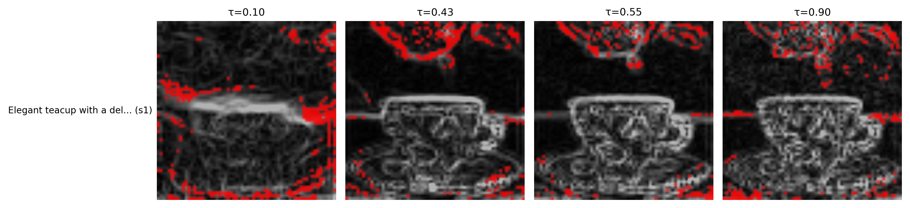
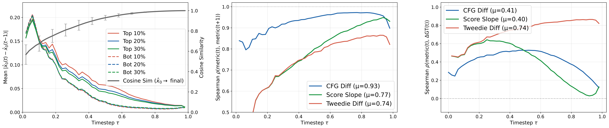

# Which Tokens to Merge? Diffusion Dynamics for Efficient Image Generation
**日期：2026-10-17**　**方向：training-free、Diffusion Transformer、token merging、推理加速**

本篇 DaTMe（arXiv:2610.22370）尚未出現在索引，且論文標示已獲 NeurIPS 2026 接受、於 2026-10-15 公開，兼具時效與會議品質訊號。依照你的去重規則，另排除庫內已收錄的 BAR（arXiv:2602.09024）。[1] [2]

## 論文資訊

- **標題：** *Which Tokens to Merge? Diffusion Dynamics for Efficient Image Generation*
- **作者：** SeungJu Cha、Ye-Chan Kim、HyunGee Kim、Sungho Koh、Dong-Jin Kim；作者團隊來自 Hanyang University。[1]
- **發表狀態：** NeurIPS 2026（接受）；arXiv:2610.22370v1，2026-10-15。[1] [2]
- **資源：** [論文全文](https://arxiv.org/html/2610.22370v1)｜[官方程式碼](https://github.com/SeungJuCha/DaTMe)。官方程式碼列出 Stable Diffusion 1.5、SDXL、PixArt-α 與 FLUX.1-dev 的入口。[3]

## 核心問題與貢獻

擴散模型在每個去噪步驟都重複處理大量影像 token。Token merging 會把部分 token 合併至其他代表 token，以減少後續計算；難點在於：被合併的 token 若仍在生成細節，或剛好落在背景物件邊界上，就可能讓細節糊掉、物體輪廓變形。

既有的重要性訊號多半倚賴文字條件，例如 classifier-free guidance（CFG）分支的差異。它能保護 prompt 指定的前景，卻不一定看得到未被文字點名、但對畫面完整性重要的背景與局部結構。DaTMe 的主張是：**應保留還在變化的 token，也應保留承載邊界與細節的 token；只有已趨於穩定且空間上平滑的區域，才較適合合併。**[1] [5]

論文有三項主要設計：

1. 從每一步的 Tweedie 去噪估計建立時間變化訊號，量出各位置還有多少內容尚未定型。
2. 以低頻平滑估計與原估計之差建立結構訊號，找出輪廓、高頻細節與局部紋理。
3. 依兩種訊號分派保留錨點與可合併來源，再用空間局部匹配限制合併對象。

*圖 1。原文 Figure 1 的局部圖像，取自論文 PDF；可見重要 token 並非全程只聚集在 prompt 指定物件。來源：[1]*

## 方法與數學形式

令前向加噪過程為

$$x_t=\alpha_t x_0+\sigma_t\epsilon,\qquad \alpha_t^2+\sigma_t^2=1.$$

給定模型的噪聲預測 $\epsilon_\theta(x_t,t,c)$，Tweedie 公式可將目前的 noisy latent 投影回預測的乾淨圖像空間：

$$\hat{x}_0(t)=\frac{x_t-\sigma_t\epsilon_\theta(x_t,t,c)}{\alpha_t}.$$

這個 $\hat{x}_0(t)$ 是模型在第 $t$ 步對最終內容的估計。DaTMe 用相鄰步驟估計的差值衡量時間變化：

$$M_{\mathrm{temp}}(t)=\left|\hat{x}_0(t)-\hat{x}_0(t-1)\right|.$$

值較大的 token 代表預測內容仍在明顯更新，應避免過早合併。論文特別比較它與 raw score slope。若 $s_t\approx-\epsilon_\theta(t)/\sigma_t$，則 score 的相鄰差可拆成

$$s_t-s_{t-1}=\underbrace{\frac{\epsilon_\theta(t-1)-\epsilon_\theta(t)}{\sigma_{t-1}}}_{\text{模型預測的實際變化}}+\underbrace{\epsilon_\theta(t)\left(\frac{1}{\sigma_{t-1}}-\frac{1}{\sigma_t}\right)}_{\text{由噪聲排程帶入的尺度項}}.$$

去噪接近尾端時，$\sigma_t$ 變小，尺度項可能蓋過模型預測真正的變化。因此 raw score slope 會較不穩定。Tweedie 差值則可化為

$$\hat{x}_0(t)-\hat{x}_0(t-1)=\frac{\sigma_{t-1}}{\alpha_{t-1}}\bigl(\epsilon_\theta(t-1)-\epsilon_\theta(t)\bigr),$$

它保留預測差異，且其排程係數在去噪末段會衰減。原文圖 2 顯示，Tweedie 差值與作者定義的 pseudo-GT token 變化量之平均 Spearman 相關約為 0.74，高於 CFG 差值的 0.41 與 raw score slope 的 0.40。[1]

第二個訊號度量局部結構。令 $D_s$ 與 $U_s$ 分別表示以尺度 $s$ 降採樣及上採樣，則

$$M_{\mathrm{spat}}(t)=\left|\hat{x}_0(t)-U_s\!\left(D_s(\hat{x}_0(t))\right)\right|.$$

粗尺度平滑後仍留下的殘差，會對邊界、輪廓與高頻紋理給出較高響應；均勻平滑區則較低。論文主實驗對 PixArt-α 設 $s=4$，並以 $P=4$ 個空間網格補足來源 token 數量。[1]

*圖 2。原文 Figure 2 的圖表擷取，呈現時間訊號在去噪步驟中的差異；圖片由 PDF Image Extractor 從原文 PDF 擷取。[1]*

### Token 如何被分派與合併

令當前有 $N$ 個 token，使用者指定的壓縮率為 $r$，目標是移除約 $n_{\mathrm{tgt}}=\lfloor rN\rfloor$ 個 token。此處的 $r$ 是**被移除的比例**，不是保留比例。[3]

DaTMe 先將時間與結構分數各自排序。兩者都落在低分區的 token 形成保守來源集合 $\mathcal{S}_{\mathrm{src}}$；兩者都落在高分區的 token 形成錨點集合 $\mathcal{S}_{\mathrm{con}}$，在合併時維持不變。因為雙低交集可能不足以達到指定的移除數，作者再把剩餘名額平均分配到空間網格中，避免來源 token 聚集在局部。最後，每個來源 token 只與附近的目的 token 配對並合併，避免單靠特徵相似度把遠距位置混在一起。[1]

這裡的核心不是「所有相似 token 都能合併」，而是把合併資格拆成兩個條件：**預測已穩定**與**局部結構足夠平滑**。高重要性 token 充當錨點，低重要性 token 才進來源候選池。

## 實驗與性能

主實驗使用 COCO 2014 validation 的 10,000 組圖像／提示詞，在 PixArt-α 與 FLUX.1-dev 上測試壓縮率 0.3、0.5、0.7；另在附錄以 Stable Diffusion 1.5 與 SDXL 驗證 U-Net 架構。所有主實驗在單張 RTX PRO 6000 Blackwell 上執行。PixArt-α 使用 20 個去噪步驟；FLUX 使用 35 步。[1]

- **PixArt-α，壓縮率 0.5：** 未壓縮模型的 FID 為 42.10、延遲 1.9417 秒。DaTMe 的 FID 為 43.42、延遲 1.6884 秒、TFLOPs 為 170.41；相較未壓縮模型，延遲約降低 13%，計算量約降低 7%。ToMeSD 與 CFG-based merge 的 FID 分別是 94.89 與 52.29，雖然延遲略低，畫質退化則明顯較大。DaTMe 的 CLIP-T/HPSv2 為 31.01/27.52，且 SSIM、PSNR、LPIPS 也優於這兩個比較方法。[1]
- **PixArt-α，壓縮率 0.7：** DaTMe 延遲由未壓縮的 1.9417 秒降至 1.6426 秒；但 FID 由 42.10 升至 47.05，顯示高壓縮仍有代價。相較 ToMeSD 的 123.01 與 CFG-based merge 的 70.71，DaTMe 在該設定下保留較多分佈品質，但並未完全無損。[1]
- **FLUX.1-dev，壓縮率 0.5：** DaTMe 延遲 13.271 秒，基線為 14.601 秒；FID 為 31.34，基線為 30.61。它的 SSIM/LPIPS 為 0.7087/0.2176，優於 ToMA 的 0.7009/0.2305；但 FID 31.34 略差於 ToMA 的 30.99。換言之，DaTMe 在相近延遲下較能保留原始生成的結構，不代表每一個品質指標都勝出。[1] [6]
- **人類偏好測試：** 在 PixArt-α、壓縮率 0.3 的 20 個案例中，由 32 位評估者比較輸出；DaTMe 在文字對齊、視覺品質與整體偏好上獲得最高評價。樣本規模仍小，較適合視為補充證據，而非穩定的人類偏好基準。[1]

原文另指出，在複雜場景與極高壓縮下仍可能失去必要 token；DiT 不同層對構圖、細節與背景的作用也尚未充分分析。這兩點都會限制壓縮策略的泛化。[1]

## 相關研究脈絡

- **ToMeSD（CVPR 2023 Workshop）** 把視覺 Transformer 的相似度合併帶入 Stable Diffusion，以局部候選配對減少 token 計算。DaTMe 延續「訓練外、推理期合併」的路線，但把問題往前推到：在做相似度配對之前，先判斷哪些位置本來就不該被合併。[4]
- **Importance-Based Token Merging（ICCV 2025）** 使用 CFG 或 cross-attention 作為重要性訊號，保護與條件相關的 token。DaTMe 的差異是，不只問 token 是否影響文字對齊，也直接追蹤去噪中的變化與局部結構，因此能補上背景與未明說物件的盲點。[5]
- **ToMA（ICML 2025）** 主要解決 token merge 的實際 GPU 執行效率，以 submodular destination selection、attention-like 矩陣運算及 pattern reuse 減少排序與資料搬移開銷。DaTMe 著重「合併選擇是否保留畫面」，兩者可以互補；FLUX 實驗中，DaTMe 的結構分數較佳，但 FID 並非全面領先。[6]

## 評價與研究靈感

我認為 DaTMe 最值得借鑑的是它把「重要性」從靜態文字顯著度改成**生成狀態下的可合併性**：尚在演化，或有邊界殘差的 token 應被保留；穩定且平滑的 token 才適合合併。它提供了一個很直接的推理期資源控制旋鈕，尤其適合 training-free 的擴散加速方向。

不過，實際加速幅度需要保守解讀。PixArt-α 的 50% token removal 對應約 13% 延遲改善，70% removal 約 15%；非線性的差距反映了 token matching、記憶體操作與未被壓縮的網路部分仍有成本。品質也非完全不變：例如 FLUX 壓縮率 0.5 時 FID 比未壓縮基線高，PixArt-α 壓縮率 0.7 時升幅更明顯。論文中的 SSIM、PSNR、LPIPS 是相對於未壓縮模型生成結果，主要回答「是否保存原輸出結構」，不等同於對真實圖像的 ground-truth 忠實度。[1]

這篇工作與你近期關注的幾個方向有明確交會點。以下是可測試的研究假設，**不是 DaTMe 論文已驗證的結果**：

1. **Energy-based merge gate。** 把合併前後的局部相容性差寫為 $\Delta E_{i\to j}=E_\phi(z_{\mathrm{merged}},c)-E_\phi(z_{\mathrm{original}},c)$。在時間／結構分數選出的候選來源中，只合併 $\Delta E$ 小的 token，讓能量模型充當合併安全檢查器。若要維持 training-free，必須使用既有 frozen energy/score model；另訓一個 verifier 就會改變成本假設。
2. **JEPA 預測不確定度。** 以兩個未來 latent 預測分支的差異 $u_i=\|\hat z^{(a)}_{i,t+\Delta}-\hat z^{(b)}_{i,t+\Delta}\|_2$ 衡量局部動態不確定度。高 $u_i$ token 保留為 anchor，低 $u_i$ 且結構殘差低的 token 才合併；這可檢驗 latent predictive signal 是否比 pixel-space Tweedie 差值更穩定。
3. **VAR scale-wise token budget 與 attention modulation。** 將 diffusion timestep 換成 VAR 的 next-scale index：跨尺度預測不穩定的位置提高 token budget，穩定區域才做局部合併；再以 attention head 的局部支援度調整 anchor 權重。這能把 DaTMe 的動態選擇改寫成 next-scale generation 的尺度自適應壓縮。

最小驗證可以先固定模型、prompt、seed 與總延遲預算，比較 ToMeSD、CFG-importance、DaTMe，以及加入 energy 或 JEPA gate 的兩個變體；同時報告 FID/CLIP-T、相對原輸出的 SSIM/LPIPS、實際 latency 與不同壓縮率下的失敗案例。這樣能把「選對要合併的 token」與「把合併運算做得夠快」拆成兩個可獨立驗證的問題。

## References

[1]: https://arxiv.org/html/2610.22370v1 "Which Tokens to Merge? Diffusion Dynamics for Efficient Image Generation"
[2]: https://neurips.cc/Downloads/2026 "NeurIPS 2026 official paper downloads"
[3]: https://github.com/SeungJuCha/DaTMe "Official DaTMe implementation"
[4]: https://openaccess.thecvf.com/content/CVPR2023W/ECV/html/Bolya_Token_Merging_for_Fast_Stable_Diffusion_CVPRW_2023_paper.html "Token Merging for Fast Stable Diffusion"
[5]: https://openaccess.thecvf.com/content/ICCV2025/html/Wu_Importance-Based_Token_Merging_for_Efficient_Image_and_Video_Generation_ICCV_2025_paper.html "Importance-Based Token Merging for Efficient Image and Video Generation"
[6]: https://icml.cc/virtual/2025/poster/46449 "ToMA: Token Merge with Attention for Diffusion Models"
