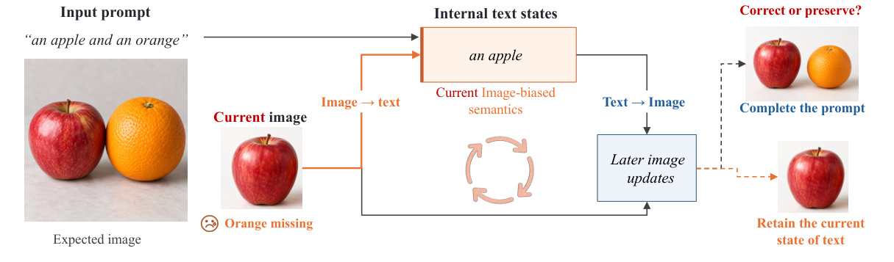

# AI Daily

## 2026-10-16｜Images Talk Back：抑制圖像生成 Transformer 的 Image-to-Text Feedback

> **今日結論：** 多模態擴散 Transformer（MMDiT）不只讓文字條件影響影像；影像 token 也會回寫內部文字狀態，接著再影響後續影像更新。這篇研究發現，當生成已偏離 prompt 時，這種回饋有時會把錯誤內容寫回文字流並延續下去。作者因此提出 **Semantic Feedback Guidance（SFG）**，在推理期間調整 image-to-text（I2T）與 text-to-image（T2I）訊息；免除微調，並提供零額外模型評估的 iSFG 版本。[1] [2]

**日期：2026-10-16**　**方向：training-free、attention modulation、frozen-model inference-time control、text-to-image/video**

## 論文資訊

- **標題：** *Images Talk Back: Guiding MMDiTs by Suppressing Image-to-Text Feedback*
- **作者：** Yucheng Yang、Xiaoxiao Sun、Shusheng Yang、Jiakang Chen、Serena Yeung-Levy。
- **機構：** Stanford University、Tsinghua University、New York University。
- **發表狀態：** arXiv:2610.13941v1，2026-10-09，cs.CV 預印本；截至 2026-10-16，未見頂會或期刊錄用標註。作者公開了推理程式碼。[1] [2]
- **論文與程式：** [arXiv 全文](https://arxiv.org/html/2610.13941v1)｜[官方程式庫](https://github.com/yyc1215lll-creator/SFG)。

## 為什麼選它

本輪檢查 Energy-based models、JEPA／世界模型、VAR、training-free 生成控制、attention modulation，以及頂尖研究單位的新稿；並逐篇排除 AI_Daily 已整理的論文。最後選 SFG，是因為它不只是再調一個 guidance scale，而是找出 MMDiT 內一條可干預的資訊路徑，並以同 prompt 的成功／失敗軌跡交換訊息來驗證方向。它直接連結你近期關注的免訓練推理控制與 attention modulation，也可延伸至 EBT、JEPA 和 VAR。這是 **arXiv 預印本，不是已確認的頂會論文**；本文因此把實驗結果視為作者報告，並在評價中保留限制。[1]

搜尋中亦核對了近期 VAR 方向的候選；最接近的 NAMVIS 與 QuadTok 已在倉庫收錄，不以近似版本重複發布。這次改選一篇機制與實驗都可追溯的 MMDiT 控制研究。

## 核心機制與數學表示

標準 cross-attention 通常由影像 query 讀取文字特徵。MMDiT 使用 joint attention，影像和文字各有 residual stream，且都從聯合的 image–text keys/values 取訊息。可將輸出拆成：

$$
O_i=A_{i\to i}V_i+B_{t\to i},\qquad
O_t=A_{t\to t}V_t+B_{i\to t},
$$

其中

$$
B_{t\to i}=A_{t\to i}V_t,\qquad
B_{i\to t}=A_{i\to t}V_i.
$$

$B_{t\to i}$ 是文字寫入影像流的 **T2I 訊息**；$B_{i\to t}$ 是影像寫入文字流的 **I2T 訊息**。後續 Transformer block 會再讀取更新後的文字流，形成 image → text → image 的回路。這裡的「回寫」發生在同一次 denoiser forward 的不同 blocks 之間；每次新的 denoiser call 仍會由 prompt 重新初始化文字流，不是把文字狀態跨 sampling timestep 永久保存。[1]

*圖 1。MMDiT 的 I2T feedback 可能幫助補全 prompt，也可能把當前影像的缺漏寫回內部文字狀態。圖片僅裁取原論文 Figure 2 的圖示區域，未包含整頁。[1]*

### 先確認回饋方向，再設計 guidance

作者先從 SD3.5M 與 FLUX 生成結果建立 **400 組同 prompt 成功／失敗軌跡**，每組只改變 seed。成功／失敗標籤依 GenEval 是否答對，或 T2I-CompBench 分數高於 0.75／低於 0.45 判定；中間案例排除。接著把成功軌跡的 I2T 訊息移植到失敗軌跡，並以反向移植和 norm-matched 隨機訊息作控制。結果顯示 I2T 訊息確實可能救回失敗，也可能干擾成功；在失敗狀態下，抑制 I2T 的局部反應較接近成功訊息移植，而不是隨機擾動。於 40 個 sampling steps 中，前 1–8 步的移植已恢復約三分之二的完整時段效果。[1]

### SFG：朝「放大回饋」的負分支反方向走

SFG 在 attention softmax 與 value aggregation 之後、output projection 之前縮放訊息；它不改 attention logits，也不重新訓練模型權重。令 $u<0$，建立一個刻意放大 I2T、同時削弱 T2I 的輔助分支：

$$
O_t^{\mathrm{pert}}(u)=A_{t\to t}V_t+(1-u)B_{i\to t},
\qquad
O_i^{\mathrm{pert}}(u)=A_{i\to i}V_i+(1-|u|)B_{t\to i}.
$$

$u<0$ 使 $(1-u)>1$，因此輔助分支會更強地把影像訊息寫回文字流；而 $1-|u|<1$ 會減弱文字對影像的條件。作者再將正常條件分支的速度預測 $v_{\mathrm{clean}}$ 與輔助分支 $v_{\mathrm{pert}}$ 作差，沿著遠離輔助分支的方向更新：

$$
\hat v=v_{\mathrm{clean}}
+\omega\bigl(v_{\mathrm{clean}}-v_{\mathrm{pert}}\bigr)
+(s-1)\bigl(v_{\mathrm{clean}}-v_\theta(x_t,t,\varnothing)\bigr).
$$

$\omega$ 是 SFG guidance 強度，$s$ 是 classifier-free guidance（CFG）尺度。直觀來說，SFG 不是把影像區域模糊或破壞注意力來構造負分支，而是先加強論文假設有害的 I2T 回饋，再從這條分支外推離開。這個負分支設計是其方法上最有辨識度的地方。[1]

### iSFG：直接改條件 forward

作者另提出 **iSFG**，不額外建立輔助分支，而是在原本的條件 forward 直接調節兩種訊息：

$$
O_t^{\mathrm{iSFG}}=A_{t\to t}V_t+(1+\gamma)B_{i\to t},\qquad \gamma<0,
$$

$$
O_i^{\mathrm{iSFG}}=A_{i\to i}V_i+(1+\gamma_S)B_{t\to i},\qquad \gamma_S>0.
$$

因此 iSFG 直接降低 I2T 影響、提高 T2I 條件強度，並且不增加相對於 CFG 的模型評估次數。**Training-free 不代表零計算成本：** SFG 仍有額外 forward；原文估計 SFG 約為無 CFG 基線的 $1.2\times$ NFE、搭配 CFG 時約 $2.2\times$。iSFG 則是零額外 NFE，但生成表現通常低於完整 SFG。[1]

## 實驗結果

作者測試 SD3 Medium（SD3M）、SD3.5 Medium、FLUX 的 1024×1024 文字生圖，以及 HunyuanVideo 的文字生影片（T2V）與圖生影片（I2V）。影像指標包含 GenEval、T2I-CompBench++、HPSv2.1、ImageReward；另在 SD3M 使用 5,000 張 COCO 圖片計算 FID。GenEval 的主要對照與 guidance sweep 使用 553 個 prompts、每個 prompt 6 個 seeds，共 3,318 張圖／設定；HPSv2.1 與 ImageReward 使用 800 個 prompts、4 種風格、4 seeds，共 3,200 張圖。影片以 VBench 評估。[1]

- **不使用 CFG（cfg=1）：** SD3M 的 GenEval 由 0.3294 升至 0.5811，T2I-CompBench++ 由 0.3230 升至 0.4760；COCO FID 由 41.76 降至 24.21。FLUX 的 GenEval 由 0.3604 升至 0.6853，T2I-CompBench++ 由 0.3254 升至 0.4727。兩項對齊指標越高越好，FID 越低越好。
- **CFG + SFG：** SD3.5M 的 GenEval 由 0.6890 升至 0.7110，HPSv2.1 由 31.65 升至 32.50；FLUX 的 GenEval 由 0.6661 升至 0.7479，HPSv2.1 由 30.96 升至 31.66。FLUX 的 counting 分項由 0.6458 升至 0.8167，position 由 0.1850 升至 0.3033，對應多物件與空間關係能力的改善。[1]
- **CFG + iSFG（零額外 NFE）：** SD3.5M 的 GenEval 為 0.7047（CFG 基線 0.6890），HPSv2.1 增加 1.33、ImageReward 增加 0.0748。FLUX 的 GenEval 為 0.6868（CFG 基線 0.6661），HPSv2.1 增加 0.32、ImageReward 增加 0.0532。這個版本的優點是推理成本低，代價是 GenEval 增益小於完整 SFG。[1]
- **影片：** HunyuanVideo T2V 的 VBench Total 由 base 82.58 升至 SFG 84.25；CFG 為 83.52。I2V Total 由 base 88.50 升至 SFG 90.04；CFG 為 89.43。T2V 最佳測試設定只在 25 個 sampling steps 中啟用前 7 步 SFG，需要 32 次 branch predictions；完整 CFG 對照需 50 次模型評估。最佳時段隨任務改變，不能把影像實驗的前 20% schedule 當成通用定律。[1]

## 相關研究脈絡

- **TACA（ICCV 2025）** 以 temperature scaling 與 timestep-dependent adjustment 重新平衡 MMDiT 的跨模態 attention，主攻提高文字對影像的條件訊號；論文也報告以 LoRA fine-tuning 降低溫度調制引入的生成瑕疵。SFG 與它的核心差異是 intervention target：TACA 調整跨模態 attention 權重，SFG 特別控制影像寫回文字流的 I2T 訊息。[3] [4]
- **Attend-and-Excite** 從 cross-attention 中強化被忽略的主體 token，針對 prompt 中漏畫物件或錯誤屬性綁定。兩者都試圖改善 prompt adherence；但 Attend-and-Excite 的著力點是文字 token 對影像生成的注意力，SFG 則把焦點移到影像如何回寫內部文字表示。[5]
- **CFG 與 training-free self-guidance** 都以不同預測分支構造方向，SFG 的新意在於以可測量的 MMDiT feedback path 建立負分支，而不是以模糊、identity attention 或跳層等方式破壞模型計算。[1]

## 評價與研究靈感

我認為這篇最值得帶走的不是「負向控制總能提高生成」，而是**先找出多模態 Transformer 中哪一條訊息路徑會放大當前錯誤，再對該路徑做有方向的介入**。成功／失敗訊息移植與 matched random control，比單看輸出改善更接近機制證據；而 iSFG 又把這項分析轉成低額外成本的實作。但現有證據仍需審慎解讀：它是 arXiv v1，沒有獨立複現；主要品質依據來自 GenEval、HPSv2.1、ImageReward 等自動或 learned metrics，未見人類盲測；測試骨幹集中於 SD3M、SD3.5M、FLUX 與 HunyuanVideo。固定的早期介入窗口也可能隨模型、解析度和 sampler 改變。[1]

可以從下列方向延伸，並把它們視為**研究假設**而非原文已驗證結論：

1. **Energy-gated feedback：** 定義 prompt–image compatibility energy $E(x_t,c)$，並約定「能量越高代表越不相容」。令 $m_t=\sigma(\beta(E(x_t,c)-E_0))$，以 $\gamma_t=-\lambda m_t$ 動態決定 I2T 抑制強度。比較固定 20% schedule 與 energy-gated schedule，在相同 NFE 下衡量 GenEval counting/position、FID 與失敗軌跡的恢復率。此設計可把 EBT/EBM 的相容性訊號接到 inference-time attention modulation。
2. **JEPA 作為 feedback 校驗器：** 以 frozen JEPA 預測未來影像表示，對兩個輕量擾動或兩種預測頭計算 $u_t=\lVert\hat z_{t+\Delta}^{(1)}-\hat z_{t+\Delta}^{(2)}\rVert_2$。假設高不確定區域較需要保留 prompt 訊息、降低影像回寫的主導性；低不確定且與 prompt 一致的區域則少干預。關鍵是分開驗證「不確定」與「語義不一致」是否真是同一種訊號。
3. **移植到 VAR：** 將 diffusion timestep $t$ 換成 VAR scale index $k$，量測一個尺度產生的 visual tokens 如何影響後續尺度或文字條件。測試 coarse scales 是否應保留較強全局回寫、細尺度是否應抑制會自我確認的局部錯誤；評估需包含物件數量、相對位置與每尺度延遲，而不只整體 FID。

一個清楚的最小實驗，是在同一批 prompt、seed 與 backbone 上比較 CFG、TACA、SFG、iSFG，以及 SFG+iSFG 以外的 energy-gated 變體；同時報告 NFE、wall-clock、GenEval 分項、HPSv2.1、ImageReward 和人工盲測，並分開做成功／失敗軌跡的 I2T transplantation。這能檢驗提升究竟來自改變 I2T 資訊流，還是一般性的條件強化。

## References

[1]: https://arxiv.org/html/2610.13941v1 "Images Talk Back: Guiding MMDiTs by Suppressing Image-to-Text Feedback"
[2]: https://github.com/yyc1215lll-creator/SFG "Official SFG implementation"
[3]: https://openaccess.thecvf.com/content/ICCV2025/html/Lv_Rethinking_Cross-Modal_Interaction_in_Multimodal_Diffusion_Transformers_ICCV_2025_paper.html "Rethinking Cross-Modal Interaction in Multimodal Diffusion Transformers, ICCV 2025"
[4]: https://arxiv.org/html/2506.07986v1 "TACA: Rethinking Cross-Modal Interaction in Multimodal Diffusion Transformers"
[5]: https://arxiv.org/abs/2301.13826 "Attend-and-Excite: Attention-Based Semantic Guidance for Text-to-Image Diffusion Models"
