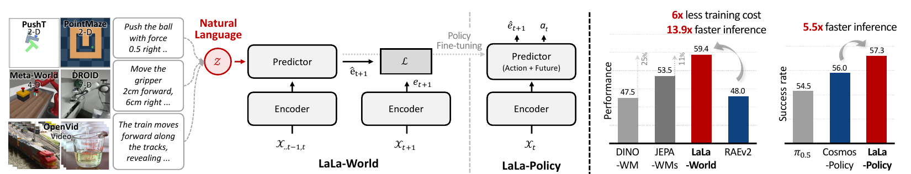

# AI Daily

## 2026-10-23｜LaLa-World：用自然語言統一異質動作與視覺轉換的 JEPA 式世界模型

**方向：** JEPA／latent world model／自然語言動作／跨領域規劃／policy fine-tuning　**閱讀版本：** arXiv v2，2026-10-21　**發表狀態：** arXiv 預印本；截至 2026-10-23，未找到已接收會議或期刊的正式紀錄。[1]

_圖 1｜取自原文 Figure 1 的局部裁切；保留模型與結果圖示，未截取整頁。來源論文採 CC BY 4.0。[1]_

## 論文基本資訊

- **英文標題：** *LaLa-World: Scaling Latent World Models with Natural Language Actions*
- **作者：** Junha Song、Geonmo Gu、Jeongeun Park、Heejeong Nam、Lucas Maes、Byeongho Heo、Dongyoon Han、Sangdoo Yun。
- **機構：** NAVER AI Lab、Georgia Institute of Technology、Brown University、Mila／Université de Montréal；Junha Song 為 project lead，Sangdoo Yun 為通訊作者。[1][2]
- **來源：** [arXiv:2610.27851](https://arxiv.org/abs/2610.27851)，v1 於 2026-10-20 提交，本文依 v2（2026-10-21）閱讀。論文聚焦 world modeling、MPC 與機器人 policy；它不是以產生逼真圖像為目標的新型 image-generation 模型。[1]
- **作者資源狀態：** 官方專案頁仍標示完整頁面即將推出；GitHub README 將訓練／評估程式、decoder 與 checkpoint 標為「Updating soon」。因此目前數據應視為作者報告、尚待獨立重現。[2][3]

## 搜尋與篩選

本次先查閱 2026-10-22 的 arXiv cs.CV 最新投稿，再以 JEPA、training-free attention、圖像生成、DiT 機制與自回歸編輯等方向比對候選。候選包含 LaLa-World、DualHeads、CCG Diffusion、ALLOT、*How Do DiTs Denoise?* 與 *MT Forcing*；其中 CCG Diffusion 和 ALLOT 是 training-free 組合生成／稀疏注意力的強候選，但 LaLa-World 最切合近期 JEPA/world-model 主題，且涵蓋多領域 MPC、matched generative baseline 與下游 policy 三組實驗。[9]

需留意，這輪新近候選均未查到已確認的正式發表紀錄；因此選擇不是以虛構的頂會地位背書，而是綜合研究主題契合度、方法差異與實驗可檢視程度。LaLa-World 仍是預印本，且實作資源尚未完整釋出。[1][3]

## 為什麼值得讀？

JEPA 式 world model 通常從狀態與數值動作預測未來視覺表徵，但多個資料集的動作向量維度、單位與物理意義不同；一般影像或影片又沒有可直接使用的動作標籤。LaLa-World 的核心提案，是把數值動作轉成保留方向與幅度的文字模板，也把無動作影像／影片中的視覺變化寫成文字，讓同一個 future predictor 能混合控制軌跡與較廣泛的視覺資料。[1]

這不是把 action language 當成魔法零樣本能力：數值向量仍要按資料集模板轉成句子，模型亦先在控制與視覺資料上訓練。它最有啟發性的地方，是試著用語言作為異質資料的共用「介面」，而不讓 world model 必須重建像素。

## 核心貢獻

1. **用文字統一不同控制空間與視覺變化。** 七組控制／機器人資料的數值動作以固定模板轉成語言；OpenVid 影片、OmniEdit 與 ShareGPT-4o-Image 的影像變化則以 caption／編輯指令描述。前者保存控制量，後者補充沒有數值 action label 的視覺轉換。[1]
2. **以語言模型本身作 future predictor。** 凍結的視覺 encoder 將影像轉成 latent tokens，文字條件與視覺 tokens 一同輸入 Qwen3.5-0.8B backbone；訓練直接預測下一個視覺 latent，不在 world-model 主訓練中使用像素重建目標。[1]
3. **把預訓練延伸到 MPC 與 policy。** 以 Cross-Entropy Method（CEM）在 imagined latent rollout 中搜尋動作；另將預訓練 predictor 微調成 LaLa-Policy，聯合預測 action chunk 與未來 latent。[1]

## 技術方法

### 1. 凍結視覺表徵與文字條件

令觀測影像為 $x_t$，凍結視覺 encoder（DINOv2-S/14 或 DINOv3-L/16）產生表徵 $e_t$。LaLa-World 把數值動作與視覺變化都表示為文字條件 $z$。數值動作文字化時保留資料中的方向、維度與大小；對純影像／影片，文字則描述兩張影像或前後影格之間的改變。[1]

### 2. JEPA 式下一狀態預測

模型以一段視覺上下文與文字條件預測下一個未來 latent：

$$
e_t = E_\theta(x_t), \qquad
\hat e_{t+1} = P_\phi(e_{t-w+1:t}, z),
$$

其中 $E_\theta$ 是凍結 encoder，$P_\phi$ 是 future predictor，$w$ 為上下文長度。視覺 latent 先由兩層 MLP 投影至語言模型的 embedding 空間，再加上時間、列、行三維位置編碼；學習到的 query tokens 讀出目標 patch 表徵。主要訓練目標就是預測 latent 的平方誤差：

$$
\mathcal{L}_{\text{latent}}
= \left\|\hat e_{t+1}-e_{t+1}\right\|_2^2.
$$

模型刻意不輸入或預測 proprioception，以避免依賴各領域定義不一的狀態量。另有 12 層 transformer decoder 將 latent 解碼成影像供視覺化；decoder 不參與 world-model 訓練，也不代表主模型以像素重建作為目標。[1]

### 3. 在 latent 空間用 CEM 做 MPC

規劃器從目前影像 $x_{\mathrm{init}}$ 與目標影像 $x_{\mathrm{goal}}$ 出發，抽樣一批候選動作序列；每個序列都由 predictor autoregressively rollout $H$ 步，並依未來 latent 到目標 latent 的距離評分：

$$
e_{\mathrm{goal}}=E_\theta(x_{\mathrm{goal}}), \qquad
\mathcal{C}(\mathbf{a})
=\left\|\hat e_{t+H}(\mathbf{a})-e_{\mathrm{goal}}\right\|_2^2.
$$

CEM 保留低成本序列並更新抽樣分布；系統再執行選出的動作前綴，取得新觀測後重新規劃。這仍是搜尋式 MPC，而非由新提出的端到端規劃演算法取代 CEM。[1]

### 4. LaLa-Policy：由世界模型轉成動作生成器

policy fine-tuning 時，predictor 由當前觀測與任務文字產生 future latent 及 action queries 的條件特徵；額外 action head 從高斯噪聲逐步去噪產生一段動作：

$$
(\hat e_{t+N},h_{t:t+N-1})
=P_\phi(E_\theta(x_t),\ell), \qquad
\hat a_{t:t+N-1}
=A_\psi(\epsilon;h_{t:t+N-1}),\quad
\epsilon\sim\mathcal{N}(0,I).
$$

action head 依 Isaac-GR00T 式 diffusion-transformer 架構建立；因此 LaLa-Policy 是 policy 階段加入擴散式動作生成，不能與 LaLa-World 的純 latent predictor 混為一談。[1]

## 實驗結果

**多領域 MPC。** 模型在七組控制資料上訓練（六種模擬領域與 DROID），並在五個模擬任務及機器人相關任務測試。Wall、PointMaze、Push-T、MetaWorld-Reach、MetaWorld-Reach-Wall 五項模擬成功率平均為 **72.1% ± 2.3**，作者表列 JEPA-WMs 為 **64.6% ± 2.6**、DINO-WM 為 **62.3% ± 2.5**；Push-T 為 **81.2% ± 4.0**，表中最強基線為 68.8%。這是論文所列基準與設定內的比較，不應解讀為對所有 world model 的通用 SOTA。[1][5][6]

**未見領域測試。** RoboCasa 不在訓練領域中，zero-shot Reach 成功率為 **40.6% ± 8.7**，Place 為 **46.9% ± 8.8**。DROID 的數字是 action score（**40.2 ± 5.2**），不是成功率；它也不是在該表中進行即時真實機器人 policy deployment。[1]

**加入圖像／影片轉換。** 作者報告，只有控制軌跡的平均分數為 59.3，加入影像與影片轉換後升至 61.6；若只用控制資料訓練，再將動作模板換成同義措辭，平均表現下降 6.8 點。此結果支持多樣化語言／視覺資料有助於措辭魯棒性，但不是自由文字 action interface 已完全解決的證據。[1]

**與生成式模型的 matched comparison。** LaLa-World 與 RAEv2 使用相同 DINOv3-L/16 encoder、語言條件與訓練資料，predictor 約各 0.8B 參數。作者報告 LaLa-World 約 2 小時便追上 RAEv2 在 12 小時訓練預算下的五步 denoising 規劃表現，後續分數為 59.4，對照 RAEv2 最佳 48.0；規劃速度分別約快 **2.9×**（對 RAEv2 一步）與 **13.9×**（五步）。這個比較的重點是「latent prediction 對規劃的成本效益」，不是比較兩者的影像視覺品質。[1][7]

**下游 policy。** LaLa-Policy 在 LIBERO 平均成功率為 **97.7%**，作者改成相同預測目標後的 Cosmos Policy 基線為 97.3%；RoboCasa 使用每任務 50 個示範時為 57.3%，同表 Cosmos Policy 為 56.0%。另有 300 個 MimicGen 示範／任務時為 66.4%，但該列沒有相同 300-demo Cosmos 對照。作者報告每條軌跡推論最高快 5.5×；測試皆為 LIBERO／RoboCasa 模擬器。[1][8]

## 相關研究脈絡

- **DINO-WM** 以預訓練 DINOv2 patch features 預測未來視覺特徵，再對候選 action sequence 做 goal-conditioned zero-shot planning。LaLa-World 延續「在表示空間規劃」的路線，但把異質數值 action 和沒有 action label 的視覺轉換收斂到同一個文字條件介面。[1][5]
- **V-JEPA 2-AC** 先以大量影片做 action-free 視覺預訓練，再用機器人資料 post-train action-conditioned latent world model，且論文報告 Franka 實機 zero-shot picking／placing。相較之下，LaLa-World 的重點是跨資料／跨 action space 的語言介面與模擬 MPC；它並未在本文報告 LaLa-Policy 的實機部署。[1][4]
- **JEPA-WMs** 系統性分析 JEPA world-model 的架構、目標函數與規劃元件，原文目前 v4 已註明接受 TMLR；它也是 LaLa-World Table 1 的重要比較基線。LaLa-World 的主張不是取代 JEPA-WM 訓練理論，而是提供更廣的資料共用方式。[1][6]
- **RAEv2／Improved Baselines with Representation Autoencoders** 探討預訓練表示與 diffusion-transformer 的生成式建模；LaLa-World 刻意預測未來 latent、不以像素重建為訓練主目標，並以 matched setup 比較規劃成本與結果。[1][7]
- **Cosmos Policy** 將影片生成模型 fine-tune 成可共同預測 action、未來影格與 value 的 policy。LaLa-Policy 的對照延續「生成式／預測式預訓練如何轉成動作」問題，但改以 future latent 作為預測目標，並在論文中採作者調整後的 Cosmos Policy 版本作較公平比較。[1][8]

## 限制與我的評價

1. **zero-shot 的範圍要講清楚。** RoboCasa 是未見訓練領域，故可稱該 benchmark 的 zero-shot transfer；但模型本身已在其他控制軌跡、影片與編輯資料上訓練，也依賴 CEM 搜尋，不是 training-free。數值 action 仍以資料集專屬模板轉字；無數字的 qualitative action 實驗把幅度壓成三個粗略級別，不能等同任意自然語言指令的精準控制。[1]
2. **短期 latent prediction 不保證長期動力學可靠。** 主模型學下一個 latent，再 autoregressive rollout；預測誤差可能隨規劃 horizon 累積。論文列出的未來方向亦包括更長預測 horizon、擴大資料／模型，以及將 policy 評估推進到真實機器人。[1]
3. **效率數字依賴特定 protocol。** MPC 用 CEM 評估大量候選；matched RAEv2 比較控制了 encoder、資料、語言條件與大致參數量，是有價值的設計，但不能直接外推到所有影片生成器、規劃器或硬體。decoder 僅供視覺化，latent 成功不代表生成影像細節同樣好。[1]
4. **可重現性尚待補強。** 本次查核未找到獨立重現；官方程式庫仍把訓練／評估、decoder 與 checkpoint 列為即將推出。現階段適合把它當有清楚研究假說和實驗的 arXiv 預印本，不宜當成已證實的通用機器人模型。[2][3]

**我的判斷：** 最值得借鑑的不是「語言一定是最佳 action representation」，而是將數值控制、影片描述與未來 latent 預測放在同一個資料介面下，並用 matched experiment 把 latent planning 與 pixel-generative world model 分開比較。真正需要後續證明的是：這個介面能否跨 embodiment、動作尺度與語言措辭遷移，而不靠每個資料集手工設計模板；以及多步 latent error 是否會令 MPC 選到「latent 看似接近、實際動作失敗」的序列。

## 可延伸的研究想法

以下是讀後構想，**不是原論文已提出或驗證的結果**：

1. **Energy-based MPC × JEPA uncertainty。** 將純目標距離改為含不確定度的 action-sequence 能量，例如
   $$
   E(\tau)=\left\|\hat e_{t+H}(\tau)-e_{\mathrm{goal}}\right\|_2^2
   +\lambda_u\,\mathrm{Var}_{k}\!\left[\hat e_{t+H}^{(k)}(\tau)\right],
   \qquad p(\tau)\propto \exp[-E(\tau)/T].
   $$
   以 ensemble／多 predictor disagreement 估計模型不確定度，再比較 CEM elite selection、energy-weighted resampling 與失敗率校準。這可把 JEPA 的預測誤差轉成 EBT 式的可排序 action energy。
2. **嚴格 zero-shot action grounding。** 將整個 embodiment、動作維度或動詞族留作測試集；評估同一控制目標的多種 paraphrase、單位／幅度重標定與未見物件關係。另報告 template-normalized、free-form language 與 training-free test-time normalization 三種 protocol，避免把「未見 benchmark」與「完全免訓練泛化」混稱。
3. **注意力調制與自適應計算。** 以 goal relevance 和 latent disagreement 共同調節空間／時間 token 的 attention budget：高相關且高不確定的區域保留細粒度預測，其餘區域降採樣或減少 rollout。這能把 training-free attention modulation 接到 world-model MPC，而不是只看視覺特徵相似度。
4. **VAR/coarse-to-fine future state。** 對長 horizon latent prediction 引入多尺度或 next-scale 預測：先規劃低解析度未來佈局，再只在碰撞、接觸或目標物附近細化。可測量是否比單一 patch-grid latent 更穩定，並檢驗錯誤是否因尺度逐步展開而減少。

## 參考來源

[1] Junha Song et al., *LaLa-World: Scaling Latent World Models with Natural Language Actions*, arXiv:2610.27851v2, 2026. [論文 HTML](https://arxiv.org/html/2610.27851) · [摘要與版本紀錄](https://arxiv.org/abs/2610.27851)

[2] 作者官方 [LaLa-World 專案頁](https://june-page.github.io/lala-world/)，查閱於 2026-10-23。

[3] 作者官方 [LaLa-World GitHub repository](https://github.com/junha1125/LaLa-World)，查閱於 2026-10-23。

[4] Mido Assran et al., *V-JEPA 2: Self-Supervised Video Models Enable Understanding, Prediction and Planning*, [arXiv:2506.09985](https://arxiv.org/abs/2506.09985), 2025.

[5] Gaoyue Zhou et al., *DINO-WM: World Models on Pre-trained Visual Features enable Zero-shot Planning*, [arXiv:2411.04983](https://arxiv.org/abs/2411.04983), 2024／v2 2025.

[6] Basile Terver et al., *What Drives Success in Physical Planning with Joint-Embedding Predictive World Models?*, [arXiv:2512.24497](https://arxiv.org/abs/2512.24497), 2025；arXiv v3 comments 註明已接受 TMLR。

[7] Jaskirat Singh et al., *Improved Baselines with Representation Autoencoders*, [arXiv:2605.18324](https://arxiv.org/abs/2605.18324), 2026.

[8] Moo Jin Kim et al., *Cosmos Policy: Fine-Tuning Video Models for Visuomotor Control and Planning*, [arXiv:2601.16163](https://arxiv.org/abs/2601.16163), 2026.

[9] [arXiv cs.CV 最新投稿清單](https://arxiv.org/list/cs.CV/new)，查閱於 2026-10-23；另對六篇候選的 arXiv 原文與可用官方資源進行交叉比較。
