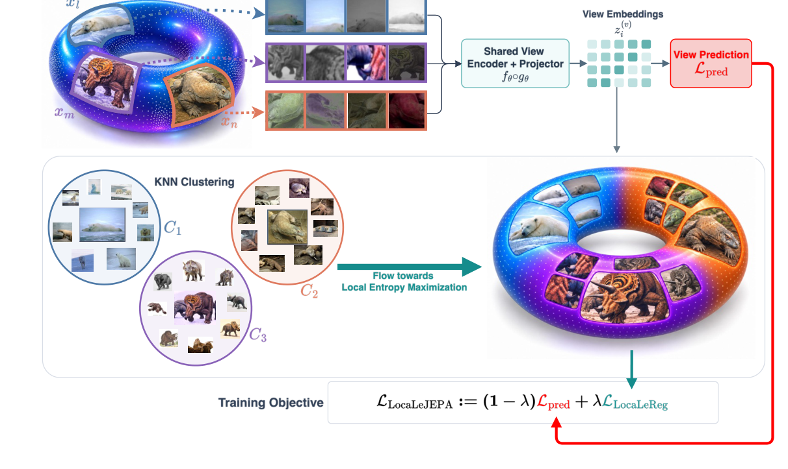

# AI Daily — 2026-10-24

> 報告整理：Manus AI

## 今日候選與選擇

本次先從近一週的 AI 論文中篩出五個候選，並逐一對照 repo 的 README、INDEX 與既有文章。**SpecKCast（arXiv:2610.26837）已在 repo 的 2026-10-21 文章中收錄，因此排除，不重複報告。**其餘未收錄候選包括 LocaLeJEPA、DASA、Halcyon 與 TriTD。[9] [10] [11] [12]

今日選 **LocaLeJEPA**，因為它最直接命中你偏重的 JEPA 方向，且全文、arXiv metadata、官方實作與 loss code 可彼此核對。其他候選分別著重自回歸影片稀疏注意力、從零訓練的文字生成影像，以及影片蒸餾；LocaLeJEPA 則提供一個可與能量模型、世界模型和視覺自回歸延伸對話的表徵學習新切口。它目前是預印本，選擇理由是主題契合與證據完整度，不是已獲頂會接受。[1] [2]

## 論文資訊

**論文：** *LocaLeJEPA: Maximum Entropy Representations under Geometric Priors* 
**作者：** Kartik Tandon、Alessio Borgi、Pavel Snopov、Inés García-Redondo、Davide D’Ascenzo、Sebastiano Cultrera di Montesano、Fabrizio Silvestri、Pietro Liò、Francesca Dominici、Randall Balestriero、Claudio Battiloro。前兩位作者標註共同貢獻。[1]

**研究單位：** University of Pennsylvania、Sapienza University of Rome、University of Texas Rio Grande Valley、University of Fribourg、University of Milan、Broad Institute、University of Cambridge、Harvard University 與 Brown University。[1]

**發表狀態：** arXiv:2610.28458v1，首次提交於 2026-10-20 16:15 UTC；截至本報告日期，arXiv 紀錄未列正式會議或期刊，也沒有接受資訊，因此本文以「預印本」標示。[1] [2] 
**論文：** [arXiv 摘要與版本紀錄](https://arxiv.org/abs/2610.28458) · [PDF](https://arxiv.org/pdf/2610.28458v1)
**官方程式：** [LocaLeJEPA repository](https://github.com/alessioborgi/LocaLeJEPA)

## 核心問題與貢獻

JEPA 以預測另一個視角或目標區塊的潛在表徵，學習不必重建像素的語義表示；但若訓練目標沒有足夠約束，表徵可能塌縮。LeJEPA 以 SIGReg 把整體 embedding 分佈推向各向同性高斯，藉此避免塌縮。LocaLeJEPA 指出，單一全域高斯假設不一定適合資料本身具有多個語義區域、或 backbone 帶有雙曲與等變幾何先驗的情況。[1] [5] [8]

作者的理論動機來自熱流：短時間熱流在局部近似高斯，長時間則趨向流形上的均勻分佈。LocaLeJEPA 不直接模擬完整流形上的動態熱流，而採取較可實作的折衷：把 embedding 空間分成局部鄰域，讓每個鄰域的中心位置自由、只約束中心化後的局部形狀。[1]

主要貢獻是 **LocaLeReg**：每個 batch 內對樣本 embedding 分群，對各群組、各視角分別重新置中，再以均勻球分佈作為局部目標。作者在 ImageNet-1K 的普通 Euclidean ViT、Poincaré 雙曲 ViT、D4 等變 ResNet 與大型 ViT 上測試，並評估 frozen-feature 分類、下游資料集轉移及拓撲保留。[1]

## 技術方法

對樣本 $i$ 的第 $v$ 個增強視角，令 projector 輸出為 $\mathbf{z}_i^{(v)}\in\mathbb{R}^d$，並令跨視角平均為

$$
\bar{\mathbf{z}}_i=\frac{1}{V}\sum_{v=1}^{V}\mathbf{z}_i^{(v)}.
$$

JEPA 的跨視角 prediction/invariance 項為

$$
\mathcal{L}_{\mathrm{pred}}=\frac{1}{NVd}\sum_{i=1}^{N}\sum_{v=1}^{V}\left\|\mathbf{z}_i^{(v)}-\bar{\mathbf{z}}_i\right\|_2^2.
$$

**第一步：建立局部鄰域。** 對停止梯度的 $\bar{\mathbf{z}}_i$ 做 cosine k-means，取得 $K$ 個群組 $C_1,\ldots,C_K$；同一影像的不同視角共用一個群組指派。低於最小樣本數的群組會略過；若沒有可用群組，實作會退回整個 batch 的全域分佈測試。[1] [3] [4]

**第二步：把位置與形狀分開。** 對每一個有效群組及視角，先減掉該群組的視角均值：

$$
\boldsymbol{\mu}_q^{(v)}=\frac{1}{|C_q|}\sum_{j\in C_q}\mathbf{z}_j^{(v)},\qquad
\mathbf{r}_i^{(v)}=\mathbf{z}_i^{(v)}-\boldsymbol{\mu}_q^{(v)},\quad i\in C_q.
$$

如此一來，正則化約束的是局部點雲的形狀，而不會把不同鄰域的中心都拉向原點。這也是論文強調的「局部」：實際分群是在當前 batch 的投影 embedding 上進行，不是已知或精確恢復的資料流形座標。[1] [4]

**第三步：用均勻球作局部分佈目標。** 令 $\mathbf{Y}$ 均勻分佈於 $d$ 維半徑 $R$ 的球 $\mathbb{B}_R^d$。設定

$$
R=\sqrt{d+2}\quad\Longrightarrow\quad\operatorname{Cov}(\mathbf{Y})=\mathbf{I}_d.
$$

這使目標球與 LeJEPA 的標準高斯具有相同單位協方差。均勻球在任意單位方向 $\mathbf{u}$ 上的投影特徵函數為

$$
\varphi_Y(t)=\mathbb{E}\!\left[e^{it\langle\mathbf{Y},\mathbf{u}\rangle}\right]
=2^{d/2}\Gamma\!\left(\frac{d}{2}+1\right)
\frac{J_{d/2}(R|t|)}{(R|t|)^{d/2}},\qquad \varphi_Y(0)=1,
$$

其中 $J_\nu$ 是第一類 Bessel 函數。對群組 $C_q$ 的視角 $v$，經隨機方向投影後的經驗特徵函數為

$$
\widehat{\varphi}_{q,v,\mathbf{u}}(t)=\frac{1}{|C_q|}\sum_{i\in C_q}
 e^{it\langle\mathbf{r}_i^{(v)},\mathbf{u}\rangle}.
$$

LocaLeReg 使用 sketched Epps–Pulley 統計量，計算經驗與目標特徵函數的差異，再對有效群組與視角平均：

$$
D_{q,v}=|C_q|\,\mathbb{E}_{\mathbf{u}\sim\operatorname{Unif}(\mathbb{S}^{d-1})}
\int_{0}^{\infty}\left|\widehat{\varphi}_{q,v,\mathbf{u}}(t)-\varphi_Y(t)\right|^2e^{-t^2/2}\,dt,
$$

$$
\mathcal{L}_{\mathrm{LocaLeReg}}=\frac{1}{|\mathcal{Q}|V}\sum_{q\in\mathcal{Q}}\sum_{v=1}^{V}D_{q,v},\qquad
\mathcal{L}_{\mathrm{LocaLeJEPA}}=(1-\lambda)\mathcal{L}_{\mathrm{pred}}+\lambda\mathcal{L}_{\mathrm{LocaLeReg}}.
$$

也就是說，作者沒有直接估計高維密度，而以多個一維隨機投影的特徵函數比對來近似檢查分佈。官方最小範例使用 256 個隨機方向、17 個積分節點；ImageNet 的 ViT-S/8 主設定採 $K=4$、$\lambda=0.1$，ViT-L/14 則使用 $\lambda=0.05$。小於 4 個樣本的群組不納入局部統計。[3] [4]

*圖 1．原文 Figure 2 的方法流程圖局部擷取。圖中標籤為 View Embeddings、Shared Encoder + Projector、View Prediction、KNN Clustering、Local Entropy Maximization 與 Training Objective；下文逐一說明這些模組如何分工。圖像只保留論文中的流程圖區域，未截取整頁。[1]*

## 實驗結果

作者以 ImageNet-1K 預訓練，再以 frozen encoder features 做線性分類與 k-NN 評估；也在 DTD、FGVC-Aircraft、CIFAR-10、CIFAR-100、Flowers-102、Food-101 和 Oxford-IIIT Pets 七個資料集做 frozen-feature 線性轉移。[1]

- **Euclidean ViT-S/8：**在作者採用相同優化設定的 LeJEPA baseline 上，ImageNet 線性 top-1 為 $51.6\%$，k-NN 為 $38.9\%$，七資料集轉移平均為 $64.3\%$；LocaLeJEPA（$K=4$）分別為 $62.1\%$、$50.1\%$ 與 $72.3\%$。這是最清楚的主比較：提升分別為 10.5、11.2 與 8.0 個百分點。[1]
- **幾何先驗 backbone：**雙曲 ViT-S/8 的線性 top-1 / k-NN / 轉移平均由 $51.6/39.4/64.1\%$ 提升至 $61.9/50.6/72.1\%$；D4 等變 ResNet-50 則由 $48.8/39.7/58.8\%$ 提升至 $55.2/47.5/63.0\%$。[1]
- **大型 ViT-L/14：**線性 top-1 由 $54.7\%$ 提升至 $61.0\%$，七資料集平均由 $61.3\%$ 提升至 $65.5\%$；k-NN 則是 $46.0\%$ 至 $47.4\%$，幅度較小。[1]

結果值得注意之處不只是整體平均上升。作者另外用同一組局部鄰域改以未置中的 Gaussian matching 做控制，該版本在雙曲及等變 backbone 上失去多數增益，顯示效果不能單獨歸因於「有做分群」。另一方面，將 batch 切成 $K=4$ 鄰域後，有效正則強度也會隨每群樣本數下降；論文以調整 $\lambda$ 的實驗檢查這個尺度效應。[1]

## 相關研究脈絡

**I-JEPA** 以同一張影像的 context block 預測 target blocks 的表徵，是此類預測式自監督學習的重要起點。[8] **LeJEPA** 將一般 JEPA prediction loss 與 SIGReg 結合，使用隨機投影匹配全域各向同性高斯；LocaLeJEPA 保留這個 prediction-plus-regularization 形式，但把全域目標改為中心化的局部均勻球。[5]

**SPHERE-JEPA** 把目標分佈改為單位球面上的均勻分佈，提供另一種幾何先驗；它是全域球面約束，與 LocaLeJEPA 的多個局部 Euclidean 球並不相同。[6] **Sub-JEPA** 則在多個隨機子空間施加 Gaussian regularization，以放寬 ambient space 的單一全域約束；它和 LocaLeJEPA 都回應「全域高斯可能太強」的問題，但一個切子空間、一個切局部鄰域。[7]

## 評價與研究靈感

我認為這篇論文最有價值的點，是把「避免 collapse」從單一全域分佈假設，推向可依資料局部結構調整的設計。它同時把均勻分佈的最大熵觀點、局部幾何與簡單可實作的隨機投影統計連起來。這個方向對 JEPA 表徵學習有啟發性，且有跨 Euclidean、雙曲與等變 backbone 的初步證據。[1]

但需要把理論動機與演算法實際做法分開看。訓練時的鄰域來自當前 batch 的 cosine k-means，局部目標仍是在 Euclidean projector space 中匹配均勻球；它不是對任意流形上「真正均勻測度」的直接估計，也沒有證明所有幾何下都存在同一個最佳 $K$。$K$、$\lambda$、batch size 和最小群組大小互相影響；而且 ViT-S/8 以外的主要預訓練結果多為單次 run，線性 probe 也只有一個 seed。作者報告的額外 k-means 與 sketch 計算亦表示它不是零成本的正則項。[1] [3] [4]

這篇**不是** Energy-Based Transformer、VAR、training-free attention modulation 或 zero-shot 方法；它需要預訓練。對你的研究方向，以下是可驗證的延伸構想，而非原文貢獻：

1. **用 JEPA 的預測誤差替代純幾何分群。**先以跨時間 latent prediction residual 或 action-conditioned dynamics 建立鄰域，再在每一個可預測動態群組內做局部熵正則。若目標是 world model，可檢查 held-out dynamics shift 上的 latent prediction、CEM/MPC 成功率，並對照原始 k-means 分群。
2. **把局部先驗接到 VAR 的多尺度 token。**逐尺度建立 token embedding 鄰域，測試同尺度局部分佈是否比單一全域正則更能保留空間／語義結構；評估需同時報告 FID 或 gFID、組合式提示遵循、token 數與跨解析度 transfer，避免只看表示空間指標。
3. **把能量當作「鄰域可信度」而非另加一個口號。**例如以 predictor disagreement 定義局部能量 $E_q$，再比較等權的 LocaLeReg 與經溫度校準的能量權重版本；先驗假設是高不確定鄰域需要不同正則強度。關鍵消融應固定總正則量，避免把收益誤認成單純改變 loss scale。這是可測假說，並非本文已驗證的 EBM 結論。

## References

[1]: https://arxiv.org/pdf/2610.28458v1 "LocaLeJEPA: Maximum Entropy Representations under Geometric Priors"
[2]: https://export.arxiv.org/api/query?id_list=2610.28458 "Official arXiv metadata for LocaLeJEPA"
[3]: https://raw.githubusercontent.com/alessioborgi/LocaLeJEPA/main/MINIMAL.md "LocaLeJEPA official minimal method and implementation"
[4]: https://github.com/alessioborgi/LocaLeJEPA/blob/main/src/losses.py "LocaLeJEPA official loss implementation"
[5]: https://arxiv.org/abs/2511.08544 "LeJEPA: Provable and Scalable Self-Supervised Learning Without the Heuristics"
[6]: https://arxiv.org/abs/2605.26900 "SPHERE-JEPA: Spherical Prediction with Homogeneous Embeddings"
[7]: https://arxiv.org/abs/2605.09241 "Sub-JEPA: Subspace Gaussian Regularization for Stable End-to-End World Models"
[8]: https://arxiv.org/abs/2301.08243 "I-JEPA: Self-Supervised Learning from Images with a Joint-Embedding Predictive Architecture"
[9]: https://arxiv.org/abs/2610.26837 "SpecKCast: Spectral Kalman Forecasting for Diffusion Acceleration"
[10]: https://arxiv.org/abs/2610.26262 "Dynamics-Aware Sparse Attention for Efficient Autoregressive Video Diffusion"
[11]: https://arxiv.org/abs/2610.26863 "Text-to-Image Generative Modeling Without Language Pretraining"
[12]: https://arxiv.org/abs/2610.26165 "TriTD: Tri-Partite Trajectory-Distribution Distillation for Real-Time Autoregressive Video Generation"
