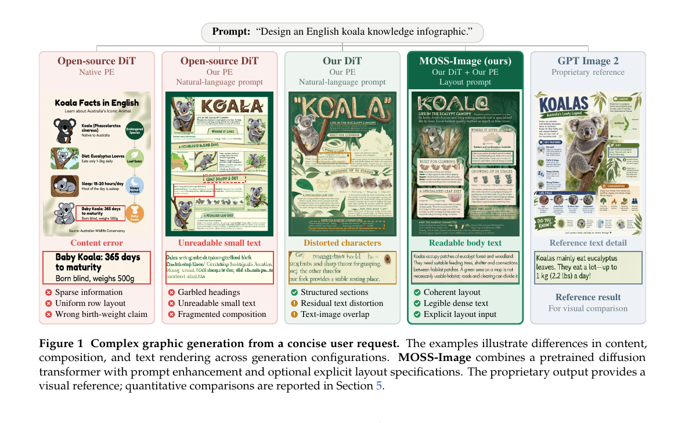

# AI Daily: MOSS-Image——讓開放式 Diffusion Transformer 讀懂長文本與版面

**日期：2026-10-22**　**方向：圖像生成／Diffusion Transformer／中英文字渲染／版面控制／Agentic Prompt Planning**

今日選讀 **MOSS-Image**。它把資訊密集圖像生成拆成兩個相連、但可分別評估的問題：生成器能否把長段文字與空間配置畫準；系統能否把一句簡短需求補成可執行的內容與版面規格。研究團隊從頭預訓練 5B 單流 Diffusion Transformer，再用意圖感知的 prompt enhancer 將自然語言轉成結構化版面條件。這不是新的 diffusion objective，而是以資料標註、共同條件介面及端到端規格化，強化模型在海報、資訊圖表與 UI 這類「需要把資訊放對位置」的圖像任務。[1] [2]

*來源：MOSI.AI 論文 Figure 1；裁切自原始 PDF，只保留圖與圖說。[1]*

## 論文資訊

- **標題：** *MOSS-Image Technical Report*。
- **作者與機構：** arXiv 署名為 **MOSI.AI**。論文列出 MOSI Intelligence、Shanghai Innovation Institute（SII）、Fudan University 與 Shanghai Jiao Tong University；PDF 將 Zhe Xu、Donghua Yu 列為共同 project leads，並列 Xie Chen、Xipeng Qiu 為 advisors。OpenMOSS 團隊頁亦說明其研究由 SII 支持、與復旦大學合作。[1] [3]
- **日期與發表狀態：** arXiv:2610.23374v1，cs.CV，2026-10-16 提交。截至本報告日期，arXiv 未列出正式會議或期刊接收資訊，因此應視為 **arXiv technical report／預印本**，不標成頂會論文。[1]
- **程式與權重：** 團隊於 2026-10-16 公開 MOSS-Image-Base、MOSS-Image-SFT 與推論程式。[2]

## 核心貢獻

**第一，將文字渲染和版面控制納入同一個生成條件介面。** 模型同時學習一般自然語言描述，以及包含文字內容、元素類別與 bounding box 的結構化版面描述。這讓使用者可以只給 prompt，也可以明確提供 JSON layout，不必先把每個字轉成手工 glyph mask。[1]

**第二，把資料監督從「只描述畫面」推進到「描述畫面內文字如何排列」。** 團隊用 Gemma 4 建立短、中、長三種粒度的 caption；對部分樣本再加上元素位置、文字轉錄、字體屬性與保留換行的結構化標註。作者特別指出，換行本身也是版面訊號。資料清理在去重與 AI 生成圖像移除後，從約 50 億張降至約 30 億張；其餘可見瑕疵較偏向以 caption 記錄，而非一概過濾掉。[1]

**第三，將簡短需求轉成可執行規格。** Layout PE 由外部 GPT-6 系列模型依任務選擇指引，需要時檢索知識或參考圖，再輸出文字、元素、座標、字型與空間關係的 JSON。參考圖用於規劃，不直接作為 DiT 的圖像條件；最後仍由同一套文字條件介面交給生成器。[1] [2]

**第四，分開測量模型能力與整個系統的能力。** LLTB 測量指定長文本能否被渲染；7Bench 測量版面定位；RLA 則用短需求評估完整系統能否產生內容完整、文字可讀、構圖合理的設計。[1]

## 技術方法

### 生成器與位置編碼

5B 單流 DiT 將凍結的 Qwen3.5-9B 文字編碼器輸出與凍結的 FLUX.2 VAE 圖像 latent 放進同一序列，使用 joint self-attention、shared modulation 與 SiTU-GLU FFN。可把整體流程簡寫成

$$
\text{短需求 } u \xrightarrow{\text{Layout PE}} s=(\text{內容、文字、版面 JSON})
\xrightarrow{\text{DiT}} \hat{x},
$$

其中 $s$ 不是單純較長的自然語言 prompt，而可以包含文字逐字內容與位置座標。論文的文字與版面條件共用同一個 encoder interface。[1]

SiTU-GLU 對兩個投影分支施加平滑飽和，再以 sigmoid gate 相乘：

$$
\begin{aligned}
\mathbf{g}&=W_g\mathbf{x},\qquad \mathbf{u}=W_u\mathbf{x},\\
c_\beta(v)&=\beta\tanh(v/\beta),\\
\operatorname{FFN}(\mathbf{x})&=W_o\!\left[c_{\beta_g}(\mathbf{g})\odot\sigma(\mathbf{g})\odot c_{\beta_u}(\mathbf{u})\right].
\end{aligned}
$$

$W_g,W_u,W_o$ 是可學習投影，$\sigma$ 是 sigmoid，$\odot$ 是逐元素乘法。$c_\beta$ 讓分支幅度在大值時平滑飽和；這是生成器的 FFN 設計，不應誤解成單獨解決文字拼寫的模組。[1]

為了同時表示參考索引、序列位置及二維影像座標，作者把每個 query/key head 切成四個子空間：

$$
\mathbf{z}=[\mathbf{z}_r;\mathbf{z}_t;\mathbf{z}_w;\mathbf{z}_h],\qquad
\operatorname{RoPE}_{4D}(\mathbf{z};r,t,w,h)=
[R_r(r)\mathbf{z}_r;R_t(t)\mathbf{z}_t;R_w(w)\mathbf{z}_w;R_h(h)\mathbf{z}_h].
$$

各 \(R_a(p_a)\) 由頻率 \(\omega_{a,j}\) 不同的二維旋轉區塊構成，例如

$$
\begin{bmatrix}
\cos(p_a\omega_{a,j})&-\sin(p_a\omega_{a,j})\\
\sin(p_a\omega_{a,j})&\cos(p_a\omega_{a,j})
\end{bmatrix}.
$$

這把寬、高座標直接納入位置編碼。現行文字生圖沒有參考圖輸入，故 $r=0$；預留 reference 軸則方便日後擴展，不代表目前模型已具備 reference-image conditioning。[1]

### 資料、訓練與推理

訓練資料由 ReLAION、OmniCorpus、DataComp 等公開圖文資料構成；在這個整理階段作者採用 SSCD 去重與內部 AI 圖像偵測器，約由 5B 張保留 3B 張，沒有再做一輪廣泛品質篩選。Caption 分支在原始 caption 與重新描述之間採 20:80 比例；版面分支提供 bbox、類別、逐字文字與換行等額外訊號。模型分三階段提高解析度與文字 context，最終文字長度上限為 4096 tokens，輸出面積上限約為 $1024^2$。[1]

作者在 1B ablation 中採 hybrid Muon–AdamW，報告兩個訓練階段的 denoising loss 為 0.41、0.403，分別比 AdamW 少 33.2%、28.6% training steps。這是 1B 規模的 optimizer ablation，不等同於 5B 主模型的完整成本比較。[1]

官方 repo 的預設推論設定為 Flow-Matching Euler、50 steps、CFG 3、shift 5，並提供 negative-branch layer skip 設定。這是可重現推論配置，不是論文聲稱的新採樣理論。[2]

## 實驗結果

- **長文本：** LongLongTextBench（LLTB）含 240 個英、中任務，兩種語言各 120 題，分三種長度；每段目標平均 1,339.8 字元，總計 321,545 字元。以 OCR 字詞／字元 multiset recall 計算，並對六個「語言 × 長度」組別等權平均。MOSS-Image 得 **96.3 Mean-6**，為作者列出的開放權重模型中最高；最長英文、中文條件分別為 97.1 與 92.4。文中 Qwen-Image 2512 為 64.9，但該比較基線來自公開報告，並非所有模型都在完全相同條件下重跑。[1]
- **版面定位：** 在 7Bench，對已偵測到的目標物件計算 mIoU，MOSS-Image 為 **0.88**，Ideogram 4 為 0.44；Layout AUC 分別為 **0.70** 與 0.20。mIoU 是對已偵測物件計算，解讀時需搭配論文附錄中的 detection rate 與漏檢說明。[1]
- **端到端設計：** RealLayoutArena 有 61 個任務（20 海報、20 資訊圖表、21 UI），以盲測成對人評及 Bradley–Terry Elo 評分。MOSS-Image 得 **1698.70 Elo**（95% CI 1655.96–1741.43），在該評估中排名第二，低於 GPT Image 2 的 1844.35、高於 Seedream 5.0 Pro 的 1661.16。這是特定小型 arena 的排序，不等於所有生圖情境的通用排名。[1]
- **Prompt 消融：** 同一系統下，短 prompt 為 1081.70 Elo，詳細 prompt 1509.21，直接擴寫 1541.45，JSON layout 1622.87。另在共享自然語言規格下，MOSS-Image backbone 為 1807.34 Elo（95% CI 1727.44–1887.24），在作者測試的九個 generator 中最高。兩組數據回答的是「規格如何影響結果」與「同規格下生成器如何比較」，不應混為同一排行榜。[1]

## 相關研究脈絡

**TextDiffuser-2** 早已探索以語言模型產生文字版面，再把文字行級資訊交給 diffusion model；其動機也是減少逐字 glyph mask 對字型風格的限制。MOSS-Image 延續「先規劃、再渲染」的系統觀，但把 layout JSON 與自然語言放進同一 5B 單流 DiT 的條件介面，並把重點擴展至雙語長段文字與資訊密集圖像。[4] [1]

**Qwen-Image-2.0** 則採 Qwen3-VL encoder 與 MMDiT，並統一文字生圖和圖像編輯，支援長 context；與 MOSS-Image 相比，它的任務範圍更廣，而 MOSS-Image 把研究資源集中在長文本與明確版面規格，且目前不支援 reference-image conditioning 或圖像編輯。[5] [1]

## 評價與研究啟發

我認為這篇工作的亮點不在提出全新的擴散方程，而在於把「使用者意圖規格化」視為生成模型的一部分，並透過 shared-prompt 與端到端基準拆開評估 prompt planner 和 renderer。LLTB 也指出短句 OCR 指標容易飽和；長文本、多語別和分組報告更能暴露模型的實際失敗點。相對地，MOSS-Image 的高分仍主要由作者自建基準、有限題數與外部 GPT-6 prompt enhancer 支撐，部分基線取自公開報告，因此需要第三方重現與更大規模盲測。

值得延伸到你關注方向的問題是：

1. **Energy-based verifier：** 把 OCR 完整度、bbox 重疊、元素順序與語義一致性組成能量 $E(s,\hat{x})$。若局部能量過高，只重寫失敗元素的 JSON，再重新生成局部區域；可測試是否比整段 prompt 重寫更省 NFE。
2. **JEPA／預測式結構檢查：** 用凍結的視覺表徵衡量版面在不同解析度或去噪時刻的結構穩定度，將「文字可讀」和「語義／構圖一致」分成兩個評分器，避免單靠 OCR recall。
3. **VAR 與 attention modulation：** 將 bbox 轉成跨尺度條件 token，粗尺度先鎖定元素位置，細尺度再調節局部 cross-attention。這可以測試 training-free attention modulation 能否在不改模型權重下改善局部排版；但需與本文的已訓練版面能力分開比較。

**邊界要分清：** MOSS-Image 是從頭訓練的 diffusion transformer，不是 Energy-Based Transformer、JEPA 或 VAR backbone，也不是 training-free 方法。論文所稱的 layout-guided zero-shot modification，是不再訓練、只改 layout prompt 後重新做 text-to-image 生成；它不等於任意輸入圖像的零樣本編輯，也不代表模型普遍具備 zero-shot 泛化。[1]

## References

[1]: https://arxiv.org/html/2610.23374 "MOSI.AI, MOSS-Image Technical Report, arXiv:2610.23374v1"
[2]: https://github.com/OpenMOSS/MOSS-Image "MOSS-Image official code, model weights and inference configuration"
[3]: https://github.com/OpenMOSS "OpenMOSS research group profile"
[4]: https://arxiv.org/html/2311.16465 "TextDiffuser-2: Unleashing the Power of Language Models for Text Rendering"
[5]: https://arxiv.org/html/2605.10730 "Qwen-Image-2.0 Technical Report"
