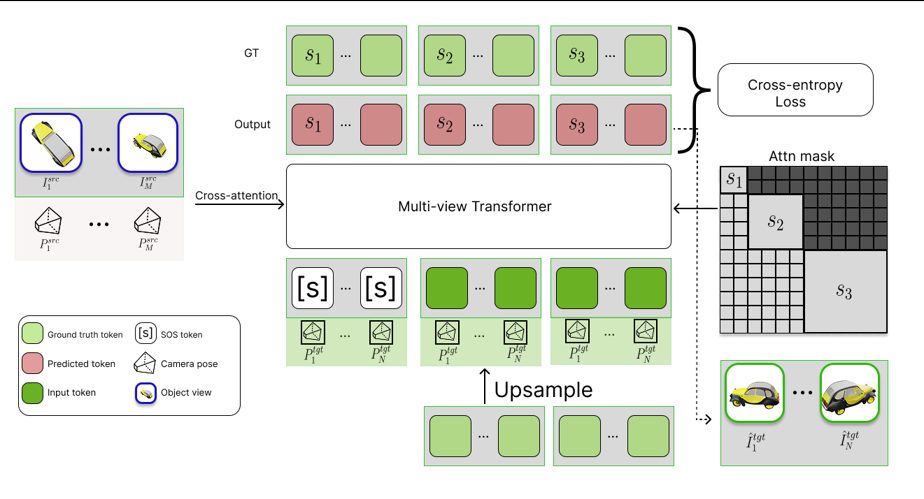
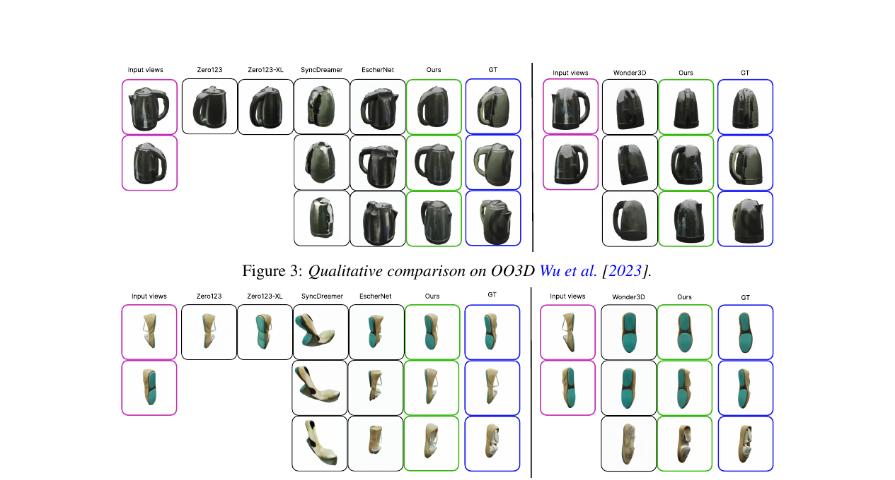

# AI Daily

## 2026-10-14｜NAMVIS：把 Visual Autoregression 推進到幾何條件的多視角生成

> **今日精選：** NAMVIS 將 sparse-view novel view synthesis 改寫成 geometry-conditioned next-scale autoregression。它不再對每個目標視角反覆執行 diffusion denoising，而是以少量 coarse-to-fine scale steps，同時生成多個目標視角的 visual tokens。[1] [2]

## 論文基本資訊

- **論文：** *NAMVIS: Next-Scale Autoregressive Multi-View Image Synthesis*
- **作者：** Ramil Khafizov、Ilya Statsenko、Ruslan Rakhimov、Artem Komarichev、Peter Wonka、Evgeny Burnaev
- **研究單位：** Applied AI Institute、T-Tech、KAUST、AXXX
- **時間：** arXiv v1 於 2026-10-03 提交；本報告以 `arXiv:2610.04722v1` 為主要閱讀版本。[1]
- **會議狀態：** 官方專案頁標示 **NeurIPS 2026**；但本次下載的 arXiv PDF 仍標示為 *Preprint*，因此本文採取「官方頁標示 NeurIPS 2026、arXiv 預印本」的保守表述。[1] [2]
- **任務：** 從一張或數張帶有相機姿態的 source views，直接生成指定 target cameras 的 novel views，不進行 per-scene optimization，也不輸出 NeRF、mesh 或 3D Gaussian。[1]
- **GitHub 倉庫排除檢查：** 已在 `KaiCobra/AI_Daily` 內搜尋 `2610.04722`、`NAMVIS` 與完整標題，沒有既有文章，因此本次沒有重複發布。
- **原始連結：** [arXiv 摘要頁](https://arxiv.org/abs/2610.04722) · [論文 HTML](https://arxiv.org/html/2610.04722v1) · [官方專案頁](https://corl-team.github.io/namvis/) · [Hugging Face Papers](https://huggingface.co/papers/2610.04722)

## 為什麼今天選它？

NAMVIS 最值得讀的地方，不只是它把 diffusion 換成 autoregression，而是它回答了一個更具體的問題：**Visual AR 的 next-scale factorization 能不能承載 3D camera geometry，以及多個 target views 能不能在生成過程中彼此溝通？**

這個問題正好落在你近期關注的幾條線的交界處：它是 VAR-based image generation，使用 attention modulation 注入幾何條件，具有不需要逐場景優化的 zero-shot inference，並且將「視角一致性」變成同尺度 target-to-target attention 的結構性問題。它不是 Energy-Based Transformer、JEPA 或 training-free 方法，但它提供了一個很清楚的生成狀態空間，適合接上 verifier、predictive critic 或 inference-time controller。

## 1. 研究背景：為什麼多視角生成不只是「多跑幾次 T2I」？

Sparse-view novel view synthesis 的輸入只有少量已知相機姿態的影像。模型必須同時猜測不可見區域的幾何、材質和光照，再把結果投影到新的 camera pose。這是一個高度 under-constrained 的問題：同一張 source image 可以由許多不同的 3D 場景產生，所以模型需要很強的幾何與外觀先驗。[1]

現有方法大致分成三類：

1. **顯式 3D 重建：** 先建立 NeRF、mesh 或 Gaussian Splatting，再渲染新視角。這類方法有明確的 3D 中間表示，但通常需要較多 views，或需要對每個 scene 進行優化。
2. **Diffusion-based NVS：** 以 Zero-1-to-3、Wonder3D、SyncDreamer、EscherNet 等為代表，將相機條件注入預訓練 diffusion prior。生成品質強，但每個 target view 通常需要多個 denoising steps，當 target views 增加時，成本快速上升。
3. **Feed-forward 或 autoregressive NVS：** 不做 per-scene optimization，直接由 source views 產生 target images。VAR 的 next-scale prediction 將序列生成從 raster-scan token-by-token 改為 coarse-to-fine scale-by-scale，為 NAMVIS 提供生成骨架。[1] [4]

NAMVIS 的定位是第三類，但它和普通 image AR 的差異在於：**條件不再只是文字或 class token，而是 source features、source camera poses 與 target camera poses；輸出也不再是一個 image，而是多個互相需要協調的 target views。**

## 2. 核心貢獻

### 2.1 以 next-scale autoregression 取代逐 view 的 iterative denoising

NAMVIS 使用 frozen multi-scale VQ-VAE 將影像轉成連續 feature map 與多個 residual token maps。Transformer 依照空間尺度由粗到細預測 target residuals。同一個 scale 內的 tokens，以及不同 target views 在同一 scale 的 tokens，都可以平行生成，因此推理的主要步數是 scale 數量，而不是整段 raster sequence 的 token 數量。[1]

### 2.2 Multi-scale Projective Pose Encoding（ProPE）

普通 2D RoPE 只能表達 image-plane 的位置，無法直接表達不同 camera 之間的 3D 關係。NAMVIS 將 projective camera transformation 加入每個 autoregressive scale，並同時放進：

- target-view self-attention：讓不同生成視角互相溝通，維持跨視角一致性；
- source-to-target cross-attention：讓 target token 根據 source camera 與 target camera 的幾何關係讀取輸入影像。

這比把 Plücker rays 直接串接到 feature 上更貼近模型真正的 attention routing。

### 2.3 Global + dense dual-path conditioning

source images 同時走兩條路：

- **Global path：** 將 source features 經 learnable query pooling 成 `[SOS]`，作為 target sequence 的全局語義起點，並轉成 AdaLN 的 scale/shift，調制每個 transformer block。
- **Dense path：** 保留未 pooling 的 VQ-VAE source features，在每一層進行 geometry-aware dense cross-attention。這條路負責高頻局部細節，避免單一 `[SOS]` token 只能表達粗略語義。

### 2.4 多視角 joint generation 與 caching

對 N 個 target views，NAMVIS 按 scale 交錯排列所有 view 的 tokens。它允許同一 scale 中不同 views 互相 attention，因此多視角一致性在生成期間就被建立，而不是生成完後才用額外的 3D consistency module 修正。

推理時同時使用 standard KV cache 與 global ProPE cache。後者預先計算 source-target camera configuration 對應的 projective tensors，再跨 transformer layers 重用；在 3-to-3 設定中，移除 ProPE cache 後 runtime 由 0.96 秒增加到 1.28 秒。[1]

## 3. 技術方法與數學細節

### 3.1 問題定義

給定 source RGB images、source camera poses，以及 target camera poses：

$$
\hat{I}^{\mathrm{tgt}} = F_{\theta}\left(I^{\mathrm{src}}, P^{\mathrm{src}}, P^{\mathrm{tgt}}\right),
$$

其中 $P^{\mathrm{src}},P^{\mathrm{tgt}}\in SE(3)$。NAMVIS 不建立顯式 3D representation，而是直接預測 target images 的 visual tokens。[1]

### 3.2 VAR 的 next-scale factorization

frozen VQ-VAE 將影像編碼成 feature map $f\in\mathbb{R}^{h\times w\times d}$ 與 $K$ 個 residual maps：

$$
(r_1, r_2, \ldots, r_K),
\qquad r_k\in\mathbb{R}^{h_k\times w_k\times d},
$$

前 $k$ 個尺度累積出的 feature 為：

$$
 f_k = \sum_{i=1}^{k} \operatorname{up}(r_i,(h,w)),
 \qquad f=f_K.
$$

在 NAMVIS 中，target residual 的條件機率分解為：

$$
 p_{\theta}\left(r^{\mathrm{tgt}}_{1:K}\mid f^{\mathrm{src}},P^{\mathrm{src}},P^{\mathrm{tgt}}\right)
 =
 \prod_{k=1}^{K}
 p_{\theta}\left(r^{\mathrm{tgt}}_k\mid r^{\mathrm{tgt}}_{<k},f^{\mathrm{src}},P^{\mathrm{src}},P^{\mathrm{tgt}}\right).
$$

因此，模型不是逐 pixel 或逐 raster token 生成，而是讓後續尺度依賴前面已經累積的 coarse structure。論文保留 Infinity 的 bitwise representation 與 scale-reweighted cross-entropy；訓練時以 10% 機率丟掉 source conditioning，為推理時 CFG 提供 unconditional branch。[1]

### 3.3 Multi-view block-causal attention

令 $S_k$ 表示 scale $k$ 中所有 target views 的 flattened tokens，總序列為：

$$
S=(S_1,S_2,\ldots,S_K).
$$

attention mask 遵循：

$$
S_k \longrightarrow S_{\leq k},
\qquad
S_k \not\longrightarrow S_{>k}.
$$

也就是說，當前 scale 可以讀取所有較早尺度，也可以讀取同一尺度其他 target views，但不能讀取未來尺度。這個設計同時滿足兩件事：

- **AR 因果性：** coarse scale 先於 fine scale；
- **跨視角通信：** 同一尺度的不同 views 可以交換資訊，降低每個 view 各自生成而造成的 geometry drift。

這裡的關鍵不是單純把多張圖片 concatenate，而是讓「同一個 scale」成為多視角協調的通信平面。

### 3.4 Multi-scale Projective Pose Encoding

對位於 scale $s$ 的 attention head，NAMVIS 將 token feature 拆成 projective 與兩個局部座標部分：

$$
 x_s = \left[x_s^{\mathrm{proj}},x_s^u,x_s^v\right].
$$

對 view $v$ 的 projective-RoPE 變換可寫為：

$$
\Psi_b^{v,s}(x_s)=
\left[
 M_b(P_v)x_s^{\mathrm{proj}},
 \operatorname{RoPE}(x_s^u,u_s),
 \operatorname{RoPE}(x_s^v,v_s)
\right],
$$

其中 $(u_s,v_s)$ 是當前 scale 的 token-grid 座標，$b\in\{q,kv,o\}$ 表示 query、key/value 或 output branch。論文採用的 branch-specific projective matrices 是：

$$
 M_q(P_v)=P_v^{\top},
 \qquad
 M_{kv}(P_v)=P_v^{-1},
 \qquad
 M_o(P_v)=P_v.
$$

這樣的拆分讓 projective component 注入 3D camera geometry，同時保留兩個 local RoPE component 來維持當前解析度下的 2D 空間關係。因為每個 autoregressive scale 有自己的 grid，所以 NAMVIS 為每個 scale 建立相對應的 coordinate grids 與 rotary coefficients。[1]

#### Target self-attention

在 target-view self-attention 中，query、key、value 和 output 都使用 target camera：

$$
Y^{\mathrm{self}}_{t,s}
=
\Psi^{t,s}_{o}
\operatorname{Attn}\left(
\Psi^{t,s}_{q}(Q_{t,s}),
\Psi^{t,\leq s}_{kv}(K_{t,\leq s}),
\Psi^{t,\leq s}_{kv}(V_{t,\leq s})
\right).
$$

這條路徑主要負責 generated target views 之間的幾何一致性。

#### Source-to-target cross-attention

在 source-to-target cross-attention 中，target token 是 query，source VQ-VAE features 是 key/value：

$$
Y^{\mathrm{cross}}_{t,s}
=
\Psi^{t,s}_{o}
\operatorname{Attn}\left(
\Psi^{t,s}_{q}(Q_{t,s}),
\Psi^{\mathrm{src}}_{kv}(K_{\mathrm{src}}),
\Psi^{\mathrm{src}}_{kv}(V_{\mathrm{src}})
\right).
$$

query/output branch 使用 target camera；key/value branch 使用 source cameras。這個 role-aware routing 讓模型能將「我要生成哪個視角」與「source view 在哪個相機位置」分開處理。

### 3.5 Global / dense source conditioning

全局 path 以 learnable query $q$ 對 source features 做 pooling：

$$
[\mathrm{SOS}]=\operatorname{CrossAttn}(q,f^{\mathrm{src}}).
$$

`[SOS]` 會被放到 target sequence 前面，並透過 mapping network 產生 AdaLN 的 scale/shift，調制所有 transformer blocks。dense path 則直接保留完整的 $f^{\mathrm{src}}$，讓每個 target token 在每一層讀取高解析度 source evidence。[1]

這種 asymmetry 很重要：target tokens 按照 coarse-to-fine 逐步增加；source keys/values 卻維持 dense single-scale resolution。換句話說，即使最早期的 coarse scale，也能讀取 source image 的細節，而不必等到後期細尺度才補救。

## 4. 實驗設定與結果

### 4.1 實驗設定

作者從 Objaverse-XL 建立約 200K objects 的 curated subset。每個 object 渲染 100 個帶 pose 的 RGBA views，並釋出 camera intrinsics、extrinsics、masks、point maps、captions 與 preprocessing scripts。模型使用 1B-parameter transformer，從 Infinity 2B checkpoint 每隔一個 block 保留一層，最後得到 16 層、hidden size 2048、16 個 attention heads 的模型。[1]

訓練只更新 autoregressive transformer，VQ-VAE 保持 frozen。主要設定為 AdamW、base learning rate $10^{-4}$、global batch size 512、20 個 warm-up epochs、cosine decay，以及總共 500 epochs。所有評估都在 $256\times256$ 解析度，品質指標是 PSNR、SSIM、LPIPS；跨視角一致性則使用 COLMAP reconstructability 與 camera registration coverage。[1]

### 4.2 主結果：品質與速度同時改善

表中的結果是九種 source-to-target view configurations（1-to-1 到 3-to-3）的平均。PSNR/SSIM 越高越好，LPIPS 越低越好。

| 方法 | Objaverse PSNR / SSIM / LPIPS | GSO（zero-shot）PSNR / SSIM / LPIPS | OO3D PSNR / SSIM / LPIPS | 每 target view 時間 |
|---|---:|---:|---:|---:|
| Zero-1-to-3 | 19.097 / 0.816 / 0.152 | 15.614 / 0.749 / 0.257 | 16.094 / 0.768 / 0.219 | 2.6 s |
| Zero-1-to-3 XL | 19.341 / 0.827 / 0.136 | 15.936 / 0.747 / 0.236 | 16.320 / 0.767 / 0.209 | 2.6 s |
| Wonder3D | 15.801 / 0.821 / 0.209 | 14.158 / 0.777 / 0.285 | 14.290 / 0.786 / 0.243 | 2.0 s |
| SyncDreamer | 19.368 / 0.826 / 0.156 | 16.961 / 0.781 / 0.246 | 16.766 / 0.793 / 0.207 | 16.6 s |
| EscherNet | 19.078 / 0.816 / 0.147 | 18.878 / 0.799 / 0.156 | 17.767 / 0.780 / 0.167 | 2.1 s |
| **NAMVIS 1B** | **22.485 / 0.861 / 0.091** | **21.715 / 0.843 / 0.111** | **21.098 / 0.845 / 0.104** | **0.6 s** |

NAMVIS 在三個資料集的 PSNR、SSIM、LPIPS 都優於表中的 diffusion baselines。GSO 是不在 Objaverse-XL 訓練分布內的 zero-shot dataset；NAMVIS 在 GSO 仍達 21.715 PSNR、0.843 SSIM、0.111 LPIPS。[1] [2]

在 1-to-1 設定中，NAMVIS 每個 target view 約需 0.6 秒，最快的 diffusion baseline Wonder3D 約需 2.0 秒，因此是約 **3.3× faster**。這個比較是同一個 $256\times256$ 設定下的單 target-view latency，不應直接解讀成所有硬體或所有解析度的通用加速倍數。

### 4.3 多視角 scaling

在 Objaverse 的大型 view-count 測試中，NAMVIS 可 joint generate 6 個 source views 到 6 個 target views：

| 設定 | LPIPS ↓ | SSIM ↑ | PSNR ↑ | 時間 | Peak VRAM |
|---|---:|---:|---:|---:|---:|
| 2 → 6 | 0.0654 | 0.8845 | 24.49 | 1.53 s | 4.3 GB |
| 6 → 2 | 0.0457 | 0.9017 | 26.07 | 0.84 s | 4.1 GB |
| **6 → 6** | **0.0473** | **0.9015** | **26.12** | **1.56 s** | **5.0 GB** |

增加 source views 通常會改善品質，因為不可見區域的 ambiguity 下降；增加 target views 主要增加計算量，對固定 source-view 數量而言品質相對穩定。[1]

### 4.4 跨視角 consistency

單一 view 的 PSNR 或 LPIPS 不一定能反映多視角是否真的能對齊。因此作者使用 COLMAP 來測試生成的 source + target views 是否能被穩定地 feature match、camera register 與 triangulate：

- COLMAP sparse points：NAMVIS **221**，EscherNet 214，Wonder3D 172，SyncDreamer 151。
- 30 scenes 的 camera-registration coverage：ground truth 168/240（70.0%）、NAMVIS 162/240（67.5%）、EscherNet 145/240（60.4%）。[1]

這些數字支持 NAMVIS 的跨 view consistency 不只來自單張影像變清楚，也反映在幾何重建代理指標上。不過 COLMAP reconstructability 仍是 proxy，不等於完整 3D reconstruction quality，也不等於在真實場景中能精確恢復所有深度。

### 4.5 消融：為什麼需要 geometry-aware cross-attention？

消融在 10K Objaverse-XL subset、200 epochs 下完成，重點結果如下：

| Variant | PSNR ↑ | SSIM ↑ | LPIPS ↓ |
|---|---:|---:|---:|
| Plücker Rays 取代 ProPE | 20.260 | 0.899 | 0.142 |
| Prefix Conditioning 取代 Cross-Attn | 14.539 | 0.797 | 0.427 |
| CLIP `[SOS]` 取代 VQ-VAE | 20.613 | 0.901 | 0.126 |
| Learned Dense Features 取代 VQ-VAE | 20.886 | 0.901 | 0.134 |
| 移除 dense cross-attention，只留 `[SOS]` | 17.891 | 0.865 | 0.248 |
| LoRA tuning 取代 full tuning | 18.912 | 0.883 | 0.185 |
| **Full NAMVIS** | **21.360** | **0.907** | **0.115** |

這個消融揭示兩個重要現象：

1. **幾何注入位置比單純加入幾何 feature 更關鍵。** ProPE 直接改變 Q/KV/O 的 attention geometry，比把 Plücker rays 串接到 feature 上更有效。
2. **global token 不足以保存細節。** 移除 dense cross-attention 後，LPIPS 由 0.115 惡化至 0.248。source view 的高頻 evidence 必須在每一層以 dense path 提供。
3. **只訓練 LoRA 不夠。** LoRA 版本的 PSNR 18.912，顯著低於 full tuning 的 21.360。對 frozen Infinity prior 進行幾何條件化，似乎需要改動核心 transformer weights，而不只是學一個低秩 residual。

## 5. 相關研究與定位

### 5.1 VAR：從 raster AR 到 next-scale AR

VAR 的核心改變是以 next-scale prediction 取代逐 token raster generation，讓圖像生成在尺度內平行化，並將 coarse structure 與 fine detail 分成不同 prediction stages。[4] NAMVIS 沿用這個 coarse-to-fine factorization，但把條件從 class/text 改成 source views 與 camera geometry；同時把單圖生成擴展成多 target views joint generation。

可以把兩者的差異簡化為：

- VAR：`condition → one image, scale by scale`
- NAMVIS：`source views + source/target poses → multiple target images, scale by scale, with cross-view communication`

因此 NAMVIS 的真正增量不是「又一個 AR generator」，而是把 **camera-conditioned multi-view consistency** 寫進 next-scale attention topology。

### 5.2 Infinity：bitwise autoregressive image prior

NAMVIS 建立在 Infinity 的 transformer 風格上。Infinity 將 visual token 的表示改成 bitwise code，並透過多尺度生成與 bitwise self-correction 擴展高解析度生成；NAMVIS 在此基礎上保留多尺度與 bitwise prediction，再加入 source feature conditioning 與 ProPE。[1]

這也解釋了為什麼 NAMVIS 不是從零設計一個 NVS backbone，而是把現有的大型 visual AR prior 改造成幾何條件 generator。其代價是：模型仍然需要相當規模的 fine-tuning，不能把「推理時不需 per-scene optimization」誤解成「不需要訓練」。

### 5.3 與 diffusion-based NVS 的差異

Zero-1-to-3、Wonder3D、SyncDreamer 與 EscherNet 等方法把 camera conditioning 放進 diffusion denoising trajectory；NAMVIS 則把 camera geometry 放進 attention operator，並讓 target views 在同一 scale 中互相通信。[1]

這兩種 paradigm 的差異不只在速度：

- diffusion 的控制介面是連續去噪時間 $t$ 與 score/denoising update；
- NAMVIS 的控制介面是離散尺度 $k$、bitwise token logits、target-target self-attention，以及 source-target cross-attention。

所以很多 diffusion 時代的 guidance 方法不能直接搬過來。要做 training-free attention modulation，必須先處理 visual AR 的 stateful KV cache、scale causality 與 discrete sampling。

## 6. 對你近期關注方向的啟發

以下是我的延伸判斷，不是 NAMVIS 論文已經驗證的結果；它們是以本文的 attention / scale interface 為起點，可以實驗的研究問題。

### 6.1 Energy-Based Transformer：把 geometry consistency 變成每一尺度的 energy

NAMVIS 現在用 cross-entropy 訓練 token prediction，用 PSNR、LPIPS 和 COLMAP 在輸出後評估一致性。可以加入一個視角相容性能量：

$$
E_k = E_{\mathrm{pose}}\left(r_{\leq k}^{\mathrm{tgt}},
 f^{\mathrm{src}},P^{\mathrm{src}},P^{\mathrm{tgt}}\right).
$$

低 energy 代表目前 coarse-to-fine state 同時符合 source appearance 與 target geometry。推理時可以：

1. 在每個 scale 選擇較低 energy 的 token proposals；
2. 當 $E_k$ 收斂時提前停止後續 scale；
3. 當不同 target views 的 energy disagreement 上升時，增加該 scale 的 refinement budget。

這會把 NAMVIS 從固定 $K$ 步的 next-scale decoder，推向具有 dynamic compute allocation 的 energy-guided visual AR。要注意，這不會自動變成 EBT；若 energy 沒有經過 verifier-style 訓練，只是另一個 reranking score。

### 6.2 JEPA：用 predictive consistency 做跨視角 critic

NAMVIS 直接生成 pixel-like visual features，但多視角中有些細節本來就不可由 source view 唯一決定。可以加入 frozen JEPA encoder $\phi$，對每個 scale 的 target latent 做 predictive consistency：

$$
D_k = \left\|
\phi\left(\hat{I}^{\mathrm{tgt}}_{k,1:N}\right)
-
\phi\left(I^{\mathrm{tgt}}_{k,1:N}\right)
\right\|_2^2.
$$

更實際的版本是不使用 ground-truth target，而比較不同 target views 經 pose transform 後的 relational embedding，形成 geometry-aware predictive disagreement。若 $D_k$ 在早期 scale 就很高，代表模型可能已經選錯 coarse geometry；這時可以回退一個 scale、擴大 cross-attention，或重新採樣 token。

這條路線對應 JEPA 的核心直覺：不必重建所有 pixel detail，而是優先維持跨視角仍然可預測、與任務相關的 latent structure。

### 6.3 VAR + scale-local attention：降低高解析度與多視角的 KV 成本

作者自己也指出，NAMVIS 目前對所有 previous scales 使用 full block-causal attention；在更高解析度或更多 target views 時，sequence length 與 KV cache 會成為瓶頸。[1]

可以測試一個 scale-local/windowed target-target attention：

$$
\mathcal{A}_k^{\mathrm{target}}
=\operatorname{Attn}\left(S_k,
\operatorname{Window}(S_{k-w:k})\right),
$$

但保留 full 或 sparse geometry-aware source-to-target cross-attention。因為 $f_k$ 已經累積早期尺度資訊，未必需要每個 fine-scale token 重新讀取所有歷史 scales。這個設計能直接回答兩個問題：

- 視角一致性主要依賴同尺度通信，還是依賴所有歷史尺度？
- source geometry cross-attention 是否比 target-target history 更值得保留完整計算？

### 6.4 Training-free attention modulation：從 pose confidence 介入，而不是重新訓練

NAMVIS 本身需要 fine-tuning，且 full tuning 比 LoRA 好很多；因此它不是 training-free。可是它的 inference interface 很適合做 frozen-backbone controller：

- 以 camera pose uncertainty 或 source-target baseline 估計 confidence；
- 在 cross-attention logits 加入 token-wise geometry bias；
- 在高 confidence 的 source regions 增強 value routing；
- 在不確定的 target regions 保留較大的 sampling entropy；
- 對不同 scale 使用不同的 modulation strength。

一個簡化形式是：

$$
A_{k}^{\mathrm{mod}}
=\operatorname{softmax}\left(
\frac{Q_kK_{\mathrm{src}}^{\top}}{\sqrt d}
+\beta_k B(P^{\mathrm{src}},P^{\mathrm{tgt}})
\right),
$$

其中 $B$ 是由 projective geometry 或 source visibility 估計的 bias，$\beta_k$ 隨 scale 改變。這種方法的關鍵評估不應只看平均 PSNR，還要看 pose noise、遮擋區域、thin structures 與跨 dataset robustness。

### 6.5 Zero-shot 的更嚴格定義

NAMVIS 的 zero-shot 是 **不做 per-scene optimization 的 novel-view inference**。它不是：

- 不需要訓練；
- 不需要 source image；
- 不需要 camera pose；
- 對任意真實世界 scene 都 zero-shot 泛化。

目前的 GSO zero-shot 實驗有價值，但仍屬 object-centric domain。下一個更嚴格的 protocol 應加入：真實室內外場景、camera pose noise、多物體遮擋、非 Lambertian 材質、鏡面反射與 source-view 數量極低的條件，並把「perceptual quality」「geometry consistency」「uncertainty calibration」分開報告。

## 7. 個人評價、限制與研究意義

### 我認為最重要的 insight

NAMVIS 最重要的不是「AR 速度比 diffusion 快」，而是它把多視角生成中的兩種一致性拆成兩個 attention interface：

- **target self-attention：** generated views 之間的協調；
- **source-to-target cross-attention：** source appearance 與 target pose 的幾何對齊。

再配合 next-scale mask，模型在每個尺度都有一個清楚的決策順序：先形成 coarse geometry，再透過多 view communication 修正細節。這種 interface 比「加入一個 pose embedding」更容易被分析、替換和擴展。

### 需要保留的限制

1. **解析度限制：** 模型只在 $256\times256$ 訓練與評估；直接做 $512\times512$ 需要額外 training 或 fine-tuning。[1]
2. **資料分布限制：** 主要資料來自 object-centric Objaverse-XL，對複雜 real-world scenes 的 domain gap 尚未解決。
3. **pose robustness 尚未充分驗證：** 論文把 pose noise robustness 列為 future work；ProPE 對正確 camera geometry 很有幫助，但也可能讓錯誤 pose 更直接地污染 attention。
4. **訓練成本仍高：** full transformer fine-tuning 比 LoRA 好，表示方法不是輕量 plug-in；它的 inference 不需 per-scene optimization，不代表整體 training-free。
5. **COLMAP 是 proxy：** 221 sparse points 與 67.5% coverage 支持幾何一致性，但不能替代真實 3D reconstruction、depth error 或 scene-level interaction evaluation。
6. **正式出版資訊需保守：** 官方 project page 標示 NeurIPS 2026，但本次讀到的 arXiv PDF 仍是 preprint 版本，後續投稿版本可能調整數字與實驗設定。

### 最終評價

我會把 NAMVIS 評為一篇**值得追蹤、但不應只用單一速度倍數宣傳的 VAR 生成論文**。它把 VAR next-scale、camera-aware attention 與 multi-view consistency 放在同一個可推導的架構裡，並且有清楚的 ablation 證明 ProPE、dense cross-attention 與 full tuning 各自重要。對你的研究方向而言，它最適合當作一個「生成器介面」：上面可以接 Energy-based verifier，旁邊可以接 JEPA predictive critic，下面可以做 scale-local attention 或 inference-time modulation。

## 結論

NAMVIS 將 sparse-view novel view synthesis 從 iterative diffusion denoising 改寫成 geometry-conditioned next-scale visual autoregression。它以 multi-scale ProPE 將相機關係注入 self-attention 與 cross-attention，以 block-causal mask 讓不同 target views 在同一尺度互相協調，再以 global + dense conditioning 同時保留語義與細節。

在 $256\times256$ 的 Objaverse、GSO 與 OmniObject3D 評估中，它報告最高的 PSNR/SSIM、最低的 LPIPS，並在 1-to-1 設定以 0.6 秒每 target view 達到約 3.3× 相對 Wonder3D 的速度。它仍受限於 object-centric data、固定解析度、pose noise 與 full fine-tuning 成本，但正因為其 scale-wise state 與 attention routing 很明確，NAMVIS 是一個適合延伸到 **Energy-Gated VAR、JEPA consistency verification、training-free pose modulation 與 uncertainty-aware zero-shot generation** 的研究起點。

## References

[1]: https://arxiv.org/abs/2610.04722 "NAMVIS: Next-Scale Autoregressive Multi-View Image Synthesis — arXiv abstract and metadata"

[2]: https://corl-team.github.io/namvis/ "NAMVIS official project page"

[3]: https://huggingface.co/papers/2610.04722 "NAMVIS on Hugging Face Papers"

[4]: https://arxiv.org/abs/2404.02905 "Scalable Image Generation via Next-Scale Prediction"

[5]: https://arxiv.org/html/2610.04722v1 "NAMVIS full HTML paper"
