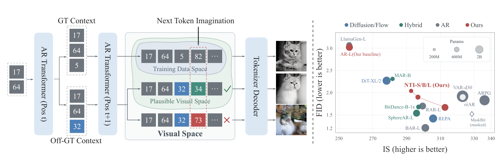

# AI Daily

## Visual Autoregressive Generation with Next Token Imagination

> **今日選文**：NTI 把 visual autoregressive（AR）訓練從「每個位置只教模型複製資料中的唯一正解 token」改成「在模型生成的偏離前綴下，對可信的替代 token 分配受控機率」。在 ImageNet-256 的同一個 461M 參數 raster-AR backbone 上，作者報告 FID 從 3.02 降至 1.67，訓練成本只比 vanilla AR 高約 10%。但這是需要重新訓練的訓練方法，不是 training-free 或 zero-shot 方法。

### 基本資訊

- **作者**：Ruihang Jiang、Zongyao Zhao、Zhaolin Wang、Yuanwei Liu、Xiatian Zhu。
- **研究單位**：前四位作者列出的單位為 The University of Hong Kong；Xiatian Zhu 列出的單位為 University of Surrey。[1]
- **發表狀態**：arXiv:2610.36793v1，2026 年 10 月 27 日提交；同一論文列為 ICLR 2027 Conference Submission，目前是 **under review**，尚非已錄取論文。[1] [2]
- **論文與程式**：[arXiv 原文](https://arxiv.org/html/2610.36793v1)｜[ICLR 2027 投稿頁](https://openreview.net/forum?id=opIfMHUbJP)｜[官方程式與 checkpoints](https://github.com/JackRuihang/NTI)。[1] [2] [6]
- **關鍵詞**：Visual AR、next-token prediction、exposure bias、soft target、codebook prior、context-aware training。

### 為什麼選它？

本次搜尋包含 arXiv 最新視覺論文、Hugging Face Papers Trending，以及 energy-based transformer、JEPA、VAR、training-free attention control 等方向。當日較早的 Transformer Energy-Based Model 已於 repo 的 10 月 27 日文章收錄；NTI 則是 10 月 28 日 arXiv 最新列表的新作，切入點不同，直接改變 visual AR 的 supervision，而不是更換 tokenizer 或生成順序。[1]

它值得讀的地方，是把 exposure bias 從「如何讓模型在錯誤前綴下回到唯一 ground truth」重新看成「偏離 ground truth 的前綴，有時仍對應有效的另一種視覺實現」。這個觀點可能把 latent world model 的預測一致性、energy-based compatibility，以及 VAR 的尺度式生成接到同一個候選評估問題上。

*圖 1。僅裁出論文 PDF 中的 Figure 1，保留方法直覺與結果比較，未包含整頁截圖。[1]*

### 核心貢獻

一般離散 visual AR 先將影像轉成 codebook token，再以 causal Transformer 按 raster order 預測。標準訓練只在 ground-truth（GT）前綴上預測 GT token；推論時，模型卻依自己的抽樣結果延續。作者認為，對生成任務而言，非 GT token 不必然代表錯誤：它可能把後續序列帶到另一張合理圖片。NTI 因此讓模型在「偏離 GT、但仍有視覺合理性」的情況下學習多種延續。[1]

方法由兩個部分組成。**Snapshot-based Context Approximation（SCA）** 使用週期性凍結的模型快照，平行產生替代 token 並拼成近似 model-generated prefixes，免去每個訓練樣本都逐 token rollout。**Context-Regulated Imagination（CRI）** 則依據 codebook 相似度、GT／偏離前綴的預測一致性，以及模型信心，決定哪些非 GT token 可以成為軟標籤，以及分配多少機率質量。[1]

### 技術方法與公式

令影像的離散 token 序列為 \(\mathbf z=(z_1,\ldots,z_N)\)，類別條件為 \(y\)。標準 raster-order AR 的聯合分布為

$$
p_\theta(\mathbf z\mid y)=\prod_{t=1}^{N}p_\theta(z_t\mid \mathbf z_{<t},y),
\qquad
\mathcal L_{\mathrm{AR}}=-\frac{1}{N}\sum_{t=1}^{N}\log p_\theta(z_t\mid\mathbf z_{<t},y).
$$

標準目標把每個 \(z_t\) 當成唯一目標。SCA 改用一份凍結快照 \(p_{\bar\theta}\)：先在 GT 前綴上取得預測並抽樣 \(\hat z_i\)，再用 Bernoulli mask 以機率 \(\rho\) 置換 token，形成偏離序列 \(\tilde{\mathbf z}\)：

$$
\hat z_i\sim p_{\bar\theta}(\cdot\mid\mathbf z_{<i},y),\quad
b_i\sim\mathrm{Bernoulli}(\rho),\quad
\tilde z_i=\begin{cases}z_i,&b_i=0,\\\hat z_i,&b_i=1.\end{cases}
$$

這裡的 \(\tilde{\mathbf z}_{<t}\) 是便宜的偏離前綴近似，不是完整、逐步自回歸 rollout。模型另在 GT 前綴與偏離前綴上取得兩個分布：

$$
\mathbf p_t^{\mathrm{GT}}=p_{\bar\theta}(\cdot\mid\mathbf z_{<t},y),\qquad
\mathbf p_t^{\mathrm{gen}}=p_{\bar\theta}(\cdot\mid\tilde{\mathbf z}_{<t},y).
$$

CRI 先以 codebook embedding \(\mathbf c_k\) 的 cosine similarity 建立候選 token 親和度，並用兩個預測分布的 total variation（TV）距離估計兩種前綴是否仍一致：

$$
A_{z_t,k}=\exp\!\left(\frac{\operatorname{cos}(\mathbf c_{z_t},\mathbf c_k)-1}{\tau}\right),\qquad
g_t=1-\frac{1}{2}\sum_{k=1}^{K}\left|p_t^{\mathrm{GT}}(k)-p_t^{\mathrm{gen}}(k)\right|.
$$

當 \(g_t\) 高時，兩種前綴的預測相近，CRI 願意參考偏離前綴的分布；當兩者差異大時，想像會被收斂。將此一致性與 codebook 親和度結合，再只對非 GT token 正規化：

$$
u_t(k)=A_{z_t,k}\big[(1-g_t)p_t^{\mathrm{GT}}(k)+g_t p_t^{\mathrm{gen}}(k)\big],\qquad
r_t(k)=\begin{cases}\displaystyle\frac{u_t(k)}{\sum_{j\ne z_t}u_t(j)},&k\ne z_t,\\0,&k=z_t.\end{cases}
$$

想像強度 \(d_t\) 再由預測信心、GT token 尚未吸收的機率，以及前綴一致性共同控制：

$$
c_t=1-\frac{\mathcal H(\mathbf p_t^{\mathrm{GT}})}{\log K},\qquad
d_t=c_t\bigl(1-p_t^{\mathrm{GT}}(z_t)\bigr)g_t,\qquad
q_t(k)=(1-d_t)\mathbf 1\{k=z_t\}+d_t r_t(k).
$$

因此 \(q_t\) 保留 GT 的主要權重，只把有限機率分配給可信的替代 token。若模型信心低、已高度支持 GT token，或兩種前綴下的預測不一致，\(d_t\) 就會降低。NTI 在偏離前綴的位置最小化此軟標籤交叉熵，並與原本的 GT 目標相加：

$$
\mathcal L_{\mathrm{NTI}}=-\frac{\mathbb E\left[\sum_t m_t\sum_{k=1}^{K}q_t(k)\log p_\theta(k\mid\tilde{\mathbf z}_{<t},y)\right]}{\mathbb E\left[\sum_t m_t\right]},\qquad
\mathcal L=\mathcal L_{\mathrm{AR}}+\lambda(s)\mathcal L_{\mathrm{NTI}},
$$

其中 \(m_t=1\) 表示第 \(t\) 個位置的前綴已偏離 GT，\(\lambda(s)\) 是隨訓練進度調整的權重。[1]

### 實驗結果

作者在 ImageNet-1K 的 256×256 class-conditional generation 上評估，每組生成 50,000 張影像，回報 FID 與 Inception Score（IS）。使用預訓練 MaskGIT-VQGAN tokenizer，codebook 大小為 1,024，每張影像編碼成 256 個 token；NTI-S/B/L 以 400 epochs 訓練，全球 batch size 2,048。NTI-L 使用 classifier-free guidance（CFG）scale 14。[1] [6]

在相同 461M 參數 AR-L backbone 上，作者報告：

- **AR-L baseline**：FID 3.02、IS 256.20。
- **NTI-L**：FID **1.67 ± 0.01**、IS **312.72 ± 1.02**，吞吐量 13.957 images/s。
- **模型尺度**：NTI-S（218M）FID 2.04；NTI-B（261M）FID 1.90；NTI-L（461M）FID 1.67。[1]

NTI 也在兩種不同 tokenizer／generator 設定上改善 FID：GigaTok 由 3.94 降至 3.66；AliTok 由 1.61 降至 1.51。作者在 8 張 NVIDIA A100 上估計每 epoch 訓練時間：vanilla AR 11.62 分鐘、NTI 12.80 分鐘、線上 two-pass context construction 22.90 分鐘；因此 SCA+CRI 約增加 10% 訓練時間，且不改推論流程。[1]

重要的比較界線是：NTI 的 1.67 優於該論文同 backbone AR-L 及多個 raster-AR 對照，但並非 Table 1 所有生成方法中的最低 FID；該表列出的 REPA 為 1.42、FreqFlow-H 為 1.38、BAR-L 為 1.21。不同方法可能使用不同 backbone、訓練配置和 guidance，不能只按單一 FID 排名推論全面勝負。[1]

### 相關研究

**VAR** 將 visual AR 由逐 token 的 raster order 改寫成 coarse-to-fine 的 next-scale prediction，並展示其 ImageNet 表現與 zero-shot inpainting、outpainting、editing 能力。[3] NTI 並未採用 VAR 的尺度式生成順序；它直接處理「替代 token 如何被監督」，因此可以把兩者視為相對正交的設計：一個改變 factorization／生成尺度，另一個改變條件式目標分布。

**LlamaGen** 是將語言模型式 next-token prediction 擴展到圖像生成的重要代表，為 raster-order AR 提供了可擴展的模型家族與 tokenizer 設計。[5] **IAR（CVPR 2025）** 則利用 codebook clustering 與 cluster-oriented cross-entropy，讓模型先學對 token cluster，再學精確 token。[4] NTI 同樣利用 codebook 結構，但更進一步以當下前綴的預測一致性與信心動態調節 soft target；它不是靜態地把 token 分群，也不要求推論時額外執行 guidance。

### 評價與研究啟發

NTI 的強項是問題定義清楚，並把額外 rollout 成本壓低：不是在推論時堆更多 sampler step，而是訓練模型接受「多種合理下一步」。消融也支持 context-adaptive 的必要性：NTI-S 中，SCA+GT supervision 的 FID 為 2.11，加入 CRI 後為 2.04；線上 scheduled sampling+CRI 為 2.03，品質略佳但需要額外計算。[1]

限制也很明顯。第一，這是 ImageNet 類別條件的離散 token 實驗，尚不能據此推論對開放詞彙 text-to-image 或高解析度生成同樣有效。第二，所謂「想像訓練資料外的視覺內容」受到既有 tokenizer codebook 與相似度鄰域約束；方法主要擴大資料 token 序列周遭可接受的延續，並未直接證明會生成新語義概念。第三，NTI 需要額外訓練，故不可稱為 training-free；ImageNet 評估也不是 zero-shot transfer。第四，NTI-S 的 scheduled sampling ablation 比 SCA+CRI 再低 0.01 FID，顯示省下的成本是以非常小的品質差距換來，不代表 SCA 在所有 regime 都占優。[1]

可延伸的方向（以下是研究構想，不是原論文主張）：

1. **Energy-based candidate verifier**：以輕量 energy function \(E_\phi(\tilde{\mathbf z}_{<t},k)\) 評估候選 token 的局部相容性，將 CRI 的 \(r_t(k)\) 改成 \(r_t(k)\exp[-\beta E_\phi(\tilde{\mathbf z}_{<t},k)]\) 再正規化。研究問題是，energy verifier 是否能比 codebook cosine distance 更好辨別「token 看似相近，但接到當前場景會破壞結構」的情況；並可把 EBT 的測試時計算擴展到 candidate-space search。
2. **JEPA predictive consistency gate**：以 frozen JEPA encoder／predictor 比較 GT prefix 與 imagined prefix 的未來 latent，而不只比較兩個 token softmax 的 TV 距離。若兩條路徑預測的 future representation 接近，就允許較強的 imagination；若語義／動態預測分歧，則降低 \(d_t\)。這可檢驗 latent-level consistency 是否比 token-level agreement 更能保留物件、姿態和場景關係。
3. **將 NTI 搬到 VAR 的 next-scale**：在每個尺度 \(s\) 上取代單一正解尺度 token，建立 \(q_s\)；粗尺度允許多個語義 scaffold，細尺度再以跨尺度一致性縮小自由度。可對照「只在細節 token 做 imagination」與「粗尺度也探索」對 FID、IS、多樣性和組合泛化的影響。
4. **training-free／attention modulation 的推論期版本**：不更新 generator 權重，利用模型自己的 entropy 與 GT／perturbed-prefix 一致性，動態調整局部 attention 或 guidance。研究時必須和 NTI 的訓練版本分開報告，並在未見類別或文字條件任務驗證，避免把「免微調推論」和「模型已在相關資料訓練」混為一談。

### References

[1]: https://arxiv.org/html/2610.36793v1 "Visual Autoregressive Generation with Next Token Imagination"
[2]: https://openreview.net/forum?id=opIfMHUbJP "ICLR 2027 Conference Submission: Visual Autoregressive Generation with Next Token Imagination"
[3]: https://neurips.cc/virtual/2024/poster/94115 "Scalable Image Generation via Next-Scale Prediction"
[4]: https://openaccess.thecvf.com/content/CVPR2025/html/Hu_Improving_Autoregressive_Visual_Generation_with_Cluster-Oriented_Token_Prediction_CVPR_2025_paper.html "Improving Autoregressive Visual Generation with Cluster-Oriented Token Prediction"
[5]: https://arxiv.org/abs/2406.06525 "Autoregressive Model Beats Diffusion: Llama for Scalable Image Generation"
[6]: https://github.com/JackRuihang/NTI "Official NTI training code and checkpoints"
