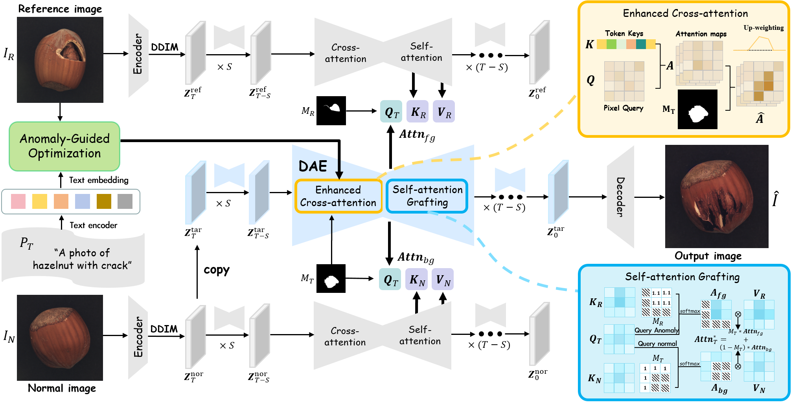

# AI Daily

## One-to-More: High-Fidelity Training-Free Anomaly Generation with Attention Control

**報告日期：** 2026-10-31

**作者與機構：** Haoxiang Rao、Chenyang Si、Fang Zhao、Caifeng Shan（南京大學）；Zhao Wang、Yan Lyu（中國移動紫金創新研究院）；Yuanyi Duan（山東科技大學）。Fang Zhao 與 Caifeng Shan 為通訊作者。[1] [2]

**發表資訊：** IEEE/CVF Conference on Computer Vision and Pattern Recognition（CVPR）2026 主會議論文，頁碼 28492–28501；arXiv:2603.18093。官方 CVF 頁面說明開放版本除浮水印外與錄用版本相同；作者程式庫將本文標為 CVPR 2026 Highlight。[1] [2] [3]

**研究方向：** 少樣本異常生成、training-free diffusion、self-/cross-attention control、工業影像異常檢測與跨類別測試。

### 為什麼選這篇

repo 已有 Energy-Based Transformers、其他 JEPA、VAR 與免訓練生成文章；O2MAG 曾在一篇相關工作整理中被提到，但尚無以 O2MAG 為主題的獨立報告。它是 CVPR 2026 主會議論文，並把近期關注的 training-free、attention modulation 和 zero-shot 問題落在一個具體任務上：只給一張真實異常參考圖，如何把「異常長什麼樣」和「應該出現在哪裡」拆開處理。[1] [2]

這裡的 training-free 不代表完全沒有最佳化。作者凍結 Stable Diffusion 權重，但會針對每張異常參考影像做文字嵌入最佳化，且推理時同時執行三條 diffusion 分支。這個定義差異直接影響成本與可部署性，值得在讀結果時一起考慮。[2]

### 核心貢獻

O2MAG 將合成流程分成三個互補角色：異常參考分支提供缺陷外觀；正常影像分支提供背景與物體先驗；目標分支則在指定遮罩內生成異常。Tri-branch Attention Grafting（TriAG）透過帶遮罩的 self-attention 特徵 grafting，把參考缺陷移到目標位置，同時讓正常分支保護遮罩外內容。[1] [2]

Anomaly-Guided Optimization（AGO）不更新 diffusion U-Net，而是用參考異常的反演結果調整文字 embedding，縮小通用文字提示與工業缺陷語意之間的落差。Dual-Attention Enhancement（DAE）再於選定去噪步驟提高目標遮罩內的 self-attention 與缺陷文字 cross-attention，降低缺陷只淡淡出現、沒有填滿遮罩的情況。[1] [2]

*圖：reference anomaly、normal image 與 target anomaly 三條分支的互動方式。這是原論文 Figure 2，由 PDF 圖片擷取工具取出；來源見 [1]。*

### 技術方法與數學形式

**1. 三分支與輸入反演。** 輸入包含一張異常參考影像與其遮罩 \((I_R,M_R)\)、正常影像 \(I_N\)、目標異常遮罩 \(M_T\)，以及描述物件和缺陷類型的文字 \(y\)。作者以凍結的 Stable Diffusion v1.5 和 DDIM inversion，分別取得參考與正常影像的起始 latent \(z_T^R\) 與 \(z_T^N\)，再令目標分支從正常 latent 開始：

$$
z_T^T=z_T^N.
$$

這個初始化讓生成保留正常物件及背景；後續 attention grafting 才把參考缺陷的外觀注入目標區域。論文在早期去噪的第 \(T_S=5\) 步之後開始操作，並把修改集中在 U-Net decoder 的 self-attention layers \(\mathcal L_S=\{9,\ldots,16\}\)。[2]

**2. TriAG：用兩種來源分工合成前景與背景。** 令目標分支的 query 為 \(Q_T\)，參考異常分支的 key/value 為 \(K_R,V_R\)，正常分支的 key/value 為 \(K_N,V_N\)。作者在注意力 logits 上施加遮罩，分別取得異常前景與正常背景的注意力輸出：

$$
A_{fg}=\operatorname{softmax}\!\left(\mathcal M_R\!\left(\frac{Q_TK_R^\top}{\sqrt d}\right)\right)V_R,\qquad
A_{bg}=\operatorname{softmax}\!\left(\mathcal M_T\!\left(\frac{Q_TK_N^\top}{\sqrt d}\right)\right)V_N.
$$

\(\mathcal M_R\) 抑制參考圖中遮罩外的 key，讓目標 query 主要讀取異常前景；\(\mathcal M_T\) 則限制正常分支對目標缺陷區的貢獻。兩種輸出依目標遮罩融合：

$$
A_T=M_T\odot A_{fg}+(1-M_T)\odot A_{bg}.
$$

因此，\(M_R\) 決定「從參考圖的哪裡取缺陷線索」，\(M_T\) 決定「把線索放到目標圖的哪裡」。遮罩使位置控制明確，不必只期待文字 cross-attention 自行定位。[2]

**3. AGO：以反演重建誤差校準缺陷文字。** 將提示詞輸入凍結的 CLIP text encoder 得到初始 embedding \(e_{ori}=\tau_\theta(y)\)。接著以參考異常影像的反演 latent 為條件，只最佳化 embedding，使 diffusion model 更能重建該異常：

$$
e^*=\arg\min_e\;\mathbb E_{t,\epsilon}\left[\left\|\epsilon_\theta(z_t^R,t,e)-\epsilon\right\|_2^2\right].
$$

作者實作採用 Adam 500 步、learning rate \(3\times10^{-3}\)；U-Net 和其餘基礎模型權重維持凍結。這是一種單張參考條件下的 inference-time prompt embedding optimization，而非完全不做梯度更新。[2]

**4. DAE：讓缺陷訊號在遮罩內更明確。** 對 self-attention，DAE 在參考缺陷遮罩位置增加 logit bias，並以溫度 \(\tau_{fg}\) 調整注意力集中度；簡化表示為

$$
\widetilde A_{fg}=\operatorname{softmax}\!\left(\frac{Q_TK_R^\top/\sqrt d+\log(\gamma)\,\overline M_R}{\tau_{fg}}+\text{mask-fill}\right)V_R.
$$

對 cross-attention，作者在目標遮罩內提高提示詞中 anomaly-type token 的注意力，實作係數 \(C=100\)。這兩個控制分別加強「看向參考缺陷區」與「聽從缺陷語意」，但也是固定手動係數；不同缺陷尺度或資料集是否需要自適應設定，仍是可測問題。[2]

### 實驗結果

主要評估使用 MVTec-AD 的 15 類工業物件與紋理。設定以每類前 1/3 異常影像作參考，剩餘 2/3 作測試；每種異常生成 1,000 組影像—遮罩配對，再訓練下游 U-Net 做異常偵測與定位。生成器使用 Stable Diffusion v1.5，未微調模型權重。[2]

- **生成品質：** MVTec-AD 的平均 KID 越低越好，O2MAG 為 45.55；DFMGAN 為 62.85、AnomalyDiffusion 為 102.67、DualAnoDiff 為 103.87、SeaS 為 125.67。平均 IC-LPIPS 為 0.30；作者提醒，較高的 LPIPS 也可能來自背景被破壞，不能單獨當成真實缺陷多樣性的證據。[2]
- **下游定位：** U-Net 的 MVTec-AD 平均結果為 image-level AP 99.8、pixel AUROC 99.2、pixel AP 86.3、pixel F1 80.8。比較方法中 DualAnoDiff 的 pixel AP/F1 為 84.5/78.8，因此 O2MAG 分別提高 1.8 與 2.0 個百分點；它在此表的多項指標領先，但不是所有資料集和協定都全面領先。[2]
- **對照 training-free AnomalyAny：** 論文另一組 MVTec-AD 比較中，O2MAG 的 pixel AUROC/F1 為 99.2/80.6，AnomalyAny 為 97.4/65.1。此結果支持遮罩式 reference attention control 的價值，但它仍是工業異常生成與下游分割的特定評估，不等同一般圖像編輯品質。[2] [6]
- **跨資料集結果：** VisA 補充實驗的平均 pixel F1，O2MAG 為 64.6、AnomalyAny 為 50.4；但 O2MAG 的 image AUROC 為 93.6，低於 AnomalyAny 的 95.8。作者指出，由於無法取得 AnomalyAny 的完整 VisA 提示和生成細節，對照採用其論文報告的 full-shot 結果，並非完全 matched 的 one-reference 實驗。Real-IAD 的 one-reference 設定中，O2MAG 的 image/pixel AUROC 為 79.3/93.6，pixel AP/F1 為 37.3/41.9；相較 SeaS 的 76.7/87.7 AUROC 與 31.1 pixel AP，定位指標有所提高。[2]
- **推理成本：** Real-IAD 資源表中，O2MAG 單 GPU 訓練時間為 0 小時，但每張影像推理約 28 秒、GPU 記憶體約 32 GB；SeaS 是 160 小時訓練、11 秒/張、24 GB。這呈現清楚的訓練成本與部署延遲取捨，且 O2MAG 的三分支與 embedding optimization 不能被忽略。[2]
- **消融與 zero-shot 範例：** MVTec-AD 中 TriAG 單獨使用時 pixel AUROC/AP/F1 為 99.0/81.9/77.6；加入 DAE 後為 99.0/83.3/77.9，加入 AGO 後為 99.1/82.7/77.7，完整模型為 99.2/86.3/80.8。作者另展示一個 wood-hole 參考缺陷轉移到 hazelnut-hole 目標的跨類別案例，pixel AP/F1 為 86.8/80.2，高於 AnomalyAny 的 78.8/75.0；這是有趣的 zero-shot 線索，但單一缺陷轉移案例不足以證明普遍的開放類別泛化。[2]

### 相關研究脈絡

- **AnomalyDiffusion，AAAI 2024：** 透過可學的異常 embedding 和模型調整建立 few-shot 缺陷生成；O2MAG 把重心移到凍結 diffusion 的注意力移植與逐樣本文字 embedding 最佳化，避免針對每類缺陷完整微調生成器。[4]
- **DualAnoDiff，CVPR 2025：** 以互相連結的 diffusion 分支生成完整影像與局部異常，是 O2MAG 的重要 training-based 對照。兩者都利用分支分工，但 O2MAG 把主要控制移至 inference-time attention grafting，省下每類訓練，代價是較高的單張推理成本。[5]
- **AnomalyAny，CVPR 2025：** 是最近的 training-free 對照，使用正常影像與 attention/prompt 操作生成未知缺陷。O2MAG 的差異是加入一張真實異常參考圖，並以參考遮罩和目標遮罩控制外觀來源與空間落點；因此它減少了對通用文字提示的依賴，卻仍需要可用的缺陷參考及遮罩。[6]
- **MasaCtrl 與 attention editing：** tuning-free mutual self-attention control 已展示可透過交換或共享 self-attention 特徵維持結構；O2MAG 把此方向具體化為工業缺陷的三分支 grafting，並額外加入 anomaly mask、AGO 和雙重注意力增強。[8]
- **CORE，2026 年 10 月 arXiv 預印本：** 同一研究群後續提出 LMM 驅動的 zero-shot/one-shot prompt optimization，並把 O2MAG 列為 one-shot 比較方法。它提示研究路線正從「必須有一張缺陷參考圖」走向「用語言模型把稀疏使用者描述轉成缺陷條件」；截至本報告日期，CORE 仍是 arXiv 預印本，不能當成已審查的獨立複現。[7]

### 評價與研究延伸

我認為 O2MAG 最值得借鏡的是對控制變數的拆分：參考圖提供「what」，目標遮罩提供「where」，正常分支負責「what must stay」。這比單純提高提示詞權重更可解釋，也便於將遮罩、語意和背景保真分別做消融。它的主張則要收斂理解：CVPR 2026 的同行審查與公開程式碼是強證據，但主要任務仍是工業異常合成；論文也承認小缺陷在 attention feature 中不明顯，且對 cable-cable_swap、transistor-misplaced 等邏輯異常仍不理想。[1] [2] [3]

對你近期關注的方向，我會優先追三個可驗證問題：

1. **JEPA predictive critic + energy-based masked refinement：** 以凍結 JEPA 表徵衡量生成缺陷與參考缺陷的相容性，另用正常分支約束遮罩外背景。可先定義

   $$
   E_{edit}(z)=\lambda_r\left\|\phi_{JEPA}(z_{\widetilde M_T})-\phi_{JEPA}(I_R,M_R)\right\|_2^2+\lambda_b\left\|(1-\widetilde M_T)\odot(z-z_N)\right\|_2^2+\lambda_tE_{text}(z,y),
   $$

   再只在目標遮罩 latent 上做 \(z\leftarrow z-\eta\widetilde M_T\odot\nabla_zE_{edit}\)。這是將 EBT 式相容性能量、JEPA 表徵與 O2MAG 空間控制接在一起的研究假說，不是原論文方法；核心實驗應檢查它是否提升小缺陷定位，而非只讓生成更像參考圖。

2. **VAR 的尺度式缺陷生成：** 先預測正常物件的 coarse tokens，再只在遮罩覆蓋的尺度產生 anomaly tokens；以 energy 或 JEPA 預測誤差挑出需要額外 refinement 的尺度。比較全尺度生成與局部 token editing，並同時量測 pixel AP/F1、背景保真、NFE 和 wall-clock。

3. **更嚴格的 zero-shot protocol：** 做 leave-one-category-out 和 leave-one-defect-family-out，並更換參考來源、目標物件與遮罩品質。報告需分開呈現 image-level detection、pixel-level localization、人類真實感評分及推理成本，避免單一跨類別範例或飽和 AUROC 被解讀成通用 zero-shot 能力。

另一個簡單而有價值的改動，是把 DAE 固定的 \(\gamma\)、溫度和 anomaly-token gain 改成由遮罩可信度、缺陷面積與 layer/timestep 決定的控制器。若控制訊號來自 frozen feature statistics，部署時可能維持免微調；但若控制器需要學習，仍要清楚區分「frozen backbone」與「整體 training-free」。

### References

[1]: https://openaccess.thecvf.com/content/CVPR2026/html/Rao_One-to-More_High-Fidelity_Training-Free_Anomaly_Generation_with_Attention_Control_CVPR_2026_paper.html "One-to-More: High-Fidelity Training-Free Anomaly Generation with Attention Control"
[2]: https://arxiv.org/html/2603.18093v1 "One-to-More arXiv full text"
[3]: https://github.com/echrao/O2MAG "Official O2MAG implementation"
[4]: https://ojs.aaai.org/index.php/AAAI/article/view/28696 "AnomalyDiffusion: Few-Shot Anomaly Image Generation with Diffusion Model"
[5]: https://openaccess.thecvf.com/content/CVPR2025/html/Jin_Dual-Interrelated_Diffusion_Model_for_Few-Shot_Anomaly_Image_Generation_CVPR_2025_paper.html "Dual-Interrelated Diffusion Model for Few-Shot Anomaly Image Generation"
[6]: https://openaccess.thecvf.com/content/CVPR2025/html/Sun_Unseen_Visual_Anomaly_Generation_CVPR_2025_paper.html "Unseen Visual Anomaly Generation"
[7]: https://arxiv.org/html/2610.19610v1 "CORE: Contrast-and-Reflect for Self-Supervised Prompt Optimization in Anomaly Synthesis"
[8]: https://arxiv.org/abs/2304.08465 "MasaCtrl: Tuning-Free Mutual Self-Attention Control for Consistent Image Synthesis and Editing"
