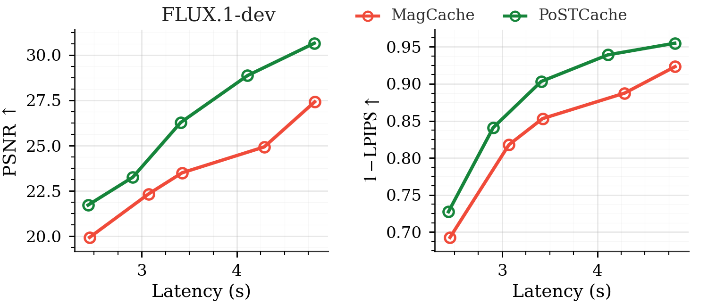

# AI Daily: PoSTCache——讓 Diffusion Cache 從「預測」變成「可回頭修正」

**日期：2026-10-20**　**方向：Diffusion／Flow Matching、training-free、trajectory smoothing、cache acceleration**

今日選讀 **PoSTCache**。它不只猜測哪些去噪步可以跳過，而是把跳步得到的預測暫時視為「待修訂的估計」：當稍後重新計算的完整步提供新訊息時，方法把這項 feedback 傳回前面的區間，再以原本的 solver 重積分軌跡。另一個核心是從少量完整生成軌跡估計未來 anchor 的整體價值，選擇比單看局部 cache error 更有用的計算步。[1] [2]

## 論文資訊

- **標題：** *PoSTCache: From Forecasting to Postdictive Smoothing for Revisable Diffusion Caching*
- **作者與機構：** Liwei Lan（School of Software, Tsinghua University）、Hui Chen（BNRist, Tsinghua University）、Jungong Han（Department of Automation, Tsinghua University）、Guiguang Ding（School of Software, Tsinghua University）。作者與機構對應依原論文 PDF 首頁核實。[2]
- **日期與領域：** arXiv:2610.25664v1，2026-10-19，cs.CV；arXiv metadata 列為 37 頁、13 張圖。[3]
- **會議／期刊狀態：** 原論文首頁標示「Preprint. Under review」。截至本次查核，arXiv metadata 沒有 journal reference 或正式會議紀錄，因此本文只稱 **arXiv 預印本**，不稱已接收或已發表。[2] [3]
- **資源：** [論文 HTML](https://arxiv.org/html/2610.25664)｜[論文 PDF](https://arxiv.org/pdf/2610.25664)｜[arXiv metadata](https://export.arxiv.org/api/query?id_list=2610.25664)。目前未核實到作者公開程式庫或後續版本。[3]

## 核心貢獻與方法

許多 diffusion cache 以目前 latent 或模型特徵推估後續步，並在誤差變大時才重新執行完整模型。這是單向的 forecasting：已經跳過的 prediction 一旦影響後續狀態，未來的完整計算通常只供接下來使用，不能修正已走過的軌跡。PoSTCache 把後來的完整計算視為帶有「回顧資訊」的 anchor，讓 skipped prediction 在收到新訊息後仍可更正。原文 Figure 1(a–b) 畫出這個差別；Figure 1(c) 比較其品質—延遲曲線。[1]

先把任一 sampler 寫成

$$
x_{k+1}=S_k(x_k,u_k;\tau_k),
$$

其中 $x_k$ 是第 $k$ 步 latent，$u_k$ 是模型預測的 noise、clean estimate、velocity 或 flow vector，$S_k$ 是原有 scheduler／solver 更新，$\tau_k$ 表示採樣時間。若在 anchor $a$ 與下一個完整計算步 $b$ 之間使用 cache，歷史資訊 $H_a$ 會產生 forward proposal $\tilde u_k=P_k(H_a)$。在 $b$，完整模型預測 $\bar u_b$ 與舊 proposal $\tilde u_b$ 的差異是新資訊：

$$
r_b=\bar u_b-\tilde u_b.
$$

若 $e_k=\bar u_k-\tilde u_k$ 表示同一個狀態下「完整計算」與「forward proposal」的 prediction error，PoSTCache 先用條件期望表達未來 anchor 對過去誤差的修正：

$$
\mathbb E[e_k\mid r_b]
=\Sigma_{e_k r_b}(\Sigma_{r_b r_b}+R_b)^{-1}r_b,
\qquad
\hat u_k=\tilde u_k+\mathbb E[e_k\mid r_b].
$$

$\Sigma_{e_k r_b}$ 是過去誤差與 anchor innovation 的交叉共變異數；$R_b$ 表示 anchor residual 的不確定性。完整的高維條件增益難以在每次推論中直接估計，作者因此採用依區間位置遞增的純量近似：

$$
\hat u_k=\tilde u_k+w_{k\mid a,b}r_b,
\qquad
w_{k\mid a,b}=\frac{\eta_k-\eta_a}{\eta_b-\eta_a},\quad a<k<b.
$$

$\eta$ 是採樣進度；$w$ 從區間起點的 0 遞增至未來 anchor 的 1，使後來訊息對較接近 $b$ 的估計影響更大。只改 prediction 而不改已生成 latent 仍會留下 state–prediction mismatch，因此作者由 $x_a$ 重新套用同一個 solver：

$$
\hat x_a=x_a,\qquad \hat x_{k+1}=S_k(\hat x_k,\hat u_k;\tau_k).
$$

預設流程會保留未來 anchor 已算好的 prediction，而不是額外再跑一次模型刷新它；這節省了更新成本，但也留下可測的狀態—預測不一致。[1] [2]

第二個元件是 **Posterior Variance Reduction（PVR）**，用來選擇在哪些 timestep 做完整計算。作者先對每個模型／採樣設定執行 $N$ 條完整離線軌跡，令 $z_t^{(n)}$ 為第 $n$ 條軌跡在時間 $t$ 的預測，$\mu_t$ 為其平均；據此估計 timestep 間的正規化共變異數：

$$
K_{ij}=\frac{1}{ND}\sum_{n=1}^{N}\left\langle z_i^{(n)}-\mu_i,\;z_j^{(n)}-\mu_j\right\rangle.
$$

若目前已選 anchor 集合為 $A$，PVR 把時間 $t$ 的條件變異數估為

$$
V_t(A)=K_{tt}-K_{tA}K_{AA}^{-1}K_{At}.
$$

候選 timestep $s$ 加入 $A$ 後，可帶來的條件共變異數為

$$
C_{ts\mid A}=K_{ts}-K_{tA}K_{AA}^{-1}K_{As},
$$

其整體邊際效益寫成

$$
\Delta(s\mid A)=\sum_t\gamma_t\frac{C_{ts\mid A}^{2}}{V_s(A)}.
$$

$\gamma_t$ 是依 scheduler 設定的時間權重。PVR 每次選擇使 $\Delta(s\mid A)$ 最大的下一個 anchor，直到計算預算用完。這與單純挑選 local error 看起來最大的步不同：目標是減少整條軌跡的條件不確定度，而非只修正某一個時間點。[1] [2]

原文圖中 FLUX.1-dev 的兩個品質—延遲子圖，顯示在作者測試的相同速度區間內，PoSTCache 的 PSNR 與 $1-\mathrm{LPIPS}$ 均高於 MagCache。此處只裁出 Figure 1(c) 的 FLUX.1-dev 面板，保留論述所需的座標軸、圖例與曲線。

*圖 1。由 PoSTCache 原論文 PDF 擷取後聚焦裁切，只保留 FLUX.1-dev 的 PSNR 與 $1-\mathrm{LPIPS}$ 兩個面板；綠線為 PoSTCache，紅線為 MagCache。圖中兩種品質指標皆為越高越好。[1] [2]*

## 實驗結果

作者測試兩個文字生圖模型（FLUX.1-dev、Qwen-Image-2512）與三個文字生影片模型（Wan 2.1、CogVideoX 2B、OpenSora 1.2），以單張 NVIDIA H200 執行；每個模型設定用 $N=10$ 條完整離線軌跡做校準。文字生圖使用 200 個 DrawBench prompts、三個 seed；影片使用 944 個 VBench prompts、五個 seed。效率報告 latency、speedup、FLOPs 與 GPU memory；生成品質報告 ImageReward、CLIP 或 VBench，並以 LPIPS、SSIM、PSNR 衡量相對 full inference 的成對重建差異。[1] [2]

- **FLUX.1-dev：** PoSTCache-slow 為 3.41 秒、2.74× speedup，LPIPS 0.0966、SSIM 0.8961、PSNR 26.625、ImageReward 1.0322、CLIP 31.728。作為同一表中的 slow 比較，MagCache 為 3.43 秒、2.72×，LPIPS 0.1479、SSIM 0.8488、PSNR 23.648、ImageReward 1.0188、CLIP 31.712。[1]
- **Qwen-Image-2512：** PoSTCache-slow 為 10.78 秒、2.90×，LPIPS 0.0608、SSIM 0.9302、PSNR 27.588、ImageReward 1.0901、CLIP 31.631；DiCache-slow 為 11.62 秒、2.69×，LPIPS 0.1278、SSIM 0.8670、PSNR 24.632、ImageReward 1.0674、CLIP 31.432。[1]
- **Wan 2.1 影片：** PoSTCache-slow 為 29.31 秒、2.37×，LPIPS 0.0597、SSIM 0.9067、PSNR 29.232、VBench 79.44%；SenCache-slow 為 29.91 秒、2.32×，LPIPS 0.1034、SSIM 0.8685、PSNR 26.867、VBench 78.86%。[1]

機制驗證中，Qwen-Image 與 Wan 2.1 的 future-anchor innovation 對區間內誤差方向之 pooled Spearman correlation 為 $\rho=0.98$。作者另以 135 個 schedules 和 16 條 held-out trajectories 檢驗 PVR schedule 對 stored full-trajectory error 的預測，報告 Spearman correlation 為 0.858 與 0.963，pairwise accuracy 為 83.7% 與 92.3%。在 FLUX.1-dev 的消融中，PVR 加 smoothing 的 LPIPS／SSIM／PSNR 為 0.0968／0.8944／26.284；PVR without smoothing 為 0.1293／0.8712／25.287，表示「選對 anchor」和「把 future correction 傳回去」在該設定下都重要。[2]

## 相關研究脈絡

- **TeaCache 與 TaylorSeer** 是 forward cache／forecasting 脈絡的代表：它們依 timestep 或歷史 feature 估計哪些計算可以重用或預測未來 feature。PoSTCache 的主要差異不是另做一個 proposal，而是把 proposal 保留為暫定值，等待 future anchor 回來修正。[5] [6]
- **DiCache、MagCache 與 SenCache** 探索線上 probe、累積 skip error 或敏感度估計，調整 cache 的使用時機。PoSTCache 可把其中一些方法當作前向 proposal 策略，再疊加其 smoothing 與 PVR；因此它更像一個可組合的修正層，而非取代所有前向 cache。[7] [8] [9]
- **DPCache** 將 timestep 選擇寫成全域路徑規劃，並已在 CVPR 2026 官方頁面列為會議論文。PoSTCache 與它最接近之處是都重視整條採樣軌跡的 anchor／schedule；差別在 PoSTCache 使用 future innovation 做回溯修正，並以跨 timestep covariance 估算 anchor 的條件變異數降低。[1] [4]
- **ERTACache** 以離線校準、時間步調整和 residual rectification 處理 cache 誤差累積。它與 PoSTCache 都關心誤差修正，但 PoSTCache 的新重點是 later evidence 對 earlier estimates 的 backward information flow。[10]

## 評價與研究靈感

我認為 PoSTCache 最值得注意的地方，是把 cache 的問題從「如何預測下一步」改寫成「何時值得重新計算，且新算出的結果如何修正舊軌跡」。這個觀點使它有機會和多種 forward cache 組合。實驗涵蓋五個影像／影片生成模型，且重建品質指標在多個設定中有改善；不過目前證據仍是單篇 arXiv 預印本的指定模型與硬體結果，不能直接推論所有採樣器或生成器都會受益。[1] [2] [3]

最重要的限制是 **training-free 不等於零成本，也不等於免校準的 strict zero-shot**。每個模型／採樣設定仍需約十條完整離線軌跡；作者量到 Qwen 約 5.05 分鐘、Wan 約 11.12 分鐘的校準軌跡收集時間。PVR 使用共享的 offline schedule，未必能反映每個 prompt 或樣本特有的誤差；離線軌跡上的 uncertainty reduction 也不完全等於 online reintegration 後的 closed-loop 最終品質。實作把高維共變異數增益近似成 timestep 進度的純量，長 cache interval 或更積極的跳步可能會破壞這項近似。此外，主要 baseline 的 Fast／Slow 比較通常先以少量 prompts 對齊 latency，而非對每個方法完整做 quality-optimal tuning；結果應理解為作者報告的比較，而不是毫無條件的普遍 SOTA 排名。[1] [2]

這篇給我的三條可驗證延伸方向如下；它們是研究假設，不是 PoSTCache 已完成的實驗：

1. **Energy-based anchor gate：** 把 PVR 的預期變異降低量和 frozen energy／條件相容性分數共同用於 anchor selection，例如在固定計算預算下最小化
   $$
   \mathcal J(A)=\sum_t\gamma_t V_t(A)+\lambda\sum_t E_\theta(\hat x_t,c).
   $$
   這可檢驗「讓 trajectory 更容易預測」是否也會使影像在語義上更符合 prompt，而不是只改善 paired reconstruction 指標。
2. **JEPA predictive uncertainty：** 以 JEPA predictor 的 latent disagreement 作為廉價 online uncertainty signal，當預測分歧與離線 PVR 不一致時，觸發 sample-adaptive anchor 或重新估計 correction gain。關鍵實驗是比較 shared schedule、prompt-specific PVR 和 JEPA disagreement 三者在相同 NFE 下的品質／延遲曲線。
3. **VAR 與 attention modulation：** 測試 next-scale visual AR 是否也存在可由後續尺度回饋修訂較早尺度的離散軌跡。可先保持已提交 token 不變，只以 PVR-like expected gain 選擇較值得重算的 scale；再檢驗該 gain 能否轉成 inference-time attention bias。這是跨到離散生成的假設，不能直接把 diffusion 的連續 latent smoothing 搬成已證實的 VAR 方法。

一個最小 follow-up 實驗可以固定同一批 prompt、seed、模型和總 NFE，比較 forward-only cache、PoSTCache、Energy gate、JEPA disagreement gate；分別記錄離線校準成本、每張／每段延遲、LPIPS／PSNR、語義評分與 schedule 的跨 prompt 穩健性。這樣才能分辨收益來自「多做了校準」還是「future feedback 本身更有效」。

## References

[1]: https://arxiv.org/html/2610.25664 "PoSTCache: From Forecasting to Postdictive Smoothing for Revisable Diffusion Caching"
[2]: https://arxiv.org/pdf/2610.25664 "PoSTCache arXiv PDF"
[3]: https://export.arxiv.org/api/query?id_list=2610.25664 "arXiv metadata for 2610.25664"
[4]: https://cvpr.thecvf.com/virtual/2026/poster/36824 "Denoising as Path Planning: Training-Free Acceleration of Diffusion Models with DPCache"
[5]: https://arxiv.org/html/2411.19108 "It's Time to Cache for Video Diffusion Model"
[6]: https://arxiv.org/html/2503.06923v1 "From Reusing to Forecasting: Accelerating Diffusion Models with TaylorSeers"
[7]: https://arxiv.org/html/2508.17356v1 "DiCache: Let Diffusion Model Determine Its Own Cache"
[8]: https://arxiv.org/html/2506.09045v2 "MagCache: Fast Video Generation with Magnitude-Aware Cache"
[9]: https://arxiv.org/html/2602.24208v1 "SenCache: Accelerating Diffusion Model Inference via Sensitivity-Aware Caching"
[10]: https://arxiv.org/html/2508.21091v1 "ERTACache: Error Rectification and Timesteps Adjustment for Efficient Diffusion"
