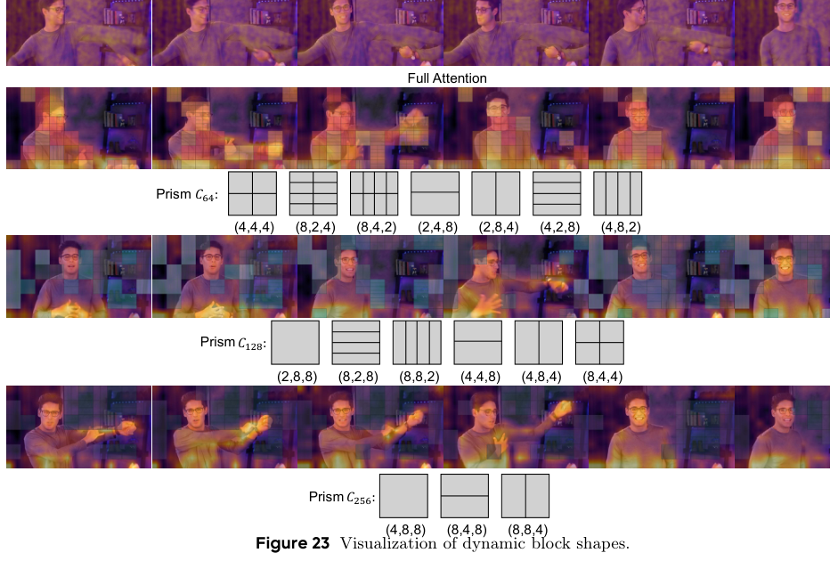

# AI Daily: Prism：以音視覺內容自適應稀疏注意力支援原生 2K 聯合影片—音訊生成
> 報告整理：Manus AI  
> 日期：2026-10-26  
> 方向：高解析影片／音訊生成、attention modulation、稀疏注意力、Flow Matching

## 今日唯一深讀
### Prism: Dynamic Sparse Attention for Native 2K Joint Video-Audio Generation Model Training

## 為什麼選這篇？
八篇候選中，**Prism** 不是正式會議論文，而是 2026-10-04 提交的 arXiv v1 預印本；截至 2026-10-26，arXiv API 沒有 `journal_ref` 或 conference 欄位，作者官方 GitHub 也將它列為 arXiv technical report，而不是已接受論文。[1] [4] [5] 這點不如已正式刊於 ICML 2026 PMLR 的 TFM，或已進入 ICLR 2026 proceedings 的 Purrception。[13] [14]

我仍選它，理由不是把預印本的出版地位抬高，而是它在本批候選中最直接命中使用者偏好的 **attention modulation**，同時把 **content-adaptive routing、音視覺條件、原生 2K、Flow Matching 與 kernel-level efficiency** 放到一個可拆解的系統裡。它也有 48 頁原文、完整數學式、主表與多組消融、跨 backbone 測試、官方程式與 README，證據完整度足以支撐一篇技術深讀。[2] [3] [5] [6] 

較新的 Looking Ahead（2026-10-21 arXiv v1）對 VAR 式 autoregressive video 與 future-chunk supervision 更直接，但截至截止日同樣沒有可核實的正式 venue，且其核心不是 attention routing。[15] 因此本次取捨是：**放棄 TFM／Purrception 的正式會議優勢，換取 Prism 對 attention modulation、2K scaling 與可驗證工程問題更集中的研究刺激。** Prism 本身不是 Energy-Based Transformer、JEPA、VAR、training-free 或 zero-shot 方法；以下會把這些方向標成可驗證的後續研究，而不冒充原論文貢獻。

## 論文資訊

- **論文標題：** *Prism: Dynamic Sparse Attention for Native 2K Joint Video-Audio Generation Model Training*
- **作者：** Shuyuan Tu、Qi Tian、Yinming Huang、Yue Wu、Xintong Han、Kaihang Pan、Weijie Kong、Jiangfeng Xiong、Jian-Wei Zhang、Zuxuan Wu、Yu-Gang Jiang。[1] [3]
- **機構：** ¹ Fudan University；² Tencent Hunyuan Foundation Model Team；³ Zhejiang University。Shuyuan Tu 同時列 Fudan 與 Tencent Hunyuan，且註明工作在 Tencent 實習期間完成；Zuxuan Wu、Yu-Gang Jiang 為 corresponding authors。[3]
- **arXiv／DOI／官方 ID：** arXiv:2610.05416v1，primary category `cs.CV`。截至截止日未列 DOI；官方識別以 arXiv ID 為準。[4]
- **發布日期：** arXiv 顯示 Submitted on 2026-10-04；GitHub repository 於 2026-09-21 建立、2026-10-06 推送公開版本。[4] [7]
- **venue 狀態：** **arXiv v1 預印本，未核實正式會議／期刊接收。** arXiv API 沒有 `journal_ref`；截至截止日沒有可引用的 acceptance record。[1] [4]
- **論文：** [arXiv 摘要頁](https://arxiv.org/abs/2610.05416v1)、[HTML 全文](https://arxiv.org/html/2610.05416v1)、[PDF](https://arxiv.org/pdf/2610.05416)
- **程式與設定：** [Tencent-Hunyuan/Prism 官方 repository](https://github.com/Tencent-Hunyuan/Prism)、[官方 README](https://raw.githubusercontent.com/Tencent-Hunyuan/Prism/main/README.md)
- **重現提醒：** GitHub 公開程式、preview checkpoint 與設定，但 Releases API 截至查核日為空；native 2K 訓練仍需大規模 GPU、原始影片／音訊與外部模型權重。[5] [6]

## 一句話結論
Prism 把原生 2K 聯合影片—音訊生成的稀疏化，從「固定切 block、固定保留比例」改成由**視覺方向變異、音訊耦合、區域資訊密度**共同決定 block 形狀與每個 query 的 key-block 集合；作者在其 MOVA 設定中報告，相對 full attention 每 step 訓練時間由 26.5 分鐘降至 10.6 分鐘、顯存由 72.8G 降至 38.0G，且 2K-Bench 的 AQ 由 0.42 升至 0.61、MotionQ 由 0.53 升至 0.89。[2] [3] 但 2.5× 是 per-step training-time 比較，不是完整訓練 wall-clock、能耗或相同 update budget 的證明；主結果也仍是作者自建 benchmark 與作者執行的評估流程。

*圖 1。自原論文 PDF 第 42 頁聚焦裁切 Figure 23，保留 Full Attention 與 Prism 的影片列、C64／C128／C256 的 block-shape rows、shape legend 及 caption；不含上方 Figure 22 的 attention matrix。圖中細粒度 C64 覆蓋人臉／手部，粗粒度 C256 覆蓋 bookshelf／wall background，而 C128 對 torso／clothing boundary 使用中等粒度。依 /pdf-image-extractor 技能從原論文 PDF 擷取圖像後，只保留 Figure 23 完整圖框與圖說，未放入整頁截圖。[3]*

## 核心貢獻與方法

### 1. 問題：原生 2K 的瓶頸不是只有 token 數量

Prism 以 MOVA 的 joint video-audio DiT 為基礎。影片 latent 在原生 2K、長片段與 24 FPS 下會產生極長的時空 token sequence；full self-attention 的二次成本同時帶來訓練時間與顯存壓力。作者的另一個觀察是，背景區域的重複 token 會稀釋 attention，而只依視覺冗餘做稀疏化又可能忽略正在發聲或需要同步的區域。[2] [3]

Prism 的設計只稀疏化 **video self-attention**；audio self-attention、text/video/audio cross-attention 保持原樣。它在每一層、每一個 attention head、每個 macro-zone 內決定三件事：

1. 這個區域沿時間、水平或垂直方向的資訊變化有多大；
2. 音訊對這個區域的 cross-attention 耦合在哪個方向較強；
3. 該區域應使用 64、128 或 256 token 的 block volume，以及該 volume 對應的 anisotropic edge shape。

### 2. Macro-zone 與視覺 directional variance

將 video token grid 切成不重疊的 macro-zone，設定

$$
Z_T=Z_H=Z_W=8,
\qquad
N_m=\frac{T}{Z_T}\frac{H}{Z_H}\frac{W}{Z_W},
$$

其中 $T,H,W$ 是 video latent 的時間、高度與寬度，$N_m$ 是 macro-zone 數量。對 zone $m$ 的 value feature $V_m\in\mathbb{R}^{Z_T\times Z_H\times Z_W\times D}$，沿方向 $d\in\{T,H,W\}$ 平均另外兩條軸，再計算 channel-wise directional variance：

$$
\sigma^2_{v,d}(m)
=\frac{1}{D}\sum_c\frac{1}{Z_d}
\sum_i\left(\bar V^{(d)}_{m,i,c}-\mu^{(d)}_{m,c}\right)^2.
$$

正規化後得到

$$
 r_{v,d}(m)=
 \frac{\sigma^2_{v,d}(m)}
 {\sigma^2_{v,T}(m)+\sigma^2_{v,H}(m)+\sigma^2_{v,W}(m)}.
$$

$V_m$ 選用 value feature，而不是 query 或 key；作者的理由是 value 直接進入 attention output，其方向變化較接近 block pooling 可能丟失的資訊。[2] [3]

### 3. Audio guidance：讓聲音改變 visual block allocation

令前一層 audio-to-video cross-attention 的輸出為 $\hat h_{t,h,w}$，音訊耦合強度為

$$
 a_{t,h,w}=\|\hat h_{t,h,w}\|_2.
$$

將其在 zone $m$ 內平均，並以所有 zones 的最大平均值正規化，得到 $\bar a(m)\in[0,1]$。沿 $T,H,W$ 計算 audio coupling 的方向比例 $\hat v_{a,d}(m)$ 後，Prism 將視覺與音訊訊號合併為

$$
 g_d(m)=r_{v,d}(m)+\bar a(m)\hat v_{a,d}(m)+\epsilon,
 \qquad \epsilon=10^{-4}.
$$

$\bar a(m)$ 是 audio gate：靜音或低耦合區域的 audio term 近似消失，sound-producing region 則會提高音視覺相關方向的細分優先級。由於 MOVA 的 video self-attention 排在同層 audio-to-video cross-attention 之前，實作以前一層 cache 的 audio-conditioned hidden state 作 guidance；第一層沒有 audio norm，因此只使用視覺 variance。[2] [3]

### 4. 由資訊密度決定 block volume，再決定 anisotropic shape

先以 zone 內 spatial variance 加上 temporal frame-difference variance 得到資訊密度 $\rho_{\mathrm{raw}}(m)$，再正規化為 $\rho(m)\in[0,1]$。作者使用兩個 threshold：

$$
B(m)=
\begin{cases}
64,&\rho(m)\ge\tau_{128},\\
128,&\tau_{256}\le\rho(m)<\tau_{128},\\
256,&\rho(m)<\tau_{256},
\end{cases}
\qquad
\tau_{128}=0.5,\quad \tau_{256}=0.25.
$$

高資訊區使用較小的 $B=64$ block，重複背景使用 $B=256$。在固定 block volume 下，Prism 最小化沿各軸平均 pooling 的資訊損失：

$$
\min_{b_T,b_H,b_W}
\sum_{d\in\{T,H,W\}}g_d(m)(b_d^2-1),
\qquad b_Tb_Hb_W=B(m).
$$

連續解滿足

$$
 b_d^*\propto g_d(m)^{-1/2},
$$

因此 variance 較大的方向得到較短的 block edge。令 $\ell_d=\log_2b_d$、$S=\log_2B(m)$，作者再將連續解投影到有限候選集合 $\mathcal C_B$，選擇 log-space 距離最近的離散 shape。[2] [3]

候選集合為：

- $C_{64}=\{(4,4,4),(8,2,4),(8,4,2),(2,4,8),(2,8,4),(4,2,8),(4,8,2)\}$；
- $C_{128}=\{(2,8,8),(8,2,8),(8,8,2),(4,4,8),(4,8,4),(8,4,4)\}$；
- $C_{256}=\{(4,8,8),(8,4,8),(8,8,4)\}$。

所有 token 仍以 zone 為單位共用同一個 shape，之後重排為 block-contiguous layout；作者不採 token-level 混合 shape，以避免 irregular clustering、padding 與非 coalesced memory access。[2] [3]

### 5. Hybrid Top-k + Top-p 的 per-query key-block selection

在固定 block partition 後，對 mean-pooled query/key representative 計算 block relevance：

$$
P_{ij}=\operatorname{softmax}_j
\left(\frac{\bar Q_i\bar K_j^\top}{\sqrt D}\right).
$$

對每個 query block $i$，先用 Top-$k$ 提供最低 coverage，再依機率排序加入最小集合，使累積權重首次達到 $p$：

$$
\mathcal S_i=\operatorname{TopK}(P_i,k)
\cup\operatorname{TopP}(P_i,p).
$$

實驗主要設定為 Top-$k$ 保留 95% 的 block coverage，再加 Top-$p=0.2$。被選 block 上的細粒度 attention output 為

$$
O_i=\operatorname{softmax}
\left(\frac{Q_iK_{\mathcal S_i}^{\top}}{\sqrt D}\right)V_{\mathcal S_i}.
$$

routing statistics $\rho$、$g_m$ 與 $P_i$ 都 detach，梯度只經過被選中的 sparse attention；因此 shape assignment 和 key-block 選擇本身不是可微學習的 policy，而是由當前 hidden/value/audio statistics 驅動的離散路由。[2] [3]

### 6. 訓練與工程設定

作者採用 joint video/audio Flow Matching。令 clean video/audio latent 為 $z_0^v,z_0^a$，noise endpoint 為 $z_1^v,z_1^a\sim\mathcal N(0,I)$，則

$$
 z_t=(1-t)z_0+t z_1,
$$

且 velocity target 為 $z_1-z_0$。主要 loss 為

$$
\mathcal L=\mathbb E\left[
\left\|\hat v_\theta^v(z_t^v,z_t^a,t,c)-(z_1^v-z_0^v)\right\|_2^2
+\left\|\hat v_\theta^a(z_t^v,z_t^a,t,c)-(z_1^a-z_0^a)\right\|_2^2
\right],
$$

其中 $c$ 是條件，$\hat v_\theta^v$、$\hat v_\theta^a$ 是 video/audio velocity prediction。工程上使用 bf16、AdamW、FSDP、Sequence Parallelism 與 custom Triton 3.3.1/CUDA 12.8 kernel；Triton tile 的 $BLOCK_M=BLOCK_N=64$，head dimension block 為 128。[3] [6]

A.6 表示訓練時只有 attention modules trainable，其餘參數 frozen；初始化使用 MOVA checkpoint，主要替換 video self-attention。這使 Prism 的結果應解讀為「在既有 joint video-audio backbone 上訓練 sparse attention modules」，而不是從零預訓練一個新的 2K video generator。[3] [6]

## 實驗結果

### 1. 資料與評估 protocol

訓練資料為約 100,000 個 2K video-audio clips，影片長度 8–12 秒、24 FPS，經過短邊至少 1440 pixels、aesthetic predictor、MANIQA、Dynamic Degree、AudioBox PQ 與 speech SyncNet confidence 等篩選，再由 Qwen3-VL-235B-A22B-Instruct 與 Qwen3-Omni 產生 caption。[3]

主測試集 **2K-Bench** 包含 300 個 unseen 2K videos，每段 10 秒、24 FPS。作者做 exact URL dedup 與 perceptual hash Hamming distance < 8 的 near-duplicate 排除；並以 FVD 檢查 ground-truth 與 training set 的分離。[3]

評估涵蓋：

- 視覺／動態：AQ、DD、TF、ID、MUSIQ、MANIQA、MotionQ；
- 音訊品質／內容：PQ、CU、cpCER；
- 音畫同步：DeSync、Sync-D、Sync-C；
- 另以 VABench、MOVA-Bench 進行 720p 評估，並以 200 位成人做 2AFC user study。[2] [3]

### 2. 2K-Bench：相對 Ovi、LTX-2.3、MagiHuman、MOVA

Table 1 的主要數值如下。AQ、DD、TF、ID、PQ、CU、MUSIQ、MANIQA、MotionQ 越高越好；DeSync、cpCER 越低越好。這些是作者在 2K-Bench 上的 reported metrics，不是獨立第三方重測。[3]

- **Prism：** AQ 0.61、DD 0.52、TF 0.982、ID 0.94、PQ 7.69、CU 7.34、DeSync 0.63、cpCER 0.187、MUSIQ 62.25、MANIQA 0.438、MotionQ 0.89。
- **MOVA：** AQ 0.42、DD 0.39、TF 0.903、ID 0.88、PQ 6.80、CU 6.26、DeSync 1.05、cpCER 0.374、MUSIQ 53.21、MANIQA 0.363、MotionQ 0.53。
- **LTX-2.3：** AQ 0.48、DD 0.41、TF 0.943、ID 0.91、PQ 7.05、CU 6.83、DeSync 0.95、cpCER 0.382、MUSIQ 55.60、MANIQA 0.403、MotionQ 0.66。
- **MagiHuman：** AQ 0.40、DD 0.37、TF 0.912、ID 0.87、PQ 6.72、CU 6.14、DeSync 1.08、cpCER 0.420、MUSIQ 52.68、MANIQA 0.337、MotionQ 0.58。
- **Ovi：** AQ 0.38、DD 0.35、TF 0.891、ID 0.85、PQ 6.68、CU 5.92、DeSync 1.12、cpCER 0.468、MUSIQ 51.43、MANIQA 0.326、MotionQ 0.42.

Sync-D 為 Prism 6.74、Ovi 8.28、LTX-2.3 7.62、MagiHuman 8.05、MOVA 7.96；Sync-C 則為 7.27、5.21、5.92、5.45、5.62。作者報告 Prism 在表中大部分指標領先，但這個 cross-model comparison 仍有重要條件差異：LTX-2.3 在 2K-Bench 依原 pipeline 先生成 720p 再 upsample，其餘競爭者不一定與 Prism 共享資料、訓練、RLHF、audio post-processing 或模型規模。[2] [3]

### 3. Sparse-attention ablation：從 full attention 到 Prism

Table 2 比較 Full Attention、VMoBA、SpargeAttn2 與 Prism。以下數值依序為 AQ、TF、PQ、CU、DeSync、cpCER、MANIQA、MotionQ；兩個外部 sparse baseline 的 Base Sparsity 均為 95%。

- **Full Attention：** AQ 0.42、TF 0.903、PQ 6.80、CU 6.26、DeSync 1.05、cpCER 0.374、MANIQA 0.363、MotionQ 0.53。
- **VMoBA：** 0.46、0.924、7.04、6.52、0.91、0.328、0.381、0.59。
- **SpargeAttn2：** 0.47、0.928、7.10、6.55、0.90、0.319、0.384、0.61。
- **Prism：** 0.61、0.982、7.69、7.34、0.63、0.187、0.438、0.89。

作者另報 Prism 相對 SpargeAttn2 的 MotionQ 提升 46%、DeSync 改善 30%。這組結果支持「內容自適應 shape 加音訊引導」在作者 protocol 中比固定／較單一的 sparse routing 更有效，但不能單獨拆出 dynamic shape、audio guidance、hybrid Top-k/Top-p 各自對 full-attention 差距的因果貢獻；後面的消融才提供部分分解。[2] [3]

### 4. 原生 2K 的訓練時間與顯存

Table 5 將不同 sparse attention 方法放在 native 2K 設定比較。Prism 的每 step training time 為 10.6 分鐘、inference memory 38.0G；Full Attention 為 26.5 分鐘、72.8G。以 26.5/10.6 計算約為 2.5× per-step speed ratio，但這不等於 2.5× 完整訓練加速。[3]

- **Full Attention：** 每步 26.5 分鐘、inference memory 72.8G；AQ 0.42、TF 0.903、PQ 6.80、DeSync 1.05、MotionQ 0.53。
- **Prism：** 每步 10.6 分鐘、38.0G；AQ 0.61、TF 0.982、PQ 7.69、DeSync 0.63、MotionQ 0.89。
- **SpargeAttn2：** 每步 8.4 分鐘、36.7G；AQ 0.47、TF 0.928、PQ 7.10、DeSync 0.90、MotionQ 0.61。
- **LUVE：** 每步 18.7 分鐘、62.0G；AQ 0.50、TF 0.926、PQ 7.19、DeSync 0.85、MotionQ 0.62。
- **PyramidFlow：** 每步 18.3 分鐘、65.8G；AQ 0.51、TF 0.944、PQ 7.08、DeSync 0.84、MotionQ 0.70。
- **T3：** 每步 16.9 分鐘、52.0G；AQ 0.53、TF 0.939、PQ 7.28、DeSync 0.79、MotionQ 0.71.

同一表中，Prism 不是所有效率軸都絕對最小：SpargeAttn2 的每 step time 更短、memory 也略低。Prism 的論點是以較高的 dynamic-routing overhead 換取更高品質與更低同步錯誤，而不是聲稱單純 kernel latency 全面勝出。

Table 13 的 native 2K inference 則在 4 張 NVIDIA H800、10 秒、24 FPS 設定比較 MOVA Full Attention 與 Prism：MOVA 為 1091 秒、72.8G、AQ 0.42、MotionQ 0.53、DeSync 1.05；Prism 為 331 秒、38.0G、AQ 0.61、MotionQ 0.89、DeSync 0.63。作者據此報告超過 3× faster、47% less memory、AQ +45%、MotionQ +68%、DeSync improvement 40%；但 331 秒中 286 秒仍花在 sparse kernel/output scatter，代表其主要瓶頸已從 dense attention 轉成 block routing 與 scatter。[3]

### 5. 元件消融：audio、directional shape 與 random shape

Table 9 的 native 2K ablation 如下，數值依序為 AQ、TF、PQ、CU、DeSync、cpCER、MANIQA、MotionQ：

- **完整 Prism：** AQ 0.61、TF 0.982、PQ 7.69、CU 7.34、DeSync 0.63、cpCER 0.187、MANIQA 0.438、MotionQ 0.89。
- **移除 audio guidance：** 0.57、0.969、7.46、6.97、0.79、0.263、0.420、0.78。
- **移除視覺方向變異 $r_{v,d}$：** 0.53、0.943、7.31、6.82、0.73、0.219、0.399、0.70。
- **只用 C64：** 0.57、0.965、7.49、7.08、0.70、0.221、0.419、0.80。
- **Random Shape：** 0.40、0.894、6.73、6.18、1.03、0.372、0.339、0.46。

作者的解讀是：視覺 guidance 是主要品質驅動，audio guidance 對 synchronization 有互補作用；固定只用 C64 和 random shape 都劣於完整 dynamic shape。這是有用的 component-level evidence，但仍是同一資料、同一 backbone、同一作者 protocol 的消融，不能視為對所有 multimodal sparse attention 的普遍因果證明。[3]

### 6. 解析度 scaling、跨 backbone 與人評

同一影片 resize 到不同解析度時，Prism 相對 Full Attention 的 2K row 為 0.61/0.982/7.69/7.34/0.63/0.187/0.438/0.89（AQ、TF、PQ、CU、DeSync、cpCER、MANIQA、MotionQ），training time 10.6 分鐘、GPU 38.0G；1080P row 為 0.59/0.979/7.62/7.26/0.65/0.196/0.416/0.82，4.6 分鐘、18.4G；720P row 為 0.58/0.974/7.52/7.06/0.70/0.221/0.382/0.71，1.4 分鐘、11.3G。[3]

Prism 插入其他 backbone 的 cross-backbone ablation 也有增益：

- LTX-2.3+Prism 相對 LTX-2.3：AQ 0.63 對 0.48、TF 0.986 對 0.943、PQ 7.74 對 7.05、CU 7.41 對 6.83、DeSync 0.66 對 0.95、MotionQ 0.86 對 0.66；
- Ovi+Prism 相對 Ovi：AQ 0.53 對 0.38、TF 0.952 對 0.891、PQ 7.38 對 6.68、CU 6.68 對 5.92、DeSync 0.79 對 1.12、MotionQ 0.71 對 0.42。[3]

這支持 routing idea 不是完全綁死 MOVA，但仍不是第三方 replication；每個組合都依賴作者的訓練、資料與評估設定。

作者的 online 2AFC user study 使用 30 個 2K-Bench videos、200 位成人，隨機左右順序。Prism 相對 Ovi／LTX-2.3／MagiHuman／MOVA 的 V-A preference 為 93.4%／91.2%／92.8%／92.0%，A-A 為 92.6%／88.7%／90.3%／91.3%，V-Q 為 96.9%／94.3%／95.7%／96.5%，A-Q 為 96.2%／93.5%／94.1%／95.8%，M-Q 為 98.1%／95.7%／97.6%／97.6%，V-A-S 為 91.7%／87.4%／89.5%／91.3%。這是作者主導的線上偏好研究，不能當作獨立盲測複驗。[3]

## 相關研究脈絡

### MOVA：Prism 的直接 backbone，而非同層級方法

MOVA 是 Prism 初始化與主要比較的 joint video-audio foundation model；它提供 asymmetric dual-tower 與 cross-modal bridge，Prism 則保留 audio branch 與 cross-modal modules，主要替換 video self-attention。[9] 因此 Prism 的增益應解讀為「在 MOVA 類 joint generator 上加入動態稀疏 attention」，不是重新提出 audio-video fusion backbone。

### VMoBA：固定／預設 partition 的 sparse baseline

VMoBA 採 layer-wise recurrent 1D-2D-3D block partition、global block selection 與 threshold-based selection，公開摘要報告 2.92× FLOPs、1.48× latency speedup。[10] Prism 的差異是每個 macro-zone、每個 head、每層依 directional visual variance 與 audio-to-video norm 選 anisotropic shape，並在 joint audio-visual model 上處理聲音相關區域；兩者同樣說明「block geometry」比單純固定 local window 更有研究空間，但評估任務、backbone 與資料設定不同，不能直接把速度數字混算。

### SpargeAttention2：Top-k + Top-p 的直接 selection 前例

SpargeAttention2 也使用 hybrid Top-k + Top-p，並以 velocity distillation 讓 sparse student 近似 frozen full-attention teacher；其先前工作在 video diffusion 上報告 95% sparsity 與 16.2× attention speedup。[11] Prism 沿用 hybrid selection 的概念，但不是 teacher-student distillation，而是以 joint video/audio Flow Matching 原生訓練 sparse attention，並額外加入 per-zone anisotropic shape、visual variance 與 audio guidance。這個差異使 Prism 的 central question 從「如何把 dense teacher 壓成 sparse student」轉成「能否在訓練時讓 sparse route 本身成為 multimodal model 的 inductive bias」。

### T3-Video：native high-resolution 的另一條路

T3-Video 以 multi-scale window attention 支援 native 4K video，把 attention complexity 從全局 token interaction 改成多尺度 window 結構。[12] Prism 與 T3 都拒絕單純 720p 生成後 super-resolution，但 Prism 的 shape 是 zone-local、方向性且 audio-aware；T3 主要解純 video 的多尺度 window 問題。若要公平比較，後續應在同一 backbone、相同輸出解析度、相同 total updates 與相同 kernel budget 下，對照固定 window、multi-scale window、Prism dynamic block 三者。

## 評價與研究靈感

### 客觀優勢

1. **問題定義清楚且對應部署瓶頸。** Prism 同時報 training time、inference memory、native 2K quality、audio-video synchronization 與 user preference，而非只報一個 sparse FLOPs ratio。[3]
2. **方法可分解。** visual directional variance、audio guidance、block volume、anisotropic shape、Top-k/Top-p 都有獨立消融，且 random shape、only C64、w/o audio 等對照讓機制解釋不只停留在示意圖。[2] [3]
3. **跨 backbone 與解析度有初步泛化證據。** LTX-2.3 與 Ovi 插入 Prism 後均有改善，480P、720P、1080P、2K 也呈現 memory/time scaling；雖然仍是作者 protocol，至少不只在單一 2K checkpoint 上展示。[3]
4. **工程細節足以啟動重現。** 官方 repository、README、Triton kernel、FSDP／sequence-parallel 設定與 preview checkpoint 均已公開。[5] [6]

### 限制與不能過度宣稱之處

1. **沒有正式會議認可。** Prism 截至 2026-10-26 仍是 arXiv v1 預印本；不能稱作 ICML、ICLR 或其他正式 conference paper。[1] [4]
2. **2.5× 不是完整訓練成本。** Table 5 是每 step training time；論文沒有以相同 total update、完整 convergence、wall-clock、能源或碳成本做 end-to-end study。作者的 2.5× 應限縮為其 native 2K protocol 下的 per-step ratio。[3]
3. **cross-model baseline 不完全同構。** 2K-Bench 只有 300 個作者選取的 unseen videos；LTX-2.3 先 720p 再 upsample，商用模型的參數、訓練資料、RLHF、audio post-processing 與 generation API 不透明。不能只用 Table 1 宣稱 Prism 普遍勝過所有 video-audio generator。[2] [3]
4. **評估包含 learned／judge metrics。** MotionQ、AudioBox、SyncNet、MOSS Transcribe Diarize、Synchformer 與其他 judge pipeline 可能有 evaluator bias；表格沒有完整 uncertainty interval、顯著性檢驗或跨 evaluator robustness。user study 雖有 200 人與 30 cases，仍是作者執行的 online preference study。[3]
5. **routing 是 detached 離散決策。** $\rho$、$g_m$、$P_i$ 不反傳梯度；因此 shape assignment 並非端到端學到的 differentiable policy。它對快速 kernel 友善，但在 rapid cuts、非局部 sound source、camera motion 或不同 VAE tokenization 下的 failure boundary 尚未充分測試。[2] [3]
6. **時間區域假設有限。** 固定 temporal macro-zone span $Z_T=8$ 可能把遠景與 close-up rapid zoom 放在同一 zone；作者列出的 camera focus target frequent switching failure 會造成 block shape 無法同時捕捉 background 與 face，可能出現 blur 或 body distortion。[3]
7. **尚未驗證 4K 與更大 backbone。** 作者明確受 GPU 限制停在 native 2K；4K token count 還會增加，不能把 2K 結果直接外推到 4K 或更長影片。[3]
8. **資料與硬體門檻高。** 論文寫 5 epochs 需 160 張 NVIDIA H800、SP=8；README 對 native 2K training 建議至少 64 張 80GB GPU，且訓練 corpus 混有 UltraVideo、YouTube/Bilibili 影片與 caption CSV。公開 code 不等於一般研究者能 exact reproduce 100k-clip 表格。[5] [6]

### 可驗證的後續研究

以下是由 Prism 的結果提出的研究設計，不是原論文已完成的實驗。

#### 1. Energy-based attention routing：由 variance heuristic 改成條件相容性能量

在每個 macro-zone／candidate shape 上加入 scalar energy：

$$
E(m,s\mid c,t)
=\alpha E_{\mathrm{visual}}(m,s)
+\beta E_{\mathrm{sync}}(m,s)
+\gamma E_{\mathrm{predict}}(m,s),
$$

其中 $s$ 是候選 block shape，$E_{\mathrm{visual}}$ 衡量 sparse output 與 full-attention output 的偏差，$E_{\mathrm{sync}}$ 衡量 audio-conditioned hidden state 的 temporal alignment，$E_{\mathrm{predict}}$ 衡量下一個 Flow Matching velocity 或 clean latent 的預測誤差。先凍結 MOVA／Prism，再只訓練 energy head；固定 95% sparsity、相同 kernel 與相同 total update，比較 AQ、MotionQ、DeSync、energy calibration、top-shape ranking 與 GPU time。這能檢驗「高 variance 等於高資訊」是否真的比「低 energy compatibility」更適合作為 routing signal。

#### 2. JEPA predictive router：用 latent prediction uncertainty 預測下一層／下一幀的資訊密度

在不更動 generator output 的條件下，訓練一個 frozen 或輕量 JEPA-style predictor，對每個 zone 預測下一層 hidden／下一個 temporal slice 的 latent；以 predictive disagreement 或 ensemble variance 取代 $r_{v,d}$，並讓 uncertainty 決定 $B(m)$、anisotropic shape 與 Top-$p$ 的動態範圍。固定 audio guidance，做四組 matched ablation：variance-only、JEPA-only、audio+variance、audio+JEPA。除了品質，也要報各 zone 的 uncertainty calibration、DeSync、MotionQ 與 routing overhead，才能判斷 JEPA 是否比當前 frame-local statistics 更能預先發現 rapid motion 或 audio event。

#### 3. VAR 式 scale-aware、training-free zero-shot routing

將 2K video latent 拆為 coarse-to-fine temporal/spatial scales：粗尺度優先使用 C256 或較少 Top-$p$，細尺度再切換 C128/C64；在不更新原模型權重的條件下，直接從 dense model 的 value variance、attention entropy 與 audio norm 計算 route，測試真正的 inference-only sparse intervention。評估必須包含：

- frozen dense MOVA 在同一 2K-Bench 上作 quality／sync baseline；
- zero-shot 將 routing transfer 到未見的 video backbone、未見解析度與 rapid camera-transition subset；
- 與 Prism fine-tuned route、固定 window、random shape 對照；
- 報告品質、DeSync、MotionQ、端到端 latency、routing calibration，以及是否需要任何 calibration data。

只有在不更新 backbone、沒有 per-model route retraining 且跨 backbone／解析度仍穩定時，才能把它稱為較嚴格的 training-free zero-shot attention modulation；Prism 現有結果本身還不能作此宣稱。

## 結論

Prism 的研究價值不在於它已經證明「所有原生 2K video-audio generator 都應採同一種 sparse attention」，而在於它把高解析 multimodal generation 的 routing 問題具體化：**哪一個 zone、哪一條軸、哪一種 block volume、哪一批 key blocks 值得保留，應由視覺變異與音訊耦合共同決定。** 其 2K-Bench、native 2K time/memory、component ablation 與 cross-backbone 結果，足以支持一個值得重做的 engineering hypothesis；但 cross-model 公平性、作者主導 evaluator、detached routing、2K 上限與高重現成本都要求保守解讀。

對使用者偏好的研究方向而言，Prism 提供的最佳接口是：以 Energy function 取代 heuristic routing，以 JEPA prediction uncertainty 取代單幀 variance，以 VAR 式 coarse-to-fine schedule 組織 temporal/spatial token budget，最後在 frozen backbone 上做真正的 training-free zero-shot attention modulation。這些是下一輪可驗證的研究問題，不是 Prism 已經完成的貢獻。

## References

[1]: https://arxiv.org/abs/2610.05416v1 "Prism arXiv abstract and version record"
[2]: https://arxiv.org/html/2610.05416v1 "Prism full HTML paper"
[3]: https://arxiv.org/pdf/2610.05416 "Prism original PDF"
[4]: https://export.arxiv.org/api/query?id_list=2610.05416 "Prism arXiv API metadata"
[5]: https://github.com/Tencent-Hunyuan/Prism "Prism official code repository"
[6]: https://raw.githubusercontent.com/Tencent-Hunyuan/Prism/main/README.md "Prism official README"
[7]: https://api.github.com/repos/Tencent-Hunyuan/Prism "Prism GitHub repository metadata"
[8]: https://api.github.com/repos/Tencent-Hunyuan/Prism/releases "Prism GitHub releases API"
[9]: https://arxiv.org/abs/2602.08794 "MOVA: Towards Scalable and Synchronized Video-Audio Generation"
[10]: https://openreview.net/forum?id=oQaRElUdmh "VMoBA: Mixture-of-Block Attention for Video Diffusion Models"
[11]: https://arxiv.org/html/2602.13515v1 "SpargeAttention2: Trainable Sparse Attention via Hybrid Top-k and Top-p Masking"
[12]: https://zhangzjn.github.io/projects/T3-Video/ "T3-Video official project page"
[13]: https://proceedings.mlr.press/v306/pan26m.html "Temporal-aware Flow Matching for Video Generation with Temporally Coherent Motion"
[14]: https://proceedings.iclr.cc/paper_files/paper/2026/hash/9d8cf1247786d6dfeefeeb53b8b5f6d7-Abstract-Conference.html "Purrception: Variational Flow Matching for Vector-Quantized Image Generation"
[15]: https://arxiv.org/abs/2610.29989 "Looking Ahead: Modeling Future Evolution in Autoregressive Video Generation"
