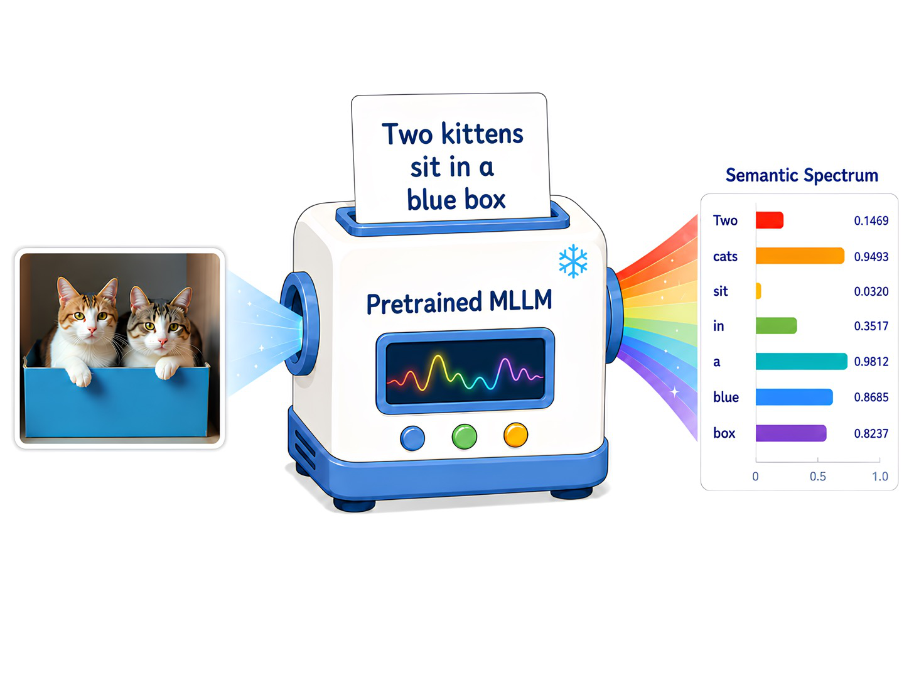

# AI Daily

## Read It Back: Pretrained MLLMs Are Zero-Shot Reward Models for Text-to-Image Generation

> **今日選文**：NeurIPS 2026 論文提出 SpectraReward，直接把凍結多模態大型語言模型（MLLM）對提示詞的逐 token 條件似然，當成圖像生成的強化學習 reward。重要界線：reward 函數不需訓練，但生成器仍要經過 RL 微調。

### 基本資訊

- **作者**：Runhui Huang、Qihui Zhang、Zhe Liu、Yu Gao、Jie Wu、Hengshuang Zhao。
- **研究單位**：The University of Hong Kong、Peking University、ByteDance Seed。
- **發表**：NeurIPS 2026；官方列有論文 poster。arXiv:2607.11886v1，2026 年 7 月 13 日提交。[1] [2]
- **論文與專案**：[arXiv 全文](https://arxiv.org/abs/2607.11886)｜[SpectraReward 專案頁](https://huangrh99.github.io/projects/SpectraReward/)。
- **關鍵詞**：zero-shot reward、MLLM、text-to-image、reinforcement learning、prompt likelihood、self-rewarding。

### 為什麼選它？

本次搜尋同時查閱 arXiv、Hugging Face Trending 與頂會論文頁。repo 中已經有近期的單圖 training-free diffusion 報告，因此依照「排除已收錄論文」規則不重複新增；Read It Back 則是 NeurIPS 2026 收錄、且直接切中 zero-shot 與免訓練 reward 的新題目。它也能帶出一個關鍵問題：生成模型的語言理解分數，能否比外部的人類偏好 reward 更有效地指導影像生成？

### 核心貢獻

**SpectraReward** 不請 MLLM 用自然語言替圖片打分，也不先把 prompt 拆成一串問答。它把生成圖片輸入凍結的 MLLM，再以 teacher forcing 讀取原始 prompt，將每個 prompt token 的條件 log-likelihood 平均為一個 scalar reward。這讓既有圖文對齊能力可直接充當 reward，不必收集偏好標註或再訓練 reward model。[1] [3]

作者進一步提出 **Self-SpectraReward**。在同時具備理解與生成分支的 unified multimodal model 中，使用模型自己的理解分支，評分其生成分支產生的圖片。作者的假設是，兩個分支共享 tokenizer、視覺 encoder 與預訓練分布，因此內部 reward 可能比規模更大、但分布不同的外部 MLLM 更貼合生成器。

*圖 1。生成圖片經凍結 MLLM 評分後，各 prompt token 的似然構成 semantic spectrum；整段 prompt 的平均值則成為 reward。[1]*

### 技術方法與公式

令輸入 prompt 為 token 序列 \(x=(x_1,\ldots,x_T)\)，生成器依 prompt 產生圖片 \(y\sim G_\theta(\cdot\mid x)\)。凍結 MLLM \(\mathcal M\) 以圖片 \(y\) 為視覺條件，逐步讀取 prompt；論文定義的 reward 為

$$
R_{\mathcal M}(x,y)=\frac{1}{T-1}\sum_{t=1}^{T-1}\log p_{\mathcal M}(x_{t+1}\mid x_{\le t},y).
$$

其中 \(x_{\le t}\) 是截至第 \(t\) 個 token 的文字前綴。每個 \(\log p_{\mathcal M}(x_{t+1}\mid x_{\le t},y)\) 表示：看過圖片與前文後，MLLM 對下一個 prompt token 的預測信心。這些逐 token 分數組成 **semantic spectrum**；平均值越高，代表圖片越能提供足夠視覺線索，讓 MLLM 回推出原 prompt。[1]

概念上，生成器的 RL 目標是最大化

$$
\max_{\theta}\;\mathbb E_{x\sim\mathcal D,\,y\sim G_\theta(\cdot\mid x)}[R_{\mathcal M}(x,y)].
$$

論文比較 AWM、FlowGRPO 與 DiffusionNFT 等更新方式。這裡的「training-free」只表示 SpectraReward 不需要偏好標籤或 reward-model 微調；生成器仍要透過 RL 更新參數。作者也指出，固定 prompt 的純文字先驗對同組候選圖片是常數，因此在 group-relative advantage 中會抵消；實作時另排除容易被終止符號主導的 EOS token。[1]

Self-SpectraReward 可寫成把 \(\mathcal M\) 換成 unified model 的理解分支 \(G_\theta^{\mathrm{understanding}}\)，而圖片仍由生成分支 \(G_\theta^{\mathrm{generation}}\) 產生。這讓 reward 與 policy 共用模型內部表徵，形成內部評分、外部更新的閉環。

### 實驗結果

作者以 SD3.5-M 與 BAGEL 作為兩種生成器，測試三種 RL 演算法、四個家族的九種 reward MLLM（4B 至 235B），並在五個文字生圖基準上評估，包括 GenEval、TIIF-Bench、DPG-Bench、WISE 與 GenEval2。[1] [2]

在 BAGEL 的 512 解析度比較中，未經 RL 的基線在 **GenEval / TIIF-Short / TIIF-Long** 分別為 **84.0 / 75.2 / 78.6**。使用 AWM 搭配 Self-SpectraReward 後，分數升至 **89.5 / 85.1 / 84.3**，相差 **+5.5 / +9.9 / +5.7**。同一組實驗的 prompt-likelihood reward 也高於 AlphaGRPO 的 DVReward 設定（GenEval 85.0、TIIF-Short 78.9、TIIF-Long 79.5）。[1]

Reward 消融顯示，prompt likelihood 在三項指標為 **89.5 / 85.1 / 84.3**；直接要求 MLLM 給 1–5 分的 scalar scoring 為 **77.7 / 67.5 / 76.0**；以 yes/no 問答機率作 reward 的 VQA-Score 為 **83.1 / 77.4 / 78.9**。因此在這套設定下，直接取 teacher-forced 似然比要求模型「判斷圖片好不好」更有效。[1]

Reward model 尺度不與效能單調增加：BAGEL 自身的理解分支在 GenEval 得 **89.5**，高於外部 Qwen3-VL-30B-A3B 的 **88.3** 與 Qwen3-VL-235B-A22B 的 **86.8**。作者亦報告，模型在 512 解析度訓練後，1024 解析度推論仍取得 GenEval **89.8**、GenEval2 **34.3**，以及 WISE CoT 設定 **0.76**。[1]

### 相關研究

**ImageReward** 代表偏好標註路線：研究者建立包含 137,000 組專家比較的資料集，訓練通用文字生圖 reward model，再以 Reward Feedback Learning 微調 diffusion model。[4] 相較之下，SpectraReward 省去偏好資料與 reward model 訓練，但仍需要對生成器做 RL。

最接近的同時期工作是 **PromptEcho**。它同樣以凍結 VLM、單次前向計算與 prompt token cross-entropy 形成 reward；差異在於 PromptEcho 使用引導 query，並以負 cross-entropy 作分數。它在 Z-Image 與 QwenImage-2512 上評估；Read It Back 的主要新增價值，則是跨多種 MLLM／生成器的系統比較，以及 Self-SpectraReward 的模型內部 reward-policy 對齊。因此，不宜把「用 MLLM 讀回 prompt」本身視為本篇獨有的新概念。[1] [5]

另一條路線 **AlphaGRPO** 會將 prompt 拆成多個可驗證問題，再由 MLLM 逐題檢查；這種 reward 較可解釋，但多了問題生成與驗證流程。SpectraReward 改採密集的 token likelihood，縮短 reward pipeline，代價是評分依賴 MLLM 的讀圖能力與語言先驗。[6]

### 評價與研究啟發

本篇最值得借鑑的不是「更大的 reward model」，而是把預訓練模型本來就在做的條件語言建模，轉成低成本、可逐 token 檢視的評分訊號。Self-SpectraReward 的結果也提醒我們，reward 與生成器是否共享表徵與生成分布，可能比 reward model 的參數規模更關鍵。

限制同樣明確：分數受 reward MLLM 的視覺理解能力上限約束；它偏重 prompt 明寫的語意，可能忽略「熱咖啡應有蒸氣」這類隱含常識，也沒有直接優化美學或安全性。逐 token 似然因此不等於完整的人類偏好指標，且 reward 免訓練不代表整個 RL 流程免計算。[1]

可延伸的方向（以下是研究構想，並非原論文結論）：

1. **Energy-based inference control**：把 \(E(x,y)=-R_{\mathcal M}(x,y)\) 當成 prompt-image compatibility energy；先以 token spectrum 找出缺失屬性，再只對相關 cross-attention 做推理期調制，測試能否不更新權重便修正生成結果。
2. **JEPA 補足隱含條件**：將 prompt-likelihood 的語意分數與 JEPA latent predictive consistency 結合，前者檢查「文字是否能從圖中讀回」，後者檢查場景或物理狀態是否一致，降低只追逐字面 token 的盲點。
3. **VAR 尺度分工**：按 object、attribute、relation 將 prompt token 分組，觀察不同 token 的似然何時形成，再於 VAR 的粗到細生成階段分別調整 attention；這可把 semantic spectrum 從總分改造成尺度化控制訊號。

### References

[1]: https://arxiv.org/html/2607.11886v1 "Read It Back: Pretrained MLLMs Are Zero-Shot Reward Models for Text-to-Image Generation"
[2]: https://neurips.cc/virtual/2026/poster/155394 "NeurIPS 2026 official poster for Read It Back"
[3]: https://huangrh99.github.io/projects/SpectraReward/ "SpectraReward project page"
[4]: https://arxiv.org/abs/2304.05977 "Learning and Evaluating Human Preferences for Text-to-Image Generation"
[5]: https://arxiv.org/html/2604.12652v2 "PromptEcho: Annotation-Free Reward from Vision-Language Models for Text-to-Image Reinforcement Learning"
[6]: https://openreview.net/forum?id=mtcGhTTDgN "AlphaGRPO: Unlocking Self-Reflective Multimodal Generation in Unified Multimodal Models via Decompositional Verifiable Reward"
