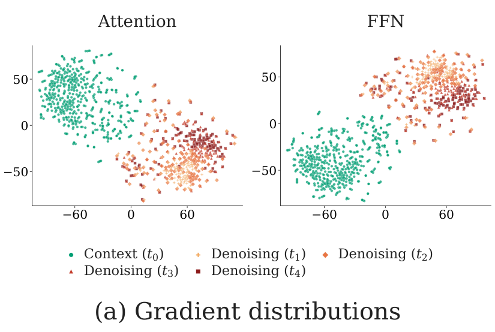
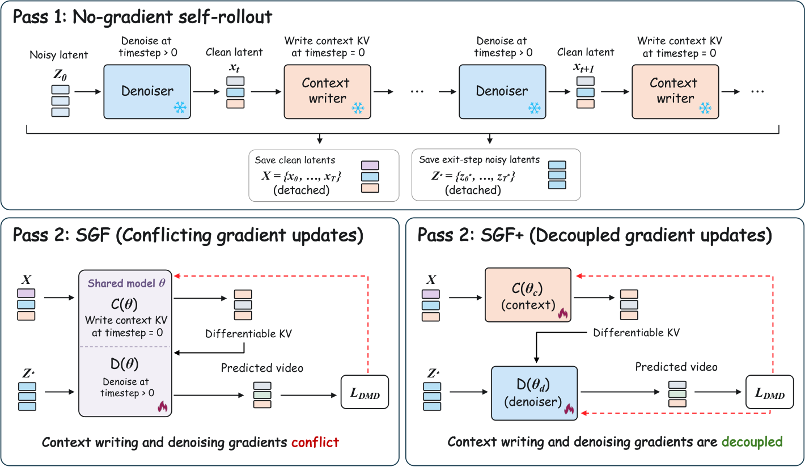

# AI Daily

## 2026-10-11｜SGF+：把自回歸影片生成的兩種角色拆成兩組梯度

> **一句話結論：** SGF+ 發現自回歸影片 diffusion 同時要做兩件不同的事：一是對目前 noisy block 去噪，二是把已生成內容寫成供未來使用的 KV context。這兩種角色在共享 Transformer 參數上產生系統性的負梯度對齊；SGF+ 不改用額外 loss，也不延長訓練影片，只把兩種角色的參數分開，便在 60 秒與 240 秒 rollout 中改善大多數品質與一致性指標，並宣稱以 5 秒訓練視窗支援最長 24 小時的連續生成。[1] [2]

## 論文基本資訊

- **標題：** *SGF+: Decoupling Gradient Flows for Autoregressive Video Generation*
- **作者：** Zihan Su、Junhao Zhuang、Yaowei Li、Siwen Lu、Haoran Li、Lingen Li、Haoyu Wu、Weiyang Jin、Songchun Zhang、Haoyang Huang、Chun Yuan、Zeyue Xue、Nan Duan。[3]
- **研究單位：** Tsinghua University、Joy Future Academy / JD、The Chinese University of Hong Kong。[4]
- **發表狀態：** arXiv cs.CV 預印本；v1 於 2026-10-07 發表，v2 於 2026-10-08 更新。截至本報告撰寫時，頁面未列出 ICCV、CVPR、ICML、NeurIPS 或其他正式會議錄用資訊，因此不把它寫成頂會論文。[3]
- **論文連結：** [arXiv abstract](https://arxiv.org/abs/2610.10429)｜[HTML 全文](https://arxiv.org/html/2610.10429v2)｜[官方 project page](https://zihan-su.github.io/self-gradient-forcing-plus/)
- **程式碼、權重與訓練腳本：** [官方 GitHub](https://github.com/Zihan-Su/Self_Gradient_Forcing_Plus)。[5]
- **研究方向：** autoregressive video diffusion、KV-cache、self-forcing、long-horizon extrapolation、gradient conflict、role-specific parameterization。
- **本庫去重：** 已以完整標題、arXiv ID `2610.10429`、方法名與關鍵詞掃描 `INDEX.md` 及既有文章；SGF+ 尚未收錄。Energy-Based Transformers、DiverseVAR、QuadTok 等相近候選則已在庫中，故排除，不重複發布。

## 為什麼今天選它

這篇工作不只是再提出一個「讓影片更長」的 KV-cache 技巧。它把長影片生成的失真來源拆成兩個可以分別測量的計算角色：**denoising** 負責生成當前內容，**context writing** 負責把這些內容轉成未來 block 會讀取的 key/value。作者接著用梯度方向直接檢查這兩種角色是否真的在爭用同一組參數，最後用最小的架構干預驗證：把參數分開，比堆疊另一個 auxiliary loss 更直接。[2]

它也很適合延伸到目前關注的幾條路線。SGF+ 本身不是 Energy-Based Transformer、JEPA、VAR、training-free 或 zero-shot 方法；但它提供了一個清楚的接口，讓後續研究可以問：能不能用 energy 決定何時相信 context、用 JEPA-style prediction 衡量未來 context 的可預測性，或把 role-specific parameterization 搬到 visual VAR 的 scale-wise generation？

## 1. 問題：自回歸影片模型其實有兩種工作

在 causal video diffusion 中，模型一次生成一個 frame 或 chunk。對第 $i$ 個 block，模型先讀取歷史 KV cache，將 noisy latent $z_i^t$ 去噪成 clean estimate $\tilde{x}_i$；接著，再把 $\tilde{x}_i$ 以 clean context timestep 寫入 KV cache，供下一個 block 使用：

$$
\mathrm{KV}_i
=\mathcal{C}_{\theta}\!\left(\tilde{x}_i,t_{\mathrm{ctx}}\mid\mathrm{KV}_{<i}\right),
\qquad t_{\mathrm{ctx}}=0.
$$

原本的設計通常讓同一個 DiT 參數 $\theta$ 同時扮演兩種角色：

1. **Denoiser $\mathcal{D}_{\theta}$：** 在 $t>0$ 的 noisy timestep 上，根據歷史 context 生成目前 block。
2. **Context writer $\mathcal{C}_{\theta}$：** 在 $t_{\mathrm{ctx}}=0$ 的 clean timestep 上，把已生成 latent 編碼成 future KV。

這種共享參數在參數量上很簡潔，但兩個角色看到的輸入分布、被未來 loss 需要的行為，以及對時間一致性的要求都不同。SGF+ 的核心問題是：**如果兩種角色的梯度方向本來就相反，單一權重更新是否會把兩邊的改善互相抵消？**

## 2. 從 Self Forcing 到 SGF+

### 2.1 Self Forcing：先處理 exposure bias

Teacher Forcing 以真實影片歷史作為 context 訓練，但推理時模型必須讀取自己生成的、可能已經有誤差的歷史。這個 train–test distribution gap 會在長 rollout 中累積成曝光偏差（exposure bias）。Self Forcing 讓模型在訓練時進行 self-generated autoregressive rollout，並對完整生成影片使用 distribution-matching objective，讓訓練分布更接近真正推理分布。[7]

### 2.2 SGF：補上 historical context-gradient gap

Self Forcing 為了控制記憶體，會把 rollout 中的歷史 KV cache 視為 frozen state。如此一來，未來 block 的 loss 可以學習「noisy target 如何讀取歷史」，卻不能學習「早先生成的 latent 應該如何被寫成更有用的 KV」。這條被切斷的監督路徑就是 **historical context-gradient gap**。[6]

SGF 使用兩次 forward：

- **Pass 1：** 無梯度 self-rollout，記錄 detached 的 clean context latents $X=\{\tilde{x}_i\}$ 與 sampled-exit noisy latents $Z^{\star}=\{z_i^{t^{\star}}\}$。
- **Pass 2：** 將這些固定 latents 以 causal reconstruction mask 平行重建；context KV 重新計算並保留梯度，讓未來的 DMD loss 可以回傳到 context writer。

Pass 2 可寫成：

$$
M_{\theta}
=\mathcal{C}_{\theta}\!\left(\operatorname{sg}(X),t_{\mathrm{ctx}}\mid\mathcal{M}_{\mathrm{rec}}\right),
$$

$$
\hat{X}_{\mathrm{tar}}
=\mathcal{D}_{\theta}\!\left(Z^{\star},t^{\star}\mid M_{\theta},\mathcal{M}_{\mathrm{rec}}\right),
\qquad
\mathcal{L}=\mathcal{L}_{\mathrm{DMD}}(\hat{X}_{\mathrm{tar}}).
$$

其中 $\operatorname{sg}(\cdot)$ 表示 stop-gradient。它切斷的是 sampled rollout trajectory，而不是 reconstructed context KV 的梯度路徑。因此，SGF 能在不保存整條長 rollout autograd graph 的情況下，補回 context writing 的 credit assignment。

## 3. SGF+ 的方法：角色分離，而不是再加一個 loss

### 3.1 梯度衝突的量化

對共享線性權重 $W$，把 Pass 2 中不同 token role 的輸入與輸出梯度分開，得到 context-writing 與 denoising 的梯度：

$$
 g_{\mathrm{C}}=\Delta_{\mathrm{C}}^{\mathsf{T}}H_{\mathrm{C}},
 \qquad
 g_{\mathrm{D}}=\Delta_{\mathrm{D}}^{\mathsf{T}}H_{\mathrm{D}},
 \qquad
 g_W=g_{\mathrm{C}}+g_{\mathrm{D}}.
$$

兩者的方向相似度以 cosine similarity 衡量：

$$
 s(g_{\mathrm{C}},g_{\mathrm{D}})
=\frac{\langle g_{\mathrm{C}},g_{\mathrm{D}}\rangle}
 {\lVert g_{\mathrm{C}}\rVert_2\lVert g_{\mathrm{D}}\rVert_2}.
$$

若 $s<0$，代表兩個角色要求權重往相反方向更新。作者在 128 個 prompts、4 個 denoising timesteps、Attention 與 FFN 兩類模組上分析 SGF 梯度：

- Attention 的平均角色梯度夾角為 **104.2°**。
- FFN 的平均角色梯度夾角為 **106.3°**。
- 512 組配對的 cosine similarity 在兩種模組族中都呈現負值。

這個結果把「長影片會漂移」從單純的 sampling error，推進成一個更具體的 optimization conflict 假說。共享更新 $g_W$ 可能讓兩個角色的有效梯度部分抵消，而不是同時保留兩邊的改善。[2]

*圖 1。只擷取論文 Figure 3 的梯度分布圖，未使用整頁 PDF；圖片來源為論文 HTML/PDF 資產。[2]*

### 3.2 角色專用參數

SGF+ 將單一模型改成兩個 forward role：

- $\mathcal{C}_{\theta_c}$：context writer，只負責把 clean latent 寫入 future KV。
- $\mathcal{D}_{\theta_d}$：denoiser，只負責對目前 noisy target 去噪。

兩者從同一個 autoregressive diffusion checkpoint 初始化，但之後各自更新。它們仍然透過 causal attention 的 KV path 互動，因此不是把模型拆成兩個互不相干的網路；改變的是 **gradient accumulation 的歸屬**。

SGF+ 的 Pass 2 為：

$$
M_{\theta_c}
=\mathcal{C}_{\theta_c}\!\left(\operatorname{sg}(X),t_{\mathrm{ctx}}\mid\mathcal{M}_{\mathrm{rec}}\right),
$$

$$
\hat{X}_{\mathrm{tar}}
=\mathcal{D}_{\theta_d}\!\left(Z^{\star},t^{\star}\mid M_{\theta_c},\mathcal{M}_{\mathrm{rec}}\right),
$$

$$
\mathcal{L}=\mathcal{L}_{\mathrm{DMD}}(\hat{X}_{\mathrm{tar}}).
$$

因此，context-writing 的梯度主要更新 $\theta_c$，denoising 的梯度主要更新 $\theta_d$；loss 仍是原本的 generation objective，沒有額外的 context loss、gradient projection 或長影片 fine-tuning。[1] [2]

*圖 2。只擷取論文 Figure 4 的方法總覽，凸顯 SGF 的 conflicting updates 與 SGF+ 的 decoupled updates。[2]*

## 4. 實驗設定

作者使用 **Wan2.1-T2V-1.3B** 作為 causal video diffusion student，使用 frozen **Wan2.1-T2V-14B** teacher，另有以 Wan2.1-T2V-1.3B 初始化的 fake-score network。訓練資料使用 VidProM 的過濾與擴充 prompt，訓練視窗固定為 **5 秒**；比較方法為 Self Forcing（SF）、Self Gradient Forcing（SGF）與 SGF+，並分成 chunkwise 與 framewise 兩種生成粒度。[2]

主要長距離評估為：

- **60 秒：** VBench-Long prompts。
- **240 秒：** 128 個 MovieGen prompts。
- **評估指標：** Subject Consistency、Background Consistency、Temporal Flickering、Motion Smoothness、Dynamic Degree、Aesthetic Quality、Imaging Quality。
- 表中分數乘以 100，除 Dynamic Degree 外，數值越高通常越好；所有方法使用相同初始化、prompt set 與 random seed。[2]

## 5. 實驗結果

### 5.1 長距離品質與一致性

以下列出 SGF+ 的主要結果；Dynamic Degree 另行討論，避免把「動得更多」錯當成「動得更好」。

| Rollout | Subject | Background | Flickering | Motion | Aesthetics | Imaging |
|---|---:|---:|---:|---:|---:|---:|
| 60s，chunkwise | **98.48** | **97.41** | **99.35** | **98.69** | **66.63** | **71.51** |
| 60s，framewise | **99.08** | **98.06** | **99.43** | **98.90** | **66.29** | 71.11 |
| 240s，chunkwise | **98.21** | **97.31** | **97.57** | **98.63** | **64.74** | **71.39** |
| 240s，framewise | **98.74** | **97.81** | **98.24** | **98.94** | **63.95** | **70.90** |

在 **240 秒 framewise** 設定中，SGF+ 相較 SF 的 Subject Consistency 為 $98.74-96.36=2.38$ 分，相較 SGF 為 $1.67$ 分；Motion Smoothness 為 98.94，優於 SF 的 98.01 與 SGF 的 98.24。這表示角色分離的收益不只出現在短距離生成，而是延伸到訓練視窗 48 倍的 rollout。[2]

**Dynamic Degree 是主要例外。** 例如 240 秒 framewise 中，SF、SGF、SGF+ 分別為 67.04、65.68、53.96。作者指出，場景跳接、物體變形、主體消失或突然出現其他人，都可能製造較高的表面動態分數；SGF+ 的低分更可能反映較穩定、較少不一致的動態，而不是生成能力較差。這個提醒很重要：長影片評估不能只追求單一 motion-like metric。[2]

### 5.2 參數分離的消融

60 秒 chunkwise 的模組消融如下：

| 變體 | Subject | Background | Flickering | Motion | Aesthetics | Imaging |
|---|---:|---:|---:|---:|---:|---:|
| 只分離 Attention | 95.37 | 95.43 | 99.30 | 97.40 | 58.49 | 68.18 |
| 只分離 FFN | 97.43 | 96.48 | 98.33 | 98.27 | 63.49 | 70.41 |
| **完整 SGF+** | **98.48** | **97.41** | **99.35** | **98.69** | **66.63** | **71.51** |

只分離 FFN 已比只分離 Attention 穩定，但兩者都不如完整分離。這個消融支持一個較強的結論：衝突不只存在於 FFN，也存在於 Attention；若只做 FFN experts，不能完整解決 context writer 與 denoiser 的角色競爭。[2]

### 5.3 計算與記憶體代價

SGF+ 以兩套完整 parameter sets 實作，因此 generator 參數由 1.4B 增加到 **2.8B**。但每個 token 在單次 forward 只使用對應 role 的參數，所以推理計算量不會直接加倍。[2]

| 方法 | Train peak memory | Train stable memory | Train time / step | Infer memory | 81 frames inference |
|---|---:|---:|---:|---:|---:|
| SF | 86.36 GB | 86.19 GB | 10.02 s | 24.85 GB | 4.963 s |
| SGF | 97.83 GB | 70.06 GB | 11.79 s | 24.85 GB | 4.962 s |
| **SGF+** | **98.15 GB** | **73.60 GB** | **12.76 s** | **27.96 GB** | **4.969 s** |

相較 SGF，SGF+ 每 step 訓練時間由 11.79 秒增加到 12.76 秒，約 **8.2%**；81 frames 推理時間由 4.962 秒變成 4.969 秒，幾乎不變，但推理記憶體增加約 3.11 GB。這是一個合理但不能忽略的 trade-off：SGF+ 用參數儲存與訓練成本，換取更乾淨的角色梯度。[2]

官方 README 也說明，論文訓練使用 64 GPUs；framewise 與 chunkwise 的參考訓練步數分別約為 1,900 與 700 steps。因此，「不需要額外影片資料」不等於「低成本方法」；它降低的是 supervision 與 rollout horizon 的設計負擔，而不是整個訓練系統的硬體門檻。[5]

### 5.4 24 小時生成的正確解讀

作者展示以 5 秒 rollout 訓練、持續 autoregressive rollout 最長 24 小時的結果，稱為 **native long-horizon extrapolation**。[1] [4]

這個 claim 的重要性在於：模型沒有用更長影片做 long-video fine-tuning，也沒有把訓練視窗直接拉到 240 秒。然而，24 小時是連續生成展示，不等於對每一個小時都提供同等嚴格的 benchmark；真正可量化、可公平比較的主結果仍是 60 秒與 240 秒的 VBench-Long / MovieGen-128 指標。

## 6. 相關研究脈絡

### Self Forcing：用 self-rollout 解決 exposure bias

Self Forcing 的重要貢獻是把 inference-time 的自回歸誤差帶進訓練，再對完整影片做 distribution matching。它在一張 H100 上宣稱可達 17 FPS 與 sub-second latency，並改善長影片中的 error accumulation。[7]

SGF+ 並沒有否定 Self Forcing；它沿用 self-generated history 與 DMD-style training，而是指出在 SF/SGF 的共同參數裡還有一層更底層的角色衝突。換句話說，SF 解決的是 **train–test distribution mismatch**，SGF 解決的是 **historical context-gradient gap**，SGF+ 解決的是 **shared-role gradient conflict**。

### CausVid：從雙向 teacher 蒸餾成 causal student

CausVid 是 CVPR 2025 的重要前置工作，透過 teacher ODE trajectory initialization 與 asymmetric distillation，將 50-step bidirectional video diffusion teacher 蒸餾成 4-step causal generator。官方頁面報告 VBench-Long total score 84.27，並以 KV caching 在單 GPU 上達到 9.4 FPS；它也展示 zero-shot image-to-video 與 dynamic prompting。[8]

SGF+ 使用 Causal Forcing release 的權重做 Teacher Forcing initialization，但它的主要干預不是 teacher–student distillation，而是 student 內部的 role parameterization。這使兩者可以疊加：先以 CausVid / Causal Forcing 建立可用的 causal student，再以 SGF+ 修正 context writer 與 denoiser 的訓練衝突。

### Self Gradient Forcing：讓未來 loss 監督歷史 KV

SGF 的 two-pass replay 是 SGF+ 的直接前置：Pass 1 以 no-gradient rollout 記錄狀態，Pass 2 以 parallel reconstruction 重新建立可微分 context KV。[6]

SGF+ 沒有再增加另一個 context reconstruction objective，而是保留 SGF 的梯度路徑，將其送往 $\theta_c$；denoising path 則送往 $\theta_d$。因此，SGF+ 的新意不是「加一個更強的 loss」，而是重新思考 **同一個 Transformer 是否應該同時擔任兩個條件分布不同的角色**。

## 7. 與近期偏好方向的連接

### Energy-Based Transformer：可把 role separation 變成 energy routing

SGF+ **不是** Energy-Based Transformer，也沒有以 compatibility energy 取代 DMD loss。可是它揭露了一個適合使用 energy 的位置：在每個 rollout block，對「目前 context KV 是否足以支持下一個 noisy target」估計相容性能量：

$$
E_i=E_{\psi}\!\left(M_{\theta_c,i},z_{i+1}^{t}\right).
$$

接著用 energy 決定 context 的注入強度，例如：

$$
\alpha_i=\sigma(-\gamma E_i),
\qquad
\widetilde{M}_i=\alpha_iM_{\theta_c,i}+(1-\alpha_i)M_{\theta_c,i-1}.
$$

這會把「永遠使用最新 KV」改成 state-dependent routing：context 相容性低時回退或增加計算，高時維持低成本。這是後續研究假說，不是 SGF+ 已驗證的部分。

### JEPA：從 context writing 走向 future-context prediction

SGF+ 的未來 loss 間接監督 context writer，但它不是標準 JEPA：沒有 target encoder / predictor 的 joint-embedding objective，也沒有以 latent prediction accuracy 作為主要學習目標。

一個可測試的混合方向是，讓 context writer 產生 hidden state $h_i$，再由 predictor 預測未來 context representation：

$$
\widehat{h}_{i+1}=P_{\phi}(h_{\le i}),
\qquad
\mathcal{L}_{\mathrm{JEPA}}
=\left\|\operatorname{sg}(h_{i+1})-\widehat{h}_{i+1}\right\|_2^2.
$$

將它和 $\mathcal{L}_{\mathrm{DMD}}$ 分開做 ablation，才能回答：長距離一致性究竟來自更好的 image/video distribution matching，還是來自 context representation 對未來 dynamics 更可預測。

### VAR：把 role separation 搬到 scale-wise visual generation

SGF+ 的時間 block 與 VAR 的空間 scale 並不相同。VAR 將圖像生成寫成 coarse-to-fine next-scale prediction；SGF+ 則在影片 rollout 中交替做 noisy denoising 與 clean-context writing。

一個自然的組合是，對每一個 visual scale $s$ 使用 role-specific context writer $\mathcal{C}_{\theta_c}^{(s)}$ 與 denoiser $\mathcal{D}_{\theta_d}^{(s)}$，並以 scale-dependent gate 控制細節寫入：

$$
M^{(s)}_{i}
=\mathcal{C}^{(s)}_{\theta_c}\!\left(\operatorname{sg}(X_i^{(s)}),t_{\mathrm{ctx}}\right),
\qquad
\widehat{X}^{(s+1)}_i
=\mathcal{D}^{(s+1)}_{\theta_d}\!\left(Z_i^{(s+1)},M_i^{(\le s)}\right).
$$

這可檢查一個具體問題：梯度衝突是否只源於 clean/noisy timestep，還是也存在於 **coarse semantic scale 與 fine texture scale** 之間。

### Training-free 與 attention modulation：SGF+ 不是 inference-only 方法

SGF+ 需要重新訓練角色專用參數，所以不能稱為 training-free，也沒有證明 zero-shot cross-backbone transfer。若要把它推向 training-free，可先凍結原本的模型，從 context-writing 與 denoising 的 attention logit 或 KV norm 建立一個無參數 gate，再比較：

1. 只做 inference-time attention modulation；
2. 只做 SGF+ role-specific training；
3. 兩者合併；
4. 兩者都不做的 SF / SGF baseline。

最重要的 protocol 是固定 prompt、seed、KV budget 與生成時間，否則「品質提升」可能只是增加了隱性計算或更換了 context policy。

## 8. 我的評價與研究意義

我給 SGF+ **9.0/10**，原因有四個：

1. **問題定義精準。** 它沒有把所有長影片失真都歸因於 exposure bias，而是辨識出 clean context writing 與 noisy denoising 的角色差異。
2. **分析和方法互相對應。** 先用 gradient angle 與 cosine similarity 顯示共享權重存在 conflict，再用 role-specific parameterization 直接切斷衝突更新；不是先有技巧、再事後尋找解釋。
3. **改動小但可疊加。** 它保留 SF 的 self-rollout、SGF 的 differentiable replay 與原本 DMD objective，所以理論上可以和更好的 teacher、cache policy、spectral correction 或 attention sink 組合。
4. **結果有長距離意義。** 60 秒與 240 秒的多數一致性指標改善，且 inference latency 幾乎不變；這比只在 5 秒短片上追求單一 FID 更能支撐其研究主張。

最需要保留的懷疑也很明確：完整 SGF+ 以兩套參數把 generator 從 1.4B 擴成 2.8B，實驗集中在 Wan2.1-T2V-1.3B、特定 prompt set 與特定 teacher；因此目前更強的結論是「在這個 causal video diffusion family 中，role-specific parameterization 有效」，而不是「所有 Transformer 都必須拆成兩套」。

## 9. 可直接延伸的研究問題

- **Energy-gated context refresh：** 能否用 compatibility energy 或 prediction disagreement 決定哪些 block 需要重新寫 KV，而不是每個 block 都完整更新？品質、latency 與 cache memory 是否存在可控 Pareto frontier？
- **JEPA-KV critic：** context writer 是否能透過 future latent / future KV prediction 被直接訓練？若加入 $\mathcal{L}_{\mathrm{JEPA}}$，長距離一致性提升是否仍然存在於不變的 DMD budget 下？
- **Role-specific LoRA：** 官方實驗雖提到可用兩個 LoRA adapters，但主結果採兩套完整參數。若只訓練 context LoRA 與 denoiser LoRA，能否保留大部分收益，同時降低 2.8B 的儲存與部署成本？[5]
- **VAR × SGF+：** 在 visual autoregressive model 中，將 context writer 對應到 coarse-scale semantic memory、denoiser 對應到 fine-scale token refinement，是否可以降低 scale-wise error accumulation？
- **World-action model：** 既然 action-conditioned world model 也會把歷史 observation 寫成 KV 再預測未來 action / state，SGF+ 的角色分離是否能解決 representation writing 與 action prediction 之間的梯度衝突？
- **真正的 training-free baseline：** 能否不更新權重，只從現有 attention map 的 role discrepancy 建立 test-time gate，並和 SGF+ 的 retrained result 做嚴格比較？

## 限制與查核提醒

- SGF+ 截至本報告為 **arXiv v2 預印本**，不是已核實的正式頂會錄用論文。[3]
- 「5 秒訓練到 24 小時生成」是 native long-horizon extrapolation 的展示性主張；主要可比較的量化結果仍是 60 秒與 240 秒。[1] [2]
- Dynamic Degree 在多個設定不是最高，且這個指標可能被不一致的場景跳接或物體變形抬高，不能脫離其他 consistency metrics 解讀。[2]
- SGF+ 使用兩套完整 generator parameters，推理記憶體由 SGF 的 24.85 GB 增加至 27.96 GB；訓練仍需要大規模硬體，不能把「不增加影片資料」誤寫成「低成本」。[2] [5]
- 目前報告的模型與主要 baseline 都在 Wan2.1 causal video diffusion family 內，跨 backbone、跨解析度、跨資料集與 text-to-image VAR 的泛化仍待驗證。
- 這篇論文本身沒有驗證 Energy-Based Transformer、JEPA、VAR、training-free 或 zero-shot；上述段落是基於其 mechanism 所提出的後續研究方向，不是作者的已完成實驗。

## 結論

SGF+ 最值得記住的不是「把參數複製一份」，而是它提出一個可遷移的設計原則：**當同一個 Transformer 在不同輸入狀態下同時負責寫入記憶與讀取記憶，角色差異可能比 token 相似性更重要。**

對自回歸影片而言，context writer 決定模型如何記住過去，denoiser 決定模型如何生成現在；兩者若共享權重，長距離一致性可能被局部去噪目標拉走。SGF+ 以 role-specific parameterization 分離這兩個 optimization demand，並用長距離 rollout 顯示收益。下一步最有價值的問題，是把這個「角色分離」和 energy verification、JEPA predictive uncertainty、VAR scale-wise generation 以及 inference-time attention modulation 接起來，形成能根據生成狀態分配計算的統一 controller。

## References

[1]: https://arxiv.org/abs/2610.10429 "SGF+: Decoupling Gradient Flows for Autoregressive Video Generation — arXiv abstract"
[2]: https://arxiv.org/html/2610.10429v2 "SGF+: Decoupling Gradient Flows for Autoregressive Video Generation — full HTML paper"
[3]: https://export.arxiv.org/api/query?id_list=2610.10429 "arXiv API metadata for SGF+ v2"
[4]: https://zihan-su.github.io/self-gradient-forcing-plus/ "SGF+ official project page"
[5]: https://github.com/Zihan-Su/Self_Gradient_Forcing_Plus "SGF+ official code, checkpoints and training README"
[6]: https://arxiv.org/html/2607.20368v1 "Self Gradient Forcing: Native Long Video Extrapolation"
[7]: https://arxiv.org/html/2506.08009v1 "Self Forcing: Bridging the Train-Test Gap in Autoregressive Video Diffusion"
[8]: https://causvid.github.io/ "CausVid: From Slow Bidirectional to Fast Autoregressive Video Diffusion Models"
