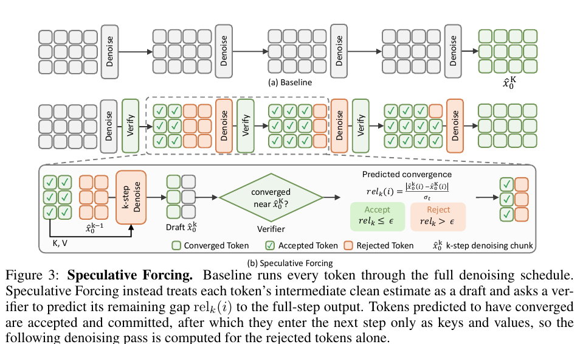

# AI Daily

## Speculative Forcing for Efficient Autoregressive Video Generation

**整理日期：2026-10-18**　**方向：自回歸影片生成、token-wise adaptive denoising、training-free inference、KV cache**

本次先排除 AI_Daily 已有文章，再比較近期候選。由於 2026-10-17 至 10-18 可找到且尚未收錄的相關候選不足，搜尋範圍放寬到 10-15。本文選中 *Speculative Forcing*，因為它把自回歸影片生成的去噪計算分配細化到單一 token，並提供免訓練與 learned 兩種 verifier，以及短片、長片和世界模型實驗。[1] [2]

### 論文資訊

- **標題：** *Speculative Forcing for Efficient Autoregressive Video Generation*
- **作者：** Hyunwook Choi、Seungryong Kim、Dongyoon Han、Sangdoo Yun；作者來自 KAIST AI 與 NAVER AI Lab。[2] [6]
- **論文版本與狀態：** arXiv:2610.22347v1，2026-10-15 提交。依 2026-10-18 可查到的 arXiv 紀錄，尚無正式期刊或會議接受資訊，因此應視為預印本，而非已發表頂會論文。[2] [3]
- **研究範圍：** 針對少步數的 autoregressive video diffusion generator，減少每個影片 latent token 實際需要執行的去噪步數。

### 核心想法

少步數影片生成器通常把每個 chunk 切成大量時空 latent tokens，並讓每個 token 固定跑完同一個去噪排程。然而，不同位置的 token 收斂速度並不一致：背景或重複內容可能較早穩定，快速移動或新出現的細節則可能仍在改變。固定步數會把已穩定 token 的計算也重複做完。[1]

*Speculative Forcing* 把每一步的 clean latent estimate 當成一份「草稿」。Verifier 判斷該 token 是否已足夠接近最終輸出；若已收斂，就提交該 token 並停止後續去噪。其他尚未收斂的 token 繼續更新。已提交 token 的 layer-wise key/value（K/V）仍保留在注意力上下文，供尚在更新的 token 使用。[1]

*原文 Figure 3 局部擷取，顯示已接受 token 提前固定、K/V 繼續作為上下文，而未接受 token 才進入下一次去噪。來源：論文 PDF。[2]*

### 方法與數學形式

令一個影片 chunk 含有 $N$ 個時空 latent tokens。少步數生成器對每個 token 最多執行 $K$ 次去噪，並在第 $k$ 步產生 clean estimate $\hat{x}_{0,i}^{(k)}$。作者用第 $K$ 步的完整輸出作為參照，定義第 $k$ 步 token $i$ 的剩餘收斂差距：

$$
 r_k(i)=\frac{\left\|\hat{x}_{0,i}^{(k)}-\hat{x}_{0,i}^{(K)}\right\|_2}{\sigma_t},
$$

其中 $\sigma_t$ 是該 chunk 完整輸出之 token norm 的中位數，用來正規化差距。若 $r_k(i)\leq\epsilon$，理想上就可在第 $k$ 步提交 token。這個量需要先知道完整 $K$ 步的輸出，因此主要作為 oracle 分析或 learned verifier 的訓練目標；推理時不能直接拿它當免成本判斷。[1]

作者提出兩種可部署的 verifier。

**Training-free verifier。** 在第一個去噪步驟，將草稿與 clean history/reference bank $\mathcal{H}$ 比較：

$$
 s_{\mathrm{red}}(i)=\min_{h\in\mathcal{H}}\left\|\hat{x}_{0,i}^{(1)}-h\right\|_2.
$$

若經過時空平滑的 $s_{\mathrm{red}}(i)$ 低於門檻 $\tau_{\mathrm{red}}$，便接受該 token。從第二步開始，改用連續兩份草稿的變化量：

$$
 s_{\mathrm{stab}}^{(k)}(i)=\left\|\hat{x}_{0,i}^{(k)}-\hat{x}_{0,i}^{(k-1)}\right\|_2,
 \qquad
 \operatorname{accept}_k(i)=\mathbf{1}\!\left[\mathcal{S}\!\left(s_{\mathrm{stab}}^{(k)}\right)(i)\leq\tau_{\mathrm{stab}}\right],
$$

其中 $\mathcal{S}$ 表示論文使用的時空平滑。這個版本不訓練 generator 或 verifier head，但門檻仍以 held-out calibration data 校準，不能解讀成完全免校準或跨模型零樣本泛化。[1]

**Learned verifier。** 另一版本凍結 generator，在中間特徵上訓練一個淺層 head，預測 token 到 full-step output 的收斂差距。若 head 輸出為 $\hat r_k(i)$，訓練目標可寫成：

$$
\mathcal{L}(\phi)=\frac{1}{N(K-1)}\sum_{i=1}^{N}\sum_{k=1}^{K-1}
\operatorname{Huber}\!\left(\hat r_k(i),r_k(i)\right).
$$

這個 head 約有 4.11M 參數，generator 本身保持凍結；它不屬於嚴格的 training-free 方法。[1]

令 token $i$ 實際提交的步數為 $k^*(i)$，則去噪 token evaluation 數量從固定計算的 $KN$ 降為

$$
\sum_{i=1}^{N} k^*(i),
\qquad
\bar{k}=\frac{1}{N}\sum_{i=1}^{N}k^*(i).
$$

已接受的 token 不再參與後續去噪，但保留接受當下算出的 K/V；chunk 完成後，模型仍會對組合後的 chunk 做一次 clean pass，以更新下一個 chunk 使用的 KV cache。因此，平均去噪深度下降不等於同幅度的端到端加速，應以實測 FPS 和延遲為準。[1]

### 實驗結果

作者在 LongLive 自回歸影片生成器與 Lingbot-World 2.0 世界模型上，比較固定四步生成、training-free verifier（OursTF）與 learned verifier（OursH）。平均步數是每個 token 的平均去噪深度；FPS 與 VBench 分數只代表論文所用模型、硬體及評估設定。[1]

- **LongLive，5 秒影片：** 四步 baseline 的平均去噪深度為 4.00、速度 26.40 FPS，VBench Total/Quality/Semantic 為 83.08/83.49/81.43。OursTF 降至 1.65 步，達 43.61 FPS，分數為 83.12/83.51/81.56。OursH 為 1.68 步、41.74 FPS，分數為 83.21/83.54/81.89。以 learned verifier 對 baseline 的吞吐比計，約為 1.58×；training-free verifier 約為 1.65×。[1]
- **LongLive，30 秒影片：** baseline 為 4.00 步、24.5 FPS，Drift 1.722，VBench Total/Quality/Semantic 為 82.69/83.29/80.30。OursTF 為 1.71 步、38.8 FPS、Drift 1.685，分數 82.75/83.28/80.65。OursH 為 1.72 步、37.8 FPS、Drift 1.707，分數 82.81/83.32/80.77。OursH 相對 baseline 的實測吞吐比約 1.54×。[1]
- **Lingbot-World 2.0：** 在 200 個 held-out navigation scenes 上評估。四步 baseline 為 18.1 FPS、Quality 82.62、Drift 3.094，RPE translation/rotation 為 0.328/0.253。OursTF 為 2.53 步、24.7 FPS、Quality 82.58、Drift 2.926，RPE 為 0.329/0.259；OursH 為 2.55 步、24.5 FPS、Quality 82.65、Drift 2.839，RPE 為 0.328/0.260。OursH 吞吐約 1.35×，但相機姿態誤差近似不變，rotation RPE 略高，不能把結果說成姿態精度全面提升。[1]

整體來看，作者在這三組設定中將每 token 的平均去噪深度降至約 1.65–2.55 步，同時保持相近的 benchmark 分數。這些是特定模型、場景和校準門檻下的結果，不代表不同生成器或更高加速倍率仍會維持相同品質。[1]

### 相關研究脈絡

**DSA: Dynamic Step Allocation for Fast Autoregressive Video Generation** 將自適應去噪放在 frame 層級，透過與 generator 聯合訓練的 confidence head，替不同影格分配步數。*Speculative Forcing* 把決策粒度推進到單一 latent token；其 learned head 在 generator 凍結後另行訓練，並額外提出不需訓練 head 的 verifier。[4]

**Surprise Forcing: What to Remember, When to Skip in Long Video Generation** 同樣處理免訓練的推理期資源配置，但主要依據 chunk 層級的 surprise 決定記憶與去噪策略。*Speculative Forcing* 則允許同一 chunk 中不同 token 在不同步數提交。兩者分別代表 chunk-level policy 與 token-level refinement，適合在相同 generator、提示詞、seed、KV 策略和延遲預算下做更嚴格的比較。[5]

### 評價與研究延伸

本文最有價值的設計是把「是否值得繼續計算」變成 token 層級的可驗證決策，並讓已提交 token 的 K/V 仍服務於其他 token。它不是單純跳過整個影格，也不是縮短所有 token 的固定排程；這使計算資源能跟著局部收斂速度變化。短片、長片和世界模型的結果，加上 verifier、容忍度與接受粒度的消融，讓方法有可檢驗的實驗支撐。[1]

但兩種 verifier 都有明確代價。Training-free 版本使用的相似度與 draft stability 只是收斂 proxy；相似於歷史內容的 token 仍可能需要更新，兩次草稿變化很小也不保證已接近 full-step output。門檻依 held-out calibration data 設定。Learned 版本直接預測 full-step gap，但要訓練 4.11M 參數的 head。端到端速度也受每個 chunk 中最慢的 token、clean KV refresh pass 與模型 forward overhead 影響。[1]

**與近期關注方向的連結必須區分原文與新假設：**

1. **Energy-based Transformer：** 原文沒有 energy function 或 EBT。可測試把 token 的相容性能量或能量差作為 verifier，只有能量穩定且低風險的 token 才提前提交；需與原始 stability proxy 比較速度、VBench、temporal drift 和失敗率，並把新增 energy 計算納入 wall-clock 成本。
2. **JEPA：** 原文不是 JEPA，也沒有 latent prediction objective。可讓 frozen JEPA predictor 預測下一個時間片段的 latent，使用多 predictor disagreement 作為不確定度；不確定度高的 token 延後提交，低的 token 才 commit。關鍵實驗是確認 predictive uncertainty 是否比相鄰 draft 差值更能預測最終誤差。
3. **VAR：** 原文是 autoregressive video diffusion，不是 Visual Autoregressive Model。若移植到 VAR，不能照搬 denoising-step 公式；需重新定義 next-scale token 的「可提交」條件，例如跨尺度預測差距或 verifier confidence，並檢查提前固定粗尺度 token 是否傷害細尺度細節與全圖一致性。
4. **Attention modulation：** 原文保留已提交 token 的 K/V，並減少其後續計算，但沒有直接調整 attention logits、softmax 權重或 head gate。可用收斂分數調整 active token 的 attention budget，測試是否能比單純 early commitment 帶來額外加速。
5. **Zero-shot：** generator 凍結不等於零樣本泛化。OursTF 仍校準 verifier 門檻，OursH 還使用特定 backbone 的資料訓練 head；目前也只在 LongLive 與 Lingbot-World 2.0 評估。應以完全未校準的跨模型、跨資料集測試，才可檢驗 zero-shot transfer。[1]

**我的結論：** 這篇不是 EBT、JEPA 或 VAR 論文，但提供了一個可直接改造的「局部預測—信心判斷—狀態提交」推理介面。最值得追問的研究問題是：能否以 JEPA 預測不確定度或相容性能量，取代簡單的 draft similarity/stability；同時維持跨模型免訓練，並把額外判斷成本也計入真實吞吐。首要驗證應報告每 token 實際步數分布、FPS/延遲、VBench/Drift、跨模型門檻遷移，以及最容易被錯誤提前提交的快速運動案例。

## References

[1]: https://arxiv.org/html/2610.22347v1 "Speculative Forcing for Efficient Autoregressive Video Generation"
[2]: https://arxiv.org/pdf/2610.22347v1 "Speculative Forcing official PDF"
[3]: https://arxiv.org/abs/2610.22347 "Speculative Forcing official arXiv record"
[4]: https://arxiv.org/abs/2606.04432 "DSA: Dynamic Step Allocation for Fast Autoregressive Video Generation"
[5]: https://arxiv.org/abs/2607.18436 "Surprise Forcing: What to Remember, When to Skip in Long Video Generation"
[6]: https://speculative-forcing.github.io/ "Speculative Forcing project page"
