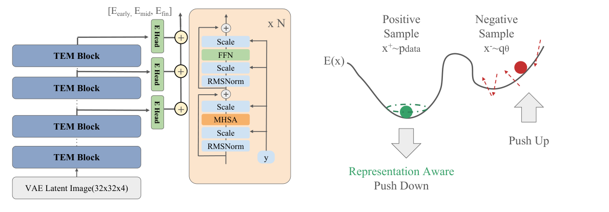

# AI Daily

## Scaling Transformer Energy-based Models For High Quality Image Synthesis

**報告日期：** 2026-10-27

**作者：** Jungsoo Lee（MIT）、Alexi Gladstone（University of Illinois Urbana-Champaign）、Yilun Du（Harvard University）

**發表狀態：** arXiv:2610.31889v1，2026-10-22 公開；截至本報告日期，尚未列正式會議或期刊。

**研究類型：** 對比式 Energy-Based Model（EBM）、Transformer、ImageNet 類別條件生成、零樣本修補與能量組合。[1] [2]

### 為什麼選這篇

repo 已有一篇 ICLR 2026 的 *Energy-Based Transformers are Scalable Learners and Thinkers*，但它主要把能量函數用作輸入與候選預測的相容性驗證器，再以能量最小化執行推理。這篇新作稱自己的模型為 **Transformer Energy-Based Model（TEM）**，問題更直接：能否用對比式、以自身 MCMC 負樣本訓練的 EBM，從高斯雜訊生成高解析度自然影像？作者報告 ImageNet 256² 上 FID-50K 為 3.82，並展示組合生成、零樣本修補與 OOD 偵測。[1] [3]

兩篇研究都採用 Transformer 與能量函數，但任務、訓練目標和推理方式不同。讀 TEM 時不應把「EBT」與「TEM」當成同一篇論文或同一套方法。

### 核心貢獻

TEM 把能量函數建在凍結自編碼器的 latent space，而不是直接在像素空間做 MCMC。對 256×256 圖像，輸入 latent 為 32×32×4。骨幹是 Vision Transformer；作者採用 RoPE、query-key normalization、SwiGLU 與 AdaLN 式條件注入，並在不同深度掛上多個能量頭。各層能量相加後，淺層、中層與深層可分別形成偏向局部紋理、物體布局與較粗語義的約束。[1]

訓練的第一個關鍵是 **Positive Representation Alignment（PRA）**。對比式 EBM 主要透過每個樣本的一個 scalar energy 接收監督，表徵訊號較稀疏。PRA 將正樣本 latent 的中間特徵，對齊到凍結視覺基礎模型的 patch-level 特徵；負樣本不做對齊，避免把通常落在資料流形之外的 MCMC 樣本錯誤拉向正樣本特徵。[1]

第二個關鍵是 sampler-matching 正則項。有限步數的 MCMC sampler 產生的分布不會自動等於理想模型分布；作者以能量項鼓勵 sampler 落入低能量區，再以熵項鼓勵負樣本維持多樣性。推理時則可增加取樣步數或調整步長與噪聲，改變樣本銳利度與多樣性的折衷，不必重新訓練模型。[1]

### 技術方法與數學形式

**1. 在 latent space 建立未正規化機率模型。** 令圖像編碼後的 latent 為 \(\mathbf z\)，類別條件為 \(c\)，TEM 學習 scalar energy \(E_\theta(\mathbf z,c)\)。對應的機率密度為

$$
p_\theta(\mathbf z\mid c)=\frac{\exp[-E_\theta(\mathbf z,c)]}{Z_\theta(c)},\qquad
Z_\theta(c)=\int \exp[-E_\theta(\mathbf z,c)]\,d\mathbf z.
$$

低能量區域代表模型認為較可能的 latent。配分函數 \(Z_\theta(c)\) 通常無法直接計算，因此訓練仰賴正樣本與模型負樣本之間的對比估計。圖像先經預訓練自編碼器得到 latent；生成完成後再交由 decoder 還原至像素空間。[1]

**2. 多層能量頭把不同深度的表徵組成同一個能量。** 可將總能量簡寫為

$$
E_\theta(\mathbf z,c)=E_\theta^{(\mathrm{early})}(\mathbf z,c)+E_\theta^{(\mathrm{mid})}(\mathbf z,c)+E_\theta^{(\mathrm{late})}(\mathbf z,c).
$$

這不是三個模型的集成，而是單一 Transformer 不同深度的能量頭。作者的消融顯示，三頭設定比單頭與雙頭略好；個別頭的生成樣本亦呈現不同層級的結構訊號。[1]

**3. 對比式目標讓資料樣本低能、MCMC 負樣本高能。** 令 \(\mathbf z^+\) 為資料影像編碼得到的正樣本，\(\mathbf z^-\) 為 sampler 產生的負樣本，則論文採用

$$
\mathcal L_{\mathrm{contrast}}
=E_\theta(\mathbf z^+,c)-E_\theta(\mathbf z^-,c)
+\lambda_{\mathrm{reg}}\left[E_\theta(\mathbf z^+,c)^2+E_\theta(\mathbf z^-,c)^2\right].
$$

平方能量項用來限制能量幅度，避免能量只以相對差值受約束時出現不必要的整體漂移。模型負樣本從高斯雜訊或 replay buffer 初始化，再以短鏈 Langevin 更新；概念上可寫為

$$
\mathbf z_{t+1}=\mathbf z_t-\eta_t\nabla_{\mathbf z}E_\theta(\mathbf z_t,c)+\sigma_t\boldsymbol\epsilon_t,
\qquad \boldsymbol\epsilon_t\sim\mathcal N(\mathbf 0,\mathbf I).
$$

能量梯度把樣本推向較低能量區，噪聲則保留隨機探索。論文在實作中分別設定步長與噪聲尺度，因此這個式子是更新方向的簡寫，而不是宣稱每個設定都使用同一個固定 Langevin 噪聲係數。[1]

**4. sampler matching 與 PRA 補上負樣本熵和正樣本語義。** sampler-matching 項可概括為

$$
\mathcal L_{\mathrm{SM}}
=\mathbb E_{\mathbf z^-\sim q_\theta}\!\left[E_{\mathrm{sg}(\theta)}(\mathbf z^-,c)\right]
+\mathbb E_{\mathbf z^-\sim q_\theta}\!\left[\log q_\theta(\mathbf z^-)\right].
$$

第一項透過 sampler 的更新降低負樣本能量；第二項是負熵，最小化它會鼓勵 sampler 保持較高熵與多樣性。\(\mathrm{sg}\) 表示停止對能量參數求梯度，梯度只沿 sampler 路徑傳遞。論文以近鄰統計估計熵。[1]

對第 \(n\) 個 patch，PRA 將 TEM 表徵投影後與凍結 VFM 的正樣本特徵作 cosine alignment：

$$
\mathcal L_{\mathrm{PRA}}
=-\frac{1}{N}\sum_{n=1}^{N}
\operatorname{sim}\!\left(
\bar h_{\mathrm{VFM}}(x^+)_{[n]},
P_\phi(h_\theta(\mathbf z^+)_{[n]})
\right).
$$

整體訓練目標為

$$
\mathcal L_{\mathrm{total}}
=\mathcal L_{\mathrm{contrast}}
+\lambda_1\mathcal L_{\mathrm{SM}}
+\lambda_2\mathcal L_{\mathrm{PRA}}.
$$

PRA 只用正樣本，這個設計是有意識的：資料正樣本需要語義表徵監督；MCMC 負樣本常在資料流形之外，對它們套用同一個語義目標可能與「提高負樣本能量」的訓練方向衝突。[1]

**5. 能量相加提供組合式條件生成。** 若兩個概念各自對應 \(E_1\) 與 \(E_2\)，則

$$
p_{\mathrm{comp}}(\mathbf z)\propto p_1(\mathbf z)p_2(\mathbf z)
\propto \exp\!\left[-\left(E_1(\mathbf z)+E_2(\mathbf z)\right)\right].
$$

因此，只要把能量相加，就能在同一個取樣過程中尋找同時符合兩種條件的 latent。修補則從已知影像的 latent 開始，只更新遮罩區域，並在每一步把已觀測區域固定回原值；不需為修補任務另訓一個生成器。[1]

### 實驗結果

主要生成實驗使用 class-conditional ImageNet，batch size 為 256、訓練 50K iterations；訓練取樣用 40 步，主結果推理用 60 步。論文報告的是 FID-50K，越低越好，而且主結果**沒有使用 classifier-free guidance（CFG）**。[1]

- 在 ImageNet 256×256，TEM-L（415M 參數）以 60 NFE 得到 FID 4.74；TEM-XL（609M）以 60 NFE 得到 **FID 3.82**。
- 在 ImageNet 512×512，TEM-XL 報告 **FID 8.24**，同樣標示 60 NFE。
- 論文表格中的 DiT-XL/2（675M）與 SiT-XL/2（675M）未使用 CFG 時，256² FID 分別為 9.62 與 8.30，且表列 250 NFE。TEM 因而在這些「未引導」對照下，以較少表列 NFE 達到較低 FID。可是加上 CFG 後，SiT-XL/2+REPA 報告 FID 1.42；因此不應把 TEM 寫成整體生成品質的 SOTA。表中數字取自各方法原論文，不是同一實驗室重新跑出的完全 matched comparison。[1]

PRA 消融在 TEM-B、50K 步時，沒有 representation alignment 的 FID 為 42.8；正負樣本都對齊時為 36.6；只對齊正樣本的 PRA 為 **19.9**。在相同消融設定下，三個能量頭 FID 為 19.86，優於單頭 20.95 與雙頭 20.50。這顯示表徵監督及多層能量組合都對早期品質有幫助，但差距仍應依論文自身的消融設定解讀。[1]

作者另測試幾項 EBM 原生應用。CLEVR 三物件組合的物件偵測成功率，TEM 對 1、2、3 個物件分別為 95.6%、76.6%、27.4%；Composable Diffusion 為 86.3%、59.8%、26.2%。ImageNet OOD 偵測的四個資料集平均 AUROC 為 0.717，對照 DiT 的 0.598、SiT 的 0.573、SiT+REPA 的 0.549；不過在 Places365 單一資料集上，TEM 的 0.636 仍低於 DiT 的 0.669，所以提升並非每個 OOD 資料集都一致。[1]

計算成本也值得一併閱讀：TEM-XL 在 ImageNet 256² 訓練 50K 步，作者報告約需 4 張 H200 執行 6 天；以 1 張 H200、60 個取樣步驟生成 50K 張樣本約需 1 小時。512² 訓練與推理約需 256² 的 3–4 倍時間。這提醒我們，60 NFE 不能直接等同於 60 次普通前向傳遞的成本，因為每個 MCMC 步驟需要對 latent 求能量梯度。[1]

### 相關研究脈絡

- **短鏈 MCMC 對比式 EBM：** Du 與 Mordatch 的工作以短跑 Langevin MCMC、replay buffer 等技巧讓高維連續資料上的 EBM 訓練更實用，並展示組合性與修補能力。TEM 延續「正樣本與模型負樣本」的對比訓練路線，但把主體換成多層能量頭的 Transformer，並把解析度推到 ImageNet 256²/512²。[4]
- **Energy-Based Transformers（ICLR 2026）：** EBT 學習輸入與候選預測的相容性能量，並以迭代能量最小化執行 System 2 式預測；會議論文報告在圖像去噪上少用約 99% forward passes。TEM 則把 scalar energy 當成生成分布，從雜訊透過 Langevin sampler 產生 ImageNet 圖像。兩者是一條研究線上的不同目標，而非同一模型的不同名稱。[3]
- **Energy Matching（NeurIPS 2025）：** 這條研究把 flow matching 與 EBM 連結，以單一、時間無關的 scalar potential 描述遠離資料流形時的 transport，並在接近資料流形時用能量與 Boltzmann equilibrium 表達機率結構。相較之下，TEM 明確採用對比式能量訓練與 MCMC 負樣本；兩者提供一個值得比較的設計分岔：生成軌跡要由 flow/transport 預先規定，還是從學得的能量地形與 sampler 分工？[5]
- **REPA 表徵對齊：** REPA 顯示預訓練視覺表示可提升 DiT/SiT 的訓練效率與生成品質。TEM 的 PRA 借用「外部視覺特徵提供密集監督」的思路，但針對 EBM 的正負樣本分布不對稱，採取正樣本限定的對齊。[6]
- **其他可擴展 EBM 路線：** *Scalable Energy-Based Models via Adversarial Training* 以 PGD 對比樣本與對抗訓練，避開傳統 SGLD 的不穩定問題；TEM 則保留自己的 MCMC sampler，並以 sampler matching、PRA 和多層能量頭改善訓練與取樣。這是「換訓練路徑」與「改善 MCMC 路徑」的可比較基線。[7]

### 評價、限制與研究想法

這篇的價值不只是 FID 數字，而是展示 contrastive EBM 可以在高解析度圖像任務中，將「模型學到什麼分布」與「測試時怎樣取樣」拆開。多層能量頭、positive-only PRA 與 sampler matching 都瞄準了 EBM 擴展時的具體痛點；組合式能量與遮罩 latent 更新也把可控生成帶回同一個模型介面。[1]

限制同樣明確。它目前主要是類別條件 ImageNet，不是文字條件的通用 T2I 系統；所謂 zero-shot inpainting 指的是不為修補任務重新訓練，而不是任意提示詞都能零樣本生成。取樣仍需要多步 latent 梯度計算，且更長、更強的取樣會帶來 fidelity–diversity 折衷。FID 對照也混合了不同論文的設定，CFG 與否會大幅改變排序。最後，論文仍是 arXiv 預印本，結果應視為作者報告、等待獨立重現與正式審查。[1] [2]

對你關注的 Energy-based Transformer、JEPA、VAR、training-free、attention modulation 與 zero-shot，以下是三個可測試的延伸方向；它們是研究構想，不是論文已提出或已驗證的功能：

1. **Energy-Gated VAR：** 讓 VAR 先以 next-scale prediction 提出粗到細的 latent token，再以 TEM 式 energy verifier 評估每個尺度的候選；只在能量高或候選不確定的尺度執行少量 Langevin refinement。主要假說是降低平均梯度步數，同時保留全局語義與局部細節。可用 FID、precision/recall、組合條件成功率、NFE 與實際 wall-clock 一起測，避免只報步數。
2. **JEPA 作為 PRA 的 teacher：** 把凍結 VFM 換成 JEPA 的預測表徵，或讓兩種 teacher 分別監督局部外觀與未來／全局語義；保留「只對齊正樣本」作為核心對照。測試資料效率、OOD AUROC、組合生成成功率，以及負樣本也對齊時是否再次退化。這可能把 JEPA 的語義不變性帶進能量地形，但需要重新訓練，不應稱為 training-free。
3. **能量訊號驅動的 attention modulation：** 利用局部 latent 擾動或 layer-wise energy head 差異估計哪些區域最影響總能量，再以此 gate VAR 的 scale attention 或 DiT 的區域注意力。若在已訓練模型上只改 inference policy，可稱為免微調部署；但仍依賴一個先訓練好的能量模型。首要驗證是 scalar energy 梯度是否真的能定位語義相關區域，而非只追逐紋理或模型偏差。

一個值得追問的核心實驗是：把條件能量拆為內容、幾何與風格三項，測試

$$
E_{\mathrm{joint}}=E_{\mathrm{content}}+\lambda_gE_{\mathrm{geometry}}+\lambda_sE_{\mathrm{style}},
$$

能否在未見過的條件組合上比單一條件模型更可控；同時要量測互相矛盾的條件是否造成模式崩潰。這能把「能量可加」從漂亮的例圖推進為可檢驗的 zero-shot composition 能力。

### References

[1]: https://arxiv.org/html/2610.31889v1 "Scaling Transformer Energy-based Models For High Quality Image Synthesis"
[2]: https://arxiv.org/abs/2610.31889 "arXiv abstract for TEM"
[3]: https://proceedings.iclr.cc/paper_files/paper/2026/hash/e19a65fd53b6f9a88b354da98813465d-Abstract-Conference.html "Energy-Based Transformers are Scalable Learners and Thinkers"
[4]: https://arxiv.org/abs/1903.08689 "Implicit Generation and Generalization in Energy-Based Models"
[5]: https://neurips.cc/virtual/2025/poster/117591 "Energy Matching: Unifying Flow Matching and Energy-Based Models for Generative Modeling"
[6]: https://arxiv.org/abs/2410.06940 "Representation Alignment for Generation"
[7]: https://arxiv.org/abs/2510.13872 "Scalable Energy-Based Models via Adversarial Training"
