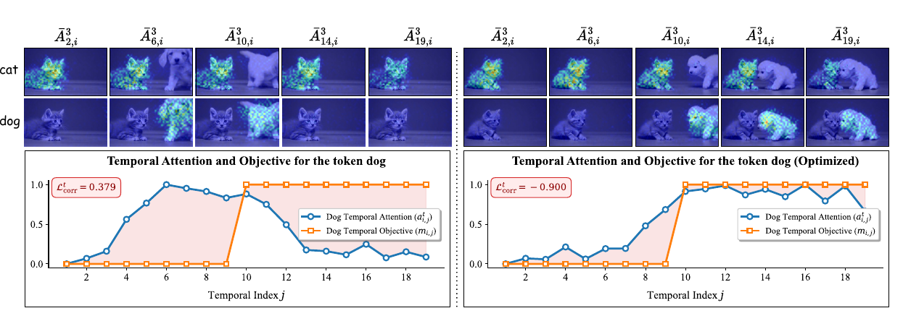
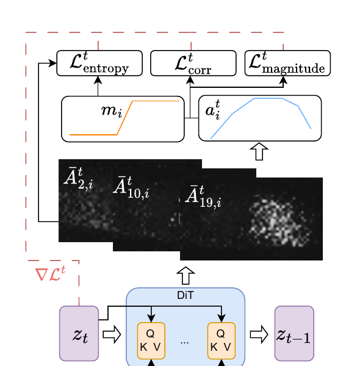

# AI Daily

## 今日精選：TempoControl

### 論文基本資訊

- **論文**：*TempoControl: Temporal Attention Guidance for Text-to-Video Models*
- **作者**：Shira Schiber、Ofir Lindenbaum、Idan Schwartz
- **研究單位**：Bar-Ilan University
- **正式發表**：CVPR 2026；Computer Vision Foundation 提供 Open Access 版本。[1] [2]
- **版本日期**：arXiv 首次投稿於 2025-10-02，v3 於 2026-04-01 更新；arXiv metadata 註記為「Accepted CVPR'26」。[3] [4]
- **論文連結**：[CVF 正式頁面][2]、[arXiv v3 HTML][3]、[作者專案頁][5]、[官方程式碼][6]
- **研究定位**：在不更新生成模型權重、不使用額外時間標註資料的前提下，於推理階段控制文字概念在影片中「何時出現、何時消失、何時動起來」。

> **一句話結論**：TempoControl 把文字—影片 cross-attention 當成一條可讀取的時序控制通道，再對 latent 做少量梯度更新；它不重新訓練 Wan 2.1，卻能把「dog 應該只在後半段出現」這種模糊的 prompt 意圖，轉成逐 token 的 temporal mask。

### 為什麼這個問題值得研究？

現代 text-to-video 模型通常能產生語義合理、畫面穩定的影片，卻不擅長遵守「第四秒才出現」、「只在前半段移動」或「聲音峰值出現時才閃電」等細粒度時間條件。單純在 prompt 加上 *at the third second* 一類的文字，並不能保證生成器真的把概念放到指定時間；TempoControl 的正式論文甚至報告，Wan 2.1 加上顯式 timing cue 後，Temporal Accuracy 由沒有 timing cue 時的 65.18% 降到 63.94%，Imaging Quality 也由 59.99% 降到 53.76%。[1]

這裡的關鍵不是模型「完全不懂」某個概念，而是它在去噪過程中已經透過 cross-attention 把文字 token 對應到不同影片 token，只是這種 grounding 的時間分布不受使用者直接控制。TempoControl 因此不另外建立 temporal encoder 或 control branch，而是直接利用模型內部已存在的注意力訊號。

上圖的直觀重點是：左側的 dog attention 在 dog 尚未應出現時已經升高；右側經過 latent optimization 後，attention 曲線才在 target mask 指定的後半段升高。這不是把影片後處理成「前半段遮掉 dog」，而是直接改變去噪期間文字 token 對影片 latent 的影響位置。

## 核心貢獻與創新點

1. **把 temporal control 放在 cross-attention 上。** 文字 token 與影片 token 的關聯本來就存在於 DiT 的 cross-attention 中；TempoControl 只需要讀出這個關聯，再以 latent gradient 反向影響下一個去噪狀態。

2. **把「時序形狀、注意力強度、空間集中度」拆成三個互補目標。** Pearson correlation 負責形狀，magnitude 負責足夠可見的 activation，entropy regularization 則防止為了拉高 attention 而把物件攤散成語義破碎的區域。[1] [3]

3. **提出 Temporal Accuracy 及 presence/absence 分解。** VBench 原本沒有直接測量「概念是否出現在指定影格」的指標，因此作者使用 YOLOv10 檢測物件是否在應出現或不應出現的影格出現；對動作則以每秒 optical-flow magnitude 最大的時間段作為 motion peak。[1]

4. **把同一控制介面延伸到多物件、動作和音訊。** binary mask 可以指定 dog 的出現區間；連續 mask 可以表示音訊 envelope 的強弱，因此作者展示了 audio-to-video 的 zero-shot alignment 示範，但這不等同於已證明的通用 zero-shot 生成能力。

## 技術方法：從 cross-attention 到 latent update

### 1. 影片 latent 與文字 cross-attention

Wan 2.1 先以 3D causal VAE 把影片壓成 latent：

$$
z \in \mathbb{R}^{T' \times H' \times W' \times C},
$$

再把空間和時間維度攤平成 $n_v=T'H'W'$ 個 video tokens。對於去噪步驟 $t$，DiT 的 cross-attention tensor 可寫成：

$$
A^t \in \mathbb{R}^{L \times h \times n_v \times n_p},
$$

其中 $L$ 是 cross-attention layer 數量、$h$ 是 attention heads 數量、$n_p$ 是 prompt token 數量。作者先對 layer 和 head 取平均，得到：

$$
\bar A^t \in \mathbb{R}^{n_v \times n_p}.
$$

對指定文字 token $p_i$，取出第 $i$ 欄，再依 temporal index $j$ reshape 成空間 attention map $\bar A^t_{j,i} \in \mathbb{R}^{H'\times W'}$。作者以空間聚合值表示該 token 在第 $j$ 個 latent frame 的影響：

$$
\hat A^t_{j,i}=\left\langle \bar A^t_{j,i}\right\rangle_{x,y}.
$$

將不同時間位置串起來，就是 token $i$ 在去噪步驟 $t$ 的 temporal attention vector：

$$
 a_i^t=\left[\hat A^t_{1,i},\hat A^t_{2,i},\ldots,\hat A^t_{T',i}\right].
$$

第一個 latent frame 因 attention 不穩定而被排除。這一步很重要：模型並沒有另外學一個「dog detector」，而是把 cross-attention 的 token-level grounding 當成控制訊號。[1] [3]

### 2. Temporal mask 與 latent optimization

使用者提供與 token $p_i$ 對應的 temporal mask：

$$
 m_i=[m_{i,1},\ldots,m_{i,T'}], \qquad m_{i,j}\in[0,1].
$$

一般物件控制使用 binary mask，例如 dog 只在後半段出現時，前半段為 $0$、後半段為 $1$。音訊對齊則使用連續值，讓 $m_{i,j}$ 表示聲音在時間 $j$ 的相對強度。

TempoControl 不更新模型權重，而是在前幾個去噪步驟直接更新 latent：

$$
 z'_t=z_t-\alpha\nabla_{z_t}\mathcal{L}^t.
$$

正式 CVPR 版本的設定是只在前五個 denoising steps 做最佳化，每一步最多十次 gradient updates；learning rate 通常為 $5\times10^{-4}$，two-object setting 提高到 $10^{-3}$，並使用 $\lambda_1=0.3$、$\lambda_2=10$。[1]

### 3. 三個 loss

#### (a) Temporal correlation：對齊時序形狀

先把 attention vector 做 min–max normalization：

$$
\tilde a_i^t=\frac{a_i^t-\min(a_i^t)}{\max(a_i^t)-\min(a_i^t)}.
$$

接著以負 Pearson correlation 讓 attention 曲線對齊 mask：

$$
\mathcal{L}_{\mathrm{corr}}^t
=-\frac{\operatorname{Cov}(m_i,\tilde a_i^t)}
{\sigma_{m_i}\sigma_{\tilde a_i^t}}.
$$

最小化這個 loss 等價於最大化 mask 與 attention 的線性相關。它能解決「概念應該在哪些時間出現」的問題，但 correlation 對尺度不敏感：如果 attention 全部很小，曲線仍可能取得很高的相關係數，物件卻不一定真的可見。若 mask 的 variance 為零，例如要求物件全片段出現，correlation term 會被省略。

#### (b) Attention magnitude：補回可見性與抑制能力

令 $\tau$ 是判定 mask 是否 active 的 threshold：

$$
\mathcal{L}_{\oplus}^t
=\frac{1}{T'}\sum_{j=1}^{T'}
\mathbb{1}_{\{m_{i,j}>\tau\}}a_{i,j}^t,
$$

$$
\mathcal{L}_{\ominus}^t
=\frac{1}{T'}\sum_{j=1}^{T'}
\mathbb{1}_{\{m_{i,j}\leq\tau\}}a_{i,j}^t,
$$

$$
\mathcal{L}_{\mathrm{magnitude}}^t
=\mathcal{L}_{\ominus}^t-\mathcal{L}_{\oplus}^t.
$$

在 mask 應為 $1$ 的位置，降低這個 loss 會提高 attention；在 mask 應為 $0$ 的位置，則會壓低 attention。它可以處理「原本沒有畫出 token」和「需要把 token 完全移除」這兩種 correlation 單獨不擅長的情況。

需要特別澄清：早期 arXiv v1 與作者專案頁把這個項目稱為 **energy term**，正式 CVPR v3/PDF 改稱 **magnitude term**。[1] [3] [5] 它不是 Energy-Based Transformer 意義下的 learned energy function，也沒有學習一個全局能量模型；比較準確的說法是「energy-like 的 attention magnitude difference」。

#### (c) Entropy regularization：維持空間語義

若只追求時間曲線，模型可能把 attention 分散到整個畫面，使物件變形或語義漂移。作者只在 mask active 的時間位置加入空間 Shannon entropy：

$$
\mathcal{L}_{\mathrm{entropy}}^t
=\frac{1}{T'}\sum_{j=1}^{T'}
\mathbb{1}_{\{m_{i,j}>\tau\}}
\mathcal{H}(\bar A^t_{j,i}).
$$

最終目標為：

$$
\mathcal{L}^t
=\mathcal{L}_{\mathrm{corr}}^t
+\lambda_1\mathcal{L}_{\mathrm{magnitude}}^t
+\lambda_2\mathcal{L}_{\mathrm{entropy}}^t.
$$

作者另以 correlation threshold 做 early stopping：某一 denoising step 的 attention 已達到足夠相關時，就停止該步的 latent updates，避免每個影片都付出相同的最佳化成本。[1] [3]

### 4. Audio-to-video 的連續控制

給定音訊 waveform $y$，作者先取 onset-strength envelope，再 pool 到影片時間軸、normalize 到 $[0,1]$，並保留高於 $\tau_{audio}$ 的峰值；其餘位置使用 Gaussian smoothing：

$$
\tilde s_t=
\begin{cases}
\hat s_t, & \hat s_t\geq\tau_{audio},\\
\operatorname{GaussianSmooth}(\hat s_t;\sigma), & \text{otherwise}.
\end{cases}
$$

這個 envelope 可直接作為 temporal mask。它展示了「不訓練 paired audio-video data，也能用外部訊號控制生成」的可能性，但目前只在少量、峰值清楚的音訊事件上展示，不能解讀成完整的音樂影片同步系統。

## 實驗結果與性能指標

正式 CVPR PDF 使用多個 backbone 作比較，包含 Wan 2.1 1.3B/14B、Wan 2.2 5B、CogX1.5-L 5B 和 LTX-2 19B；TempoControl 的主要實驗使用 Wan2.1-S 1.3B。單一物件使用 80 個 YOLOv10 類別，two-object 使用 82 組物件配對，movement 使用 100 種動作。[1]

### 主要結果

| 設定 | Text-only baseline | TempoControl | 主要解讀 |
|---|---:|---:|---|
| One object，Wan2.1-S；Temporal Accuracy | 63.94% | **83.56%** | 提升 19.62 個百分點 |
| One object；Absence / Presence | 67.38% / 60.50% | **87.38% / 79.75%** | 兩個子指標都提升 |
| One object；Imaging Quality | 53.76 | **56.92** | 時序控制沒有犧牲影像品質 |
| Two objects，Wan2.1-S；Temporal Accuracy | 37.50% | **53.17%** | 提升 15.67 個百分點 |
| Two objects；Absence / Presence | 45.85% / 29.15% | **57.32% / 49.02%** | presence 提升更明顯 |
| Movement，Wan2.1-S；Temporal Accuracy | 19.00% | **54.00%** | 動作 peak 的時間定位顯著改善 |
| Movement；Imaging Quality | 60.46 | **63.24** | 沒有因 motion control 而下降 |

表中數值取自正式 CVPR PDF Table 1；例如 two-object 的 Image Quality 是 68.56→70.82，movement 的主指標則是由 optical flow 找到最強動作所在秒數。[1]

### 多物件、消融與人評

- **VBench Multiple Objects**：GRiT 指標 74.13%→76.37%，YOLO 指標 61.54%→65.73%；Image Quality 幾乎不變，為 70.25→70.21。[1]
- **Loss ablation**：只用 correlation 時 Temporal Accuracy 為 81.19%，但 Imaging Quality 降到 50.96%；只用 entropy 時 Temporal Accuracy 為 72.94%，卻取得最高 Imaging Quality 59.52%；C+E 為 78.38% / 57.60%；完整方法為 82.50% / 56.51%。這說明 correlation 最會推動時間對齊，entropy 最能抑制 attention 擴散，magnitude 則補上完整方法的可見性與抑制能力。[1]
- **50 位電腦科學研究生的人類評估**：每人比較 16 組影片。Temporal Accuracy 的偏好為 TempoControl 61.51%、baseline 16.94%、無偏好 21.55%；Visual Quality 的偏好為 62.66%、25.99%、11.35%。[1]
- **跨模型結果**：正式表格顯示，其他模型也會受益，但不同模型的 temporal cue 敏感度不同。例如 Wan2.2 的 text-only one-object Temporal Accuracy 已達 78.02%，但 Imaging Quality 只有 48.13%；作者指出拿掉顯式 timing cue 後 Imaging Quality 可升至 57.78%，但 absence accuracy 會下降到 71.25%。[1]

### 版本差異與可重現性提醒

早期 arXiv v1 HTML 曾報告 Wan2.1 one-object 81.00%、two-object 55.00%、movement 53.00% 等數字；正式 CVPR PDF 的 Table 1 則是 83.56%、53.17%、54.00%。本報告以正式 CVPR Open Access PDF 為主，不混用不同版本的 benchmark 結果。[1] [3]

官方程式碼是以 Wan2.1-T2V-1.3B 為基礎修改，提供 one-object、two-object 和 action benchmark 的推理腳本與 Temporal Accuracy 評估程式；README 也提醒單張 GPU 約需 110 GB memory。[6] 這意味著「training-free」只代表不需更新權重或額外 supervision，不代表一般消費級 GPU 可低成本執行。

## 相關研究與研究脈絡

### 從 Prompt-to-Prompt 到影片 temporal attention

Prompt-to-Prompt 觀察到 text-to-image 模型的 cross-attention 控制了空間位置與文字的關係，因此可以在不完全重生成的情況下做 word replacement、global specification 和局部編輯。[7] Attend-and-Excite 則把 attention optimization 用於處理 subject neglect，讓 prompt 中提到的物件更容易被生成。[8]

TempoControl 的差異不是「又一次提高 attention」，而是把控制軸從 **是否被生成** 推進到 **在哪些時間位置被生成**。因此它同時需要 temporal correlation 來改變曲線的形狀，以及 entropy 來避免提高 attention 時破壞空間物件。這是從 image-level semantic nursing 到 video-level temporal scheduling 的自然延伸。

### 與 MinT 的差異：學習式 temporal model vs. 推理式 temporal controller

MinT 是 CVPR 2025 的 multi-event video generator。它把每個 event 綁定到特定時間區間，設計 ReRoPE 讓 event caption token 與 video token 產生 time-aware cross-attention，並以 temporally grounded data fine-tune 預訓練 video diffusion transformer。[9] [10]

兩者的差異可以概括為：

| 面向 | TempoControl | MinT |
|---|---|---|
| 控制發生在哪裡 | 推理時 latent optimization | 訓練後模型內部的 temporal conditioning |
| 是否需 temporal dataset | 不需要額外時間標註 | 需要 temporally grounded data |
| 控制粒度 | token-level 的 frame/latent-time mask | 多事件與事件時間區間 |
| 代價 | 每個 denoising step 額外 gradient updates，推理慢且吃記憶體 | 需要模型 fine-tuning，但推理時不需反覆 latent optimization |
| 泛化直覺 | 可把任意外部連續訊號轉成 mask | 依賴訓練分布與時間條件介面 |

因此 TempoControl 適合研究「如何在 frozen generator 上快速試驗新的 temporal interface」，MinT 則更接近「把時間控制能力寫進模型本身」。未來可以把兩者結合：用 MinT 提供穩定的粗粒度 event schedule，再用 TempoControl 的 attention loss 做個別 token 的細粒度校正。

### 與 FreeLong 和 training-free motion control 的差異

FreeLong 研究的是如何把短影片 diffusion model 延伸成長影片，透過 global video feature 的低頻成分與 local subsequence 的高頻成分混合，維持長程一致性與局部細節；它解的是長影片的頻率與一致性問題，不是使用者指定某個 token 在第幾秒出現的問題。[11]

另一類 training-free motion-guided video generation 會利用 reference-video inversion noise 和 frame-to-frame motion consistency loss，把外部軌跡或參考影片的動作轉移到生成影片；其控制訊號是 motion pattern，TempoControl 的控制訊號則是文字 token 的 temporal grounding。[12] 這兩類技術可以互補：motion guidance 負責「怎麼動」，TempoControl 負責「何時出現或何時動」。

## 個人評價與研究意義

### 我認為最有價值的地方

**第一，控制介面選得非常好。** 它沒有把 temporal control 重新包成一個龐大的條件模型，而是利用 DiT 已經計算好的 cross-attention。這使得研究問題變成「哪一種 attention objective 最能把概念放到正確時間」，而不是重新蒐集資料、訓練 control branch 和設計新 backbone。

**第二，三個 loss 的分工清楚。** Pearson correlation 對應時序形狀，magnitude 對應 token 的可見性，entropy 對應 spatial focus。這種拆解比一個不透明的總 loss 更容易做 ablation，也更容易改造成其他控制任務。

**第三，它把 training-free 的界線說得相對清楚。** 這個方法不更新模型參數，但需要在每次推理時做 latent gradient updates，並且官方程式碼的記憶體要求很高。因此它是 **no-finetuning / no-additional-supervision**，不是 **no-compute**；它在音訊例子上的 zero-shot 也只是「不用 paired audio-video training」的狹義說法，不應直接等同於通用 zero-shot video generation。

### 主要限制

1. **推理成本高。** 五個去噪步驟、每步最多十次 AdamW updates，會明顯增加 latency 和 memory。這也是它和單純 attention reweighting、KV routing 的實用性差距。
2. **Temporal Accuracy 依賴 proxy。** absence/presence 由 YOLOv10 偵測，movement 由 optical flow 推斷；偵測失敗可能把 absence 人為拉高。作者也指出 presence 比 absence 更可靠。[1]
3. **完整語義一致性沒有被明確約束。** attention 被拉到正確時間時，背景、顏色或未指定屬性可能發生輕微變化；entropy 只能降低 attention 擴散，不能保證所有非目標內容完全固定。
4. **缺少強力的 dedicated baseline。** 論文以 text-only temporal cue 作主要 baseline，因為作者認為 fine-grained temporal control 缺少現成標準。這使得結果能證明「比 prompt timing 更有效」，但還不能完全回答「是否比其他 inference-time temporal controller 更有效」。
5. **需要使用者提供 mask。** 這提升了控制精度，也把部分工作轉移給使用者；如果 mask 由 LLM 或音訊自動產生，mask 本身的錯誤就會成為新的瓶頸。

## 對 Energy-based Transformer、JEPA、VAR 的延伸想法

這篇論文雖然不是 EBT、JEPA 或 VAR，但它提供了一個很適合接上這些方向的「推理時控制骨架」。

### 1. Energy-based temporal attention controller

目前 magnitude loss 只是 active/inactive mask 上的線性 attention 差：

$$
\mathcal{L}_{\mathrm{magnitude}}
=\text{mean}(a_{\mathrm{off}})-\text{mean}(a_{\mathrm{on}}).
$$

可以改成學習或估計一個 compatibility energy：

$$
E_\phi(a_i^t,m_i,c_i)
= D_\phi\!\left(\operatorname{Pool}(a_i^t),m_i,c_i\right),
$$

其中 $c_i$ 可包含 prompt context、object identity 和 motion type。推理時最小化

$$
\mathcal{L}^t
=\mathcal{L}_{\mathrm{corr}}^t
+\beta E_\phi
+\lambda\mathcal{L}_{\mathrm{entropy}},
$$

就能讓 energy model 學到「dog 在後半段出現」和「dog 在後半段以正確外觀出現」的差別。這會比單純把 attention 拉高更接近真正的 EBT，但也必須用 held-out prompts 防止 energy model 變成另一個過擬合 detector。

### 2. JEPA-style predictive attention

TempoControl 每個 denoising step 都重新讀取 attention 並做 gradient updates。可以加入一個 frozen 或輕量的 predictive representation：從早期 denoising state 預測後續 token-grounding trajectory，並以 prediction disagreement 決定是否需要繼續 optimization：

$$
\hat a_{i,t+1:t+K}=g_\psi(z_t,m_i),
\qquad
u_t=\left\|a_{i,t+1:t+K}-\hat a_{i,t+1:t+K}\right\|.
$$

當 $\nu_t$ 小時採 early stopping；當 $\nu_t$ 大時才增加 gradient steps。這會把現有「相關係數達標就停」推進到「預測未來 attention 是否仍會偏離」的 adaptive compute。

### 3. VAR 的 scale-wise temporal control

對 visual autoregressive model，可以把 temporal mask 從 diffusion timestep 改寫成 scale-wise token schedule：粗尺度先決定某個物件何時進入場景，細尺度再補外觀與 motion detail。概念上可寫成：

$$
 p(x)=\prod_{s=1}^{S}\prod_{k=1}^{K_s}
 p\!\left(x_{s,k}\mid x_{<s},x_{s,<k},m_i\right).
$$

在 coarse scale 對 token logits 或 attention 加上 temporal compatibility，能減少物件一開始就被寫進所有尺度的問題；細尺度則用 entropy 或 identity consistency 保留局部細節。這正好把 TempoControl 的「時間曲線控制」和 VAR 的「多尺度生成順序」接起來。

### 4. 更嚴格的 zero-shot protocol

後續工作應把以下情況分開報告：

- **No fine-tuning**：不更新 backbone 權重。
- **No additional supervision**：不需要時間標註或 paired audio-video 訓練集。
- **Training-free inference**：推理時不訓練任何 auxiliary model。
- **Zero-shot control**：控制訊號來自未見過的概念、未見過的資料型態或未見過的模型 family。
- **Zero-cost**：不應被誤用；TempoControl 明確不是這一類。

若以 unseen object nouns、unseen action verbs、unseen audio event、不同 backbone 和不同影片長度建立矩陣式評估，會比單一 benchmark 更能回答它究竟是在學會 temporal control，還是在特定 detector/prompt template 上取得分數。

## 最後評價

TempoControl 的真正意義不是「讓 Wan2.1 更會聽懂 at the third second」，而是展示了一個可重用的研究策略：**把生成模型內部的 attention 當成可觀測狀態，把使用者控制轉成對該狀態的 energy/consistency objective，再用推理時 latent optimization 介入。**

它目前還不夠便宜，也沒有完全解決語義漂移與 proxy metric 問題；但作為 attention modulation 的基礎模版，它比一個只報 headline score 的新 backbone 更容易激發後續想法。對使用者目前關注的方向而言，最值得延伸的是「energy-based temporal compatibility + JEPA predictive early stopping + VAR scale-wise control」這條組合路線。

## References

[1]: https://openaccess.thecvf.com/content/CVPR2026/papers/Schiber_TempoControl_Temporal_Attention_Guidance_for_Text-to-Video_Models_CVPR_2026_paper.pdf "TempoControl: Temporal Attention Guidance for Text-to-Video Models — CVPR 2026 Open Access PDF"
[2]: https://openaccess.thecvf.com/content/CVPR2026/html/Schiber_TempoControl_Temporal_Attention_Guidance_for_Text-to-Video_Models_CVPR_2026_paper.html "TempoControl: Temporal Attention Guidance for Text-to-Video Models — CVF Official Page"
[3]: https://arxiv.org/html/2510.02226v3 "TempoControl: Temporal Attention Guidance for Text-to-Video Models — arXiv v3 HTML"
[4]: https://export.arxiv.org/api/query?id_list=2510.02226 "arXiv Atom Metadata for 2510.02226"
[5]: https://shira-schiber.github.io/TempoControl/ "TempoControl Official Project Page"
[6]: https://github.com/Shira-Schiber/TempoControl "TempoControl Official Implementation"
[7]: https://arxiv.org/abs/2208.01626 "Prompt-to-Prompt Image Editing with Cross-Attention Control"
[8]: https://arxiv.org/abs/2301.13826 "Attend-and-Excite: Attention-Based Semantic Guidance for Text-to-Image Diffusion Models"
[9]: https://openaccess.thecvf.com/content/CVPR2025/html/Wu_Mind_the_Time_Temporally-Controlled_Multi-Event_Video_Generation_CVPR_2025_paper.html "Mind the Time: Temporally-Controlled Multi-Event Video Generation — CVPR 2025"
[10]: https://mint-video.github.io/ "MinT Official Project Page"
[11]: https://neurips.cc/virtual/2024/poster/94789 "FreeLong: Training-Free Long Video Generation with SpectralBlend Temporal Attention"
[12]: https://arxiv.org/html/2501.07563v1 "Training-Free Motion-Guided Video Generation with Enhanced Temporal Consistency Using Motion Consistency Loss"
