# AI Daily
## 2026-11-21｜RL Post-Training in Diffusion Transformers Is Activation Steering

> **今日一句話**：如果把八個已公开的 RL-tuned diffusion transformer（六個影像、兩個影片）的權重全部凍結，只在每個 block 的輸出上**加一個對所有 prompt、所有 token、所有 noise level 都相同的向量**，就能拿回它們 90.0%–96.3% 的 reward 增益——而這些向量在 SD3.5-M 上只有 288,768 個參數，是原 RL LoRA（18.8M）的 1.5%。更刺的是第二句：**擬合這些向量時目標函數裡完全沒有 reward**，只有「跟 RL 模型的 velocity 對齊」的 $\ell_2$ 回歸；而真正解釋增益從哪來的，是「把 image query 讀到的 text key/value 換回未 steered 的 base，增益就只剩 10.5%–20.5%」這一組通路實驗。[1]

這不是「guidance 的另一種寫法」，而是一個對 **RL post-training 到底做了什麼** 的本體論宣稱：policy-gradient 阶段沒有發明新計算，它只是把 base model 原本就算得出來、但取樣時不會去走的解，用一組**輸入無關的常數偏移**搬了過去。[1]

---

## 一、論文資訊

| 項目 | 內容 |
|---|---|
| 標題 | RL Post-Training in Diffusion Transformers Is Activation Steering |
| 作者 | Tuna Han Salih Meral、Kaan Oktay、Alec Helbling、Atakan Kara、Duen Horng Chau、Pinar Yanardag [1] |
| 單位 | Virginia Tech（Meral、Yanardag）＋ **fal**（Oktay、Kara）＋ Georgia Tech（Helbling、Chau）＋ IBM Research（Helbling 兼任）；PDF 首頁以上標標注，未見基金計畫欄位 [1] [4] |
| 來源 | arXiv:2611.26627v1（cs.CV primary，cs.LG cross），2026-11-19 掛出，**27 頁**，正文 9 節＋附錄 A–I；arXiv API 與 submission history 都只有 v1（24,147 KB）[1] [2] [3] |
| 狀態 | **純預印本**：Comments 欄只有專案頁連結，無 journal-ref、無會议名、PDF 無會議頁尾；DataCite DOI 仍為 *pending registration*；Semantic Scholar 圖譜 API 兩次 HTTP 429，**引用數查無** [3] |
| 程式碼 | **查無官方 repo**：以 arXiv ID 與標題走 GitHub API 搜尋 `total_count = 0`；專案頁寫 Code (coming soon)／Weights (coming soon)（檢查於 2026-11-21）[4] |
| 被解釋的對象 | 全部使用他人**已公開**的 RL checkpoint（Table S10）：`jieliu/SD3.5M-FlowGRPO-*`、`shi-labs/FLUX.1-dev-ind-expert-PickScore`、`xzyhku/flux_hpsv2.1_dancegrpo`、`lightx2v/Wan2.1-T2V-1.3B-longcat-step1500`、`Video-Reason/VBVR-Pro-Wan2.2-TI2V-5B-RLVR` [1] |
| 連結 | [arXiv 摘要](https://arxiv.org/abs/2611.26627) ｜ [全文 HTML](https://arxiv.org/html/2611.26627v1) ｜ [PDF](https://arxiv.org/pdf/2611.26627v1) ｜ [Project page](https://rl-is-steering.github.io) |

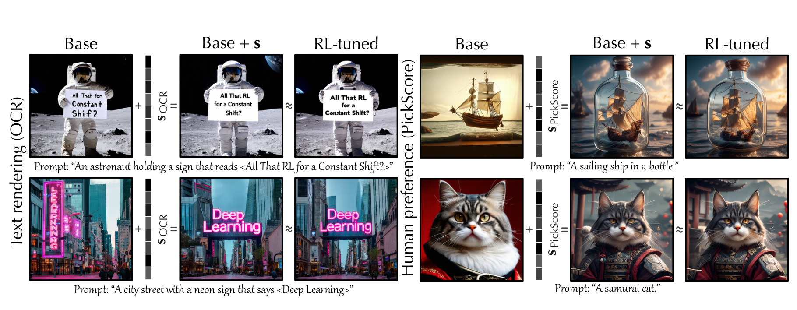
*圖：論文 Figure 1（自 PDF 聚焦擷取）。原文 caption：「A constant shift of a frozen base model recovers 90.0% to 96.3% of the RL reward gain on six image models.」左半是文字渲染（OCR reward），右半是人類偏好（PickScore）；三欄依序是 Base、**Base + s**、RL-tuned。中間那條灰階色棒是 $\mathbf{s}$ 本身——一個跟 prompt 無關的向量。注意宇航員紙牌上「All That RL for a Constant Shift?」這個自嘲式 prompt，以及「a sailing ship in a bottle」那一列：base 畫的是**瓶子外面的船**，加了向量之後才出現瓶子（構圖級別的行為改變，不是色調級別）。[1]*

---

## 二、為什麼挑這篇

你點名的偏好軸裡，這篇同時踩到**attention modulation**、**training-free（部分）**、**zero-shot（跨解析度／跨取樣步數）**、以及「把生成模型當成可解釋系統來拆」這條隱線；而它的主戰場是 flow matching／DiT 的 RL post-training，正是近半年 huggingface papers 上最擁擠的方向。真正讓我決定選它的，是三件事：

1. **它是一個「反直覺 + 可反駁」的組合，而不是又一個 trick。** 直覺上，RL 微調要改變「給不同輸入不同回應」的能力，所以至少該動 weight matrix；作者的宣稱恰恰相反：**把更新壓成輸入無關的常數就夠了**。而這個宣稱可以用一個很便宜的實驗打死——「同參數量的 LoRA 有沒有比較好呢？」他們真的做了（Table S5），而且在影像模型上**偵測不到差異**。
2. **它附了一整套機制證據，不只是 leaderboard。** 通路互換實驗（Fig. 9）、attention 上的精確恆等式（Eq. 3 與 Theorem S1）、把 key shift 與 value shift 分離的因果測試，這些是 interpretabilty 论文的標配，但在「RL for generation」文獻裡罕見。
3. **它跟本庫已讀的幾篇直接對撞。** 本庫讀過的 SHIFT（flow transformer 的 hidden intermediates steering）、AdaLN-Zero、attention sinks／text template tokens 那幾篇，剛好可以拼成同一張圖：本文提供的是「**在 diffusion transformer 裡，訓練所學到的東西可以住在多小、多靜態的一層介入裡**」的量化答案，而 DreamBooth 那組反例則把邊界畫得很清楚。

**必須先講清楚的兩點（否則標題會誤導讀者）**：

- 標題寫 **is** activation steering，但作者在 Limitations（附錄 H）裡明確**不主張必要性**，也沒有宣稱 RL 的權重更新是 low-rank——他們測的是 LoRA 訓練的模型與**全參數**微調的模型都能被常數向量大幅恢復，所以「低秩所以好複製」這條解釋其實是他們自己排除掉的。[1]
- 這**不是 training-free 方法**：擬合向量要花 5.6–16.8 H100 GPU-hours（影像／模型）、22.4–69.7（影片），而真正宣稱「只訓向量就打贏 weight-based RL」的 Sec. 4.6 更是燒了 123／183 **B200** GPU-hours。[1] 「training-free」在本文裡只有一個精確含義：**不需要 reward、不需要 rollout 取樣**（Eq. 2 是對已快取樣本的回歸）。

---

## 三、命題的形式化：一個只看 block、pass、step bin 的向量

### 3.1 記號與介入

模型是 flow matching／rectified-flow 的 velocity 場 $\mathbf{v}$，雜訊 latent 為 $\mathbf{x}_t=(1-t)\mathbf{x}_0+t\boldsymbol{\epsilon}$，$t\in[0,1]$；base 記 $\mathbf{v}_\theta$、RL-tuned 記 $\mathbf{v}_{\theta_{\mathrm{RL}}}$、被 steered 的 base 記 $\mathbf{v}_{\theta,\mathbf{s}}$。CFG 寫成 $\mathbf{v}_\varnothing+w(\mathbf{v}_{\mathrm{c}}-\mathbf{v}_\varnothing)$，FLUX.1-dev 是 guidance-distilled 所以只有單 pass。[1]

在一個有 $L$ 個 block、寬度 $d$ 的模型裡，$\mathbf{h}^{\mathrm{str}}_{\ell,i}\in\mathbb{R}^{d}$ 是 block $\ell$ 在 stream $\mathrm{str}\in\{\mathrm{img},\mathrm{txt}\}$ 的第 $i$ 個 token 輸出。steering vectors 的定義就是全文的核心一句：

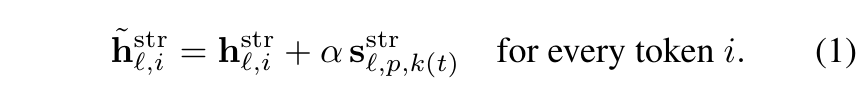

$$
\widetilde{\mathbf{h}}^{\mathrm{str}}_{\ell,i}=\mathbf{h}^{\mathrm{str}}_{\ell,i}+\alpha\,\mathbf{s}^{\mathrm{str}}_{\ell,p,k(t)}\quad\text{for every token }i . \tag{1}
$$

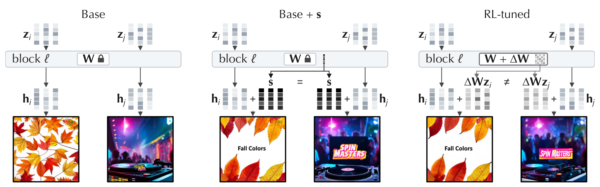
*圖：論文 Figure 2（自 PDF 聚焦擷取）。原文 caption：「The steering vectors add the same vector to every token of every prompt.」圖中以顏色區分 token、以框線高亮「這一格該用哪個 $\mathbf{s}$」；縱軸是 block、橫軸是 sampling step，cond／uncond 兩條 pass 各有一套向量。[1]*

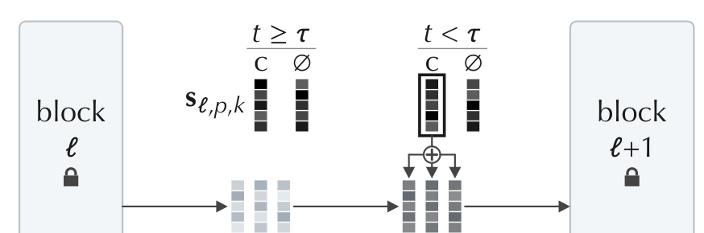
*圖：論文 Figure 3（自 PDF 聚焦擷取）。原文 caption：「One steering vector shifts every token of a block output.」同一個 linear layer $\mathbf{W}$、同一組 token 輸入 $\mathbf{z}_i,\mathbf{z}_j$：$\Delta\mathbf{W}$ 給每個輸入不同的位移（$\Delta\mathbf{W}\mathbf{z}_i\neq\Delta\mathbf{W}\mathbf{z}_j$），$\mathbf{s}$ 給所有 token 同一個位移。這張圖就是整篇的「自變量」。[1]*

四件事決定用哪個向量：**block、stream、guidance pass、step bin**。參數布局（Table S3）是 block outputs × width × passes × 2 step bins：[1]

| Base | Block outputs | Width | Passes | 向量參數 | 同參數 LoRA 的放法 |
|---|---|---|---|---|---|
| SD3.5-M | 47 | 1,536 | 2 | **288,768** | attention output projection，rank 2 |
| FLUX.1-dev | 76 | 3,072 | 1（guidance-distilled） | 466,944 | rank 2 |
| Wan2.1-1.3B | 30 | 1,536 | 2 | 184,320 | rank 1 |
| Wan2.2-5B | 30 | 3,072 | 1（VBVR-Pro 取樣不用 guidance） | 184,320 | rank 1 |

在 SD3.5-M 上，$\mathbf{s}$ 一共是 **188 個向量**、0.29M 參數，是 Flow-GRPO 那個 rank-32 LoRA（18.8M）的 **1.5%（65×）**。[1] [4]

三個布局理由都很務實，值得記成設計守則（附錄 C）：[1]

- **跨 token 共享** 讓參數量與 token 數无關 → 在 $512^2$ 擬合的向量可以直接搬到 $768^2$、$1024^2$（實測保留 92%–98%）。
- **依 guidance pass 拆分**：CFG 把 conditional 速度的變化乘 $w$、把 unconditional 的變化乘 $(1-w)$，兩者**符號相反**（$w>1$），所以一套向量不夠。Table S11 顯示分開兩 pass 比分開 step bins 更能提升增益。
- **依 step bin 拆分**（$K=2$，邊界 $\tau$ 平均切 $N=40$ 個 noise level）：RL-tuned 模型的平均 block-output 改變**在取樣步上是變動的**——SD3.5-M＋PickScore 上，前 5 步與後 5 步的改變 cosine 只有 **0.09**；把步分組平均，兩 bin 保留八 bin 能量的 **83%–94%**（若是無關的隨機分組只有 25%–26%，Table S4）。

### 3.2 對照組：LoRA 到底哪裡不一樣

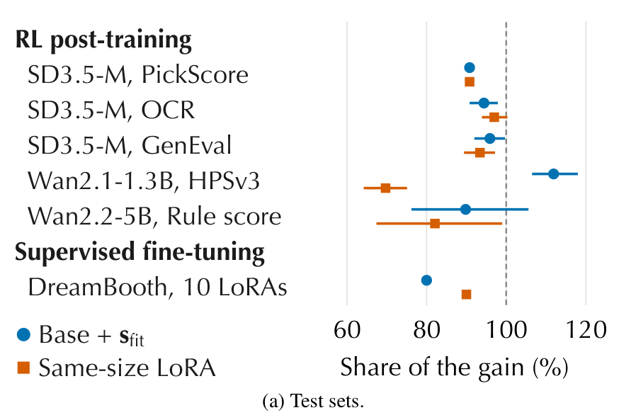

$$(\mathbf{W}+\Delta\mathbf{W})\mathbf{z}_i=\mathbf{W}\mathbf{z}_i+\underbrace{\Delta\mathbf{W}\mathbf{z}_i}_{\text{per-token}},\qquad
\mathbf{h}_i+\alpha\mathbf{s}=\text{同一位移}.$$

一個 rank-1 更新 $\Delta\mathbf{W}=\mathbf{b}\mathbf{a}^\top$ 加的是「固定方向 $\mathbf{b}$，乘以 $\mathbf{a}^\top\mathbf{z}_i$ 這個**隨輸入變化的純量**」，所以 LoRA 天生是 steering vector 的輸入相關版本。這條對照是全文實驗設計的原點：**要證明「常數就夠」，就必須把「同參數、但輸入相關」的對照組做出來**（Table S5），否則就只是參數量比較。[1]

### 3.3 推論成本

 Eq. (1) 在推論時的開銷是「每個 block 一次向量加法」，沒有額外 forward、沒有額外 model、沒有 extra NFE。這與本庫讀過的 Z-Cache／PreSTP 那類「省算力」路線正交：**它買的不是速度，而是把 RL 塞進一個可以隨處插拔、可加可減、可 transport 的極小物件裡。**[1]

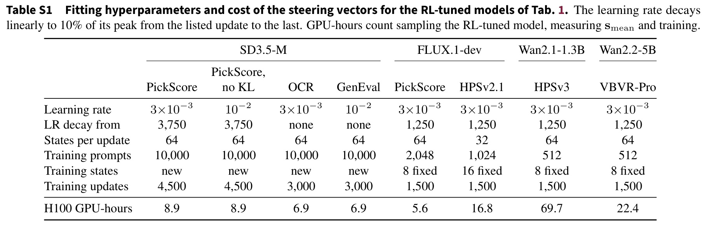
*圖：論文 Table S1（自 PDF 聚焦擷取，含最右欄 GPU-hours）。重點口徑：每個 RL-tuned 模型各擬合一組向量（不共用）、1,500–4,500 次更新、AdamW、lr 3e-3 或 1e-2、影像模型 ≤17 H100 GPU-h、影片模型 ≤70。這是最常被讀者跳過、但决定「能不能重現」的一張表。[1]*

---

## 四、目標函數：把 reward 整個拿掉的 velocity matching

擬合 $\mathbf{s}$ 的方式是**回歸到 RL 模型的 velocity**，而不是最大化任何 reward：

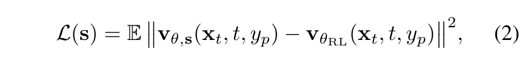

$$
\mathcal{L}(\mathbf{s})=\mathbb{E}\bigl\|\mathbf{v}_{\theta,\mathbf{s}}(\mathbf{x}_t,t,y_p)-\mathbf{v}_{\theta_{\mathrm{RL}}}(\mathbf{x}_t,t,y_p)\bigr\|^{2}, \tag{2}
$$

期望取在 prompt $y$、RL 模型跑完的最終樣本 $\mathbf{x}_0$、$t$、$\boldsymbol{\epsilon}$、以及 guidance pass $p\in\{\mathrm{c},\varnothing\}$ 上。因為 Eq. (1) 只用 pass 與 step bin 選向量，**Eq. (2) 可拆成每個 (pass, step bin) 一個獨立項**——這是把「$K$、$p$ 要不要分開」做成布局問題而非優化問題的關鍵：分開之後每項都是小回歸，沒有跨 bin 的正則、也沒有 coupling。[1]

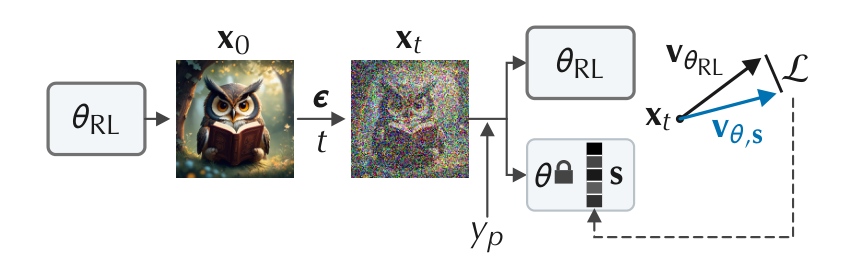
*圖：論文 Figure 4（自 PDF 聚焦擷取）。原文 caption：「Fitting matches the RL-tuned model's velocity.」左軸是 loss 曲線，右側說明「兩個模型都凍結，所以這是一筆對已快取狀態的监督回歸」——不需要在訓練迴路裡取樣，也不需要 reward model 在線打分。[1]*

**這個選擇比方法本身更有意思**，因為它把 RL 的「訊號」降級成「目標函數的輸出端」：

- 不需要 reward 模型 → 沒有 reward hacking、沒有 KL 正則、沒有取樣器與 log-prob 估計（Flow-GRPO 那一類方法最痛的幾件事全消失）。
- 但是需要**一個 RL-tuned 模型當 teacher**，以及它跑出來的樣本。所以本文精確說法是「**把 RL 蒸餾進常數**」，不是「不用 RL」。
- 也因為 Eq. (2) 配的是 velocity 而不是 reward，**$\mathbf{s}$ 的殘差方向不受 reward 約束**——這點直接解釋了 Table 1 裡 Wan2.1 那個 111.9%（超過 RL 自己）不是奇蹟，而是匹配誤差的自由方向（見 5.1）。

### 4.1 training-free 起點 $\mathbf{s}_{\mathrm{mean}}$，以及它為什麼不夠

最自然的免訓練猜測是：把兩個模型在每個 block 輸出上的**平均差**直接當 $\mathbf{s}$：

$$
\mathbf{s}^{\mathrm{str}}_{\ell,p,k}=\mathbb{E}_{i,\,y,\,t\in\text{bin}}\bigl[\mathbf{h}^{\mathrm{str}}_{\ell,i}(\theta_{\mathrm{RL}})-\mathbf{h}^{\mathrm{str}}_{\ell,i}(\theta)\bigr].
$$

這是 contrastive CAA（activation addition）的雙模型版本，也是「把 block 依序量測、先加的向量已納入 base」的 sequential 定義，所以不會重複計入同一個 block 的改變。[1]

結果**它遠不如擬合**：Table 1 的 share 欄裡 $\mathbf{s}_{\mathrm{mean}}$ 只有 12.2%–79.0%，而 $\mathbf{s}_{\mathrm{fit}}$ 是 89.8%–95.9%（影像）。三個細節值得記：[1]

- PickScore 上 $\mathbf{s}_{\mathrm{mean}}$ 的**方向其實不差**（擬合結果與它的 cosine 是 0.97），問題是 norm 太小：把它 rescale 到 $\mathbf{s}_{\mathrm{fit}}$ 的 norm 可得 +1.231（vs $\mathbf{s}_{\mathrm{fit}}$ +1.416、$\mathbf{s}_{\mathrm{mean}}$ 原始 +0.952）。
- OCR 上 $\mathbf{s}_{\mathrm{fit}}$ **垂直於** $\mathbf{s}_{\mathrm{mean}}$ 的分量就保留了 96% 的增益（+0.312／+0.325）→ 需要的不是「平均激活差的幅度」，而是平均差之外的方向。
- 反向也成立：$\mathbf{s}_{\mathrm{mean}}$ 與 zero-init 擬合的 cosine 只有 0.33，但兩種初始化都能到同樣的 gain（+1.34 對 +1.36）。**同一個 reward 增益可由不同向量集合達成**，這是 identifiability 問題，作者在文中承認但未處理。

一句話總結本節：**「RL 的學習內容是常數」這個說法，只有在「用 velocity matching 擬合過」的意義下才成立；把平均激活差直接抄過去是不夠的。**[1]

---

## 五、主結果與必須一起讀的控制實驗

### 5.1 Table 1：八個模型、四種 RL 方法、兩種更新規模

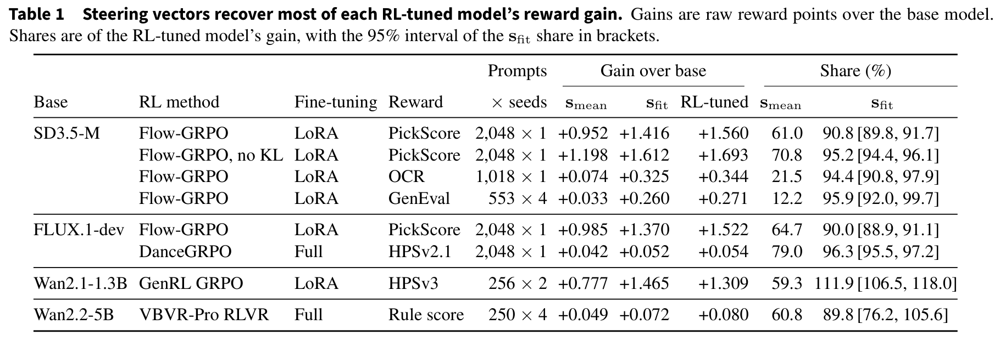
*圖：論文 Table 1（自 PDF 聚焦擷取）。gain 是相對 base 的 raw reward points，括號是 $\mathbf{s}_{\mathrm{fit}}$ share 的 95% bootstrap 區間。[1]*

| Base | RL 方法 | 更新 | Reward | prompts×seeds | $\mathbf{s}_{\mathrm{mean}}$ | $\mathbf{s}_{\mathrm{fit}}$ | RL-tuned | share $\mathbf{s}_{\mathrm{fit}}$ |
|---|---|---|---|---|---|---|---|---|
| SD3.5-M | Flow-GRPO | LoRA | PickScore | 2,048×1 | +0.952 | +1.416 | +1.560 | **90.8** [89.8, 91.7] |
| SD3.5-M | Flow-GRPO（無 KL） | LoRA | PickScore | 2,048×1 | +1.198 | +1.612 | +1.693 | **95.2** [94.4, 96.1] |
| SD3.5-M | Flow-GRPO | LoRA | OCR | 1,018×1 | +0.074 | +0.325 | +0.344 | **94.4** [90.8, 97.9] |
| SD3.5-M | Flow-GRPO | LoRA | GenEval | 553×4 | +0.033 | +0.260 | +0.271 | **95.9** [92.0, 99.7] |
| FLUX.1-dev | Flow-GRPO | LoRA | PickScore | 2,048×1 | +0.985 | +1.370 | +1.522 | **90.0** [88.9, 91.1] |
| FLUX.1-dev | DanceGRPO | **Full** | HPSv2.1 | 2,048×1 | +0.042 | +0.052 | +0.054 | **96.3** [95.5, 97.2] |
| Wan2.1-1.3B | GenRL GRPO | LoRA | HPSv3 | 256×2 | +0.777 | **+1.465** | +1.309 | **111.9** [106.5, 118.0] |
| Wan2.2-5B | VBVR-Pro RLVR | **Full** | Rule score | 250×4 | +0.049 | +0.072 | +0.080 | **89.8** [76.2, 105.6] |

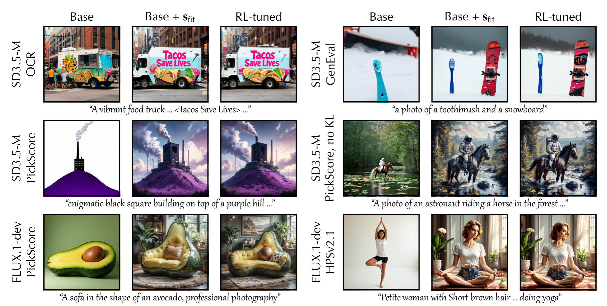
*圖：論文 Figure 5（自 PDF 聚焦擷取）。原文 caption：「Steering vectors recover most of the gain of each RL-tuned image model.」[1]*

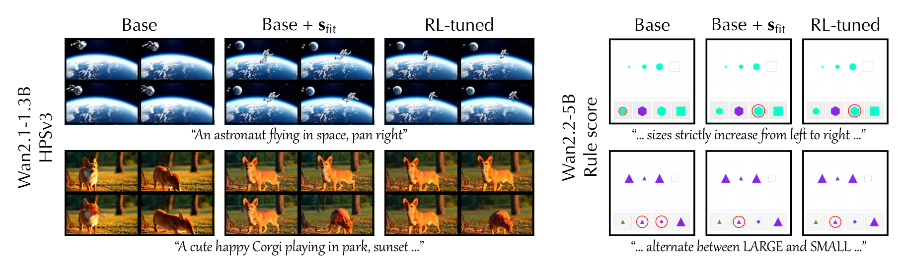
*圖：論文 Figure 6（自 PDF 聚焦擷取）。原文 caption：「Steering vectors recover most of the gain of both RL-tuned video models.」注意附錄 H 自己說：六個影片候選裡只有**兩個**在評測 reward 上有顯著正增益（Table S13），所以「影片那一列」是篩選倖存者後的結果。[1]*

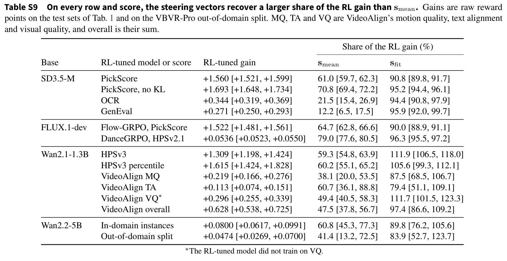
*圖：論文 Table S9（自 PDF 聚焦擷取）。原文 caption：「On every row and score, the steering vectors recover a larger share of the RL gain than $\mathbf{s}_{\mathrm{mean}}$.」這張表是把「免訓練直覺」系統性打掉的證據。[1]*

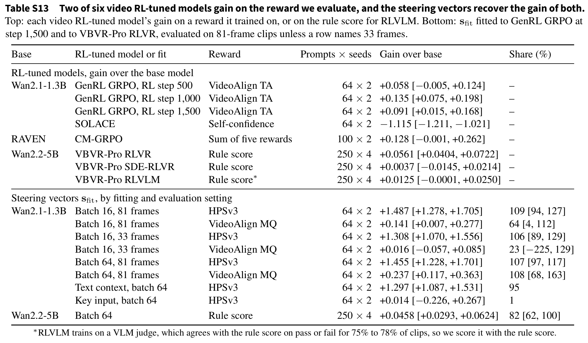
*圖：論文 Table S13（自 PDF 聚焦擷取）。六個 video RL checkpoint 的 gain 與顯著性，只有兩個可用——這是影片結果的外推上限，報告裡請以「兩個模型／兩個 base」來引用，不要寫成「video RL post-training 適用」。[1]*

**111.9% 怎麼讀？** Wan2.1 上 $\mathbf{s}_{\mathrm{fit}}$ 的增益（+1.465）比 RL-tuned 模型自己（+1.309）還大。作者的解釋是：擬合配的是 velocity、不是 reward，reward 只是評估用的讀數，所以殘差方向可能恰好朝 reward 更好的一側走。這**不是「常數比微調強」的證據**，而是「velocity matching 是一個比 reward 更寬的約束」的證據——同一個理由也解釋了两個 OCR fit 的 cosine 只有 0.33 卻同分。[1]

### 5.2 最關鍵的一張表：同參數 LoRA 沒有被偵測到優勢

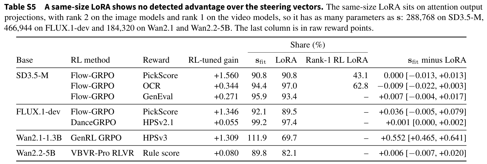
*圖：論文 Table S5（自 PDF 聚焦擷取）。原文 caption：「A same-size LoRA shows no detected advantage over the steering vectors.」對照組放在 attention output projection（影像 rank 2、影片 rank 1）以湊齊相同參數量，用同一個 Eq. (2) 擬合。[1]*

| 配置 | share $\mathbf{s}$ | share LoRA | 差值（對 $\mathbf{s}$ 有利為正） |
|---|---|---|---|
| SD3.5-M · PickScore | 90.8 | 90.8 | 0.000 [−0.013, +0.013] |
| SD3.5-M · OCR | 94.4 | 97.0 | −0.009 [−0.022, +0.003] |
| SD3.5-M · GenEval | 95.9 | 93.4 | +0.007 [−0.004, +0.017] |
| FLUX.1-dev · PickScore | 92.1 | 89.5 | +0.026 |
| FLUX.1-dev · HPSv2.1 | 99.2 | 97.4 | +0.018 |
| Wan2.1-1.3B · HPSv3 | **111.9** | **69.7** | +0.552 [+0.465, +0.641] |
| Wan2.2-5B · Rule score | 89.8 | 82.1 | +0.077 |

四個影像配置裡有三個差值的 95% 區間**跨 0**，唯一明顯的優勢反而是對 $\mathbf{s}$ 有利（Wan2.1）。這是我認為本篇最有價值、也最容易被標題掩蓋的一張表：**「輸入相關」在 RL 增益這個尺度上買不到東西。** 另外兩組佐證同向：[1]

- 把 RL 自己的 LoRA **截到 rank-1**（即最接近「一個 steering 方向乘以一個輸入相關純量」的形式），只剩 **43.1%**（PickScore，+0.668／+1.549）與 **62.8%**（OCR，+0.210／+0.334）的增益 → 低秩地複製 RL 權重更新**比**用常數向量**更差**。
- 取 RL LoRA 的「跨輸入共享部分」（對輸入平均），只能關閉 velocity gap 的 **62.5%**［61.1, 63.8］（PickScore）與 **30.8%**［30.0, 31.8］（OCR）。
- 隨機向量（同 norm、同位置）把 PickScore **拉低 4.704 點**（同場景 $\mathbf{s}$ 是 +1.416）→ 增益不是「加了能量／扰动」的副作用。

### 5.3 「那不就是 guidance 嗎？」——Table S6 逐條排除

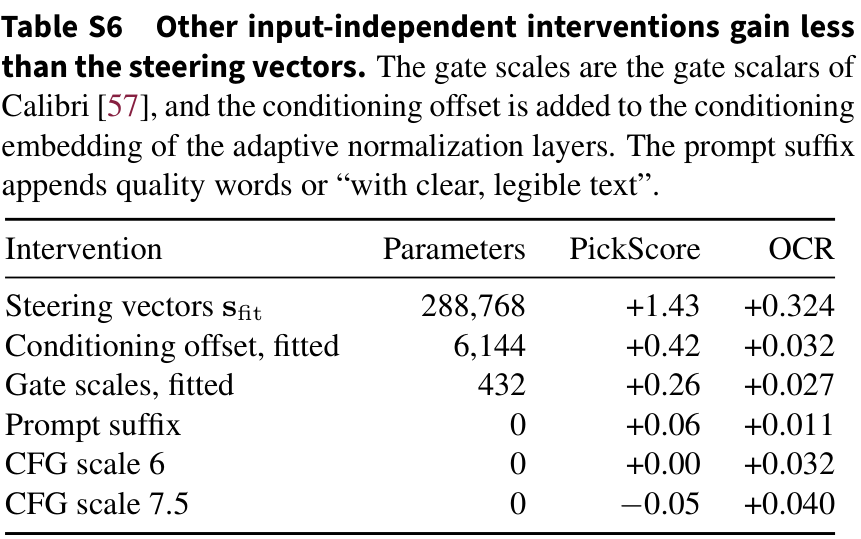
*圖：論文 Table S6（自 PDF 聚焦擷取）。原文 caption：「Other input-independent interventions gain less than the steering vectors.」[1]*

| 介入 | 參數 | PickScore gain | OCR gain |
|---|---|---|---|
| conditioning offset（在 text encoder 輸出加常數） | 6,144 | +0.42 | +0.032 |
| Calibri 式 gate scales | 432 | +0.26 | +0.027 |
| prompt suffix | 0 | +0.06 | +0.011 |
| CFG scale 6 | 0 | +0.00 | +0.032 |
| CFG scale 7.5 | 0 | −0.05 | +0.040 |
| **steering vectors** | **288,768** | **+1.43** | **+0.324** |

RaTE（只做一個可學 prompt token，實為 MapReduce LoRA 的 Sec. 3.3 方法）在本文口徑下只恢復 **7%–32%**。[1] [5] 結論不是「這些方法沒用」，而是：**介入必須落在 block output 這一層、且要依 pass/step bin 拆開**，才吃得到 RL 的內容——位置與粒度本身就是貢獻的一部分。

### 5.4 它連 RL 的副作用都一起複製了（這條最有說服力）

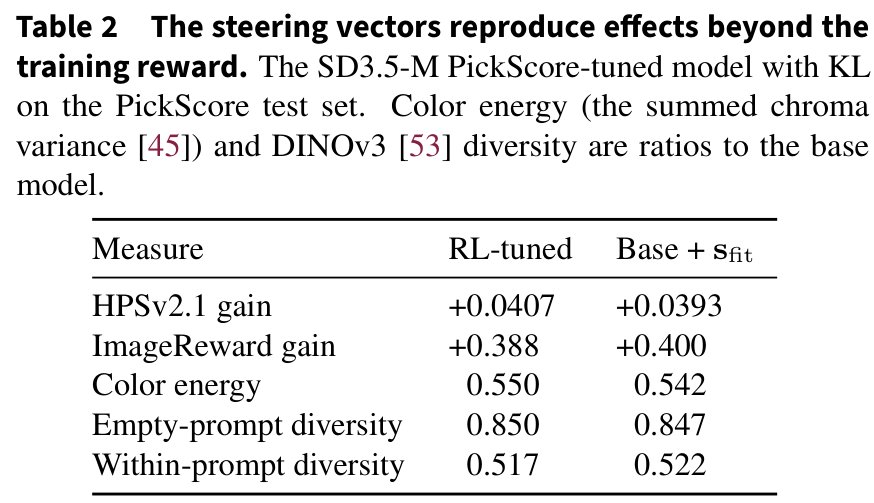
*圖：論文 Table 2（自 PDF 聚焦擷取）。原文 caption：「The steering vectors reproduce effects beyond the training reward.」[1]*

用 PickScore 擬合的向量，在**沒被擬合過**的指標上：HPSv2.1 +0.0393（RL-tuned +0.0407）、ImageReward +0.400（RL +0.388）。更狠的是兩個眾所周知的 RL 副作用也被同幅重現：**color energy**（以 base=1 歸一的色度變異和）0.542 對 RL 的 0.550；**within-prompt DINOv3 diversity** 0.522 對 RL 的 0.517；empty-prompt diversity 0.847 對 0.850；無 KL 版本是 0.377 對 0.379、0.457 對 0.456。[1] [7]

而且作者先擋掉了最明顯的解釋：**全球色彩變換只解釋 PickScore 增益的 8%**。同一 noise 下 steered base 與 RL-tuned 幾乎畫同一張圖（Fig. S4）。

- 使用者研究（Table S8，25 raters × 50 prompts、約每格 500 次判斷）：對 base 的偏好勝率 62%–68%，對 RL-tuned 是 47%–53%（統計上≈平手）。[1]
- 難例（Table S14）：GenEval 上取「base 在另外三個 seed 都失敗」的 146 個 prompt，在第四個 seed base 只有 14.9% 成功，向量恢復了 RL-tuned +0.641 增益的 **97.7%**；在「base 失敗而 RL 成功」的 prompt–seed pair 上，向量解開 **91.4%**（GenEval）／**75.3%**（OCR），而 RL-tuned 模型自己在下一個 seed 只有 93.3%／71.6%——向量不只近似 teacher，還**泛化過 teacher**。[1]

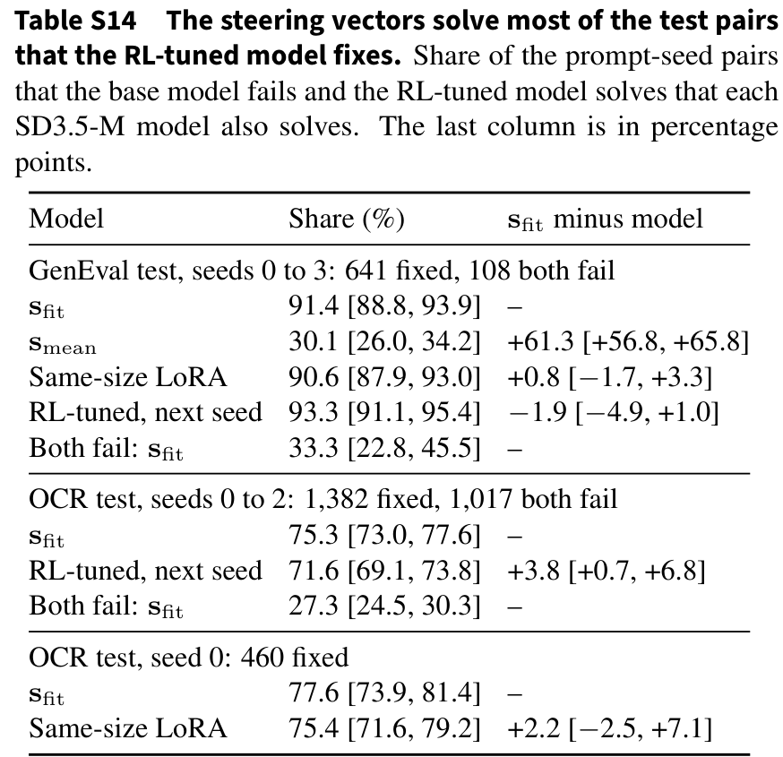
*圖：論文 Table S14（自 PDF 聚焦擷取）。原文 caption：「The steering vectors solve most of the test pairs that the RL-tuned model fixes.」這張表是「不是過擬合 teacher」的主要答辯。[1]*

### 5.5 反向測試：只用 RL 訓練向量（Sec. 4.6）

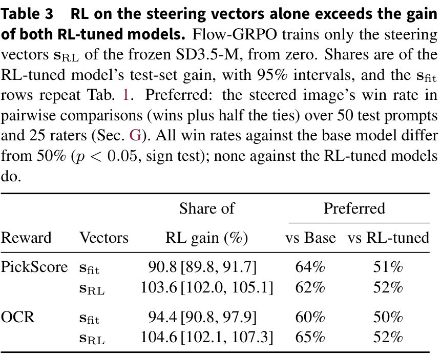
*圖：論文 Table 3（自 PDF 聚焦擷取）。原文 caption：「RL on the steering vectors alone exceeds the gain of both RL-tuned models.」$\mathbf{s}_{\mathrm{RL}}$ 從零初始化、用 Flow-GRPO 直接優化 Eq. (1) 的向量（不動任何權重），OCR 達 weight-based RL 的 **104.6%**、PickScore **103.6%**。[1]*

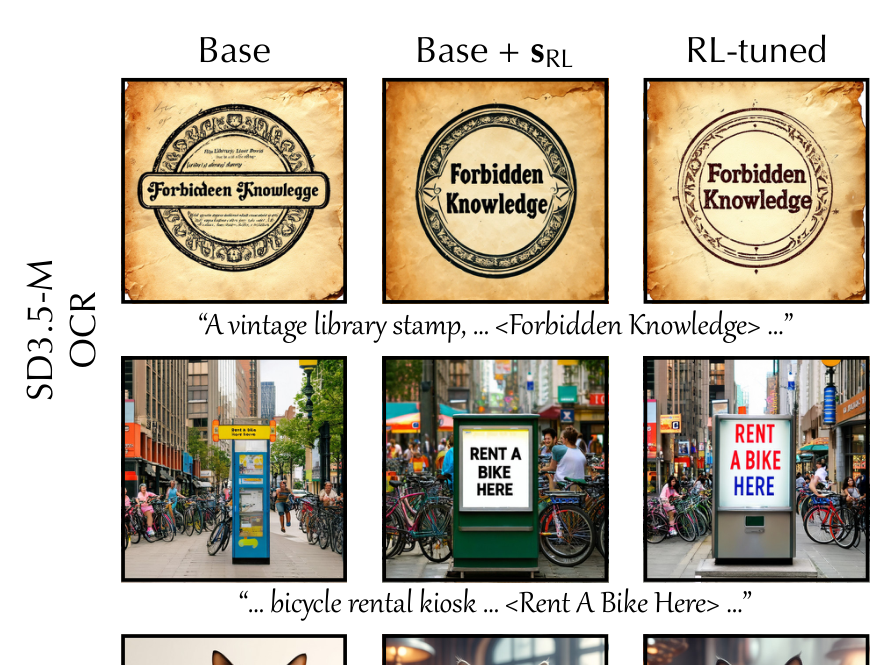
*圖：論文 Figure 8（自 PDF 聚焦擷取）。原文 caption：「Steering vectors trained by RL alone change the images as the RL-tuned models do.」[1]*

成本要寫清楚：訓練 $\mathbf{s}_{\mathrm{RL}}$ 花 **123／183 B200 GPU-hours**（Table S2：lr 5e-3、576 images/update、1,300／1,500 updates、每 8 步 EMA decay 0.9）。[1] 這代表本文的「節參數」宣稱是**推理期與儲存期**的，不是訓練期的。這條也是全文最重要的一句話的另一半：**常數向量不只是 RL 的近似描述，它本身就是一個足夠有表達力的 policy class**——至少在這些 reward 上。

### 5.6 邊界：DreamBooth（SFT）就不是常數能搞定的

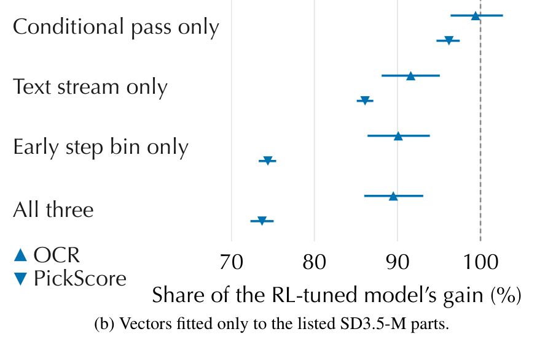
*圖：論文 Figure 7（自 PDF 聚焦擷取）。原文 caption：「(a) A same-size LoRA recovers detectably more after supervised fine-tuning (DreamBooth) but not after RL, and (b) vectors fitted to parts of SD3.5-M recover most of the RL gain.」[1]*

DreamBooth 那組是**故意放在標題反面的證據**：六個虛構人物（ArcFace 身份相似度）只恢復 **68%–83%**、四個公開 DreamBooth LoRA（DINOv3 主體相似度）**73%–95%**，而同參數 LoRA 是 **81%–91%**／**94%–100%**；附錄 E 的定性圖（Fig. S5／S6）說得更直接——向量畫得出新主體的**粗appearance，丟掉細節與身份**。[1]

這篇的真實命題因此比標題窄也更有趣：**「RL 教的是既有機制的取用方式，SFT 教的是新內容」**，而「常數向量是否夠用」正是區分這兩者的可測量。這條與 LLM 側 Venhoff et al.（base models know how / thinking models learn when）的結論同構。[1] [8]
---

## 六、增益住在哪裡：拆解、通路與一個可驗的 attention 恆等式

### 6.1 拆開來看（Table S12）：方向性反常本身就是資訊

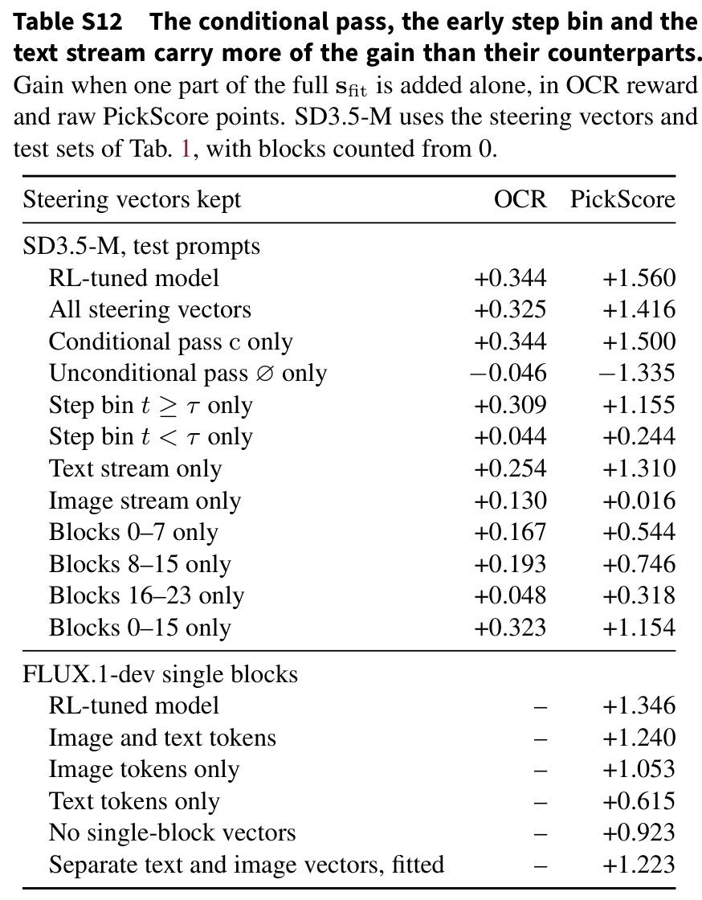
*圖：論文 Table S12（自 PDF 聚焦擷取）。原文 caption：「The conditional pass, the early step bin and the text stream carry more of the gain than their counterparts.」口徑是「在整套擬合好的向量裡，只留該部分」。[1]*

SD3.5-M 上「只留一部分」的增益（OCR／PickScore）：[1]

| 保留的部分 | OCR | PickScore |
|---|---|---|
| 整套 $\mathbf{s}$ | +0.325 | +1.416 |
| 只有 conditional pass | **+0.344** | **+1.500** |
| 只有 uncond pass 的那份 | −0.046 | −1.335 |
| 早期 step bin | +0.309 | +1.155 |
| 晚期 step bin | +0.044 | +0.244 |
| block 0–7 ／ 8–15 ／ 16–23 | +0.167／+0.193／+0.048 | +0.544／+0.746／+0.318 |
| text stream only | +0.254 | +1.310 |
| image stream only | +0.130 | +0.016 |

兩個必須講清楚的點：

1. **「只有 uncond 那份會降低 reward」不是 bug，是 CFG 的算術**。$\mathbf{v}_\varnothing+w(\mathbf{v}_c-\mathbf{v}_\varnothing)$ 等於把 cond 變化乘 $w$、uncond 變化乘 $(1-w)$；兩套向量方向相近而係號相反，**拿掉 uncond 那份等同把 $\alpha$ 調大**。這也解釋了為什麼「只擬合 conditional pass」反而比整套更多：那時候 uncond 走的是 base 的原值。[1]
2. **「留哪部分」與「單獨擬合哪部分」是兩個問題**。Sec. 5 正文另外報告：**單獨**對 image stream 擬合也能恢復大部分增益（OCR 91.4%、PickScore 84.9%）。所以「增益住在 text stream」這句話只在「固定其他條件、只留子集合」的意義下成立。作者把兩種口徑放在不同表，閱讀時很容易混掉——報告裡我把它們分開寫。[1]

把三個「比較重要」的軸同時取交集（conditional pass ∩ 早期 bin ∩ text stream）只需要 **35,328** 個參數——整套的 12%、rank-32 LoRA 的 **0.19%**——就恢復 OCR 增益的 **89.5%**、PickScore 的 **73.7%**。這是全文參數效率的極限點。[1]

### 6.2 通路互換實驗：把 gain 定位到一條 attention 邊上

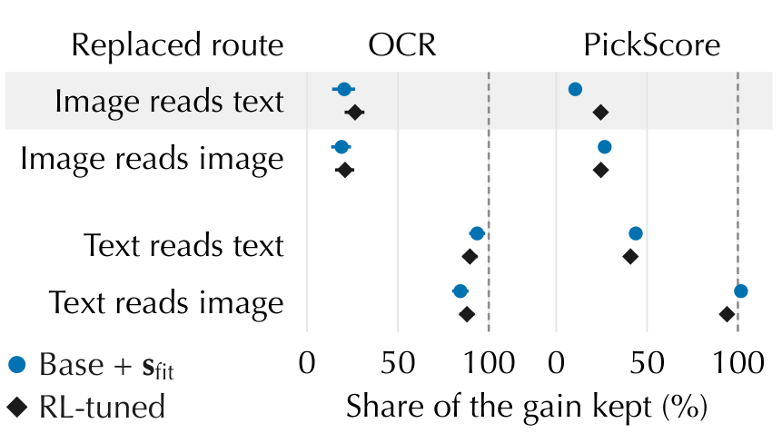
*圖：論文 Figure 9（自 PDF 聚焦擷取）。原文 caption：「Steering vectors and RL reach the image through what image tokens read from text.」做法是把 joint attention 裡某一個 query→key/value 子集合的來源，換回「未 steered 的 base 模型在同一個 noise state 上的值」，再看 reward 剩多少。[1]*

| 被換回的通路 | $\mathbf{s}$ 剩下 | RL-tuned 剩下 |
|---|---|---|
| image query 讀到的 **text** keys/values（OCR） | **20.5%** | 26.4% |
| image query 讀到的 text keys/values（PickScore） | **10.5%** | 24.5% |
| text query 讀到的 image keys/values | ≥84.4% 保留 | — |
| text query 讀到的 text keys/values（PickScore） | 43.8% | 40.9% |
| 同上（OCR） | 93.6% | 89.6% |
| 交叉：把 OCR-tuned 模型的 text KV 換成「被 OCR 向量 steered 的 base」 | **95.2%**［91.9, 98.6］保留 | （換成 unsteered base 只剩 26.4%［20.7, 31.6］） |
| 交叉：同一條邊改餵「被 PickScore 向量 steered 的 base」的 text KV | 只剩 **44.0%** | — |

三件事一次到位：**(a)** steering 與 RL 走**同一條路**（兩者對同一干擾的脆弱度同數量級）；**(b)** 這條路是「image tokens 讀 text tokens」；**(c)** 增益是**任務特異**的（95.2% 對 44.0%），不是通用的「把 text tokens 弄好一點」。附錄 I 的 Fig. S8 给了最直觀的一张圖：只把這條邊換回 base，乾淨的文字立刻退回 base 的亂碼。[1]

另一組被引用較少但很重要的對照：把向量加在 **text encoder 的輸出**（conditioning offset）只有 +0.42（Table S6），而在 block 輸出加是 +1.43 → **增益不是在「prompt 好壞」這一層產生，而是在模型內部 text tokens 被反覆讀取的層**。[1]

### 6.3 Eq. (3) 與 Theorem S1：常數向量為什麼能「擴散」成 per-token 的差異

一個 obvious 的反駁是：你加的是常數，憑什麼能做出 per-token、per-input 的行為改變？答案在 joint attention 的 softmax 結構裡。[1]

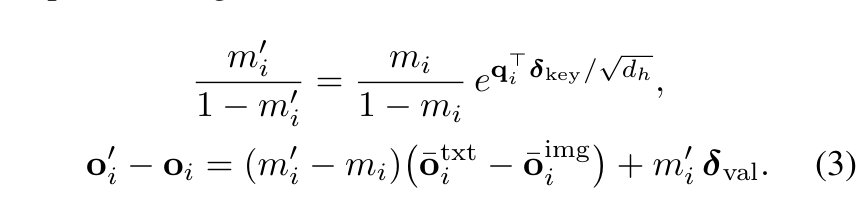

取一個 head，image token $i$ 對 text token $j$ 的權重與輸出寫成

$$
m_{ij}=\frac{e^{\mathbf{q}_i^\top\mathbf{k}_j/\sqrt{d_h}}}{\sum_{j'}e^{\mathbf{q}_i^\top\mathbf{k}_{j'}/\sqrt{d_h}}},\qquad
m_i=\!\!\sum_{j\in\mathrm{txt}}\!\!m_{ij},\qquad
\mathbf{o}_i=m_i\,\bar{\mathbf{o}}^{\mathrm{txt}}_i+(1-m_i)\,\bar{\mathbf{o}}^{\mathrm{img}}_i . \tag{3}
$$

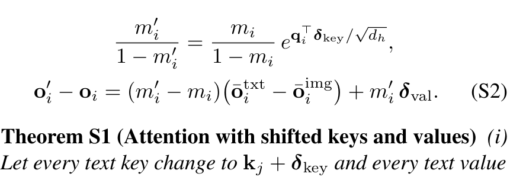

**Theorem S1**（若所有 text key 同移 $\boldsymbol{\delta}_{\mathrm{key}}$、所有 text value 同移 $\boldsymbol{\delta}_{\mathrm{val}}$）：

$$
\frac{m_i'}{1-m_i'}=\frac{m_i}{1-m_i}\,e^{\mathbf{q}_i^\top\boldsymbol{\delta}_{\mathrm{key}}/\sqrt{d_h}},\qquad
\mathbf{o}_i'-\mathbf{o}_i=(m_i'-m_i)\bigl(\bar{\mathbf{o}}^{\mathrm{txt}}_i-\bar{\mathbf{o}}^{\mathrm{img}}_i\bigr)+m_i'\,\boldsymbol{\delta}_{\mathrm{val}} . \tag{S1, S2}
$$

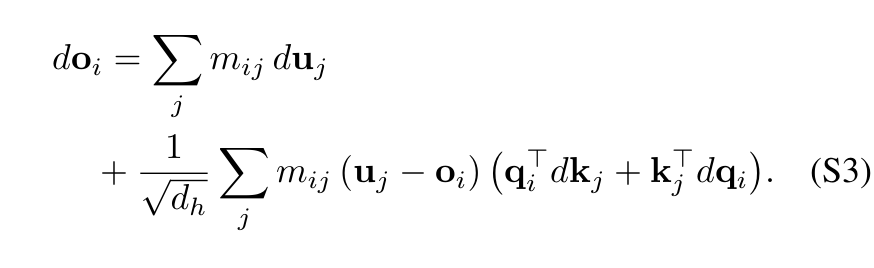

$$
d\mathbf{o}_i=\sum_j m_{ij}\,d\mathbf{u}_j+\frac{1}{\sqrt{d_h}}\sum_j m_{ij}\bigl(\mathbf{u}_j-\mathbf{o}_i\bigr)\bigl(\mathbf{q}_i^\top d\mathbf{k}_j+\mathbf{k}_j^\top d\mathbf{q}_i\bigr). \tag{S3}
$$

三條可直接拿去用的推論：[1]

1. **同一個常數位移，在不同 query 上被乘上不同的純量** $e^{\mathbf{q}_i^\top\boldsymbol{\delta}_{\mathrm{key}}/\sqrt{d_h}}$ → 輸入相關性是 attention 幫你做的，不需要向量自己依賴輸入。這是「常數足以模仿 RL」的機制正當性來源，也是為什麼**位置必須在 block output（attention 之前／之中）而不是網路末端**。
2. **stream 內部的權重不受共同位移影響**（分子分母同乘同一指數，抵銷），改變的只有 **text↔image 的質量分配**與 **text value 本身的偏移**。這正是 6.2 那組通路實驗的理論預言。
3. **cross-attention 是例外**：所有 text key 同移時 $\boldsymbol{\delta}_{\mathrm{key}}$ **完全抵銷**，$\boldsymbol{\delta}_{\mathrm{val}}$ 則退化為「給每個 query 加同一個向量」→ 失去 $e^{\mathbf{q}_i^\top\boldsymbol{\delta}/\sqrt{d_h}}$ 那層擴散。作者在 Wan2.1 上驗了這條：**只在 cross-attention 的 key 投影輸入加常數**，在 64 個 VBench prompt 上恢復 **1%** 的 HPSv3 增益、在 Table 1 的 128 個測試 prompt 上是 **−8.0%**［−21.3, +4.5］，正文口徑是「恢復不了任何增益」；同一批 prompt 上，「給整個 text context 加常數」是 **95%** 與 **108.4%**［96.5, 121.9］。附錄 I 給的機制理由是：共同 key 位移在 softmax 裡完全抵銷，**只有 key 投影之後那層 RMSNorm 留下一點改變**。同節也把這與 Petrov et al.（ICLR，prompting／prefix-tuning 的同構分解）對照。[1]

要標的防線：SD3.5-M 在 attention 前有 normalization，所以 $d\mathbf{k}_j$、$d\mathbf{u}_j$ 一般會**隨 token 不同**，Theorem S1 是**一階近似**而非精確描述；Fig. S7 那張圖就是在說「凍結的 block 會把同一個位移變成每個 token 不同的 velocity 改變」，這是定性的、不是閉式的。[1]

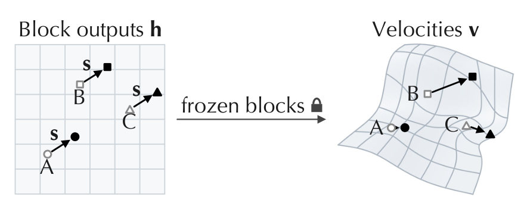
*圖：論文 Figure S7（自 PDF 聚焦擷取）。原文 caption：「The frozen blocks turn the same shift into different velocity changes.」[1]*

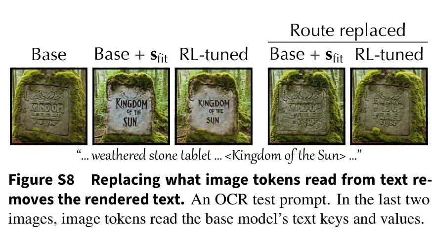
*圖：論文 Figure S8（自 PDF 聚焦擷取）。原文 caption：「Replacing what image tokens read from text removes the rendered text.」這是我個人認為全篇最「一眼定音」的一张圖。[1]*

---

## 七、相關研究背景

### 7.1 LLM 側的先例：「只訓 bias／常數就能吃到 RL」早已發生過

- **Sinii et al., "Steering LLM Reasoning Through Bias-Only Adaptation"（EMNLP 2025，arXiv:2505.18706）**：每層只訓一個 $d$ 維向量、凍結全部權重，在數學推理上打平完整 RL 微調，8B 模型只增約 0.0016% 參數。同組前作 "Small Vectors, Big Effects"（arXiv:2509.06608）用 steering vector 做 RL-induced reasoning 的機制分析。[1] [18] [9]
- **"Learning to Reason in 13 Parameters"（arXiv:2602.04118）**：TinyLoRA 把參數壓到低於 LoRA 秩的下界，質疑「連 rank-1 LoRA 都不是必要條件」。[1]
- **Venhoff et al.（ICML 2026 Spotlight，arXiv:2510.07364）**：constructive model diffing，「純 RL 模型的 category vectors 在 base 上收斂到遠更低的 loss」，hybrid 模型恢復 ~76% 的 RL base-to-thinking gap、但只有 11% 的 SFT gap。**這就是本文 DreamBooth 那組反例的 LLM 版**，而且它的「RL 教 heuristics、不教新機制」敘事是本文標題的思想源頭之一。[1] [8]
- **"Label-free steering: Compressing test-time RL into bias-only subspaces"（arXiv:2609.18587）**：TTRL 壓進 bias-only 子空間，時間上僅早於本文兩個月。[1]

### 7.2 weight → activation 的「翻譯」正被形式化

- **Adila & Sala et al., "Weight Updates as Activation Shifts: A Principled Framework for Steering"（arXiv:2603.00425）**：本文書目第一條 [15]，給出一階等價性來取代「插在哪、用什麼參數化」的經驗試錯。[1]
- **"First-Order Steering: Translating Weight Adaptation into Activation Steering"（arXiv:2610.04283）**：同樣以一階展開作為 weight→activation 的橋 [16]，主軸是多目標組裝時不互相抵銷。[1]

本文的增量不在這條理論線（它甚至沒有把 Theorem S1 用在最佳化上），而在**把這條翻譯落到 diffusion transformer 的 block outputs ＋ velocity matching，並用八個公開 RL checkpoint 量出比例**。

### 7.3 diffusion transformer 上的 steering／參數高效介入

- **SHIFT: Steering Hidden Intermediates in Flow Transformers（arXiv:2604.09213）**：在本文書目裡是第 27 條 [10]，但目標是 concept erasure 而非恢復 RL 增益。本庫已讀（2026-04）。[10]
- **Calibri（arXiv:2603.24800）[17]**：只學 432 個 gate scale 就能顯著提升 DiT——被本文當 Table S6 的對照組，差一個數量級。[1]
- **RaTE ⊂ MapReduce LoRA（CVPR 2026，arXiv:2511.20629）**：本文 [9] 印出的書目其實是 MapReduce LoRA，RaTE 是它 Sec. 3.3 的方法（一個可學 prompt token 蒸餾 Flow-GRPO）。「7%–32%」是本文由該文表格**自行換算**：base GenEval 0.68／PickScore 21.784／OCR 0.601，Flow-GRPO 單專家 0.93／23.359／0.934，RaTE×1 是 0.76／22.052／0.623 → 32.0%／17.0%／6.6%。引用時請寫「由該文表格推算」。[5]
- **BitFit／$(\mathrm{IA})^3$／DiffFit**： biases 與 channel scales 的參數高效微调家族，本文把它們歸為「介入層級不同」而非「方法不同」。

### 7.4 RL 配方與副作用文獻（也就是被解釋的那一側）

- **Flow-GRPO（NeurIPS 2025，arXiv:2505.05470）**：ODE→SDE 改造＋few-step online GRPO，產生本文使用的 SD3.5-M 四個與 FLUX 一個 checkpoint，Sec. 4.6 又把它套在只優化 $\mathbf{s}$ 的凍結模型上。[11]
- **DanceGRPO（arXiv:2505.07818）**：本文唯一非 LoRA 的影像模型（FLUX.1-dev full fine-tune，HPSv2.1）。[1]
- **GenRL（GitHub `ModelTC/GenRL`，無 arXiv 技術報告）**：Wan2.1-T2V-1.3B checkpoint 的來源，依 **LongCat-Video（arXiv:2510.22200）** recipe 訓練。注意 GenRL 的 arXiv badge 至今仍是 README 裡的 TODO 註解。[12]
- **VBVR-Pro（arXiv:2608.26105）**：Wan2.2-TI2V-5B 的 RLVR rule-score 模型，也是唯一 non-GRPO 配方。[1] [19]
- **DiffusionNFT（ICLR 2026 Oral，arXiv:2509.16117）**[20] 與 **Direct-Align／SRPO（arXiv:2509.06942）[27]**：分別代表 forward-process RL 與可微分 reward 直接回傳兩條本文**未測**的路。
- **NormGuard（arXiv:2606.27771）**：color energy 定義出處，其「RL 使 per-step velocity norm 膨脹」的觀察與本文「常數 velocity 偏移」相互呼應。[7]
- **ReNFT（arXiv:2609.00061）**：reward post-training 造成 mode collapse／多様性損耗的文獻依據；本文用 DINOv3 within-prompt diversity 把這個副作用**歸因到常數偏移本身**。[1]

### 7.5 同期競爭（重要，標題可能被稀釋）

2026-10～11 同一波裡，「steering 承載 RL／微調增益」已經不是孤獨提問：**Get Hint-Augmented GRPO Done Right Through Activation Steering（arXiv:2611.23124，11-17，比本文早 2 天）**[13] 同樣主張把 GRPO 的增益改由 activation steering 承載，但對象是 LLM 推理；DiT 側则有 **Learning to Read the Contextual Tokens in Diffusion Transformers（2610.06844）**[14]（text tokens 是被反覆更新的語意承載者，與本文 Sec. 5 主題重疊）、**Does Physics Live in the Activations?（2610.03154）**、**Few-Shot Visual Concept Extraction for Steering Diffusion Transformers（2611.19440）**、**Spectral Steering（2611.19572）**。我另行檢索「同月、同域、同主張」的组合：**查無**另一篇宣稱「diffusion transformer 的 RL post-training 等同輸入無關常數偏移」的工作——所以本文在**圖像／影片 DiT ＋公開 RL checkpoint ＋ velocity matching ＋通路歸因**這個交集上目前仍是唯一的，但**「steering 足以取代 RL 權重更新」這個大命題本身已經開始擁擠**。

### 7.6 與本庫已讀報告的對照

| 已讀 | 與本篇的關係 |
|---|---|
| **SHIFT**（2026-04，flow transformer hidden intermediates steering）[10] | 同技術、不同問題：它做 concept erasure，本文把 steering 當成「RL 的本體描述」。本文書目第 27 條已引它。 |
| **Z-Cache**（2026-11-07，training-free cache 修正）[24] | 同為「凍結模型＋輸出端加法」的 zero-extra-NFE 介入，但一個修軌跡誤差、一個搬 reward 增益；兩者的向量可以疊加測試。 |
| **PreSTP**（2026-11-08）／**FreqFlow**（2026-04） | 前者是「免訓練」的另一種意義（推論期剪枝）；提醒我們在報告裡必須把 training-free 分成「不需梯度／不需 rollout／不需 teacher checkpoint」三個層次——本文只命中前兩個。 |
| **CFM**（2026-11-14）[22]／**EBReg**（2026-11-12）[25]／**LEF-JEPA**（2026-11-11） | energy／score 路線把「取值時的偏好」寫進目標；本文證明同一個偏好可以被**一個與輸入無關的向量**承載，等於給 energy-based guidance 提供了一個極简的「已存在實現」。 |
| **VPred-PCA（RiT）**（2026-11-17）[23] | 那篇的「minor 方向係數 $C_i(t)\to1/t$、major 方向近乎原封搬運」是**逐座標線性**的分析；本文 Theorem S1 是**逐 token 非線性**的擴散。兩篇合起來就是一個自然的問題：$\mathbf{s}_{\mathrm{fit}}$ 在 patch 協方差特徵基下是否也集中在major directions？（第七節延伸 (1)） |
| **G-STAR／Any-Order-AR／Saccades-AR**（本庫 AR 系列） | 本文的反例線：AR 的 SFT／新主體學習預計也不是常數能搬的——可直接拿 DreamBooth 那組的協議去測 next-scale AR。 |
| **Text Template Tokens／Attention Sinks／MS-pDiT**（本庫 2026-07／10／11） | 本文 6.2 的通路歸因（image←text）與「text tokens 是語意 register」的敘事**互相引用級**的支持；PickScore 那組（text→text 43.8%）更是直接指出風格類增益先改 text tokens。 |

---

## 八、個人評價與意義

**我認為站得住的部分。**

1. **控制變量的選擇很成熟。** 最關鍵的不是 Table 1（那個誰都能跑），而是 Table S5（同參數 LoRA）、Table S6（其他 input-independent 介入）、rank-1 截斷、隨機向量、$\mathbf{s}_{\mathrm{mean}}$ vs $\mathbf{s}_{\mathrm{fit}}$、以及 DreamBooth 反例。特別是把「最可能推翻自己論點的實驗」（同參數輸入相關對照）**主動做出來且承認影像上無差異**，是這篇最值得信的地方。
2. **把副作用當證據。** Table 2 與 Fig. S3 那組是全文最漂亮的一擊：color energy、within-prompt diversity 這些**沒人拿去優化**的量都被同幅重現（0.542 vs 0.550、0.522 vs 0.517），而且先排除了「只是比較飽和所以分高」（全球色彩只解釋 8%）。要伪造這種一致性比偽造主指標難得多。
3. **通路實驗與理論對上了，而且還留下一個「約等於零」。** Theorem S1 預測 cross-attention 下共同 key shift 完全抵銷；Wan2.1 上「只在 key 投影輸入加常數」是 1%（VBench prompts）與 −8.0%［−21.3, +4.5］（Tab. 1 測試 prompts），而「整個 text context 加常數」是 95%／108.4%。理論一條、實驗一值、方向一致——這是 mechanism paper 的標準交付格式，而且作者連「殘留 1% 來自 RMSNorm」這種細節都寫了。
4. **參數布局有理由且被消融支撐。** 用「CFG 對 cond 乘 $w$、對 uncond 乘 $1-w$」來說服讀者拆兩個 pass，用「兩 bin 保留 83–94% 能量、隨機分組只有 25%」來說服讀者拆 step bin，而不是直接把配置當超參。

**地雷清單（引用這篇時一定要保留的判斷）。**

1. **preprint，無 venue、無 code、無 weight**。Comments 欄只有一個 project page；專案頁 Code／Weights 都是 coming soon；GitHub API 搜 arXiv ID 與標題 `total_count=0`；掛出两天，Semantic Scholar 圖譜 API 兩次 429，**引用數查無**，DOI 仍 pending。換言之：現在**無法重現**，所有數字只能引用不能復算。
2. **八個被解釋的模型全部是 policy-gradient（Flow-GRPO／DanceGRPO／GenRL GRPO／VBVR RLVR）**，**DPO 與可微分 reward 回傳（DiffusionNFT、Direct-Align／SRPO 那一側）未測**。標題裡的 "RL Post-Training" 在證據上應讀作「**policy-gradient RL post-training on these eight checkpoints**」。偏好優化把 pair-wise likelihood 差直接寫進梯度，很可能真的造出輸入相關的辨識能力（把兩個影像放一起比较這件事本身就是 input-dependent）。[1]
3. **$\mathbf{s}_{\mathrm{RL}}$（Sec. 4.6）不是 training-free**：123／183 B200 GPU-hours 的 Flow-GRPO 訓練，而且 $\mathbf{s}_{\mathrm{RL}}$ 優於 weight-based RL 只有在「base + 向量」這個 policy class 上做 online RL 的意義下成立。把本文當「RL 比較便宜」來引用是錯誤的：擬合（≤17 H100-h）便宜、從零訓向量不便宜。
4. **111.9% 的解讀要保守**。velocity matching 約束的是函數而不是 reward，所以 share > 100% 在方法上是預期內的，**不是**「常數打敗 RL」的證據（Wan2.2-5B 的 [76.2, 105.6] 區間也把 100% 包在裡面，同樣不能当作「不輸 RL」）。同理六個影像模型的區間下界都 ≥ 88.9%，這才是 90.0–96.3% 這個標題數字的真實來源。
5. **「留子集合」與「單獨擬合子集合」兩種口徑會得出相反結論**（image stream：留 → +0.016 PickScore；單獨擬合 → 84.9% 增益）。引用「gain 住在 text stream」務必附帶口徑。[1]
6. **影片只篩出兩個可用模型**（六個候選，Table S13）；每個 fit 只用**一個 training seed**；擬合長度是在 RL 模型的 validation set 上選的（雖宣稱不碰 test set）。[1]
7. **identifiability 未處理**：zero-init 與 $\mathbf{s}_{\mathrm{mean}}$-init 的兩組 OCR 向量 cosine 只有 0.33 卻同分 → 至少對「向量本身作為機制解釋」來說，同一行為可由不同向量實現，因此**不能把 $\mathbf{s}_{\mathrm{fit}}$ 直接當成 RL 的「真實方向」**。這是把本文當 interpretability 成果引用時最容易被戳的一點。
8. 標題的 **is** 是修辭。作者自己在附錄 H 不主張必要性。引用時建議寫「可被輸入無關常數偏移大幅逼近」。

**為什麼值得做 image generation 的人讀。** 對做生成的人，這篇最实用的產出不是「省參數」，而是三個可以直接搬的**測試原語**：(a) 拿你手上的兩個 checkpoint（base vs. 任何 post-train）做 Eq. (2) 的回歸，看**你的**改動能不能被常數承載——這是對「你的 micro-tune 到底學了什麼」最便宜的度量；(b) 通路互換（把某一條 query→KV 邊換回 base）是比 probing 更硬的因果工具；(c) Theorem S1 那條 odds 公式告訴你：**你想用一個靜態向量做出 input-dependent 效果，就必須把它放在 softmax 之前**。

---

## 九、給你激發想法的七條線索（每條都附可證偽判準）

1. **把 Theorem S1 搬到 EBT／energy-based transformer[26] 上：一個常數偏移能不能模拟 energy head？** EBT 的 score head 在每一層給出一個與輸入相關的修正；本輪本文證明在 diffusion transformer 裡「RL 學到的修正」可以被常數承載，那 EBT 學到的东西呢？**實驗**：凍結一個公版 EBT，把 score head 换掉成 $\mathbf{s}_{\ell,p,k(t)}$ 查表（不讀輸入），用 Eq. (2) 回歸原模型的 velocity。**預測**：能量型修正主要修正**頻譜／norm 分布**（類 color energy 的全局效應），所以常數版本應該保留大部分 ImageNet FID 增益，但在需要**逐區域判別**的 long-tail 類別上明顯掉——若常數版本全類別同幅持平，代表 EBT 的增益本質上是 global guidance，而不是 per-token 辨識。
2. **JEPA：把「predictor 學到的東西」壓成常數，檢驗 latent 預測需要多少 input-dependence。** JEPA predictor 的整個功能就是「依輸入變換」，所以這是本文命題最硬的 adversarial test。**實驗**：對 V-JEPA 2.1／DINO-WM 這類 predictor，在同一批 context 上算 $\Delta=\text{pred}_{\theta_{RL}}(h)-\text{pred}_{\theta}(h)$（或 pretrain vs. fine-tune），用 $\mathbf{s}_{\mathrm{mean}}$ 對 $\mathbf{s}_{\mathrm{fit}}$ 兩個版本去代替，量下游 probe／規劃成敗。**預測**：因為「新内容」在下游（不是 RL 型的策略取用），常數版本應該落在 DreamBooth 那一側（68–83%）而不是 RL 那一側（90–96%）。如果常數也能吃 90%，代表我們對 JEPA 的「學到了什麼」的理解需要重寫。
3. **VAR／next-scale：常數向量能不能搬「某個 scale 的策略」？**本文的 step-bin 拆法（早期 bin 扛 +1.155／+0.309，後期只 +0.244／+0.044）與 next-scale 的時間結構同構：早期 scale 定幾何、後期 scale 定紋理。**實驗**：把 Eq. (1) 的索引從 $(\ell,p,k(t))$ 换成 $(\ell,p,k)$（$k$ = scale 索引），對「同一個 AR backbone、RL-或偏好微調後」兩個模型做 Eq. (2)（目標换成 logits 或 unembedding 前的 hidden）。**可證偽判準**：若增益集中在粗 scale、且常數版丢細節（像 DreamBooth 那樣丢主體細節），代表「後期 scale 學的是内容、早期 scale 學的是策略」；若常數版在细 scale 上仍保留 >90%，则「常數承載 RL」對 AR 也成立，本文的適用域從 DiT 廣到 AR。
4. **training-free：把 $\mathbf{s}_{\mathrm{fit}}$ 當「可携带的 RL」做零樣本 transfer。** 本文只驗了同 base、同 reward、不同解析度／步數／CFG 的 transfer（92–98%／85–101%）；**真正沒人驗的是跨 reward 與跨 base**。**實驗**（兩個都零成本）：(a) 把 OCR 向量與 PickScore 向量相加／正交化後相加，看 GenEval 是否像 RaTE 那樣同時受益（線性可加性是「常數承載 RL」的强版本主張）；(b) 把 SD3.5-M 的向量搬到 Sana／FLUX.2 上（不同 width 需先做 block-level PCA 或 Procrustes 對齊）。**預測**：因為 Theorem S1 的擴散依賴各 head 自己的 $\mathbf{q}_i$，跨 base 的常數向量應該**部分保留**而不會全無——如果完全崩，代表「常數」只在同個 backbone 的座標系裡有意義，引用本文時就不該把 $\mathbf{s}$ 當「行為方向」。
5. **attention modulation：直接按 Theorem S1 反向設計介入。** 公式給了一個**免費的旋鈕**：$\mathbf{o}_i'-\mathbf{o}_i=(m_i'-m_i)(\bar{\mathbf{o}}^{\mathrm{txt}}_i-\bar{\mathbf{o}}^{\mathrm{img}}_i)+m_i'\boldsymbol{\delta}_{\mathrm{val}}$，兩項可以**分開控制**：$\boldsymbol{\delta}_{\mathrm{key}}$ 只改質量分配（$\propto e^{\mathbf{q}_i^\top\boldsymbol{\delta}/\sqrt{d_h}}$，且對 text 內部權重無影響），$\boldsymbol{\delta}_{\mathrm{val}}$ 只平移 content。**實驗**：同一個模型上做三組 zero-shot 注入（只 key、只 value、兩者）、量 GenEval（需要空間/组成）與 PickScore（需要風格）的解離度。**預測**：結構類任務對 $\boldsymbol{\delta}_{\mathrm{key}}$ 敏感、偏好類對 $\boldsymbol{\delta}_{\mathrm{val}}$ 敏感——如果 6.2 那張「text→text 在 PickScore 只有 43.8%、在 OCR 93.6%」的表是真的，這個解離必然重現；重現不了就是通路結論有疑。
6. **zero-shot：$\mathbf{s}$ 是天然的多偏好組合物件。** 與本庫已讀的「test-time LoRA composition」同一位置：**實驗**把多個 reward 的 $\mathbf{s}$（PickScore／OCR／GenEval／HPSv2.1）做 Procrustes 對齊後線性組合，以「組合 share = 加權 share」為零假設，量 Pareto 前緣——這直接對照 RaTE 的 7–32% 與 LoRA 混合。**可證偽**：如果組合結果**次線性**崩塌，代表「常數承載 RL」是每個 reward 局部的陳述，不能当「行為向量可算術」用（這是很多 CAA 宣稱最常掛的地方）。
7. **一個用本文工具去戳本文的方法：held-out 通路分析。** 把 6.2 的 KV 互換用在與擬合無關的 held-out prompt 上、並把「擬合時用的 $\mathbf{x}_0$」换成「來自另一個 reward 的取樣軌跡」，看 gain 的通路歸因是否穩定。若歸因對**擬合資料的來源**敏感（很可能，因為 Eq. (2) 的期望取在 RL 模型自己的最終樣本上），則「增益住在 image←text 這條邊」需要降级成「增益住在 image←text 這條邊，**對 RL teacher 自己的分佈而言**」——這是本文沒有做、但一步就能做的自檢。

**一句總結**：這篇最持久的貢獻可能是**方法論**而不是結論——「把任何 post-training 的差異回歸到一個輸入無關向量，再看剩多少」是一個**一個晚上就能對自己模型做的本體論測試**（影像端 ≤17 H100 GPU-hours）。如果它在你的任務上成功，代表你學的是策略取用；如果失败（像 DreamBooth），恭喜，你學到了新東西。

---

## 十、查證紀錄（2026-11-21）

| 項目 | 結果 |
|---|---|
| arXiv 版本 | export API 回 $v1$（updated 2026-11-19T18:59:53Z）；abs 頁 submission history 只有 v1 → **查無 v2** |
| Venue／DOI | Comments 僅 "Project page"；無 journal-ref；DataCite DOI "pending registration" → **預印本** |
| 引用數 | Semantic Scholar Graph API 兩次 HTTP 429 → **查無實際數据**，不可宣稱 |
| 官方 code | GitHub API（arXiv ID／標題）total_count=0；專案頁 Code／Weights = coming soon → **尚未釋出** |
| 作者單位 | PDF 首頁上標＋專案頁：Meral／Yanardag = Virginia Tech；Oktay／Kara = fal；Helbling／Chau = Georgia Tech（Helbling 兼 IBM Research） |
| 專案頁數字 | 「188 vectors, 288,768 params, 1.5% of the 18.8M LoRA, 平均恢復 92.6%」與本文 Table 1／Table S3 一致 |
| 公版 checkpoint | Table S10 的 repo id 逐一查對（`jieliu/*`、`shi-labs/*`、`xzyhku/*`、`lightx2v/*`、`Video-Reason/*`）均可定位 |
| 公關討論 | web／news 搜尋未找到 Reddit／HN／X／YouTube 對本片的解讀 → **查無** |
| 易混淆點 | 「Common Diffusion Noise Schedules and Sample Steps are Flawed」（arXiv:2305.08891）一作是 Timo Kreuzer 等（Adobe），**與本文作者 Atakan Kara 無關，且未被本文 74 條書目引用**——引用本文時不要把它列為相關工作 |
| 報告圖片 | 27 張聚焦裁圖（自 PDF 逐區塊定位擷取，DPI 260），皆為公式／表格／單圖特寫，無整頁截圖 |

---

## 參考資料

[1]: https://arxiv.org/abs/2611.26627 "RL Post-Training in Diffusion Transformers Is Activation Steering (arXiv:2611.26627v1)"
[2]: https://arxiv.org/html/2611.26627v1 "論文全文 HTML（本報告的公式與表格自此抽取）"
[3]: https://export.arxiv.org/api/query?id_list=2611.26627 "arXiv API metadata（版本／分類／license）"
[4]: https://rl-is-steering.github.io "Project page（作者單位、188 vectors 與 92.6% 宣稱、Code/Weights coming soon）"
[5]: https://arxiv.org/abs/2511.20629 "MapReduce LoRA: Advancing the Pareto Front in Multi-Preference Optimization（CVPR 2026；Sec. 3.3 即 RaTE）"
[8]: https://arxiv.org/abs/2510.07364 "Base Models Know How to Reason, Thinking Models Learn When (ICML 2026)"
[9]: https://arxiv.org/abs/2505.18706 "Steering LLM Reasoning Through Bias-Only Adaptation (EMNLP 2025)"
[10]: https://arxiv.org/abs/2604.09213 "SHIFT: Steering Hidden Intermediates in Flow Transformers（本庫已讀 2026-04）"
[11]: https://arxiv.org/abs/2505.05470 "Flow-GRPO: Training Flow Matching Models via Online RL (NeurIPS 2025)"
[12]: https://github.com/ModelTC/GenRL "GenRL（Wan2.1 RL checkpoint 來源；無 arXiv 技術報告）"
[7]: https://arxiv.org/abs/2606.27771 "NormGuard: Reward-Preserving Norm Constraints in Flow-Matching Reinforcement Learning（color energy 定義出處）"
[13]: https://arxiv.org/abs/2611.23124 "Get Hint-Augmented GRPO Done Right Through Activation Steering（同期，LLM 域）"
[14]: https://arxiv.org/abs/2610.06844 "Learning to Read the Contextual Tokens in Diffusion Transformers（同期，text tokens 角色）"
[15]: https://arxiv.org/abs/2603.00425 "Weight Updates as Activation Shifts: A Principled Framework for Steering"
[16]: https://arxiv.org/abs/2610.04283 "First-Order Steering: Translating Weight Adaptation into Activation Steering"
[17]: https://arxiv.org/abs/2603.24800 "Calibri: Enhancing Diffusion Transformers via Parameter-Efficient Calibration"
[18]: https://arxiv.org/abs/2609.06608 "Small Vectors, Big Effects: A Mechanistic Study of RL-Induced Reasoning via Steering Vectors"
[19]: https://arxiv.org/abs/2608.26105 "VBVR-Pro（Wan2.2-TI2V-5B RLVR checkpoint 來源）"
[20]: https://arxiv.org/abs/2509.16117 "DiffusionNFT: Online Diffusion Reinforcement with Forward Process (ICLR 2026 Oral)"
[22]: https://github.com/KaiCobra/AI_Daily/blob/main/papers/2026/2026-11/CFM/AI_Daily_CFM.md "本庫已讀：CFM（2026-11-14）"
[23]: https://github.com/KaiCobra/AI_Daily/blob/main/papers/2026/2026-11/VPred-PCA/AI_Daily_VPred_PCA.md "本庫已讀：v-prediction／RiT（2026-11-17）"
[24]: https://github.com/KaiCobra/AI_Daily/blob/main/papers/2026/2026-11/Z-Cache/AI_Daily_Z_Cache.md "本庫已讀：Z-Cache（2026-11-07）"
[25]: https://github.com/KaiCobra/AI_Daily/blob/main/papers/2026/2026-11/EBReg/AI_Daily_EBReg.md "本庫已讀：EBReg（2026-11-12）"
[26]: https://github.com/KaiCobra/AI_Daily/blob/main/papers/2026/2026-05/EBT/AI_Daily_EBT.md "本庫已讀：EBT（2026-05）"
[27]: https://arxiv.org/abs/2509.06942 "Directly Aligning the Full Diffusion Trajectory with Fine-Grained Human Preference (Direct-Align / SRPO)"
