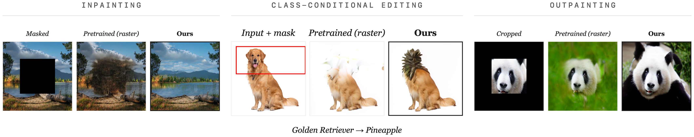

# AI Daily

## Unlocking Any-Order Generation in Pretrained Autoregressive Image Models

- **報告日期：** 2026-11-02
- **作者：** Rishav Pramanik、Marco Pedersoli、Zhaozheng Yin；論文列出的研究單位包括 Stony Brook University、International Laboratory on Learning Systems（ILLS）與 LIVIA／ÉTS Montréal。
- **發表狀態：** NeurIPS 2026 已接收，NeurIPS 官方頁面列有論文海報；arXiv:2610.39293v1，2026-10-29 公開。[1] [2]
- **主題：** 預訓練自回歸影像生成、任意順序生成、inpainting／outpainting、KV cache。

### 為什麼選這篇

多數自回歸影像模型固定依照 raster scan（由左至右、由上至下）生成。這種順序適合一般生成，卻使模型難以利用影像中分散的已知區域來補洞、延伸畫布或只重繪某一區塊。這篇研究主張，不必從頭訓練任意順序模型：可以保留既有 raster-scan 模型的大部分能力，只花一小段追加訓練，讓它能在任意 token 順序下預測。[1]

本次先用 repo 的既有文章排除重複項目：Energy-Based TEM（arXiv:2610.31889）已在 repo 發布，因此不重複撰寫。本文的 arXiv ID 在 README、INDEX 與論文目錄中皆未出現。另須注意，本文雖然和 VAR 同屬自回歸影像生成，**它不是 VAR 的 next-scale 架構**；它改造的是 LlamaGen 與 RAR 的 raster-token 順序。[1] [5]

### 核心貢獻

作者提出兩個彼此互補的適配元件。第一個是 **future-aware positional embedding**：每個生成步驟都提供「下一個要預測的影像位置」作為條件，避免模型面對相同的已知 token 集合時，不知道現在應該預測哪個空間位置。第二個是 **ordering curriculum**：訓練初期以熟悉的 raster 順序為主，再逐步增加隨機排列的比例，讓模型有時間建立新的條件路徑，而不是一開始就被高變異的亂序梯度拉離預訓練權重。[1]

適配後，模型仍是標準單流 causal Transformer；它保留 KV cache 與平行解碼的使用方式，不需要為 inpainting 或 outpainting 新增專用 sampler、mask head 或輔助網路。任務由「先把已觀察到的 token 排在前面，再生成剩餘 token」表達。[1] [3]

### 技術方法與數學形式

令一張圖像經 VQ tokenizer 轉為離散 token 序列 \(\mathbf{x}=(x_1,\ldots,x_n)\)。\(\sigma\) 是這些空間位置的一個排列；\(\sigma(t)\) 表示排列中的第 \(t\) 個位置，\(\mathbf{x}_{\sigma(<t)}\) 表示已生成的前綴。模型在多種排列上最小化自回歸負對數似然：

$$\mathcal{L}(\theta)=\mathbb{E}_{\sigma\sim P_{\alpha(s)}}\left[\sum_{t=1}^{n}-\log p_{\theta}\!\left(x_{\sigma(t)}\mid \mathbf{x}_{\sigma(<t)},E_{\sigma(t+1)}\right)\right].$$

其中 \(E_j\) 是位置 \(j\) 的「下一目標」嵌入。論文將它加到目前 token 的輸入表徵：

$$\tilde h_t=h_t+E_{\sigma(t+1)},\qquad E\in\mathbb{R}^{n\times d}.$$

可把 \(E_{\sigma(t+1)}\) 理解為告訴模型「讀完目前上下文後，下一步要填哪個位置」。序列最後一步使用可學習的 null embedding。這個嵌入只在輸入層相加，不必像 XLNet 的 two-stream attention 額外維持 query stream；作者表示它只增加約 \((n+1)d\) 個參數與逐元素加法。對 LlamaGen 的 RoPE 與 RAR 的絕對位置編碼，模型仍依照 token 的**影像空間位置**而非生成序列索引取位置資訊，盡量保留預訓練時已學到的 2D 空間關係。[1]

為了讓隨機順序適配保持穩定，作者讓訓練排列來自 raster 與均勻隨機排列的混合分布：

$$P_{\alpha}=(1-\alpha)\,\delta_{\sigma_{\mathrm{raster}}} +\alpha\,\mathrm{Uniform}(S_n),\qquad \alpha(s)=\min\!\left(\frac{s}{S_{\mathrm{ramp}}},1\right).$$

訓練初期 \(\alpha=0\)，即沿用 raster-scan；在前 \(S_{\mathrm{ramp}}\) 個訓練步驟中，\(\alpha\) 線性升到 1，之後使用均勻隨機排列。位置嵌入解決「相同上下文究竟要預測哪個位置」的可識別性問題；curriculum 則解決「如何從 raster 預訓練權重平順走到任意順序解」的最佳化問題。消融實驗顯示，缺少任一元件都會造成 loss 不下降或品質退化。[1]

推論時可把任何保留區域指定為已知前綴，並用排列 \(\sigma\) 選擇要生成的位置順序。於是補洞、outpainting 或局部重繪都成為同一個條件式自回歸過程，而非各自訓練一個任務模型。[1] [3]

### 實驗結果

所有實驗使用 ImageNet-1k，作者將方法套用至 LlamaGen-L／XL 與 RAR-L／XL 四個基礎模型。FID、IS、Precision 與 Recall 以 50,000 張樣本評估。任意順序能力是以一次性適配訓練換來的；因此閱讀數字時要同時看生成品質和新增能力，而不能只看單一 FID。[1]

- **一般類別條件生成：** LlamaGen-XL（775M）在 ImageNet 256×256 的 FID 由預訓練 raster 模型 2.63 升至適配後 3.91；IS 為 244.08→252.94，Precision 0.80→0.81，Recall 0.57→0.53。四個基礎模型的 FID 增幅為 1.17–1.93。LlamaGen-XL 原生輸出為 384×384，論文評估時縮放至 256×256。[1]
- **Inpainting：** 使用 ImageNet 中央遮罩時，方法的 FID 為 6.21；MaskGIT cosine schedule 為 10.44、較強的 Halton schedule 為 7.82，MAR-L 為 6.63。相對於簡單的 cosine 設定，提升很大；和 Halton 或 MAR-L 相比，優勢則較小。[1]
- **Outpainting：** 將中央 128×128 裁切延伸至 256×256 時，方法 FID 為 5.84；MaskGIT cosine／Halton 分別為 12.17／7.91，MAR-L 為 6.86。方法的 FID 較低，但 MAR-L 的 outpainting Precision 與 Recall 較高，因此不宜只用 FID 宣稱全面勝出。[1]
- **區域完成指標：** 對 5,000 張 held-out 圖像的隨機區域重繪，LPIPS 為 0.125；中央遮罩區域的 PSNR 為 24.65±3.34、SSIM 為 0.682±0.17。作者提醒，reference-based 指標不能完整衡量多種合理完成方式或指令遵從。[1]
- **成本與解碼：** 相對於預訓練，追加訓練成本依模型為 13–33%；LlamaGen-XL 約多 25%，約為從零訓練任意順序模型總成本的 1/2.4。論文亦示範平行解碼以 64 個解碼步驟完成，較 256 步的序列版本少約 4 倍 forward passes。這些是模型適配與解碼方案的報告值，不代表任務適配完全免訓練或任何部署環境都會有同樣延遲。[1] [3]

### 相關研究

**RandAR** 已經展示任意順序影像 AR、位置指令 token、KV cache、平行解碼及 zero-shot inpainting／outpainting。不同之處在於 RandAR 從頭以亂序 token 訓練；本文把問題改成「如何用少量續訓把既有 raster AR 轉成任意順序模型」，重點在預訓練可轉移性與 adaptation cost。[4]

**VAR** 則把影像自回歸改為 coarse-to-fine 的 next-scale prediction，並展示 ImageNet 生成與下游編輯能力。本文仍以離散空間 token 為單位，只更換 token 生成的排列，故可以把它視為與 VAR 相鄰、但架構不同的兩種自由度：VAR 改變預測單位；本文改變給定前綴與下一目標位置的組合。[5]

**MaskGIT** 用雙向 Transformer 同時預測隨機遮罩的 token，再經多輪迭代修正；它是本論文 inpainting／outpainting 的重要基線。本文保留 causal AR 與 KV cache 生態，避免改成需要雙向注意力與 iterative mask-refinement 的生成堆疊。[6]

### 評價與研究靈感

我的評價是，這篇的主要貢獻不是首次提出任意順序生成，而是把「隨機順序能力要從零學」改寫為「現有模型能否透過因果式適配重新排列已學到的條件路徑」。future-aware embedding 很小，卻精準處理了目標位置不可識別；curriculum 也不只是降低 learning rate，而是逐步改變訓練目標的組成。兩者合起來，讓既有空間表徵可以在不同 token 順序下被重用。[1] [4]

需要保留的限制是：本文結果集中在 ImageNet 類別條件生成與規則遮罩，**沒有證明它能直接成為開放詞彙的文字指令編輯器**。這裡的 zero-shot 指模型適配後，推論時不再為 inpainting／outpainting 單獨訓練；整體流程仍需要從預訓練檢查點繼續訓練。FID 的完整生成結果也確實有 1.17–1.93 的退化。[1]

可延伸成以下可驗證問題：

1. **Energy-gated VAR：** 將 future-aware embedding 推廣到 VAR 的 scale／region token；以 energy 或不確定度決定下一個生成尺度與區域，對高不確定區域做更多 refinement。除了 FID，也要量測條件遵從率、coverage、forward passes 與實際 wall-clock，避免只用生成步數代表效率。
2. **JEPA 作為候選一致性評分器：** 把已知區域和預測區域編碼到 JEPA latent，測試預測表示的一致性是否能選擇更合理的 token order 或候選 completion。這會引入額外評分器，因此要和「純 AR、只增加 future embedding」分開比較，並報告額外推論成本。
3. **注意力調制的目標位置路由：** 令已觀察 token 對當前目標位置的 cross-attention / causal attention 強度隨生成步驟改變，檢驗是否能降低局部重繪的邊界不連續。可將固定 attention bias、位置 embedding、energy gate 三者做 factorial ablation，並以 mask 外 PSNR／LPIPS 量測是否誤傷未編輯區域。

### References

[1]: https://arxiv.org/html/2610.39293v1 "Unlocking Any-Order Generation in Pretrained Autoregressive Image Models"
[2]: https://neurips.cc/virtual/2026/poster/152247 "NeurIPS 2026 poster listing"
[3]: https://github.com/Ordered-AR/unlockedadaptation "Official implementation for any-order adaptation"
[4]: https://arxiv.org/abs/2412.01827 "RandAR: Decoder-only Autoregressive Visual Generation in Random Orders"
[5]: https://neurips.cc/virtual/2024/poster/94115 "Visual Autoregressive Modeling at NeurIPS 2024"
[6]: https://openaccess.thecvf.com/content/CVPR2022/html/Chang_MaskGIT_Masked_Generative_Image_Transformer_CVPR_2022_paper.html "MaskGIT at CVPR 2022"
