# AI Daily

## 2026-11-14｜Expanding the Quality–Coverage Frontier with Competitive Flow Matching（CFM）

### 論文資訊

**標題：** Expanding the Quality–Coverage Frontier with Competitive Flow Matching

**作者與單位：** Wenxuan Peng¹ ²、Richard Zhang²、Haitian Zheng²、Jaskirat Singh²、Tsai-Shien Chen²、Eli Shechtman²、Bharath Hariharan¹、Hadar Averbuch-Elor¹、Zongze Wu²；¹Cornell University、²Adobe Research。[1] 第一作者同時掛 Cornell 與 Adobe，屬於典型的 Adobe Research 聯合培養學生；共同作者 Richard Zhang、Eli Shechtman、Zongze Wu、Tsai-Shien Chen 都是 Adobe 影像生成線上長期出手的人（DreamSim 與 Group Diffusion 的作者名單裡都出現 Richard Zhang 與 Eli Shechtman），因此這篇的題目雖然小，陣容卻是「大佬級別的 coverage 研究組」。[1] [3]

**來源與狀態：** arXiv:2611.07055v1，`cs.CV`，2026-11-04 提交，40 頁、24 張圖，授權為 CC BY 4.0。每頁頁首隻寫「Preprint」，arXiv metadata 的 Comments 欄位是空的，未列任何會議或期刊，所以目前是**預印本**，尚無同儕審查背書。[1] [2]

**連結：** [arXiv 摘要](https://arxiv.org/abs/2611.07055)｜[全文 HTML](https://arxiv.org/html/2611.07055v1)｜[PDF](https://arxiv.org/pdf/2611.07055v1)｜[Project page](https://lilydaytoy.github.io/CFM/)。截至 2026-11-14 **查無官方 code**：project page 只有圖、結果表與 BibTeX，沒有 GitHub 連結；Hugging Face 的論文頁上「Models / Datasets / Spaces citing this paper」全部是 0；本庫附檔為自行壓縮過的 PDF（`CFM_paper.pdf`，3.4 MB）。可重現性目前只能依賴附錄 A.1 的逐 backbone 注入方式與 Table 3 的超參（SiT 用 batch 256、lr 1e-4、EMA 0.9999、seed 0）。[2] [4]

**為什麼挑這篇：** 它不直接屬於你點名的六個軸，卻同時給六個軸都提供了新的抓手。第一，它的核心是**一個訓練目標的微調**，把 flow matching 的「多個合法答案被平均成一個模糊答案」這個根本毛病，用獲者全取（winner-take-all，WTA）拆開；這個 `min_k` 正好是能量視角下的零溫度極小化，跟 EBT／TEM 的能量下降只差一個分配變數的位置。第二，它把 JEPA blueprint 裡那個一直被當成固定 token 的輔助變數 $z$ 真的做成隨機低維碼，而且附錄給出一個很顯眼的結論：這些碼沒有任何指派監督，卻長出跨類別可複用的視覺簽名。第三，推理時它多了一根**零額外 NFE 的旋鈕** $\lambda$，跟 training-free／attention modulation 那一族「不動權重、只動條件」的手法直接互補。第四，它把「coverage」變成可測量的自變數，這正是 zero-shot 評估值最容易漏掉的一軸。[1] [5] [6] [7]

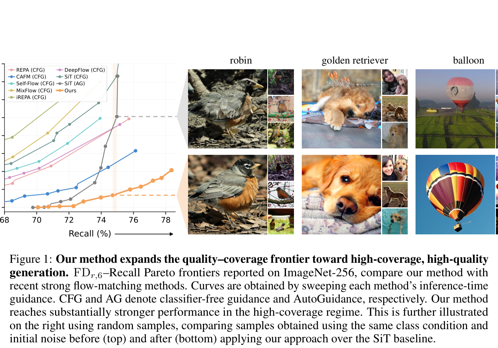

*圖：論文 Figure 1（自 PDF 聚焦擷取，非整頁截圖）。左：FD_r,6（越低越好）對 Recall（coverage 代理，越高越好）的帕雷託邊界，曲線由各方法自己的推理時引導強度掃描得到；CFG 與 AG 分別是 classifier-free guidance 與 AutoGuidance。右：同一類別條件、同一初始噪聲下，SiT 基線（上排）與本文（下排）的樣本對比。[1]*

### 核心貢獻

論文的診斷很乾脆：**品質與覆蓋率的取捨不是取樣器的毛病，而是目標函數的毛病**。標準 flow matching 對每個帶噪狀態 $x_t$ 只要求一個速度預測，而同一個 $x_t$ 可以由許多組 $(x_0,\epsilon)$ 生成，它們各自誘導不同的目標速度；模型被強制去擬合這些目標的**條件平均**，平均之後的場就會把質量推向資料流形之外，並讓少數模式被吃掉了。三個貢獻如下。[1]

第一，**把「一個狀態、一個預測」改成「一個狀態、$K$ 個預測」**。做法是給生成器加一條低維高斯輔助碼 $z\sim\mathcal N(0,I_d)$（$d=8$），用一個小 MLP 與 backbone 原生的條件注入機制（AdaLN 調變、in-context token、或兩者）接上，讓同一個 $x_t$ 因 $z$ 不同而給出不同速度；訓練時對同一個目標抽 $K$ 個碼、算 $K$ 個候選損失，**只讓最接近的那個候選回傳梯度**。這是 Multiple Choice Learning／IMLE 那條線第一次被搬到 flow matching 的「局部速度回歸」層面上。[1] [8] [9]

第二，**由此自然長出第二根推理時旋鈕：auxiliary-conditioning scaling $\lambda$**。把 $c_\phi(z)$ 乘以 $\lambda$ 就連續地在「高保真基模型（$\lambda=0$）」與「高覆蓋率（$|\lambda|$ 大）」之間滑動，而且**不需要第二次前向、不加 NFE**；它與 CFG／AutoGuidance 的引導強度 $\gamma$ 構成兩個正交的軸，兩者疊起來才把帕雷託邊界整個往外推。[1]

第三，**用「post-training 而非 pretraining」的規模把證據做實**。全部結果都從現成 checkpoint 出發，10 個 epoch、$K=8$，只花原始 SiT-XL/2 預訓練模型核心算力的約 **2.63%**。在 ImageNet-256 上，於 Recall ≈ 67% 的高覆蓋工作點把 FD_r,6 從 SiT 的 19.22 降到 5.91；把同一套東西套到已經很強的 RAEv2 上，於 Recall ≈ 70% 把 FD_r,6 從 16.83 降到 3.18。此外四種 backbone（VAE latent 的 SiT、像素域的 JiT、表示自編碼器的 RAE 與 RAEv2）在 $\lambda=0$ 的基模型上都變好了，說明效果不綁定某一種表示空間。[1]

### 技術方法

#### 1｜標準 flow matching 的「平均化」結構

論文用一般化的插值寫法。給資料 $x_0\sim p_{\text{data}}$、噪聲 $\epsilon\sim\mathcal N(0,I)$ 與時間 $t$，

$$x_t=\alpha_t x_0+\sigma_t\epsilon,\qquad u_t=\dot\alpha_t x_0+\dot\sigma_t\epsilon,$$

速度場以均方回歸訓練（可帶任何額外條件 $y$），

$$\mathcal L_{\mathrm{FM}}(\theta)=\mathbb E_{x_0,\epsilon,t}\big\|v_\theta(x_t,t,y)-u_t\big\|_2^2 .$$

在 SiT／rectified-flow 的線性排程 $\alpha_t=1-t,\ \sigma_t=t$ 下，$u_t=\epsilon-x_0$：從乾淨端到噪聲端的反向就是一條直線速度。關鍵在於平方損失的最優解是條件期望，

$$v^{*}(x_t,t)=\mathbb E\big[u_t\mid x_t,t,y\big],$$

而同一個 $x_t$ 相容的 $(x_0,\epsilon)$ 配對是多模式的，於是這個期望就是「好幾個合法答案的加權平均」。把誤差分解寫清楚（本報告補充，論文中以 Figure 2 的 1D toy 視覺化）：對任何候選 $\hat v$，

$$\mathbb E\big\|\hat v-u_t\big\|^2=\big\|\hat v-v^{*}\big\|^2+\underbrace{\mathbb E\big\|u_t-v^{*}\big\|^2}_{\text{不可約的條件變異數}},$$

第二項與模型容量無關，是這個目標的地板；它等於「同一狀態下各模式目標的離散程度」。當容量有限、或 $v^{*}$ 落在兩個模式中間時，取樣軌跡就會被帶到流形外（off-support），而被平均掉的次要模式則變成覆蓋不足。[1]

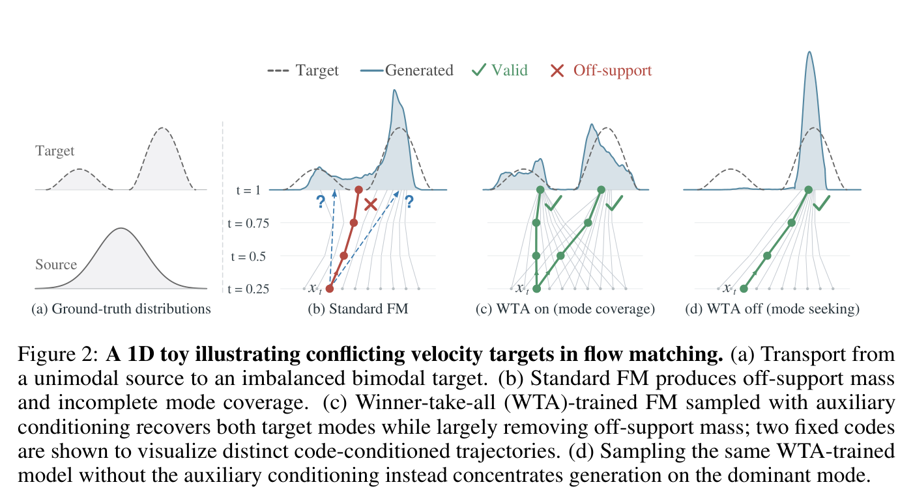

*圖：論文 Figure 2（自 PDF 聚焦擷取）。(a) 單峰源分佈搬到不平衡的雙峰目標；(b) 標準 FM 在中間狀態被迫平均，產生流形外（Off-support，紅叉）的質量與不完備的模式覆蓋；(c) WTA 訓練後配合輔助條件取樣，兩條固定碼的軌跡各自恢復一個目標模式；(d) 同一個 checkpoint 把輔助條件關掉（$\lambda=0$）就集中到主模式。這正是 $\lambda$ 兩端行為的一維版本。[1]*

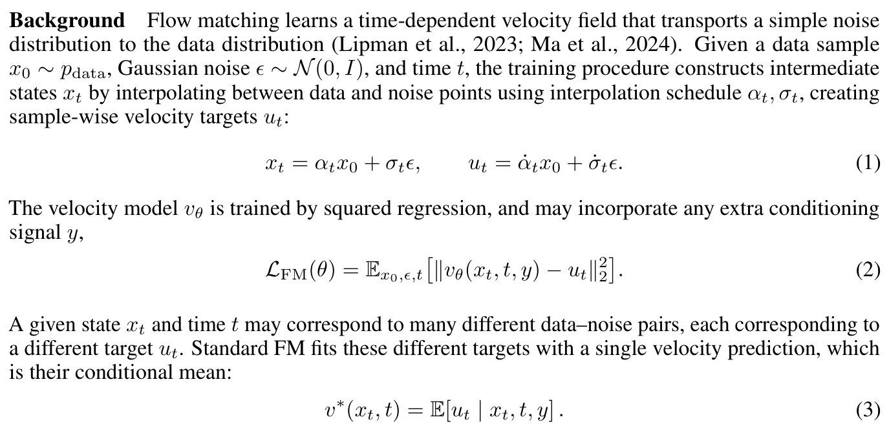

*圖：論文第 4 頁式（1）–（3）的原文截取。[1]*

#### 2｜輔助碼、$K$ 個候選與獲者全取目標

要讓同一個 $x_t$ 有多個預測，就必須往模型裡塞一個「與目標無關、但能區分預測」的自由度。他們抽 $K$ 個獨立碼

$$\hat u_k=v_{\theta,\phi}\big(x_t,t,y,c_\phi(z_k)\big),\qquad z_k\overset{\text{i.i.d.}}{\sim}\mathcal N(0,I_d),\ k\in\{1,\dots,K\},$$

然後只為最佳匹配的那一個回傳梯度：

$$\mathcal L_{\mathrm{WTA}}(\theta,\phi)=\mathbb E_{x_0,y,\epsilon,t,z_{1:K}}\Big[\min_{k\in\{1,\dots,K\}}\big\|\hat u_k-u_t\big\|_2^2\Big].$$

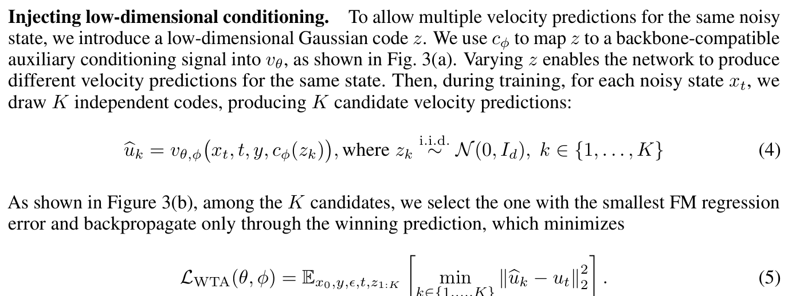

*圖：論文第 4 頁式（4）–（5）的原文截取。[1]*

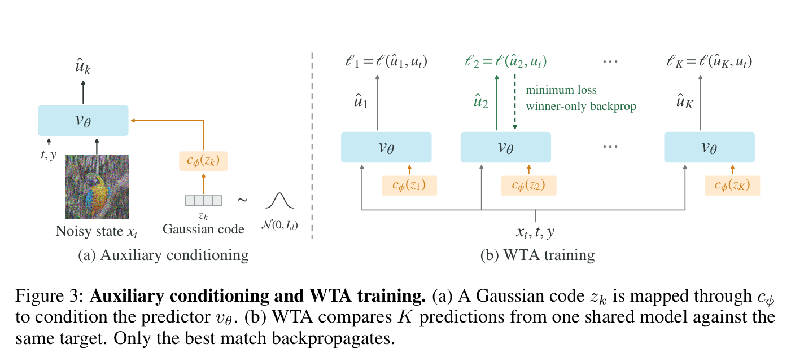

*圖：論文 Figure 3（自 PDF 聚焦擷取）。左：高斯碼 $z_k$ 經 $c_\phi$ 變成輔助條件，與 $x_t$、$t$、$y$ 一起進 $v_\theta$。右：同一份權重在同一個 $x_t$ 上算出 $\hat u_1,\dots,\hat u_K$，各自與同一目標 $u_t$ 比損失，只有最小損失者做 backprop。[1]*

用 Jensen／排序不等式可以直接看出表達力為什麼變大（本報告推導）：$\min_k a_k\le \frac{1}{K}\sum_k a_k$，而 $z_k$ 交換可換（exchangeable），故

$$\mathcal L_{\mathrm{WTA}}\ \le\ \frac{1}{K}\sum_{k=1}^{K}\mathbb E\big\|\hat u_k-u_t\big\|^2\ =\ \mathcal L_{\mathrm{FM}}\quad(\text{在 } \hat u_k \text{ 同分布、共享權重時}),$$

也就是說 $K$ 個候選一起看時，WTA 的最優值不會比標準 FM 差；但 WTA 的最優解不再是條件平均。固定 $x_t$，令 $A_k=\{u:\ \|\hat u_k-u\|^2=\min_j\|\hat u_j-u\|^2\}$ 是目標空間上的 Voronoi 指派區域，則對每個碼的最佳預測滿足

$$\hat u_k^{\star}=\mathbb E\big[u_t\mid x_t,y,\ k=\text{winner}\big],$$

即「**每個碼學自己那個被指派到的子集的條件平均**」。訓練迴圈因此結構上就是 Lloyd／$k$-means 或 hard-EM：先做 argmin 的指派步，再做只對贏家的回歸質心步。$K$ 越大，可分辨的模式越多，平均被切得越細。[1] [8]

這也正好把它放到能量座標系裡（本報告觀點）：若把候選的相容性寫成能量 $E_k=\tfrac{1}{2\tau}\|\hat u_k-u_t\|^2$，那麼標準 soft-MCL／EM 的目標是 $-\tau\log\sum_k e^{-E_k}$（自由能、軟指派），WTA 是 $\tau\to0$ 的極限（$\arg\min$ 的硬指派、零溫度）。所以這篇的方法可以讀成「**在訓練迴圈裡做了一次 argmin 能量極小化**」，而 EBT／TEM 是「**在推理迴圈裡做連續的能量極小化**」，兩者的能量都定義在同一個 $\|\cdot\|^2$ 上，只是變分對象不同（一個選 $k$，一個選 $x$）。[6] [7]

#### 3｜注入方式：跟著 backbone 的原生條件路徑走

$z$ 的維度只有 $d=8$，$c_\phi$ 是一個兩層 SiLU MLP（SiT：$8\to1152\to1152$），再經每個 block 一組新的 SiLU–Linear 調變映射產生額外的 shift／scale／residual gate，**加在原生 AdaLN 輸出上**；輸出層另有自己的 $2H$ 維 shift／scale。所有新增路徑**零初始化**，使得 post-training 起點的精確度與原模型完全相同（這點對「改進來自競爭而非多參數」的因果判讀很關鍵）。JiT 同時加到 AdaLN 輸入與 32 個 class-context token 上（Table 2 的 JiT 版本還額外加到 patch token 上）；RAE 在 backbone stack 與 wide head stack 各配一套 MLP；RAEv2 沿用 DDT 式調變並給輔助 embedding 20 倍的 lr 與自己的 500-step warmup。[1]

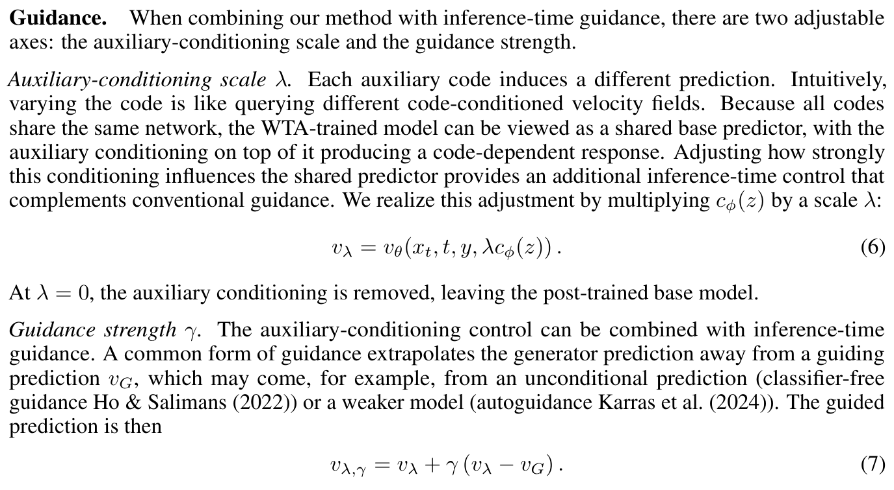

*圖：論文第 5 頁式（6）–（7）與兩段說明原文截取。$v_\lambda=v_\theta(x_t,t,y,\lambda c_\phi(z))$；$v_{\lambda,\gamma}=v_\lambda+\gamma(v_\lambda-v_G)$，其中 $v_G$ 可以是無條件預測（CFG）或較弱模型（AutoGuidance）。[1]*

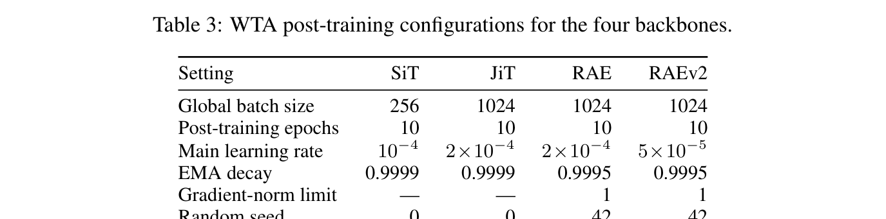

*圖：論文 Table 3（附錄 A.1，自 PDF 聚焦擷取）。SiT 用 batch 256、lr 1e-4、EMA 0.9999、無梯度裁剪、seed 0；JiT／RAE／RAEv2 用 batch 1024，其中 JiT lr 2e-4、RAE lr 2e-4 與 clip 1（seed 42）、RAEv2 lr 5e-5 與 clip 1（seed 42），四組都是 10 epoch。[1]*

#### 4｜推理：碼要固定、$\lambda$ 是免費旋鈕

兩種用法都試過：**每條軌跡抽一次 $z$ 固定到底**，或**每一步重抽**。固定較好，尤其在高覆蓋區；作者的解釋是固定碼讓它的影響在各步驟之間一致累積，每步重抽則不斷換方向。$\lambda$ 的作用方式很像 CFG，但方向不同：CFG／AG 是**外插**（把預測推離一個參考場），而 $\lambda$ 是**調變強度**（把輔助條件從 0 漸增），而且 $\lambda$ 完全不加前向次數。$\lambda=0$ 得到 post-trained 基模型；$|\lambda|$ 越大，Precision 換成 Recall，呈現一條平滑的操作點曲線。正負 $\lambda$ 行為對稱得有趣：兩者都有效，負值通常 FD_r,6 更低，所以主文的邊界用負 $\lambda$ 分支畫。[1]

#### 5｜訓練代價的算術

令 $F_0,F_1$ 是普通 SiT-XL/2 與輔助條件版每樣本的前向 MAC，回傳與前向比 $\beta=2$（DiT 的分析慣例），則每次更新的模型核心算力比是

$$R(K)=\frac{K+1+\beta}{1+\beta}\cdot\frac{F_1}{F_0}.$$

實測 $F_0=118.621$ GMAC、$F_1=118.848$ GMAC（輔助路徑只加 0.19%），$K=8$ 時 $R(8)\approx3.674$。10 個 epoch 在 batch 256 下是 50,040 步，對照原始 7,000,000 步預訓練，$\tfrac{C_{\text{post}}}{C_{\text{pre}}}=0.00715\times R(8)\approx2.63\%$。值得注意的是實測 wall-clock 比這還便宜：8×H100 上普通 FM 834.51 images/s，$K=8$ 是 343.75 images/s（2.43×，不是 3.67×），記憶體 36.55 → 39.66 GiB/GPU，因為候選評分不回傳梯度、且分 chunk 批處理。$K=32$ 就退化到 129.79 images/s（6.43×）。[1]

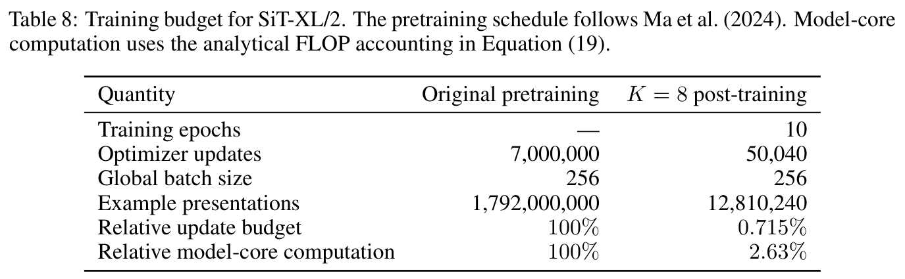

*圖：論文 Table 8（自 PDF 聚焦擷取）。樣本呈現次數 1,792,000,000 → 12,810,240；相對更新預算 100% → 0.715%；相對模型核心算力 100% → 2.63%。[1]*

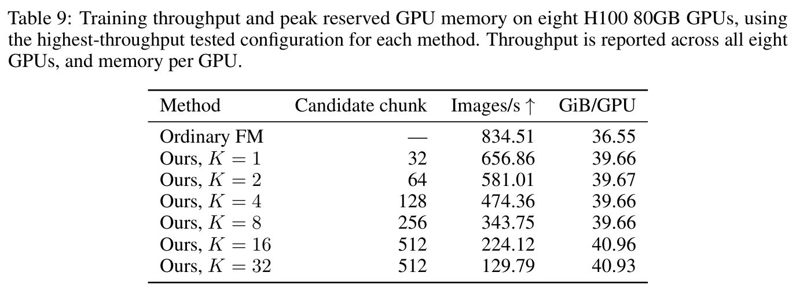

*圖：論文 Table 9（附錄 D.1.2，自 PDF 聚焦擷取）。普通 FM 834.51 images/s／36.55 GiB，$K=8$ 是 343.75 images/s／39.66 GiB，$K=32$ 掉到 129.79 images/s；候選以 chunk 方式批次前向，因此 wall-clock 劣化（2.43×）小於模型核心計價（3.67×）。[1]*

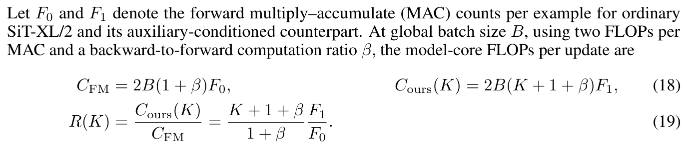

*圖：論文附錄 D.1.1 式（18）–（19）原文截取。候選前向不保留梯度圖，選出贏家後再帶梯度重算一次，因此計價是 $K+1+\beta$ 而非 $K(1+\beta)$。[1]*

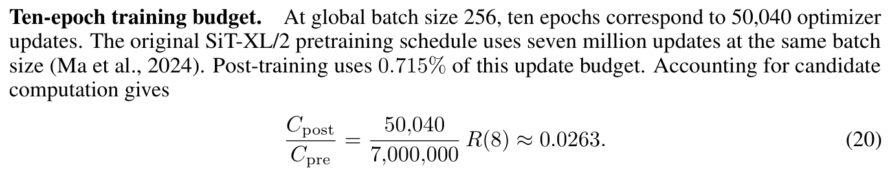

*圖：式（20）與「Ten-epoch training budget」段落原文截取。[1]*

### 實驗結果

#### 主表：高覆蓋區才是差距所在

評估以 class-conditional ImageNet-256 為主，主要指標是 FD_r,6（六個表徵空間的 Fréchet 距離正規化平均，包含 ADM FID、ConvNeXt、DINOv2、MAE、SigLIP、CLIP），輔以 Precision（保真度）與 Recall（覆蓋率代理）、IS、以及類內 DreamSim 距離作為多樣性指標。操作點曲線用 10K 樣本，數值比較用 50K；為避免取樣器差異，對比統一在 50-step Euler、等距時間步下重評，各方法的引導形式保留原文並掃強度。[1]

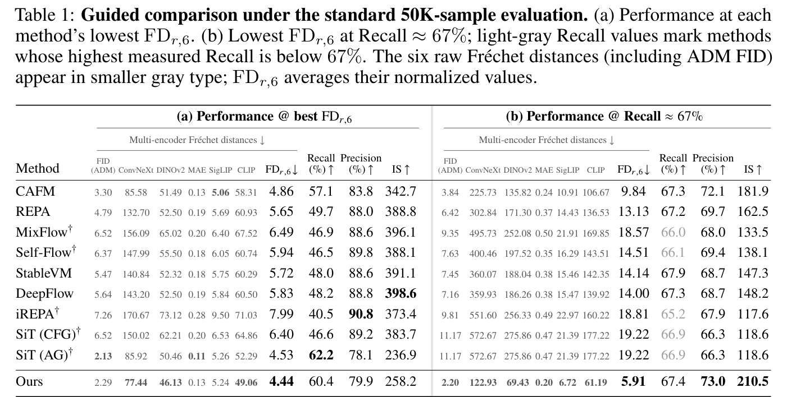

*圖：論文 Table 1（自 PDF 聚焦擷取）。(a) 各方法最佳 FD_r,6；(b) 鎖定 Recall ≈ 67% 時的最低 FD_r,6，淺灰代表該方法量測到的最高 Recall 就低於 67%。[1]*

讀表的重點有兩個。(a) 裡各家在**自己的最佳工作點**幾乎擠在一起：本文 4.44（Recall 60.4／Precision 79.9／IS 258.2／ADM FID 2.29），SiT+AG 4.53（62.2／78.1／236.9／FID 2.13），CAFM 4.86、DeepFlow 5.83、Self-Flow 5.94、MixFlow 6.49、REPA 5.65、iREPA 7.99。最佳點上差距其實很小，而且 SiT+AG 的 ADM FID 甚至更低（2.13 vs 2.29）。差距真正拉開是在 (b) 鎖定 Recall ≈ 67%：本文 5.91（67.4／73.0／IS 210.5），而 SiT 是 19.22（66.9／66.3／IS 118.6），CAFM 9.84、DeepFlow 14.00、StableVM 14.14、Self-Flow 14.51（其 Recall 66.1 已低於門檻）、REPA 13.13、MixFlow 18.57、iREPA 18.81。換言之，**既有方法一到高覆蓋區就崩，本文在那裡仍接近自己的最佳點**。[1]

沒有引導時（$\gamma=0$）也有同一個訊號：在對齊的 Recall（預訓練 66.91% vs 本文 66.83%）下 FD_r,6 從 19.22 降到 14.94、FID 從 11.17 降到 7.22；而 $\lambda=0$（完全關掉輔助條件）的工作點更低到 FD_r,6 12.15／FID 4.59。[1]

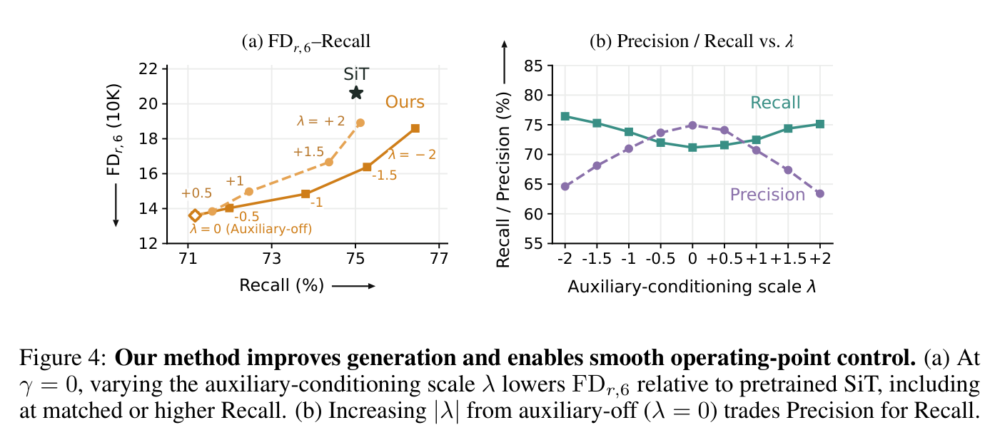

*圖：論文 Figure 4（自 PDF 聚焦擷取）。左：$\gamma=0$、$\lambda\in[-2,2]$ 的 FD_r,6–Recall 曲線，多數工作點低於預訓練 SiT；右：$\lambda$ 遠離 0 時 Precision 穩定換成 Recall，$\lambda=0$ 在高 Precision 端。[1]*

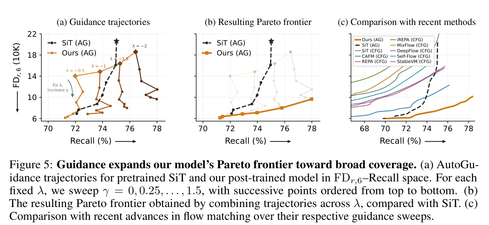

*圖：論文 Figure 5（自 PDF 聚焦擷取）。(a) 對預訓練 SiT 與本文各固定 $\lambda$ 掃 $\gamma=0,0.25,\dots,1.5$；(b) 跨 $\lambda$ 合併出的邊界明顯越過 SiT+AG；(c) 與 CFG 系方法各自掃描強度後的對比。[1]*

引導協同效應是本文最實用的發現。預訓練 SiT 一加引導就往下也往左（品質升、覆蓋降）；本文在固定 $\lambda$ 下加引導主要是「往下」，Recall 幾乎不掉，高覆蓋工作點甚至 Recall 上升。多樣性也同步：類內 DreamSim 平均成對距離隨 $\gamma$ 增加，預訓練 SiT 從約 0.58 一路降到約 0.57，本文在 $\lambda=-2$ 卻從約 0.60 升到約 0.62、在 $\lambda=-1.5$ 從約 0.59 升到約 0.61。這是「品質與覆蓋不再此消彼長」最直接的一張圖。[1]

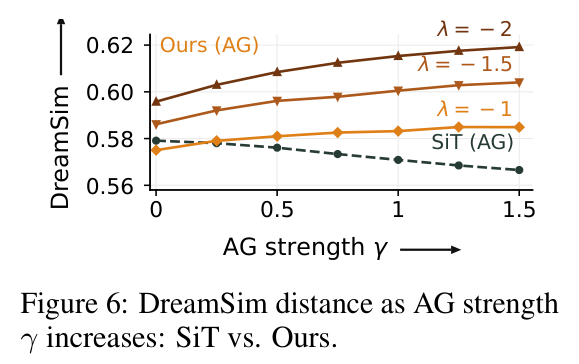

*圖：論文 Figure 6（自 PDF 聚焦擷取）。SiT+AG 隨 $\gamma$ 變得更不多樣，本文在 $\lambda=-1,-1.5,-2$ 下反而更多樣。[1]*

#### 跨 testbed：套在 RAEv2 上更誇張

第二組實驗把同一套 post-training 用在 RAEv2（在預訓練視覺編碼器表示空間生成的 SOTA 模型）上，10 epoch、$K=8$，保留 RAEv2 原生的 timestep shifting 與 guidance window；它的引導是同一 forward 內的 intermediate head，所以本文的兩個預測共享同一個 $\lambda$。最佳點只從 2.07 微升到 2.02，但鎖定 Recall ≈ 70% 時從 16.83@69.09 變成 3.18@70.32，同時 Precision 52.39 → 71.25、IS 111.47 → 182.39。[1]

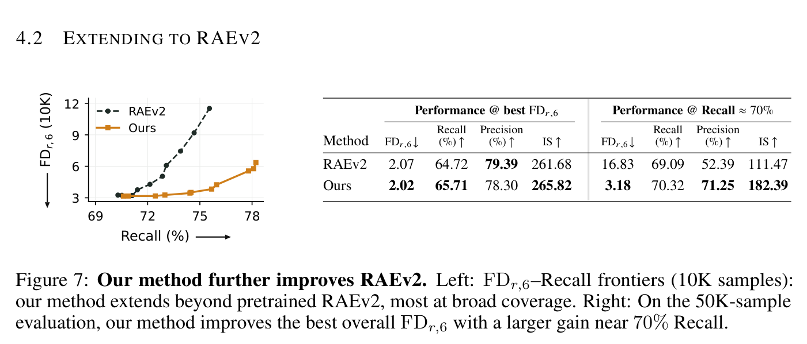

*圖：論文 Figure 7（自 PDF 聚焦擷取）。左圖邊界外推，右圖顯示高覆蓋點的差距（16.83 → 3.18）。[1]*

#### 基模型本身也變強：$\lambda=0$ 的跨四種生成器證據

這點容易被忽略但很重要：把輔助條件關掉，post-trained 的基模型相對預訓練版本在四種表示空間上一致變好，但方向是「Precision 升、Recall 降」。[1]

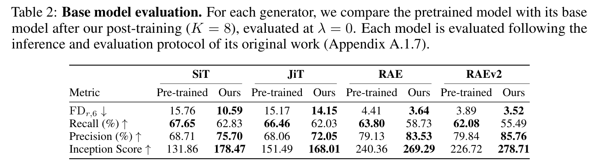

*圖：論文 Table 2（自 PDF 聚焦擷取），各模型依其原文推論與評估協定。SiT FD_r,6 15.76 → 10.59、IS 131.86 → 178.47；JiT 15.17 → 14.15；RAE 4.41 → 3.64；RAEv2 3.89 → 3.52，Recall 四組全部下降、Precision 全部上升。[1]*

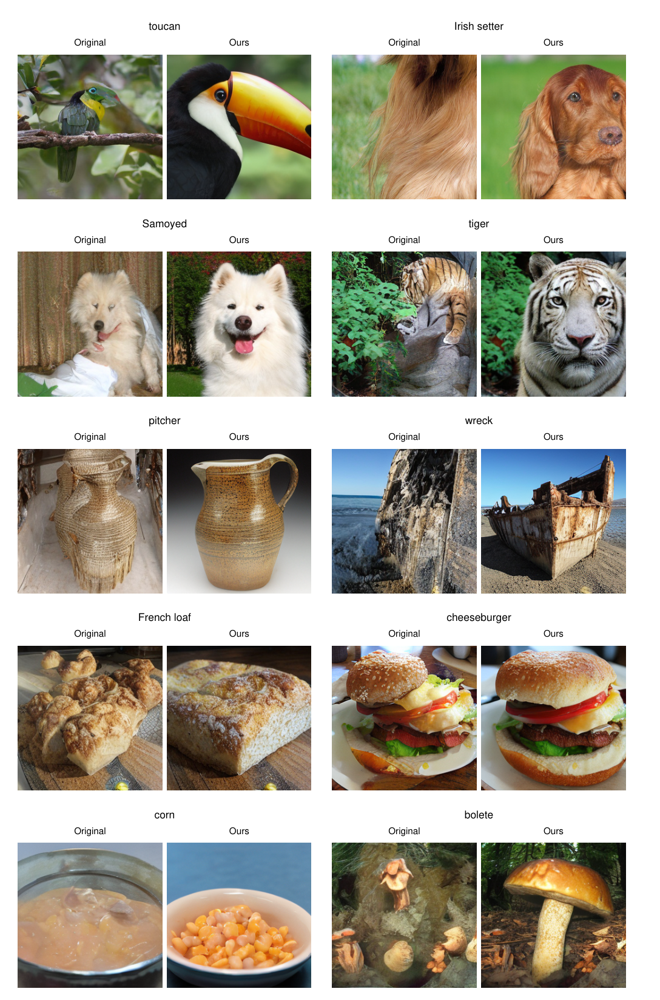

*圖：論文 Figure 22（附錄 C.1，自 PDF 聚焦擷取）。十組 ImageNet-256 類別，每組左為預訓練 SiT、右為 post-trained 基模型，兩者都在 $\lambda=0$ 取樣。這個對比說的是「輔助條件完全關掉時的保真度提升」，與前表同個方向。[1]*

#### 競爭強度 K：把算力從推理搬到訓練

SiT 上掃 $K\in\{1,4,8,16,32\}$：$K=1$（有輔助架構、無競爭）幾乎等於預訓練 SiT，說明增益來自競爭而非多參數；$K$ 越大，基模型（$\lambda=0$）Precision 穩定上升、FD_r,6 下降，而且**步數越少效果越明顯**——4 步與 8 步取樣的 FD_r,6 隨 $K$ 持續下降、縮小與 50 步的差距。同時，$\lambda$ 的響應幅度也隨 $K$ 增大：$K=1$ 時 Precision／Recall 對 $\lambda$ 幾乎是平的。[1]

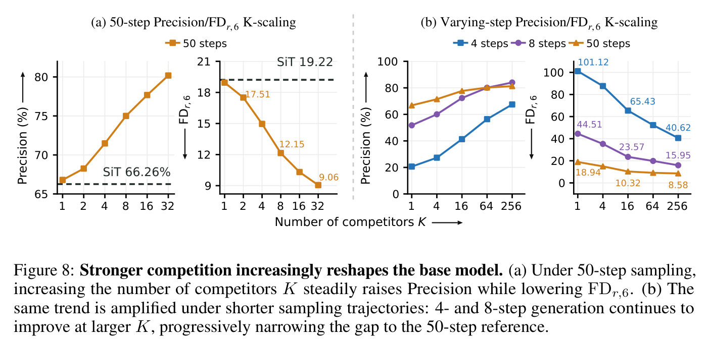

*圖：論文 Figure 8（自 PDF 聚焦擷取）。[1]*

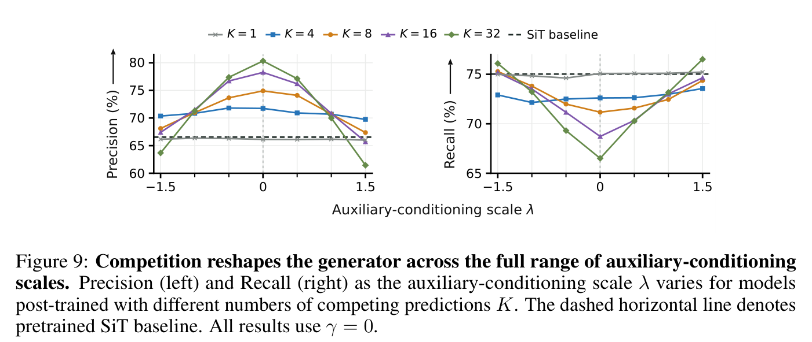

*圖：論文 Figure 9（自 PDF 聚焦擷取）。虛線是預訓練 SiT 基線，全部 $\gamma=0$。[1]*

#### 對照組：作者把「另一些解釋」擋掉了

三組控制實驗讓因果讀比較乾淨。第一，容量對齊的 $K=1$（保留同樣的額外參數但不競爭）無法重現高 Recall 端的邊界；第二，把標準 FM 接著訓 50 個 epoch，FID 只有 14.41 → 14.31、IS 118.60 → 120.90，幾乎不動；第三，把 SiT-B/2 的 batch 從 256 放大到 1024、8192 再訓 20 epoch，FID 33.40 → 32.84／31.76／32.81，沒有一致改善。也就是說「多訓一點」「多加參數」「大 batch」都解釋不了結果。[1]

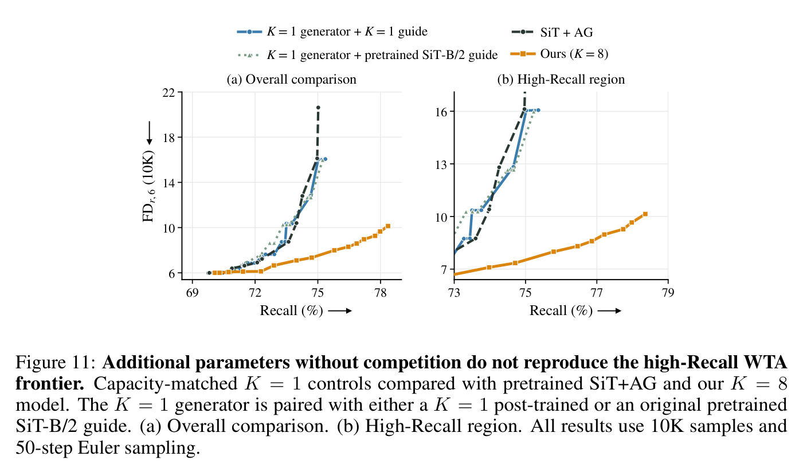

*圖：論文 Figure 11（附錄 B.2.1，自 PDF 聚焦擷取）。10K 樣本、50-step Euler。[1]*

#### 最有想法的一張圖：輔助碼長出可複用的「視覺簽名」

附錄 B.6 是全篇最值得你花時間的部分。$z$ 在訓練時是獨立抽樣、也沒有被指派任何固定角色，但推理時固定一個碼，跨初始噪聲、跨 ImageNet 類別生成時，會出現**重複的外觀傾向**：同碼的行在色調、背景、構圖上明顯同質（例如一列偏冷色／青色、一列偏暖橙的「golden hour」、一列偏綠的日光場景、一列偏暗的夜景），而且這種傾向在**參考集之外的類別**也成立。[1]

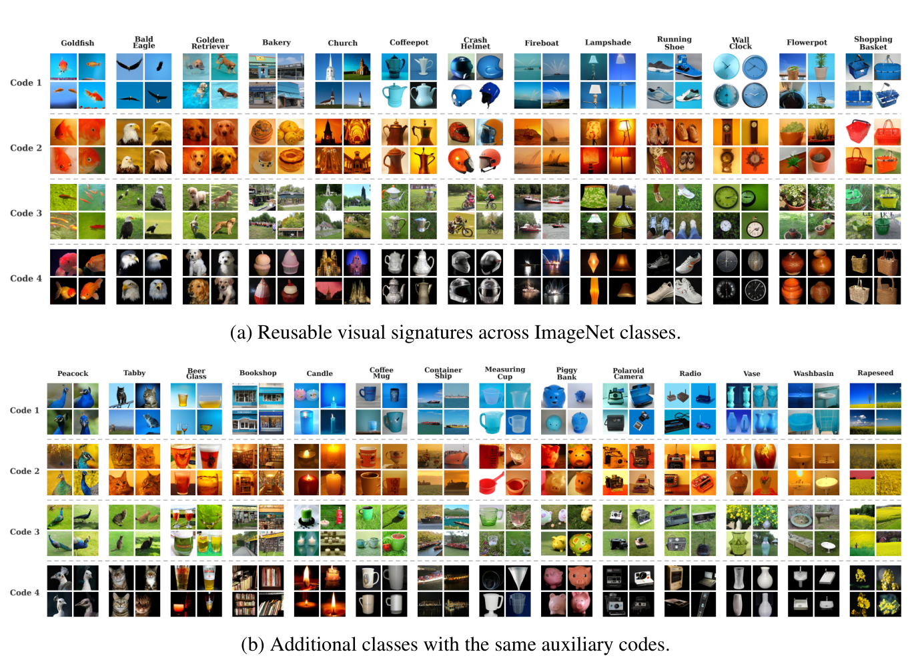

*圖：論文 Figure 18（自 PDF 聚焦擷取，含 (a)(b) 兩個 panel）。每一行固定一個碼、每欄固定一個類別，格內 4 張只變初始噪聲；同一 checkpoint、同一組 4 個碼、50-step ODE、$\lambda=1$、$\gamma=0$。[1]*

他們把這件事量化：對每個「類別 × 源噪聲」生成有碼／無碼兩張，取預訓練編碼器特徵差，減掉所有碼的平均差（留下該碼專屬的部分），再在參考類別上平均得到碼的「簽名」；對 held-out 類別的樣本，把它分配到最接近的簽名。64 個碼的隨機水準是 1/64 = 1.56%。在 DINOv2、CLIP、ConvNeXt 三種特徵下，$K=1$ 接近隨機，$K$ 越大辨識度單調上升，$K=512$ 時大約是隨機水準的 **10 倍**（約 15%），附 95% hierarchical class–seed bootstrap 區間。注意這裡掃到 $K=512$，遠超主模型的 $K=8$，屬於分析用實驗而非主結果。[1]

這代表：一個純粹的、無監督的**分配索引**，在只要求「贏家回傳梯度」的目標下，自己獲得了**跨類別語義一致性**。作者自己在結論裡也承認「輔助條件化預測學到的結構比目標明確要求的多」，並把理解這種結構列為後續工作。[1]

### 相關研究脈絡

**獲者全取／多候選學習這條線。** 概念源頭是 Multiple Choice Learning：對同一輸入產出多個假設、只更新最佳者，Guzmán-Rivera 等人 2012 年用模型集成、Lee 等人 2016 年用單網路多頭（stochastic MCL）、Rupprecht 等人 2017 年把它用於歧義結構預測。IMLE（Li & Malik 2018）把「最近候選」用於隱式生成模型，cIMLE（Li 等人 2020）擴展到每個輸入抽多個碼的有條件版本。本文的新意在於把 WTA 放進 **flow matching 的局部速度回歸**，並用「同一狀態 + 低維碼」而不「多頭」或「多模型」來產生候選，因此推理時仍能享受單一權重、零額外 NFE 的條件調變。[1] [8] [9] [20] [21]

**最直接的並行工作是 Explorative Modeling（XM）。** Gladstone、Heng Ji、Yilun Du，arXiv:2607.27372，本庫 2026-08-03 已解析。XM 同樣用 $K$ 個候選的 $\min$ 目標、同樣把它當成「參數／資料之外的第三條擴展軸」，但兩家有兩個實質差異：(i) **候選怎麼來**——XM 的 $K$ 個候選來自同一乾淨樣本的 $K$ 個噪聲實作，因此它們處在**不同的 $x_t$**，競爭的是「哪一組配對」；本文的 $K$ 個候選**共享同一個 $x_t$**，靠 $z$ 區分，競爭的是「同一狀態該往哪個模式去」。這讓本文的候選可比、且能在推理時以同一狀態重現；(ii) **目標不同**——XM 主打表達力與訓練／樣本效率（ImageNet-256 無引導 FID 1.43、FLOP 效率 4.1×），並能端到端生成；本文主打高覆蓋區的品質，並且只做 post-training。兩者不互斥，疊起來（例如在多配對探索之上加同狀態碼競爭）是明顯可做的一題。[1] [5]

**推理時引導這條線。** CFG（Ho & Salimans 2022）以代價換品質；Inner CFG（Sun 等人 2024）把更高階條件放進引導；CFG++（Chung 等人，ICLR 2025）把強引導下的劣化歸因於流形外外插並把更新拉回流形；AutoGuidance（Karras 等人 2024）用「同一家族的較弱模型」當參考場，本文主實驗的引導就是 AG，指導模型用同樣 post-trained、$\lambda=0$ 的 SiT-B/2。本文的定位是**與這一族正交**：不是改取樣器或改引導公式，而是改訓練目標，讓同一個引導公式在高覆蓋端不再付出覆蓋率代價；同時 $\lambda$ 本身是一根新軸（不增加前向次數）。[1] [10] [11]

**Flow matching 的訓練目標／表示監督這條線。** 對比群都是 2026 年的強基線：REPA（Yu 等人，ICLR 2025）把 DiT 中間特徵對齊到外部視覺編碼器；iREPA（Jiang 等人，ICLR 2026）主張不需要外部組件也能做表示對齊；Self-Flow（Chefer 等人 2026，FAIR）用自監督流匹配；DeepFlow（Shin 等人）深層監督；MixFlow（Li 等人，CVPR 2026）放慢插值混合以緩解 exposure bias；CAFM（Lin 等人，ECCV 2026）連續對抗流；StableVM 與 Group Diffusion（Mo 等人，CVPR 2026，跨樣本協作）也在同一個評測協定下被重評。本文把這些全部放到「品質升但覆蓋不足」的敘事裡：它們推的是 $y$ 軸，$x$ 軸被讓掉了。[1]

**評測指標這條線。** FD_r,6 是把 Fréchet 距離在多 Representation 空間（ADM FID／ConvNeXt／DINOv2／MAE／SigLIP／CLIP）正規化後平均，動機來自 FD-loss 一文指出的「FID 會誤排現代生成器的品質」；Precision／Recall 用 Kynkäänniemi 等人的 improved precision/recall（kNN 半徑判據），DreamSim 用來量類內多樣性。選這組指標本身就是一篇 coverage 論文的必要條件：若只看 FID，本文 4.44 vs SiT+AG 4.53 的差異幾乎沒有新聞價值，是 Recall 軸讓差距變成 3 倍以上。[1] [12] [13] [14]

**testbed 這條線。** SiT（Ma 等人，ECCV 2024）是 VAE latent 上的 interpolant transformer；JiT（Li & He，arXiv:2511.13720）把去噪拉回像素域；RAE（Zheng 等人 2026）用 DINOv2-with-registers 凍結編碼器加 ViT-XL 解碼器做表示自編碼器生成；RAEv2（Singh 等人 2026b）用 DINOv3-L 的第 11/13/15/17/19/21/23 層特徵，是目前 ImageNet 生成很強的表示空間方案。四個 testbed 涵蓋三種表示假設（VAE latent／像素／凍結語義表示），因此「$\lambda=0$ 基模型一致變好」這個結論的普適性比較可信。[1]

**與 JEPA 的 latent $z$ 對話。** LeCun 的 JEPA 藍圖裡，預測器應由一個輔助變數 $z$ 條件化，用來承載「多個合理完成」的分佈；但幾乎所有實現都把 $z$ 退化成一個固定 token。同週的 S-JEPA（arXiv:2611.09302，Imperial College London，WACV 2027）正是把 $z$ 還原成真正的隨機潛變數（學一個 posterior 與 context-conditioned prior，無解碼器、無重建），並在表徵品質上不劣於 I-JEPA／LeJEPA。本文則是從生成端給出同族答案的另一種形態：$z$ 是隨機高斯低維碼，不需要學 prior，取樣時固定即可，而且附錄 B.6 的「跨類別可辨識簽名」等於間接證明了這些 $z$ 承載了語義。這兩篇（外加本庫讀過的 LEF-JEPA、EBReg、TEM／EBT）可以拼成一張「$z$ 到底是什麼」的地圖。[6] [7] [15]

### 評價與研究啟發

這篇最強的地方不是分數，而是**它把一個抽象的統計論證（條件平均 → 模式塌去）變成一個可以 10 epoch 上線的操作**，並且用四種表示空間、$K$ 掃描、$\lambda$ 掃描與三組控制實驗把替代解釋擋掉。以下分六個軸整理可驗證的想法，都是我的延伸推導，不屬於論文內容。

**一、能量軸：把 $\min$ 換成 soft-min，就得到一個溫度可調的家族。** WTA 的目標是 $\mathcal L=\mathbb E[\min_k\|\hat u_k-u_t\|^2]$，對應零溫度的自由能。若改成 $-\tau\mathbb E\big[\log\sum_k\exp\big(-\|\hat u_k-u_t\|^2/\tau\big)\big]$，就得到 soft-MCL／EM 式軟指派（$\tau\to\infty$ 退回標準 FM 的平均、$\tau\to0$ 退回 WTA），而 $\tau$ 是一個直接的**「平均 ↔ 競爭」內插旋鈕**，等於把 coverage 控制從推理時的 $\lambda$ 前移到訓練時的 $\tau$。可預測的實驗：soft-min 應該在小 $K$ 下就穩定（不必擔心贏家震盪與碼被閒置），且在 4/8 步取樣區間與 WTA 持平。第二個能量想法是把 $z$ 當成能量變數：推理時對 $z$ 做一步 Langevin／梯度下降 $\nabla_z\big[\min_k\|\hat u_k-u_t\|^2+\text{reward}\big]$，就能用同一個網路做「免訓練的 verifier-guided 選碼」，這跟 EBT 把 RL 寫成推理時能量下降是同構的。[6] [7]

**二、JEPA 軸：把競爭搬到 latent 預測上。** 平均化問題在 JEPA 更嚴重：對同一個 context，目標嵌入的多模式性直接變成「預測出一個模糊的平均嵌入」，而這是所有 JEPA 崩潰／模糊預言討論的上游。具體可做的是：用凍結視覺編碼器的目標嵌入取代 $u_t$ 作為候選評分，$\hat z_k$ 條件化的預測器最小化 $\min_k\|g_\theta(E[\text{context}],z_k)-E[\text{target}]\|^2$；配上 S-JEPA 式的 learned prior，就能在同一個表徵空間裡同時拿到「多模式完成」與「預測不確定性圖」。這也順手回答 S-JEPA 留下的問題：$z$ 需不需要監督——本文的結論是**不需要指派，只需要競爭**。[6] [15]

**三、VAR 軸：把「尺度」當成候選劃分。** next-scale prediction 本質上就是粗到細的多模式消解：一個粗尺度 token map 對應許多合法細尺度展開，模型在同一層 softmax 上把多個展開平均成模糊的期望 token 分佈。可以把本文的結構逐字搬過去：給 VAR 一個低維 $z$（透過原生 adaLN／in-context token 注入），在同一個已生成前綴下抽 $K$ 個碼、對細尺度 logits 算 $K$ 個候選分佈，只回傳交叉熵最小的那個；推理時固定 $z$ 當成「展開風格」的語義旋鈕。與本庫讀過的 ATLAS（2026-10-30，注意力引導的逐尺度候選淘汰）剛好對稱：ATLAS 在**推理時**搜候選，本文在**訓練時**搜候選，兩者的代價完全不同（前者只花取樣預算 $N=8$，後者每次更新 $K$ 倍前向）。另外值得測的是 $\lambda$ 在 VAR 上會不會仍舊零 NFE——若是，就得到一個「粗尺度已定、細尺度風格可調」的免搜題控制介面。[16]

**四、training-free 軸：$\lambda$ 的捷徑能不能不 post-train？** 這是這篇對你最有價值的提問。$\lambda$ 的機制是往 AdaLN 的 shift／scale／gate 上加一個由 $z$ 決定、零初始化的方向。既然基模型已經有完整的調變空間，一個純推理時的近似是：對現成 DiT／SiT，直接在原生條件嵌入 $e_t(t)+e_y(y)$ 上加一個**隨機低範數方向** $\delta$，並掃 $\|\delta\|$ 當 coverage 旋鈕（相當於把 $c_\phi$ 換成常數隨機映射）。若這個能在不加訓練的情況下複現部分 Precision→Recall 滑動，就說明本文的增益有相當比例來自「條件空間的局部擾動」而非競爭本身；反之如果只有 post-trained 模型有反應，那就是「競爭改變了條件流形的可調變性」的強證據，也正好對應附錄 B.6 的碼簽名。這是個便宜、可證偽、且直接接上你 attention-modulation 興趣的實驗。[1]

**五、attention modulation 軸：把 $z$ 接在注意力上而不是 AdaLN 上。** 本文的輔助調變是**全局**（逐特徵的 shift／scale／gate），不碰注意力分佈。自然延伸是讓 $z$ 去調製每頭注意力的逆溫度／logit 縮放、或做 head 級別的稀疏路由：$K$ 個碼對應 $K$ 組注意力工作點，贏家由目標匹配決定。這跟本庫讀過的 AReA（2026-10-15，注意力視野隨去噪收縮）、Attention Sinks（2026-10-13）、AlignVid 的 ASM（2026-05-27，$\gamma$ 縮放 Q/K 以降低交叉注意力熵）共用一套數學工具（softmax 熵與逆溫度），但多了一個「**由資料決定哪組工作點該被使用**」的 argmin 指派步——這是現有 attention modulation 工作普遍缺少的學習訊號。[17] [18] [19]

**六、zero-shot 軸：碼可以是可檢索的控制子。** 附錄 B.6 的簽名檢索精度（held-out 類別上 10× 隨機）其實已經做了一件半 zero-shot 的事：**在沒見過的類別上辨識一個碼的作用**。往下走可以問「能不能反向用」：用一個凍結編碼器抽出參考圖的特徵，在碼空間裡找最接近的 $z$，然後在**完全沒訓過該風格**的類別上重現它——這是真正的零樣本風格遷移，而且不需要優化權重、textual inversion 或 LoRA。但要嚴格：本文的 post-training 用了 ImageNet 訓練集（10 epoch），$\lambda$／$z$ 是在**已見分佈**上調出來的，因此「zero-shot」只能用在類別／風格泛化的意義上，不能宣稱免訓練或免資料。[1]

### 限制與判讀

第一，**它不是同儕審查成果**。頁首隻有「Preprint」、arXiv Comments 空白、查無 code、HF 上引用它的 model／dataset／space 為 0。結論要按「Adobe + Cornell 的強組、控制實驗做得乾淨的預印本」來打折扣。第二，**最佳工作點上的差距很小**：4.44 vs SiT+AG 的 4.53，而且 ADM FID 反而較差（2.29 vs 2.13）；全部戲劇性都押在 Recall ≈ 67%／70% 這個區間。Recall 是 improved precision/recall 的 kNN 代理，並不是真正的密度覆蓋，且對樣本數（10K 曲線 vs 50K 表）與嵌入空間敏感；跨方法重評時各家協定的細節只能靠作者敘述驗證。第三，**「<3% 算力」是模型核心的解析計價**：$R(8)=3.674$ 假定 $\beta=2$、$F_1/F_0=1.0019$，沒有含指導模型（SiT-B/2 也要 post-train）、沒有含掃 $\lambda\times\gamma$ 網格所需的大量 50K 評估；實測 wall-clock 比是 2.43×。作者自己在結論裡也把「選贏家需要 $K$ 次候選評估、代價隨 $K$ 增長」列為實際限制。第四，**基模型一致性改善伴隨 Recall 下降**（Table 2 四組 Recall 全降），所以「$\lambda=0$ 就是更好的生成器」要讀成「更 mode-seeking、更高保真的生成器」，不是全面壓倒。第五，**若干現象沒有機制解釋**：正負 $\lambda$ 的行為不對稱（負值通常更好，但 $z\sim\mathcal N(0,I_d)$ 本來應是對稱的）；固定碼為何優於每步重抽只有一段 intuition；碼簽名的形成也沒有理論。第六，**範圍限制**：只有 class-conditional ImageNet-256，沒有文字條件（T2I）、沒有 512、沒有 video；JiT 那一行用的還是「同時把輔助嵌入加到 patch token」的變體，跨 testbed 的對齊程度不如四行看起來那麼整齊。第七，**與 XM 沒有直接數字對比**，兩者誰在什麼預算下更強仍是開放問題。[1]

一句話總結：**競爭不是新的取樣技巧，而是把「一個狀態只能有一個答案」這個隱性假設拿掉**。代價是訓練時 $K$ 倍前向，回報是推理時多一根不花 NFE 的 coverage 旋鈕，外加一個沒有被監督卻長出語義的 latent 索引空間——後者對你在 EBT／JEPA／VAR 上的興趣可能比 FID 更值錢。

### References

[1]: https://arxiv.org/abs/2611.07055 "Expanding the Quality-Coverage Frontier with Competitive Flow Matching, Peng et al., arXiv 2611.07055v1"
[2]: https://arxiv.org/html/2611.07055v1 "Competitive Flow Matching full text HTML"
[3]: https://lilydaytoy.github.io/ "Wenxuan Peng homepage, Cornell generative vision group"
[4]: https://lilydaytoy.github.io/CFM/ "Competitive Flow Matching project page with Pareto plots and tables"
[5]: https://arxiv.org/abs/2607.27372 "Explorative Modeling: Unlocking a Third Pretraining Axis and End-to-End Generation, Gladstone Ji Du"
[6]: https://arxiv.org/abs/2610.31889 "Scaling Transformer Energy-based Models For High Quality Image Synthesis, TEM"
[7]: https://arxiv.org/abs/2611.11379 "Self-Supervised Collapse Prevention with Score-Based Entropy Maximization, EBReg"
[8]: https://arxiv.org/abs/1809.09087 "Implicit Maximum Likelihood Estimation, Li and Malik"
[9]: https://arxiv.org/abs/1612.00197 "Learning in an Uncertain World Representing Ambiguity through Multiple Hypotheses, Rupprecht et al., ICCV 2017"
[10]: https://arxiv.org/abs/2406.02507 "Guiding a Diffusion Model with a Bad Version of Itself, Karras et al., NeurIPS 2024"
[11]: https://arxiv.org/abs/2406.08070 "CFG++: Manifold-Constrained Classifier-Free Guidance, Chung et al., ICLR 2025"
[12]: https://arxiv.org/abs/2604.28190 "Representation Frechet Loss for Visual Generation, FD-loss and multi-representation metric"
[13]: https://arxiv.org/abs/1904.05327 "Improved Precision and Recall Metric for Assessing Generative Models, Kynkaanniemi et al."
[14]: https://arxiv.org/abs/2301.03859 "DreamSim: Learning New Dimensions of Human Visual Similarity using Synthetic Data, Fu et al."
[15]: https://arxiv.org/abs/2611.09302 "A Stochastic Latent Variable Generalization of Joint-Embedding Predictive Architectures, S-JEPA"
[16]: https://github.com/KaiCobra/AI_Daily/blob/main/papers/2026/2026-10/ATLAS/AI_Daily_ATLAS.md "AI Daily ATLAS attention-guided test-time latent selection for VAR"
[17]: https://github.com/KaiCobra/AI_Daily/blob/main/papers/2026/2026-10/AReA/AI_Daily_AReA.md "AI Daily AReA dynamic attention receptive field in DiT"
[18]: https://github.com/KaiCobra/AI_Daily/blob/main/papers/2026/2026-10/AttentionSinks/AI_Daily_AttentionSinks.md "AI Daily exploring attention sinks in text-to-image transformers"
[19]: https://github.com/KaiCobra/AI_Daily/blob/main/papers/2026/2026-05/AlignVid/AI_Daily_AlignVid.md "AI Daily AlignVid training-free attention scaling modulation"
[20]: https://proceedings.neurips.cc/paper/2012/hash/cfbce4c1d7c425baf21d6b6f2babe6be-Abstract.html "Multiple Choice Learning Learning to Produce Multiple Structured Outputs, Guzman-Rivera et al., NeurIPS 2012"
[21]: https://arxiv.org/abs/1606.07839 "Stochastic Multiple Choice Learning for Training Diverse Deep Ensembles, Lee et al., NeurIPS 2016"
