# AI Daily
## 2026-11-20｜Counterfactual World Models: JEPAs That Reason About "What If"

> **今日一句話**：這篇給了一條**零參數、零訓練、只多呼叫一次世界模型再做一次加法**的反事實推理規則 $\hat z_{t+1}(a')=z_{t+1}+\mu(z_t,a')-\mu(z_t,a)$，並同時證明「這件事不可能從 factual 資料學出來」與「為什麼物理動力學替你付了那個缺的結構」；真正的代價不是算力，而是你必须知道**在哪種座標系裡，作用力與干擾是可加的**。[1] [6]

---

## 一、論文資訊

| 項目 | 內容 |
|---|---|
| 標題 | Counterfactual World Models: JEPAs That Reason About "What If" |
| 作者 | Randall Balestriero\*、Yann LeCun\*、Kerda Varaku\*（\* 為 equal contribution，三人皆第一作者等級貢獻）[1] |
| 單位 | Brown University（電機與電腦工程系助理教授，前 Meta FAIR 博士後）＋ **AMI Labs**（Yann LeCun 創辦的世界模型新創，2026 年 3 月官宣約 10 億美元種子輪）＋ New York University ＋ 獨立研究員 [1] [2] [4] |
| 來源 | arXiv:2611.24778v1，2026-11-18（台北時間 11-19）掛出，**78 頁**（正文約 29 頁，附錄 A–J 與完整證明佔大半功樂時），v1 尚无更新版 [1] [3] |
| 狀態 | 目前為**預印本**，arXiv metadata 與全文頁都未列任何會議或期刊，無同儕審查背書 [3] |
| 程式碼 | 已釋出：[galilai-group/counterfactual-WM](https://github.com/galilai-group/counterfactual-WM)（HTTP 200，檢查於 2026-11-20）[5] |
| Demo | 已上線：`huggingface.co/spaces/galilai-group/cwm_demo`（HTTP 200）[1] |
| 連結 | [arXiv 摘要](https://arxiv.org/abs/2611.24778) ｜ [全文 HTML](https://arxiv.org/html/2611.24778v1) ｜ [PDF](https://arxiv.org/pdf/2611.24778v1) |

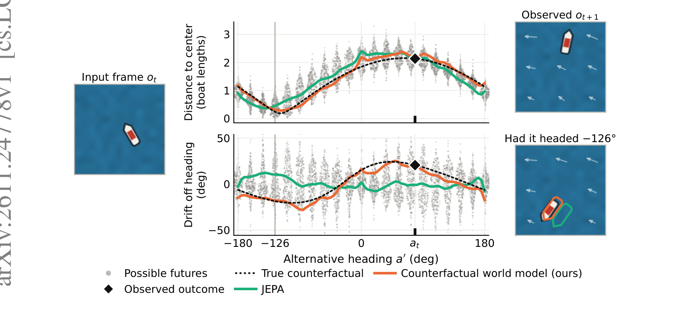
*圖：論文 Figure 1（自 PDF 聚焦擷取）。灰色點是所有干擾下可能的未來；綠色 JEPA 對每個備選航向都只給「平均未來」，因此無論 $a'$ 怎麼換都落在同一條曲線上；橘線是本方法的反事實預測，黑色虛線是真值反事實曲線。菱形是唯一被觀測到的結果——它把這條流「實際上推了多少」透露了出來。[1]*

---

## 二、為什麼挑這篇

你近期點名的五個軸裡，這篇一次命中三個半：**JEPA based**、**training-free**、**zero-shot**，外加「把能量／結構當作推理時的额外資訊」這條隱線。更關鍵的是它給出的不是又一個 loss 或又一個模組，而是一個**可以被證明、也可以被證偽的命題結構**：

1. **不可能性**：任何只從 factual transition 學出來的世界模型，無論資料多、容量多大、likelihood 多準，都**無法**辨識 individual counterfactual。這不是一個「目前還沒有人做到」的工程缺口，而是一個数学上的自由度（gauge freedom）。[1]
2. **結構從哪來**：物理動力學裡 action 與 disturbance 各走自己的通道時，交互項是時間步的**二階**量，所以「把觀測殘差搬過去」這個看起來很樸素的動作，在短時間過渡上有可證的速率，而且是 **minimax rate-optimal（連 leading constant 都sharp）**。
3. **邊界在哪**：它同時把失效條件量化成一個**無因次標量** $\rho$，並用真實的失效案例（接觸、gain fault、摺疊座標、像素空間）告訴你什麼時候不該用。

對一個做 image generation 的人來說，第三點最有價值：它把「在哪個表示空間做加法」這件事，從直覺變成可以**先用模擬器量一量**的變數。下面第七節我會把這套 $\rho$ 算術翻譯成 diffusion／VAR／CFG 的語言。

另外值得記錄的是**時序信号**：這一篇掛出前的 24 小時內，arXiv 上同時出現了 `2611.25415 Stuck in Place: Stall Diagnosis and Remedies for JEPA Planners`（指出 JEPA+MPC 規劃器 96% 的失敗其實是「规划迴路的不动點」而非模型误差）與 `2611.25347 Search or Scoring? Diagnosing Why Visual World-Model Planners Fail`（把失敗拆成 search failure 與 scoring failure，並發現 Metaworld 上 cost 在真實結果上 AUROC 0.94、在預測結果上只有 0.54）。三篇湊成同一個提問：**latent world model 到底在什麼條件下可以用來做決策**。這波「診斷型」研究正在把 JEPA 從「能不能跑」推進到「什麼時候會騙你」。

---

## 三、問題設定：prediction、intervention、counterfactual 是三件事

物理狀態 $s_t$、動作 $a_t$、未觀測干擾 $\varepsilon_t$，轉動服從

$$
s_{t+1}=F_s(s_t,\,a_t,\,\varepsilon_t). \tag{2}
$$

同一條式子有三種讀法：控制論裡它是受擾動的 plant；因果推論裡它是結構方程式（$a$ 是 intervention，$\varepsilon$ 是外生變數）；世界模型裡它是被學習器逼近的未知機制。觀測不到 $s$，只看得到影像 $o_t$，於是 $z_t=f(o_t)$，學習器拟合 $\mu(z_t,a_t)\approx z_{t+1}$——在表徵空間預測而非重構像素，正是 JEPA 的定義。[1]

三個問句的差別是全文的支點：

$$
\begin{aligned}
\mathrm{ATE}(a',a)&=\mathbb{E}\!\left[Y(a')-Y(a)\right] &&\text{(average treatment effect)}\\
\mathrm{CATE}(a',a\mid z)&=\mathbb{E}\!\left[Y(a')-Y(a)\mid Z=z\right] &&\text{(conditional average)}\\
\mathrm{ITE}_i(a',a)&=Y_i(a')-Y_i(a) &&\text{(individual)}
\end{aligned} \tag{3--5}
$$

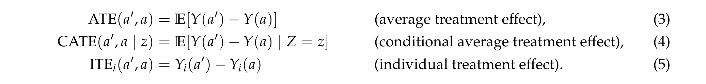
*圖：論文式(3)–(5)（自 PDF 聚焦擷取）。[1]*

- **prediction** 問的是 $P(s_{t+1}\mid s_t)$：在行為策略下，下一步大概會怎樣。
- **intervention** 問的是 $P(s_{t+1}\mid s_t,\mathrm{do}(a_t=a'))$：把動作換掉，**對所有可能發生的干擾取平均**。一個理想的 action-conditioned world model 在行動前答的就是這題。
- **individual counterfactual** 問的是：系統已經做了 $a_t$、遇上了那一道**實際發生的** $\varepsilon_t$、產生了已被觀測的 $s_{t+1}$；如果當時換成 $a'$、而初始狀態與干擾**完全不變**，結果會是什麼？答案是 $s_{t+1}(a')=F_s(s_t,a',\varepsilon_t)$，其中 $\varepsilon_t$ 就是造成這次觀測的那一個實現值。[1]

一句話：**intervention 考慮「可能會有哪些干擾」，counterfactual 問「已經發生的那個干擾」**。差别不是精度，是問題層級（Pearl 因果階梯的第 3 層 vs. 第 2 層）。

### 3.1 為什麼學不到：兩個非辨識性結果

**命題 2.1（邊緣分布不決定配對）**：兩個結構模型可以在**每個動作下的結果分布完全相同**，卻對「同一件事在 $a'$ 下會怎样」給出不同答案。論文給的最小反例是 $Y(a)=U$，而 $Y(a')$ 可以是 $U$、也可以是 $1-U$，兩者的 factual 與 interventional 分布一模一樣。[1]

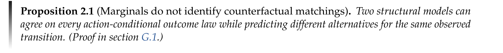
*圖：論文 Proposition 2.1（自 PDF 聚焦擷取）。[1]*

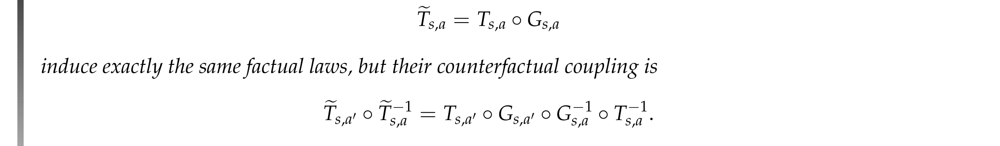
*圖：附錄中「把噪聲重標之後，每個動作的觀測律逐點相同」的代數步驟（自 PDF 聚焦擷取）。兩式只差一個把 $G_{s,a}$ 吸收進積分變換的動作——這就是「任何 factual 準則都看不見這個差別」的精確含義。[1]*

**定理 2.2（action-dependent gauge nonidentification）**：把每個動作的結果律寫成 push-forward $P_{s,a}=(T_{s,a})_\#\nu$。對任意一族保持 $\nu$ 的可測雙射 $G_{s,a}$，改寫機制

$$
\widetilde{T}_{s,a}=T_{s,a}\circ G_{s,a}
$$

 induces **完全相同的 factual laws**，但同干擾配對變成 $\widetilde{T}_{s,a'}\circ\widetilde{T}_{s,a}^{-1}=T_{s,a'}\circ G_{s,a'}\circ G_{s,a}^{-1}\circ T_{s,a}^{-1}$。因此任何只依賴 $\{P_{s,a}\}$ 的準則——likelihood、校準、calibration、factual FID 之類的東西——**原理上都看不見這個差別**。當 $G$ 與動作無關時它才會消掉。[1]

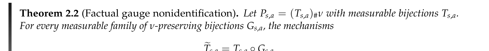
*圖：論文 Theorem 2.2（自 PDF 聚焦擷取）。這段直接點名：normalizing flow 即便有精確 likelihood，能從一次過渡反推 latent 變數，factual 資料也不能保證那個 latent 在另一個動作下代表的還是同一個物理干擾。[1]*

這裡有個必須記住的**推論**：非可逆的生成模型同樣中招——diffusion 或 latent world model 可以在備選動作下生成很逼真的結果，但它的 factual 目標本身並沒有指出「哪一個備選結果屬於這次觀測到的事件」。換句話說，**把 world model 的 factual loss 壓到 0，不能让你升級到第 3 層**。

---

## 四、方法：Residual Reuse（殘差重用）——它不是近似，是唯一解

**定義 3.1（反事實世界模型）**：給定 factual predictor $\mu$ 與一筆已觀測的 transition $(H_t,a_t,z_{t+1})$，

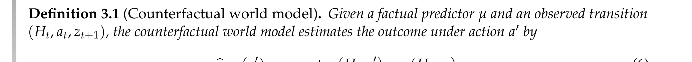

$$
T_{\mathrm{R}}(z,a,y,a') \;=\; y+\mu_h(z,a')-\mu_h(z,a). \tag{8}
$$

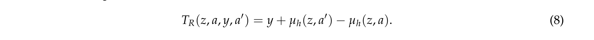
*圖：論文式(8)（自 PDF 聚焦擷取）。口訣是全文最好記的一句：**the residual carries the event, the world model carries the action**（殘差負責「這次事件」，世界模型負責「換動作」）。[1]*

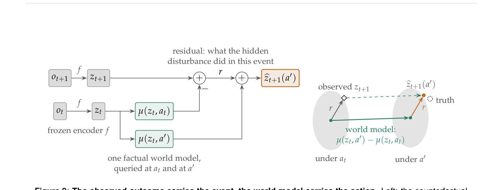
*圖：論文 Figure 2（自 PDF 聚焦擷取）。左邊是同一段 factual rollout 上的兩個 action query，各經同一個 predictor 得到「平均未來」；右邊是 residual reuse：把「實際發生的 $z_{t+1}$ 減掉 $a$ 的平均未來」所得的殘差，加到 $a'$ 的平均未來上，得到這次事件專屬的反事實節點。全流程沒有新增任何可學習元件。[1]*

### 4.1 代數：誤差恰好是「動作效應在干擾變數上的變異數」

令 individual action contrast $\Delta_h=Y_h(a')-Y_h(a)$。因為 $\mu_h(z,a')-\mu_h(z,a)=\mathbb{E}_{\nu_z}\Delta_h$，代入式(8)得到**恆等式**

$$
T_{\mathrm{R}}-Y_h(a')=\mathbb{E}_{\nu_z}\Delta_h-\Delta_h,
\qquad
\mathbb{E}_{\nu_z}\bigl\|T_{\mathrm{R}}-Y_h(a')\bigr\|^2=\operatorname{tr}\operatorname{Var}_{\nu_z}(\Delta_h). \tag{9,10}
$$

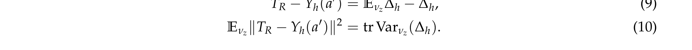
*圖：論文式(10)（自 PDF 聚焦擷取）。這個式子的讀法是：**ITE 與 CATE 的差距**就是殘差重用的全部誤差，跟干擾本身有多大無關。[1]*

**命題 3.2（唯一性）**：任何由 factual laws 加一筆觀測 transition 組成的規則 $T(z,a,y,a')$，若在**所有** additive-response 世界 $F_h(z,a,\varepsilon)=m_h(z,a)+q_h(z,\varepsilon)$ 中都精確，則它必須就是 $y+\mu_h(z,a')-\mu_h(z,a)$。[1]

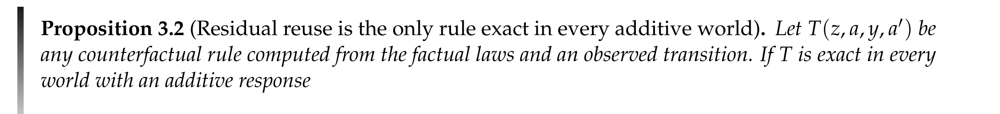
*圖：論文 Proposition 3.2（自 PDF 聚焦擷取）。注意 $q_h$ 可以是非線性、多維、甚至非單射——只要同一個干擾項在兩個動作下都出現，殘差就能直接複用，甚至不需要辨識出 $\varepsilon$。[1]*

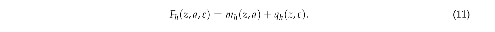
*圖：論文式(11)（自 PDF 聚焦擷取）。$F_h(z,a,\varepsilon)=m_h(z,a)+q_h(z,\varepsilon)$：動作項與干擾項各自獨立，同一個 $q_h(z,\varepsilon)$ 因此可以從觀測事件直接搬到反事實事件，無須辨識出 $\varepsilon$ 本身。這是殘差重用能成立的最弱結構形式。[1]*

### 4.2 幾何：交互比 $\rho$ 是唯一要檢查的數字

假設混合偏導數有界 $\bigl\|\partial_a\partial_\varepsilon F(z,a,\varepsilon)[u,v]\bigr\|\le K_z\|u\|\|v\|$，則

$$
\mathbb{E}_{\nu_z}\bigl\|T_{\mathrm{R}}-Y(a')\bigr\|^2=\operatorname{tr}\operatorname{Var}_{\nu_z}(\Delta)\le K_z^{2}\,\|a'-a\|^{2}\operatorname{tr}\operatorname{Cov}_{\nu_z}(\varepsilon),
$$

若再加分離條件 $\|F(z,a',\varepsilon)-F(z,a',\varepsilon')\|\ge\kappa_z\|\varepsilon-\varepsilon'\|$，就得到**交互比**

$$
\rho_z(a,a'):=\frac{\operatorname{tr}\operatorname{Var}_{\nu_z}(\Delta)}{\operatorname{tr}\operatorname{Var}_{\nu_z}(Y(a'))}\le\left(\frac{K_z\|a'-a\|}{\kappa_z}\right)^{2}. \tag{12--14}
$$

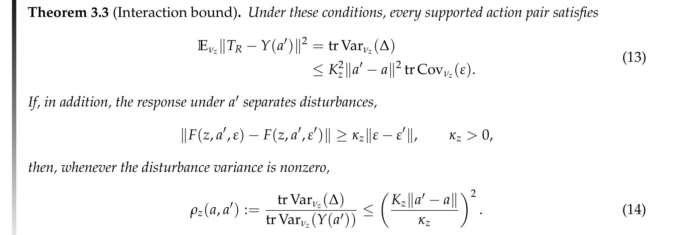
*圖：論文式(12) 與 Theorem 3.3、式(13)(14)（自 PDF 聚焦擷取）。[1]*

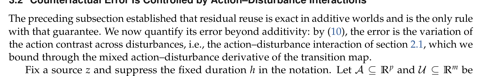
*圖：論文式(12) 與其分離條件式（自 PDF 聚焦擷取）。$K_z$ 度量「換動作會不會改變干擾的作用方式」，$\kappa_z$ 度量「結果能不能分辨干擾」；兩者的比值就是交互比上界的來源，**兩個常數缺一不可**。[1]*

**$\rho$ 的判準非常乾淨**：分母是「不看結果的最佳預測器的風險」$\inf_c\mathbb{E}\|c-Y(a')\|^2=\operatorname{tr}\operatorname{Var}_{\nu_z}(Y(a'))$，所以

$$
\rho_z<1\iff \text{殘差重用勝過「無視觀測結果」的最佳預測器};\quad
\rho_z=0\iff\text{精確};\quad
\rho_z>1\iff\text{搬殘差反而比不看結果更糟}.
$$

同時要記住**兩個常數缺一不可**：$K_z$ 小不夠，$\kappa_z$（結果能否分辨干擾）也必须够大——一個把一階干擾變化抑制掉的表徵，分母會自己縮小，$\rho$ 反而變大。這正是後面「像素不能 transport」失效的根源。[1]

### 4.3 學習器只從「動作對比」這一條路進入誤差

把學到的預測寫成 $\widehat{\mu}(z,a)=\mu(z,a)+e(z,a)$，$e_\Delta=e(z,a')-e(z,a)$，則

$$
\mathbb{E}_{\nu_z}\bigl\|\widehat T_{\mathrm{R}}-Y(a')\bigr\|^2=\underbrace{\operatorname{tr}\operatorname{Var}_{\nu_z}(\Delta)}_{\text{物理交互（學不掉）}}+\underbrace{\bigl\|e_\Delta(z,a,a')\bigr\|^2}_{\text{動作對比的估計誤差（可以學掉）}}. \tag{15,16}
$$

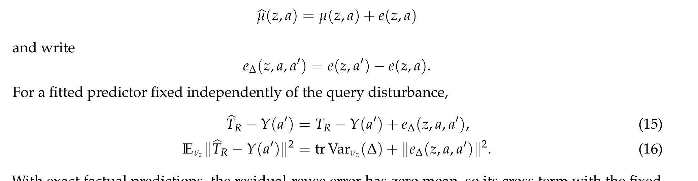
*圖：論文式(15)(16)（自 PDF 聚焦擷取）。交叉項為零的關鍵是「預測器獨立於本次queried 干擾」。這個分解非常值得抄：它說 **factual loss 降低 8–17% 不等於反事實變準**——只有「跨兩個動作共享的誤差」會被抵銷，只有**動作相關的偏差**才會直接進入修正項。[1]*

### 4.4 natura non facit saltus：為什麼物理替你把 $K_z$ 壓到 $O(h)$

牛頓／拉格朗日形式下，作用力與干擾力分通道：

$$
M(q)\ddot q=\tau_a(q,a)+\tau_\varepsilon(q,\dot q,\varepsilon)-c(q,\dot q),
\qquad
\dot s=v_s(s,a)+b_s(s,\varepsilon). \tag{17,18}
$$

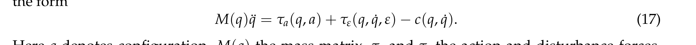
*圖：論文式(17)（自 PDF 聚焦擷取）。這是**假設**，不是從 smoothness 推出來的——文中明確說磨損的致動器（gain fault）很平滑，但交互是一階的，所以被列為違反條件。[1]*

Taylor 展開後，動作的一階效應不依賴干擾、干擾的一階效應不依賴動作，交互只出現在高阶項：

$$
F_h(z,a,\varepsilon)=z+h\,v(z,a)+h\,w(z,\varepsilon)+R_h(z,a,\varepsilon),\qquad \|R_h\|_{L^2(\nu_z)}\le Ch^{2}, \tag{20}
$$

$$
\bigl\|T_{\mathrm{R}}-Y_h(a')\bigr\|_{L^2(\nu_z)}\le 2Ch^{2},\qquad \mathbb{E}_{\nu_z}\bigl\|T_{\mathrm{R}}-Y_h(a')\bigr\|^2\le 4C^2h^4. \tag{21}
$$

**推論 3.5（相對速率）**：在 $h<\kappa\sigma/(\sqrt2 C)$ 時

$$
\rho_h(a,a')\le\left(\frac{2Ch}{\kappa\sigma-\sqrt2\,Ch}\right)^{2}=O(h^{2}). \tag{25}
$$

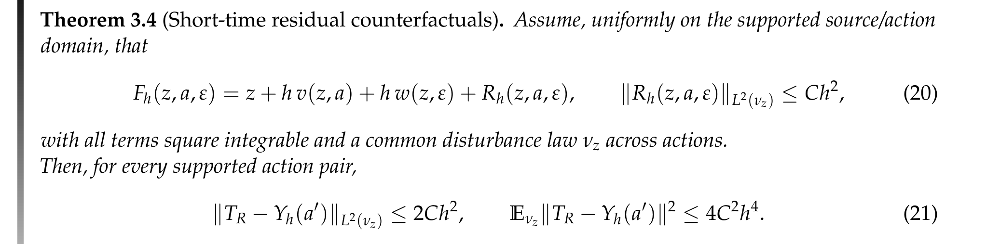
*圖：論文 Theorem 3.4（自 PDF 聚焦擷取）。分子 $O(h^4)$、分母 $O(h^2)$，所以**過渡越短，殘差重用解釋掉的干擾不確定性比例越高**。[1]*

**定理 3.6（minimax rate-optimal）**：讓估計器**知道每個 source／action／duration 的精確 factual 轉移律**，並給它觀測結果 $Y_h(-1)$，則對所有 $0<h\le h_0$

$$
\frac{4C^2h^4}{1+C^2h^2}\;\le\;\inf_\delta\sup_{M\in\mathcal F_C}\mathbb{E}_M\bigl\|\delta-Y_h^M(1)\bigr\|^2
\;\le\;\sup_{M\in\mathcal F_C}\mathbb{E}_M\bigl\|T_{\mathrm{R}}^M-Y_h^M(1)\bigr\|^2=4C^2h^4. \tag{26}
$$

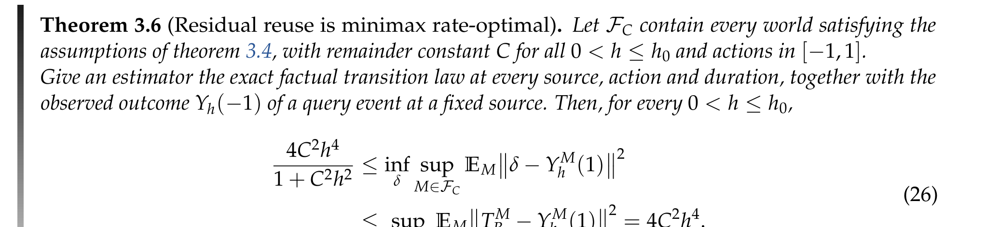
*圖：論文 Theorem 3.6（自 PDF 聚焦擷取）。上下界在 $h\to0$ 同阶且 leading constant 匹配，而且反例只需**平滑自主 ODE**就能構造——所以「換更大的模型、把 factual likelihood 估得更準」不可能一致地改進速率。[1]*

作者還補了一個漂亮的推廣：**只有 pose、隐藏初速度的系統**，因為力對位置是 $h^2$ 阶作用，残差重用的均方誤差仍是 $O(h^6)$，相對速率仍是 $O(h^2)$。這說明保謮屬於「慣性動力學」的性質，而不是任意表徵的保證。

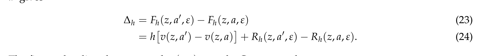
*圖：論文式(23)(24)（自 PDF 聚焦擷取）。同一段 rollout、同一個實現噪聲下把兩個動作的軌跡相減，一階項完全抵銷，剩下的只有混合偏導數貢獻的高階殘量。natura non facit saltus 在這裡的精確意思是：**自然不做跳躍，所以跳躍的代價是高階量**。[1]*

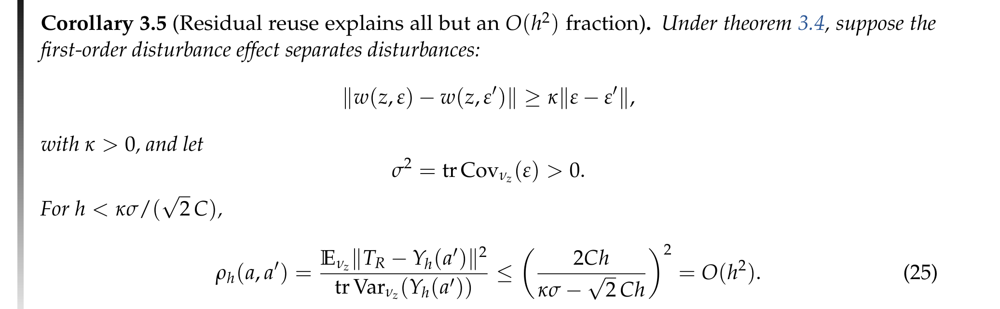
*圖：論文 Corollary 3.5（自 PDF 聚焦擷取）。條件 $h<\kappa\sigma/(\sqrt{2}C)$ 把「多短才算短」寫成干擾尺度 $\sigma$、分離常數 $\kappa$ 與交互常數 $C$ 的比值，而不是一個絕對時間——這正是「工作窗口由交互決定、不由時鐘決定」的出處。[1]*

### 4.5 解凍 encoder 就能用：三個「不需重新訓練」的正當性論證

**定理 3.7（平方損失辨識編碼後的條件均值）**：對任意固定的 $f$ 與 context $H_t$，

$$
\mathbb{E}\bigl\|Y_t-\widehat\mu(X_t)\bigr\|^2=\mathbb{E}\bigl\|Y_t-\mu(X_t)\bigr\|^2+\mathbb{E}\bigl\|\widehat\mu(X_t)-\mu(X_t)\bigr\|^2,
$$

而且加任何正的權重 $w(X_t)$ 都不改變 minimizer 集合。**推論 3.8**：任何放出來的 checkpoint（DINOv2、MAE、SigLIP、監督式模型）都可以當世界模型的表徵，只要新拟合一個平方損失預測器——pretraining 目標完全不重要。[1]

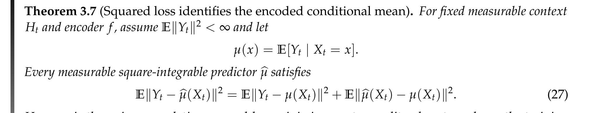
*圖：論文 Theorem 3.7（自 PDF 聚焦擷取）。這條是「為何 MAE（像素重構式預訓練）在這裡也稱為 JEPA」的正當性來源：**它預測的是 embedding，不是 pixels**。[1]*

**命題 3.9（共用輸入排除混雜）**：若行為策略是 $\bm a_t=\pi_b(g(H_t),\xi_t)$，即 controller 只看世界模型看得到的東西，加上與 potential outcomes 條件獨立的外部隨機化，則 $Y_t(a)\perp\!\!\!\perp \bm a_t\mid H_t$，於是 $\mu(H_t,a)$ 就是真正的干预性均值，**不需要 propensity weighting**。[1]

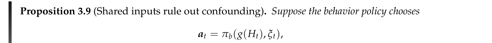
*圖：論文 Proposition 3.9（自 PDF 聚焦擷取）。文中的反例很生動：一個**感覺到水流並反向操舵的船夫**會讓 logged action 攜帶模型看不到的干擾資訊，此時動作效應與風效應混雜，整條論證就斷了。*

### 4.6 實作就兩行

$$
\mathcal L_{\text{factual}}=\mathbb{E}_{\text{train}}\Bigl\|d_\theta(H_t^{(k)},a_t)-\frac{z_{t+1}-z_t}{r}\Bigr\|^2,
\qquad
\widehat\mu_k(H,a)=z_t+r\,d_\theta(H,a), \tag{31}
$$

$$
\widehat z^{\mathrm{CF}}_{t+1}=z_{t+1}+\widehat\mu_k(H_t^{(k)},a')-\widehat\mu_k(H_t^{(k)},a_t). \tag{32}
$$

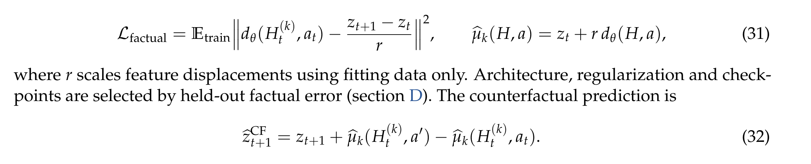
*圖：論文式(31)(32)（自 PDF 聚焦擷取）。注意式(32) 的**推理成本**：比原本多一次 predictor forward，外加一次向量加法；參數 0、訓練階段 0。預測器只有 2 個 attention block、寬度 1024，輸入 $k\in\{1,2,3\}$ 幀 embedding 加歷史動作。[1]*

---

## 五、實驗設定

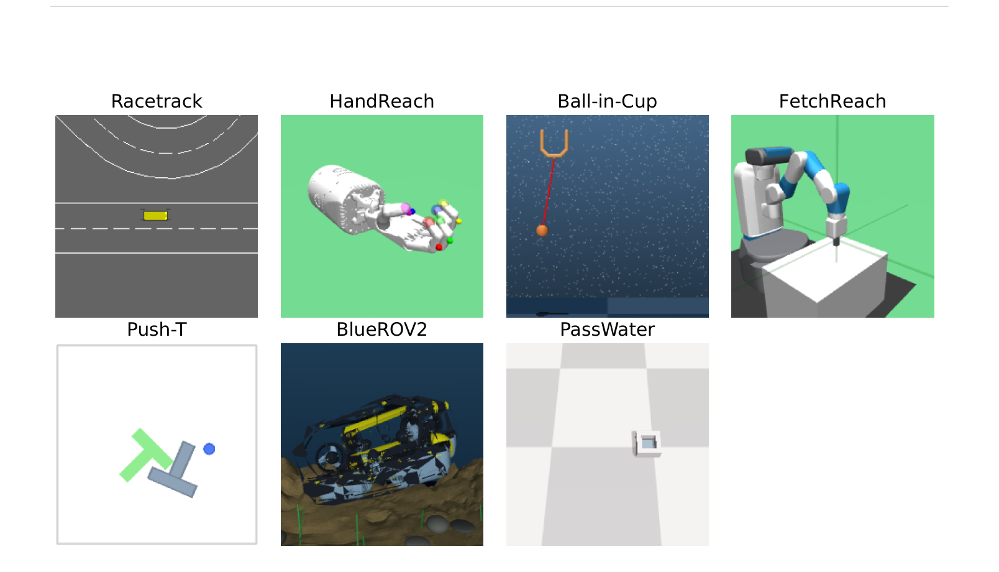
*圖：論文 Figure 5（自 PDF 聚焦擷取）。七個原生模擬器渲染於 $224\times224$：HandReach、Ball-in-Cup、FetchReach、liquid transport（PassWater）、Racetrack、Push-T、BlueROV2；每次過渡注入一個**有物理意義的有界干擾**（servo 目標偏移、力、位置目標、推力）。[1]*

- **編碼器**：7 個完全凍結的公開 checkpoint——DINOv2-S／DINOv2-B（joint-embedding 系）[6]、MAE-B（重構系）[7]、DINOv3-B [8]、SigLIP 2-B [9]、CLIP-B [10]、EVA-02-B [11]。每張影像取 CLS token。
- **資料**：標準每環境 8k factual episodes（BlueROV2 另有 32k、128k 組；洋流消融每條件 128k），拟合用 80%、held-out 20%（標準設定實為 6,553 episodes），3 個 seed，1 幀 context 為主。
- **基線（重點在「不對稱」）**：
  - *Trained predictor* $\pi(\widehat\mu_k(H,a'))$：與本方法**共享全部權重**，唯一差別是看不到觀測結果。
  - *Oracle predictor (no outcome)*：知道模擬器完整 source state、對真動力學取干擾平均——「不看結果的最佳可能預測」。
  - *Factual copying* $\pi(z_{t+1})$：直接把觀測結果抄過來，用来检验「換動作有没有意義」。
  - *Shuffled outcomes*：把不同干擾 draws 的結果對調，用来检验「修正用的是不是這次事件的專屬資訊」。
- **指標**：physical counterfactual $R^2$（預先指定的物理座標上，1 − 平方誤差／真反事實變異數），區間為對 source state 與 seed 的 bootstrap。
- **没有任何反事實標籤進入拟合或模型選擇**——這點是整篇可信度的基礎。

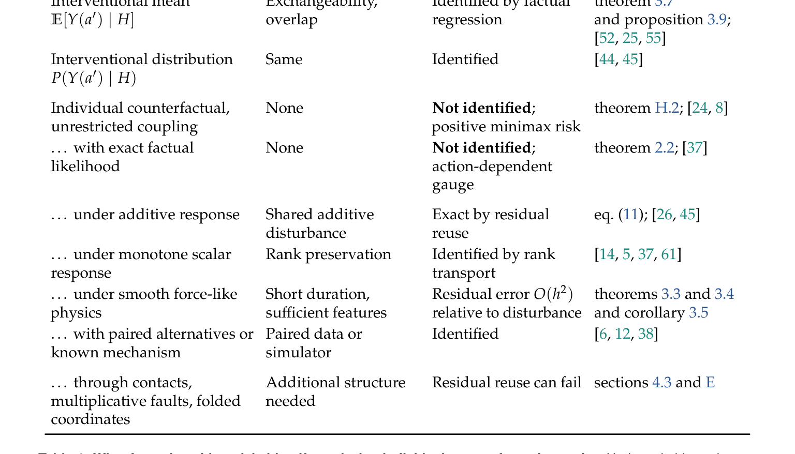
*圖：論文 Table 1（自 PDF 聚焦擷取）。六行對照：干預均值與分布（factual 可辨識）、individual counterfactual（不可辨識）、加 additive response（殘差重用精確）、加單調純量響應（rank transport 可辨識）、加平滑 force-like 物理（$O(h^2)$ 相對誤差）、有配對資料或已知機制（可辨識），最後一行是接觸／乘性故障／摺疊座標（残差重用會失效）。[1]*

---

## 六、結果

### 6.1 主結果：同一個 world model，只是多讀了結果一次

在 8k episodes、一幀 context 下，**readout 後修正**在四個環境達到 $R^2$ 85.6–95.7%，而同款 trained predictor 只有 38.1–45.6%，「不看結果的 oracle」是 49.1–51.1%；factual copying 6.7–43.5%，打亂結果後掉到 −14.6～6.3%。[1]

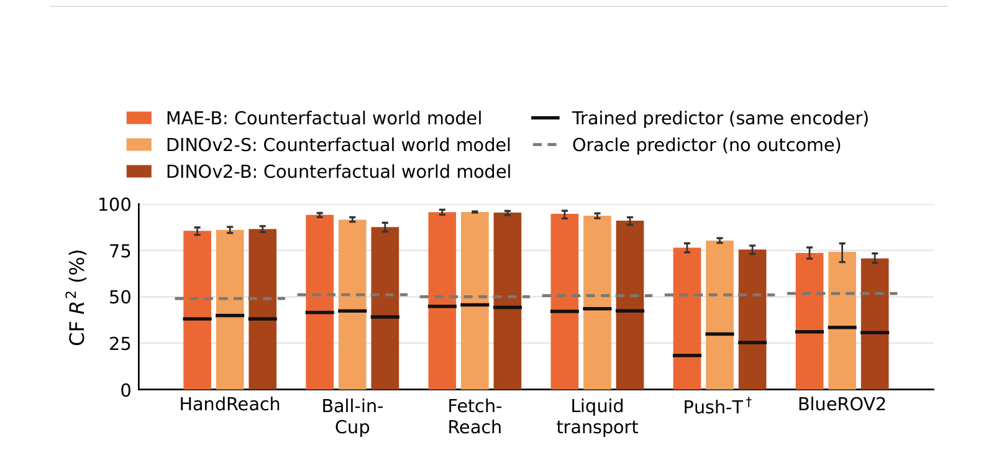
*圖：論文 Figure 6（自 PDF 聚焦擷取）。橘／淺橘／深橘是三個編碼器的反事實世界模型，黑線是**同一個預測器不看結果**，灰虛線是 oracle (no outcome)。Push-T 標了 †（diagnostic）。[1]*

從 Table 5 摘幾組具體數字（physical $R^2$，%）[1]：

| Encoder / Env | Predictor | Oracle(no outcome) | Feature 修正 | **Readout 修正** | Ideal residual |
|---|---|---|---|---|---|
| MAE-B · HandReach | 38.1 | 49.1 | 82.4 | **85.6 [83,87]** | 98.3 |
| MAE-B · Ball-in-Cup | 41.6 | 51.1 | 92.0 | **94.2 [93,95]** | 99.8 |
| MAE-B · FetchReach | 44.8 | 50.0 | 94.0 | **95.7 [94,97]** | — |
| MAE-B · Liquid transport | 42.1 | 50.6 | 82.3 | **94.8 [92,96]** | — |
| MAE-B · BlueROV2 (8k) | 31.1 | 51.8 | 47.7 | **73.6 [71,77]** | 96.9（body velocity） |
| MAE-B · BlueROV2 (128k) | 47.4 | 51.8 | 72.2 | **93.5 [93,94]** | 同上 |
| DINOv2-S · HandReach | 39.9 | 49.1 | 82.3 | **86.1 [84,88]** | — |

判讀上要抓三個要點：**增益不是來自更好的預測器**（預測器完全同一個、同一份資料）；**增益不是抄結果**（copying 只有 2–43%，shuffling 直接轉負）；**距離理想值的差距主要來自「學」而非「物理」**——用精確模擬器條件均值做殘差重用可達 98.3–100%，而學習版本 85–96%。[1]

### 6.2 $\rho$ 是被量出來的，不是被假設的

Table 3（純模擬器、無任何影像模型）[1]：

| 環境／座標 | 機制 | Oracle | Ideal residual | $\rho$ |
|---|---|---|---|---|
| HandReach wrist angles | direct offset（additive） | 49.1 | 98.3 | **0.033** |
| BlueROV2 $\sin(\text{pitch})$ | direct thrust（additive） | 51.8 | 100.0 | **0.000** |
| BlueROV2 body velocities | hydrodynamics（smooth） | 50.4 | 96.9 | **0.062** |
| BlueROV2 $\cos(\text{pitch})$ | **folded coordinate** | 16.9 | **−38.4** | **1.666** |
| Push-T pusher $x,y$ | kinematic（additive） | 51.0 | 100.0 | **0.000** |
| Push-T block $v_x$ | **contact（non-smooth）** | 36.4 | **5.6** | **1.485** |
| Push-T block $v_y$ | contact | 38.8 | −15.5 | 1.889 |
| Push-T block $\omega$ | contact | 19.9 | −44.4 | 1.802 |

同一支致動器 offset 連續滑到 gain fault（$\sigma\varepsilon\bigl[(1-\lambda)+\lambda\,a/a_{\max}\bigr]$）時，測量值與平衡模型的預測值幾乎重疊：HandReach 的 $\rho$ 在 $\lambda=0,0.5,1$ 各為 **0.033／0.497／2.006**（理論 0／0.5／2），理想殘差 $R^2$ 從 **98.3／76.9／6.7** 崩下来；Ball-in-Cup 是 0.003／0.479／1.969（理論 0／0.5／2）。學習端同步：$\lambda=0.5$ 時 feature 修正 70.5–70.6%（勝過 oracle 52.9%），$\lambda=1$ 時掉到 6.4–11.0%，**比 trained predictor 的 41–42% 還差**，readout 修正甚至 −12.8～−11.8%。[1]

**這是我認為全文最值得抄的實驗設計**：不是「我提一個方法，我贏了」，而是「我提一個**預測**（$\rho$ 應該按 $(K_z\|a'-a\|/\kappa_z)^2$ 走），然後把干擾機制從 additive 連續滑到 multiplicative，看曲線跟不跟得上」。

短時間速率與「settling」那組也很有意思：damped pendulum 的 $\theta''=-\sin\theta-0.2c\theta'+u$ 在 additive force 下是 $h^8$、在 gain fault 下維持在 $\rho\approx2.06$；HandReach 的 offset 交互比從 0.04 s 的 **0.19** 降到 0.32 s 的 **0.0008**——**長時間反而更接近可加**，因為位置伺服已經 settle 到一個近似 additivity 的 setpoint。作者的說法是「**工作窗口由交互決定，不是由時鐘決定**」。[1]

### 6.3 洋流消融：干擾要在「動作會帶你去的距離尺度」上近似常數

固定流速與平均流，只改渦的尺寸 $L$（1000 船長 → 1.25 船長）與圖樣的相位速率（0 → 3 rad/transition）：$\rho$ 隨 $1/L^2$ 增長（$2\times10^{-6}\to0.08$，$L=5$；$0.49$，$L=1.25$），而反事實模型的相對風險**始終只比 $\rho$ 高 0.12–0.15**（0.13→0.64），trained predictor 則卡在 1.11–1.17。相位速率那一軸 $\rho$ 恆在 0.020–0.022、相對風險 0.15–0.17，**完全沒有影響**。[1]

機制解釋很漂亮：一個事件裡所有備選航向在**同一批時刻**遇到流場，所以殘差能不能搬，取決於流場在「兩個動作leads to 的兩個位置之間」差多少，而不是它随時間怎麼變。只有把一個 transition 的殘差搬到**下一個** transition 時，時間變化才要緊。

### 6.4 像素不能 transport：這是給生成模型研究者的一記當頭棒

在同一個（uniform current，readout 後精確）船上，改用 Monte Carlo 條件均值**只換座標、不拟合任何模型**：在**像素**裡 $\rho=2.13$——因為流把船的**邊緣**推走，而邊緣在備選航向下根本不在那個位置，所以「加兩張平均圖的差」留下的是一團暗印與一張模糊複印；把這些圖讀回凍結編碼器與 readout，相對風險 **5.86**，比不看結果還糟。縮短時間也救不了：$h=1\to0.05$ 之間 $\rho$ 恆在 1.74–2.18，因為 $h=0.05$ 的命令位移仍有約 1.4 像素。[1]

但 MAE-B 的 768 維 feature **在自己的度量下也不 additive**（$\rho=1.92$），可是在 feature 空間修正仍能把位移帶進 readout（相對風險 0.31），readout 後修正到 **0.002**。結論：**殘差要搬在「動作與干擾可加」的座標裡**，而一個只預測像素的世界模型必須先自己找到這種座標。

### 6.5 規劃與「重複嘗試」：什么时候結果有價值

Hindsight planning（問「剛剛那一事件裡，哪個指令會到達目標」）：反事實世界模型 35–69%、trained predictor 9–25%、**知道模擬器但不知道結果的 oracle planner 14–23%**；10 個 environment–encoder 比較全部正增益且 bootstrap 區間跨 0 以上。知道真干擾的 oracle planner 則每個事件都成功。[1]

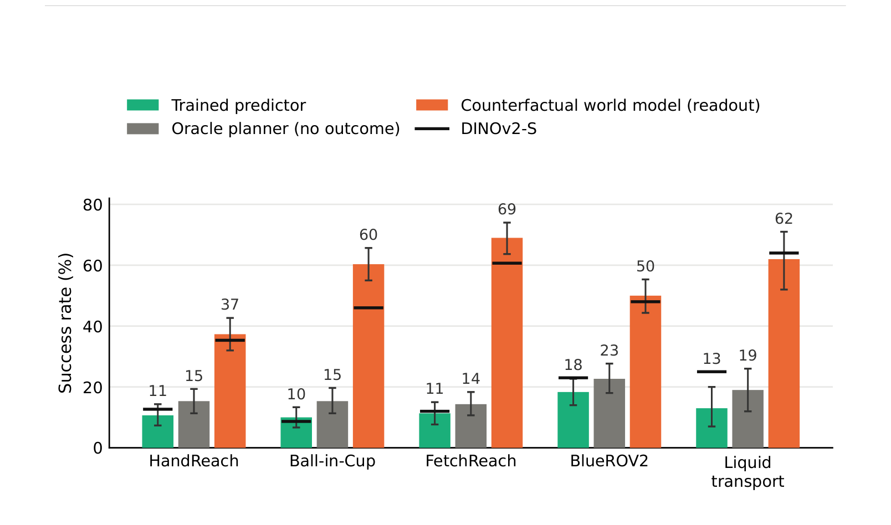
*圖：論文 Figure 11（自 PDF 聚焦擷取）。Success 定義為標準化目標距離 < 0.2。[1]*

最有價值的卻是負結果那一組：**同事件重試**兩次可把成功率從 9–24% 抬到 51–97%；**持續性故障**（一個干擾撐整集）下 3 次連續 transition 的 replanning 從 4–25% 升到 11–51%；但**fresh 干擾**（每步重抽）只有 −4～+6 點；**完全沒有干擾**時，replanning 成功率反而**下降 4–15 點**（同事件重試仍 +13～+58）。這對應到命題：殘差只在「同一事件」或「干擾會持續」時是有用的資訊，否則它是纯噪声——**它 predict 的是這次事件的誤差，不是下一次獨立干擾的誤差**。

### 6.6 其他值得記的細節

- **history 消融**：把干擾變異數的 fresh 占比從 25% 拉到 100%，trained predictor 從 71.7% 掉到 38.1%，反事實模型只從 91.4% 掉到 85.6%——**結果觀測是歷史幀的替代品，而且更難被搶走**。把一半變異數改成 persistent、context 從 1 幀加到 3 幀，trained predictor 變化 −2.3～+2.1、反事實 −4.5～+1.6，作者承認 population 層面的 history 益處在這些有限拟合模型上沒有被穩定實現。
- **factual loss 不是好代理**：用 held-out factual loss 選配置讓 factual 誤差降 8–17%，六個環境中五個改善或持平，但 **Push-T 是反例**——feature 誤差變好、pusher 的動作對比卻變差。
- **BlueROV2 需要更多資料**：標準 8k 時 readout 修正只有 70.7–75.5%，16 倍資料才到 90.1–93.5%（oracle 恆在 51.8%）。feature 空間修正在標準資料規模上「不夠用」，16 倍也只有 65.9–72.2%。

---

## 七、相關研究背景

這篇的定位很清楚，它站在三條線的交會點上，而且**明明白白地认领了自己的祖籍**：

**(1) 因果推論的非辨識性。** 直接對話 Nasr-Esfahany、Alizadeh & Shah 的 *Counterfactual Identifiability of Bijective Causal Models*（ICML 2023）[12] 與 Nasr-Esfahany & Kiciman 的 *Counterfactual (non-)identifiability of learned SCMs* [13]，以及 Xia et al. 的 Neural Causal Models [14]。本文的新意是把「action-dependent gauge」搬進**學習到的視覺世界模型**，並補上一個**帶 sharp constant 的 minimax 下界**；加性噪聲 SCM 的經典反事實構造（Pearl）[15] 就是式(8) 的統計學祖本。

**(2) 控制論的 offset-free 家族。** Muske & Badgwell 的 *Disturbance modeling for offset-free linear MPC*（2002，引用 654）[16]、Pannocchia & Rawlings（2003）、Morari & Maeder 的非線性 offset-free MPC（2012）[17]，以及 iterative learning control（Arimoto 1984）。本文的說法是：** disturbance observer 與 offset-free MPC 本質上就是反事實估計器**，只是過去都在「已知（近）線性名義模型」下分析；這裡把它們的推理搬到**在凍結影像表徵上學出來的非線性模型**，代價是一個交互項。

**(3) 影像域的反事實世界模型先聲。** 早在 2020 年，CoPhy（ICLR 2020）就用反事實 supervise 物理動力學的預測 [30]；Bear et al. 的 *Unifying (Machine) Vision via Counterfactual World Modeling*（2023）則主張用「假想干預後的表徵一致性」統一視覺任務 [31]。這兩條線要的是**訓練目標**；本篇把問題反過來問：如果只借物理的結構，能否在**完全不訓練**的前提下拿到同一層答案。

**(4) JEPA／冻结特徵世界模型。** I-JEPA（Assran et al., CVPR 2023）[18]、V-JEPA 系的 video feature prediction [19]，以及 DINO-WM（Zhou, Pan, LeCun, Pinto, arXiv:2411.04983）——「在凍結視覺特徵上做 MPC 就能 zero-shot 規劃」[20]。這篇正好補上 DINO-WM 那一脈缺的一塊：**在凍結特徵上規劃，什麼時候會騙你**。

**與本庫已讀報告的對照（這條最有意思）**：

| 已讀 | 與本篇的關係 |
|---|---|
| **Causal-JEPA**（2026-09-10）[21] | 用 object-level latent masking **在訓練時**逼出反事實般的交互推理（PHyRE 上 counterfactual VQA +20%）。本篇正相反：**訓練時什麼都不做，推理時多查一次**。兩篇構成「結構從何而來」的兩極——一個把結構塞進 loss，一個向物理借結構。 |
| **JEPA-TTT**（2026-10-08）[22] | 部署期間 online self-supervised adaptation 來追動態漂移；本篇**零更新**，並指出「factual 準確度」根本不度量你要的那個對比。TTT 動權重、本篇只動一次加法。 |
| **TD-JEPA**（2026-11-09）[23] | successor features + 離線多步 TD，做到 test-time reward 對應的 zero-shot policy。這是「第 2 層（干預）」上的規劃；本篇是「第 3 層（反事實）」上的事後診斷，兩者天然互補。 |
| **V-JEPA 2.1 / La-JEPA**（2026-11-05／11-10）[24] [25] | 都在放大 dense latent 世界模型；本篇提醒：預測器越強，**交互項**（學不掉的那一塊）就越成為唯一天花板。 |
| **EBReg / LEF-JEPA / EBT / TEM**（本庫 energy 系列）[26] | 與本篇湊成同一個三元座標「energy — inference — learning」：**factual loss 的 minimizer 在正權重下不變（定理 3.7）**，就像 EBReg 的 score 熵正則只在學習時起作用；而本篇的殘差重用是純 inference-time operator。 |
| **Stuck in Place / Search or Scoring?**（2611.25415／2611.25347，11-19）[27] [28] | 同週的「診斷三部曲」。Search or Scoring 說 cost 在預測結果上近隨機（AUROC 0.54 vs. 真實 0.94）；本篇解釋了**為什麼**：latent 预测的誤差裡有一半是「這次事件的干擾」，而那正是 factual 目標看不见的 gauge。 |

---

## 八、個人評價與意義

**真正硬的部分。** 定理 2.2 與 3.6 是我近幾個月看到最「乾淨」的一對：前者說你不管怎麼訓練都拿不到那個配對，後者說你連速率都改进不了、而且反例用平滑自主 ODE 就能造出來。這兩條合起來把一個原本屬於「哲學／可解釋性」的話題，變成一個有明確工作窗口的工程問題——只要你能量 $\rho$，你就能決定該不該用。**Figure 2/Table 3/Table 4 的「預測→量測→連續滑動失效機制」三段式，是我覺得可以直接搬到任何生成模型論文裡的評審級實驗範式。**

**必須保留的判斷。**

1. **全部是模擬環境**，作者自己在 Scope of the Evidence 裡承認：干擾是「有物理意義的受控致動器故障」，不是現實不確定性的完備模型；七個環境中有兩個過不了「從影像恢復被評分量或恢復干擾」的準則；BlueROV2 需要 4 倍資料才通過 readout 那關；oracle 參考值是 Monte Carlo 估計、**沒有正式的數值誤差界**，PassWater 的 oracle 每個 source state 只抽 4 個干擾。
2. **readout 需要物理狀態標籤**（joint angle、位置）。無標籤時只剩 feature 空間修正：四個環境 73.4–94.1%（大多數增益還在），但 BlueROV2 就明顯掉隊。文中說「精確的物理反事實不等於整個 feature 向量是可加的」，並給出明確反例（$\rho=1.92$）。
3. **只在一個 transition 上 reuse 一個殘差**，不 chain；fresh 干擾下 replanning 會**變差 4–15 點**，這是方法邊界而不是工程瑕疵。
4. **假設 logged action 只依賴模型看得到的東西**（Prop 3.9）。真人遙控、或任何模型外資訊参与的控制器都會讓這個假設失效——作者列為 future work。
5. 一些**口徑不一致**要記：摘要說「四個 rendered simulators」提升到 86–96%，但正文與表格其實把 Push-T 標為 diagnostic、把 BlueROV2 列為第 5 個（要 16 倍資料才到 90–94%），Figure 6 的 bar 又包含 Push-T 與 liquid transport；另外「7 個環境」在不同章節被切成 4／5／6／7，閱讀時要用 † 標記去校對，不要直接摘摘要的數字。
6. **無同行審查**，且這是「LeCun 的世界模型路線 + 一篇理論很重的預印本」的組合；參考文獻中部分控制論條目年份久遠但引用數很高（Muske & Badgwell 654），真正的風險不在引用錯，而在**讀者容易把「在模擬器上被證明的速率」讀成「在真實機器人上會有的速率」**——文中 Corollary 3.5 明確說「多久算短是經驗問題，factual 資料無法回答」。

**為什麼對 image generation 的人值得讀。** 表面上這是 world model／robotics，但它的骨架是一條極通用的命題：**觀測到的誤差（residual）攜帶的是「這一次 draw」的隱變數資訊；模型攜帶的是「換條件」的平均效應；兩者的可加性取決於你在哪個座標系做這個加法。** 這正是任何 latent generative model 都在做的事情，而 $\rho$ 是一個你**可以算**的判準。[1]

---

## 九、給你激發想法的九條線索（每條都附可證偽的實驗）

1. **VAR／next-scale：把「同 scale、不同 noise」當作 action pair，直接量 $\rho$。** 對同一張 $x_0$ 的前 $k$ 個 scale 固定、在第 $k{+}1$ scale 用兩個不同溫度／不同 logits 修正做兩次取樣，把「兩次取樣之差」當作 $\mu(a')-\mu(a)$，把「實際采样結果 − 該 scale 的條件均值」當作殘差。**預測**：scale 越早（幾何結構已被前 scale 定住），交互越小、$\rho$ 越接近 0；後段高頻 scale 因取樣器把誤差搬進「邊界／紋理位置」，$\rho$ 應該像像素一樣爆掉（本文像素值 2.13 就是同型現象）。這能直接检验本庫 G-STAR／FlexVAR 那类「哪个 scale 負責哪个頻段」的歸因，而且**零訓練**。
2. **CFG 讀成 CATE，然後做一個「同事件反事實」的 training-free 算子。** 標準 $\epsilon_\theta(z_t,a,w)=\epsilon(z_t)+s\bigl(\epsilon(z_t,a)-\epsilon(z_t)\bigr)$ 給的是**對噪声取平均**的干預效應，也就是 CATE；殘差重用的類比是 $\hat z_1^{\mathrm{CF}}=z_1^{\mathrm{obs}}+\bigl[\epsilon(z_t,a')-\epsilon(z_t,a)\bigr]$——用**同一組初始噪声與同一条軌跡**已經觀察到的偏离去錨定。可測的預測是：當兩條 guidance 路徑的「交互」小（例如只改屬性詞、不改空間佈局）時，這個免訓練算子應該比提高 guidance scale 更準；反之改構圖時應該失敗。這與本庫 AlignVid（ASM 調注意力熵）、MMD-Guidance 正好互補，因為它**改的是 transport 規則而不是 scale**。
3. **「像素不能 transport」→ 給 1-step／2-step 生成模型一個可量化診斷。** 本文證明：即使有精確條件均值，在像素座標做加法 $\rho=1.74\text{–}2.18$，而縮短時間無效（因為邊界處的灰度變化是一階不連續）。對應到 JiT／$x_0$-prediction、pixel-space diffusion 這一類「raw-state 直接出口」的路線（本庫 RiT/v-prediction PCA 已討論過低秩與有效秩）：**可以直接量「同一 event、兩個 prompt」的 $\rho$**，預測像素空間或低頻子空間的 $\rho>1$，而 DINO／RAE 語義 readout 空間的 $\rho$ 較小。若成立，結論就不是「哪个參數化 FID 低」，而是**「哪種參數化允許把 sample-specific 誤差當條件搬運」**。
4. **JEPA／world model 規劃器的 $\rho$ 門控，接上同週的 Unstick 與 DemoProp。** `2611.25415` 說 96% 失敗是「plan 的不动點」；`2611.25347` 說 cost 在預測結果上近隨機。本篇給的處方是：**先用一筆 factual transition 的殘差把 scoring 那一路修好**（$\rho<1$ 時才修），$\rho>1$（接觸、乘性故障、摺疊座標）就退回 search／averaging 策略，別浪費算力。一個具體實驗：在 DINO-WM 或 V-JEPA-AC 上，把「用不用殘差修正」交給一個**線上估計的 $\rho$**（用同 source state、兩個候選指令的 rollout 估計交互比），並檢查成功率是否只在 $\rho<1$ 區間上升。
5. **把「readout 選座標」變成一個 training-free 的表示修飾器。** 本文最实用的一招是：同一個 frozen encoder，**先過一個小 MLP 讀出物理量、再在讀出空間做修正**，比在 768 維 feature 空間做修正好 1.4–25.9 點。搬到生成端：同一個 VAE／RAE latent，用「動作（text／condition）與干擾（noise／採樣隨機性）是否近似可加」來筛出幾個低 $\rho$ 方向，只在這些方向上做 guidance 或 editing——這等於用**交互比**取代本庫 LEF-JEPA 那種「能量場學結構」的做法，且完全不訓練。
6. **energy-based transformer：$\rho$ 是 verifier 的信任分數。** EBT／TEM 這一系用能量頭在推理時做迭代下降或 best-of-$N$ 驗證；本篇的分解式(16) 說**只有「動作相關的偏差」會傷害修正，共享誤差自動抵銷**。因此可以把 $e_\Delta$ 的估计量做成一個零參數的**信心標量**：同一事件下查兩個 condition，若兩者相減的符號／大小在 bootstrap 下不穩，就直接拒絕用這個 verifier 的排序。這是把「residual → credibility」搬到 energy head 上的具體版本。
7. **$\rho$ 可以當 dataset／training-free intervention 的選址器。** 洋流消融顯示 $\rho\propto1/L^2$：干擾在「兩個動作會去的位置之間」变化越快，殘差越不可搬。這给了一個便宜的資料價值度量和一個 planning 的動作距離上限——**同一份 log、同一個模型，只要把 query 的 $\|a'-a\|$ 控制在 $\rho<1$ 的範圍內，就能把「事後反事實」變成一個可用的 planning 工具**。可以直接在 video diffusion 的「插畫家視角／镜头位移」任務上做这个距離掃描。
8. **零樣本的動作條件控制 vs. 零樣本的反事實重播。** 本庫 UniJEPA、TD-JEPA 都宣稱 zero-shot planning；本篇區分出更嚴格的一層：**zero-shot 的 counterfactual replay**（不改任何權重，只用一筆已發生 transition 去回答「若當時…」）。建議把兩者疊起來做一次實驗：TD-JEPA 式 successor features 提供「換 action 的平均效應」，殘差重用提供「這次事件的干擾」，檢查是否能得到一個**免訓練的 hindsight credit assignment**，並與 Mesnard et al. 的 counterfactual credit assignment [29]、以及影像端的 CoPhy [30] 做基線對比。
9. **最狠的一條：把 $\rho$ 當反事實的「可辨識性計量」來審所有 generative 反事實宣稱。** 任何宣稱能做「換 prompt／換參考圖會怎样」的 editing、personalization、counterfactual augmentation 工作，都應該先回答：你在哪個座標系做加法、那個座標系的 $\rho$ 是多少？沒有這個數字的結果，按本文的框架，**都只在回答第 2 層（干預）**，不該被讀成第 3 層。這是一個可以馬上用在 review 里的刀。

**一句總結**：這篇把「看結果」這件事，從世界模型的弱點變成世界模型的輸入——**the residual carries the event, the world model carries the action**；代價是你必須為自己的表徵空間負責。[1]

---

## References

[1]: https://arxiv.org/abs/2611.24778 "Counterfactual World Models: JEPAs That Reason About What If (arXiv:2611.24778v1, PDF 全文 78 頁)"
[2]: https://randallbalestriero.github.io/ "Randall Balestriero 個人網站：world models 與 self-supervised learning，前 Meta FAIR"
[3]: https://arxiv.org/html/2611.24778v1 "arXiv HTML 全文與附錄 A–J、證明 G–J"
[4]: https://amilabs.xyz/ "AMI Labs：LeCun 創辦的世界模型公司，官方定位為在潛在空間做預測的 JEPA 路線"
[5]: https://github.com/galilai-group/counterfactual-WM "galilai-group/counterfactual-WM 官方 code release"
[6]: https://arxiv.org/abs/2304.07193 "DINOv2: Learning Robust Visual Features without Supervision (arXiv:2304.07193)"
[7]: https://arxiv.org/abs/2111.06377 "Masked Autoencoders Are Scalable Vision Learners (arXiv:2111.06377)"
[8]: https://arxiv.org/abs/2508.10104 "DINOv3 (arXiv:2508.10104)"
[9]: https://arxiv.org/abs/2502.14786 "SigLIP 2: Multilingual Vision-Language Encoders (arXiv:2502.14786)"
[10]: https://arxiv.org/abs/2103.00020 "Learning Transferable Visual Models From Natural Language Supervision / CLIP (arXiv:2103.00020)"
[11]: https://arxiv.org/abs/2303.11331 "EVA-02: A Visual Representation for Neon Genesis (arXiv:2303.11331)"
[12]: https://proceedings.mlr.press/v202/nasr-esfahany23a.html "Counterfactual Identifiability of Bijective Causal Models (ICML 2023, Nasr-Esfahany, Alizadeh & Shah)"
[13]: https://arxiv.org/abs/2301.09031 "Counterfactual (Non-)Identifiability of Learned Structural Causal Models (Nasr-Esfahany & Kiciman, 2023)"
[14]: https://arxiv.org/abs/1408.2063 "From Ordinary Differential Equations to Structural Causal Models: The Deterministic Case (UAI 2013, Mooij et al.)"
[15]: https://arxiv.org/abs/2008.05249 "Elements of Causal Inference: Foundations and Learning Algorithms (Peters, Janzing & Schölkopf, MIT Press 2017)"
[16]: https://www.sciencedirect.com/science/article/abs/pii/S0959152401000518 "Disturbance Modeling for Offset-Free Linear Model Predictive Control (Muske & Badgwell, Journal of Process Control 2002)"
[17]: https://www.sciencedirect.com/science/article/pii/S0005109812002932 "Nonlinear Offset-Free Model Predictive Control (Morari & Maeder, Automatica 2012)"
[18]: https://arxiv.org/abs/2301.08243 "Self-Supervised Learning from Images with a Joint-Embedding Predictive Architecture / I-JEPA (CVPR 2023)"
[19]: https://arxiv.org/abs/2404.08471 "Revisiting Feature Prediction for Learning Visual Representations from Video / V-JEPA (TMLR 2024)"
[20]: https://arxiv.org/abs/2411.04983 "DINO-WM: World Models on Pre-trained Visual Features enable Zero-shot Planning (ICML 2025, arXiv:2411.04983)"
[21]: https://arxiv.org/abs/2602.11389 "Causal-JEPA: Learning World Models through Object-Level Latent Interventions (arXiv:2602.11389, ICML 2026)"
[22]: https://github.com/KaiCobra/AI_Daily/blob/main/papers/2026/2026-10/JEPA-TTT/AI_Daily_JEPA_TTT.md "本庫已讀：JEPA-TTT（2026-10-08）"
[23]: https://github.com/KaiCobra/AI_Daily/blob/main/papers/2026/2026-11/TD-JEPA/AI_Daily_TD_JEPA.md "本庫已讀：TD-JEPA（2026-11-09）"
[24]: https://github.com/KaiCobra/AI_Daily/blob/main/papers/2026/2026-11/V-JEPA-2.1/AI_Daily_V-JEPA_2_1.md "本庫已讀：V-JEPA 2.1（2026-11-05）"
[25]: https://github.com/KaiCobra/AI_Daily/blob/main/papers/2026/2026-11/La-JEPA/AI_Daily_La-JEPA.md "本庫已讀：La-JEPA（2026-11-10）"
[26]: https://github.com/KaiCobra/AI_Daily/blob/main/papers/2026/2026-11/EBReg/AI_Daily_EBReg.md "本庫已讀：EBReg — Score-Based Entropy Maximization（2026-11-12）"
[27]: https://arxiv.org/abs/2611.25415 "Stuck in Place: Stall Diagnosis and Remedies for JEPA Planners (arXiv:2611.25415)"
[28]: https://arxiv.org/abs/2611.25347 "Search or Scoring? Diagnosing Why Visual World-Model Planners Fail (arXiv:2611.25347)"
[29]: https://proceedings.mlr.press/v139/mesnard21a.html "Counterfactual Credit Assignment in Model-Free Reinforcement Learning (ICML 2021, Mesnard et al.)"
[30]: https://arxiv.org/abs/1909.12000 "CoPhy: Counterfactual Learning of Physical Dynamics (ICLR 2020, Baradel et al.)"
[31]: https://arxiv.org/abs/2306.01828 "Unifying (Machine) Vision via Counterfactual World Modeling (arXiv:2306.01828, Bear et al.)"
