# AI Daily

## 2026-11-19｜Energy-Based Reasoners: Your Recurrent Reasoner Should Be an Energy-Based Model（EBR）

### 論文資訊

**標題：** Energy-Based Reasoners: Your Recurrent Reasoner Should Be an Energy-Based Model

**作者與單位：** William Xingxu Chen¹、Alexi Gladstone²、Zeyu Michael Li¹、Heng Ji²、Yilun Du³；¹Duke University、²University of Illinois Urbana-Champaign、³Harvard University（Gladstone 為 EBT 第一作者、Du 為 IREM／IRED 與 EBT 系列的推動者，本篇是該條 energy-based 路線在 latent reasoning 上的最新一炮）

**來源與狀態：** arXiv:2611.08977v1，`cs.LG`（交叉 `cs.AI`），2026-11-06 提交，22 頁（正文約 9 頁、參考文獻 44 條、附錄 A–E）。Comments 欄位不存在、journal-ref 為空，PDF 無會議頁尾 → **純預印本，尚未經同儕審查**；HuggingFace papers 趨勢頁於 2026-11-17 前後出現。

**程式碼與專案頁：** 官方 code `github.com/wwillchen/ebr`（MIT、Python、75 stars、建於 2026-10-29、最後推送 2026-11-19）、專案頁 `energy-based-reasoners.github.io`，兩者查核時均為 HTTP 200。

**為什麼挑這篇：** 它一次命中你近期點名的數個軸——energy-based transformer（同一批作者的 latent reasoning 版）、training-free（$\|\nabla E\|<\tau$ 是免外掛模組的 test-time 旋鈕）、attention modulation（per-token 能量 $e_i$ 是現成的調製訊號）、以及 JEPA／VAR 都缺的那個「一致性標量」。更關鍵的是它把 **refine／halt／select 三件事壓成同一個標量函數的三種讀法**，這個結構可以直接搬到 DiT 去噪軌跡與 VAR 的 next-scale 決策上，而本庫已讀的 TEM（2610.31889）、EBReg（2611.11379）、LEF-JEPA（2611.08989）剛好湊成可對照的能量座標系。

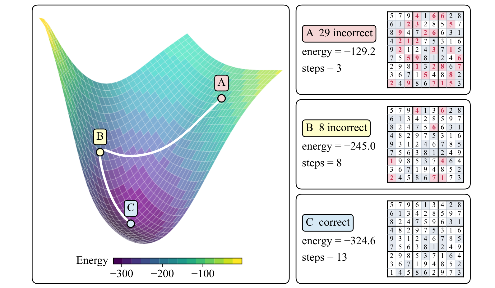
*圖：論文 Figure 1（自 PDF 聚焦擷取，非整頁截圖）。三條數獨下降軌跡落在同一個 learned energy landscape 上：能量 −129.2、走 3 步、29 格錯（A）；能量 −245.0、走 8 步、8 格錯（B）；能量 −324.6、走 13 步、完全正確（C）。能量高低本身就是「這題解得怎麼樣」的單一標量讀數。*

---

### 核心貢獻

Looped reasoner（TRM、HRM、EqR、GRAM 這一系列「一個只有 1.8M–10M 參數的 Transformer 重複疊 30–300 次」的做法）近兩年屢創小模型解 Sudoku-Extreme 的紀錄，但它有一個共同的結構性缺陷：**更新規則 $z\gets f_\theta(z,x)$ 是個自由函數，模型沒有任何內建機制告訴你「現在離答案多近」「什麼時候該停」「多條軌跡該選哪一條」**。現有方法只能另外掛一個 learned halt head 或 Q head，而那個 head 只能在訓練見過的迭代數上工作，一旦 test-time 多跑幾步就失效。

EBR 的主張只有一句話：**把更新規則限制成某個標量能量的梯度場**，

$$
z_{t+1}=f_\theta(z_t,x)\qquad\Longrightarrow\qquad z_{t+1}=z_t-\alpha\nabla_z E_\theta(z_t;x).
$$

這樣做之後，「refine、halt、select 三件事」不再是三個模組，而是同一個 $E_\theta$ 的三個讀數：沿 $-\nabla E$ 走就是精煉；$\|\nabla E\|$ 掉到閾值以下就是該停；$K$ 條軌跡裡能量最低的那條就是該交的答卷。四個具體貢獻如下。

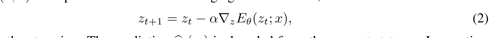
*圖：論文第 5 頁式（2）原文截取——整個方法就縮在這一行的減號上。[1]*

第一，提出 **EBR**：以投影式 Langevin 動力學做 latent 下降，能量函數用一個只多 $d^2+2d$ 參數（約 3.7%）的 per-token 標量頭實現在既有 TRM 骨幹上，總參數維持在 **1.8M**。

第二，提出 **segment-wise deep supervision + convergence loss**：把訓練損失改成「最後 $H$ 步加權監督 + 一個用下降殘差算出的收斂機率做 BCE」，使模型同時學會「下降到對的答案」與「知道自己收斂了」；關鍵消融顯示拿掉收斂損失，準確率會從 98.96% 崩到 **45.32%**。

第三，提出 **State-based Explorative Modeling（SXM）**：把 XM／IMLE 式的 winner-take-all 搬到 latent 軌跡端點，用 forward matching 選軌跡、reverse matching 選目標，讓同一題的多條軌跡被推向**不同**合法解。這讓 10×10 N-Queens 的多解覆蓋率從 GRAM 的 57.5% 拉高到 **92.0%**、8-vertex Graph Coloring 達到 0 衝突。

第四，把以上拼成一個在四個演算法任務上 SOTA 的系統：Sudoku-Extreme **99.4%**（單樣本）／**99.9%**（5 樣本）、Maze-Hard **87.4%**／**88.3%**，而在同等準確率下推理算力比 EqR 少 **345×**、比 GRAM 少 **43× 樣本**，訓練算力還比 GRAM 少 15%。

---

### 技術方法

#### 1｜從 fixed point 到 gradient flow

標準 looped reasoner 把問題 $x$ 編成 latent $z_0$，反覆疊代 $T$ 次後由 $z_T$ 解出答案。若 $f_\theta$ 是任意函數，它的不動點集合 $\{z:f_\theta(z,x)=z\}$ 和「正解集合」毫無關係——EqR 靠收縮映射、FPRM 靠 Jacobian 譜約束來補這個洞，但那都還是「約束一個自由向量場」。EBR 換個做法：不約束向量場，而是**規定向量場必須是某個標量函數的梯度**，於是更新自動變成 descent on $E_\theta(\cdot;x)$，不動點恰好是駐點（$\nabla E=0$），而「正解 = 低能量駐點」是可學習、可比較、可排序的。

實際寫出來的更新式（Algorithm 1／2）比教科書的 gradient flow 多兩層裝飾：

$$
\tilde z_t=\operatorname{RMS}(z_t)+\sigma\xi_t,\qquad
z_{t+1}=\Pi_{\mathcal M}\Big(\tilde z_t-\alpha\,\nabla_{\tilde z}E_\theta(\tilde z_t;x)\Big),\qquad \xi_t\sim\mathcal N(0,I).
$$

這裡 $\Pi_{\mathcal M}$ 把每行 token 向量投回「unit-RMS 球面」$\mathcal M$（即 $\|z^{(i)}\|=1$ 的球面約束），因此真正的梯度是**切向梯度** $\nabla_{\mathcal M}E$；$\sigma\xi_t$ 是 Langevin 項，讓軌跡不會死鎖在第一個局部極小。這個球面約束有一個容易被忽略的重要作用：它把能量值錨定在「token 內積的有界組合」上，否則每走一步 $\|z\|$ 變化都會讓能量漂移，$\nabla E$ 的量級就失去了「可解性指標」的意義。附錄 A.2 給出的 $\alpha$ 上界也印證了這點——為了不繞過極小，$\alpha$ 需小於 $2/\Lambda$，$\Lambda$ 是能量對 $z$ 的 Lipschitz 常數（Hessian 最大特徵值）。

推理時的自適應停止條件就一行：**$\|\nabla_{\mathcal M}E_\theta(z;x)\|<\tau$ 即收工**。這是 EBR 相對 TRM／HRM 最實用的一點——不需要 halt head，$\tau$ 是可以 test-time 隨手調的旋鈕。

#### 2｜段式監督與收斂損失

EBR 沿段（segment）訓練：每段 $n$ 步 descent，最後 $H$ 步做截斷反向傳播（truncated backpropagation through time），梯度要穿過 $\nabla_z E_\theta$，也就是**需要二階導數**（$\nabla_z\nabla_\theta$），這是它主要的工程成本來源。

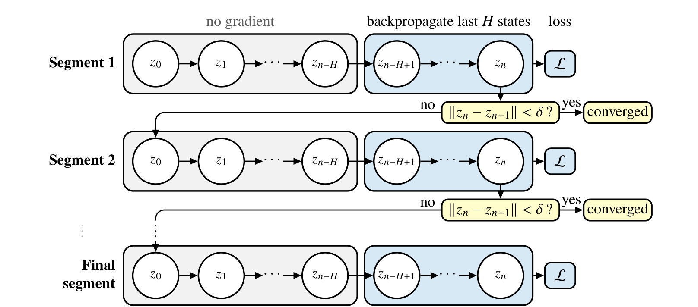
*圖：論文 Figure 2（自 PDF 聚焦擷取）。每段先 no-gradient rollout 前 $n-H$ 步、只對最後 $H$ 步回傳損失；段末以 $\|z_n-z_{n-1}\|<\delta$ 判斷收斂，收斂即結束該軌跡。[1]*

$$
\mathcal L(Z,y)=\sum_{t=n-H+1}^{n} w_t\,\ell_\theta(z_t,y)\;+\;\lambda\,\mathcal L_{\mathrm{conv}}(Z,y),
$$

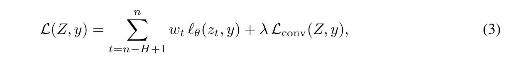
*圖：論文第 5 頁式（3）原文截取。[1]*

其中 $w_t$ 對段內後段給更大權重（越接近軌跡尾端越重要），$\ell_\theta$ 是 stablemax cross-entropy。第二項是這篇的靈魂：先定義「軌跡尾端的相對位移」

$$
r_n=\frac{1}{H}\sum_{t=n-H+1}^{n}\frac{\|z_t-z_{t-1}\|}{\|z_{t-1}\|},
$$

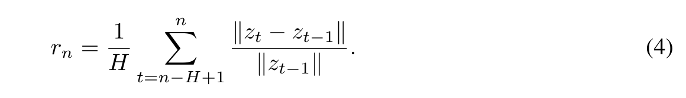
*圖：論文第 5 頁式（4）原文截取，$r_n$ 取段內最後 $H$ 步的相對位移平均。[1]*

再把它透過一個固定的 sigmoid 閘門轉成收斂機率 $p_n=\sigma\big((\delta-r_n)/\kappa\big)$（$\kappa=0.05$，$\delta$ 是閾值），最後用「這條軌跡到底解對了沒」當標籤做 BCE：

$$
\mathcal L_{\mathrm{conv}}(Z,y)=\operatorname{BCE}\Big(p_n,\ \mathbb 1\big[\hat y_\theta(z_n)=y\big]\Big).
$$

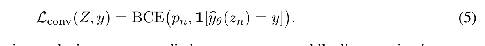
*圖：論文第 6 頁式（5）原文截取，$\kappa=0.05$、$\delta$ 為閾值。[1]*

注意這裡**沒有新增任何參數**：$p_n$ 完全是 $r_n$ 的確定函數，損失只在「收斂但答錯」與「沒收斂但答對」的樣本上產生梯度，把 $\nabla E=0$ 的位置與正確性綁在一起。Table 3 的消融非常暴力：$\mathcal L_{\mathrm{conv}}$ 整個拿掉 → 98.96% 掉到 45.32%；把收斂損失改掛到傳統 learned q-head 上 → 92.42%。換言之「用下降殘差自己當收斂訊號」比「另外學一個收斂頭」好 6.5 個百分點。

#### 3｜能量頭怎麼實作

能量直接復用 TRM 的 recurrent block 作為 encoder，再加一個極小的標量頭：

$$
E_\theta(z;x)=\sum_{i=1}^{N}\phi(e_i),\qquad e_i=w^\top\operatorname{SiLU}\big(Wh_i+b\big),\qquad h=f_\theta\big(z+\operatorname{emb}(x)\big).
$$

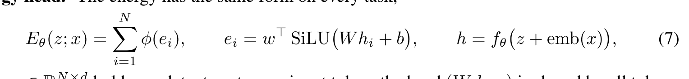
*圖：論文第 15 頁式（7）原文截取。[1]*

$W\in\mathbb R^{d\times d}$、$w\in\mathbb R^{d}$ 就是全部的代價：**$d^2+2d$ 個參數**（$d=256$ 時 66,048 個，佔 1.8M 的 3.7%）。$\phi$ 預設是 identity，但 Maze-Hard 用 softplus——因為迷宮的合法解長短不一，identity 會讓「多繞路」持續降低能量，softplus 把負貢獻飽和掉。這是「per-token 能量相加」的一個實務警告：**求和的形式等於假設 token 間的能量可加**，而 token 間的互動其實全交給 attention 在 $f_\theta$ 裡做。

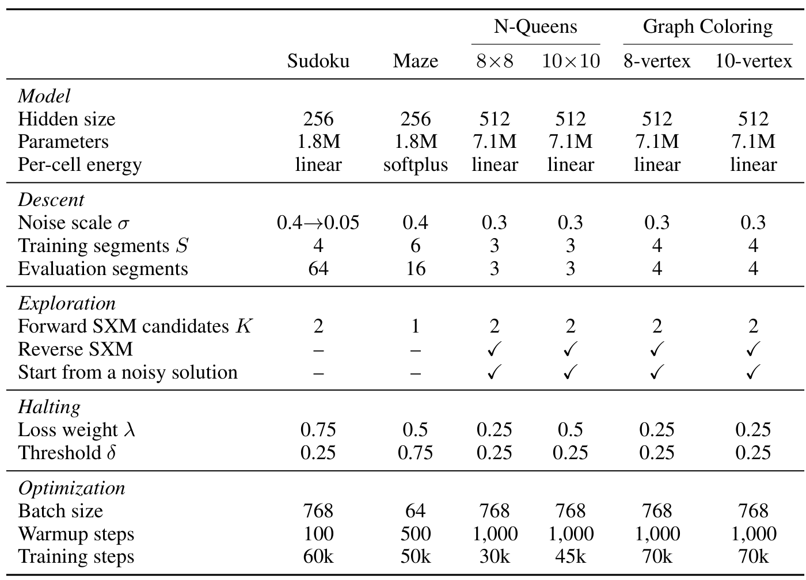
*圖：Table A.2（自 PDF 聚焦擷取）。六個任務的隱藏維度、$\phi$（linear／softplus）、噪聲尺度 $\sigma$、訓練段數 $S$、forward／reverse SXM 開關、$\lambda$、$\delta$、batch 與步數一表看盡。[1]*

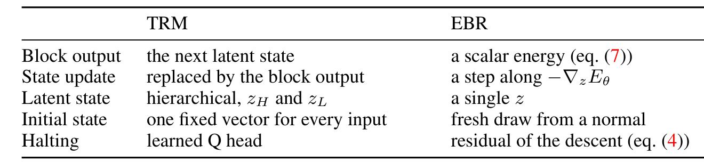
*圖：Table A.1（自 PDF 聚焦擷取）。五個維度上 TRM 與 EBR 的差異，最右欄是這篇的全部賣點：block 輸出從「下一個 latent」變成「一個標量能量」，state 更新從「直接替換」變成「沿 $-\nabla_z E_\theta$ 走一步」，停止條件從「學一個 Q head」變成「下降殘差」。*

#### 4｜SXM：讓同一題的多條軌跡去不同解

單軌跡訓練只監督能量沿著一條路徑，模型學到的是「條件均值」，多樣性無從談起。SXM 的作法是先對每個 batch 隨機生成大量（Maze 約 100×、數獨 1000×）合法解集合 $\mathcal Y(x)$，對同一題跑 $K$ 條獨立軌跡（各自獨立初始 $z_0$），然後：

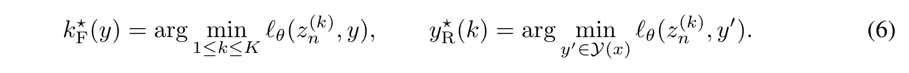

$$
k_F^\star(y)=\arg\min_{1\le k\le K}\ \ell_\theta\big(z_n^{(k)},y\big),
\qquad
y_R^\star(k)=\arg\min_{y'\in\mathcal Y(x)}\ \ell_\theta\big(z_n^{(k)},y'\big).
$$

第一式是 **forward SXM**（給定目標，挑最接近的軌跡回傳梯度，即 IMLE／winner-take-all 的軌跡版）；第二式是 **reverse SXM**（給定軌跡端點，挑離它最近的合法解當目標）。論文採「先 forward、再 reverse」串接，並加一個防坍縮規則：已指派過的解不重複用，直到該題 75% 的解都分配完才重置。

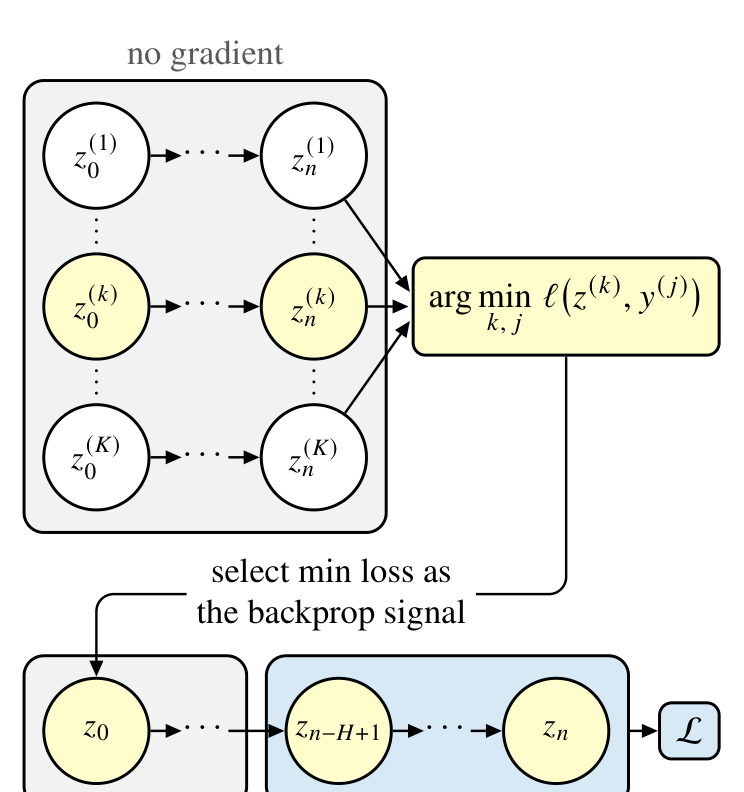
*圖：Figure 3（自 PDF 聚焦擷取）。$K$ 條候選軌跡以 no-gradient 方式 rollout，端點 $z_n^{(k)}$ 與候選目標 $y^{(j)}$ 交錯配對後取 $\arg\min_{k,j}\ell(z^{(k)},y^{(j)})$，把最小損失那條軌跡的最後 $H$ 步回傳梯度。*

多解評估另有一套定義（附錄 C，也是 EBR 與 GRAM 數字差異的來源）：

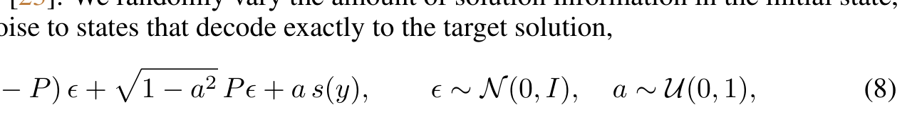
*圖：論文第 17 頁式（8）原文截取。訓練 N-Queens／Graph Coloring 時以 $a\sim\mathcal U(0,1)$ 在「純噪聲（等於推論初始）」與「直接可解出 $y$」之間插值，$P$ 是線性 decoder 的行空間投影；$a=0$ 恢復推論設定、$a=1$ 就是從真解出發。[1]*

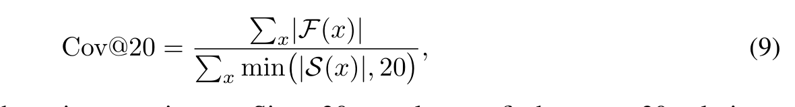

$$
\mathrm{Cov@20}=\frac{\sum_x\big|\mathcal F(x)\big|}{\sum_x \min\big(|\mathcal S(x)|,\,20\big)},
$$

分母把每題的真實解數封頂在 20（與 GRAM 原始碼一致），**不封頂**時 EBR 在 8-vertex Graph Coloring 只有 88.6%（GRAM 70.4%）、10-vertex 54.5%（47.0%）；封頂後才變成 89.0% 對 86.6%。引用 coverage 時一定要講清是哪個版本。

---

### 實驗結果

#### 1｜主表：1.8M 參數拿下 99.4%

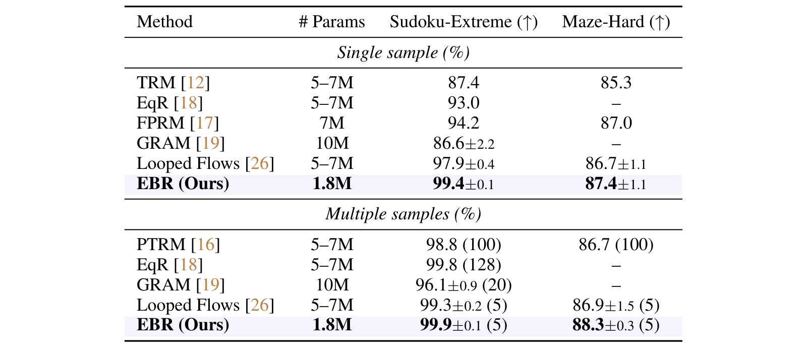
*圖：Table 1（自 PDF 聚焦擷取）。上段為單樣本（Pass@1），下段為多样本。*

| 方法 | 參數 | Sudoku-Extreme 單樣本 | 多解 | Maze-Hard 單樣本 | 多解 |
| --- | --- | --- | --- | --- | --- |
| TRM | 5–7M | 87.4 | 98.8 (N=100) | 85.3 | 86.7 (100) |
| EqR | 5–7M | 93.0 | 99.8 (128) | – | – |
| FPRM | 7M | 94.2 | – | 87.0 | – |
| GRAM | 10M | 86.6±2.2 | 96.1±0.9 (20) | – | – |
| Looped Flows | 5–7M | 97.9±0.4 | 99.3±0.2 (5) | 86.7±1.1 | 86.9±1.5 (5) |
| **EBR（本論文）** | **1.8M** | **99.4±0.1** | **99.9±0.1 (5)** | **87.4±1.1** | **88.3±0.3 (5)** |

值得留意的不是「99.4」這個數字，而是**它用 5 個樣本就到 99.9**，而 EqR 需要 128 個、PTRM 需要 100 個。這直接對應 Figure 4b 的「43× fewer samples」。

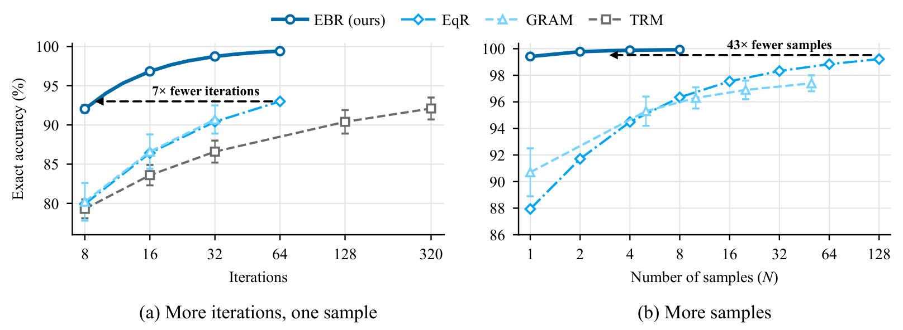
*圖：Figure 4（自 PDF 聚焦擷取）。EBR 用 7× 少的迭代、43× 少的樣本達到同等準確率；TRM 與 Looped Flows 在此以 Backprop 方式評估。*

#### 2｜自適應停止：把算力變成一個可讀的旋鈕

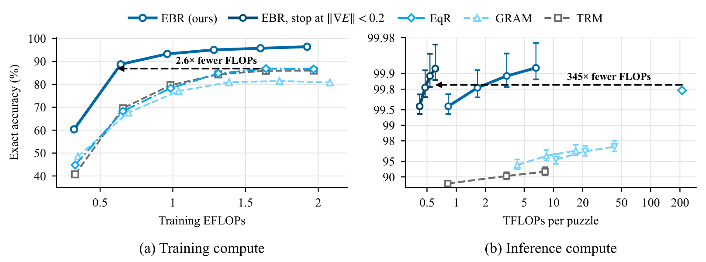
*圖：Figure 5（自 PDF 聚焦擷取）。(a) 訓練算力：EBR 曲線以 2.6× 更少 FLOPs 勝過 GRAM；(b) 推理算力：在同等準確率下對 EqR 省下 345×。*

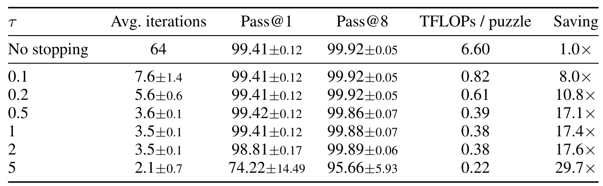
*圖：Table C.2（自 PDF 聚焦擷取）。以 64 段為上限，$\tau$ 從 0.1 放到 5 的效應對照。*

$\tau=0.2$ 時平均只剩 5.6 段迭代、TFLOPs 從 6.60 降到 0.61（**10.8× 節省**），Pass@1 完全不掉（99.41）；$\tau$ 放到 1 還有 3.5 段、0.38 TFLOPs（17.4×）且 Pass@1 維持 99.41。真正的斷崖在 $\tau=5$：迭代降到 2.1 段、省 29.7×，但 Pass@1 掉到 74.22±14.49。這組曲線是「$\|\nabla E\|$ 確實是可靠的解品質代理」最硬的證據——它必須能在砍掉 94% 算力的同時不動準確率。

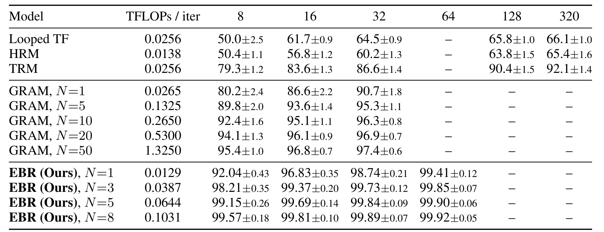
*圖：Table C.1（自 PDF 聚焦擷取）。EBR 每次迭代僅 0.0129 TFLOPs（$N=1$），比 GRAM（0.0265）、TRM（0.0256）、Looped TF（0.0256）都低；$N=1$ 在 64 迭代即 99.41，$N=8$ 於 64 迭代 99.92。[1]*

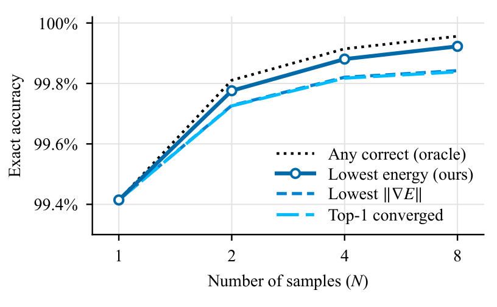
*圖：Figure 7（自 PDF 聚焦擷取）。$N$ 條軌跡裡取「能量最低」者，其準確率緊貼「只要有一條對就算對」的 oracle 上界，明顯優於「取 $\|\nabla E\|$ 最小者」與「Top-1 收斂者」。*

後者值得特別標注：用 $\|\nabla E\|$ 選樣**不如**用 $E$ 選樣。收斂強度與正解與否相關，但不是等價——這正是 $\mathcal L_{\mathrm{conv}}$ 存在的原因，也是 best-of-$N$ 選樣時該讀哪個訊號的實務指引。

#### 3｜多解多樣性

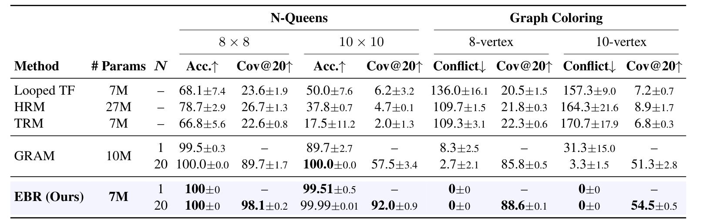
*圖：Table 2（自 PDF 聚焦擷取）。EBR 為 $K=8$ SXM 訓練，基線為 Loop TF、HRM、TRM、GRAM。*

N-Queens 10×10 的 Pass@1 從單樣本的 99.51±0.5 到 20 樣本 99.99±0.01，**coverage 92.0±0.9%**（GRAM 57.5±3.4）；8×8 則兩家都 100% 但 EBR coverage 98.1 vs GRAM 90.7。Graph Coloring 兩題 EBR 都是 0 衝突，8-vertex coverage 88.6%、10-vertex 54.5%（GRAM 70.4%、47.0%）。Reverse SXM 消融（Table E.1）顯示候選解集合大小 $k$ 決定一切：$k=2$ 只能拿到 72.18%，$k=16$ 就 99.52%，全量則 100%。

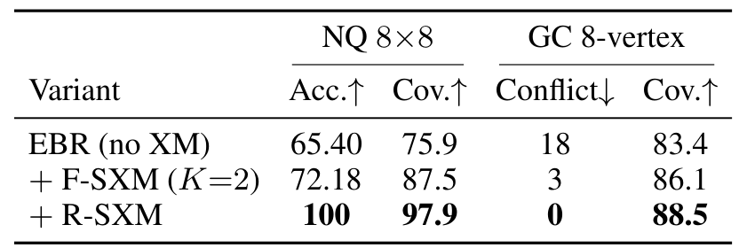
*圖：Table 4（自 PDF 聚焦擷取）。8×8 N-Queens 的 Acc／Cov 與 8-vertex Graph Coloring 的衝突數：forward SXM 已經把衝突從 18 壓到 3，reverse SXM 才真正把 coverage 推到 97.9 且衝突歸零。[1]*

#### 4｜消融：那個標量頭才是主角

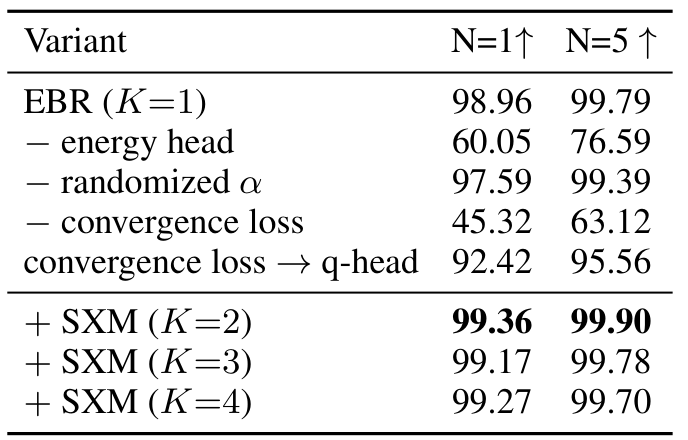
*圖：Table 3（自 PDF 聚焦擷取）。$K=1$ 設定下的逐項消融。*

| Variant | N=1 | N=5 |
| --- | --- | --- |
| EBR ($K=1$) | 98.96 | 99.79 |
| − energy head | 60.05 | 76.59 |
| − randomized $\alpha$ | 97.59 | 99.39 |
| − convergence loss | 45.32 | 63.12 |
| convergence loss → q-head | 92.42 | 95.56 |
| + SXM ($K=2$) | 99.36 | 99.90 |

「−energy head」就是退回 $z\gets f_\theta(z,x)$ 的普通 looped reasoner，掉近 39 個百分點——這是全文最強的因果證據：**不是深一點、不是訓久一點，而是「更新必須是梯度場」這件事本身**在撐起準確率、停止與選樣。

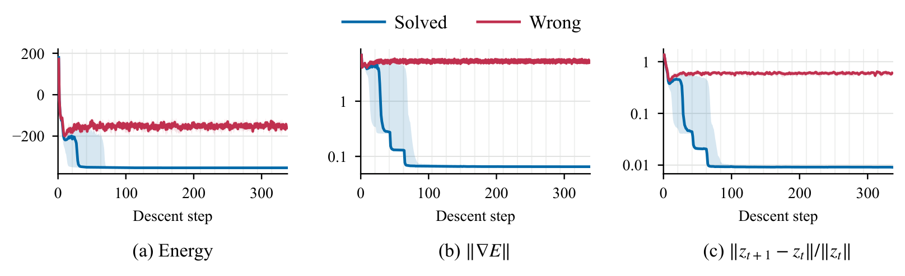
*圖：Figure 6（自 PDF 聚焦擷取）。(a) 能量、(b) $\|\nabla E\|$、(c) 相對下降量。藍色為最終解對的軌跡、紅色為錯的：正解軌跡收斂到明確的低能量駐點且梯度範數歸零，錯誤軌跡則停在能量較高、梯度也非零的位置。*

#### 5｜訓練成本

EBR 不是免費午餐。它需要自訂 GPU kernel 做二階導，SXM 另加 $K$ 倍 rollout。單張 H200 上 wall time 3–8 小時／seed。與 GRAM 比訓練 EFLOPs：Sudoku-Extreme 1.92 vs 2.26（省 15%），但 N-Queens 8×8 是 2.45 vs 1.08、10×10 是 5.82 vs 4.74，Graph Coloring 8-vertex 2.46 vs 0.67、10-vertex 3.98 vs 1.77——**在有結構約束的任務上 EBR 訓練其實貴 2–3.7×**，論文只在文字裡寫「training compute is comparable」，表格才是真相。

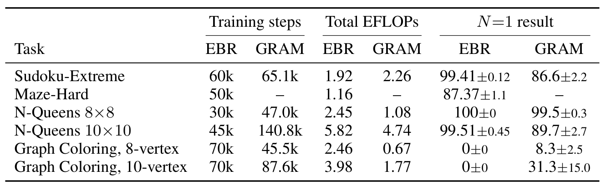
*圖：Table B.1（自 PDF 聚焦擷取）。只有 Sudoku-Extreme 上 EBR（1.92 EFLOPs）低於 GRAM（2.26）；四個 N-Queens／Graph Coloring 任務 EBR 反而較貴。[1]*

---

### 相關研究脈絡

**Energy-based reasoning 這條線是誰在推？** 主要是 EBT 的同一批人。EBT（Energy-Based Transformers are Scalable Learners and Thinkers，arXiv:2507.02092，**ICLR 2026 Oral**，Gladstone、Du、Ji 等）把能量定義在「輸入 × 候選預測」上，用迭代精煉預測拿到 35% 思考算力效率提升；TEM（Scaling Transformer Energy-based Models for High Quality Image Synthesis，arXiv:2610.31889）則把多層 energy 用在圖像生成取樣，本庫 2026-10-27 已寫過。EBR 可讀成 EBT 的另一面：EBT 的能量在**預測**上，EBR 的能量在**latent 狀態**上，因此它能同時管停止與選樣。另外 XM（Explorative Modeling，arXiv:2607.27372，Gladstone、Ji、Du）是 SXM 的直接源頭，而 SXM 的「reverse」一側則接回 Chojnacki 的 Multiple Choice Learning 與 Ren 的 IMLE 家族。更上游則是 Du & Mordatch（NeurIPS 2019，implicit generation through competitive learning）、IREM（ICML 2022）與 IRED（arXiv:2406.11179）。

**Looped reasoner 家族。** TRM（Less is More: Recursive Reasoning with Tiny Networks，arXiv:2510.04871）與 HRM（arXiv:2506.21734）是本論文的直接骨幹來源，兩者都以極小網絡解迷宮與數獨；EqR（Equilibrium Reasoners，Huang、Geng、Kolter，arXiv:2605.21488，**ICML 2026**，code 在 locuslab/EqR）用收縮映射顯式學習 attractor，是「靠动力学約束而非能量」的代表；FPRM（Fixed-Point Reasoners，arXiv:2606.18206）用 Jacobian 谱半徑約束穩定 fixed point；GRAM（Generative Recursive Reasoning，Baek、Ren、Bengio、Ahn，arXiv:2605.19376，**ICML 2026**）把遞歸改成多條随机轨迹的概率模型、是「多解」基线；PTRM 與 Looped Flows／Flow Reasoning Models（arXiv:2606.29150、2609.11801）則是流匹配版的 looped reasoner。EBR 把上述全部摆在同一張表裡，並用「能量」把它們的差異重述為一句話：**它們都在約束向量場，而 EBR 是取消向量場、只留標量場。**

**必須正視的反方。** 就在 2026-11-12，同為 Energy Transformer 作者的 Benjamin Hoover 等人掛了《Classical Energies Learn to Reason 1,000× Faster than Looped Models》（CRAM，arXiv:2611.17309）：用 Hopfield–Tank 的成對 MRF 自由能直接學 $W_{ij}$ 與 $B_i$，在單張 H200 上 **42 ms** 訓練到 Sudoku-Extreme 99.996%、132 ms 到 Maze-Unique 100%，推理算力比 looped models 少 282×，並直言「Sudoku/Maze 這類可平凡解的 benchmark 無法證明 looped reasoning 的可擴展性」。這篇的存在强調了 EBR 真正值得留下的部分不是那個 99.4%，而是「把能量當作可學習、可遷移的通用標量場」這個**機制**：CRAM 的成對權重硬綁在任務的 cell 結構上，無法搬到 latent 空間、也無法搬到沒有顯變數的任務；EBR 的能量頭是 task-agnostic 的 $d^2+2d$ 個參數。兩篇合读才完整。

---

### 評價與研究啟發

**我的判斷：機制是對的，benchmark 選小了，而真正該被抄走的不是那個準確率。** 「一個標量讀數同時驅動 refine／halt／select」這個設計在方法論上是乾淨的：它把三件通常被當成三個工程模組的事還原成同一個函數的三個性質，而且代價只有 3.7% 參數。反方證據（CRAM）也沒有殺掉這個論點，它殺掉的是「用數獨證明 reasoning」這層包裝。EBR 自己在 §5 也承認：能否扩展到語言模型推理與 world-model planning 是 open。

以下是我從它讀出來的、可以直接動手的方向，對到你點名的幾個軸。

**（1）energy-based transformer：把 EBR 的能量頭接到 DiT／VAR 的去噪軌跡上。** DiT 每一步 $\epsilon_\theta(x_t,t)$ 目前沒有任何內建「這一步走對了沒」的訊號，EBR 提供了一個可直接抄的最小配方：保留現成 backbone，只加 $d^2+2d$ 的 per-token 標量頭，把更新改成切向下降 $x_{t+1}=\Pi_{\mathcal M}(x_t-\alpha\nabla E)$。真正的實驗問題是**$\tau$ 曲線在圖像上能不能像 Table C.2 那樣平坦**：如果 $\tau$ 放寬到省 10× NFE 而 FID／sFID 不掉，那就是目前最缺的「免 verifier 自適應步數分配」；如果掉（我預期會，因為圖像的合法解不是離散可驗證的），就退而求其可實用的第二個讀數——拿 $E$ 做 best-of-$N$ 的 verifier，這在圖像生成上就是「免訓練、免外掛獎勵模型」的選樣器，而且 EBR 已經證明**用 $E$ 比用 $\|\nabla E\|$ 好**（Figure 7），這條可以直接指導 TEM／REINFORCE 式的 image best-of-N。

**（2）JEPA：$E_\theta$ 就是 JEPA 缺的那個「一致性標量」。** JEPA 的 predictor 只給向量值損失 $\|\hat z_y-z_y\|$，從不給「當前狀態離可預測性 manifold 多遠」的標量讀數，所以 latent 世界模型在 plan search 時只能靠 roll-out 成本排序。EBR 的 $\mathcal L_{\mathrm{conv}}$ 給了個可搬的東西：把「下降殘差 $r_n$ 經 sigmoid 後對『這個 latent 是否可用』做 BCE」當成 JEPA 的輔助任務，讓 predictor 自己報告可信度。這跟本庫讀過的 LEF-JEPA（2611.08989，去噪訓練的 latent energy field）其實是同一件事的兩面——LEF-JEPA 把能量放在預訓練塑形，EBR 把能量放在推論時控制，兩者可拼成「latent 能量 = 預測可信度 + 停止條件」。

**（3）VAR／next-scale：SXM 是「scale 間 winner-take-all」的現成模板。** VAR 的問題是每個 scale 只學條件均值，粗尺度一錯全鏈皆錯。把 forward SXM 逐 scale 化：對同一張圖 rollout $K$ 個粗尺度前綴，只讓「與最終真值最匹配」的那個前綴回傳梯度，等於把 EBR 的 $k_F^\star(y)$ 從「軌跡索引」換成「尺度路徑索引」；reverse 側則對應「先給粗尺度、挑最近的合法 fine-scale」。EBR 的 $k$ 消融（$k=2\to 72.18\%$、$k=16\to 99.52\%$）給了非常明確的預期：**候選集合大小本身就是效能旋鈕**，而它在 VAR 上的對應成本是 $K$ 倍前綴 rollout，這正好是 G-STAR 那類「深度壓縮 + 群組並行」可以搭車的地方。

**（4）training-free：EBR 的停止條件天然是免訓練的 test-time 機制。** 注意一個容易被誤讀的點：EBR 本身**不是** training-free（要二階導、要 SXM rollout），但它的推論控制是。把「$\|\nabla E\|<\tau$ 就停」搬到任何已有 diffusion／flow 模型上，只需要一個 freeze 的能量頭——這是本篇最容易被立刻重現的 contribution。另外一個 training-free 的副產品：$p_n=\sigma((\delta-r_n)/\kappa)$ 完全不含參數，它把「軌跡位移」這個可觀測量直接當可信度分數，可以原封不動搬去 diffusion 做無訓練的 hallucination／mode-collapse 偵測。

**（5）attention modulation：per-token 能量是可以拿來調 attention 的訊號。** $E=\sum_i\phi(e_i)$ 這個求和結構給了你每個 token 自己的 $e_i$，於是可以：把高能量（=目前「錯得最離譜」）token 的 attention 權重放大，讓更多算力流向它；或反過來，用 $e_i$ 做 attention 的加性偏置 $\alpha_{ij}\mathrel{+}=\beta\,\mathbb 1[i\in\text{high-}e]$。EBR 的 Maze softplus 發現其實已經在暗示這件事——**當 token 間能量不可加時，求和形式會誤導下降**。把這個假設打開，就是 attention modulation 的切口，也是最適合你做的「小代價、可反證」的實驗。

**（6）zero-shot：這裡要說句實話。** EBR 沒有做任何 zero-shot 聲稱。它四個任務都是從零訓練，Maze-Hard 甚至只有 1,000 題且無增廣（SXM 在那裡完全沒增益）。唯一沾到 zero-shot 邊的是「同一個 trained model 用不同 $\tau$／不同 $N$ 就能跨工作點」，這是 test-time 泛化而非任務泛化。把「收斂準則跨任務可遷移」包裝成 zero-shot 是過度推論——我把它列在這裡是為了避免後續報告抄錯。

**一句話總結：** 這篇的真正貢獻是把 looped reasoner 從「一個自由向量場 + 三個外掛頭」壓成「一個標量場 + 三個讀法」，而它選的 benchmark 讓這個貢獻看起來像是一個數獨紀錄，實際上是一個可以被立刻搬到 DiT／VAR／JEPA 的控制介面。

---

### 限制與判讀

1. **venue 未定**：純預印本，無 Comments、無 journal-ref，未被任何會議接收；引用時請以 preprint 對待。同作者群的 EBT 是 ICLR 2026 Oral，但這不等於 EBR 已過同儕審查。
2. **任務天花板低**：四個任務全是可驗證約束滿足問題，正解可枚舉（數獨的 $\mathcal Y(x)$ 靠 1,000 題 × 1,000 合法變換生成），SXM 的 reverse matching 必須依賴「可枚舉解集合」，這是它無法直接搬到開放生成任務的根本障礙。
3. **與 CRAM 的張力未被討論**：EBR（11-06）與 CRAM（11-12）幾乎同時、互相未引用。CRAM 用經典成對能量在 42 ms 內打到 99.996%，直接動搖「必須學一個通用能量」的動機；EBR 的反駁只能是「結構無關性 + 停止與選樣同址」，但這需要非 puzzle 任務來證明，目前沒有。
4. **訓練成本敘述偏樂觀**：正文寫「comparable training compute」，Table B.1 顯示 N-Queens／Graph Coloring 上 EBR 比 GRAM 貴 2–3.7× EFLOPs，只有數獨省 15%；另外二階導需要自訂 kernel，可重現門檻比參數量看起來高。
5. **coverage 口徑有兩套**：封頂／不封頂兩版差異很大（8-vertex GC：89.0 vs 88.6 差別小，但 GRAM 是 86.6 vs 70.4，差別巨大），引用 coverage 必須同時報出 $\min(|\mathcal S(x)|,20)$ 是否啟用。
6. **超參數不少**：$\alpha$、$\sigma$、$n$、$\delta$、$\lambda$、$\tau$、$K$、$H$、softplus 開關，論文主張跨任務大致可遷移，但消融只給單 seed 的數獨；主表是 3 seeds 平均，標注 ±std。
7. **Maze-Hard 的評語口徑有爭議**：原文以「精確匹配標籤路徑」計，作者指出標籤可被 $D\prec L\prec R\prec U$ 優先的 BFS 重現；改用「任一最短路徑」後 EBR 為 94.07±0.91（Pass@1），但基線數字未同步重算，因此表 1 裡的 87.4 與其它方法的 86.7 只能視為同口徑的相對比較。
8. **沒有圖像／語言的正面結果**：本報告第五節所有延伸都是我的推論，不是論文的證據；EBR 自己把 world-model planning 列為 open problem。

---

### References

1. Energy-Based Reasoners（arXiv:2611.08977） — https://arxiv.org/abs/2611.08977
2. EBR 官方專案頁 — https://energy-based-reasoners.github.io/
3. EBR 官方 code（MIT, 75 stars） — https://github.com/wwillchen/ebr
4. Energy-Based Transformers are Scalable Learners and Thinkers（ICLR 2026 Oral，arXiv:2507.02092） — https://arxiv.org/abs/2507.02092
5. EBT OpenReview 頁面 — https://openreview.net/forum?id=ZBj3Qp1bYg
6. Scaling Transformer Energy-based Models for High Quality Image Synthesis（TEM，arXiv:2610.31889） — https://arxiv.org/abs/2610.31889
7. Explorative Modeling（XM，arXiv:2607.27372） — https://arxiv.org/abs/2607.27372
8. Equilibrium Reasoners（ICML 2026，arXiv:2605.21488） — https://arxiv.org/abs/2605.21488
9. EqR code（locuslab/EqR） — https://github.com/locuslab/EqR
10. Generative Recursive Reasoning（GRAM，arXiv:2605.19376） — https://arxiv.org/abs/2605.19376
11. Fixed-Point Reasoners（FPRM，arXiv:2606.18206） — https://arxiv.org/abs/2606.18206
12. Less is More: Recursive Reasoning with Tiny Networks（TRM，arXiv:2510.04871） — https://arxiv.org/abs/2510.04871
13. Hierarchical Reasoning Model（HRM，arXiv:2506.21734） — https://arxiv.org/abs/2506.21734
14. Classical Energies Learn to Reason 1,000× Faster than Looped Models（CRAM，arXiv:2611.17309） — https://arxiv.org/abs/2611.17309
15. Learning Iterative Reasoning through Energy Minimization（IREM，ICML 2022） — https://arxiv.org/abs/2206.13224
16. IRED: Training Encoders that Reason with Energy（arXiv:2406.11179） — https://arxiv.org/abs/2406.11179
17. LEF-JEPA（arXiv:2611.08989，本庫 2026-11-11 已讀） — papers/2026/2026-11/LEF-JEPA/AI_Daily_LEF-JEPA.md
18. MS-pDiT（arXiv:2611.08802，本庫 2026-11-13 已讀） — papers/2026/2026-11/MS-pDiT/AI_Daily_MS-pDiT.md
