# AI Daily

## 2026-11-12｜Self-Supervised Collapse Prevention with Score-Based Entropy Maximization（EBReg）

### 論文資訊

**標題：** Self-Supervised Collapse Prevention with Score-Based Entropy Maximization

**作者與單位：** Adarsh Kappiyath¹、Silpa Vadakkeeveetil Sreelatha¹、Xiatian Zhu¹、Yann LeCun² ³、Lu Yin⁴ ¹、Amir Bar⁵ ³；¹University of Surrey、²New York University、³AMI Labs、⁴Shenzhen University of Advanced Technology、⁵Imperial College London。最後兩位標註為共同指導（∗）。[1]

**來源與狀態：** arXiv:2611.11379v1，`cs.LG`，2026-11-08 提交，18 頁（正文 9 頁、參考文獻、附錄 A–F），無 v2。每頁頁首只寫「Preprint. Under review.」，arXiv metadata 未列任何會議或期刊，因此目前是**預印本**，尚無同儕審查背書。[1] [2]

**連結：** [arXiv 摘要](https://arxiv.org/abs/2611.11379)｜[全文 HTML](https://arxiv.org/html/2611.11379v1)｜[PDF](https://arxiv.org/pdf/2611.11379v1)。截至 2026-11-12 **查無官方 code 或 project page**（arXiv 頁、HTML 全文、OpenReview 都找不到 repo 連結），可重現性只能依賴附錄 D 的超參敘述與附錄 C 的 pseudocode。[2] [3]

**為什麼挑這篇：** 它一舉命中你近期點名的數個軸——JEPA 系的崩潰問題、energy／score-based 觀點、以及「訓練好的東西反過來在推理時使用」的 training-free 味道。更關鍵的是它的技術核心只有一個**符號翻轉**：訓練時 encoder 被推著**逆著** score 走（往低密度、往高熵），測試時同一個 score 網路被用來把受損表徵**順著** score 拉回高密度流形。同一個場、同一個網路，只差一個負號，就同時承擔「反崩潰」與「免標籤自適應」兩件事。這與本庫已讀的 LEF-JEPA（2026-11-11，能量放在預訓練塑形、推理零開銷）、EBT（能量放在推理時迭代下降）與 TEM（純能量取樣生成）剛好湊成一個可對照的座標系。[4] [5] [6]

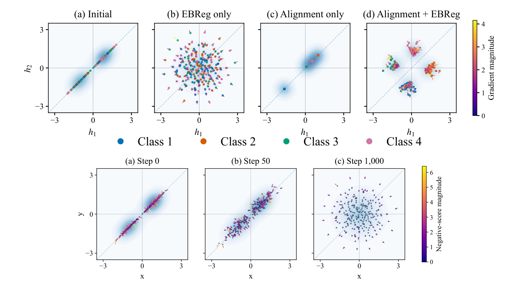

*圖：論文 Figure 1（自 PDF 聚焦擷取，非整頁截圖）。上排：初始表徵落在 $\mathbb{R}^2$ 的一條對角線附近；只有 EBReg 會把它們展開到兩個維度；只有 alignment 會把它們收縮成少數幾點（維度崩潰）；alignment + EBReg 得到緊湊且分離的四類，向量場顏色代表梯度大小。下排：EBReg 下 latent 分佈的演化，樣本被推離對角線、最終形成各向同性高斯，顏色代表負 score 大小。[1]*

### 核心貢獻

論文的問題意識很直接：**score matching 能不能自己就變成一個夠好的自監督目標**，而不只是生成模型的附屬零件。作者的答案是可以，但要換個用法——不拿 score 去生成樣本，而是拿它當**表徵分佈的 diversity 供給器**。三個貢獻如下。[1]

第一，**從變分互資訊下界推出一個 alignment–entropy 目標，並用可學習的 latent score 實作其中的熵項**。整條推導只用到兩個標準工具：資料處理不等式（把乾淨 view 的 MI 降溫成被噪聲擾動過的 view 的 MI），以及 Barber–Agakov 變分下界。好處是熵項**不需要顯式密度**，也不需要負樣本；代價是多了一個必須跟著 encoder 一起移動的分佈要擬合。

第二，**理論刻画**（詳見下方「崩潰動態」一節）：一個「乾淨 score 對崩潰方向是盲的」的定理（Theorem 1(a)），以及「低變異數方向會被變異數上升（variance ascent）放大、相對放大率由 $\gamma/\sigma^2$ 控制」（Theorem 1(b)）。再搭配一張**約束條件 → 最大熵目標 → 既有 SSL 方法**的對應表（Table 1），把 SIGReg／VICReg、contrastive、SwAV／MSN、Rectified LpJEPA 全解釋成「同一個熵目標、不同的 scale 約束」。

第三，**把同一個 score 拿去當免標籤的測試時訊號**。只更新 encoder 的 normalization 參數（TENT 那套慣例），score 網路與分類器凍結，就能把 corruption 造成的表徵漂移拉回源 latent 分佈的高密度區，在 ImageNet-C 上全面提升三種 backbone 的平均準確率。

### 技術方法

**先做 Gaussian 平滑，因為 latent 可能沒有密度。** 兩條獨立 augmentation $t,t'\sim\mathcal T$ 經共用 encoder $f_\theta$ 與 projector $g_\phi$ 得到 $h^{(1)},h^{(2)}\in\mathbb R^d$。表徵可能貼在一個低維支持集上，此時微分熵根本沒有定義，所以先加噪：

$$\tilde h^{(1)}=h^{(1)}+\sigma\epsilon,\qquad \epsilon\sim\mathcal N(0,I_d),\qquad H_\sigma(h)\equiv H(h+\sigma\epsilon),\qquad p_\sigma=p_{\theta,\phi}*\mathcal N(0,\sigma^{2}I_d)$$

**從 MI 到 alignment–entropy 下界。** 因為 $\tilde h^{(1)}$ 是 $h^{(1)}$ 加獨立噪聲，$h^{(2)}\to h^{(1)}\to\tilde h^{(1)}$ 形成 Markov chain，資料處理不等式給 $I(h^{(1)};h^{(2)})\ge I(\tilde h^{(1)};h^{(2)})$；再套 Barber–Agakov 變分下界：

$$I\bigl(h^{(1)};h^{(2)}\bigr)\;\ge\;H_\sigma\bigl(h^{(1)}\bigr)+\mathbb E\log q\bigl(\tilde h^{(1)}\mid h^{(2)}\bigr)$$

取 $q_\tau(\cdot\mid h^{(2)})=\mathcal N(h^{(2)},\tau^{2}I_d)$，展開交叉熵後會出現**歸一化 alignment loss** $\mathcal L_{\mathrm{align}}=d^{-1}\,\mathbb E\lVert h^{(1)}-h^{(2)}\rVert_2^{2}$（即 Wang & Isola 的那個 alignment），以及一個與 $(\theta,\phi)$ 無關的常數 $C_{\sigma,\tau}=\tfrac d2\log(2\pi\tau^{2})+\tfrac{d\sigma^{2}}{2\tau^{2}}$：

$$I\bigl(h^{(1)};h^{(2)}\bigr)\;\ge\;H_\sigma(h)-\frac{d}{2\tau^{2}}\,\mathcal L_{\mathrm{align}}-C_{\sigma,\tau}$$

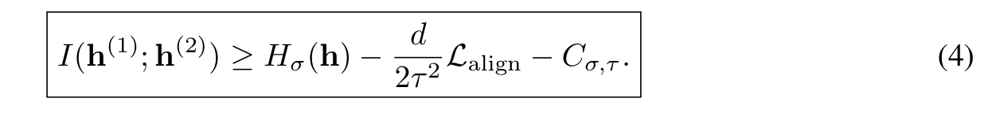

*圖：論文式 (4)。固定 $\sigma,\tau$ 時，最大化這個下界等價於最小化 $\mathcal L_{\mathrm{align}}-\gamma H_\sigma(h)$，其中 $\gamma=2\tau^{2}/d$。[1]*

**為什麼要加 scale constraint：** 單純把 latent 整體放大也能提高熵，但不增加任何資訊。所以 EBReg 把 latent 的「尺度」釘住，讓熵只能靠**結構**而不是靠**放縮**來提升。這個選擇之後變成 Table 1 的核心論點。

**EBReg surrogate（全文最重要的式子）。** $p_\sigma$ 不可算，但它的 **score 可以學**。於是把負熵項換成一個只依賴 score 的梯度代理：

$$\mathcal L_{\mathrm{total}}=\mathcal L_{\mathrm{align}}+\gamma\,\mathbb E\Bigl[\operatorname{stopgrad}\bigl(s_{\psi,\sigma}(\tilde h)\bigr)^{\top}\tilde h\Bigr]\equiv\mathcal L_{\mathrm{align}}+\gamma\,\mathcal L_{\mathrm{EBReg}}$$

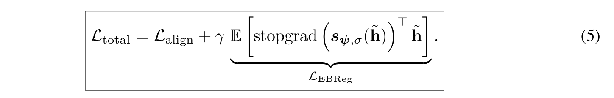

*圖：論文式 (5)。整個 score 向量被 detach，梯度只透過 $\tilde h$ 流回 encoder 與 projector。[1]*

為什麼這個線性式就是熵最大化？靠的是 implicit distribution 的熵梯度恆等式（Li & Turner 2018；Shi et al. 2018）：

$$\nabla_{\theta,\phi}H_\sigma(h)=-\,\mathbb E\bigl[J_{\theta,\phi}(h)^{\top}s_\sigma(\tilde h)\bigr],\qquad J_{\theta,\phi}(h)=\frac{\partial h}{\partial(\theta,\phi)}$$

把 score detach 之後 $\nabla\mathcal L_{\mathrm{EBReg}}=\mathbb E[J^{\top}s_{\psi,\sigma}(\tilde h)]$，所以在**精確 score** 的假設下，最小化式 (5) 的第二項就是在對 $-H_\sigma$ 做梯度下降，而且完全不碰密度。論文很誠實地標了兩點：score 是學出來的，所以這個等價只是近似；$\mathcal L_{\mathrm{EBReg}}$ 的**數值本身不是熵的估計、也不是 MI 下界**，只有梯度有意義。

**直觀方向。** $s_{\psi,\sigma}(\tilde h)$ 指向局部密度**上升**的方向；最小化 $\langle s,\tilde h\rangle$ 就是讓表徵往密度**下降**的方向跑，於是分佈被撐開。這正是 Figure 1 下排看到的：箭頭朝外、從對角線被推散。

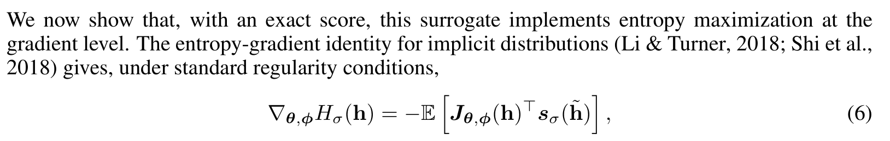

*圖：論文式 (6) 與其鋪陳句，原文在此直接標明出處為 Li & Turner（2018）與 Shi et al.（2018），也就是「不做密度估計、只用 score 取熵梯度」這條正當性來源。[1]*

**Score 怎麼學：標準 DSM 加 Tweedie。** 每個 minibatch 先把兩條 view 的表徵 pooling 起來並**截斷梯度**，$\bar h=\operatorname{stopgrad}(h)$，然後在 encoder 凍結的情況下對去噪網路 $\hat\epsilon_\psi$ 做 $K_{\mathrm{score}}$ 步更新：

$$\mathcal L_{\mathrm{DSM}}(\psi)=\mathbb E_{\bar h,\epsilon}\bigl\lVert\hat\epsilon_\psi(\bar h+\sigma\epsilon)-\epsilon\bigr\rVert_2^{2},\qquad s_{\psi,\sigma}(z)=-\frac{\hat\epsilon_\psi(z)}{\sigma}$$

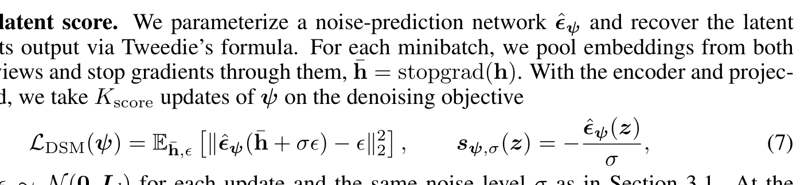

在無容量與有限樣本限制下，最佳預測器是 $\mathbb E[\epsilon\mid h+\sigma\epsilon=z]$，取負、除以 $\sigma$ 就是 $p_\sigma$ 的 score（Vincent 2011）。整體是**交替優化**：分數網路只更新 $\psi$，encoder 步驟只更新 $(\theta,\phi)$；alignment 作用在乾淨的成對表徵上，熵正則作用在它們的帶噪版本上。

**為什麼 score 一定要在 $\tilde h$ 評估而不是 $h$（Theorem 1）。** 若表徵真的崩到方向 $q$ 上（$\operatorname{Var}(q^{\top}h)=0$），則

$$q^{\top}s_\sigma(\tilde h)=-\frac{q^{\top}\epsilon}{\sigma},\qquad q^{\top}s_\sigma(h)=0$$

也就是**乾淨表徵上的 score 在崩潰方向完全沒有分量**——如果在那裡評估，正則項對那個方向永遠是零梯度，救不回來。反之在帶噪點上評估，每樣本梯度 $g_q=-(\gamma/\sigma)(q^{\top}\epsilon)\,a_q$ 非零但期望為零：完全崩潰是**駐點但不是吸引子**。再往前，提件 (b) 假設 $q^{\top}h=c+\delta u$（$\delta>0$、$u\sim\mathcal N(0,1)$ 且與其餘分量獨立），則

$$\gamma\,\mathbb E\bigl[a_q\,q^{\top}s_\sigma(\tilde h)\bigr]=-\frac{\gamma}{2(\delta^{2}+\sigma^{2})}\,\nabla_{\theta,\phi}\operatorname{Var}(q^{\top}h)$$

右邊就是一個**變異數上升**方向：更新量與該方向「已有的變異數」成正比，而不是給一個固定增量，所以低變異數區的**相對**放大率由 $\gamma/\sigma^{2}$ 決定（附錄 B 補充這個 drift 為一階、與 batch size 無關）。而且 alignment 項不會反對它——alignment 懲罰的是兩條 view **不一致**，對成對 view 共同共享的變異數本身是不變的。這解釋了為什麼兩者能互補而不互相抵消。

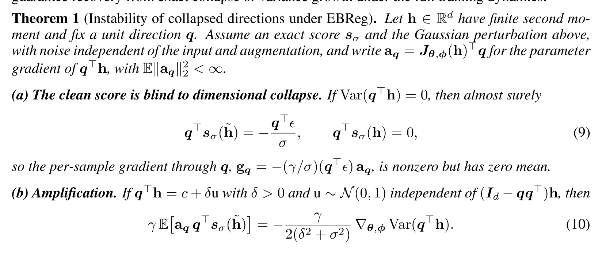

*圖：論文 Theorem 1 與其直觀說明（自 PDF 擷取 p.7）。注意定理只刻画「精確 score 下的方向性梯度貢獻」與高斯坐標獨立假設，**不**保證能從完全崩潰中恢復、也不保證完整訓練動態下的變異數會成長。[1]*

**最大熵視角：約束決定目標（Table 1）。** 附錄 E 用標準 exponential-family 論證：在支持集 $S$ 上若 $p^{\star}(h)\propto\exp\bigl(-\sum_k\lambda_k f_k(h)\bigr)$ 滿足約束 $\mathbb E[f_k(h)]=c_k$，它就是唯一最大熵解；而二次約束下可算出 $H(h)\le\frac d2\log\bigl(2\pi e(1+\sigma^{2})\bigr)$，等號成立當且僅當 $h\sim\mathcal N(0,I_d)$——所以在這個約束下，**秩不足的表徵永遠不是熵最大解**。

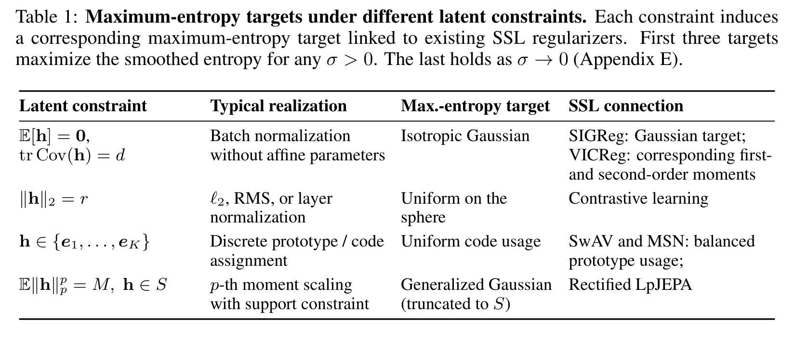

*圖：論文 Table 1（自 PDF 聚焦擷取）。第一到第三行對任意 $\sigma>0$ 都是平滑熵的最大化解，第四行是 $\sigma\to0$ 的極限。[1]*

| Latent 約束 | 常見實作 | 最大熵目標 | 對應的 SSL 正則化器 |
|---|---|---|---|
| $\mathbb E[h]=0,\ \operatorname{tr}\operatorname{Cov}(h)=d$ | 去仿射的 BatchNorm | Isotropic Gaussian | SIGReg 的高斯目標；VICReg 的一階／二階矩條件 |
| $\lVert h\rVert_2=r$ | $\ell_2$／RMS／LayerNorm | 球面均勻分佈 | Contrastive learning |
| $h\in\{e_1,\dots,e_K\}$ | 離散 prototype／code 指派 | 均勻 code usage | SwAV、MSN 的平衡指派 |
| $\mathbb E\lVert h\rVert_p^{p}=M,\ h\in S$ | 支持集上的 $p$ 階矩縮放 | 廣義高斯（截斷） | Rectified LpJEPA |

最要緊的一句是論文自己寫的：**「共享同一個目標，不代表兩個目標函數等價」**。SIGReg 是把分佈匹配拆成隨機方向的一維 goodness-of-fit 檢定（靠 Cramér–Wold 型論證維持一致性），EBReg 是「熵加 score 場」；兩者極值相同、梯度路徑完全不同。[1] [7]

**測試時：同一個 score、符號翻正（式 8）。** 令 $\alpha\subset\theta$ 為 encoder 的 normalization 參數，其餘（含 score 網路、分類器）全凍結：

$$\mathcal L_{\mathrm{TTA}}(\alpha)=-\,\mathbb E\Bigl[\operatorname{stopgrad}\bigl(s_{\psi,\sigma}(h_\alpha)\bigr)^{\top}h_\alpha\Bigr]$$

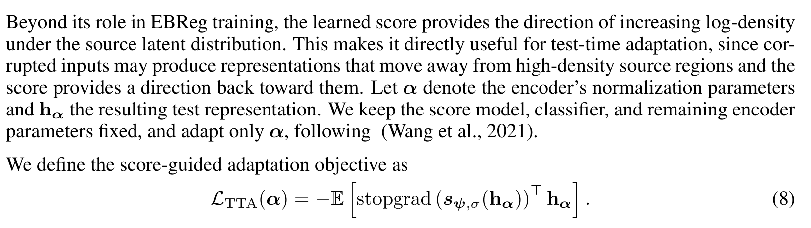

*圖：論文 §3.3 與其式 (8)。段落末句明確寫著「We keep the score model, classifier, and remaining encoder parameters fixed, and adapt only $lpha$, following (Wang et al., 2021)」，正是 TENT 那一系「只動 normalization 參數」慣例的來源。[1] [8]*

對比式 (5) 就能看出那個對偶性：預訓練是 $+\gamma\,\mathbb E[\operatorname{sg}(s)^{\top}\tilde h]$（**逆 score**、散開、增熵），測試時是 $-\,\mathbb E[\operatorname{sg}(s)^{\top}h_\alpha]$（**順 score**、靠攏高密度區、投影回 learned latent manifold）。附錄 Algorithm 2 也寫了每個 test minibatch 都要先把 $\alpha$ 重設回預訓練值、再跑 $K_{\mathrm{tta}}$ 步，以避免跨 batch 累積狀態。

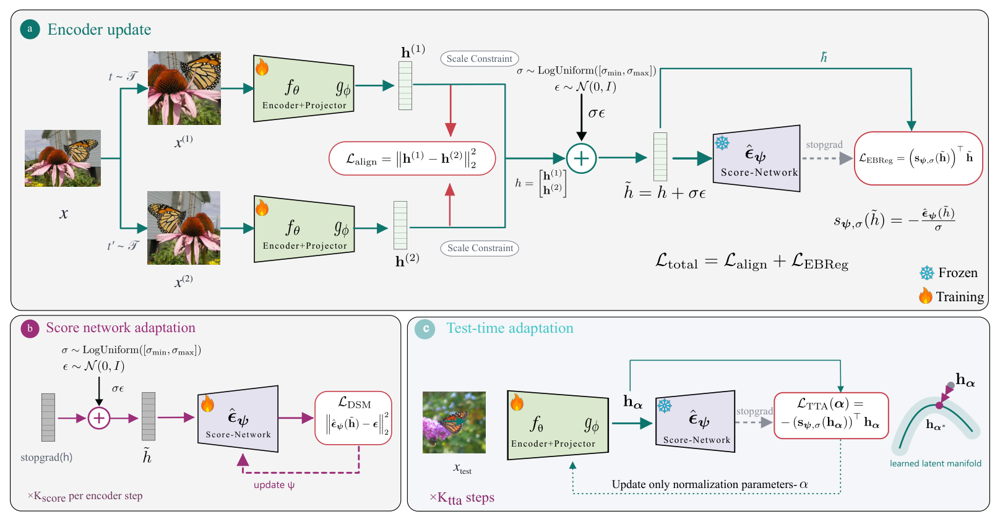

*圖：論文 Figure 2（自 PDF 聚焦擷取）。(a) encoder 更新：兩條 view 先過 scale constraint，算 $\mathcal L_{\mathrm{align}}=\lVert h^{(1)}-h^{(2)}\rVert_2^{2}$，拼成 $h$ 後加噪 $\tilde h=h+\sigma\epsilon$，送入**凍結**的 score 網路 $\hat\epsilon_\psi$，經 $s_{\psi,\sigma}(\tilde h)=-\hat\epsilon_\psi(\tilde h)/\sigma$ 得到 $\mathcal L_{\mathrm{EBReg}}$。(b) score 網路擬合：對 stopgrad 的表徵做 DSM，每個 encoder 步更新 $K_{\mathrm{score}}$ 次。(c) 測試時：只更新 normalization 參數 $\alpha$，把 $h_\alpha$ 推向流形上的 $h_{\alpha^{\star}}$。[1]*

**這裡有一個值得注意的不一致。** Figure 2 (a)(b) 把噪聲尺度畫成 $\sigma\sim\mathrm{LogUniform}([\sigma_{\min},\sigma_{\max}])$，但正文 §3.1 寫的是「for a fixed noise scale $\sigma>0$」、§3.2 也要求 DSM 用「the same noise level $\sigma$」；附錄 D 同樣沒有交代 $\sigma_{\min},\sigma_{\max}$ 的值。重現時這是一個必須自己決定的自由度。

### 實驗結果

**主表是「同協議換正則項」，不是刷榜。** 三個設定各自沿用一篇文獻的完整協議，只替換或疊加正則項，並在 accuracy 之外報告 effective rank（RankMe 型指標，越高代表維度崩潰越輕）。[1] [17]

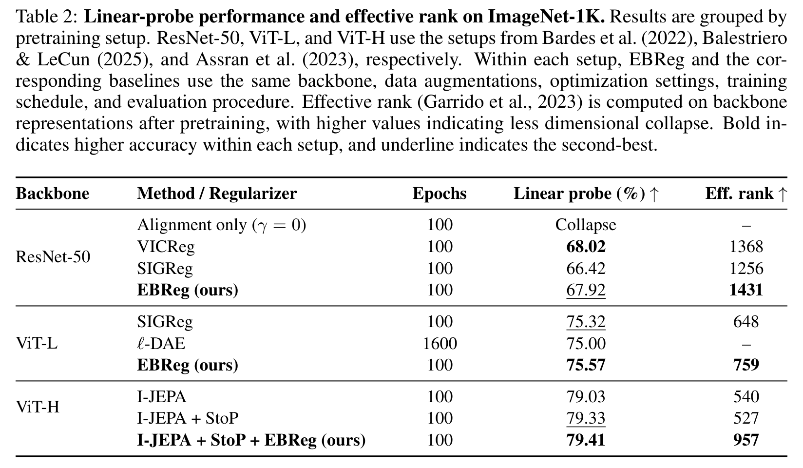

| Backbone（協議來源） | 方法 | Epochs | Linear probe (%) | Eff. rank |
|---|---|---|---|---|
| ResNet-50（Bardes et al. 2022） | Alignment only（$\gamma=0$） | 100 | **Collapse** | – |
|  | VICReg | 100 | **68.02** | 1368 |
|  | SIGReg | 100 | 66.42 | 1256 |
|  | **EBReg** | 100 | 67.92（次佳） | **1431** |
| ViT-L（Balestriero & LeCun 2025） | SIGReg | 100 | 75.32 | 648 |
|  | $\ell$-DAE | 1600 | 75.00 | – |
|  | **EBReg** | 100 | **75.57** | **759** |
| ViT-H（Assran et al. 2023） | I-JEPA | 100 | 79.03 | 540 |
|  | I-JEPA + StoP | 100 | 79.33 | 527 |
|  | I-JEPA + StoP + **EBReg** | 100 | **79.41** | **957** |

讀數時有四個重點。第一，$\gamma=0$（只有 alignment）直接 **Collapse**，這是整篇最乾淨的一組對照——正則項不是錦上添花，而是必要條件。第二，ViT-L 上 EBReg 用 **100 epoch 打過 $\ell$-DAE 的 1600 epoch**（75.57 對 75.00），訓練成本差異遠大於那 0.57 個點，才是它真正的賣點。第三，ViT-H 那一行是**疊加**而非取代（以 I-JEPA + StoP 為主目標），accuracy 只 +0.08 pt，但 effective rank 從 527 跳到 957（約 +82%）；論文的說法是「提供互補訊號而不破壞原有目標」，所以這是 rank 的勝利，不是 accuracy 的勝利。第四，ResNet-50 上 EBReg 的 accuracy（67.92）**低於** VICReg（68.02），只有 rank 較佳，因此「一致地更高 rank」不等於「一致地更高 accuracy」。[1]

**超參敏感度很陡，而且非單調。** 預設 $\gamma=0.34$、$\sigma=4.5$、$K_{\mathrm{score}}=16$，其餘一次只動一個。

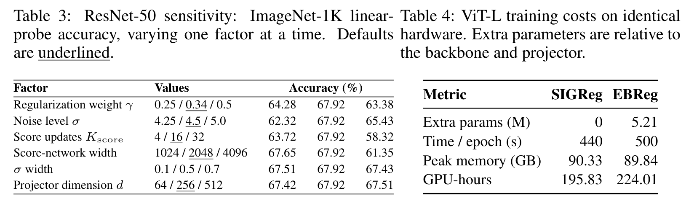

*圖：論文 Table 3（ResNet-50 敏感度，ImageNet-1K linear probe）與 Table 4（ViT-L 同硬體成本）。預設值加底線。[1]*

其中值得記住的三個數：$K_{\mathrm{score}}$ 從 16 加到 32 反而從 67.92 **掉到 58.32**；score 網路寬度從 2048 加到 4096 從 67.92 **掉到 61.35**；$\sigma$ 從 4.5 降到 4.25 掉到 62.32。換言之「分數網路擬合得更勤、更大、更準」在這裡不是較好，而是較差。作者的解釋是：score 只需在**投影後的低維 latent 空間**裡近似一個結構足夠好的場，容量過大或更新過頻會讓它追著正在移動的分佈跑，反而破壞正則訊號的穩定性（並保留一句「we do not directly characterize its intrinsic dimensionality」）。對照本庫讀過的 LEF-JEPA 那個 $K$ 步能量復原（迭代步數越少越好、$K=1$ 最佳），會看到同一種「迭代更多不一定更好」出現在兩個完全不同的機制裡，這條線索值得記。[1] [4]

**成本幾乎可以忽略。** ViT-L、同硬體對照 SIGReg：額外參數只有 5.21M（約 300M backbone 的 1.7%），每 epoch 440→500 秒（+13.6%），peak memory 90.33→**89.84 GB 反而略降**，GPU-hours 195.83→224.01。[1]

**測試時適應：提升明顯，但展示子集有偏。** $K_{\mathrm{tta}}=5$ 步、只動 normalization，15 種 corruption 平均如下。

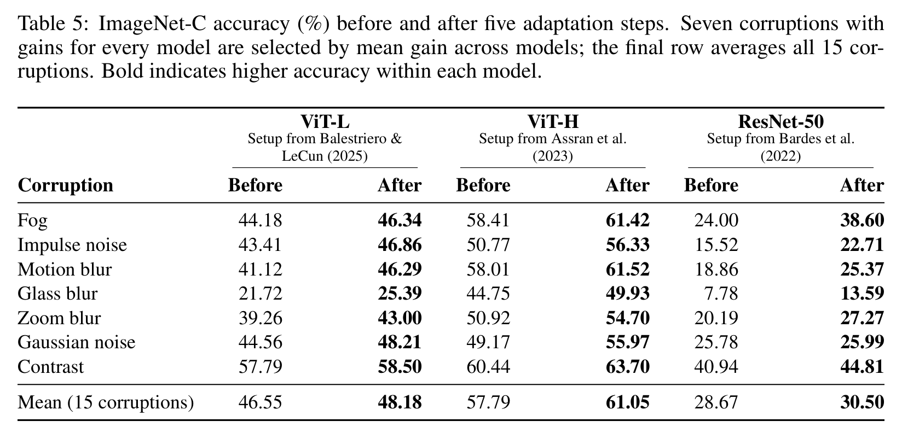

*圖：論文 Table 5（自 PDF 聚焦擷取）。表體只列 7 種 corruption，且是**按跨模型平均增益挑出的展示子集**；最後一行才是全部 15 種的平均。[1]*

| 模型 | 15 種 corruption 平均（Before → After） |
|---|---|
| ViT-L | 46.55 → 48.18（+1.63 pt） |
| ViT-H | 57.79 → 61.05（+3.26 pt） |
| ResNet-50 | 28.67 → 30.50（+1.83 pt） |

單項裡最誇張的是 ResNet-50 的 fog：24.00 → 38.60（+14.6 pt）；glass blur 7.78 → 13.59；impulse noise 15.52 → 22.71。摘要所稱「平均相對增益約 5%」與 15 種平均的口徑相容（相對而非絕對增益）。但有兩點要留意：ImageNet-C 是 15 種 corruption 各 5 種強度，這裡只報 5 步後的**單一點位**、沒有各強度曲線、也沒有 std；而且表體那 7 種是按增益挑的，所以「這 7 種都漲」這個事實本身是被選擇出來的。另外必須拆清楚的區分：這是 **label-free test-time adaptation（會更新 encoder 的 norm 參數）**，不是 training-free、更不是 zero-shot——score 網路是在預訓練裡一起練出來的。[1] [8]

### 相關研究脈絡

**它站在 LeJEPA／SIGReg 旁邊，共用同一個「目標分佈」但機制不同。** LeJEPA（Balestriero & LeCun, arXiv:2511.08544）的論證是：isotropic Gaussian 最小化下游預測風險，並用 SIGReg 把 $d$ 維分佈匹配拆成許多隨機方向的一維 goodness-of-fit 檢定，線性複雜度、不需要 stop-grad 或 teacher–student。EBReg 接受同樣的高斯目標（Table 1 第一行），但把「比對分佈」換成「用 score 做熵梯度」。同一組還有 VISReg（arXiv:2606.02572，用 Sliced-Wasserstein sketching 管 shape、variance 管 scale）與 Rectified LpJEPA（arXiv:2602.01456，把表徵匹配到 rectified generalized Gaussian、可顯式控制稀疏度）。[7] [9] [10]

**為什麼必須和 ℓ-DAE 比較。** Chen et al.（ICLR 2025「Deconstructing Denoising Diffusion Models for Self-Supervised Learning」）把去噪擴散還原成經典 DAE：在**低維 latent**（PCA）加噪、再用 ViT decoder 重建**像素**。$\ell$-DAE 證明「去噪目標能學出好表徵」，但它仍綁在像素重建上；EBReg 的賣點是**全程在表徵空間**，把崩潰預防與 input-space fidelity 解耦。[1] [11]

**零件的血緣。** Vincent（2011）提供 DSM 等價於 score matching（因此 $\epsilon$ 預測器就是 score 估計器）；Tweedie 給 $s=-\mathbb E[\epsilon\mid z]/\sigma$；Li & Turner（ICLR 2018）與 Shi et al.（ICML 2018）提供 implicit 分佈的熵梯度正當性；Barber & Agakov（NeurIPS 2003）給變分下界；Wang & Isola（ICML 2020）把 SSL 拆成 alignment 加 uniformity（EBReg 等於留 alignment、把 uniformity 換成熵）；Garrido et al.（ICML 2023）的 RankMe 提供 effective rank 這把尺。[1]

**測試時那一半接在 TENT 上。** Wang et al.（ICLR 2021）正是「只估計 normalization 統計量、最佳化 channel-wise affine 參數」這個慣例的確立者；EBReg 把它的 entropy 目標換成一個學好的 score 場。[8]

**同週有一篇直接挑戰它前提的工作。** arXiv:2611.12137「Good Views Are Not Enough」（2026-11-09，比 EBReg 晚一天）給出**全域可證明的反例**：在 Gaussian-regularized JEPA 裡，好的 view 不足以保證場景不變性或「至旋轉唯一」；高斯邊際匹配可能**獎勵保留獨立重採樣的 nuisance 變化**，且這個好處可能超過它的預測代價——在 512 維、完整場景基、光譜間隙與精確 whitening 的設定下，pooled Epps–Pulley 正則仍迫使每個全域極小點保留 nuisance。這篇沒有點名 EBReg，但它攻擊的是「把邊際分佈推向高斯、或最大化熵就足夠」這個命題本身，與 EBReg 屬於同一個論爭場。[12]

**回到本庫。** 與 LEF-JEPA（latent 能量場加單邊約束、推理零開銷）對比：兩邊都把「能量／score 拓撲」放在預訓練去塑形表徵，但 LEF-JEPA 靠 $K$ 步局部復原提供**局部、拓撲性**的結構訊號，EBReg 靠一個線性的 $\langle s,\tilde h\rangle$ 提供**全域、統計性**的分佈訊號。與 RAE、REPI、NEPA-DiT 這批「把表徵拿去餵生成模型」的工作對比：EBReg 是反方向——把生成模型的核心元件（score）拿來當**表徵正則化器**。這兩組湊在一起，指向一個尚未被驗證的問題：**生成用的 score 與辨識用的 score，是不是同一個東西？**[4] [13] [14] [15]

### 評價與研究啟發

**我的評價。** 這篇的價值不在 75.57 那個數字（+0.25 pt、沒有 seed 或 std，統計上無法判定），而在於它把一個**極簡的線性泛函** $\langle\operatorname{sg}(s_{\psi,\sigma}(\tilde h)),\tilde h\rangle$ 變成可微、可實作、可解釋的反崩潰訊號，並附了一個講清楚「為什麼必須在帶噪點評估」的定理。Table 1 那種「約束選擇等於方法族譜」的整理，是真正能被搬運的東西。缺點是實驗面只做到「換正則項的對照」，既沒有大規模 scaling（DINOv2、I-JEPA 那種 500–800 epoch 級），也完全沒有生成端的驗證；再加上查無 code 與公開討論，目前它更像一個好的**命題**，而不是一個已被驗證的**結論**。[1] [3]

以下是純粹由我延伸、**不是論文主張**的研究方向，都刻意朝你點名的幾個軸靠。

**一、把 score 熵正則搬到生成模型的條件路徑上。** EBReg 只正則化了「辨識用 encoder 的邊際分佈」，但一個 DiT／MMDiT 的 text-condition embedding、或一個 VAR 的 per-scale latent，都有同樣的邊際退化問題（本庫已讀的 Semantic Bottleneck 與 Rethinking Global Text Conditioning 都指出過条件嵌入的維度退化）。可以直接試：訓練時在條件路徑旁掛一個 5M 級 MLP 去噪頭，用式 (5) 對條件 token 的邊際做熵正則，推理時完全移除（跟 LEF-JEPA 一樣零開銷）。判斷標準不是 FID，而是「條件 token 的 effective rank」與 prompt-following 的**聯合**變動。這是我認為最有機會的一槍。

**二、把符號翻轉當成可插拔的推理時算子。** 同一個 $s_{\psi,\sigma}$，負號是「散開（增熵、去確認偏誤）」，正號是「靠攏（向流形投影、去雜訊）」。這給出一種非對稱 CFG 的替代表達：$\tilde\epsilon=\hat\epsilon_\psi(z)+\lambda\,\sigma\,s$ 的兩側可以分別對應「向訓練分佈」與「向訓練分佈的反方向」，而不是向 uncond 分支。在 VAR 上，可以把它做成 per-scale 的 logit 或 temperature 調製：粗尺度用正號（先錨定語義流形），細尺度用負號（阻止高頻碼本出現 rank 塌縮）。這條路是 training-free 的，而且能直接用 RankMe 在推理時量化。

**三、把「約束選擇」當成唯一的控制旋鈕。** Table 1 的邏輯是「換約束等於換最大熵目標、等於換方法族」。若成立，那麼在一個訓練好的模型上，**推理時把 normalization 換成對應的幾何**（去仿射 BN、球面 $\ell_2$、截斷廣義高斯三者互換），理論上就是在模型已學到的 score 場裡換目標分佈。這幾乎是零成本實驗，而且能直接反問 EBReg 的弱點：如果 accuracy 主要由 target distribution 決定，三種約束應該給出可預測的 rank／accuracy 交換比；如果不成立，Table 1 就只是極值層面的類比、而非機制層面的等價——這正是論文自己提醒的「same target $\neq$ equivalent objective」。

**四、把同週那篇的反例當測試台。**「Good Views Are Not Enough」證明高斯邊際匹配可以獎勵保留 nuisance。EBReg 的熵正則同屬「邊際匹配」家族，因此**應該**在 nuisance 可枚舉的資料上失效。具體做法：在 content／style 可分離的合成集上訓練 EBReg 與 LeJEPA 基線，量「style nuisance 在 latent 裡的變異數占比」。如果 EBReg 真的因為增熵而把 nuisance 一併納入，那麼「高 effective rank」只是一個**必要而非充分**的反崩潰指標，RankMe 就必須配上 nuisance 分解才能用。這個實驗能把兩篇論文的爭點一次講清楚。

**五、與 energy-based transformer 接起來。** 用 Du 與 Dai（arXiv:2611.14383）的三元分解（energy、inference、learning）來讀 EBReg 會特別清楚：它的 energy 是 $-H_\sigma$ 的局部線性化，inference 是「Tweedie 一步」而不是 MCMC，learning 屬於 NCE／DSM 家族。這個讀法立刻提出一個問題：如果把 inference 那一格從「一步 Tweedie」換成 EBT／TEM 那樣的迭代下降（$K$ 步 Langevin），而 encoder 仍用單邊約束接收監督（LEF-JEPA 那招），會不會把「$K_{\mathrm{score}}=32$ 就崩」的脆弱區，換成「$K$ 步降能、但只在訓練時使用」的穩定區？我認為這是 EBReg 與 LEF-JEPA 兩篇之間最自然的拼接點。[5] [6]

### 限制與判讀

重現或引用這篇時，需要把它誠實地圈在範圍裡。[1]

- **狀態與可重現性。** 預印本、未列 venue、查無 code 與 project page、查無公開討論（Semantic Scholar 引用數為 0、HuggingFace papers 查無收錄），所有數字都來自作者自報。[3]
- **引文缺口。** StoP 在 Table 2 的 ViT-H 行與附錄 D（「StoP is enabled with variance parameter 0.2」）都是實驗要件，但全文參考文獻**查無 StoP 的出處**（沒有 "Stochastic Positional Embeddings"、沒有 arXiv:2308.00566、也沒有 Bar et al. 2024 的條目）。略為諷刺的是共同作者 Amir Bar 正是 StoP 的第一作者；引用時請自行補上出處。[1] [16]
- **噪聲尺度 $\sigma$ 的口徑不一致。** 正文寫「fixed noise scale」、附錄寫「same noise level」，但 Figure 2 畫的是 $\sigma\sim\mathrm{LogUniform}([\sigma_{\min},\sigma_{\max}])$，且 $\sigma_{\min},\sigma_{\max}$ 未給值；Table 3 另有一列「$\sigma$ width（0.1／0.5／0.7）」在正文沒有任何定義。預設 $\sigma=4.5$ 對一個 projector 維度只有 256（VICReg 協議）或 64（LeJEPA 協議）的空間來說相當大，這也說明為什麼「乾淨表徵上的 score 是盲的」這個論點在這裡特別關鍵。
- **理論的適用範圍。** Theorem 1 假設精確 score、單一方向，且（(b) 部分）高斯坐標獨立；它自己只宣稱方向性梯度貢獻，**不**保證能從完全崩潰中恢復、也**不**保證完整訓練動態下的變異數增長。把它讀成「EBReg 可證明地防止崩潰」是過度宣稱。
- **實驗設計的四個侷限。** 一是 accuracy 差異小（+0.25／+0.08 pt）且無 seed 或 std；二是 $\gamma=0$ 的「Collapse」沒有給具體數值；三是 ImageNet-C 表體那 7 種是按增益挑的子集，且沒報 5 種強度曲線；四是 ViT-L 的 75.57 屬於 100-epoch 協議，不可與 DINOv2、I-JEPA 那種 500–800 epoch 的公開數字橫向比較（$\ell$-DAE 原文同一張表裡 MoCo v3 是 77.6）。ResNet-50 上 EBReg 的 accuracy 低於 VICReg。[1] [11]
- **概念層次的最大缺口。** 全文沒有任何生成任務的驗證，它是表徵學習論文；把它當成「score 對生成也有用」的證據，是跨界推論。此外它也沒有與更強的 ImageNet 自監督線做同協議對照。
- **透明度事項。** 附錄 F 的 LLM 使用聲明相當徹底，明說 LLM 協助過「附錄證明的推導、審查數學論證、辨識假設與結論之間的落差、以及擬定收窄方向性梯度結果的修訂」。這不是瑕疵，但在把 Theorem 1 當嚴格結論引用前，值得多一分保留並自行驗算。[1]

### References

[1]: https://arxiv.org/pdf/2611.11379v1 "Self-Supervised Collapse Prevention with Score-Based Entropy Maximization (EBReg) PDF"
[2]: https://arxiv.org/abs/2611.11379 "arXiv:2611.11379 abstract page"
[3]: https://arxiv.org/html/2611.11379v1 "arXiv HTML full text of EBReg"
[4]: https://github.com/KaiCobra/AI_Daily/blob/main/papers/2026/2026-11/LEF-JEPA/AI_Daily_LEF-JEPA.md "AI Daily 2026-11-11 LEF-JEPA latent energy fields"
[5]: https://github.com/KaiCobra/AI_Daily/blob/main/papers/2026/2026-05/EBT/AI_Daily_EBT.md "AI Daily EBT Energy-Based Transformers"
[6]: https://github.com/KaiCobra/AI_Daily/blob/main/papers/2026/2026-10/TEM/AI_Daily_TEM.md "AI Daily TEM Transformer Energy-Based Models"
[7]: https://arxiv.org/abs/2511.08544 "LeJEPA: Provable and scalable self-supervised learning without the heuristics"
[8]: https://arxiv.org/abs/2006.10726 "TENT: Fully Test-Time Adaptation by Entropy Minimization"
[9]: https://arxiv.org/abs/2606.02572 "VISReg Variance-Invariance-Sketching Regularization for JEPA training"
[10]: https://arxiv.org/abs/2602.01456 "Rectified LpJEPA Joint-embedding predictive architectures with sparse and maximum-entropy representations"
[11]: https://proceedings.iclr.cc/paper_files/paper/2025/file/8b52c29d1a77e3fcc6c8f90fa0ac0e8e-Paper-Conference.pdf "Deconstructing Denoising Diffusion Models for Self-Supervised Learning ICLR 2025"
[12]: https://arxiv.org/abs/2611.12137 "Good Views Are Not Enough arXiv:2611.12137"
[13]: https://github.com/KaiCobra/AI_Daily/blob/main/papers/2026/2026-10/LocaLeJEPA/AI_Daily_LocaLeJEPA.md "AI Daily LocaLeJEPA local maximum-entropy representations"
[14]: https://github.com/KaiCobra/AI_Daily/blob/main/papers/2026/2026-10/NEPA-DiT/AI_Daily_NEPA_DiT.md "AI Daily NEPA-DiT representation alignment for generation"
[15]: https://github.com/KaiCobra/AI_Daily/blob/main/papers/2026/2026-10/REPI/AI_Daily_REPI.md "AI Daily REPI representation encoders for pixel generators"
[16]: https://arxiv.org/abs/2308.00566 "Stochastic Positional Embeddings StoP, Bar et al., ICML 2024"
[17]: https://arxiv.org/abs/2210.02885 "RankMe: Assessing the downstream performance of pretrained self-supervised representations by their rank"
