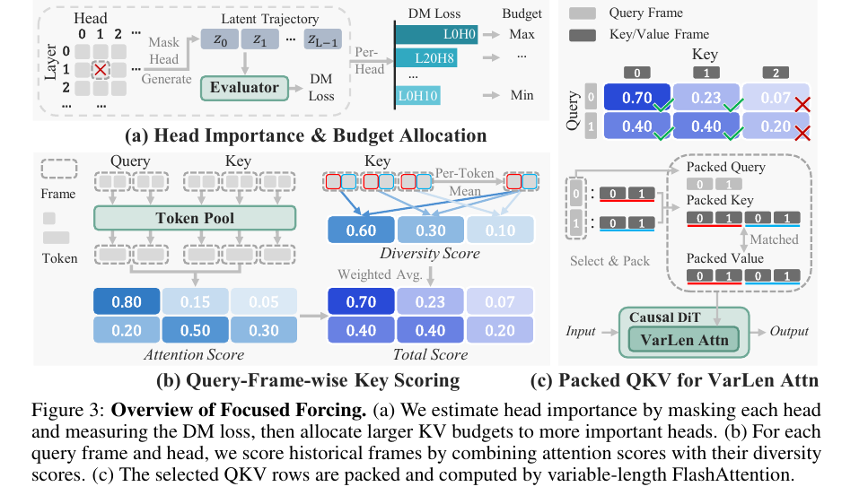

# AI Daily

## Focused Forcing: Content-Aware Per-Frame KV Selection for Efficient Autoregressive Video Diffusion

**報告日期：** 2026-11-01
**作者與機構：** Peiliang Cai、Evelyn Zhang、Jiacheng Liu、Hao Lin、Ruiqi Zhang、Weile Mo、Yue Ma、Shikang Zheng、Jiehang Huang、Dongrui Liu、Linfeng Zhang。作者單位包括上海交通大學、山東大學、華中科技大學、東京大學、香港科技大學、華南理工大學及上海人工智慧實驗室；Linfeng Zhang 為通訊作者。[1] [9]

**發表狀態：** NeurIPS 2026 官方 Virtual Poster 頁面列出本文及作者。本文分析的公開稿是 arXiv v2，並非正式 proceedings PDF；arXiv v1 首次公開於 2026-05-18，v2 修訂日期為 2026-10-29。[2] [3]

**研究方向：** 自回歸影片 diffusion、KV cache 壓縮、training-free inference、attention modulation、長影片生成。

**論文連結：** [arXiv v2](https://arxiv.org/abs/2605.18346v2)｜[NeurIPS 官方海報頁](https://neurips.cc/virtual/2026/poster/148676)｜[作者程式庫](https://github.com/caipeiliang2004/Focused-Forcing)

### 為什麼選這篇

這篇的第一次 arXiv 公開時間不是最近幾天，但作者在 10 月 29 日更新到 v2，且已列入 NeurIPS 2026 官方海報頁。它把近期常見的 training-free 與 attention modulation 從「刪掉一部分 KV」推進到較細緻的資源分配：每個正在生成的 query frame、每個 attention head，可以保留不同的歷史影格，再依 head 對生成品質的影響分配不同預算。[2] [3]

本文不是 Energy-Based Transformer、JEPA 或離散 Visual Autoregressive Model。它的直接價值在於提供一個可移植到多種自回歸影片生成器的推理期控制介面，並用多個 backbone、效率比較和消融檢查這些控制是否真的有用。這也使它適合作為後續把 EBT 能量或 JEPA 預測訊號放入快取選擇器的起點。[1]

### 核心貢獻

自回歸影片模型依序生成影格或影格區塊。隨著影片變長，歷史 Key/Value cache 會持續擴張。既有快取壓縮方法通常對一整個 query chunk 共用歷史選擇，或只看 attention 大小，並且對各 head 使用相同或啟發式預算。作者指出，同一 chunk 中不同 query frame 可能依賴不同歷史；同一歷史 frame 的注意力分數也會隨相對時間距離改變；遮蔽不同 head 對生成品質造成的影響並不相同。[1]

Focused Forcing 對應這三個觀察，包含三個互補設計：

1. **Head-wise budget allocation：** 透過遮蔽單一 layer-head、測量生成分布偏移，估算 head 的重要性；較重要的 head 保留較多歷史影格。
2. **Query-frame-wise history selection：** 對每個 query frame 與 head，結合注意力相關性和歷史內容多樣性，分別挑選要保留的歷史影格。
3. **Variable-length FlashAttention：** 將長度各異的 query/key/value 序列打包執行變長注意力，讓前面的稀疏選擇能轉成實際 kernel 計算的節省，而不是只減少邏輯上的 KV 數量。[1]

*圖：原論文 Figure 3。左上以 head 遮蔽後的 distribution-matching loss 分配預算；左下組合 query-frame attention score 與 key diversity；右側則把選出的 QKV 轉成變長序列執行 attention。[1]*

### 技術方法與數學形式

令影片由自回歸單位組成，單位可以是單一影格或一個 chunk，模型逐步估計

$$
p(x^{1:N})=\prod_{i=1}^{N}p(x^i\mid x^{<i}).
$$

在推理時，過往單位的 Key/Value 會提供時間脈絡，但整段歷史不必對每個 head、每個新影格都同樣重要。Focused Forcing 因此將問題轉成「對當前 query 而言，哪一些歷史值得留下」。[1]

**1. 用遮蔽造成的分布偏移估算 head 重要性。** 對 layer-head 配對 \(m=(\ell,h)\)，作者先在去噪 rollout 中遮蔽該 head，保留其他計算，再比較受擾生成結果與目標分布。論文使用的 distribution-matching 梯度代理與損失為

$$
g_{\mathrm{DM}}(x_t,t)=w_t\alpha_t\bigl(s_{\mathrm{fake}}(x_t,t)-s_{\mathrm{real}}(x_t,t)\bigr),
$$

$$
\mathcal{L}_{\mathrm{DM}}(x)=\frac{1}{2}\left\|x-\operatorname{sg}\!\left(x-g_{\mathrm{DM}}(x_t,t)\right)\right\|_2^2.
$$

其中 \(s_{\mathrm{fake}}\) 與 \(s_{\mathrm{real}}\) 是生成分布與目標分布的 score，\(\operatorname{sg}\) 表示 stop-gradient。作者將更大的 DM loss 解讀為遮蔽該 head 導致更大的分布偏移，並對校準 prompts \(\mathcal P\) 與 rollout 時間窗 \(\mathcal W\) 取平均：

$$
I_m=\frac{1}{|\mathcal P||\mathcal W|}\sum_{p\in\mathcal P}\sum_{w\in\mathcal W}\mathcal{L}_{\mathrm{DM}}\!\left(\tilde z_{p,w}^{(m)}\right).
$$

正規化後，把重要性映射到每個 head 的歷史影格預算：

$$
\hat I_m=\frac{I_m-I_{\min}}{I_{\max}-I_{\min}+\epsilon},\qquad
b_m=\operatorname{round}\!\left(b_{\min}+\hat I_m^{\gamma}(b_{\max}-b_{\min})\right).
$$

因此，高重要性 head 可看更多歷史，低重要性 head 則在更緊的快取限制下運作。這個重要性表只在離線校準時估一次；只要模型權重與 attention 架構不變，就可以在後續推理中重用。[1]

**2. 對每個 query frame 組合注意力與多樣性。** 對 batch \(b\)、query frame \(q_f\)、head \(h\) 和候選歷史 frame \(k_f\)，先將每個 frame 的 token pooling 成 \(G\) 組，計算近似的 frame-level attention score：

$$
A_{b,q_f,h,k_f}=\frac{1}{G^2}\sum_{u=1}^{G}\sum_{v=1}^{G}
\frac{\langle\bar Q_{b,q_f,u,h},\bar K_{b,k_f,v,h}\rangle}{\sqrt D}.
$$

分數沿歷史影格維度標準化，得到 \(\tilde A\)。只用注意力仍可能偏好冗餘影格，因此作者另以每個歷史影格的 key 與歷史平均 key 的 cosine similarity 衡量冗餘：

$$
\bar K^{\mathrm{mean}}_{b,l,h}=\frac{1}{F_h}\sum_{k_f=1}^{F_h}K^{(k_f)}_{b,l,h},\qquad
R_{b,h,k_f}=\frac{1}{L}\sum_{l=1}^{L}\cos\!\left(K^{(k_f)}_{b,l,h},\bar K^{\mathrm{mean}}_{b,l,h}\right),
$$

並令多樣性分數 \(D_{b,h,k_f}=-R_{b,h,k_f}\)。離平均愈遠的歷史影格愈不冗餘。最後將 attention 與 diversity 分數分別標準化，按權重 \(\lambda\) 合併，再以 head 專屬預算取 Top-K：

$$
S_{b,q_f,h,k_f}=\lambda\tilde A_{b,q_f,h,k_f}+(1-\lambda)\tilde D_{b,q_f,h,k_f},\qquad
\mathcal S_{b,q_f,h}=\operatorname{TopK}_{k_f}\!\left(S_{b,q_f,h,k_f},b_{\ell,h}\right).
$$

這個定義的關鍵是選擇集合依賴 query frame 和 head，而不是把一個 chunk 或影片的歷史影格排序後，讓所有 query 共用同一組記憶。[1]

**3. 把選擇結果落到實際 attention kernel。** 不同 query/head 最後留下的歷史長度可能不同。作者將各自的 Q/K/V 沿 token 軸打包，使用 cumulative sequence boundaries 告知 variable-length FlashAttention 每個序列的範圍，最後再把輸出 scatter 回原佈局。額外 packing 有暫存記憶體成本，因此理論上減少的 KV token 數不能直接等同於端到端加速。[1]

### 實驗結果

主要評估採用 VBench-Long 的 128 個 prompts。每個 prompt 生成約 30 秒、486 frames、16 FPS、832×480 的影片；NOVA 因固定訓練尺寸使用 768×480。實驗使用 8 張 NVIDIA A100，預設 KV budget 為 \((b_{\min},b_{\max})=(4,12)\)，attention 權重 \(\lambda=0.5\)。[1]

相對各自未壓縮 backbone，Table 1 報告以下端到端時間與指標變化：[1]

- **Self Forcing：** 78.06 秒降至 53.90 秒，1.45×；Visual Quality 76.58→80.00，Text Alignment 28.03→28.75，Dynamic Degree 41.55→61.39。
- **LongLive：** 90.06 秒降至 68.60 秒，1.31×；Visual Quality 76.18→77.91，Text Alignment 29.06→29.40。
- **Rolling Forcing：** 83.35 秒降至 58.20 秒，1.43×；Visual Quality 75.71→77.97，Text Alignment 28.85→28.99。
- **Causal Forcing：** 77.99 秒降至 52.68 秒，1.48×；Visual Quality 84.40→84.81，Text Alignment 26.80→28.27。

作者另外在 Self Forcing 上與多種加速方法比較。Focused Forcing 的 attention latency 為 13.48 秒、attention speedup 2.77×；端到端生成 53.90 秒、1.45×。Dummy Forcing 為 13.35 秒、2.79× attention speedup，以及 53.64 秒、1.46× 端到端 speedup。因此 Focused Forcing 並沒有比 Dummy Forcing 快；它的 Visual Quality 為 80.00，較 Dummy Forcing 的 78.38 高，Text Alignment 為 28.75，略高於 28.57，而 Frame-wise Quality 64.61 則略低於 65.55。這是很接近的速度—品質取捨，不應被概括成全面勝出。[1] [5]

消融也顯示收益依賴合理的預算和訊號組合。以 Self Forcing 為例，\((4,6)\) budget 的 attention speedup 可達 3.27×，但 Visual Quality 降至 74.67；\((4,12)\) 的 Visual Quality 為 80.00，卻不是最激進的壓縮。只用 diversity 時分數為 77.66，只用 attention 時為 79.31，混合權重 \(\lambda=0.5\) 時達 80.00。使用重要性導向的 \((4,12)\) 預算得分 80.00，也高於同範圍的 Reverse 78.79 與 Random 78.89，支持 head-wise budget 不只是任意做成非均勻分配。[1]

### 相關研究脈絡

- **Dummy Forcing：** 觀察到一部分 attention heads 幾乎只看當前影格，刪除這些 head 的 KV cache 可在不額外訓練的情況下加速影片生成。它是 Focused Forcing 最直接的快取效率對照。差異在於 Dummy Forcing 偏重判斷哪些 head 可以少看歷史；Focused Forcing 則估計遮蔽 head 的品質影響，並進一步決定每個 query frame/head 應選哪些歷史影格。[5]
- **Relax Forcing：** 把時間記憶拆成 Sink、Tail、History 等功能角色，並以結構化記憶維持長影片的運動演化。它與 Focused Forcing 都把歷史記憶視為可選擇的上下文；前者主張時間位置與記憶角色，後者把選擇粒度細化到 query frame × head，並加入 key diversity。[6]
- **LongLive：** frame-level 自回歸影片生成框架，將 KV cache 作為串流生成的核心推理狀態。Focused Forcing 在 LongLive 上報告 1.31× 端到端加速，因此可視為可疊加於不同生成器的 inference-time cache policy，而不是另一個影片生成 backbone。[1] [7]
- **Causal Forcing：** 主要處理如何把雙向影片 diffusion 蒸餾為少步自回歸生成器，屬於訓練與蒸餾層的改進；Focused Forcing 不改生成器權重，處理的是推理階段歷史 KV 的保留策略，兩者處於不同層次。[1] [8]

### 評價、限制與研究延伸

我認為本文最值得帶走的觀念，是把 KV 壓縮重新表述成「依當前生成狀態配置上下文」，而非只用固定時間窗或單一 attention 門檻裁切記憶。對任何自回歸生成器而言，這個設計將壓縮單位從整個 chunk 細分為 query frame × head，並用可量化的 head importance 指引快取資源，讓稀疏化更容易解釋和消融。[1]

但「training-free」需要精確理解。模型權重確實不更新，然而作者使用 32 個 calibration prompts，對 360 個 layer-head 配對各做 10 秒自回歸 rollout，建立一次性的預算表；該成本不計入 online latency，而且只有在模型權重和 attention 架構不變時才能重用。這不是無校準成本，也不是嚴格的零樣本、零資料推理。[1]

品質也不是所有維度都一起提高。四個 backbone 的 Visual Quality 和 Text Alignment 多數上升，但 Subject Consistency、Background Consistency、Motion Smoothness 有多項小幅下降；Self Forcing 的整體 Visual Quality 增益很大一部分來自 Dynamic Degree 提升。另有每層約 153–178 MiB 的暫存 packing 記憶體，實際加速仍受硬體與 kernel 影響。作者的 2.77× attention speedup 對應的端到端速度只有 1.45×；部署評估應同時計入 profiling、packing、記憶體與生成品質，而不是只報稀疏比例。[1]

作者也寫出 arXiv v2 的程式可用，NeurIPS 官方海報頁則仍寫「code will be released」。截至本報告日期，連結到的 GitHub 公開頁面只有一個 README，尚未看到可執行的實作檔，因此目前的程式可重現性仍需保留疑問。[2] [3] [4]

這篇可延伸出幾個與你關注方向直接相連、但仍待實驗驗證的問題：

1. **Energy-based cache utility：** 對候選歷史影格 \(k\)，比較保留與移除它後的下一影格生成能量，定義
   $$
   U_k^{\mathrm{EBT}}=E(\hat x_{t+1}\mid H\setminus\{k\})-E(\hat x_{t+1}\mid H).
   $$
   若移除 \(k\) 令能量增加，表示完整歷史更相容，可將該影格視為更值得保留。關鍵實驗是檢查此分數能否比 attention 或 DM-loss calibration 更好地預測「移除後品質下降」。
2. **JEPA predictive disagreement：** 對完整上下文與移除候選影格後的上下文，計算預測未來表徵的差異：
   $$
   U_k^{\mathrm{JEPA}}=\left\|\phi_{\mathrm{pred}}(H)-\phi_{\mathrm{pred}}(H\setminus\{k\})\right\|_2.
   $$
   再把它與 attention relevance、key diversity 合併，測試 JEPA 是否能辨識那些目前注意力較低、但對後續動作或物件身份至關重要的歷史。
3. **更接近 zero-shot 的預算控制：** 讓模型以線上 latent uncertainty 或 JEPA prediction error 動態調整每個 head 的 budget，減少對 32 個 calibration prompts 的依賴。評估需公開 amortized total latency，並跨 prompt、長度、解析度和不同影片生成器做 domain-shift 測試。
4. **連結 VAR 的尺度式記憶：** 在 next-scale visual autoregression 中，將粗尺度結構 token 作為長期 anchor，讓細尺度 token 依預測不確定度擴充局部歷史。這不是 Focused Forcing 的原始方法，而是將「按生成位置分配上下文」改寫為「按生成尺度分配上下文」的研究假說。

### References

[1]: https://arxiv.org/html/2605.18346v2 "Focused Forcing full text v2"
[2]: https://export.arxiv.org/api/query?id_list=2605.18346 "Focused Forcing arXiv metadata and version history"
[3]: https://neurips.cc/virtual/2026/poster/148676 "NeurIPS 2026 official virtual poster page"
[4]: https://github.com/caipeiliang2004/Focused-Forcing "Focused Forcing official GitHub repository"
[5]: https://arxiv.org/abs/2601.20499 "Efficient Autoregressive Video Diffusion with Dummy Head"
[6]: https://arxiv.org/abs/2603.21366 "Relax Forcing: Relaxed KV-Memory for Consistent Long Video Generation"
[7]: https://arxiv.org/abs/2509.22622 "LongLive: Real-time Interactive Long Video Generation"
[8]: https://arxiv.org/abs/2602.02214 "Causal Forcing: Autoregressive Diffusion Distillation Done Right for High-Quality Real-Time Interactive Video Generation"
[9]: https://arxiv.org/pdf/2605.18346v2 "Focused Forcing arXiv PDF v2"
