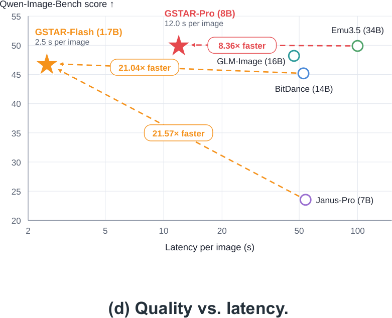
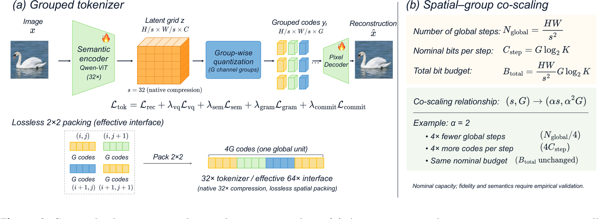
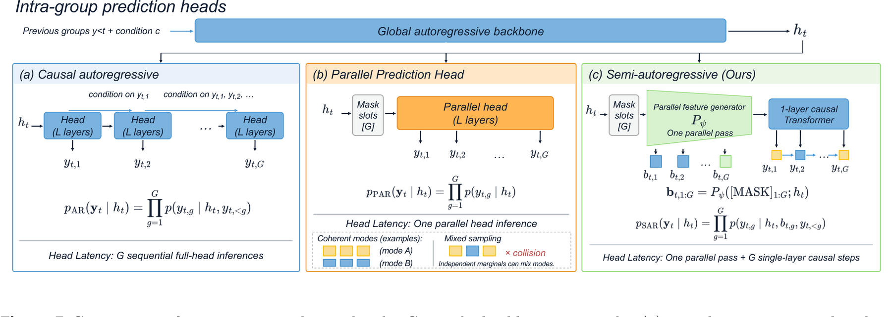
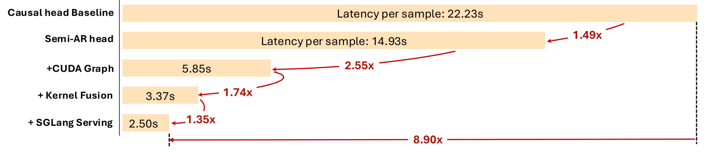
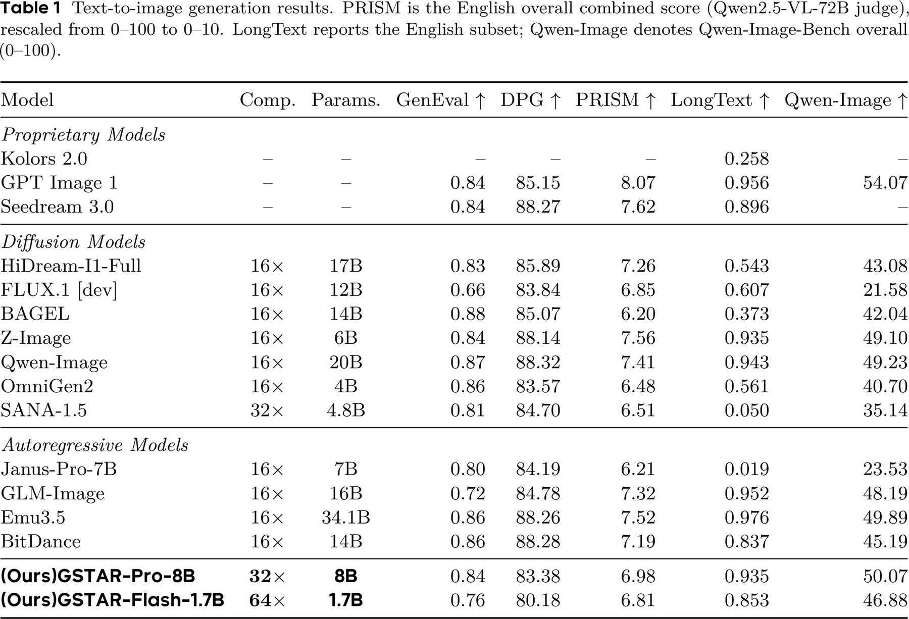
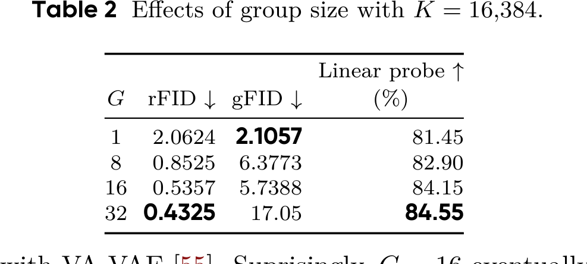
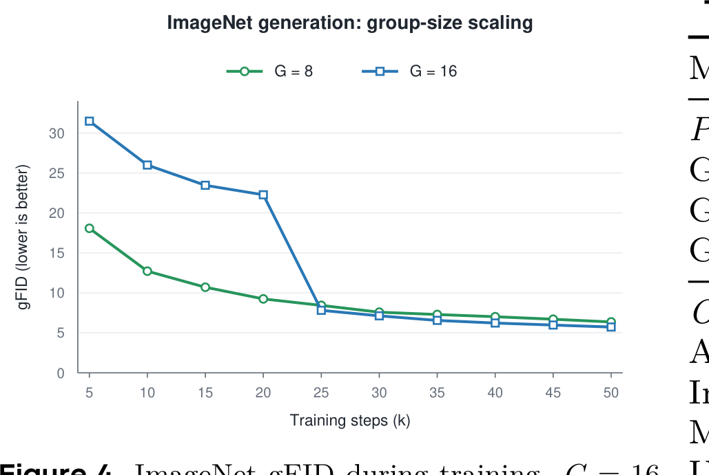
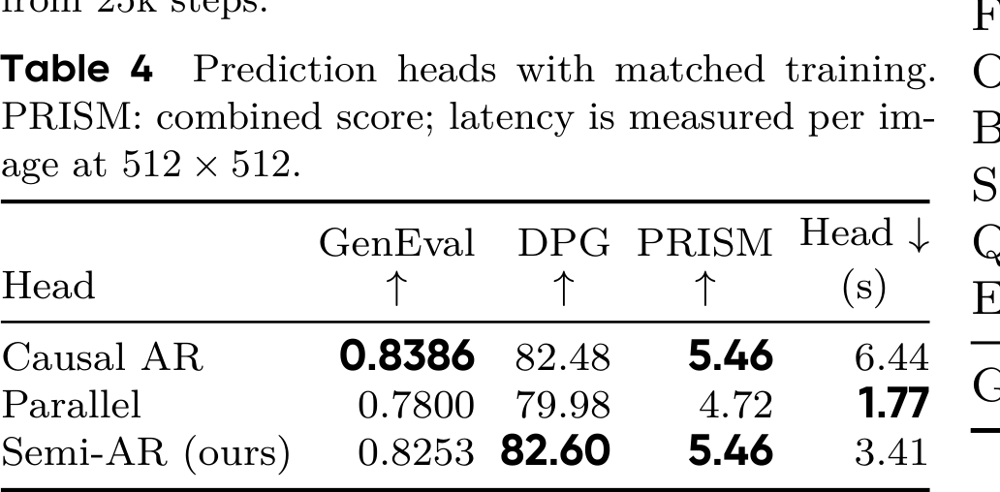
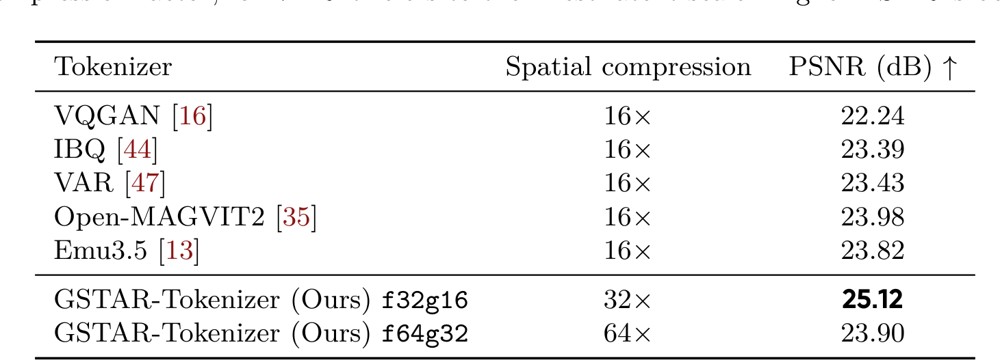

# AI Daily

## 2026-11-15｜G-STAR: Group-Scaled Token Capacity for Deeply Compressed Autoregressive Generation

### 論文資訊

**標題：** G-STAR: Group-Scaled Token Capacity for Deeply Compressed Autoregressive Generation

**作者與單位：** Xu Huang¹²\*、Ye Huang¹\*、Xiaotong Li²†‡、Zhengrong Yue²³、Jialv Zou²⁴、Minhao Jing²、Haodong Li²⁵、Wenhao Yan²⁶、Yaxin Luo²⁷、Duomin Wang¹、Daquan Zhou¹‡；¹Peking University、²Meituan Longcat、³Shanghai Jiao Tong University、⁴Huazhong University of Science and Technology、⁵The Chinese University of Hong Kong、⁶Tsinghua University、⁷MBZUAI。星號為共同第一作者，† 是 project lead（Xiaotong Li，美團 LongCat），‡ 是通訊作者（Daquan Zhou，北大 DA Group）。這個組合值得注意兩點：其一，主力單位是北大 DA Group 與美團 Longcat，project lead 在美團側；其二，通訊作者 Daquan Zhou 同時出現在論文自己列出的 SANA 系列工作名單裡（例如參考文獻 [6] 的 SANA-Video 2.0），而 SANA 那條線用的正是 32× 的 DC-AE 連續 latent。也就是說「生成模型的表示該怎麼被壓」這件事他先在連續 latent 上做過，這篇是把同一個問題意識搬到離散 code 上。[1] [4] [5] [29]

**來源與狀態：** arXiv:2611.13004v1，`cs.CV`（唯一分類），2026-11-08 提交，19 頁、5 張正文圖、9 張表。arXiv metadata 的 Comments 欄位是空的，正文每頁也沒有「Preprint／NeurIPS」字樣，所以目前**是純預印本**，尚無同儕審查背書。Hugging Face Daily Papers 於 2026-11-13 收錄，45 個 upvotes（當日第 4 高）；我查 HF papers API 時留言計數為 0，OpenReview 與 r/MachineLearning 也查無針對本篇的技術討論，社群熱度目前還停在數字層面。[1] [2] [3]

**連結：** [arXiv 摘要](https://arxiv.org/abs/2611.13004)｜[全文 HTML](https://arxiv.org/html/2611.13004v1)｜[PDF](https://arxiv.org/pdf/2611.13004v1)｜[Project page](https://dagroup-pku.github.io/G-STAR/)｜[GitHub](https://github.com/DAGroup-PKU/G-STAR)｜[HF 權重](https://huggingface.co/DAGroup-PKU/G-star)｜[HF 論文頁](https://huggingface.co/papers/2611.13004)。[1] [3] [4]

**資源實際狀態（我逐項查證過）：** GitHub repo 掛 MIT、27 stars、0 forks、0 releases，commit 歷史只有一筆「Initial commit」（2026-11-12），README 的 News 寫 code 於 2026-11-04 釋出，包含推論與訓練（AR head 與 DSpark head 兩套）。Hugging Face 上的 `DAGroup-PKU/G-star` 確實可下載，檔案清單能由 API 直接驗證：共 106 檔、45.78 GB，其中 Qwen3-8B 骨幹四個 shard 合計 19.28 GB、`tokenizer/` 3.48 GB、`refiner/` 23.0 GB（含自己的 DiT 與 VAE），likes 5、downloads 125；我另用 range GET 實測 `resolve/main/config.json` 回 HTTP 206 並取回 1,024 bytes，確認不是空殼。[6] [30] 但 **G-STAR-Flash-1.7B 的權重查無公開 repo**，README 的 todo 也把「Remaining checkpoints and their matching visual refiners」留為未打勾；另外 repo 建議推論前先跑 `Qwen-Image-2.1-PE` 做 prompt enhancement，這段 LLM 延遲不在 2.5 秒的計量內。[4] [6] [7]

**為什麼挑這篇：** 它正面回應你點名的「VAR based」與「training-free／推理時效率」兩軸，而且給的是一個**可以算的設計律**。先前離散自回歸把「快」押在改生成順序上（VAR 的 next-scale、PAR／RandAR 的重排、Emu3.5 的 DiDA、BitDance 的 next-patch diffusion），G-STAR 走相反的方向：**順序完全不動，還是 raster scan 逐位置預測，但把「容量」這個屬性從「每個 code」搬到「每個空間位置」**——每個位置發 $G$ 個 product-quantization code，於是 global step 數可以砍到 1/4 而名義位元預算不變。這件事數學上只有一行，但代價藏在 head 裡：$G$ 變大之後 intra-group 相依變成新的瓶頸，而他們的答案是從 LLM 投機解碼那條線（DFlash／DSpark）借來的 semi-autoregressive head。這條「把文字側的 parallel drafting 搬到離散視覺 code」的接線，對你正在想的 attention modulation 與 inference-time 方法直接可用。[1] [8] [9] [10]

*圖：論文 Figure 1 的 (d) 面板（自 PDF 聚焦擷取，非整頁截圖）。橫軸為單張 1024×1024 的延遲（對數軸），縱軸為 Qwen-Image-Bench 分數。G-STAR-Pro-8B 每張 12.0 秒、對 Emu3.5（34B，約 100 秒）是 8.36×；G-STAR-Flash-1.7B 每張 2.5 秒、對 BitDance（14B）與 Janus-Pro（7B，約 53 秒）分別是 21.04× 與 21.57×。摘要裡的「20× speedup over prior discrete autoregressive models」就來自這兩條箭頭，正文沒有任何跨模型延遲表。[1] [3]*

### 核心貢獻

論文的出發點是離散 AR 的一個兩難：序列長 → 表徵好但解碼慢；空間壓縮狠 → 序列短但每個 token 要扛更多資訊，而量化誤差正好在這種時候被放大。他們把這個兩難寫成一個可以被代數操縱的約束，然後給出三件事。[1]

第一，**spatial–group co-scaling 律**。在乘積量化下，每張圖的**名義**位元預算為 $B_{\text{total}}=\frac{HW}{s^{2}}\,G\log_{2}K$；把 per-axis 空間壓縮率 $s$ 放大 $\alpha$、同時把每個位置的 code 數 $G$ 放大 $\alpha^{2}$，預算完全不動，但 global autoregressive step 數減少 $\alpha^{2}$ 倍。這是全文最核心的一句話，也是圖 2(b) 那個框框：$(s,G)\to(\alpha s,\alpha^{2}G)$。[1]

第二，**用 lossless 2×2 packing 把 native 32× 變成 effective 64× 介面**。把 $2\times2$ 的四個量化位置沿 group 維摺進同一個 global unit，$G_q$ 變成 $4G_q$，global step 數剩 1/4，且**不做任何重新量化**，逆 packing 後重建逐 bit 相同。換句話說，他們沒有去訓練一個 64× 的野獸級 tokenizer，而是把 32× tokenizer 的「空間維」借了一塊給「深度維」。[1]

第三，**semi-autoregressive intra-group head**。$G$ 變大之後，RQ-Transformer 式 causal depth head 的延遲線性於 $G$、在壓縮激進時會反超 global backbone；全平行的 head 又會因為條件獨立而把同一群組裡的不相容模式混在一起（multimodal collision）。他們的答案是：重的部分（parallel trunk $P_\psi$）對 $G$ 個 slot 只跑一次，輕的部分（**單層** causal Transformer，KV cache）保留逐 code 的因果條件。實測 head latency 從 6.44 秒降到 3.41 秒（約省 47%），GenEval 從 0.8386 掉到 0.8253，DPG 反而 82.48 → 82.60，PRISM 同為 5.46；而 fully parallel head 是 1.77 秒但 GenEval 只有 0.7800。[1]

我個人認為最該記住的其實是第四個、論文沒單獨強調的點：**他們把「容量」做成了每個位置的屬性，而不是每個 code 的屬性**。這跟 VAR 把「自回歸單位」從 token 改成整張 token map 是同一種層級的重新定義——一旦容量可以沿 depth 維堆疊，空間序列長度就變成自由變數，而 latency 的真正瓶頸（global backbone 的前向次數）就能被直接操縱。

### 技術方法

#### 1｜名義位元預算：為什麼恰好是 $\alpha^{2}$

先講量化本身。設某個空間位置的投影特徵為 $\mathbf{z}_{t}\in\mathbb{R}^{C}$，把它切成 $G_q$ 個互不重疊的通道群，每群獨立地在自己的 codebook 裡找最近鄰：

$$
k_{t}^{(g)}=\arg\min_{k\in[K]}\big\|\mathbf{z}_{t}^{(g)}-\mathbf{e}_{k}^{(g)}\big\|_{2}^{2},
\qquad
\hat{\mathbf{z}}_{t}=\operatorname{Concat}_{g=1}^{G_{q}}\mathbf{e}_{k_{t}^{(g)}}^{(g)} .
\tag{1}
$$

這正是 product quantization：單個位置的**可配置狀態數**是 $K^{G_q}$，而不是 $K$。$K^{G_q}$ 的好處是它不需要拉長空間序列——這跟「把 codebook 開大」或「把分辨率開高」是三種完全不同的擴容量方式。[1]

再來是那個代數律。記 per-axis 空間壓縮率為 $s$、每個 global 位置要發的 code 數為 $G$、每個 codebook 大小為 $K$：

$$
N_{\mathrm{global}}(s)=\frac{HW}{s^{2}},
\qquad
C_{\mathrm{step}}(G,K)=G\log_{2}K,
\qquad
B_{\mathrm{total}}(s,G,K)=N_{\mathrm{global}}\,C_{\mathrm{step}}=\frac{HW}{s^{2}}\,G\log_{2}K .
\tag{3}
$$

兩個變數控制互補的東西：固定 $s$ 時提高 $G$，容量上升但 global step 數不變；提高 $s$ 則 global step 數**二次地**下降。於是 co-scaling：$s\to\alpha s$ 讓 $N_{\mathrm{global}}$ 除以 $\alpha^{2}$，只要同時 $G\to\alpha^{2}G$，$B_{\mathrm{total}}$ 就原地不動。$\alpha^{2}$ 不是經驗值，它就是 $N_{\mathrm{global}}\propto s^{-2}$ 的直接推論。[1]

這一段必須配上作者在 Sec. 4.2 緊接式 (3) 的原文才誠實：「$B_{\mathrm{total}}$ 是固定長度的**名義**位元預算，不是學出來的 code 的 empirical entropy 或 effective semantic information」。名義容量只保證「字母表夠大」，不保證「真的裝了那麼多資訊」，後面實驗裡 $G=32$ 的 gFID 爆掉就是這一區別的代價。[1] [3]

#### 2｜三個作業點的算術（本報告推算，論文未列表）

為了讓 $\alpha^{2}$ 有手感，我把論文給的配置（$K=16{,}384$，故 $\log_2 K=14$；$1024\times1024$，故 $HW=1{,}048{,}576$）代進式 (3)：

| 配置 | $s$ | $G$ | $N_{\mathrm{global}}$ | $C_{\mathrm{step}}$ (bit) | $B_{\mathrm{total}}$ (bit) | 每位置狀態數 | head 呼叫次數 $N_{\mathrm{global}}\!\times\!G$ |
|---|---|---|---|---|---|---|---|
| G-STAR-Pro-8B（native） | 32 | 16 | 1,024 | 224 | 229,376 | $2^{224}$ | 16,384 |
| packing 前基線 f32g8 | 32 | 8 | 1,024 | 112 | 114,688 | $2^{112}$ | 8,192 |
| G-STAR-Flash-1.7B（packing 後） | 64 | 32 | 256 | 448 | 114,688 | $2^{448}$ | 8,192 |

三列讀出三個重要事實。第一，packing 那一對（第 2、3 列）$B_{\mathrm{total}}$ 與 head 呼叫次數都**逐 bit 相同**，只有 global step 從 1,024 降到 256——這就是 $\alpha=2$ 的 co-scaling，省下的全是 backbone 的前向次數。第二，Pro（第 1 列）的名義預算其實是 Flash 的**兩倍**，因為 Flash 是從 f32g8 摺出來的，不是從 f32g16 摺出來的；嚴格遵守 $\alpha^{2}$ 從 Pro 出發應該得到 f64g64。第三，head 的逐 code 串行步數 $N_{\mathrm{global}}\times G$ 在 co-scaling 下不變，所以 co-scaling 對延遲的貢獻全部來自 backbone，不是來自 head；真正壓 head 的是 semi-AR 設計。這三點論文沒有明說，但直接決定了你該在哪些地方花推理時預算。[1]

*圖：論文 Figure 2（自 PDF 聚焦擷取）。(a) 語義編碼器（Qwen-ViT，32×）→ latent grid $H/s\times W/s\times C$ → group-wise quantization 得到每個位置 $G$ 個 code → pixel decoder 重建；下方是 lossless 2×2 packing 把四個相鄰位置的 $G$ code 併成一個 global unit 的 $4G$ code。(b) 右側框就是 $N_{\mathrm{global}}$、$C_{\mathrm{step}}$、$B_{\mathrm{total}}$ 與 co-scaling 關係 $(s,G)\to(\alpha s,\alpha^2 G)$，$\alpha=2$ 的例子是「4× fewer global steps、4× more codes per step、same nominal budget」；框下最後那行小字「Nominal capacity; fidelity and semantics require empirical validation」是作者自己的免責。[1]*

#### 3｜grouped tokenizer 的損失

tokenizer 不是從頭學的：編碼器由 **Qwen-ViT**（32× 下採樣）初始化，之後用五項損失一起訓練，

$$
\mathcal{L}_{\mathrm{tok}}=\mathcal{L}_{\mathrm{rec}}+\lambda_{\mathrm{vq}}\mathcal{L}_{\mathrm{vq}}+\lambda_{\mathrm{sem}}\mathcal{L}_{\mathrm{sem}}+\lambda_{\mathrm{gram}}\mathcal{L}_{\mathrm{gram}}+\lambda_{\mathrm{commit}}\mathcal{L}_{\mathrm{commit}},
\tag{2}
$$

其中 $\mathcal{L}_{\mathrm{rec}}$ 是 pixel＋知覺＋對抗三件套，$\mathcal{L}_{\mathrm{sem}}$ 把量化後特徵拉回 Qwen-ViT 連續特徵（語義保持），$\mathcal{L}_{\mathrm{gram}}$ 是跟 Scale-RAE 學的 Gram matrix 損失，用來匹配輸入與重建之間的特徵二階相關。權重為 $\lambda_{\mathrm{sem}}=1$、$\lambda_{\mathrm{gram}}=10$、$\lambda_{\mathrm{perceptual}}=1$、$\lambda_{\mathrm{vq}}=1$、$\lambda_{\mathrm{commit}}=0.25$；Adam（$\beta_2=0.95$）、global batch 1,024、量化器與解碼器 lr $10^{-4}$、編碼器 lr 刻意壓到 $10^{-5}$ 以保住預訓練語義。T2I tokenizer 走 any-resolution 訓練 200k steps，並額外混入 OCR、美學、人臉資料來撐文字渲染與人像。[1]

最後一環常被忽略但對解讀結果很關鍵：tokenizer 訓練完就**凍結**，其後跟 UniAR 與 Emu3.5 一樣接一個 **DiT-based 視覺解碼器**（從 Ideogram 4 初始化）作為 refiner，只以離散 code 為條件、不吃任何文字條件（這點明確對比 GLM-Image 與 X-Omni）。HF 上的模型卡寫明 refiner 輸出 native 2048²、`refiner_steps=52`，而 benchmark 用的 1024² 是把 2048² 用 LANCZOS 縮下來的。所以 Table 1 的像素品質有一部分是這個 23 GB 的 diffusion refiner 給的，而不是那 224 bit/位置 的離散碼本身。[1] [6] [7]

#### 4｜intra-group head 的三種分解：mean-field 到底丟了什麼

設第 $t$ 個 global 位置上，backbone 給出 context $\mathbf{h}_t$，head 要生成 code 向量 $\mathbf{y}_t=(y_{t,1},\dots,y_{t,G})$，目標是條件聯合物分佈 $p(\mathbf{y}_t\mid\mathbf{h}_t)$。三種做法：

$$
p_{\mathrm{AR}}(\mathbf{y}_t\mid\mathbf{h}_t)=\prod_{g=1}^{G}p\big(y_{t,g}\mid \mathbf{h}_t,\ \mathbf{y}_{t,<g}\big),
\qquad
p_{\mathrm{PAR}}(\mathbf{y}_t\mid\mathbf{h}_t)=\prod_{g=1}^{G}p\big(y_{t,g}\mid \mathbf{h}_t\big).
\tag{4,5}
$$

$\mathrm{PAR}$ 就是 $\mathrm{AR}$ 的 **mean-field 近似**；兩者差多少，可以用群組內的多重資訊（total correlation）寫成一個可算的量（此為本報告補充，論文未給）：

$$
D_{\mathrm{KL}}\!\left(p_{\mathrm{AR}}\,\|\,p_{\mathrm{PAR}}\right)
= I(y_{t,1};\dots;y_{t,G}\mid \mathbf{h}_t)
= \sum_{g=1}^{G} H\big(y_{t,g}\mid\mathbf{h}_t\big) - H\big(\mathbf{y}_t\mid\mathbf{h}_t\big).
$$

這個數就是「同一位置的 $G$ 個 code 之間互相解釋了多少 bit」。它為 0 當且僅當群組內完全獨立；而 PQ 的 $G$ 個子空間量化的是同一塊語義特徵的 $G$ 個切片，$I$ 幾乎不可能小，所以全平行 head 的品質崩（GenEval 0.7800）是結構性的，不是調參沒調好——這也解釋了為什麼他們必須保住因果鏈。[1]

semi-AR 的巧妙之處在於它**沒有換掉 factorization**，只換掉了「條件的表示方式」：

$$
\mathbf{b}_{t,1:G}=P_{\psi}\big([\textsc{Mask}]_{1:G};\ \mathbf{h}_t\big),
\qquad
p_{\mathrm{SAR}}(\mathbf{y}_t\mid\mathbf{h}_t)=\prod_{g=1}^{G}p\big(y_{t,g}\mid \mathbf{h}_t,\ \mathbf{b}_{t,g},\ \mathbf{y}_{t,<g}\big).
\tag{6,7}
$$

注意式 (7) 依然包含 $\mathbf{y}_{t,<g}$，所以 $p_{\mathrm{SAR}}$ 與 $p_{\mathrm{AR}}$ 有**相同的表達力等級**；被近似的只有 $\mathbf{b}_{t,g}$ ——這個 slot 的特徵是在看見任何 code 之前就算好的，屬於 prefix-blind。等於把「$G$ 次完整的 $L$ 層 head 前向」換成「1 次 $G$-slot 的 parallel trunk ＋ $G$ 次單層 causal 步」。單層＋KV cache 的串行步很便宜，於是 head latency 6.44 → 3.41 秒，而品質幾乎不掉。[1]

架構來源他們寫得很坦誠：借自 LLM 投機解碼的 parallel-sequential drafter，即 DFlash（block diffusion drafter）與 DSpark（用 semi-autoregressive 架構＝parallel backbone ＋ lightweight sequential module，再加 confidence-scheduled verification 做投機解碼）。但移植過來有一處本質不同，值得你記下來：**文字側的 parallel drafting 有 target model 做驗證，因此可以無損；G-STAR 的 semi-AR head 就是最終取樣器，沒有 verifier，品質風險自己扛**。這正是 Table 4 裡 GenEval 那 −0.0133 的來源，也是下面「延伸想法」裡最大的一個缺口。[1] [8] [9]

*圖：論文 Figure 3（自 PDF 聚焦擷取）。上方是 global autoregressive backbone 輸出 $\mathbf{h}_t$；(a) causal AR 每個 code 都要重跑一次 $L$ 層 head，標註「$G$ sequential full-head inferences」；(b) parallel head 只跑一次但條件獨立，下方小圖把「coherent modes（mode A／B 各自一致）」與「mixed sampling → collision」畫在一起；(c) semi-AR（本文）＝ parallel feature generator 一次算完 $\mathbf{b}_{t,1:G}$，再交給 1-layer causal Transformer 依序出碼，標註「One parallel pass + $G$ single-layer causal steps」。[1]*

#### 5｜系統端才是那個 8.9×

演算法只貢獻了鏈條的第一環。附錄 C.1 的延遲協議是：$1024^{2}$、batch 1、單張 H200、BF16，PyTorch 2.9.1＋CUDA 12.8＋Triton 3.5.1＋Transformers 4.57.6，解碼迴圈整段 capture 成一個 CUDA graph，warm-up 3 次後量 3 次取中位數，採樣用 CFG scale 1.8、temperature 0.5、top-$k$ 1024。在這套口徑下（Figure 5）：causal head 基線 22.23 s → semi-AR head 14.93 s（1.49×）→ CUDA graph 5.85 s（2.55×）→ fused top-$k$／norm 的 Triton kernel 3.37 s（1.74×）→ 接進 SGLang 做 backbone serving 2.50 s（1.35×），合計 **8.9×**。[1]

這組數字的訊息量很大：semi-AR head 只給你 1.49×，其餘 6× 全是 kernel dispatch、小算子融合與 LLM serving 框架。**換句話說，離散 AR 的推理速度目前主要是一個系統問題，不是一個模型問題**；如果你以後要跟 diffusion 比 latency，一定要把這一串工程拆開看，否則會把 SGLang 的功勞算到 co-scaling 頭上。[1]

*圖：論文 Figure 5（自 PDF 聚焦擷取）。22.23 s → 14.93 s → 5.85 s → 3.37 s → 2.50 s，各段增益 1.49×／2.55×／1.74×／1.35×，端到端 8.90×。[1]*

### 實驗結果

**主表（Text-to-Image，Table 1）。** G-STAR-Pro-8B（32×，8B）GenEval 0.84、DPG 83.38、PRISM 6.98、LongText 0.935、Qwen-Image-Bench 50.07；G-STAR-Flash-1.7B（effective 64×，1.7B）為 0.76／80.18／6.81／0.853／46.88。同表最強的離散 AR 對手是 Emu3.5（16×，34.1B）0.86／88.26／7.52／0.976／49.89 與 BitDance（16×，14B）0.86／88.28／7.19／0.837／45.19；擴散陣營裡 Qwen-Image（20B）是 0.87／88.32／7.41／0.943／49.23，Z-Image（6B）是 0.84／88.14／7.56／0.935／49.10。[1]

*圖：論文 Table 1（自 PDF 聚焦擷取）。注意 Pro-8B 用 1/4 的 global step 數（32×）就把 Qwen-Image-Bench 做到 50.07，勝過 Emu3.5 的 49.89 與 Qwen-Image 的 49.23；但 DPG 83.38 是全表最低之一，比擴散的 OmniGen2（83.57）還低。[1]*

把口徑講清楚才有意義：**Pro-8B 的 Qwen-Image-Bench 50.07 是開放權重離散 AR 裡最高的一格**（Emu3.5 49.89、BitDance 45.19、Janus-Pro 23.53），LongText 0.935 屬第一梯隊但仍低於 Emu3.5 的 0.976 與 GLM-Image 的 0.952；真正的短板在 DPG（長 prompt 的複合服從）與 PRISM（知覺品質），分別落後 Emu3.5／BitDance／Z-Image 約 4.8～5.0 分與 0.5～0.6 分。摘要的「perform competitively with leading models」在「同參數量級」這個限定下成立（8B vs 34B/14B），但不等於全面追平。[1] [3]

**group scaling 的真相（Table 2，$K=16{,}384$、32×、ImageNet）。**

| $G$ | rFID ↓ | gFID ↓ | Linear probe ↑ (%) |
|---|---|---|---|
| 1 | 2.0624 | 2.1057 | 81.45 |
| 8 | 0.8525 | 6.3773 | 82.90 |
| 16 | 0.5357 | 5.7388 | 84.15 |
| 32 | 0.4325 | **17.05** | 84.55 |

*圖：論文 Table 2（自 PDF 聚焦擷取）。rFID 與 linear probe 隨 $G$ 單調變好，gFID 卻不是——$G=1$ 在此訓練預算下最好，$G=32$ 直接崩到 17.05。[1]*

這張表是全文最該被反覆讀的：**重建名義容量確實隨 $G$ 上升（rFID 2.06 → 0.43）**，語義也確實變好（probe 81.45 → 84.55），但**生成品質在固定訓練預算下先變差**，而且 $G=32$ 是災難性的 17.05。論文的解釋是「大 group 收斂慢」，並用 Figure 4 佐證 $G=16$ 在 25k steps 之後反超 $G=8$。但要注意 Figure 4 只比了 $G=8$ 與 $G=16$，**$G=1$ 的 gFID 2.11 在 50k 步時是最好的，論文沒有給 $G=1$ 的長程曲線**——「larger $G$ 需要更多訓練才會贏」這個關鍵前提，目前是外推而非實證。[1]

*圖：論文 Figure 4（自 PDF 聚焦擷取）。$G=16$ 前期落後、約 25k steps 後反超前 $G=8$；這是「大 group 只是慢、不是差」的唯一視覺證據，但曲線族裡沒有 $G=1$ 與 $G=32$。[1]*

**packing 的代價（Table 8，Appendix D）。** f32g8 → f64g32（同碼、同 bit 預算、重建逐 bit 相同）在生成端是 GenEval 0.8060 → 0.7885、DPG 82.49 → 80.44、PRISM 5.30 → 5.13。所以「lossless」嚴格只作用於 tokenizer 重建，**不作用於生成品質**；4× 短的序列換來的是約 2 個百分點的 GenEval 與 2 分的 DPG。這個 trade 在 Flash（1.7B）上被證明划算，但論文沒有把「序列長度」與「每步相依難度」的邊界條件拆開，讓讀者知道什麼時候該停。[1]

**head 消融（Table 4）。** 同訓練配方的三兄弟：Causal AR 0.8386／82.48／5.46／6.44 s；Parallel 0.7800／79.98／4.72／1.77 s；Semi-AR 0.8253／82.60／5.46／3.41 s。這是我近期少數看到「幾乎無損」的近似證據：DPG 微升、PRISM 持平、GenEval −0.0133，換到 47% 的 head latency。[1]

*圖：論文 Table 4（自 PDF 聚焦擷取，512² 匹配訓練）。Semi-AR 對 Parallel 在三項品質上全面勝出（0.8253 vs 0.7800、82.60 vs 79.98、5.46 vs 4.72），延遲只多 1.64 秒。[1]*

**重建與理解（Table 9／Table 7）。** ImageNet val 512² 的 PSNR：VQGAN 16× 22.24、IBQ 16× 23.39、VAR 16× 23.43、Emu3.5 16× 23.82、Open-MAGVIT2 16× 23.98；G-STAR tokenizer f32g16 在 **32×** 拿到 25.12 dB（比 Open-MAGVIT2 高 1.14 dB，代價是每軸壓縮率翻倍、token 數只剩 1/4），f64g32 在 **64×** 拿到 23.90 dB（只比 Open-MAGVIT2 低 0.08 dB，而 token 數少到 1/16）。理解端把離散碼餵進 Qwen3-1.7B＋LLaVA-OneVision，八項平均 64.7，對連續 Qwen3-ViT 特徵的 64.6——**離散化＋32× 壓縮幾乎沒吃掉語義**（AI2D 78.6 vs 76.7、ChartQA 69.9 vs 67.4 甚至反超，MathVista 44.5 vs 45.7 略降）。這是最支持「一套離散詞彙同時做生成與理解」的證據，也是與同團隊 dNaViT 相接的地方。[1]

*圖：論文 Table 9（自 PDF 聚焦擷取，ImageNet val，512²，PSNR 越高越好）。[1]*

**編輯（Table 5）。** Pro-8B 在 GEdit-Bench 英文整卷拿到 SC 7.85／PQ 7.45／Overall 7.45，開放權重中僅次 Emu3.5（7.59）與 Qwen-Image-Edit（7.56），高於 FLUX.1 Kontext Dev（6.00）、BAGEL（6.52）、OmniGen2（6.41）。考慮到它的 code 只花 224 bit/位置，這個編輯結果算是意外地強。[1]

### 相關研究脈絡

**離散容量這條線。** 把「每個位置放多個 code」做成系統方法的源頭是 RQ-Transformer（Lee et al., CVPR 2022，arXiv:2203.01941）：它用 residual quantization ＋ spatial transformer／depth transformer 的兩段式分解，把一個位置的殘差逐層量化。G-STAR 明說沿用這個 spatial–depth 分解，但把 residual code 換成 **product-quantization 的 channel-group code**——這是本篇定位上最重要的一刀：PQ 的 $G$ 個子空間是同尺度的切片，沒有殘差的層次結構，因此 intra-group 相依是「並列的相關」而非「由粗到細」，這讓平行的 $[Mask]$ slot trunk 變得合理（殘差碼則天生有順序）。同一族還有多個近期變體：GSQ（arXiv:2412.02632，grouped spherical quantization）、UniTok／WeTok／UniWeTok（arXiv:2502.20321 等）、以及把整個詞彙搬到二進位的 BAR（masked bit modeling）與 BitDance（arXiv:2602.14041，每個 code 表徵最多 $2^{256}$ 狀態、用 binary diffusion head 取代 softmax、用 next-patch diffusion 平行出多碼，ImageNet 256² FID 1.24）。[1] [11] [12] [13]

**最直接的同期競品是同團隊的 dNaViT（arXiv:2611.12426，Meituan LongCat，Technical Report，11-09 提交）。** 兩者共用作者（Xiaotong Li、Zhengrong Yue、Xu Huang、Jialv Zou、Wenhao Yan 都在兩篇名單上），也共用核心機制「grouped product quantization 在不拉長空間序列下擴容量」與 $f=32$ 設定，但目標不同：dNaViT 是「離散碼作為通用視覺表徵」（12 項理解 ＋ 4 項生成 ＋ 1 項編輯），G-STAR 是「離散 AR 的容量—延遲折衷與 head 設計」。兩組數字可以直接對照：dNaViT 用單一共享詞彙、空間下採樣 $f=32$，其 G64 變體在 ImageNet 512² 拿到 28.12 dB／0.81 SSIM；而固定 $f=32$、只把 group 數從 16 加倍到 64（純 depth 維加長，空間維一動不動），1024² 的 PSNR 就從 28.93 dB／0.81 拉到 32.90 dB／0.91。這是公開文獻裡最接近「co-scaling 的容量那一半到底值多少 dB」的證據，也剛好是 G-STAR 沒做的對照組，它的 $64\times$ 是靠 packing 借空間維，不是把 $G_q$ 從 16 加到 64。生成端配 Qwen3-8B 時 GenEval2 49.5、Qwen-Image-Bench 52.2、OCRBench 885。更值得引用的是 dNaViT Sec. 2.4 對同一件事的兩句警告：At fixed $K$, increasing $G$ raises the nominal bit budget while leaving $N_q$ unchanged, but introduces more code indices to model. This budget characterizes the available discrete alphabet, not the empirical entropy or semantic information retained; greater capacity alone does not guarantee faithful reconstruction. 以及 Separate codebook lookups also do not imply statistically independent indices. 最後那句「分開查表不代表這些 index 統計獨立」，正是 G-STAR 那個 multimodal collision、也就是式 (5) 到式 (7) 全部動機的 tokenizer 側版本。把兩篇並讀你同時拿到「離散通用貨幣」與「離散 AR 提速」兩個視角，而 dNaViT 的 $G_{16}\to G_{64}$ 曲線告訴你：容量放在 depth 維的邊際收益，目前還看不出飽和的跡象。[14]

**縮短序列這條線（改順序，不改容量）。** VAR（arXiv:2404.02905，NeurIPS 2024 最佳論文）把自回歸單位從 token 改成整張 multi-scale token map，ImageNet 256² FID 18.65 → 1.73、推理快約 20×，並附帶 power-law scaling law 與 zero-shot 修圖／擴圖能力；Infinity（arXiv:2412.04431，CVPR 2025 Oral）把 VAR 的詞彙改成 bitwise sub-grid、理論上限到「無限詞彙」，GenEval 0.62 → 0.73、1024² 只要 0.8 秒。另外一族是重排／平行化 raster AR：MaskGIT（iterative unmasking）、PAR（arXiv:2412.15119，CVPR 2025，按 token 相依強度決定哪些能平行）、RAR／RandAR（隨機化生成順序）、以及 Emu3.5 的 DiDA（把逐 token 改成雙向平行預測，自稱單張約 20×）。**這裡有一個對照必須點出來：G-STAR 宣稱的「20× over prior discrete AR」並不是獨家口徑——Emu3.5 的 DiDA 自己就寫「about 20×」、BitDance 靠 next-patch diffusion 在 260M 對 1.4B 平行 AR 的對照下也拿到 8.7×**。G-STAR 的差別在於它是**在不改順序、不做迭代平行解碼的前提下**達成，因此保住了 AR 的因果先驗；但正因為如此，它的 2.5 秒裡有 6× 來自系統工程（見上文）。[15] [16] [17] [18] [10]

**投機解碼移植這條線。** DFlash（arXiv:2602.06036）用 block diffusion drafter 一次提一整塊 token；DSpark（arXiv:2607.05147，DeepSeek 陣營）明確把架構命名為 semi-autoregressive generation ＝ parallel backbone ＋ lightweight sequential module，用來「引入 intra-block dependency、緩解 suffix decay」，再加 confidence-scheduled verification。G-STAR 的式 (6)(7) 是同一個 shape，但**沒有 verifier**：投機解碼的無損性靠 target model 抽樣比對，這裡的品質只能自己吃。而且 HF 權重的 config 裡 head 實作直接就叫 `dspark`／「DSpark image head」，骨幹仍是 Qwen3 家族——等於把 LLM serving 的元件庫整包搬進視覺 AR。對你的啟發是：**這條線目前完全沒有「視覺版驗證器」**，而一個便宜的 discrete verifier 剛好能把 lossless 這塊補回來。[8] [9] [1] [6]

**與本庫既有報告的連動。** 這篇跟你已經讀過的幾篇構成一個很清楚的三角。容量與順序：DiverseVAR [31]、ToProVAR [21]、NOVA [20]、SparVAR [32] 都在 VAR 的尺度維上做推理時文章，G-STAR 提供了正交的另一維（同一位置的深度維）。免訓練近似：EBT／TEM 的能量下降與 semi-AR 的 sequential sampling 是同一件事的兩種寫法。位元預算與熵：EBReg 從 Barber–Agakov 下界推出「熵項必須靠帶噪 score 才有梯度」，正好是 G-STAR 那句「nominal budget ≠ empirical entropy」的理論版本——把 $I(y_{t,1};\dots;y_{t,G}\mid\mathbf{h}_t)$ 用 EBReg 那套 DSM 分數場估出來，就是一個完整的 group 內互資訊量測器。[19] [20] [21] [22] [23] [24]

### 個人評價、限制與意義

**真正的新東西只有一個，但很結實。** $(s,G)\to(\alpha s,\alpha^{2}G)$ 這種「一行代數」的洞察之所以有價值，是因為它把 tokenizer 設計從「壓縮率要多少」升級成「**容量要放在哪個維**」的資源分配問題，而這個分配直接決定 AR 的 global step 數，也就是直接決定 latency。配合 semi-AR head，他們等於證明了「在離散 AR 裡，把空間維折進深度維是划算的，只要 head 的串行成本可以被 1 層 Transformer 吃掉」。Table 4 那組 3.41 s／0.8253／82.60／5.46 與 1.77 s／0.7800 的對照，是我近期看過最乾淨的近似品質證據之一。[1]

**但有三個洞，我會在讀的時候標紅。**[1] [6]

第一，**co-scaling 的實證點與 headline 模型不是同一組數**。Pro 是 f32g16（229,376 bit），Flash 是 f64g32（114,688 bit），兩者預算差一倍、模型也差 4.7 倍參數，所以 Table 1 的 Pro vs Flash 落差混了三個因素。唯一乾淨的 co-scaling 對照是 Appendix D 的 f32g8 vs f64g32，而它的結論是**品質下降**（GenEval −0.0175、DPG −2.05、PRISM −0.17）。「same nominal budget」保住的是字母表，不是品質；論文用「retains strong generative performance」描述這組數，措辭偏寬。

第二，**$G=1$ 這個最關鍵的反對假設沒有被長程實驗排除**。Table 2 裡 $G=1$ 的 gFID 2.11 遠好於 $G=8$ 的 6.38 與 $G=16$ 的 5.74；Figure 4 只畫了 $G=8$ 與 $G=16$ 的交叉。要主張「大 $G$ 在充分訓練後贏」，至少需要 $G=1/8/16/32$ 四條長程曲線在同一 x 軸上，而 $G=32$ 的 17.05 更暗示大群組的優化難度是真實存在的（而 Flash 正好用 $G=32$）。附錄也承認所有 group／head 消融都是 Qwen3-1.7B、512²、100k steps 的小規模，並把 8B 級的效果留給「Larger models may benefit even further」這句未驗證的話。

第三，**可重現性的邊界比摘要給人的印象窄**。Flash 權重未放出、repo 只有一筆 initial commit、沒有 release/tag；官方 `inference_config.json` 是 `cfg_scale 2.4、top_k 4096、top_p 0.75、temperature 0.7、native_output_size 2048、benchmark_output_size 1024、benchmark_resize LANCZOS、refiner_steps 52`，而附錄 C.1 的延遲量測用 CFG 1.8／temperature 0.5／top-$k$ 1024——**兩套採樣設定不一致，而且 2.50 秒是否包含那個 52 步、23 GB 的 DiT refiner，論文沒寫**（Appendix C.1 只說他們「separately report global-backbone time、intra-group head time、image-decoder time、end-to-end pipeline latency」，但正文只引用了其中一條鏈）。再疊上推論建議先跑 prompt-enhancer、SFT 混入 Seedream 與 Nano Banana 2 再生成的圖，Table 1 的絕對分數不能直接跟「純 AR」對手逐點比較。另外我注意到 Table 4/3/8 的 PRISM 都在 4.7～5.5，而 Table 1 的 PRISM 是 6.8～7.5，同名同量綱（0–10）卻差一大截，文中未解釋（不同 judge／不同階段？查無說明）。[1] [6] [7]

**意義我放在兩層。**對生成模型研究：它把「離散 AR 能不能跟擴散拼速度」這個問題，從「要不要改生成順序」重新框成「容量放在哪個維、head 的串行部分有多貴」。這是一個可以立刻被 VAR 社群接用的框架——把 co-scaling 套在 scale ladder 上就是一篇新文章。對更大的圖景：它和 dNaViT、Emu3.5、UniAR 一起，把「一套離散視覺詞彙同時供生成與理解」從口號變成有 PSNR／probe／GenEval 數字的工程選項；而 Table 7 的 64.7 vs 64.6（離散 vs 連續語義）是這個選項目前最硬的一塊磚。如果你在推「統一多模態」而不是「單一 T2I SOTA」，這篇的引用價值比它的 FID 價值高。[1] [14]

### 研究啟發：六個可直接開工的延伸

**1｜Energy-based transformer。** semi-AR head 的取樣順序本身就是一條固定 scan，而式 (7) 沒有保證 scan 順序是最優的：把「$G$ 個 slot 的生成排列」看成能量景觀上的路徑，用一個輕量能量函數 $E_\phi(\mathbf{y}_{t,1:G})$ 在取樣後回評、拒絕高能量組合，就是**視覺版的 verifier**，可以補回投機解碼失去的無損性。更具體的做法：對 $p_{\mathrm{PAR}}$ 取樣 $M$ 個 candidate $\{\mathbf{y}^{(m)}\}$，以 group 內互資訊的代理（例如以凍結語義編碼器算 $\sum_{g}\log p$ 減去 $\log p_{\text{sem}}$）做 winner-take-all 挑選，這跟你在 CFM 筆記裡寫的 $\min_k\|\hat u_k-u_t\|^2$ 只差一個是速度空間、一個是 code 空間。EBT／TEM 的 Langevin 也可以換個戰場：不在像素或 latent 上做，而在 $G$ 個離散 slot 上做 block Gibbs。[1] [23] [24]

**2｜JEPA。** G-STAR 的 $\mathcal{L}_{\mathrm{sem}}$ 是「把量化後特徵拉回 Qwen-ViT 連續特徵」——這是 alignment；JEPA 式的寫法應該是「用已解碼的位置群去預測未解碼位置的 code tuple」。把 co-scaling 的 $\alpha^{2}$ 律跟 JEPA 的 latent 預測結合，可以定義 cross-position latent prediction：以 $\mathbf{h}_t$ 預測 $G$ 維 code tuple 的**軟分佈**而非 argmin，然後用 EBReg 的 score-entropy 正則化（或 LeJEPA 的高斯正則化）防止這 $G$ 個子空間塌成一個。這裡的實驗成本極低：tokenizer 凍結，只換 head 的訓練目標。[1] [22] [25]

**3｜VAR based。** 最自然的題目是 **scale–depth 統一 co-scaling**：VAR 的尺度梯度 $\{1,2,4,\dots,32\}$ 每個 scale 的 $N_{\text{scale}}=(2^{k})^{2}$，若把同一個 $B_{\text{total}}$ 約束套上去、讓每個 scale 的 $G$ 隨 $s$ 二次遞減（coarse scale 拿大 $G$、fine scale 拿小 $G$），會得到一個「粗尺度用少量位置＋高容量、細尺度用大量位置＋低容量」的新 VAR 變體，正好反過來對應人類「先語義後紋理」的生成直覺。第二個題目是 **packing 當作隱式 next-scale**：f32g8 → f64g32 本質上就是把一個 $2\times2$ 的「scale-1 map」折進 depth，因此 G-STAR 與 VAR 在中間尺度上是可比的——這個等價關係值得寫成一頁 derivation，它暗示 semi-AR head 與 VAR 的 intra-scale parallel decoding 是同一個 mean-field 誤差的兩個特例（Logit Refiner，arXiv:2609.11804，ECCV 2026，原話是 VAR 的 intra-scale 平行解碼「constitutes a mean-field-style approximation that discards spatial dependencies among same-scale tokens, causing locally incoherent samples regardless of backbone capacity」，而且把它歸為解碼規則的限制、不是容量的問題）。[1] [15] [26]

**4｜Training-free。** 論文的採樣設定（CFG 1.8／temp 0.5／top-$k$ 1024 vs 官方 2.4／0.7／4096）本身就暴露一個事實：**這些旋鈕完全沒人系統掃描過**。三個免訓練實驗立刻可做：(a) per-slot temperature——依 $G$ 個 codebook 的邊際熵分配隨機性（把 entropy budget 當作位元分配問題，跟 SoftCFG 的確定性引導同族）；(b) 可變 bit 率的**尾部碼丟棄**——co-scaling 說每位置 224 bit，但 rFID 隨 $G$ 的邊際收益明顯遞減：$1\to8$ 掉 1.21（2.0624→0.8525）、$8\to16$ 只剩 0.32（→0.5357）、$16\to32$ 更只剩 0.10（→0.4325），推論時丟掉最後幾個 slot 應該能以極小代價換 head latency 線性下降，這是一個純推理時的 rate-quality 旋鈕；(c) CFG 的 cond／uncond 共用同一個 parallel trunk（現在必然算兩次），可省近一半 head 成本。[1] [27]

**5｜Attention modulation。** semi-AR head 的 parallel trunk $P_\psi([\textsc{Mask}]_{1:G};\mathbf{h}_t)$ 是一個「$G$ 個 mask slot ＋ 一個 context」的短序列，這給注意力操控留了一個非常乾淨的介面：$\mathbf{h}_t$ 以什麼權重注入每個 slot、slot 之間能否互相看見（現在是 mask slot，全平行可見）都可在推論時改。我特別想看的是 **slot-level 逆溫度操控**：AlignVid 用 $\gamma>1$ 縮放 Q/K 來單調降低注意力熵、解決語義忽略；在 head 裡，$\gamma$ 直接控制「這個位置的 $G$ 個 code 有多依賴 global context vs 彼此」，等於一個推理時的 multimodal-collision 旋鈕。另外「只準看前面 slot」的 causality 目前寫死在單層 causal Transformer 的 KV cache 裡，把它做成可調的 partial-causal mask，就能在 AR 與 PAR 之間連續插值——而式 (5) 到式 (7) 正好是這個連續族的兩個端點。[28] [1]

**6｜Zero-shot。** Table 7 證明同一套離散碼對理解幾乎無損，這是「零樣本跨任務共用詞彙」的必要條件（不是充分條件）。但必須嚴格劃界：G-STAR **不是 training-free、也不是 strict zero-shot** ——它重訓 tokenizer（200k steps）＋ backbone（400k PT＋100k CT＋30k SFT），且 SFT 混入 3:7 的編輯資料，所以編輯能力是學來的。真正 zero-shot 的開放問題是：**把 f32g16 的 code tuple 當作任務無關的視覺「貨幣」**，不做任何 fine-tune，直接測試「理解端 trained on 連續特徵的 MLLM 能不能吃離散碼」（Table 7 是重新訓練過的對照，不是零樣本遷移）。這個測試在 dNaViT 裡有部分證據，但在 G-STAR 裡完全缺席。另一個可驗證的小實驗：co-scaling 之後每位置 $2^{224}$ 個狀態，若把 code tuple 的前 4 個 code 當作「類別指紋」去做 ImageNet 零樣本檢索，可以直接檢驗名義容量到底有多少是語義的。[1] [14]

一句話總結：**容量可以搬維度，$\alpha^{2}$ 是搬運費率，而 head 的串行成本是唯一需要付的稅**——G-STAR 用一行代數和一個單層 Transformer，把離散 AR 的 2.5 秒變成可能，但把「大 $G$ 到底值不值」這個問題原封不動留給了下一位讀者。

### References

[1]: https://arxiv.org/abs/2611.13004 "G-STAR: Group-Scaled Token Capacity for Deeply Compressed Autoregressive Generation, arXiv:2611.13004v1"
[2]: https://arxiv.org/html/2611.13004v1 "G-STAR full-text HTML for method and experiment sections"
[3]: https://dagroup-pku.github.io/G-STAR/ "G-STAR project page with co-scaling figure and latency annotations"
[4]: https://github.com/DAGroup-PKU/G-STAR "G-STAR official GitHub repository, MIT, with inference and training code"
[5]: https://arxiv.org/pdf/2611.13004v1 "G-STAR PDF, 19 pages, author affiliations and appendices A-E"
[6]: https://huggingface.co/DAGroup-PKU/G-star "G-STAR Pro-8B weights, tokenizer and SR2x refiner model card"
[7]: https://huggingface.co/DAGroup-PKU/G-star/raw/main/inference_config.json "G-STAR official inference config: cfg_scale 2.4, top_k 4096, temperature 0.7, refiner_steps 52"
[8]: https://arxiv.org/abs/2607.05147 "DSpark: Confidence-Scheduled Speculative Decoding with Semi-Autoregressive Generation"
[9]: https://arxiv.org/abs/2602.06036 "DFlash: Block Diffusion for Flash Speculative Decoding"
[10]: https://arxiv.org/abs/2510.26583 "Emu3.5: Native Multimodal Models are World Learners, DiDA parallel prediction about 20x faster"
[11]: https://arxiv.org/abs/2203.01941 "Autoregressive Image Generation using Residual Quantization, RQ-Transformer, CVPR 2022"
[12]: https://arxiv.org/abs/2602.14041 "BitDance: Scaling Autoregressive Generative Models with Binary Tokens"
[13]: https://arxiv.org/abs/2412.02632 "GSQ: Scaling Image Tokenizers with Grouped Spherical Quantization"
[14]: https://arxiv.org/abs/2611.12426 "dNaViT: Discrete Codes are General-Purpose Visual Representations, Meituan LongCat Technical Report"
[15]: https://arxiv.org/abs/2404.02905 "Visual Autoregressive Modeling: Scalable Image Generation via Next-Scale Prediction, NeurIPS 2024 Best Paper"
[16]: https://arxiv.org/abs/2412.04431 "Infinity: Scaling Bitwise AutoRegressive Modeling for High-Resolution Image Synthesis"
[17]: https://arxiv.org/abs/2412.15119 "Parallelized Autoregressive Visual Generation, PAR, CVPR 2025"
[18]: https://arxiv.org/abs/2202.04200 "MaskGIT: Masked Generative Image Transformer, CVPR 2022"
[19]: https://github.com/KaiCobra/AI_Daily/blob/main/papers/2026/2026-01/SoftCFG/AI_Daily_SoftCFG.md "AI Daily SoftCFG - uncertainty guidance stabilizing VAR"
[20]: https://github.com/KaiCobra/AI_Daily/blob/main/papers/2026/2026-02/NOVA/AI_Daily_NOVA.md "AI Daily NOVA - entropy-guided adaptive acceleration for VAR"
[21]: https://github.com/KaiCobra/AI_Daily/blob/main/papers/2026/2026-01/ToProVAR/AI_Daily_ToProVAR.md "AI Daily ToProVAR - attention entropy based VAR optimization"
[22]: https://github.com/KaiCobra/AI_Daily/blob/main/papers/2026/2026-11/EBReg/AI_Daily_EBReg.md "AI Daily EBReg - score-based entropy maximization, nominal capacity versus effective entropy"
[23]: https://github.com/KaiCobra/AI_Daily/blob/main/papers/2026/2026-05/EBT/AI_Daily_EBT.md "AI Daily EBT - Energy-Based Transformers are Scalable Learners and Thinkers"
[24]: https://github.com/KaiCobra/AI_Daily/blob/main/papers/2026/2026-10/TEM/AI_Daily_TEM.md "AI Daily TEM - Scaling Transformer Energy-based Models for High Quality Image Synthesis"
[25]: https://github.com/KaiCobra/AI_Daily/blob/main/papers/2026/2026-11/LEF-JEPA/AI_Daily_LEF-JEPA.md "AI Daily LEF-JEPA - denoising-trained latent energy fields"
[26]: https://arxiv.org/abs/2609.11804 "Logit Refiner - VAR intra-scale parallel decoding as a mean-field approximation"
[27]: https://github.com/KaiCobra/AI_Daily/blob/main/papers/2026/2026-11/Z-Cache/AI_Daily_Z_Cache.md "AI Daily Z-Cache - training-free self-reflection caching for DiT"
[28]: https://github.com/KaiCobra/AI_Daily/blob/main/papers/2026/2026-05/AlignVid/AI_Daily_AlignVid.md "AI Daily AlignVid - training-free attention scaling modulation via inverse temperature"
[29]: https://arxiv.org/abs/2410.10733 "SANA with DC-AE, the deep-compression continuous-latent counterpart of spatial-group co-scaling"
[30]: https://huggingface.co/api/models/DAGroup-PKU/G-star?blobs=true "G-STAR Hugging Face blob listing: 106 files, 45.78 GB, refiner 23.0 GB, tokenizer 3.48 GB"
[31]: https://github.com/KaiCobra/AI_Daily/blob/main/papers/2025/2025-01/DiverseVAR/AI_Daily_DiverseVAR.md "AI Daily DiverseVAR - diversity-aware inference for VAR"
[32]: https://github.com/KaiCobra/AI_Daily/blob/main/papers/2026/2026-02/SparVAR/AI_Daily_SparVAR.md "AI Daily SparVAR - sparsity-aware VAR acceleration"
