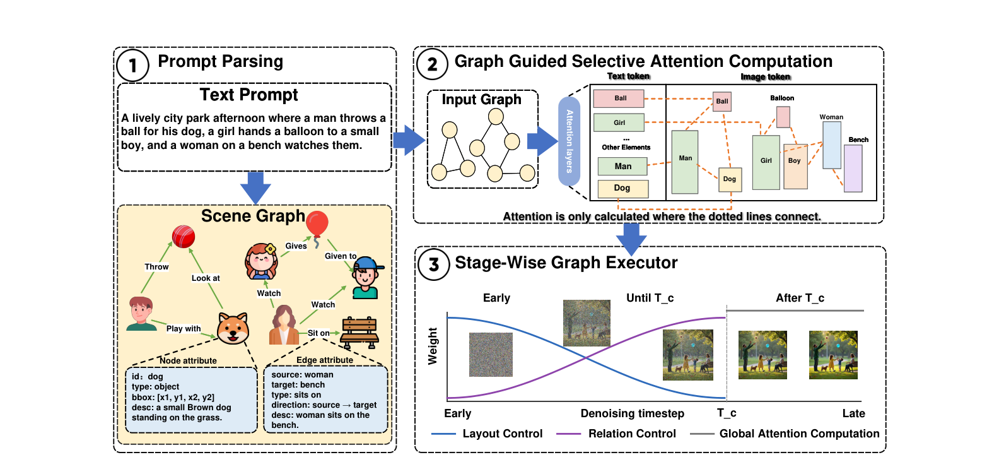

# AI Daily

2026-11-25

## 論文基本資料

**Graph2Scene: Relation-Aware Text-to-Image Generation with Graph-Guided Diffusion Model**（圖引導擴散模型的關係感知文字生圖）。作者為 Peizheng Li、Xin Ai、Guanghui Cheng、Zikang Dong、Qiange Wang 與 Yanfeng Zhang；原文列出的機構是中國東北大學（Northeastern University, China）電腦科學與工程學院。[1]

論文編號為 [arXiv:2611.30964v1](https://arxiv.org/abs/2611.30964v1)，於 2026-11-23 首次提交，分類為 cs.CV。arXiv 紀錄沒有列出期刊或會議資訊；因此截至 2026-11-25，應將它視為**尚未確認正式發表 venue 的預印本**，不是已核實的頂會論文。[2]

我選它是因為它直接把「training-free」和「attention modulation」結合，並把控制對象從物件位置擴展到物件之間的關係。它有可檢查的注意力遮罩公式、同骨幹基線與消融；但目前只有預印本證據，正式會議優先這一項未能滿足。

## 核心貢獻與方法

多物件提示詞即使把每個物件放在正確位置，模型仍可能弄錯「誰把什麼交給誰」或漏掉互動。Graph2Scene 將提示詞交給 Qwen3-VL-8B-Instruct，解析成場景圖：物件是節點，語義關係是邊，節點保存文字描述與預測區域。接著把節點、邊轉成凍結擴散 Transformer 的注意力限制，不需微調生成模型。[1]

*圖 1：原文 Figure 2 的聚焦裁切，只保留提示解析、選擇性注意力與階段式控制流程，未截取整頁。[1]*

令場景圖為 \(G=(\mathcal V,\mathcal E)\)。每個物件節點 \(v\) 對應文字 token 集 \(\mathcal T_v\) 與影像區域 token 集 \(\mathcal X_v\)；關係邊 \(e\) 對應關係 token 集 \(\mathcal T_e\)，並連接參與互動的節點 \(\mathcal V_e\)。文字到影像的 cross-attention 遮罩可寫為：

$$
M_{\mathrm{cross}}^{T\to I}(i,j)=
\begin{cases}
0, & (t_i\in\mathcal T_v\land x_j\in\mathcal X_v)\\
   & \quad\lor (t_i\in\mathcal T_e\land x_j\in\bigcup_{v\in\mathcal V_e}\mathcal X_v),\\
-\infty, & \text{其他情況。}
\end{cases}
$$

影像到文字方向採相應的轉置遮罩。直觀地說，物件詞只能連到自己的區域；關係詞則能連到該關係涉及的所有物件區域。\(-\infty\) 在 softmax 後會使被禁止的注意力權重變成零。[1]

影像 self-attention 也由圖結構限制：同一物件區域內可以互相注意；不同區域只有在對應節點由場景圖中的關係邊連接時才可互通。將 cross-attention 與 self-attention 遮罩合併為 \(M_{\mathcal G}\) 後，注意力是：

$$
\operatorname{Attention}(Q,K,V;M_{\mathcal G})=
\operatorname{softmax}\!\left(\frac{QK^{\mathsf T}}{\sqrt d}+M_{\mathcal G}\right)V.
$$

另一個關鍵是不要整段去噪都套用圖遮罩。模型先以一次無額外引導的 warm-up 收集文字 token 注意力。對 token \(u\)，令 \(\mathcal C_u\) 為高響應區域及其正規化分數，注意力洩漏定為 \(L_u=1-\max_{c\in\mathcal C_u}c\)。同類 token（物件詞彼此、關係詞彼此）的空間重疊為 \(O_{u,v}=|H_u\cap H_v|/|H_u\cup H_v|\)。取全體最大洩漏 \(L_{\max}\) 與最大重疊 \(O_{\max}\)，再令：

$$
\rho=\max(L_{\max},O_{\max}),\qquad T_{\mathrm{ctrl}}=\rho T_c.
$$

因此，注意力越混亂，圖引導時間越長。控制期間，layout 權重由 1 線性降到 0，relation 權重由 0 升到 1；到 \(T_{\mathrm{ctrl}}\) 後逐步回到預訓練模型的全域注意力。論文將最大控制跨度設為總去噪步數的 60%。[1]

## 實驗結果

在 T2I-CompBench 的 VLM 忠實度評分中，Graph2Scene 的物件存在、屬性綁定、關係正確率分別是 **0.94、0.80、0.89**；相同 FLUX.1 骨幹的 Regional Prompt 為 **0.88、0.69、0.73**，原始 FLUX.1 為 0.79、0.66、0.60。官方 benchmark 指標也有提升，但幅度較小：Spatial relationship 為 0.5816 對 0.5483，Complex 為 0.4374 對 0.4196；Non-spatial relationship 僅由 0.3105 到 0.3149。[1]

作者另建構較複雜的 ConceptMix 提示，將概念數擴至 \(K\in[8,20]\)，並加入物件互動維度。在同骨幹比較中，Graph2Scene 的關係正確率為 **0.84**，高於 Regional Prompt 的 0.59 與原始 FLUX.1 的 0.42；物件存在率為 0.88、屬性正確率 0.74。CLIPScore 為 26.45（Regional Prompt 25.91），PickScore 為 22.45（21.76），HPSv2 同為 0.29。[1]

消融顯示 layout 與 relation 控制需要依序搭配。兩者採動態比例並使用自適應控制跨度時，三項分數為 0.88、0.74、0.84；固定控制 15 步時為 0.80、0.71、0.83，固定 20 步時關係分數降至 0.38。控制過短不易建立關係，過長則會破壞模型原有生成：平均三項分數在 \(T_c=14\) 達 0.81，\(T_c=22\) 降至 0.25，\(T_c\ge24\) 時圖像崩潰。[1]

**免訓練不等於推論省時。** 在單張 NVIDIA L20、1024×1024、400–600 token 提示、五次平均的測試中，Graph2Scene 端到端需 **101.28 秒**，Regional Prompt 為 75.17 秒，約多 35%。前者包含 Qwen3-VL 場景圖規劃 39.44 秒、無引導 warm-up 與注意力分析 24.07 秒、遮罩建構 0.35 秒，以及正式生成 37.42 秒。800–1000 token 提示時，端到端耗時為 126.49 秒，基線為 83.17 秒；該設定的存在、屬性、關係分數分別約為基線的 1.73、2.52、3.53 倍。[1]

LongBench-T2I 的補充材料以定性比較描述長提示下的表現，沒有提供可與上述表格同等的定量結果，因此不把它當成統計性證據。主要 benchmark 表格亦未附信賴區間或多 seed 誤差棒；上述數字應視為作者報告的點估計，而非已證明的統計顯著差異。[1]

## 相關研究與評價

[Training-free Regional Prompting for Diffusion Transformers](https://arxiv.org/abs/2411.02395v1) 以區域提示和注意力遮罩控制 FLUX.1，讓文字片段對應指定圖像區域，是 Graph2Scene 的直接脈絡與同骨幹基線。Graph2Scene 的增量在於把關係詞也連到互動雙方，並讓場景圖相連區域交換資訊；它試圖補足「物件各自放對，但彼此互動仍錯」的缺口。[1] [3] 論文也把它與另一類場景圖生成工作區分：後者常訓練圖條件生成器或圖編碼器，而 Graph2Scene 在推論時把場景圖編譯成既有生成器的注意力控制。[1]

我認為最有價值的觀點，是把注意力控制單位從「物件在哪裡」提升為「哪些物件必須因某條關係而互相影響」。這使它比單純區域遮罩更適合多物件互動提示，也提供可檢驗的機制。主要風險是它仰賴 VLM 產生正確的節點、關係與 bounding box；錯誤場景圖會把錯誤約束注入生成。評估也使用 Qwen3-VL-8B-Instruct 構造 layout 並評估 prompt faithfulness，雖然所有基線採相同流程，仍不是人工盲評。ConceptMix 的部分提示由生成式 AI 協助構造，再由作者檢查；主結果的提示數量與跨 seed 變異在檢視到的表格中未列明。[1]

這篇論文於兩天前提交 arXiv v1，arXiv 紀錄未列正式 venue；適合作為新方向線索，不宜把結果當成已經過會議審查的結論。[2]

## 可延伸的研究想法

1. **把關係約束變成 EBT 能量。** 定義 \(E_{\mathcal G}=\sum_{e\in\mathcal E}\ell_{\mathrm{rel}}(e)\)，以關係詞對參與物件的注意力洩漏作為能量項，測試能否在推論時以能量梯度或低能量候選選擇取代固定遮罩強度。這會把「圖有沒有被滿足」變成可排序的量，而不是只看最終 VLM 分數。
2. **接上 JEPA 的互動預測。** 將節點區域的潛在表徵與關係邊送入 JEPA predictor，檢查互動前後的狀態是否符合預測；高預測誤差時才加強 relation attention。影片場景可進一步測試「誰對誰做了什麼」的時間一致性。
3. **搬到 VAR 的尺度軸。** 對粗尺度先固定物件布局，於中間尺度加強關係邊控制，細尺度再解除遮罩。比較依去噪步數調度與依 next-scale 調度，並用同一組關係準確率與延遲指標評估。
4. **嚴格測試 zero-shot 邊界。** 分開量測 VLM 解析錯誤與注意力控制錯誤，測試未見過的關係動詞、物件組合和不同生成骨幹；再比較自動圖與人工 oracle 圖，判斷瓶頸是否在 scene graph parser。

以上是研究延伸構想，不是原論文已驗證的結果。

## References

[1]: https://arxiv.org/html/2611.30964v1 "Graph2Scene: Relation-Aware Text-to-Image Generation with Graph-Guided Diffusion Model, arXiv v1 full text"
[2]: https://export.arxiv.org/api/query?id_list=2611.30964 "arXiv Atom record for Graph2Scene"
[3]: https://arxiv.org/html/2411.02395v1 "Training-free Regional Prompting for Diffusion Transformers"
