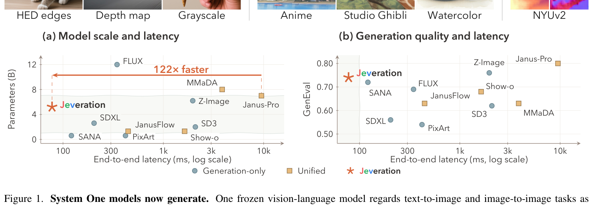
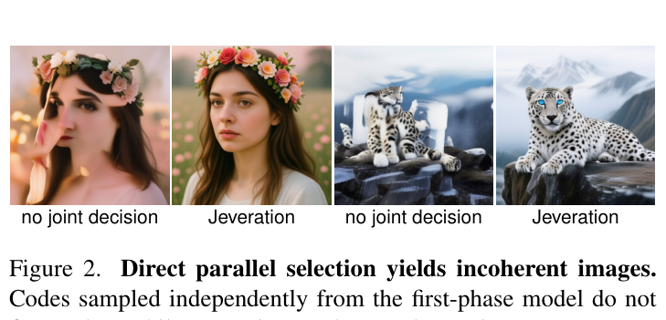
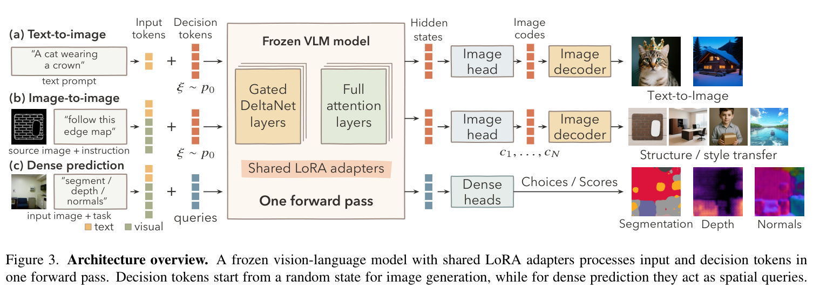
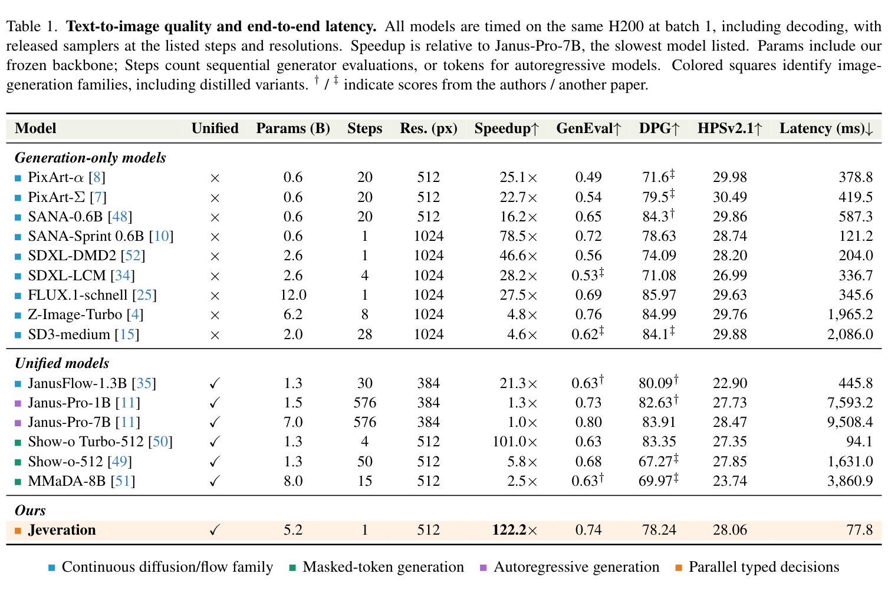
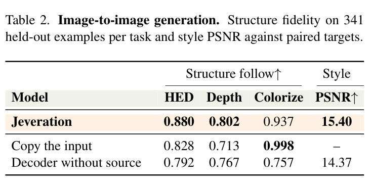
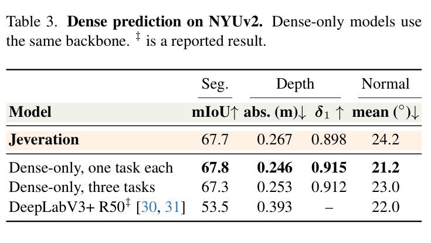
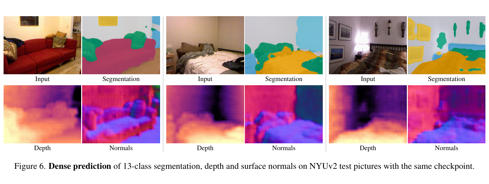
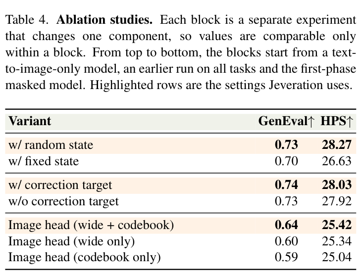
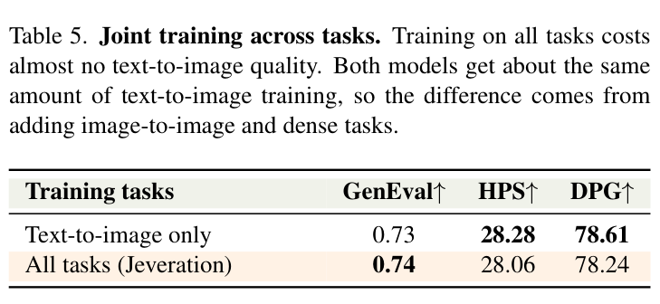
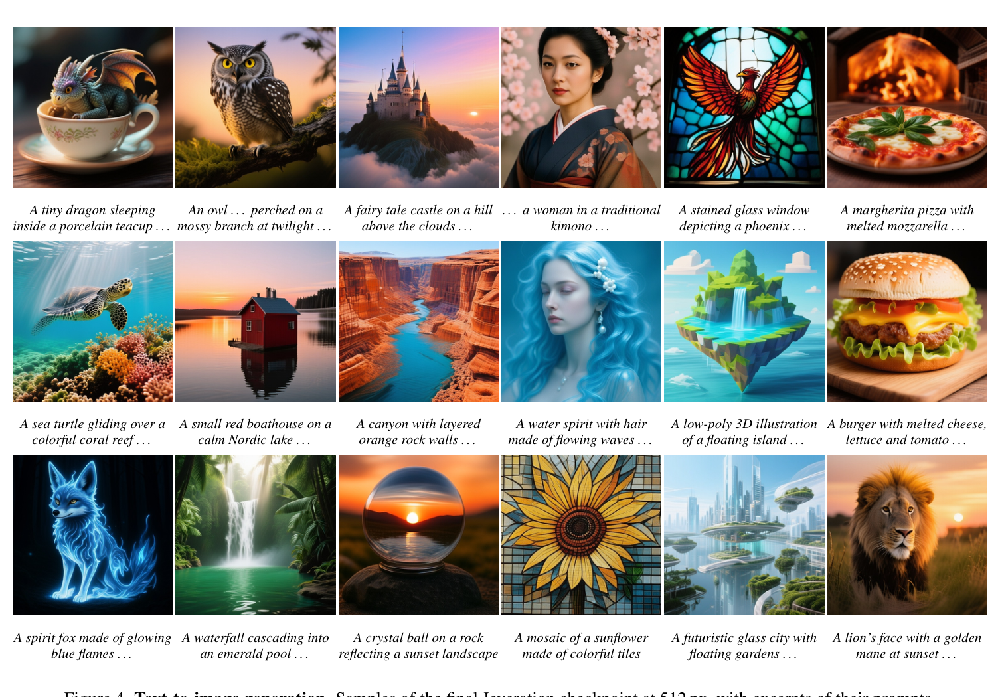

# AI Daily — Jeveration: System One Models Now Generate

> 今日閱讀：當所有主流生成模型都在「排隊走路」的時候，這篇論文把圖像生成重新定義成一次**並聯的、有類型的決策**。它不談擴散，也不談自回歸，而是問了一個更根本的問題：**一個只會「回答問題」的模型，到底能不能「作畫」？**

---

## 一、論文基本資訊

|項目|內容|
|---|---|
|標題|**Jeveration: System One Models Now Generate**|
|作者|Yuhe Liu\*、Qi Li\*（共同第一作者）、Shihua Zhang、Xinchao Wang|
|單位|National University of Singapore（NUS）。通訊作者 Xinchao Wang 為 NUS ECE 副教授，長期主導模型效率與模型合併（LoRA / DeepMerging 系列）方向|
|發表狀態|arXiv 預印本，`arXiv:2611.24738v1`，2026-11-18 上線。**未標註正式 venue**，屬於「搶先公開＋排隊投稿」的形態|
|社羣熱度|Hugging Face Daily Papers **112 upvotes**（為當期趨勢榜首位的生成類論文）；GitHub 127 stars（倉庫 2026-11-18 建立）|
|資源|程式碼 `github.com/Carol-lyh/Jeveration`（僅推理）、權重與線上 Demo 已在 Hugging Face 公開，權重 6.5 GB|
|關鍵詞|Single-pass generation、Typed decision、Latent-variable factorization、Frozen VLM、Total correlation|

為什麼選它，有三個理由。第一，它落在你近期關注的交叉點上：**凍結主幹＋少量 adapter**（training-free 的孿生思路）、**decision token 的注意力掩碼調制**、以及一個**用隨機隱變數協調並聯決策**的概率結構——而這個結構本身就能用能量視角重寫。第二，它是過去七天整個圖像生成圈最反共識的工作：它宣稱自己不是 diffusion、不是 AR，而是**第三種範式**。第三，本庫已經寫過 AR／VAR／mask／one-step distillation 的各條支線（`SparVAR`、`Any-Order-AR`、`iFSQ`、`QuadTok`），但**「決策範式」**這條線完全空白，正好補上一塊拼圖。[1] [4]

---

## 二、核心貢獻

*圖：論文 Figure 1（自 PDF 聚焦擷取，非整頁截圖）。左下圖橫軸為端到端延遲（log 毫秒），Jeveration 相對最慢的 Janus-Pro-7B 標出 **122× faster** 的箭頭。[1]*

論文的主張可以壓縮成三句話。

第一，**把圖像當成一次「聯合決策」（joint decision），而不是一串 token 或一條去噪軌跡**。文生圖的每個 code 位置是一道選擇題（從 codebook 裡選一個），深度圖的每個像素位置是一個回歸值（Score）。兩類任務被統一進同一個介面，因此同一個 checkpoint 同時支持文生圖、圖生圖與密集預測。

第二，**指出並聯決策的真正障礙，並把它量化成一個可計算的量**。位置間獨立預測之所以會產出「局部合理、整體不搭」的圖，其數學根源是目標分佈的 **total correlation（總相關性）**——論文用一行 KL 恆等式把它鎖死（見下一節）。這不是工程細節，而是範式瓶頸的解析形式。

第三，**用「一個共用的隨機狀態 $\xi$」買下這份總相關性**，並給出如何訓練模型真正去使用 $\xi$ 的兩段式配方。這個做法的妙處在於：它沒有增加任何順序計算，只是給並聯決策加了一個「共同的起點」。

---

## 三、技術方法

### 3.1 為什麼並聯決策很難：總相關性定理

給定條件 $y$（提示詞或來源圖），最樸素的做法是每個位置獨立預測：

$$q_{\mathrm{ind}}(c\mid y)=\prod_{i=1}^{N}q_i(c_i\mid y)\qquad(1)$$

它無法表達 code 之間的依賴。論文給出這種因式分解在 forward-KL 下的**最佳近似值**：

$$\min_{q_{\mathrm{ind}}}\mathrm{KL}\bigl(p\,\|\,q_{\mathrm{ind}}\bigr)=\sum_{i=1}^{N}H(c_i\mid y)-H(c\mid y)\qquad(2)$$

這個恆等式可以直接驗證，我在下面補完整條推導。先把 KL 展開，交叉項因為是乘積形式而逐位置分離：

$$\mathrm{KL}\!\left(p(c\mid y)\,\Big\|\,\prod_{i=1}^{N}q_i(c_i\mid y)\right)=-H(c\mid y)-\sum_{i=1}^{N}\mathbb{E}_{p(c\mid y)}\log q_i(c_i\mid y)$$

對每個 $i$ 單獨極小化 $-\sum_{c_i}p(c_i\mid y)\log q_i(c_i\mid y)$，最佳解就是邊際分佈 $q_i^{\star}=p(c_i\mid y)$，其值為 $H(c_i\mid y)$；代回上式即得 $(2)$。而右邊的差值恰是 **total correlation** 的定義：

$$\mathrm{TC}(c\mid y)=\sum_{i=1}^{N}H(c_i\mid y)-H(c\mid y)\;\ge\;0$$

結論非常硬：**獨立並聯決策必然殘留等於總相關性的 KL 質量，一分都省不掉**。一張連貫的圖必須有位置間的依賴，而獨立模型只能匹配邊際分佈 $p(c_i\mid y)$，於是各位置可能各自「忠於不同的圖」——這正是 Figure 2 裡「no joint decision」那兩張圖裂開的成因。[1] [2]

*圖：論文 Figure 2（聚焦擷取）。每一組左邊是同一 prompt 下的獨立並聯採樣結果（花冠與臉部交界糊成一片、雪豹與冰塊邊界不合），右邊是使用共用隨機狀態後的結果。[1]*

### 3.2 用共用隨機狀態買下總相關性

Jeveration 每張圖抽**一個**隨機狀態序列 $\xi$，並讓所有 code 位置都以它為條件：

$$q_\theta(c\mid y)=\mathbb{E}_{\xi\sim p_0}\!\left[\prod_{i=1}^{N}q_{\theta,i}(c_i\mid y,\xi)\right]\qquad(3)$$

給定 $(y,\xi)$ 時各位置依然獨立，但**因為它們共用同一個 $\xi$，邊際化之後整體就不再是乘積分佈**。這是一個標準的 latent-variable factorization，它給出一個乾淨的上界：對任何服從 $(3)$ 的分佈，

$$\mathrm{TC}_{q_\theta}(c\mid y)\;\le\;H(\xi)$$

也就是說，$\xi$ 的熵就是模型能買到的「協調預算」。論文把 $\xi$ 實作為：每個位置以 $\rho=0.6$ 的概率被 mask、其餘位置填入均勻隨機 code、並對全部 embedding 加尺度 $\sigma=0.1$ 的高斯雜訊，$N=128$，codebook 大小 $|\mathcal{C}|=8192$。

我按這個方案自己算了一遍預算。每個位置的熵是 mask 事件與填充 code 兩項之和：

$$H_{\text{pos}}=h(\rho)+\underbrace{(1-\rho)\log_2|\mathcal{C}|}_{\text{填 code 才帶來熵}}=-0.6\log_2 0.6-0.4\log_2 0.4+0.4\times 13\approx 0.971+5.20\approx 6.17\ \text{bits}$$

因此 $H(\xi)\approx 128\times 6.17\approx 790$ bits，對應約 $2^{790}$ 種有效狀態（每位置 $2^{6.17}\approx 71$ 種，$128$ 個位置相乘即得）。對照「128 個位置若彼此獨立且均勻」的滿額 $\sum_i\log_2|\mathcal{C}|=1{,}664$ bits，這個預算佔了約 **47%**。[2]

這個數字很重要，因為它推翻了一個容易誤下直覺：$\xi$ 的容量**不是**小得可憐：$2^{790}$ 遠超任何資料集裡實際存在的連貫圖像數量，所以「選哪一張圖」這件事它買得起；但它**仍然少於**滿額的位置間依賴 $2^{1{,}664}$。換句話說，$\xi$ 足以承擔「全局身份」，不足以承擔「所有局部相容性」。這恰好解釋了為什麼後面所有的訓練技巧都不是為了擴大 $\xi$ 的容量，而是為了讓模型**真的去使用** $\xi$，把這 47% 的預算花在位置間的衝突上。

### 3.3 架構：decision token 與混合注意力掩碼

*圖：論文 Figure 3（聚焦擷取）。(a) 文生圖 (b) 圖生圖 (c) 密集預測三種輸入形式共用同一條前向路徑；注意 Gated DeltaNet 層與 full attention 層交錯，且只有一套 Shared LoRA adapters。[1]*

主幹是一個**完全凍結**的 Qwen3.5-4B，其中交錯著 Gated DeltaNet 層與 full attention 層。改動只有三處，全部是可拆卸的外掛件。[2]

1. 在輸入序列後**追加 decision token**：生成任務放 $N=128$ 個（初始 embedding 由 $\xi$ 編碼），密集預測放 432 個與視覺 token 對齊的空間 query。
2. **共用的 rank-256 LoRA adapter**（所有任務共用同一組），加上**任務特定的輸出頭**。
3. **注意力掩碼的分區**：在 full-attention 層裡，decision token 之間**雙向**互相注意，而 input prefix（文字＋視覺 token）內部保持 **causal**。

第 3 點這個不對稱是全文最關鍵的結構設計——它讓 128 個並聯決策能彼此協商「我們要不要屬於同一張圖」，同時不破壞 VLM 原有的語言處理路徑，因此凍結權重裡的視覺語義知識可以被原樣複用。

每個位置的特徵 $u_i$ 由 transformer head 讀出（輸入包含該位置最終隱狀態與 $\xi$），再經兩條分支合成 code 分佈：

$$q_{\theta,i}(\cdot\mid y,\xi)=\mathrm{softmax}\bigl(f_{\mathrm{cb}}(u_i)+f_{\mathrm{wide}}(u_i)\bigr)\qquad(4)$$

其中 codebook 分支 $f_{\mathrm{cb}}$ 從 tokenizer 的 codebook 初始化（繼承離散碼的結構先驗），wide 分支 $f_{\mathrm{wide}}$ **零初始化**、直接映射到 code logits（提供 codebook 結構之外的容量）。兩者相加再 softmax，屬於典型的「先驗＋殘差」頭部設計；消融顯示兩者合用明顯優於任一單獨使用（GenEval 0.64 vs 0.60／0.59）。圖像 tokenizer 是凍結的 TA-TiTok（8,192 條目的 1D codebook），解碼器為文生圖額外微調至 512 px；圖生圖時再加一條 gated 分支把來源圖餵給解碼器。

### 3.4 訓練：先學分佈，再學決策

作者發現一個反直覺的失敗模式：**直接拿目標 code 做監督，模型會學會忽略 $\xi$**——因為 $\xi$ 與目標圖獨立，任何使用它的解都不比不用它更好。於是訓練分成兩段。[1] [2]

**第一段：用 masked prediction 學出圖像分佈。** 保持 VLM 凍結，隨機遮住 code 集合 $M$，從可見 code 預測被遮的：

$$\mathcal{L}_{\mathrm{mask}}(\phi)=\mathbb{E}\!\left[\frac{1}{|M|}\sum_{i\in M}-\log p_{\phi,i}\bigl(c_i\mid c_{\bar M},\,y\bigr)\right]\qquad(5)$$

可見 code 提供的是「這張圖自己的上下文」，模型因此被迫學習位置間的依賴。產出的 $\phi$ 就是第二段的老師。

**第二段：把隨機狀態映射成完整圖像。** 從 $(y,\xi)$ 出發，$\theta$ 一次前向採樣出 $\hat c$；把 $\hat c$ 再隨機遮成 $M$，讓兩個 masked 模型在同一可見上下文下預測：凍結的第一段模型 $\phi$ 給出 $p_{\phi,i}$（代表真實圖像分佈），輔助模型 $\psi$（初始為 $\phi$ 的拷貝，持續用 $(5)$ 在 $\theta$ 的樣本上訓練，因此跟著 $\theta$ 漂移）給出 $p_{\psi,i}$（代表 $\theta$ 當前的分佈）。最小化

$$\mathcal{L}_{\mathrm{DM}}(\theta)=\mathbb{E}\!\left[\frac{1}{|M|}\sum_{i\in M}\mathrm{sg}\bigl(p_{\psi,i}-p_{\phi,i}\bigr)^{\!\top}\ell_{\theta,i}\right]\qquad(6)$$

這裡的力學圖像很值得留意：梯度方向不是「老師 logit 減學生 logit」，而是**兩個 conditional 概率向量的差**乘上學生的 logits $\ell_{\theta,i}$（對 logits 線性，因此每位置梯度正好是那個差值）。因為每個被遮位置的 conditional 取決於同一樣本**其他 code**，所以當且僅當 $\theta$ 的並聯碼彼此相容（都落在同一張合法圖上）時，兩個預測才會吻合、差值歸零。**這等於把「全局連貫」轉成一個逐位置的可微推力**，從而逼迫 $\theta$ 去使用 $\xi$。

**最後加上信心引導的校正。** 每個 batch 中挑部分樣本，把 $\theta$ 置信度最低的 50% 位置重遮成集合 $R$，讓凍結的 $\phi$ 迭代四輪（CFG 3）補全成 $c^{\mathrm{ref}}$，再用同一個 $(y,\xi)$ 直接監督：

$$\mathcal{L}_{\mathrm{gen}}=\mathcal{L}_{\mathrm{DM}}+\lambda\,\mathcal{L}_{\mathrm{corr}},\qquad
\mathcal{L}_{\mathrm{corr}}=\mathbb{E}_{\mathrm{selected}}\!\left[\frac{1}{|R|}\sum_{i\in R}-\log q_{\theta,i}\bigl(c_i^{\mathrm{ref}}\mid y,\xi\bigr)\right]\qquad(7)$$

選「信心最低的位置」來做監督，正好命中 3.2 節的推理：**那些位置就是 $\xi$ 的預算花不到、必須靠老師補位的地方**。

**關鍵點：$\phi$、$\psi$、校正全只在訓練期出現，推理只有一次 $\theta$ 的前向。** 密集預測的監督則是普通的地面真值：分割用交叉熵、深度用 $\ell_1$、法向用 $1-\cos$。訓練總量為兩階段約 92k ＋ 6.7k steps（rank-256 LoRA，約 1.0B 可訓練參數），在 4 張 NVIDIA RTX PRO 6000 上約四天。[2]

---

## 四、實驗結果

*圖：論文 Table 1（聚焦擷取）。所有模型在同一 H200、batch 1 計時，含解碼時間；加速比以表中最慢的 Janus-Pro-7B 為基準。[1]*

**文生圖：以 1 步換全部。** Jeveration 在 512 px 達到 **77.8 ms** 端到端延遲（摘要取整為 78 ms），GenEval **0.74**、DPG 78.24、HPSv2.1 28.06，總參數 5.2B。幾個值得記下的對比：相對四步的 Show-o Turbo-512，GenEval 提升 **0.11** 同時延遲從 94.1 ms 降到 77.8 ms；相對自回歸的 Janus-Pro-1B／7B 快 **98×／122×**；相對 20 步的多步生成模型（PixArt-α／Σ、SANA-0.6B）在相同 512 px 下 GenEval 高出一截（0.74 vs 0.49–0.65）且快 5–8×。誠實的另一面是：**GenEval 0.74 仍低於 Janus-Pro-7B 的 0.80 與 Z-Image-Turbo 的 0.76**，DPG 也略輸多數對手——這是一次「用少量質量換兩個數量級延遲」的交易，論文沒有掩飾。[1] [6]

**圖生圖與密集預測：同一個 checkpoint。** 結構跟隨上，HED 邊緣 F1 0.880、深度 0.802、上色邊緣 F1 0.937，風格遷移 PSNR 15.40。NYUv2 上分割 mIoU 67.7、深度絕對誤差 0.267 m、$\delta_1$ 0.898、法向平均誤差 24.2°；對照「每任務單獨訓練」的 dense-only 模型（67.8／0.246／0.915／21.2）幾乎持平，只在中深層任務上略遜，而對照 DeepLabV3+ R50 的 53.5 mIoU 則高出 14 點。

*圖：論文 Table 2（聚焦擷取）。對照組「Copy the input」直接把條件圖當成輸出，而 Jeveration 的邊緣 F1 0.880 高於單純複製條件圖的 0.828，說明它並非只走捷徑。[1]*

*圖：論文 Table 3。生成模型能與專門的 dense-only 模型在分割 mIoU 上打平，是「決策介面統一兩類任務」最有說服力的證據。[1]*

*圖：論文 Figure 6（聚焦擷取）。同一權重、單次前向即產生分割／深度／法向三組對齊結果。[1]*

*圖：論文 Table 4。三塊各自為獨立實驗，因此只能在塊內比較；變色列為 Jeveration 實際採用的設定。[1]*

消融給出的訊號很乾淨：**隨機狀態 vs 固定狀態**（GenEval 0.73→0.70、HPS 28.27→26.63）確認了「隨機性本身」在起作用，而不只是多給了一段條件；**校正目標的貢獻偏小**（HPS 28.03 vs 27.92，GenEval 不變），作者自己的解釋是分佈匹配已經把 code 選好，校正只做微調。聯合訓練（Table 5）幾乎免費：全任務模型 0.74／28.06／78.24 vs 只訓文生圖的 0.73／28.28／78.61，說明一組 adapter 能在凍結 VLM 上同時承擔差異極大的視覺任務而幾乎不互相干擾。[1]

*圖：論文 Table 5。兩個模型獲得等量的文生圖訓練，差異只來自額外加上的圖生圖與密集任務。[1]*

*圖：論文 Figure 4（聚焦擷取）。512 px、單次前向、每張圖各一次採樣。[1]*

---

## 五、相關研究背景

把 Jeveration 放回的地圖上看，它處在三條線的交點。

**一、離散 code 並聯生成線。** MaskGIT（CVPR 2022）→ Muse → Meissonic（ICLR 2025）→ MaskGen／TA-TiTok（ICCV 2025）把「半迭代式並聯遮罩解碼」做起來，但仍需數十輪。**Di[M]O**（ICCV 2025）把它蒸成一步，方法正是一個輔助模型與一個老師模型的 token-level conditional 匹配；**Soft-Di[M]O**（ICLR 2026）再用 soft embedding 讓這條線可微分。**Jeveration 的 Eq.(6) 幾乎是 Di[M]O 的直接移植**，差別在老師不再是獨立的專用生成器，而是「同一個凍結 VLM 在第一段訓出來的 masked 變體」，因此整套方法長在 VLM 上。本庫已寫過這條線的鄰居（`iFSQ`、`QuadTok`、`BitDance`），但沒寫過 Di[M]O／TA-TiTok 本身，值得補一篇。[7] [8] [9]

**二、統一多模態模型線。** Transfusion、Chameleon、Janus／JanusFlow、Show-o、MMaDA（NeurIPS 2026）這一族統一「理解＋生成」，但它們的生成側無一例外是**順序**的：AR 逐 token，或 flow/diffusion 逐步去噪。Jeveration 的差異是把生成的順序性徹底拿掉，代價是需要一個額外的 image decoder 與一段 128 碼的序列。同一條線上還有 LENS／DenseMLLM：它們把密集預測掛在凍結 MLLM 上，但不做生成。Jeveration 把「生成」和「密集預測」壓進同一個並聯決策介面，這是它少見的賣點。[1] [2]

**三、System One／typed decision 線（最新的一條）。** 「Jev」這個名字來自 TypeSafe AI 在 2026-09 發布的 System One 模型：不做長串文字生成，直接返回帶類型的決策值（Choices／Scores／概率），單次並行查詢。圍繞它已經形成一個小小的生態：Jeva（arXiv:2610.18773，Qi Li 與 Xinchao Wang，本論文的直系前身，從第一性原理設計決策原生架構，主打 null-awareness 與 permutation invariance）、JevVLA（arXiv:2610.35010，把 Jev 做成**能量式**的 VLA 動作打分）、Visual Jev Rewards（arXiv:2610.09328，拿決策模型當生成器的獎勵），以及本庫尚未收錄的 MedJev（同樣基於 Qwen3.5-4B、做單次前向的醫學決策模型）。Jeveration 是這條線第一次把「決策範式」推向**生成**。[10] [11] [12]

---

## 六、個人評價與意義

**我認為它真正扎實的地方是那個 KL 恆等式，而不是 122×。** $\mathrm{TC}=\sum_i H(c_i)-H(c)$ 本身是教科書級的信息論量，但把它當成「並聯生成為什麼難」的定量答案，並且據此把解法定位成「給並聯決策加一個熵為 $H(\xi)$ 的全局條件」，這是一次很乾淨的問題歸約。它同時給出一句可檢驗的預言：**買不下的那部分總相關性，只能靠順序計算、靠更好的 codebook、或者靠模型自身的前向次數來補**。解碼消融間接支持了這個圖像：只給 code、不給來源圖時仍能恢復 0.792 的 HED 邊緣 F1 與 0.767 的深度 $\delta_1$，說明 128 個碼確實承載了全局結構，而細節必須回到來源圖去拿。[1] [2]

**最需要警惕的也是 $\xi$ 的語義。** 我算出的 790 bits 預算聽起來很大，但它只是「遮罩圖樣＋隨機填充」的組合熵，裡面沒有任何關於目標分佈的資訊；真正決定連貫性的，是模型在 Eq.(6) 的推力下**把這 790 bits 映射成多少種不同的圖**。alphaXiv 的自動點評也誠實指出同一件事：隨機狀態 vs 固定狀態的消融**支持**「隨機共用條件重要」，但**並未證明** $\xi$ 是連貫性的唯一來源——固定狀態只降低 0.03 GenEval，意味著即使不靠 $\xi$ 隨機化，模型仍能靠 $y$ 本身維持大部分連貫。我認為這個保留是對的，而且這是全文最值得被後續工作攻擊的一點。[6]

**對你正在醞釀的方向，我看到四個可直接嫁接的介面：**

1. **VAR × Jeveration 的對照實驗。** VAR 的 next-scale prediction 其實也在解決同一個 TC 問題，只是它選了一條**順序**路徑：粗尺度先出，為細尺度提供一個確定性的全局摘要。Jeveration 則把「全局摘要」換成**隨機的** $\xi$。一個立刻可做的實驗是：把第一段 masked 模型的粗尺度輸出（或前幾輪解碼的中間結果）當作 $\xi$ 的替代品，也就是「用確定性粗結構取代隨機狀態」，比較同一步數下的 GenEval 與 TC 殘差。如果確定性摘要更強，那麼 VAR 的 scale-prefix 就可以被移植進並聯決策；反過來，並聯決策也提供了 VAR 一條免訓練的加速路徑——直接隨機遮掉全部細尺度、只保留粗尺度作為共用上下文。
2. **把 Eq.(6) 換成能量式。** $\mathrm{sg}(p_\psi-p_\phi)^{\top}\ell_\theta$ 的機制需要維護一個會漂移的輔助模型 $\psi$，這是全篇最工程化、也最容易不穩定的部分。同一個推力完全可以來自一個**聯合連貫性能量**：令 $E_\theta(c\mid y)$ 打分「這一組 code 是否屬於同一張圖」，取 $q\propto e^{-E_\theta}$，推理時對 $\xi$ 做 $K$ 次採樣再選最低能量者——這就把本庫讀過的 EBR（能量同時承擔 refine／halt／select 三件事）與 Jeveration（$\xi$ 承擔 mode 選擇）縫在一起，而且順手刪掉 $\psi$ 與其 EMA 追蹤。代價是需要一個能對部分遮碼打分的能量頭，而那正好可以用 $(5)$ 的老師 $\phi$ 來初始化。[3] [5]
3. **JEPA 化的 $\xi$。** 既然 $\xi$ 只是一個「全局條件」，那它未必來自噪聲。用 V-JEPA 2.1／UniJEPA 的潛在特徵當共用狀態（把隨機性留給 prompt 的多樣性，把結構留給世界模型），理論上能把這 790 bits 預算的**資訊品質**大幅提高，因為它不再是無結構的隨機位元，而是落在一個已對齊的語義流形上。這條也順勢回應了本庫 11 月連續讀過的 JEPA 系列：世界模型的特徵能不能當生成器的「共同起點」？[4]
4. **訓練-free 的注意力調制入口。** decision token 之間是純雙向注意力，而且是整個模型裡唯一「彼此協商」的部分，只有 128 個 token、成本極低。直接對 decision-token 塊內的 $\mathbf{Q}/\mathbf{K}$ 乘一個 $\gamma$（本庫 AlignVid 的 ASM 手法）就能在推理時調高逆溫度、單調降低這段注意力的熵，進而調控「一致性 vs 多樣性」。與 $(2)$ 連起來看，這給出一個可以量化報告的權衡曲線：$\gamma$ 越大，$\sum_i H(c_i\mid y,\xi)-H(c\mid y,\xi)$ 應該越小，圖越「收斂到常見模式」，但 $\mathrm{TC}$ 殘差與樣本多樣性會同步下降。零訓練、零參數，正符合你偏好的那一類幹預實驗。[1]

**最後一個觀察。** 這篇論文的技術含量不在損失函數，而在「**注意力掩碼的分區**」——讓新增的 128 個 token 雙向互相注意、同時保持輸入 prefix causal，使凍結 VLM 的知識得以原樣複用。配合「凍結主幹＋共用 LoRA＋任務頭」這套幾乎零侵入的接法，它其實是一個**結構模板**：任何想要「在理解模型上長出並聯生成能力」的工作，都可以從這三處改動開始改寫。而 Eq.(2) 提供的是一個比 FID 更根本的診斷工具——**任何並聯生成器的天花板，就是它沒有建模到的那份總相關性**。

---

## References

[1]: https://arxiv.org/abs/2611.24738 "Jeveration: System One Models Now Generate (arXiv:2611.24738)"
[2]: https://arxiv.org/html/2611.24738v1 "Jeveration HTML full text (method, experiments, appendix)"
[3]: https://github.com/Carol-lyh/Jeveration "Jeveration official inference repository"
[4]: https://huggingface.co/papers/2611.24738 "Hugging Face Daily Papers - Jeveration page and discussion"
[5]: https://carol-lyh.github.io/Jeveration/ "Jeveration project page"
[6]: https://www.alphaxiv.org/abs/2611.24738 "alphaXiv - Jeveration summary and community review"
[7]: https://arxiv.org/abs/2503.15457 "Di[M]O: Distilling Masked Diffusion Models into One-step Generator (ICCV 2025)"
[8]: https://arxiv.org/abs/2509.22925 "Soft-Di[M]O: Improving One-Step Discrete Image Generation with Soft Embeddings (ICLR 2026)"
[9]: https://arxiv.org/abs/2501.07730 "Democratizing Text-to-Image Masked Generative Models with Compact Text-Aware One-Dimensional Tokens (TA-TiTok / MaskGen, ICCV 2025)"
[10]: https://arxiv.org/abs/2610.18773 "Jeva: System One Models from First Principles (Qi Li and Xinchao Wang)"
[11]: https://arxiv.org/abs/2610.35010 "JevVLA: Jev-inspired Energy-based Adaptation for Vision-Language-Action Policies"
[12]: https://typesafe.ai/blog/introducing-system-one-models-and-jev "Introducing System One Models and Jev (TypeSafe AI, 2026-09-15)"
[13]: https://sites.google.com/site/sitexinchaowang/ "Xinchao Wang - NUS ECE Associate Professor homepage"
