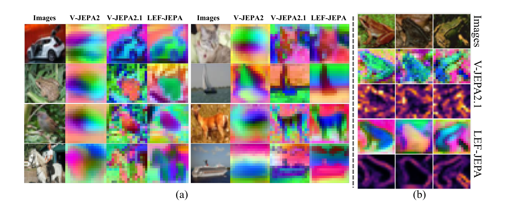
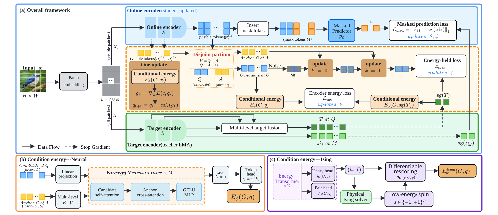
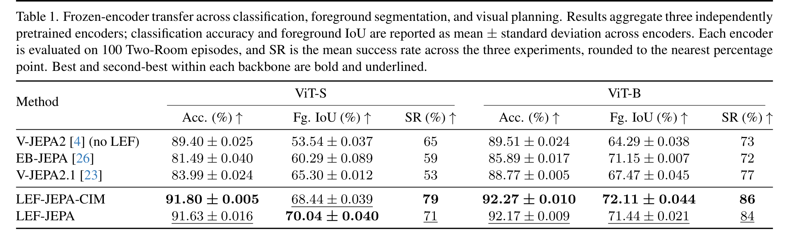
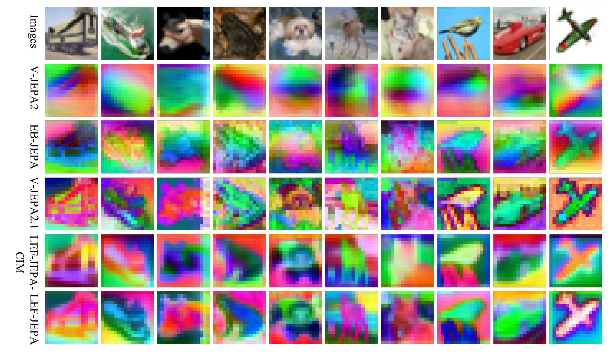
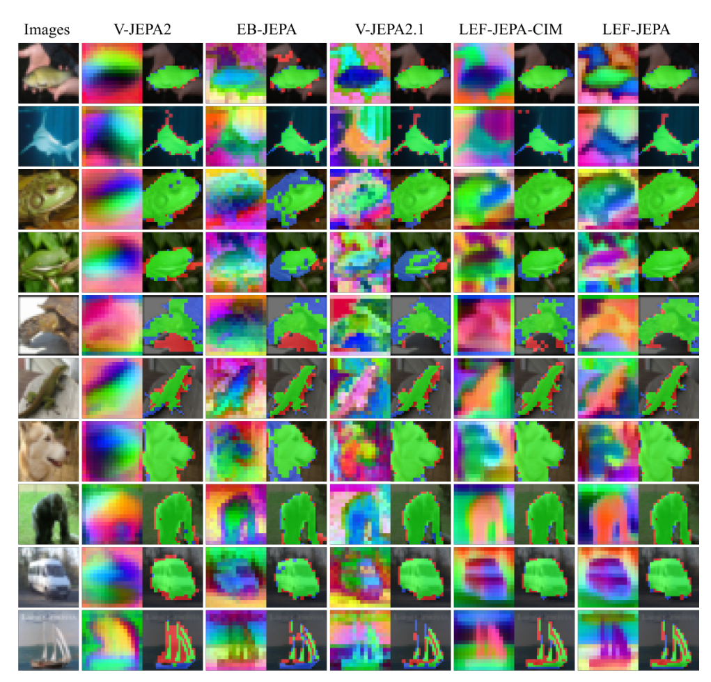
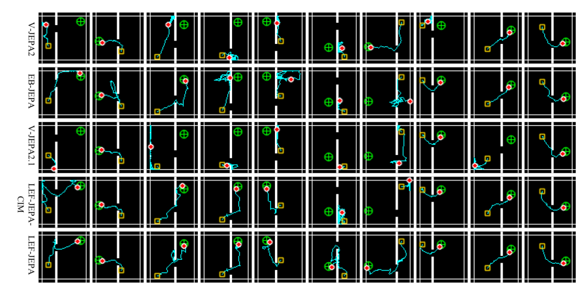
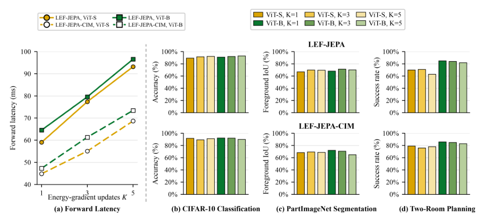
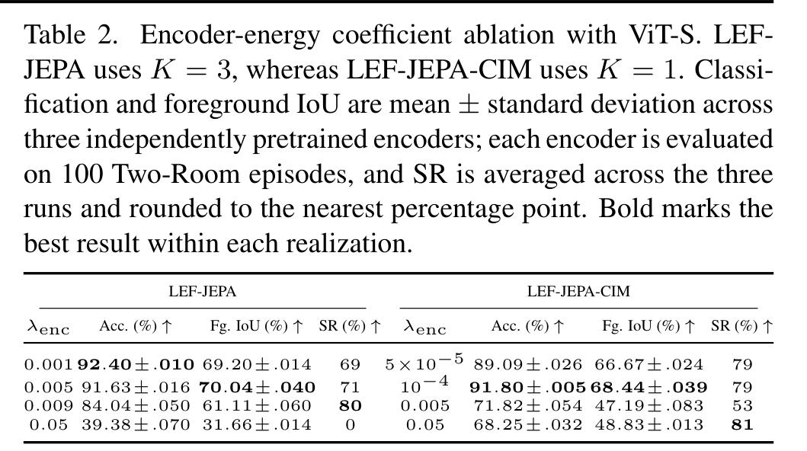

# AI Daily

## 2026-11-11｜LEF-JEPA: Denoising-Trained Latent Energy Fields for Spatial Representation Learning

### 論文資訊

**標題：** LEF-JEPA: Denoising-Trained Latent Energy Fields for Spatial Representation Learning

**作者與單位：** Zhiyuan Liu、Zhihao Xu、Sicheng Liu、Huanhuan Huang，隸屬 Qinous Technology Co., Ltd（清啟量元 QINOUS）與清華大學。首頁標明前兩位為同等貢獻，通訊作者為 Zhiyuan Liu，其信箱為清華學生信箱格式（`liuzhiyu22@mails.tsinghua.edu.cn`）。[1] [2]

**來源與狀態：** arXiv:2611.08989v1，`cs.CV` 並交叉列於 `cs.AI`，2026-11-06 提交，14 頁、7 圖、7 表，含補充材料；arXiv metadata 未列任何會議或期刊，排版採 CVPR 雙欄格式，截至 2026-11-11 應視為**預印本**，也沒有 v2 版本。[2] [3]

**連結：** [arXiv 摘要](https://arxiv.org/abs/2611.08989)｜[論文全文 HTML](https://arxiv.org/html/2611.08989v1)｜[PDF](https://arxiv.org/pdf/2611.08989v1)

**為什麼挑這篇：** 它同時命中你近期關注的四個軸——energy-based、JEPA、training-free／推理零開銷、frozen-encoder 轉移——而且把「能量」放在**預訓練期間塑形表徵**，而不是放在推理時的迭代下降。這與本庫已讀的 EBT（2026-05-23，推理時能量下降）和 TEM（2026-10-27，純能量取樣生成）形成一個清楚的三方對照。此外它的主要比較對象 V-JEPA 2.1 正是 2026-11-05 那篇的主題，今天這篇等於接在同一條線上。

*圖：論文 Figure 1（擷取自 PDF，非整頁截圖）。(a) V-JEPA2 的表徵偏粗、物體輪廓不清楚；V-JEPA2.1 恢復更多局部結構但同時保留大量紋理與顏色變化；LEF-JEPA 保留可辨識的形狀與邊界並形成更一致的空間區域。(b) 亮色代表相鄰 patch 在 PCA 子空間差異較大，V-JEPA2.1 的亮區廣泛分佈，LEF-JEPA 的亮區集中在輪廓與結構邊界。[1]*

### 核心貢獻

論文的問題意識很具體：**只在 masked 位置施加預測監督的 JEPA，學不出清楚的外形與邊界；但把低層外觀（紋理、顏色）也編進去，並不自動讓表徵更適合預測與行動。** LEF-JEPA 主張空間結構應該用「能量關係」而非「逐點回歸」來組織，並提出三項貢獻。

第一是 **target-guided latent energy field**。用 multi-level 目標表徵提供結構線索，學習被擾動表徵的局部復原方向；能量模組只在預訓練使用，下游推理完全不需要迭代修正，因此沒有額外 inference overhead。

第二是 **decoupled dual-path energy training**。同一條能量函數、兩條互不相交的梯度路徑：能量場自己學地形，編碼器只透過一個單邊（one-sided）相對能量約束接收監督，**不反向穿過那 $K$ 步復原過程**。這正是它能把結構訊號送進 encoder、又不讓 unrolled descent 變成第二條重建路徑的關鍵工程設計。

第三是 **hardware-accelerated Ising realization**。把條件能量寫成 Ising Hamiltonian，交由**物理相干伊辛機（coherent Ising machine, CIM）**搜尋低能態，再用原始浮點係數對離散解做可微 rescore，形成連續標量能量。作者在實體硬體上驗證：只用一次局部更新（`K = 1`）就能達到較低的前向延遲與較強的跨任務表現。[1]

### 技術方法

**基座仍是標準 JEPA。** 令 $\Omega = V \cup M$ 為可見與遮蔽 patch 位置集合，線上編碼器 $f_\theta$ 編可見 patch $x_V$，遮蔽預測器 $p_\psi$ 預測 $M$ 上的 latent，目標編碼器 $f_{\bar\theta}$ 由 EMA 更新、不收梯度；$z_j^\star$ 是目標 token：

$$\mathcal{L}_{\mathrm{pred}}=\frac{1}{|M|D}\sum_{j\in M}\left\|p_{\psi}\bigl(f_{\theta}(x_{V})\bigr)_{j}-\operatorname{sg}(z_{j}^{\star})\right\|_{1}$$

**第一個可搬運的技巧：contrast-preserving spatial normalization。** 對一張圖的 $n$ 個 patch token $H=[h_1,\dots,h_n]\in\mathbb{R}^{n\times D}$，先減掉全圖空間均值，再除以**所有位置共用**的一個 RMS 係數：

$$\mathcal{N}_{s}(H)=\frac{H-\mu(H)}{\sqrt{\frac{1}{nD}\lVert H-\mu(H)\rVert_{F}^{2}+\epsilon}},\qquad \mu(H)=\frac{1}{n}\sum_{j}h_{j}$$

標準 token-wise 正規化會把「邊界 token」與「內部 token」的幅度差異抹平；共用同一個 RMS 後，位置間的相對顯著性被保留下來。這個想法與能量模型無關，卻是最容易拆下來用在別處的部分。

**候選／錨點切分與多層條件。** 把可見位置互斥分成 candidate 集 $Q$ 與 anchor 集 $A$（$V = Q \dot{\cup} A$，主實驗 1:1 block 抽樣），並取三種表徵：

$$\mathcal{S}=\mathcal{N}_{s}\bigl(H_{\theta}^{(L)}\bigr)_{Q},\qquad \mathcal{C}=\Bigl\{\mathcal{N}_{s}\bigl(H_{\theta}^{(\ell_1)}\bigr)_{A},\ \mathcal{N}_{s}\bigl(H_{\theta}^{(\ell_2)}\bigr)_{A}\Bigr\}$$

目標參考 $T$ 來自 EMA 目標編碼器的多層融合，每層先做空間正規化、加權合成、再正規化一次，最後限制在 $Q$：

$$T=\left.\mathcal{N}_{s}\!\left(\sum_{\ell\in\mathcal{I}}w_{\ell}\,\mathcal{N}_{s}\bigl(H_{\bar{\theta},V}^{(\ell)}\bigr)\right)\right|_{Q},\qquad \sum_{\ell}w_{\ell}=1$$

實務設定是 anchor 用 online 第 6、9 層（權重各 0.5），target 用第 6、9、12 層（0.25、0.25、0.5）——意圖很明白：中間層給幾何、深層給語義。

**能量函數是 token 貢獻之和。** Conditional Energy Transformer 以 candidate self-attention 建模 $Q$ 內交互，再以 cross-attention 讀取 $\mathcal{C}$ 條件，經共享的 token-wise 線性頭得到 $e_i = w^{\top}h_i$：

$$E_{\phi}(\mathcal{C},q)=\sum_{i}e_{i}$$

**能量下降的塑形目標（Energy Field Loss）。** 先做保持尺度的高斯腐蝕，再走 $K$ 步被裁剪梯度的下降：

$$q_{0}=\sqrt{1-\sigma^{2}}\,S+\sigma\varepsilon,\qquad \varepsilon\sim\mathcal{N}(0,I)$$
$$g_{k}=\nabla_{q_{k}}E_{\phi}(\mathcal{C},q_{k}),\qquad q_{k+1}=q_{k}-\alpha\,\mathcal{C}_{\tau}(g_{k})$$

其中 $\mathcal{C}_{\tau}$ 把每個樣本的梯度 RMS 上限裁到 $\tau$，因此單步位移不超過 $\alpha\tau$。理想復原向量是 $\Delta=\operatorname{sg}(T-q_0)$，其 RMS 為 $r$，方向 $U=\Delta/(r+\epsilon)$。若強迫 $q_K$ 恰好抵達 $T$，每步要走 $r/K$，強擾動下可能超出可達步長而扭曲梯度地形；作者改用 **reachable-displacement** 排程：

$$\rho=\min\!\left(\frac{r}{K},\ \beta\alpha\tau\right),\qquad D_{k}=k\rho\,U$$

損失匹配的是「能量更新實際累計的位移」而不是終點位置：

$$\mathcal{L}_{\mathrm{field}}=\frac{1}{\sum_{k=1}^{K}a_{k}}\sum_{k=1}^{K}a_{k}\,\frac{\bigl\lVert (q_{k}-q_{0})-D_{k}\bigr\rVert^{2}_{Q}}{|Q|\,D}$$

這裡 $\mathcal{S},\mathcal{C},T$ 全部 stop-gradient，只更新能量參數 $\phi$；但因為每個 $q_k$ 都依賴 $\nabla_q E$，反傳需要 state 與 $\phi$ 的混合二階導（自動微分只算 Hessian–vector product，不顯式建 Hessian）。

**第二個可搬運的技巧：單邊相對能量約束（Encoder Energy Loss）。** 令 $\bar{E}(\mathcal{C},X)=E(\mathcal{C},X)/|Q|$ 為依候選位置數正規化的能量：

$$\mathcal{L}_{\mathrm{enc}}=\gamma\,\operatorname{softplus}\!\left(\frac{\bar{E}_{\phi}(\operatorname{sg}(\mathcal{C}),\,S)-\operatorname{sg}\bigl[\bar{E}_{\phi}(\mathcal{C},\,T)\bigr]}{\gamma}\right)$$

它的語意是「把你的表徵放到由目標參考所定義的低能那一側」，而不是「讓兩個標量能量相等」或「讓 $S=T$」。$\gamma$ 控制軟邊界的平滑度；$\phi$、顯式條件 $\mathcal{C}$ 與 $T$ 都是 stop-gradient，梯度只從 $S$ 進入編碼器，且因為 $S$ 的正規化統計量跨所有可見 token 共用，編碼器梯度在空間上是耦合的。

**參數分途優化：**

$$\min_{\theta,\psi}\ \mathcal{L}_{\mathrm{pred}}+\lambda_{\mathrm{enc}}\mathcal{L}_{\mathrm{enc}},\qquad \min_{\phi}\ \lambda_{\mathrm{field}}\mathcal{L}_{\mathrm{field}}$$

預訓練結束後，能量模組整個丟棄。

**第三個可搬運的技巧：把離散硬體接進連續自監督。** Ising 變體用係數網路預測 unary bias 與對稱 coupling，構成 $B=16$ 個 logical spin 的 Hamiltonian：

$$\mathcal{H}_{\omega}(s;\mathcal{C},q)=-\sum_{i=1}^{B}h_{i}s_{i}-\frac{1}{2}\sum_{i\neq j}J_{ij}s_{i}s_{j},\qquad s_{i}\in\{-1,+1\}$$

物理 CIM 回傳一池低能態 $\mathcal{S}$，再以原始浮點係數 rescore，用截斷 soft-min 聚合回連續標量能量：

$$E_{\omega}^{\mathrm{Ising}}(\mathcal{C},q)=-\tau_{s}\log\!\left[\frac{1}{|\mathcal{S}|}\sum_{s\in\mathcal{S}}\exp\!\left(-\mathcal{H}_{\omega}(s;\mathcal{C},q)/\tau_{s}\right)\right]$$

池中的 $s$ 被當結構錨點（detached），梯度經 $(h,J)$ 回到表徵 $q$，**不穿過離散搜尋本身**。對稱的 coupling 則由 pair descriptor

$$u_{ij}=\bigl[v_{i}+v_{j},\ |v_{i}-v_{j}|,\ v_{i}\odot v_{j}\bigr]$$

保證（$u_{ij}=u_{ji}$ 因此 $J_{ij}=J_{ji}$，對角線設零）。更關鍵的成本設計是：每條 $K$ 步復原軌跡**只在初始擾動態 $q_0$ 查一次物理硬體**，回傳的池給所有 $K$ 步重用，因此實體呼叫次數對 $K$ 是 $\mathcal{O}(1)$。

*圖：論文 Figure 2（擷取自 PDF）。(a) 可見 token 分成 disjoint 的 candidate／anchor 兩組；錨點條件化被擾動候選表徵上的 latent energy landscape；multi-level 目標同時監督 $K$ 步能量梯度造成的位移（$\mathcal{L}_{\mathrm{field}}$）並提供 encoder 監督的目標能量參考（$\mathcal{L}_{\mathrm{enc}}$），再加上 masked prediction（$\mathcal{L}_{\mathrm{pred}}$）。(b) 連續 neural 能量實現。(c) 條件 Ising 實現：預測 $(h,J)$ → 物理 Ising solver 搜尋低能 spin → 可微 rescore。[1]*

### 實驗結果

**協議。** 所有方法都從零在無標註 CIFAR-10 上做自監督預訓練（300 epochs、batch 256、AdamW、lr $3\times10^{-4}$、$\sigma\sim\mathcal{U}(0.1,0.5)$、$\alpha=0.1$、$\tau=1.0$、$\beta=0.8$），用 $2\times2$ patch 得到 $16\times16$（256 token）的密集空間取樣；masking 為 11–12 個 $4\times4$ 重疊塊、平均約 50%。骨架是 ViT-S（寬 384／12 層／6 頭）與 ViT-B（768／12／12），masked predictor 與 conditional energy Transformer 都是 160 寬、2 層。主實驗取 $\lambda_{\mathrm{enc}}=0.005$、$K=3$（連續 neural 版）與 $\lambda_{\mathrm{enc}}=10^{-4}$、$K=1$（CIM 版）。[1]

下游一律**凍結編碼器**，分三個粒度：CIFAR-10 linear classification（in-distribution 全域語義）、OOD 轉移到 PartImageNet 的線性前景分割（把整個物件標註轉成 16×16 前景格，僅擬一個 $1\times1$ 兩類卷積）、以及 Two-Room 連續環境的 action-conditioned 規劃（CEM 30 迭代／300 候選／30 elite，每個編碼器 100 episodes）。數值彙整 3 個獨立預訓練編碼器。[1]

*圖：論文 Table 1（擷取自 PDF）。[1]*

要點如下。V-JEPA2.1 在 ViT-S 上把前景 IoU 由 53.54 推到 65.30（+11.76 pt），但分類掉 5.41 pt、規劃成功率由 65% 掉到 53%；EB-JEPA 也出現「分割變好、分類變差」的同型取捨（81.49% / 60.29% / 59%）。LEF 的兩種實現則在兩個骨架、三項任務上全部勝過這些基線：ViT-B 的 LEF-JEPA-CIM 是 92.27% 分類、72.11% IoU、86% 規劃，LEF-JEPA 為 92.17% / 71.44% / 84%，相對 V-JEPA2.1 依序 +3.40、+3.97、+7 pt。作者據此宣稱打破了「語義能力 vs 空間能力」的 trade-off。[1]

兩種實現的差異很有意思。連續 neural 能量靠 $K=3$ 的迭代位移做細部引導，在 ViT-S 上拿到最高前景 IoU 70.04%；離散 spin coupling 會天然濾掉細碎的紋理與顏色波動，因此 CIM 版只需**一次**局部更新就在兩個骨架上拿下最強分類與規劃，ViT-B 的 IoU 反而最高（72.11%）。[1]

緊接著是另一組 CIFAR-10 sample 的 patch-token PCA，五種方法並排。V-JEPA2 的行近似整張圖一個平滑梯度，LEF 的兩列則在物體範圍與邊界上形成可辨識的一致區域。

*圖：論文 Figure 3（擷取自 PDF）。PCA 對每張圖獨立擬合，因此顏色在不同方法之間不可直接比較。[1]*

*圖：論文 Figure 4（擷取自 PDF）。綠／紅／藍分別為 true positive、false positive、false negative。相對 V-JEPA2.1 與 EB-JEPA，LEF 的前景遮罩更完整、窄結構周圍的溢出與破洞更少。[1]*

*圖：論文 Figure 5（擷取自 PDF）。每欄固定同一任務、橫向比較各方法；黃／綠／青／紅分別為起點、目標、實際路徑與最終狀態。兩列 LEF 軌跡多數穿過門洞抵達目標區。[1]*

**$K$ 與硬體延遲。** $K\in\{1,3,5\}$ 的消融顯示：連續能量在 $K=3$ 得到最佳分割與較均衡的跨任務表現，$K=5$ 再提升分類但不再改善分割或規劃；CIM 版偏好更淺的更新，ViT-B 在 $K=1$ 時三項任務全最佳。原因也清楚——CIM 只在 $q_0$ 查一次實體硬體，後續步驟只是對同一池狀態重新 rescore，因此不會帶來系統性增益。作者量測到 CIM 在 $K=1$ 的前向延遲約 45–47 ms，低於 neural 版 $K=3$；Figure 6 的折線對應約 77.5–79.5 ms。能量模組在預訓練後被移除，因此 $K$ 不影響部署延遲。[1]

*圖：論文 Figure 6（擷取自 PDF）。實線為 LEF-JEPA、虛線為 LEF-JEPA-CIM；CIM 延遲不含雲端通訊與排隊。[1]*

**$\lambda_{\mathrm{enc}}$ 相當敏感。** ViT-S 上連續能量的最佳點落在 0.005（IoU 70.04），但 0.009 就掉到 84.04% / 61.11%，0.05 直接崩潰成 39.38% / 31.66%、規劃成功率 0%；CIM 版 0.005 也退到 71.82% / 47.19%。兩種實現的最優 $\lambda_{\mathrm{enc}}$ 相差 50 倍，意味著這個約束需要針對實現分別調校。[1]

*圖：論文 Table 2（擷取自 PDF）。[1]*

### 相關研究脈絡

**V-JEPA2 與 V-JEPA2.1。** 前者把 image JEPA 擴展到影片，成為視覺世界模型的共同基座；後者（本庫 2026-11-05 已解析）以距離加權的 context loss 同時監督 masked 與 visible token，並在多個 encoder 深度施加深層自監督，換到更強的密集特徵。LEF-JEPA 的定位是把「密集結構」從逐點回歸改成能量關係約束，並批評 2.1 的代價是把過多低層外觀編進表徵。[1] [4]

**EB-JEPA（Meta FAIR，`arXiv:2602.03604`）。** 這是最直接的能量式 JEPA 前作：把 latent prediction error 本身定義為能量，再配 VICReg／SIGReg 防止塌縮，程式碼開源，v3 是 ICLR world models workshop 的 camera-ready；其原文報告 CIFAR-10 probing 約 91%、Two Rooms 規劃 97%。LEF-JEPA 明確區分自己：不把預測損失重定義成能量，也不需要推理時迭代下降。需要注意的是，本文在自己的統一協議下重訓 EB-JEPA 只得 81.49%／59%，協議差異不小。[1] [5]

**能量下降用於生成與推理。** Energy Transformer（NeurIPS 2023）以 token 級能量下降做關聯記憶；EBT（ICLR 2026，本庫 2026-05-23）把能量同時用於學習與 System-2 思考；TEM（`arXiv:2610.31889`，本庫 2026-10-27）則讓對比式 EBM 直接在 latent 空間從雜訊生成圖像。LEF-JEPA 站在同一支譜系的另一端：**能量只在預訓練期間存在，推理時一點都不留。** 對照這三篇可以看出「能量該放在訓練還是推理」是可選設計，而不是 EBM 的必然要求。[1] [6] [7] [8]

**物理 Ising 與機器學習。** 既有工作主要把實體 Ising 裝置當 Boltzmann 採樣器，用於生成模型的負相統計，例如同為 CIM 生態系的 Kaiwu-PyTorch-Plugin（`arXiv:2602.19114`，GitHub `qboson/kaiwu-pytorch-plugin`）加速 RBM／Boltzmann 採樣並組出 QBM-VAE、Q-Diffusion。LEF-JEPA 的差異是把實體低能態搜尋直接放進自監督預訓練的閉迴圈，並用可微 rescore 把離散解轉回連續表徵的梯度。硬體端走 QBoson 的 Kaiwu SDK；該供應商（北京玻色量子）的「馭量·山海1000」為 1000 計算量子位元專用機，2026 年 4 月完成約人民幣 10 億元 B 輪。CIM 本身的技術脈絡可見 Inagaki 等（Science 2016）與 Yamamoto 等（npj Quantum Information 2017）。[1] [9] [10] [11] [12]

**作者與團隊脈絡。** 第一作者 Zhiyuan Liu 同時是該團隊 2026-10-20 那篇 Quantum-JEPA（`arXiv:2610.27921`，以 conditional quantum Born prior 建模未來表徵分佈）的第一作者，第三作者 Sicheng Liu 也是該文共同作者，兩篇明顯出自同一支小團隊。清啟量元官網自述成立於 2026 年 7 月，把「Quantum for AI」與量子世界模型列為首要研究方向，團隊成員多為清華電機工程與物理背景。以這個脈絡看，LEF-JEPA 不是孤立的一次嘗試，而是這家公司把 JEPA、能量模型與伊辛硬體接成一條研究線的最新一步。[13] [14]

** regularization 血緣。** LeJEPA（本庫 2026-05-31）與 LocaLeJEPA（2026-10-24）走分佈正則化；VISReg、LeVJEPA、DINOv3 的 Gram anchoring 則處理局部相似與長訓練穩定性；Causal-JEPA（ICML 2026，本庫 2026-09）用 object-level latent masking、Temporal Straightening（ICML 2026）約束 latent 軌跡曲率。LEF-JEPA 把自己放在「用結構線索約束局部復原方向」這一格，而非正則化表徵分佈。[1] [15]

### 評價與研究啟發

我的判斷是：這篇最有價值的部分不是「用了量子硬體」，而是三個可以立刻拆下來用的想法，而且它們都便宜。[1]

**(a) 監督位移而不是終點。** $\mathcal{L}_{\mathrm{field}}$ 加上 reachable-displacement 排程（$\rho=\min(r/K,\beta\alpha\tau)$）等於在說：別要求 $K$ 步後到達目標，只要要求能量每步給的方向與幅度是「可達且朝向目標」。這比匹配終點更耐強擾動，也避免地形被拉出無法實現的陡峭梯度。

**(b) 共用 RMS 的空間正規化。** 把 token-wise 歸一化換成全圖共用的單一 RMS 係數，邊界相對內部就仍保有幅度差。這個操作與能量無關，純粹是正規化統計量的取捨。

**(c) 單邊相對能量約束。** $\gamma\,\operatorname{softplus}((\bar E(S)-\bar E(T))/\gamma)$ 只需要一個「比參考更低」的不等式，不配對負樣本、也不要求標量匹配；而且梯度只走自己的輸出，不穿過 unrolled descent。

以下把這三點延伸成可驗證假說——它們不是原文貢獻。

**Training-free／attention modulation：** 把 $\mathcal{N}_s$ 當成即插即用的特徵修飾器，套在 DiT／MMDiT 的 cross-attention $K/V$ 之前，或 VAR／next-scale 模型的 anchor token 上，檢查結構控制（邊界保留、物體完整性）是否提升；成本只有一次 reduction，可測 FID、GenEval 與邊界 IoU。若有效，它會是一個比多數 attention-steering 更便宜的槓桿。

**Energy-based verifier at inference：** LEF 訓練完就把能量頭丟掉；但那個頭本來就是「比目標參考高還是低」的判別器。把凍結能量頭留下來，對多候選／多尺度分支算 $\bar E_{\phi}(\mathcal{C},S^{(i)})$ 做逐尺度淘汰，和本庫 ATLAS（注意力淘汰 + ImageReward）與 SpecKCast（協方差風險閘）正好是同一題的三種解。關鍵消融是「只用能量分數」對比「能量 + 外部 reward」。

**CFG 的另一種形式化：** classifier-free guidance 可比擬為條件與無條件兩支路的對稱外插；LEF 的單邊 softplus 提供了「只要求條件側能量更低」的替代目標。可以試一個訓練期變體：對 $x_0$ 的條件／無條件 latent 施加 $\mathcal{L}_{\mathrm{enc}}$，推理時完全零額外 NFE，與 SoftCFG（本庫 2026-01）、Images Talk Back 的 negative-branch 抑制對照。

**位移式監督給 tokenizer／representation：** 把 Eq (8)–(9) 搬進 VAE／RAE latent 訓練——不要求復原到目標 latent，只要求 $K$ 步下降的累計位移對齊可達目標；比較重建 FID、分割／probe 表現，看是否也能打破「語義 vs 空間」取捨。TEM（本庫）用能量做生成、LEF 用能量做表示，這裡有直接可接的縫。

**離散池當結構化先驗：** CIM 版本質上是「一次搜尋出一池低能配置、後續步重用」。同一個 amortize 思路可以搬到 initial-noise 多樣化（本庫 DetNO 用 log-determinant 做整批多樣化）或 cache 刷新決策（本庫 PoSTCache、Z-Cache 都在處理「何時重算」）。可測的取捨很明確：池重用 $K$ 次對比每步重算，品質／延遲曲線在哪裡交叉。

**「該不該留紋理」是可測的任務軸：** LEF 的立場是少編低層細節對預測與行動更好；生成任務常常相反，外觀細節正是要的。合理的實驗是同一預訓練配方下做雙分支（一組保留細節、一組抑制細節），分別評生成與分割／規劃，把直覺變成曲線。這也直接關乎你想知道的 zero-shot 問題——表示該不該留紋理，會左右它能否被無訓練地讀出來。

**嚴格 zero-shot 的缺口：** 本文是 frozen encoder + 線性頭，不是 zero-shot、也不是 training-free（預訓練與能量超參都需要調）。若要接上 zero-shot，可試把能量梯度場 $\nabla_q E_{\phi}(\mathcal{C},q)$ 本身當成 promptable segmentation／localization 的訊號源，在模型留下 tiny energy head 的前提下，與 SAM 類或 JEPA dense 特徵做無訓練比較——這恰好檢驗 LEF 「推理時不需要能量」的假設在什麼任務上會反轉。

### 限制與判讀

**規模是最主要的保留點。** 全部預訓練在 CIFAR-10（32×32、50k 張）上，PartImageNet 也被降採樣到 32×32，骨架只有 ViT-S／B，300 epochs。因此「打敗 V-JEPA2.1」只能讀成「在他們自己的小規模統一協議下、重新訓練的 V-JEPA2.1 實作被超過」；釋出的 V-JEPA 2.1 是在大規模影片上訓練的 2B ViT-G（本庫 2026-11-05 有詳述），兩者不可直接比較。[1] [4]

**基線重現的落差沒有被解釋。** EB-JEPA 原文報告 probing 91%、Two Rooms 規劃 97%，本文在自己的協議下重訓得 81.49%／59%。這個差距可能來自 head、augmentation、訓練長度等設定差異，但論文沒有附基線重現的完整對照，讀者對「LEF 相對 EB-JEPA 的增益有多少來自協議」應保留判斷。[1] [5]

**數據報表有幾處需要問。** 跨 3 個獨立預訓練編碼器的標準差只有小數點後二三位（例如 89.40±0.025），小得不自然；Table S5 中 LEF-JEPA 在 ViT-S、$K=1$ 的分類 89.40±.025 與 V-JEPA2（no LEF）基線完全相同（連標準差都一樣），比較像排版／複製問題而不是巧合。規劃成功率被四捨五入到整數百分比，因此 1 個百分點級別的差異不該被過度解讀。[1]

**消融不完整。** 有 $K$ 與 $\lambda_{\mathrm{enc}}$，也有「完全不加能量」的 V-JEPA2 對照，但缺少「只留 $\mathcal{L}_{\mathrm{enc}}$、去掉 $\mathcal{L}_{\mathrm{field}}$」這類把兩個能量損失拆開的實驗，也缺 multi-level 目標（層數與權重）的系統消融；而 $\lambda_{\mathrm{enc}}$ 的敏感性（0.05 直接崩潰到 39.38%／SR 0）說明這個約束目前需要細心調校。[1]

**硬體與可重現性。** CIM 路徑依賴外部供應商雲端；延遲量測明確排除通訊與排隊，實際可用成本會更高。$B=16$ logical spins、池內最多 8 個狀態的規模非常小，與 CIM 常被演示的組合優化規模相差很遠，目前證據支持的是「閉迴圈可行」而非「硬體是必要解方」。此外，我查核時未找到 LEF-JEPA 的官方 code 或 project page，亦無 ImageNet 規模結果。[1] [9]

**Venue 狀態。** arXiv metadata 未列會議或期刊，應視為預印本；正式錄取狀態待確認。[2]

### References

[1]: https://arxiv.org/html/2611.08989v1 "LEF-JEPA: Denoising-Trained Latent Energy Fields for Spatial Representation Learning"
[2]: https://arxiv.org/abs/2611.08989 "arXiv abstract page for LEF-JEPA (2611.08989)"
[3]: https://arxiv.org/pdf/2611.08989v1 "LEF-JEPA paper PDF"
[4]: https://arxiv.org/abs/2603.14482 "V-JEPA 2.1: Unlocking Dense Features in Video Self-Supervised Learning"
[5]: https://arxiv.org/abs/2602.03604 "A Lightweight Library for Energy-Based Joint-Embedding Predictive Architectures (EB-JEPA)"
[6]: https://proceedings.iclr.cc/paper_files/paper/2026/hash/e19a65fd53b6f9a88b354da98813465d-Abstract-Conference.html "Energy-Based Transformers are Scalable Learners and Thinkers"
[7]: https://arxiv.org/abs/2610.31889 "Scaling Transformer Energy-based Models For High Quality Image Synthesis"
[8]: https://arxiv.org/abs/2302.07253 "Energy Transformer"
[9]: https://arxiv.org/abs/2602.19114 "Kaiwu-PyTorch-Plugin: Bridging Deep Learning and Photonic Quantum Computing for Energy-Based Models and Active Sample Selection"
[10]: https://kaiwu-sdk-docs.qboson.com/en/latest/source/getting_started/introduction.html "Kaiwu SDK documentation overview"
[11]: https://www.qboson.com/product "馭量·山海1000 1000 計算量子位元專用量子計算機"
[12]: https://thequantuminsider.com/2026-04-06/chinese-quantum-startup-qboson-raises-145-million-to-scale-chip-production/ "QBoson raises CNY 1 billion Series B to scale quantum chip production"
[13]: https://arxiv.org/abs/2610.27921 "Quantum-JEPA: Quantum Born Priors for Latent-Action JEPA World Models"
[14]: https://qinous.ai/en/ "QINOUS（清啟量元）官網：Quantum for AI 與量子世界模型研究方向"
[15]: https://arxiv.org/abs/2511.08544 "LeJEPA: Provable and Scalable Self-Supervised Learning without the Heuristics"
