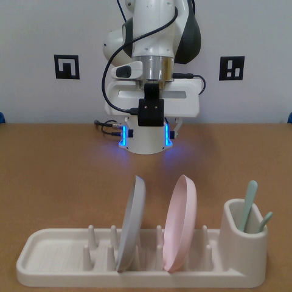

# AI Daily

## 2026-11-10｜La-JEPA: Compact Robot Policies with Latent World Modeling

### 論文資訊

**作者：** Mateo Clémente、George Z. Xue、Amin Abyaneh、Liheng Ma、Rui Heng Yang、Tongtong Cao、Zhanguang Zhang、Yingxue Zhang。論文首頁列出 Huawei Technologies Ltd.、University of Toronto、McGill University 與 Mila – Quebec AI Institute；首頁亦註明部分作者曾於 Huawei 實習。[2] [3]

**來源與狀態：** arXiv:2611.08156，v1 於 2026-11-05 提交；官方 API 記錄更新時間為 2026-11-08。API 條目未列正式會議或期刊資訊，因此截至 2026-11-10 應視為 arXiv 預印本，不能稱為已錄取頂會論文。[2]

**連結：** [論文全文](https://arxiv.org/html/2611.08156v1)｜[arXiv 摘要](https://arxiv.org/abs/2611.08156)｜[作者提供的程式碼連結](https://github.com/mt-clemente/lajepa)

### 核心想法

La-JEPA 問一個很實用的問題：機器人控制一定要沿用龐大的影片生成 Transformer 嗎？作者把預訓練 V-JEPA 2.1 的稠密視覺特徵當作狀態空間，從零初始化 World DiT 與 Action DiT；訓練時同時預測未來視覺特徵與動作，部署時則拿掉未來特徵分支，只生成動作。這讓預測式的訓練訊號仍能塑造表徵，同時避免在每次控制時生成未來影片。[1]

論文所說的「from scratch」限定於 policy Transformer，不代表完全沒有預訓練或示範資料：系統仍使用 V-JEPA 2.1 ViT-L 與 FLAN-T5-large，並以目標任務的機器人示範訓練政策。最終配方會以 LoRA 適應觀測視覺編碼器；未來特徵目標則由原始編碼器產生。[1]

*圖：論文實機任務的局部影像；由論文 PDF 擷取，非整頁截圖。[3]*

### 方法與數學目標

在時間步 $t$，V-JEPA 2.1 將多相機觀測編成 $z_{\mathrm{ctx}}$，也提供未來影格的目標特徵 $z_{\mathrm{fut}}$；文字指令由凍結的 FLAN-T5-large 編碼，機器人本體狀態（proprioception）則轉成條件 token。World DiT 負責觀測與未來特徵，Action DiT 負責一段動作 $A=(a_t,\ldots,a_{t+H-1})$。兩個 DiT 都由頭訓練，並透過跨注意力互通。遮罩規則讓 action token 可以讀取觀測 token，卻不能讀取 future token；因此未來監督可在訓練期間改善共享的觀測表徵，而不會把未來答案洩漏給動作分支。[1]

對未來特徵與動作各自取一個 flow-matching 時間 $\tau_f,\tau_a\sim\mathcal{U}(0,1)$，再以高斯噪聲建立由噪聲到資料的線性路徑：

$$z_{\mathrm{fut}}^{\tau_f}=(1-\tau_f)\epsilon_f+\tau_f z_{\mathrm{fut}},\qquad A^{\tau_a}=(1-\tau_a)\epsilon_a+\tau_a A$$

其中 $\epsilon_f,\epsilon_a\sim\mathcal{N}(0,I)$。對這條直線路徑，理想速度分別是 $z_{\mathrm{fut}}-\epsilon_f$ 與 $A-\epsilon_a$。模型同時回歸兩個速度場，目標函數為

$$\mathcal{L}=\mathbb{E}\left[\operatorname{MSE}(\hat v_f,z_{\mathrm{fut}}-\epsilon_f)+\operatorname{MSE}(\hat v_a,A-\epsilon_a)\right]$$

這裡的關鍵不是把未來特徵當成推理時必須輸出的影片，而是把它當成訓練期間的輔助預測任務，讓表示對未來動態有用。[1]

推理時移除 future tokens，從 $A_0\sim\mathcal{N}(0,I)$ 開始，以 Euler 法積分動作速度場：

$$A_{\tau+\Delta\tau}=A_\tau+\Delta\tau\,\hat v_a(A_\tau,\tau;z_{\mathrm{ctx}},z_{\mathrm{cond}}),\qquad \tau\in[0,1]$$

觀測 token 的 key/value 可先計算並快取，因此每個去噪步只需更新 action 分支。論文在 LIBERO 每次執行 10 個預測動作，在 RoboTwin 2.0 執行 24 個，之後再根據新觀測重規劃。[1]

### 實驗結果

論文將可訓練參數與部署參數分開計算：S/B/L 的 policy 參數分別為 **0.10/0.34/1.14B**，包含凍結編碼器的部署參數則為 **0.74/0.98/1.78B**。因此「小型 policy」不代表部署時完全不依賴大型預訓練表徵。[1]

在 **RoboTwin 2.0**，政策只用乾淨場景示範訓練，再測試乾淨與加入雜物、干擾物及新材質的隨機場景。La-JEPA-B 的成功率為 **86.2% / 35.4%**（乾淨／隨機），論文等權平均為 **60.8%**；三個模型尺寸中它的平均最高。這是相對於論文列出的無 embodied pretraining 基線的結果，不應誤讀為隨機場景已解決：隨機化條件下仍有約三分之二 episode 失敗。[1]

在 **LIBERO-Plus**，作者發現公開評測器把擾動參數附加到 10,030 個變體中的 8,493 個指令，可能令一個指令同時帶入多種擾動。因此論文分開報告原始釋出指令與作者修正後的指令。La-JEPA-L 在修正指令下為 **88.0%**，高於表中 NowWAM 的 **86.2%**；在原始釋出指令下則為 **84.1%**，低於 NowWAM 的 **86.2%**。這兩種 protocol 不能混在一起比較。La-JEPA-L 的部署參數為 **1.78B**，NowWAM 為 **7.1B**；作者報告 La-JEPA 在相近或更佳表現下有更低的政策呼叫延遲。[1]

在 **四項真實機器人任務**（水果採摘、方塊放置、Push T 推動、長程餐具操作），La-JEPA 平均 **17.50/20 次成功**，表列 policy-call latency 為 **25.16 ms**。同一表中的 Fast-WAM 為 16.00/20、88.09 ms；具 embodied pretraining 的 $\pi_{0.5}$ 為 17.25/20、71.89 ms。這個 latency 是政策呼叫時間，不是整個控制迴路時間；實機證據也限於一套機器人配置與四項任務。[1]

消融結果支持兩個設計選擇。相較 action-only 訓練，加入未來特徵預測後，RoboTwin 乾淨／隨機成功率分別增加 **7.0 / 3.7 個百分點**；在 V-JEPA 與 Wan2.2 VAE 特徵的比較中，V-JEPA 在四項測試的成功率都較高，RoboTwin 隨機場景差距為 **16.0 個百分點**。不過，作者說明兩邊各自使用合適的正規化與投影，所以這是表示空間及其輸入介面的整體比較，不是完全孤立的 encoder 替換實驗。[1]

### 相關研究脈絡

**V-JEPA 2.1** 提供 La-JEPA 所需的稠密、具時空結構的特徵。其核心是以 masked prediction 監督可見與遮蔽 token，並在多層 encoder 上施加深層自監督；原論文報告 Ego4D 短期物件互動預測 7.71 mAP，以及 EPIC-KITCHENS 高階動作預測 Recall@5 40.8。[4]

**Fast-WAM** 將影片／未來預測保留在訓練期，測試時跳過未來想像；它主張影片預測的價值可能主要是改善訓練表徵。La-JEPA 沿用「訓練時預測、部署時只輸出動作」的切分，但把生成式影片骨幹換成 V-JEPA 特徵與從零訓練的 policy DiT。[5] **Faster-WAM** 則選擇保留未來表徵至推理時，以稀疏未來條件控制計算量；這提供另一個可比較的取捨：未來 latent 在部署時究竟有多少額外泛化價值？[6]

最接近的 JEPA 世界—動作工作包括 **JEPA-WAM** 與 **LeapBot-WA**。JEPA-WAM 以共享預測器把 latent transition prediction 與連續動作生成連接；LeapBot-WA 用 JEPA latent 作 world anchor，加入 Isotropic Semantic Autoencoder 與非對稱 Mixture-of-Transformers。La-JEPA 的差異是讓 World／Action DiT 從零初始化，使用 V-JEPA 2.1 作視覺表示，並以目標任務示範訓練，而不是沿用生成器作為 policy Transformer 初始化。[7] [8]

### 評價與研究啟發

我認為本文最有價值的證據不是單一成功率，而是兩項消融共同支撐的設計觀察：**未來預測在訓練期有幫助，但不必成為推理期昂貴輸出；控制所需的表示，也未必等同於高保真像素重建所需的表示。**這讓「world model 要不要真的生成未來」成為可拆解、可測量的設計選擇，而非預設必須在 inference-time 想像影片。[1] [5]

對你關注的方向，我把以下視為可驗證的延伸假說，而非原文貢獻。**Energy-based：**在候選動作及其預測未來特徵上訓練 energy critic，令 $E(z_{\mathrm{ctx}},A,z_{\mathrm{fut}})$ 對成功 rollout 給低能量、對失敗 rollout 給高能量，再測試能量引導或 reranking 是否改善 latent planning。**Training-free／attention modulation：**推理時不更新權重，依當前 JEPA token 的新穎度與 action-query attention response 重加權上下文，測量對遮擋／視角變化的增益及延遲成本。**VAR-based：**把未來 JEPA grid 做多尺度、coarse-to-fine 預測，先生成粗略未來 token 再細化，並用粗尺度狀態引導 action chunk；比較它與一次性 joint flow matching 的穩定性和計算量。最後以嚴格 **zero-shot** protocol 固定訓練示範，只更換物件類別、指令或相機，且不給新任務示範；本文的隨機場景 OOD 評估不是 zero-shot，也不是 training-free。

### 限制與判讀

論文仍是 arXiv 預印本，正式會議／期刊狀態未能由官方 metadata 核實。[2] 作者也指出沒有窮盡學習率、LoRA 設定、World／Action DiT 容量比例等搜尋；RoboTwin 的成功率不隨模型尺寸單調上升。實機測試只有一套設定與四個任務，不能推論已具備跨平台通用性。更重要的是，La-JEPA 需要目標任務示範，且使用預訓練視覺／語言編碼器，所以它不是 zero-shot policy，也不是 training-free method。[1]

可重現性目前也需要保留：arXiv metadata 提供程式碼連結，但我查核時該 GitHub repository 顯示為空倉庫；在程式與權重釋出前，數值尚不易獨立重現。[2] [9]

### References

[1]: https://arxiv.org/html/2611.08156v1 "La-JEPA: Compact Robot Policies with Latent World Modeling"
[2]: https://export.arxiv.org/api/query?id_list=2611.08156 "arXiv metadata for La-JEPA"
[3]: https://arxiv.org/pdf/2611.08156v1 "La-JEPA paper PDF"
[4]: https://arxiv.org/abs/2603.14482 "V-JEPA 2.1: Unlocking Dense Features in Video Self-Supervised Learning"
[5]: https://arxiv.org/abs/2603.16666 "Fast-WAM: Do World Action Models Need Test-Time Future Imagination?"
[6]: https://arxiv.org/abs/2608.04404 "Faster-WAM: Efficient Inference-Time Future Conditioning for World Action Models"
[7]: https://arxiv.org/abs/2608.09381 "JEPA-WAM: Learning Vision-Language-Action Policies with Joint-Embedding Predictive Architectures"
[8]: https://arxiv.org/abs/2607.23969 "World-Anchor Action Models via Predictive Latent Alignments"
[9]: https://github.com/mt-clemente/lajepa "La-JEPA official code repository"
