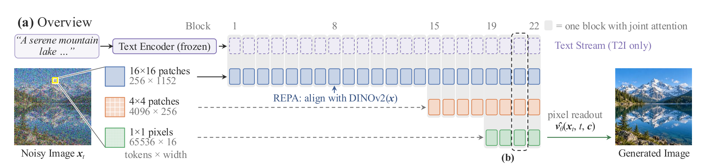
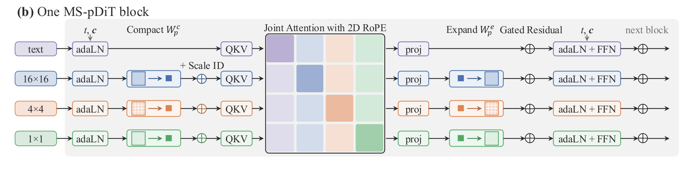
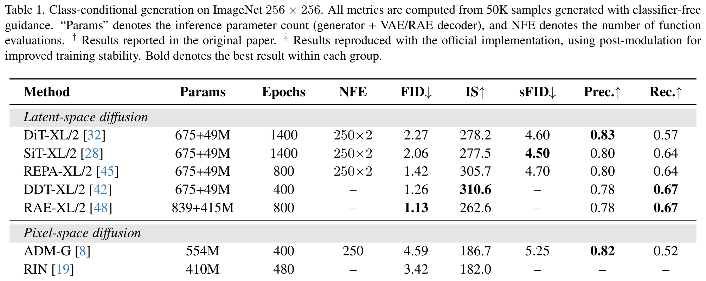
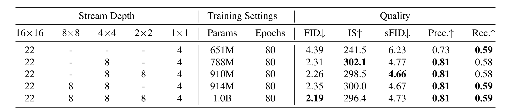
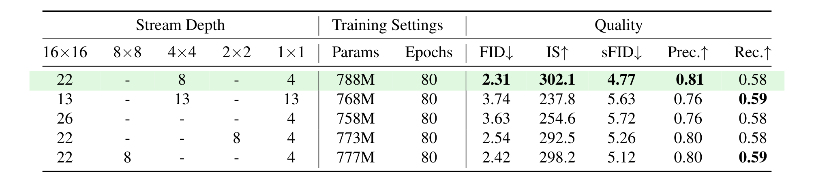
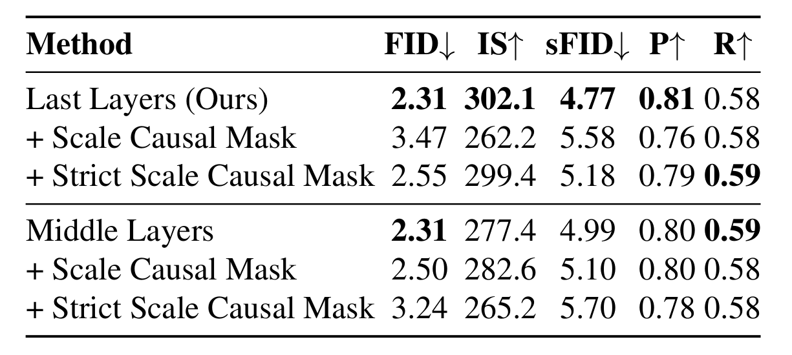
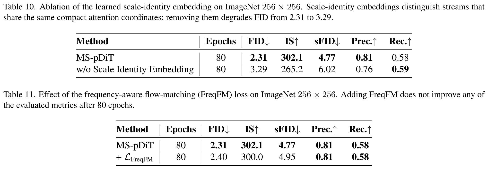
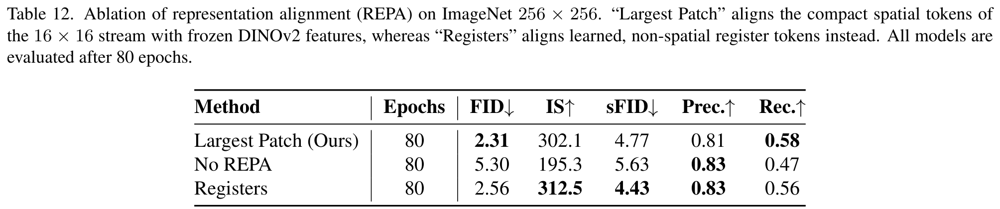
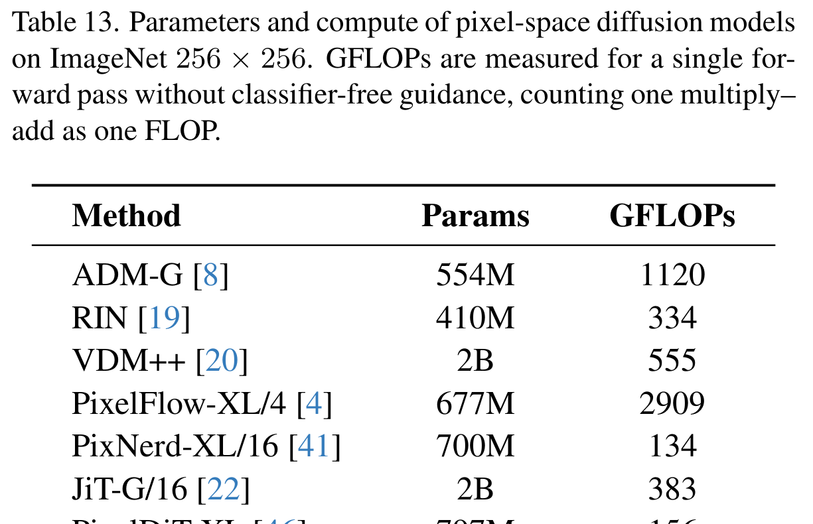
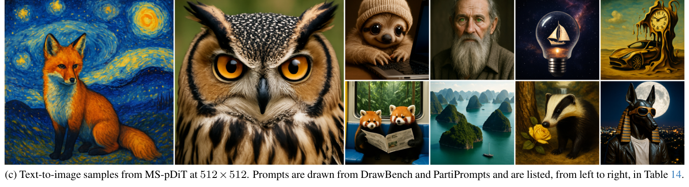

# AI Daily

## 2026-11-13｜Scale as a Modality: Multi-Scale Pixel-Space Diffusion Transformers（MS-pDiT）

### 論文資訊

**標題：** Scale as a Modality: Multi-Scale Pixel-Space Diffusion Transformers
**作者與單位：** Ruibo Chen¹ ² ˣ、Kaishen Wang²、Tianyi Xiong²、Chenxi Liu²、Yanshuo Chen²、Heng Huang² †、Jian Du¹ †；¹TikTok（ByteDance）、²University of Maryland, College Park。ˣ 註明「This work was done while Ruibo Chen was interning at TikTok」，† 為共同通訊作者。[1] [2]
**第一作者背景：** Ruibo Chen 是 University of Maryland, College Park 的 CS 四年級博士生（指導教授 Heng Huang），學士來自北京大學智慧科技方向；這條 VAE-free multi-scale pixel diffusion 線出自他在 TikTok（San Jose）的 research internship，個人頁對它的描述是「built and pretrained VAE-free multi-scale pixel-space diffusion transformers for class-conditional and text-to-image generation」。他另有 NeurIPS 2026、ECCV 2026、EMNLP 2026 等錄取紀錄，其他工作同時涵蓋免失真水印、資料選擇與 test-time scaling。[3] 這個組合值得注意：他過去的工作偏「推理時與表徵」，這篇偏「架構與 tokenization」，兩者在本文的 joint attention 裡交會。
**來源與狀態：** arXiv:2611.08802v1，`cs.CV`，2026-11-05 提交（至今只有 v1，無 v2），18 頁（正文 8 頁 + 參考文獻 + 附錄 A–D，共 15 張表、5 張圖）。arXiv metadata 沒有 comment 欄位記錄任何會議或期刊，作者個人頁把它列在 **Preprints** 而非 accepted papers，因此目前是**預印本**，尚無同儕審查背書。[1] [3]
**連結：** [arXiv 摘要](https://arxiv.org/abs/2611.08802)｜[全文 HTML](https://arxiv.org/html/2611.08802v1)｜[PDF](https://arxiv.org/pdf/2611.08802v1)。截至 2026-11-13 **查無官方 code、model checkpoint 或 project page**（arXiv 頁、HTML 全文、作者個人頁都沒有 repo 連結），可重現性只能依賴附錄 B 的超參敘述；這是本报告最重要的落地限制，細節見「限制與判讀」。[1] [2] [3]

*圖：論文 Figure 1(a)（自 PDF 聚焦擷取，非整頁截圖）。左側是同一張 noisy image $x_t$ 被切成 16×16、4×4、1×1 三種 patch；中間 Block 1／8／15／19／22 的刻度顯示右對齊的深度配置，REPA 在第 8 block 把最粗尺度的 token 對齊到 frozen DINOv2；右側 `pixel readout` 直接從 1×1 stream 輸出 $\hat{v}_\theta(x_t,t,c)$，全程沒有 VAE。[1]*

**為什麼挑這篇：** 你近期點名的六個軸裡，這篇一次命中四個，而且是從「架構」而不是「損失函數」的角度命中。**VAR based**：它把 coarse-to-fine 的多尺度表徵搬進 diffusion，明確對比 next-scale prediction 的**sequential**用法，改成**同一 forward pass 內的並行表徵**（§2.2 與附錄 A.3），這是對 VAR 範式一個很少被正面挑戰的前提。**attention modulation**：它把跨尺度溝通做成一個可開關的注意力拓撲，並用 scale-causal mask 與 strict scale-causal mask 兩個反事實去量化「單向 vs 雙向」的代價（3.47 vs 2.31 FID），這正是你想要的「动 attention 結構能換到什麼」的實證。**training-free**：compaction 本身就是一個免訓練的 attention 预算分配器，把被注意的序列長度固定在 $|P|M$、與最細 patch 數無關，這條路徑可以直接衍生出 inference-time 的尺度 dropout／尺度 guidance。**JEPA／energy**：它最重要的消融不是任何 loss，而是把 DINOv2 表徵對齊拿掉之後 FID 從 2.31 爆到 5.30，這跟昨天 EBReg 的「score 當作分佈約束」、前天 LEF-JEPA 的「能量場塑形表徵」拼在一起，正好把「生成模型到底需不需要外來表徵監督」這個問題的三個不同答案湊齊。

### 核心貢獻

論文的問題意識不是「像素空間能不能贏過 latent」，而是：**像素空間有一個 latent 拿不到的免費資源——同一張圖可以同時用任意 patch size 表示，而現有方法只用了這個資源的一小部分（兩級、且單向）**。三個貢獻如下。[1]

第一，**把 spatial scale 重新定義成 modality**。既有像素空間架構（PixelDiT、DeCo、DiP、PixNerd、HyperDiT）都是兩級 coarse-to-fine：一個 patch-level backbone 抓全局語義，一個 pixel-level 支路（decoder、prediction head 或 cross-attention branch）補細節，資訊主要單向流動。MS-pDiT 給每個 patch size 一**整條** transformer stream，各有自己的 adaLN、QKV 投影、FFN 與 embedding 寬度，並把它們當成 MM-DiT 眼中的「文字／圖像」那樣並列。代價是參數，好處是尺度數量本身變成一個可縮放的軸。

第二，**compacted joint attention**，讓「多條尺度並列」在算力上真的可行。所有 stream 被 compact 到同一個 $a\times a$（預設 $a=16$）共享網格，每個 region 每個 stream 只留 1 個 compact token，於是被注意的序列長度是 $|P|\cdot M$（$M=HW/a^2$），跟最細 patch 的 token 數完全無關。跨尺度座標用共享 2D RoPE 對齊，同位置不同尺度再加一個 per-block、per-stream 的 **scale-identity embedding** 才不會被 attention 視為同一個 token。

第三，**用受控實驗把「尺度數」與「深度／參數」分開**。這是本文我認為最有價值的部分：Table 5、6、7 全部固定 80 epoch、固定 $(1,4,16)$ 骨架，只在「多給一個尺度」與「多給幾層深度」之間做同參數預算的對照，並在 §5.2 用 758–788M 的等參數配置排除「只是變大所以變好」的解释。結論是 FID 4.39（兩尺度）→ 2.31（三）→ 2.26（四）→ 2.19（五），同預算下把深度全給粗尺度只有 3.63。

### 技術方法

#### 1. 像素空間的 rectified-flow 目標

設 $x\in\mathbb{R}^{H\times W\times 3}$ 為縮放到 $[-1,1]$ 的乾淨影像、$\varepsilon\sim\mathcal{N}(0,I)$、$c$ 為條件（class label 或 text）：

$$
x_t = t\,x + (1-t)\,\varepsilon,\qquad v=\frac{\mathrm{d}x_t}{\mathrm{d}t}=x-\varepsilon,\qquad t\in[0,1]
$$

所以 $x_0=\varepsilon$、$x_1=x$（注意本文的 $t$ 越大越乾淨，方向跟部分 diffusion 文獻相反）。網路直接回歸速度場：

$$
\mathcal{L}_{\mathrm{FM}}(\theta)=\mathbb{E}_{(x,c),\,\varepsilon,\,t}\Big\|\,v_\theta(x_t,t,c)-(x-\varepsilon)\,\Big\|_2^2
$$

最優解是條件期望 $v^{\star}(x_t,t,c)=\mathbb{E}[\,x-\varepsilon \mid x_t,t,c\,]$，沿 $\mathrm{d}x_t/\mathrm{d}t=v^{\star}(x_t,t,c)$ 從 $t=0$ 積分到 $t=1$，就把 $\mathcal{N}(0,I)$  transported 到 $p(x\mid c)$。兩個明確的設計選擇：**不用 $x$-prediction**（JiT 主張預測乾淨資料才能撐住大 patch），而是用**與 $t$ 無關的 loss weight** 直接回歸 $v$，跟隨 PixelDiT 的做法。[1]

從能量觀點看這個目標值得多說一句（這篇沒有寫，是我加的翻譯）：速度場的條件期望可以寫成 score 的仿射組合。對 linear-Gaussian 的 probability path，$\nabla_{x_t}\log p_t$ 與 $v^\star$ 只差 $x_t$、$t$ 的已知係數，因此 $v_\theta$ 本身就是一個 energy field $\mathcal{E}_\theta(x_t,t)\approx -t\log p_t(x_t)$ 的梯度，取樣是把樣本沿 $-\nabla\mathcal{E}$ 推向高密度區。MS-pDiT 的架構貢獻在於**用多個解析度同時估計同一個 $\mathcal{E}_\theta$ 的不同頻段**，並在每一層把它們拼進同一個 softmax；EBReg 的貢獻在於約束這個 $\mathcal{E}_\theta$ 的**邊際分佈形狀**。兩者是可以直接疊加的，這是我看完最想試的一件事（見「評價與研究啟發」）。

#### 2. Multi-scale pixel streams（平行而非階層）

給 patch-size 集合 $P$（預設 $\{1,4,16\}$），對**同一張** $x_t$ 依 $p$ 切 patch，得到

$$
N_p=\frac{HW}{p^{2}}\ \text{個 token},\qquad X_p\in\mathbb{R}^{N_p\times d_p},\qquad \text{預設 } (d_1,d_4,d_{16})=(16,256,1152)
$$

關鍵在兩個「不」：**stream 之間沒有派生關係**——每條都直接從 $x_t$ embedding 出來，不是把粗尺度上采样、也不是把細尺度池化，所以細 stream 保留的局部結構是「粗 tokenization 丟掉且無法從粗 stream 還原」的資訊；**讀出在原生解析度**——最終 velocity 從 $1\times1$ stream 直接 decode，不需要 patch-level upsampler 或 VAE decoder。

深度是**右對齊**（right-align）的：設 $L_p$ 為 stream $p$ 的層數、$L=\max_p L_p$，stream $p$ 只在**最後** $L_p$ 個 block 出現。預設 $(L_1,L_4,L_{16})=(4,8,22)$，也就是 16×16 跑滿 22 層、4×4 只在最後 8 層、1×1 只在最後 4 層；每個 block 只替「在場」的 stream 實參數。這把「先建立全局結構、再共同精修局部」變成架構約束，$\S$5.4 實測把它改成中間層（HyperDiT 那種交錯放法）FID 不變但 IS 從 302.1 掉到 277.4、sFID 從 4.77 變 4.99。[1]

#### 3. Compaction：把每條 stream 壓到同一個空間網格

取 attention patch size $a$ 為所有 $p\in P$ 的公倍數（預設 $a=16$）。對每條 stream，把每個 $a\times a$ region 內的 $(a/p)^2$ 個 token 沿 channel 串起來再投影到共同寬度 $D$：

$$
f_p=\Big[\;\big(\textstyle\sum_{\text{concat}}^{(a/p)^2} X_p\big)\,W_p^{c}\;\Big],\qquad W_p^{c}\in\mathbb{R}^{(a/p)^2 d_p\times D},\qquad f_p\in\mathbb{R}^{M\times D},\ M=\frac{HW}{a^{2}}
$$

注意 $W_p^{c}$ 是一個多對一的投影，所以 $D$ 小於 $(a/p)^2 d_p$ 時這一步**有損**。對預設配置逐條算：$1\times1$ 是 $256\times 16=4096\to 1152$（约 3.5 倍壓縮），$4\times4$ 是 $16\times 256=4096\to 1152$，$16\times16$ 是 $1\times 1152\to 1152$（恒等，也就是「粗 stream 的 compaction 在空間維上是恒等映射」，作者在 §3.3 與附錄 C.2 都點到這件事）。attention 結束後用 $W_p^{e}\in\mathbb{R}^{D\times (a/p)^2 d_p}$ 展開回原生解析度，再走 stream 自己的 normalization 與 FFN。

於是**被注意的序列長度 $=|P|\,M$**，與最細 patch 的 token 數無關：256² 下 $M=256$，三條 stream 加文字大概 1K token 等級，而不是 $HW=65536$。這是整篇的算力來源，也是「scale 可以加到五個而不爆炸」的前提。

*圖：論文 Figure 1(b)。四列分別是 text／16×16／4×4／1×1 stream；中間的 4×4 色塊矩陣就是 joint attention 的 attention matrix，四個色帶代表四個尺度組，**沒有任何 mask**，所以每個尺度都能看其他所有尺度。右側的 $\oplus$ 是 zero-initialized 的 gate，訓練初期每條殘差路徑都是 identity，尺度之間是「逐步長出耦合」的。[1]*

#### 4. Joint attention 與 scale-identity embedding

每條 stream 有自己的 Q/K/V/output 投影，把它們的 compact token 沿序列維拼接後做**一次** attention：

$$
Q=[Q_p]_{p\in P},\quad K=[K_p]_{p\in P},\quad V=[V_p]_{p\in P},\qquad
\mathcal{O}=\operatorname{softmax}\!\Big(\frac{QK^{\top}}{\sqrt{d_h}}\Big)V
$$

用 $D/d_h$ 個 head、序列長度 $|P|M$。位置部分：所有 image stream 共用同一套作用在 $H/a\times W/a$ attention grid 上的 2D RoPE，因此「同一個空間 region、不同尺度」的 compact token 拿到**相同的旋轉**，相對位置結構在尺度內與尺度間都被保留。但作者指出只有 RoPE 不夠——同 location 的 $|P|$ 個 token 在 attention 眼裡 otherwise indistinguishable，所以再加一個**每個 block、每條 stream 各一**的 learned scale-identity embedding（概念上等於多模態 Transformer 的 modality embedding）。移除它的代價極大：FID 2.31 → 3.29、sFID 4.77 → 6.02（Table 10）。[1]

單一個 softmax 的語意是：**每一層由模型自己決定跨尺度資訊交換的方向與幅度**。作者跟 prior art 的分界就在這裡——他們完全不加 cross-scale mask。§5.3 把這個主張做成反事實測試：

- **scale-causal mask**：尺度 $p$ 的 query 只能看 $p'\ge p$（細→粗禁止），FID 2.31 → **3.47**。
- **strict scale-causal**：再把除最粗 stream 以外的同尺度 attention 也拿掉，變成純 top-down，FID 2.31 → **2.55**。

這裡有個反直覺的細節值得記：**strict 版本反而比 relaxed 版本好**（2.55 vs 3.47）。作者的解讀是粗 tokenization 丟掉的局部空間細節只能由細 stream 提供，所以 fine-to-coarse 這條路不存在於「純 top-down」裡也還撐得住，但「只準細看粗、不準粗看細」的半開放條件最差。這個非單調排序是本文最值得追的線索之一。

#### 5. REPA 與 text-as-modality

訓練時在 flow-matching 之外加 representation alignment：把**最粗尺度**（16×16）的 token 經 3 層 MLP projector 對齊到 frozen DINOv2 ViT-B/14 的乾淨圖特徵，$\lambda=0.5$，class-conditional 放 block 8、T2I 放 block 6。Table 12 的結果是本文最「刺」的消融：**去掉 REPA，FID 2.31 → 5.30、IS 302.1 → 195.3、Recall 0.58 → 0.47**；把空間 token 換成 learned register tokens 反而 FID 2.56、IS 312.5、sFID 4.43 更好，只有 FID 輸——register 那行明確是「IS／sFID 贏、FID 輸」的 trade-off，不能讀成全面較佳。[1] [4]

T2I 只是「再多一條 modality」：frozen Qwen3-1.7B 出文字特徵、從 2048 投到 $D=1536$、配一套自己的 RoPE（$\theta=10^4$）、固定 128 token context、**不加 attention mask**（所以 padding 對 image stream 可見）、以 0.1 機率 drop text embedding 做 CFG。像素讀出仍然只從 $1\times1$ stream，完全沒有 image autoencoder。[1]

#### 6. 訓練與取樣設定（重要口徑）

| 項目 | class-conditional | text-to-image |
|---|---|---|
| 資料／tokenizer | ImageNet-1K RGB，無 VAE、無 learned tokenizer | BLIP3o corpus + BLIP3o-60k SFT，無 image tokenizer |
| 優化器 | AdamW，lr $10^{-4}$，constant，無 weight decay，grad clip 1.0（unit norm） | AdamW，三 stage：$2\times10^{-4}\to10^{-4}\to10^{-5}$，clip 1.0 |
| 精度／EMA | bfloat16，EMA decay 0.9999；attention 以 fp32 累積 | 同左，gradient checkpointing |
| batch／GPU | global 256，8 GPU；stage1 200K steps／24 GPU、stage2 80K／32、stage3 40K／32（global 1536／512／512） | 三 stage 皆 80K→40K 累加，shift 2.0／4.0／4.0 |
| 條件 drop（CFG） | label 以 0.1 機率 drop | text 以 0.1 機率 drop |
| 時間採樣 | $t=\operatorname{sigmoid}(\epsilon),\ \epsilon\sim\mathcal{N}(0,1)$，time shift 1.0@256、3.0@512 | logit-normal$(0,1)$ 再 shift |
| 取樣 | 100-step flow DPM，50K samples，CFG 2.75@$t\in[0.1,0.9]$（主表）／3.25@$[0.1,1.0]$（80-epoch 消融）；512 用 CFG 3.5 | 二階 flow DPM 50 steps，CFG 4.0 全程，shift 3.0 |

一個容易被忽略的點：**主表與消融用的 CFG 設定不同**（2.75 vs 3.25，guidance interval 也不同），所以「消融的 2.31」與「主表的 1.55」不在同一個工作點上，跨表比較必須保守。[1]

### 實驗結果

*圖：論文 Table 1。口徑：全部 50K 樣本、皆有 CFG；Params 是「generator + VAE/RAE decoder」的推論參數；NFE 為函數評估次數（$250\times2$ 表示 CFG 雙次評估）。[1]*

**ImageNet 256×256（皆有 CFG）**

| 方法 | Params | Epochs | NFE | FID↓ | IS↑ | sFID↓ | Prec.↑ | Rec.↑ |
|---|---|---|---|---|---|---|---|---|
| REPA-XL/2（latent） | 675+49M | 800 | 250×2 | 1.42 | 305.7 | 4.70 | 0.80 | 0.64 |
| RAE-XL/2（latent） | 839+415M | 800 | – | **1.13** | 262.6 | – | 0.78 | 0.67 |
| PixelDiT-XL†（原文） | 797M | 320 | 100×2 | 1.61 | 292.7 | 4.68 | 0.78 | 0.64 |
| PixelDiT-XL‡（作者重現，post-modulation） | 797M | 320 | 100×2 | 1.66 | 292.7 | 4.89 | 0.78 | 0.64 |
| DeCo-XL/16 | 682M | 600 | 100×2 | 1.69 | 304.0 | 4.59 | 0.79 | 0.63 |
| JiT-G/16 | 2B | 600 | 100×2 | 1.82 | 292.6 | – | – | – |
| PixelU-H/16 | 1.2B | 600 | 100×2 | 1.63 | 305.9 | 5.04 | 0.79 | 0.64 |
| **MS-pDiT-L** | 788M | 600 | 100×2 | 1.55 | 305.9 | 4.42 | 0.78 | 0.65 |
| **MS-pDiT-XL** | 963M | 600 | 100×2 | 1.50 | **308.7** | 4.31 | 0.79 | 0.65 |
| **MS-pDiT-H**（五尺度） | 1.4B | **360** | 100×2 | **1.43** | 304.6 | **4.13** | 0.79 | 0.65 |

口徑判讀要嚴：MS-pDiT-H 1.43 **小於（較差於）** REPA 1.42 與 RAE 1.13，作者的主張限定在 pixel-space 群組內，這個限定是誠實的；但「1.43 FID」若被單獨引用就會誤導。相對 PixelDiT 的增益要分兩套口徑：以作者重現值 1.66 算是 −0.23、以原文報告值 1.61 算是 −0.18；正文 §5.2 只寫「improves FID by 0.18 over PixelDiT-XL and by 0.20 over PixelU-H/16」（1.61−1.43、1.63−1.43，用的是原文值），而摘要另寫「improves FID by 0.23 … over competing pixel-space methods」、附錄 B.1 又改口「MS-pDiT-L improves upon the reproduced PixelDiT-XL baseline from 1.66 to 1.55」。同一件事在摘要、正文、附錄出現 0.18／0.20／0.23 三種數字，引用時必須先決定是哪一組 baseline。epoch 從 320 增至 360、參數從 797M 增至 1.4B，所以這是「參數換 FID 也換收斂速度」，不是純架構紅利——純架構紅利由下面 Table 5／6 的等參數對照支撐。[1]

**ImageNet 512×512：** MS-pDiT FID **1.44**、sFID 4.76、IS 319.2、Prec. 0.80、Rec. 0.64，贏過 PixelDiT 1.81、PixelU-H/32 1.92、JiT-H 1.94；latent 群最強的仍是 RAE-XL 1.13。作者的假設是「解析度越高、需要的空間尺度跨度越寬，兩級層級不夠用」，並指出這個優勢**隨解析度擴大**（256 的差距 0.23 → 512 的差距 0.37），這是全文對「scale 是維度」最有力的一條外部證據（注：該差距是依 Table 1 的像素空間同群數字自行相減得出，作者自己只有定性寫「with a large margin」）。[1]

**尺度即 scaling 維度（80-epoch、$(1,4,16)$ 骨架、788M 級別）**

*圖：論文 Table 5。注意第一行參數最少（651M）也最差；第二行只多了 4×4 這條 8 層 stream 就拿下 2.31／IS 302.1，第五行五尺度再小幅改善到 2.19 但參數已到 1.0B。[1]*

*圖：論文 Table 6（截圖含最後三行之一；完整五行見原文）。這是我認為全文最關鍵的一張表：**參數幾乎相同**，只改「深度怎麼分」，FID 從 3.63／3.74 動到 2.31。它把「多尺度」與「比較大」徹底分離。另外 $4\times4$（2.31）優於 $8\times8$（2.42）與 $2\times2$（2.54）。[1]*

**跨尺度資訊流與細 stream 位置（80-epoch）**

*圖：論文 Table 7。兩個訊息：(i) mask 掉 fine-to-coarse 的代價很大（+1.16 FID），(ii) 同樣的細 stream 深度放在中間層 vs 最後幾層，FID 相同但 IS／sFID 明顯較差——也就是「何時引入細尺度」影響的是語義可辨識度而非距離度量。[1]*

**其他消融（附錄 C）**

*圖：論文 Table 10、11、12（三張獨立擷取）。我特別看重 Table 11 的「負面結果」：作者把 DeCo 的 DCT／JPEG 頻域重加權 loss 接到自己模型上，FID 變差（2.31→2.40），並給出解讀——**頻域重權是在替單一網路分配「哪些頻段值得花容量」；當不同 stream 已經依 granularity  specialize，這個指引就冗餘了**。這是「架構吸收了 loss 設計的功能」的一個乾淨證據。[1]*

**算力**

*圖：論文 Table 13。MS-pDiT-L 比同參數的 PixelDiT-XL 多 19% GFLOPs（186 vs 156）換到 1.66→1.55 的 FID；只有 JiT-G 一半以下的算力、40% 的參數；比 PixelFlow 便宜约 16×、比 ADM-G 便宜约 6×。注意這是 GFLOPs 不是 wall-clock，作者沒有提供延遲或顯存的測量。[1]*

**定性結果**

*圖：論文 Figure 2(c)。GenEval 0.86（並列 DeCo-XXL/16 的最佳像素空間成績，勝 PixelDiT-T2I 0.78、PixNerd-XXL/16 0.73）、DPG-Bench 83.9（勝 DeCo 2.5 分、勝 PixelDiT 0.2 分），訓練 schedule 比 DeCo 的高解析度階段短（80K vs 100K steps），其餘設定刻意照抄 DeCo 以便「只隔離架構變項」。[1]*

### 相關研究脈絡

**像素空間單階 Transformer 這條線（2025–2026 很熱鬧）。** PixelFlow 用同一組參數在取樣時走 cascading resolution（arXiv:2504.07963）[5]；PixelDiT（CVPR 2026，NVIDIA 等，arXiv:2511.20645，被引約 77 次，並列 CVPR 2026 Best Paper Finalist）建立「patch-level DiT 抓語義 + pixel-level decoder 補細節」的 dual-level 範式，ImageNet 256 FID 1.61[6]；DeCo（CVPR 2026，arXiv:2511.19365，被引約 58–61 次）把細支路換成 attention-free pixel decoder，並加頻域 FM loss[7]；DiP 用卷積的 patch detailer head、PixNerd 從粗 stream 預測 per-patch neural field、HyperDiT（arXiv:2605.15741）讓小 patch stream 去 query 大 patch stream 的多階語義 anchor、PixelU（ECCV 2026 poster，arXiv:2606.27760）主張 $x$-prediction 下根本不需要 decoder、改用 zero-cost skip connection 但仍是兩階層級[8]。JiT（Tianhong Li、Kaiming He，「Back to basics: Let denoising act as self-supervision」）主張大 pixel patch 可行的關鍵是預測乾淨資料，並用自監督預訓練先塑 encoder 再生成 fine-tune[9]。**MS-pDiT 之於這條線的位置很清楚：這些工作全都在「兩級、偏單向」這個設計公設裡優化，本文是第一個把公設本身拿下來動手術的。** 另外有一篇 pDiT 的 technical review（arXiv:2607.17585）可當這條線的索引[10]，Hi-DiT（ECCV 2026）走 latent／pixel 混合、HDiT 用 hourglass attention 讓參數與像素數線性成長，也是同一個「粒度難題」的另一組解。

**多尺度在生成模型裡的兩種既有組織方式。** 一是**序列式**：cascaded diffusion（Ho et al. 2022）先生低解析再升級；visual autoregressive／next-scale prediction（VAR，Tian et al.，NeurIPS 2024 Best Paper，arXiv:2404.02905）把 coarse-to-fine 變成自回歸的 $\prod_k p(z_{k+1}\mid z_{\le k})$；Matryoshka diffusion 在共享架構內 jointly 建模嵌套解析度[11]。二是本文的**並行式**：同一 $t$、同一張圖、同時 tokenize 成 $|P|$ 份，「scale 決定 signal 怎麼被 tokenize，而不是決定它何時被生成」。這跟 VAR 的對照是本報告對你最有用的一點：VAR 的 scale 是**時間軸**（next-scale 是條件依賴），MS-pDiT 的 scale 是**空間／通道軸**（同時存在、靠 attention 耦合）。本庫已讀的 QuadTok（content-adaptive token budget）與 ATLAS（逐尺度 cross-attention 淘汰候選）都還在「scale = 時間軸」的世界裡，MS-pDiT 提供了一個可反查的對照組。

**表徵對齊這條線與本庫的近三篇。** REPA（Yu et al., ICLR 2025，arXiv:2410.06940）用 frozen DINOv2 監督中間層以加速 diffusion 訓練[4]；REPA-E 連 autoencoder 一起調；VA-VAE 對齊 latent；RAE 乾脆用 frozen SSL 特徵取代 VAE 當 latent space；DDT 在 latent 空間內把語義編碼與細節解碼解耦。把今天的 Table 12（無 REPA 就 5.30）與昨天 **EBReg**（arXiv:2611.11379，用 score-based entropy maximization 防表徵崩潰）、前天 **LEF-JEPA**（arXiv:2611.08989，denoising -trained latent energy field 把結構訊號送進 encoder）並排，會看到三篇在回答同一個問題的不同面向：**生成模型（或 JEPA）的中間表徵需要什麼樣的外來約束才不會退化**——EBReg 說要約束 latent 的**分佈形狀**（熵／score），LEF-JEPA 說要約束**局部能量單調性**，MS-pDiT 的證據則說在像素空間你需要**對齊一個 frozen 語義 encoder 的特定頻段（最粗尺度）**，而且換成 non-spatial register token 就會在 FID 上輸。

**被 MS-pDiT 沒有引但直接相關的近作。** HyperDiT 的 hyper-connected cross-scale interaction 是「中間層錨定」的原型（本文 §5.4 的對照組）；「Registers Matter for Pixel-Space Diffusion Transformers」（2026）與本文 Table 12 的 register 變體同一個問題意識；PixelU 對「要不要 decoder」的立場與本文「從 $1\times1$ 直接 readout」相同，但保留兩階。

### 評價與研究啟發

**我的評價（正面部分）。** 這是一篇「一個公設 + 一組受控實驗」的論文，不是 loss 拼盤。它最强的地方是方法論紀律：等參數、同骨架、同 epoch 的消融矩陣（Table 5/6/7/9/10/11/12）加上一條誠實的負面結果（FreqFM 沒有用），以及把 baseline 從「原文報告值」重現一遍（PixelDiT-XL† 1.61 vs ‡ 1.66）再比。這比多數宣稱 SOTA 的生成論文更接近可判讀的 ablation science。架構上真正新的是把 compaction + 共享 RoPE + scale-identity embedding 三件湊成「多尺度可以像多模態一樣並列且便宜」的**工程可行性證明**；每一個零件都有先例（MM-DiT、Feature Pyramid、modality embedding），但組合起來後 $|P|$ 變成可調軸，這是有效的 novelty。

**值得警惕的解讀陷阱。** 「尺度越多越好」目前只到 5 個尺度、80 epoch、$H$ 之外各配置的 FID 差距（2.31→2.26→2.19）很可能小於本文從未量化的 noise floor（全文沒有 seed 或標準差）。Table 5 裡第四行（$22/8/8/-/4$，914M）反而比第二行（$22/-/8/-/4$，788M）**差**（2.35 vs 2.31），說明加尺度不是單調有利的，$8\times8$ 在已有 $4\times4$ 時是冗餘的；但正文只在 §5.1 用「FID generally improves」概述這條反例。這是我想在報告裡標紅的地方：**它的「scaling law」措辭比數據本身強。**

**對你六個軸的具體啟發（每條都給可證偽的預測）。**

1. **Energy-based transformer × 跨尺度一致性泛函。** MS-pDiT 的 $v_\theta$ 就是 energy field 的梯度，而它同時持有同一 $x_t$ 的多個解析度估計。定義尺度間的 compatibility energy $\mathcal{E}_{\text{cross}}(x_t,t)=\sum_{p\neq p'}\big\|\,\Pi_{a}\!\uparrow v^{(p)}_\theta-\Pi_{a}\!\uparrow v^{(p')}_\theta\big\|^2$（$\Pi_a\!\uparrow$ 是把各 stream 的 velocity 展開到共同 $a\times a$ region），在 inference 時沿 $-\nabla\mathcal{E}_{\text{cross}}$ 做 $K$ 步 Langevin／梯度下降，等於把 EBT 的迭代取樣搬到「尺度共识」這個新變數上。**預測：** 在取樣早期（$t$ 小）$\mathcal{E}_{\text{cross}}$ 應該大、晚期收斂，因此只在高 $\mathcal{E}_{\text{cross}}$ 的 region 花額外算力（training-free、自適應 compute）能改善 sFID 多於 FID——因為 sFID 正是本文相對 PixelDiT 領先最多的項（4.13 vs 4.89）。這個實驗成本低，而且它的評測口徑（ADM ImageNet reference statistics、50K 樣本）是我方可以直接複用的。
2. **JEPA 式的「跨尺度預測」取代 REPA。** 目前 REPA 只對齊最粗 stream 到 DINOv2。改成自監督的 joint-embedding predictive 目標：用 16×16 stream 的表示**預測** 4×4／1×1 stream 的表示（不拿外部 encoder），把「細→粗」這條本文證明很重要的路徑（mask 掉就 +1.16 FID）從「只能靠 attention」升級成「有顯式損失約束」。**預測：** 若 fine-to-coarse 的價值來自「粗 stream 看不到而被細 stream 持有的高頻證據」，則一個 predictor-only 的 JEPA loss 應該能部分取代 DINOv2 對齊（FID 退化幅度 < 無 REPA 的 +2.99，且對 DINOv2 無依賴）。這件事同時接上 EBReg 的「entropy 約束」與 LEF-JEPA 的「單邊能量約束」，三者疊加可做一個 2×2×2 的正交測試台。
3. **VAR 的正反合題：scale-as-modality 的 AR 版。** MS-pDiT 明確拒絕 sequential scale（所有 stream 同 $t$、同圖）；VAR 明確拒絕 parallel token（next-scale 條件依賴）。可以做一個 **hybrid**：保留 VAR 的 next-scale 因果分解，但把「已生成尺度」當成 MS-pDiT 式的**並列 conditioning streams**（每個已生成尺度一條 stream，同 $a\times a$ 網格 compact、共享 RoPE + scale-identity），取代 VAR 現在把多尺度 token 全部串成一條長序列的做法。**預測：** attention 序列長度從 $\sum_k N_k$ 降到 $|P_{\text{done}}|\cdot M$，在同等 token budget 下應優先改善「跨尺度空間對齊」相關的失敗（position／counting，GenEval 的 0.78／0.72 那兩項）。這條直接可與本庫 QuadTok（adaptive topology）、Any-Order-AR（future-aware target-position embedding）串起來做實驗。
4. **Attention modulation：compaction 本身就是一個結構化 low-rank mask，而且它有已知副作用。** $f_p$ 的投影把 $4096\to1152$（$1\times1$ 與 $4\times4$ 都是），這是**有損瓶頸**；作者用 $a=32$ 的實驗間接證明這個瓶頸敏感（FID 2.31→3.00）。所以一個免訓練的推論時操作空間出現了：不重新訓練，只在 inference 時**動態調整 $a$**（早期大 $a$ 省算力、後期小 $a$ 保細節）或在 $t>t^{\ast}$ 把 $1\times1$ stream 的 expand 從 $W_p^{e}$ 換成「保留前 $r$ 個主成分」的低秩版。**預測：** 因為細 stream 只在最後 4／8 層在場，把 $a$ 在最後 $L_1$ 層調回 8 應該幾乎不掉 FID 卻明顯增加 attention 成本，反向（前段調大 $a$）應幾乎不影響品質——如果這個不對稱成立，就是一個乾淨的 training-free 算力-品質旋鈕，可以直接套在本庫已讀的 Z-Cache／PoSTCache 那類快取工作上疊加。
5. **Zero-shot 的邊界要畫清楚（避免誤用這篇）。** MS-pDiT 是**需要從頭預訓練**的模型，不是 training-free、也不是 zero-shot：512×512 的結果是「從 256 checkpoint fine-tune、降 lr、換 time shift」得來的（附錄 B.2），所以那是**跨解析度的 fine-tuned transfer**，不是 zero-shot 解析度外插。真正接近 zero-shot／training-free 的只有兩件事：text stream 的加入改變的是訓練期架構（不是零樣本），以及「同一組 stream 讀出不同尺度」的 inference 時可能性——後者是我們上面第 4 條要測的。**如果你要把這篇當 zero-shot 敘事的引證，請只引它 §3.2「各 stream 並行、無派生關係」與 Table 7 的 mask 消融，不要引它的高解析度結果。**
6. **一個小而高性價比的追問（我最好奇的）。** strict scale-causal 2.55 比 relaxed scale-causal 3.47 好，違反「限制越少越好」的直覺；作者只給了一段定性解釋。最簡單的復現測試是加第三個變體：**只準 fine→coarse、不準 coarse→fine**（跟 scale-causal 相反方向），以及**準 fine→coarse 但同尺度 attention 全留**。如果「反向 mask」掉得最狠，就能把本文的 bidirectional 主張收窄成「coarse 必須能讀 fine」这條更精確的結論，順便回答「為什麼 strict 反而較好」——那可能是因為 strict 強迫粗 stream 只能往細的地方看（同尺度也拿掉），把 top-down 的失敗模式變成一個可測的 attention 流量問題。

### 限制與判讀

- **沒有 code／checkpoint／project page。** 我查了 arXiv abs 頁、HTML 全文與作者個人頁，並做了公開搜尋，截至 2026-11-13 都找不到官方 release；附錄 B 也缺少完整訓練算力（class-conditional 只寫 global batch 256、8 GPU，主模型訓練時間、wall-clock、顯存、是否用 mixed precision 之外的技巧都沒給）。所以 Table 5/6/7 的 80-epoch 結果目前無法自行復現校準。[1] [3]
- **沒有 seed／標準差／置信區間。** 全文所有 FID／IS／sFID／Prec／Rec 都是單次 50K 估計，包括最關鍵的「五尺度 2.19 vs 三尺度 2.31」这條「scaling law」主張。
- **消融只在 80 epoch 上做，收斂外推未證。** 所有結構性結論（Table 5/6/7/9/10/11/12）都在 80 epoch、$(1,4,16)$、788M 級的骨架上得出，而主模型是 600 epoch（H 是 360）。80 epoch 約是最終訓練量的 13%，「加尺度比加深度有效」這個排序在接近收斂時是否仍成立，本文沒有證據；五尺度 2.19 與三尺度 2.31 的差也可能被更長的訓練吃掉。我檢查過 Figure 1(a) 的三個 token／寬度標註（$256\times1152$、$4096\times256$、$65536\times16$）與正文 $N_p=HW/p^2$ 在 256² 下完全自洽，所以這不是論文的錯誤，而是我在以版面還原方式抽取 PDF 文字時遇到的重排假象，記錄在此以免讀者重複追查。
- **主表與消融的工作點不同**：80-epoch 消融用 CFG 3.25@$t\in[0.1,1.0]$，主模型用 CFG 2.75@$t\in[0.1,0.9]$，512 用 CFG 3.5，T2I 用 CFG 4.0／50 steps。跨表引用數字（例如拿 2.31 去對比 1.55）必須注意這不是同一個 sampling 配置。
- **「pixel-space 內最強」不等於整體最強**：REPA 1.42、RAE 1.13 都在 latent 群裡低於或持平 MS-pDiT-H 的 1.43，且 RAE 用的是 839+415M 的完全不同 latent space；作者把 claim 限定在 pixel-space，但讀者容易把「1.43 FID、免 VAE」讀成「贏過 latent 陣營」，這不是本文的資料支持的。
- **參數與 GFLOPs 的比較不同時受控**：MS-pDiT-H 1.4B／360 epoch vs PixelDiT 797M／320 epoch；Table 13 只有 MS-pDiT-L 的 GFLOPs，五尺度模型（$|P|=5$，attention 序列 $5M$）的额外成本沒有量化，而「加尺度」的成本恰恰主要在 joint attention 的 $|P|$ 上。
- **無 T2I 的 FID／人類評估、無與 VAR／AR 系的同圖比較**，T2I 只有 GenEval 與 DPG-Bench（兩者都是 prompt-following，不是知覚品質）；另外 GenEval 是 4 images／553 prompts、DPG 是 4 images／1065 prompts 的單 seed（seed 0）協議，沒有报 variance。
- **方法未測試的範圍**：更高解析度（1024²）、video／interleaved、tokenizer-free 的統一理解生成模型、以及最重要的——它的 compaction 是否只在「同 $a$ 公倍数」的 patch set 上才便宜（$a$ 必須是所有 $p$ 的公倍數，這限制了非整數比的 content-adaptive tokenization，正是 QuadTok 那类自適應拓撲難以直接嫁接的原因）。

### References

[1]: https://arxiv.org/abs/2611.08802 "Scale as a Modality: Multi-Scale Pixel-Space Diffusion Transformers arXiv:2611.08802v1"
[2]: https://arxiv.org/html/2611.08802v1 "MS-pDiT full text HTML arXiv:2611.08802v1"
[3]: https://rayruibochen.github.io/ "Ruibo Chen homepage UMD TikTok internship and publication list"
[4]: https://arxiv.org/abs/2410.06940 "Training Diffusion Transformers Is Easier Than You Think REPA ICLR 2025"
[5]: https://arxiv.org/abs/2504.07963 "PixelFlow Pixel-Space Generative Models with Flow Diffsusion Transformers"
[6]: https://arxiv.org/abs/2511.20645 "PixelDiT Pixel Diffusion Transformers for Image Generation CVPR 2026"
[7]: https://arxiv.org/abs/2511.19365 "DeCo Frequency-Decoupled Pixel Diffusion for End-to-End Image Generation CVPR 2026"
[8]: https://arxiv.org/abs/2606.27760 "PixelU A U-Shaped Transformer for Efficient End-to-End Pixel Diffusion"
[9]: https://arxiv.org/abs/2605.15741 "HyperDiT Hyper-Connected Transformers for High-Fidelity Pixel-Space Diffusion"
[10]: https://arxiv.org/abs/2607.17585 "Pixel-Space Diffusion Transformers technical review"
[11]: https://arxiv.org/abs/2404.02905 "Visual Autoregressive Modeling Next-scale Prediction NeurIPS 2024 Best Paper"
[12]: https://github.com/NVlabs/PixelDiT "NVlabs PixelDiT official repository CVPR 2026 Best Paper Finalist"

---

*報告作者：Manus AI｜選稿與深度閱讀日期：2026-11-13｜圖表皆自 arXiv:2611.08802v1 PDF 聚焦擷取（非整頁截圖），存放於 `asset/2026-11-13-MS-pDiT/`。*
