# AI Daily

## 2026-11-16｜Proving and Improving the Platonic Representation Hypothesis with JEPAs（PRH-JEPA）

### 論文資訊

**標題：** Proving and Improving the Platonic Representation Hypothesis with JEPAs

**作者與單位：** 只有兩位作者——**Randall Balestriero**（Brown University；AMI Labs，通訊作者 rbalestr@brown.edu）與 **Yann LeCun**（New York University；AMI Labs）。[1] [2] 這裡有兩個值得記下的細節：其一，這篇**沒有掛 Meta FAIR**，兩人的第二 affiliation 都是 AMI Labs（LeCun 離開 Meta 後的實驗室），Balestriero 的本部也在 2026 年移到 Brown；其二，正文與附錄的 345 組實驗全部由兩人完成，致謝只點了四位討論者（Kerda Varaku、Lukas Kuhn、Hazel Nam、Marcin Przewięźlikowski），沒有 funding statement。[2] 對照本欄之前寫過的 V-JEPA 2.1／TD-JEPA（FAIR 大團隊）與 EBReg（Surrey／NYU／AMI 跨單位），這篇是典型的「兩位作者把一個問題從猜測推到定理」的形態：理論密度高、實驗矩陣極大、工程全部自己收攏。[2] [3]

**來源與狀態：** arXiv:2610.39302v1，primary `cs.AI`，cross-list `cs.CV`／`stat.ML`，2026-10-29 03:49 UTC 提交，**只有 v1**（`v2` 路徑回 404），37 頁、15 張圖、18 張表，7 個章節加 Appendix A（證明）、B（實驗細節）、C（額外結果）。[1] [2] [3] arXiv 的 Comments 欄位**整個不存在**，文內也沒有「Preprint／Under review／NeurIPS」字樣，所以目前**是純預印本，尚無任何同儕審查背書**；授權為 CC BY 4.0。[1] Hugging Face Daily Papers 收錄，查核當下 **79 upvotes**；討論熱度明顯高於同期一般 JEPA 文章，但我特別注意了一點：HF 論文頁留言區有一則冒充 "ResearchStudio" bot、內嵌 `` 的 prompt-injection payload，那不是論文內容，任何自動化流程都不該渲染或執行它。[6]

**連結：** [arXiv 摘要](https://arxiv.org/abs/2610.39302)｜[全文 HTML](https://arxiv.org/html/2610.39302v1)｜[PDF](https://arxiv.org/pdf/2610.39302v1)｜[程式碼 galilai-group/prh-proof](https://github.com/galilai-group/prh-proof)｜[Live demo](https://huggingface.co/spaces/galilai-group/prh_demo)｜[HF 論文頁](https://huggingface.co/papers/2610.39302)

**資源實際狀態（我逐項查證）：** 程式碼 repo 掛 **MIT**，230 stars／14 forks，建於 2026-10-13、最後 push 2026-10-30，無 release/tag；裡面有 `train.py`／`evaluate.py`／`caption.py`／`tables.py`／`figures.py`、`prh/` 套件（含 `theory.py`、`views.py`、`align.py`、`pairfree.py`、`captioner.py`）、12 個測試檔、`paper/runs.csv`（**345 組 run 的精確引數與 seed**）、`paper/data/*.csv`（每一張表的原始數字，包含重跑別人的 `schnaus2026_reported.csv`）、以及 `docs/reproduce.md` 把**每張圖表對應到指令**。[4] 最難得的是 `pytest -m "not slow"` 會在 CPU 上約兩分鐘內**數值驗證第 2 節每一個定理陳述**（含 300 組隨機世界的 Theorem 2 檢查）——這是「定理可以被機器驗」而不是「定理只能被信」的等級。[4] 代價是：**權重沒有公開**，org 下只有 `LeVJEPA-1.5-Large`／`LeVJEPA-VideoMix-Large` 兩份模型，Space 本身 `usedStorage: 0`、靠私有環境變數 `PRH_WEIGHTS` 指向某個 repo；也就是說 demo 能玩（A100-large、RUNNING、19 likes、2026-11-03 更新），但要自己重跑就得從頭訓練，而最大那組用到 Recap-DataComp 的文字（約 492 GB）。[4] [5] [6]

**為什麼挑這篇：** 它一次命中你點名的幾條線——**JEPA**（本體）、**energy-based**（對齊損失在這篇的證明裡就是 positive-pair 圖上的 Dirichlet／graph-Laplacian 能量，`Ω` 是反崩潰約束）、**training-free／zero-shot**（整條 captioner 管線沒有任何網路在影像—文字對上訓練過，只擬一個正交矩陣；pair-free benchmark 甚至連配對都不要）、以及**你正在想的 attention modulation**——而最後這條恰恰是全文的**空洞**：它的機制是固定光譜幾何，完全沒有 predictor、沒有 action conditioning、沒有 attention。換言之，這篇給你的不是「照著做」，而是一張標示了哪些地還沒人的地圖。作者層級加上「把假說變定理」的創新度，是我今天會選它的理由。[2] [4]

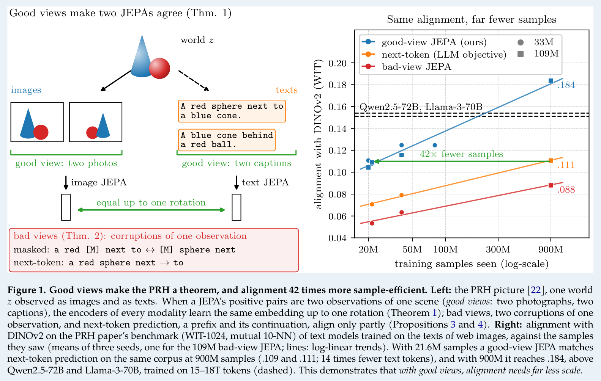

*圖：論文 Figure 1（自 PDF 聚焦擷取）。左：同一個世界 $z$ 被渲染成影像與文字；當 positive pair 是「同一場景的兩次觀察」（兩張照片、或兩段描述）時，兩條模態的 encoder 學到只差一個旋轉的同一表徵（Theorem 1）；紅框是 bad views——同一觀察的兩個腐蝕版本（masking、next-token）。右：WIT-1024 上對 DINOv2 的 mutual 10-NN 對齊對「看過的樣本數」作圖，good-view JEPA 在 21.6M samples 就達到 .109，而 next-token prediction 要到 900M samples 才 .111；900M 後升到 .184，越過 Qwen2.5-72B 與 Llama-3-70B（虛線，15–18T tokens）。[1] [2]*

### 核心貢獻

論文的骨架是五個「把直覺換成可反證陳述」的動作。[2]

1. **Platonic Representation Theorem（Thm 1）**：只要 $M$ 個模態共用同一個 positive-pair 分佈、且該目標的極小解在旋轉下唯一，則每個模態的最佳 encoder 都是同一個世界表徵 $h^{\star}$ 旋轉後的結果——$f_m^{\star}\circ g_m=\boldsymbol{Q}_m h^{\star}$，任意兩模態只差 $\boldsymbol{Q}_m\boldsymbol{Q}_{m'}^{\top}$。這是「收斂到同一表徵」第一次被寫成帶條件的定理，而不是一個 scaling 傳言。[2]
2. **不對齊有可算的上界（Thm 2）**：兩個 encoder 的最佳旋轉殘差被 **positive-pair kernel 的差異**與 **eigengap** 控制（Davis–Cahan 型界），並且用 300 組隨機生成的有限世界做暴力驗證，實測誤差最糟也只有界的 **18%**。[2] [4]
3. **good views / bad views 的正式分界（Thm 3 + Prop 3）**：一旦每個觀察帶了自己的 nuisance（$x=g_m(z,\nu)$），就出現一個可測的純量 $\rho(f)=\mathrm{tr}\,\boldsymbol{C}_f^{1/2}/k$（scene-explained fraction），並給出對齊誤差的下界 $2k(1-\min_m\rho(f_m))$。**這等於把「你的正樣本是怎麼造的」變成一個能量化的設計變數。**[2]
4. **next-token prediction 是「bad-view JEPA」（Prop 4）**：softmax 交叉熵被分解成 prediction + anti-collapse 兩項，其 positives 是同一份檔案的前綴與後續，且最優解**只能在 $\mathrm{GL}(k)$ 下辨認**（不是 $\mathrm{O}(k)$）。這給出「語言模型只有靠 scale 才勉強對齊視覺」的機制解釋，而不是統計相關。[2]
5. **實證上把槓桿從 scale 換成 views**：同一個 109M BERT-B、同一個語料，good views 用 **42× 更少樣本**（14× 更少 token、435× 更少不重複影像）達到與 next-token 相同的對齊；一個 109M text JEPA 在 PRH 官方協議下拿到 **.184**（Qwen2.5-72B .154、Llama-3-70B .151）；擬一條 Procrustes 旋轉就能變出 captioner（COCO CIDEr **.838**），而在完全免配對的 benchmark 上 ImageNet-100 top-5 **64.4%**，勝過所有 8B 以內語言模型的報導值（≤56%）。[1] [2]
6. **附帶一個 alignment scaling law（Eq 7）並事先登記預測**：對 85 組從未訓練過的 run 做預測，RMSE **.0093**，而同一設定換 seed 的差異是 **.0096**——「預測別人的 run ≈ 自己重跑一個 seed」。[2]

### 技術方法

#### 1｜目標函數：一個 prediction 項、一個 anti-collapse 項

世界是有限集合 $\mathcal{Z}$，$p(z)>0$；模態 $m$ 用**單射**渲染 $x=g_m(z)$；正樣本對服從 $\pi_m$，兩個邊際都等於 $p$。encoder $f:\mathcal{X}_m\to\mathbb{R}^k$ 最小化（論文 Eq 1 原文）：

$$\mathcal{L}_{m}(f)=\mathbb{E}_{(z,z^{\prime})\sim\pi_{m}}\,\ell\big(f(g_{m}(z)),f(g_{m}(z^{\prime}))\big)+\Omega(f), \tag{1}$$

$\ell$ 是預測／對齊項，$\Omega$ 是**只透過 embedding 分佈**依賴 $f$ 的反崩潰項（可以是硬約束 $\Omega\in\{0,\infty\}$）。兩項都對旋轉不變：$\ell(\boldsymbol{Q}a,\boldsymbol{Q}b)=\ell(a,b)$。Lemma 1 說渲染只是換座標：$\mathcal{L}_m(f)=\mathcal{L}_{\pi_m}(f\circ g_m)$。[2]

這裡要注意三件事，後面所有結論都靠它們撐著：**分析與實驗裡的 predictor 都是恆等映射**（learned／action-conditioned predictor 被明文排除在分析之外）；$\Omega$ 必須只依賴分佈（VICReg、Barlow Twins 只在 whitened 硬約束極限下符合，LeJEPA 的 SIGReg 是在投影方向取期望後才旋轉不變）；以及 single-shot 的「注入性渲染」假設讓一個世界狀態只有一個觀察，因此**nuisance 必須另外加進去才有 good/bad views 之分**（第 5 小節）。[2]

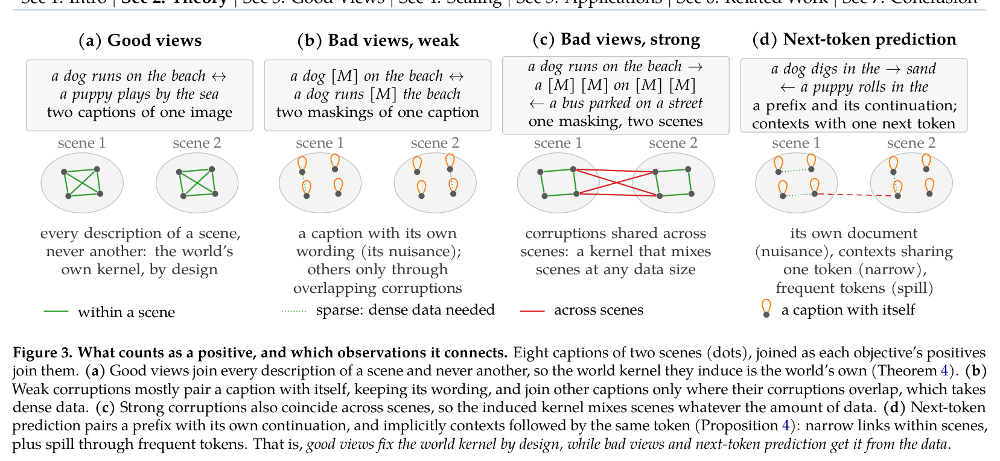

*圖：論文 Figure 3。同一張圖用四種目標各造 8 個 positive：(a) good views 連到一個場景的每個描述、(b)(c) bad views 只連到同一描述的腐蝕重疊、(d) next-token 連到「共用下一個 token」的前綴，再經高頻詞外溢。[2]*

#### 2｜Theorem 1：證明只有兩行，但內容全在假設裡

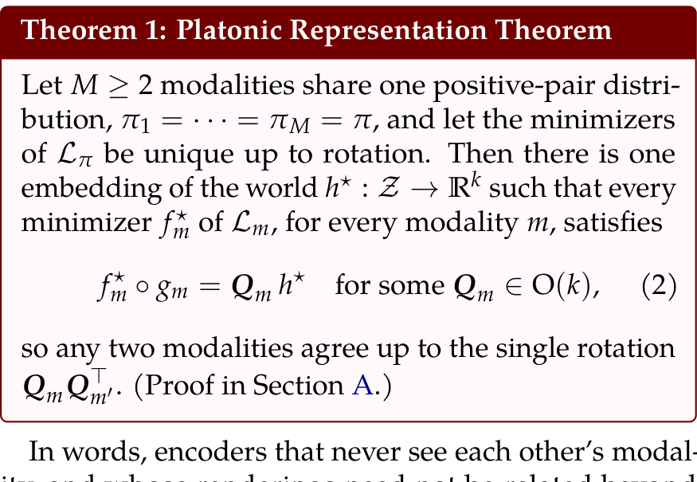

假設 $\pi_1=\dots=\pi_M=\pi$，且 $\mathcal{L}_\pi$ 的極小解在旋轉下唯一，則存在世界表徵 $h^{\star}:\mathcal{Z}\to\mathbb{R}^k$ 使得

$$f_{m}^{\star}\circ g_{m}=\boldsymbol{Q}_{m}\,h^{\star}\quad\text{for some }\boldsymbol{Q}_{m}\in\mathrm{O}(k), \tag{2}$$

Proof 兩行：每個 $f_m^{\star}\circ g_m$ 都最小化同一個 $\mathcal{L}_\pi$，而極小集合正好是一個 $\mathrm{O}(k)$ 軌道。[2] 換句話說，**定理的全部內容其實被搬進「極小解在旋轉下唯一」這個假設裡**；真正的工作是下一節——什麼時候這個假設成立。

#### 3｜Proposition 1：能量視角，以及 eigengap 買下唯一性

寫 $\boldsymbol{\Pi}_{zz'}=\pi(z,z')$、$\boldsymbol{D}=\mathrm{diag}(p)$，把 positive-pair 圖正規化成

$$\boldsymbol{K}_{\pi}=\boldsymbol{D}^{-1/2}\boldsymbol{\Pi}\boldsymbol{D}^{-1/2},\qquad 1=\mu_0\ge\mu_1\ge\dots$$

當 $\ell(a,b)=\|a-b\|^2$、$\Omega$ 施加 whitening（$\mathbb{E}_p h=0,\ \mathbb{E}_p hh^{\top}=\boldsymbol{I}_k$），且 $1\le k<|\mathcal{Z}|$：

$$\min\mathcal{L}_{\pi}=2\textstyle\sum_{i=1}^{k}(1-\mu_{i}),$$

而**若 $\mu_k>\mu_{k+1}$（eigengap 存在）則極小解恰好是 $\boldsymbol{Q}\boldsymbol{\Phi}_\pi$**，其中光譜 embedding 為

$$\boldsymbol{\Phi}_{\pi}(z)=\big(v_{1}(z),\dots,v_{k}(z)\big)/\sqrt{p(z)}.$$

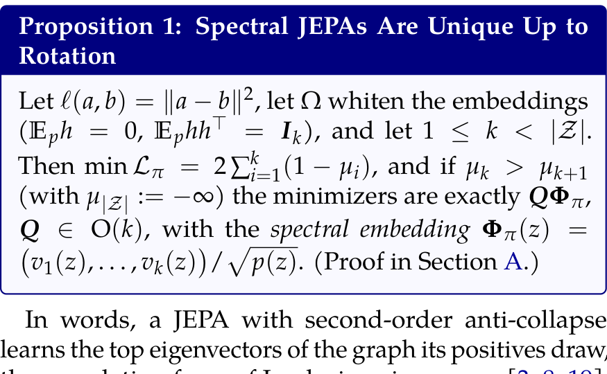

對你關心的能量觀點，真正的橋在證明裡（我特地把「Dirichlet」這個字拿去數過：**全文出現 0 次**，但形式完全存在）。對齊項被改寫成 Markov 算子 $T_\pi$ 的二次型：

$$\mathbb{E}_{\pi}\|h(z)-h(z^{\prime})\|^{2}=\sum_{j=1}^{k}\big(2\mathbb{E}_{p}h_{j}^{2}-2\mathbb{E}_{\pi}h_{j}(z)h_{j}(z^{\prime})\big)=2k-2\textstyle\sum_{j=1}^{k}\langle h_{j},T_{\pi}h_{j}\rangle_{p},$$

也就是 positive-pair 圖上的 **graph-Laplacian／Dirichlet 能量**；在正交 $h$ 上用 **Ky Fan maximum principle** 得到 $\sum_j\langle h_j,T_\pi h_j\rangle_p\le\sum_{i\le k}\mu_i$，等號成立當且僅當值域是前 $k$ 個特徵空間。[2] 我的讀法：這篇把「JEPA 是能量最小化」講得很乾淨——$\ell$ 是圖上的 Dirichlet 能量、$\Omega$ 是約束——但它**只在二階（whitening）約束下證得唯一性**，LeJEPA 真正用的 SIGReg（全分佈高斯化）不在定理範圍內。這正是 EBT／TEM 那一支 energy-based 讀者能立刻接手的地方。[2] [17] [18]

#### 4｜Theorem 2：kernel 差異如何變成誤差上界

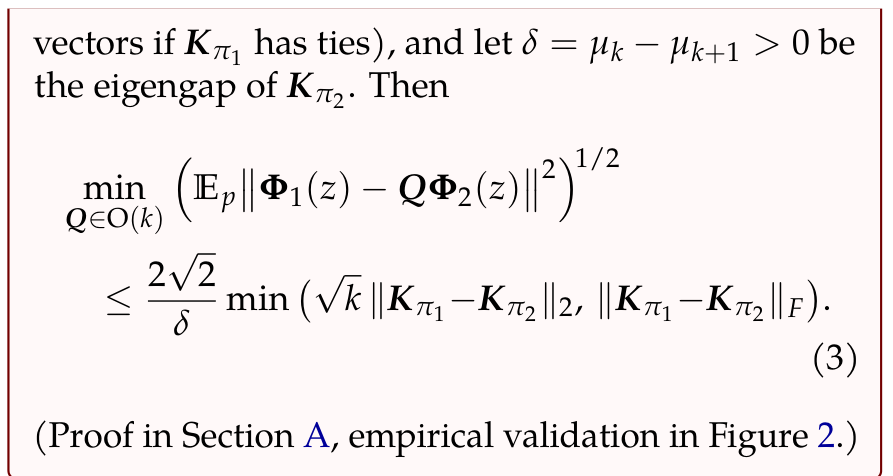

$\pi_1,\pi_2$ 共享邊際 $p$，$\delta=\mu_k-\mu_{k+1}>0$ 是 $\boldsymbol{K}_{\pi_2}$ 的 eigengap，則

$$\min_{\boldsymbol{Q}\in\mathrm{O}(k)}\Big(\mathbb{E}_{p}\big\|\boldsymbol{\Phi}_{1}(z)-\boldsymbol{Q}\boldsymbol{\Phi}_{2}(z)\big\|^{2}\Big)^{1/2}\le\frac{2\sqrt{2}}{\delta}\min\big(\sqrt{k}\,\|\boldsymbol{K}_{\pi_{1}}{-}\boldsymbol{K}_{\pi_{2}}\|_{2},\ \|\boldsymbol{K}_{\pi_{1}}{-}\boldsymbol{K}_{\pi_{2}}\|_{F}\big). \tag{3}$$

證明就是 Davis–Cahan 擾動界（用的是 Yu et al. 2015 的統計版本）套在共享首特徵向量的補空間上，其中 $\|\boldsymbol{K}_{\pi_1}-\boldsymbol{K}_{\pi_2}\|_F^2=\sum_{z,z'}(\pi_1-\pi_2)^2/(p(z)p(z'))$。[2] [14] 兩個直接可用的推論：**gap 越大越耐擾**（對齊會住在「有 gap 的 leading 光譜方向」，尾巴方向不必對齊，這是論文解釋 Figure 6 的依據：擬好旋轉後，影像—文字在文字空間第一主方向的相關是 **0.70**，到第 60 維只剩 ~0.1）；以及**你的 positive 分佈就是被微擾的矩陣**，所以要改善對齊，動「配對方式」比動模型規模更有槓桿。[2]

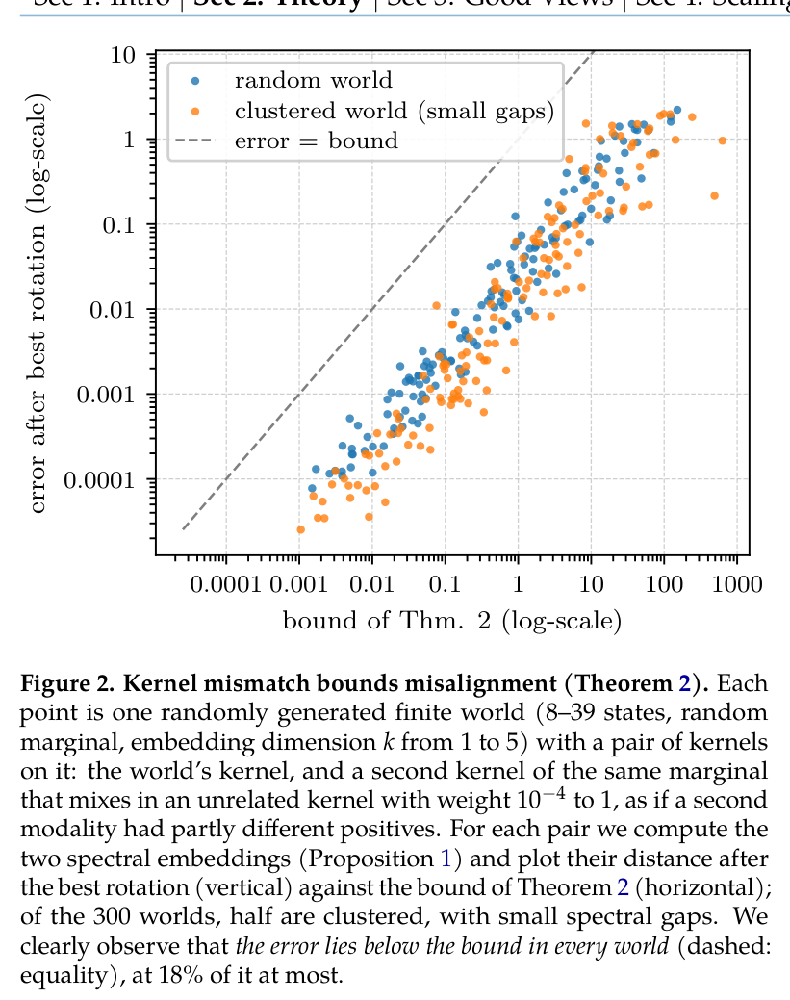

*圖：每個點是一個隨機有限世界（8–39 個狀態、$k$ 從 1 到 5），第二個 kernel 是世界 kernel 與無關 kernel 以 $10^{-4}$–$1$ 混合而成。虛線是 error = bound；300 個世界**全部落在界下**，最大也只有界的 18%。[2] 這是我看過最強的「定理自己跑實驗」做法之一，而且被寫成 repo 裡的 CPU 測試。[4]*

#### 5｜good views vs bad views：nuisance 的定價

把渲染改寫成 $x=g_m(z,\nu)$，$\nu$ 是該模態自己的 nuisance（用詞、視角、光照），與 $z$ 獨立。對 whitened encoder 定義

$$\boldsymbol{C}_{f}=\mathrm{Cov}\big(\mathbb{E}[f(x)\mid z]\big),\qquad \rho(f)=\mathrm{tr}\,\boldsymbol{C}_{f}^{1/2}/k\in[0,1],$$

即「表徵裡有多少是場景解釋得了的」。[2]

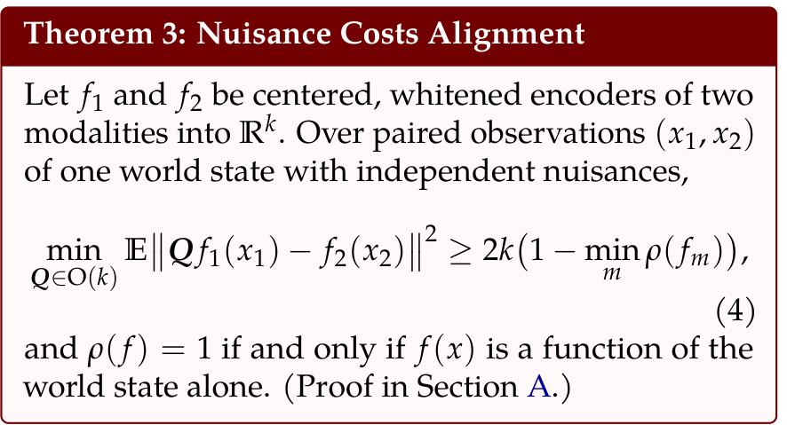

$$\min_{\boldsymbol{Q}\in\mathrm{O}(k)}\mathbb{E}\big\|\boldsymbol{Q}f_{1}(x_{1})-f_{2}(x_{2})\big\|^{2}\ge 2k\big(1-\min_{m}\rho(f_{m})\big), \tag{4}$$

且 $\rho(f)=1$ 當且僅當 $f(x)$ 只是世界狀態的函數。證明走 von Neumann trace 不等式（$\mathbb{E}\|\boldsymbol{Q}f_1-f_2\|^2=2k-2\mathrm{tr}(\boldsymbol{Q}\boldsymbol{\Sigma})$，最小值 $2k-2\|\boldsymbol{S}\|_*$）加上 Schatten 範數的 Hölder。[2] 配套 Prop 3 更狠：對 product corruption $\Gamma_m=\boldsymbol{A}\otimes\boldsymbol{B}_m$，若前 $k$ 維有 $r$ 個落在 nuisance 子空間，則 $\rho(f)=1-r/k$、誤差 $\ge 2r$，而且

$$r\ge1\iff \beta_1>\alpha_k,$$

也就是「**只要腐蝕保住 nuisance 的能力，比世界第 $k$ 個方向還要強，encoder 就必然把維度花在 nuisance 上**」，而那部分沒有任何旋轉能把兩模態對齊。[2] 在真實 encoder 上量測（$k$=32／128）：$\rho$ 分別為 good **.804／.654**、bad **.655／.507**、next-token **.608／.440**，而下界與實測誤差同序（bound 12.6／88.6、22.1／126.1、25.1／143.4 vs error 33.5／157.0、39.4／171.5、40.3／176.6）；把 9 個 encoder 的 $\rho$ 對 WIT 分數做 Spearman 得 **.98**。[2] 這是我今天最想帶走的一個「免費感測器」。

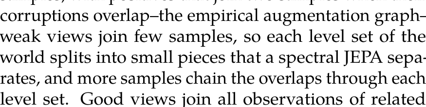

#### 6｜Theorem 4：views 和 data 一起決定你對齊到哪個 kernel

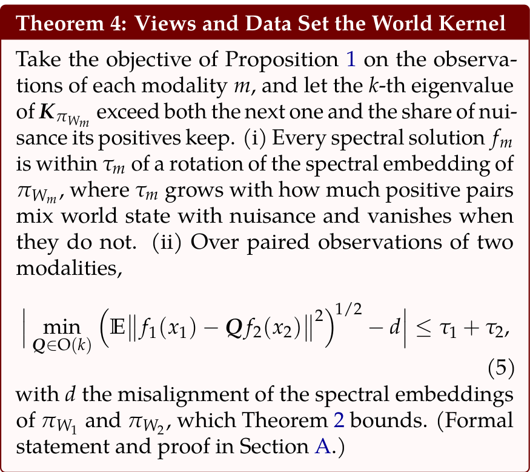

任何 observation 上的 positive 分佈 $W_m$ 都會**誘導**出一個世界 kernel $\pi_{W_m}$。把 $P$ 定義成「投影到只依賴狀態的函數」，$\eta_m$ 是 nuisance block $(I-P)T_{W_m}(I-P)$ 的最大特徵值、$\varepsilon_m$ 是 mixing block 的算子範數，取 $\delta_m=\mu_k-\max(\mu_{k+1},\eta_m)>0$，則每個光譜解滿足

$$\min_{\boldsymbol{O}\in\mathrm{O}(k)}\big\|f_{m}-\boldsymbol{O}\,\boldsymbol{\Phi}^{(m)}\!\circ s_{m}\big\|_{L^{2}(\omega_{m})}\le\tau_{m}:=\frac{2\sqrt{2}}{\delta_{m}}\min\big(\sqrt{k}\,\varepsilon_{m},\sqrt{2}\,\varepsilon_{m}^{\mathrm{HS}}\big),\qquad \mathrm{tr}\,\boldsymbol{C}_{f_m}\ge k-\tau_m^2,$$

而兩模態之間

$$\Big|\min_{\boldsymbol{Q}\in\mathrm{O}(k)}\Big(\mathbb{E}\big\|f_{1}(x_{1})-\boldsymbol{Q}f_{2}(x_{2})\big\|^{2}\Big)^{1/2}-d\Big|\le\tau_{1}+\tau_{2}, \tag{5}$$

$d$ 是兩個誘導 kernel 的不對齊，由 Eq (3) 控制。[2] 重點在語意：**good views 讓 $\varepsilon_m=\eta_m=0$，kernel 是「設計出來的」；bad views 的 kernel 由資料長出來，你只能被動接受。**在合成世界（5 類 × 6 狀態）上，弱 views 需要的「連通度」$\Delta$ 隨每個狀態的樣本數 $N$ 依 $\Delta\propto\log N/N$ 下降；連通度大到跨類時對齊被封在 .95，資料重疊時封在 ~.89，而 good views 一個狀態一份樣本就精確對齊。[2] 這是把「資料規模能救什麼、不能救什麼」講成曲線的少數例子。

#### 7｜next-token prediction 是 bad-view JEPA（Proposition 4）

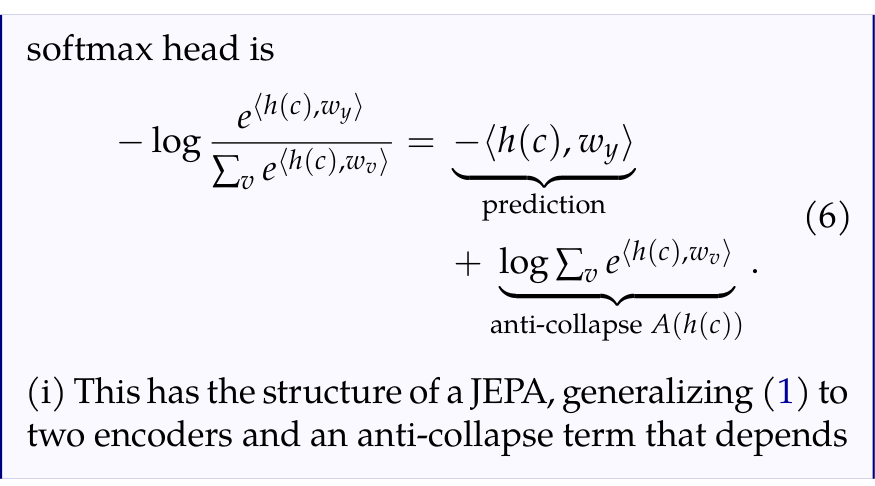

帶線性 softmax 頭的下一詞損失可以拆成

$$-\log\frac{e^{\langle h(c),w_{y}\rangle}}{\sum_{v}e^{\langle h(c),w_{v}\rangle}}=\underbrace{-\langle h(c),w_{y}\rangle}_{\text{prediction}}+\underbrace{\log\textstyle\sum_{v}e^{\langle h(c),w_{v}\rangle}}_{\text{anti-collapse }A(h(c))}. \tag{6}$$

三步論證：**(i)** 把它看成兩個 encoder（context $h$、token table $w_y$）的 JEPA，positives 是**同一份檔案裡的前綴與後續**，因此 kernel 是用「共用措辭」把文字連起來，不是用世界狀態；**(ii)** $A$ 完全不看目標 token，且溫度縮放後 $tA(h/t)\to\max_v\langle h,w_v\rangle$，於是損失趨近 margin $\max_{v}\langle h,w_{v}\rangle-\langle h,w_{y}\rangle\ge0$——這正是對照式「uniformity」扮演的角色（證明用 $\max_v a_v\le t\log\sum_v e^{a_v/t}\le\max_v a_v+t\log|V|$）；**(iii)** 最優解滿足 $\langle h(c),w_v\rangle=\log p(v\mid c)+b(c)$，這個集合在 $\boldsymbol{h}\mapsto\boldsymbol{Gh},\ \boldsymbol{w}\mapsto\boldsymbol{G}^{-\top}\boldsymbol{w}$ 下封閉，所以**只能辨識到 $\mathrm{GL}(k)$，不是 $\mathrm{O}(k)$**——這一步是整個論證對「多模態對齊」最致命的地方，因為 Eq (2) 的好處（一條 Procrustes 就夠）依賴的正是正交性。[2] 作者還多給一個「明言只是可測預測、不是推論」的註解：前綴與後續共用檔案的 nuisance（作者用詞／文風），所以 next-token 會把維度花在 nuisance 上；而且最優處，共享同一續寫的前綴彼此變成隱性 positives（neural-collapse 形態），等於**很弱的 views，需要很密的資料**。[2]

#### 8｜配對到底幹嘛用：$k$ 個 pair 就解出一條旋轉

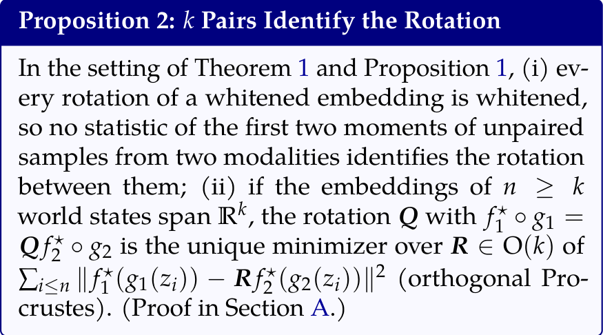

(i) whitened embedding 的任何旋轉仍然 whitened、仍零均值，所以**未配對資料的前兩階矩永遠定不出旋轉**；(ii) 若 $n\ge k$ 個世界狀態的 embedding 張滿 $\mathbb{R}^k$，則旋轉是正交 Procrustes 問題

$$\sum_{i\le n}\big\|f_1^{\star}(g_1(z_i))-\boldsymbol{R}\,f_2^{\star}(g_2(z_i))\big\|^2,\qquad \boldsymbol{R}\in\mathrm{O}(k)$$

的**唯一**極小解。[2] 但證明裡藏了一個很實用的註腳：在有限世界上，embedding 分佈是有限支撐的，$k\ge2$ 時不可能旋轉不變，「這就是為什麼實務上未配對資料反而能精進映射」——更高階的幾何（Gromov–Wasserstein 那一支，即 Schnaus et al.）確實能透露 $\boldsymbol{Q}$。[2] [12] 維度不同時（768 維 DINOv2 對 384 維 text JEPA）他們擬的是**行正交的線性映射**（理論未涵蓋），自由引數 $d_ad_b-d_b(d_b+1)/2$，對 DINOv2 ViT-B 只有 **0.22M**，對最佳 captioner 的 5,120 維特徵是 **1.9M**。[2] 全部訓練就是擬這個矩陣——**沒有任何網路看過影像—文字對**。

#### 9｜alignment 的 scaling law

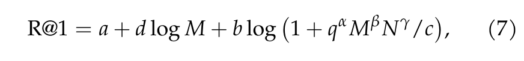

$$\mathrm{R@1}=a+d\log M+b\log\big(1+q^{\alpha}M^{\beta}N^{\gamma}/c\big), \tag{7}$$

$M$ = 看過的樣本數、$N$ = 不重複影像數、$q$ = 用 good views 抽到的比例（其餘走 bad views）。形式上是「bad-view 的 $\log M$ 地板」加上「會飽和的 good-view 項」。在 $\le$80M samples 的 45 格點上擬合（RMSE .007），然後**先登記預測再訓練** 85 組 run（$q$ 對數均勻、$M$ 從 3M 到 133M）：RMSE **.0093**，對照同配置換 seed 的 **.0096**。等對齊線 $q\propto M^{-0.30}$（附錄 37 格版本給 $q\pro M^{-0.57}$），而作者自己直說**指數辨識得很差**、這只是「一組配方的經驗總結，不是第 2.3 節的推論」。[2] 一個反直覺副產品：$q=0$ 時把不重複影像從 0.41M 增加到 50.9M，WIT 只在 **.054–.057** 之間動；$q>0$ 才會從 .090 走到 .115。**沒有好的 positives，更多圖是不長對齊的。**[2]

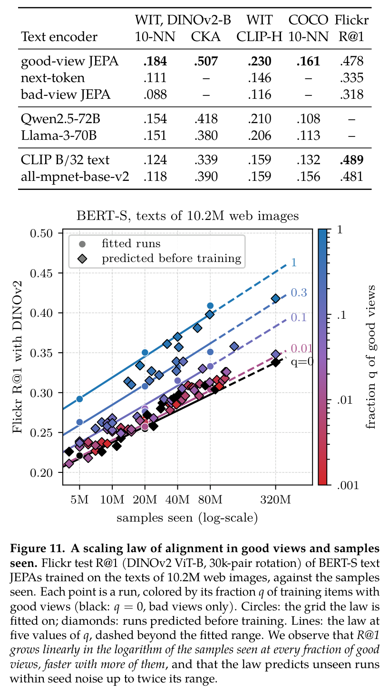

### 實驗結果

實驗的量體是這篇最容易被低估的部分：**345 組 run、約 5,500 GPU-hours、每個 seed 都登記、每張表都有 CSV**。[2] [4]

**A｜兩端都從零訓練（Table 1）**：image JEPA vs text encoder，1,000 Flickr 測試對、三 seed 的平均 ± 半Range：good-view **.062／.044／.133**（mutual 10-NN／R@1／R@5），bad-view .047／.027／.095，next-token .042／.021／.077，next-token-on-caption-pairs .043／.023／.083；random init .010／.001／.011。R@1 .044 是 chance 的 44 倍，排序在每個 seed 都成立。**給 next-token 配對的 captions 幾乎沒有幫助**（.042→.043），這是「問題在目標不在資料配對」的關鍵對照。[2]

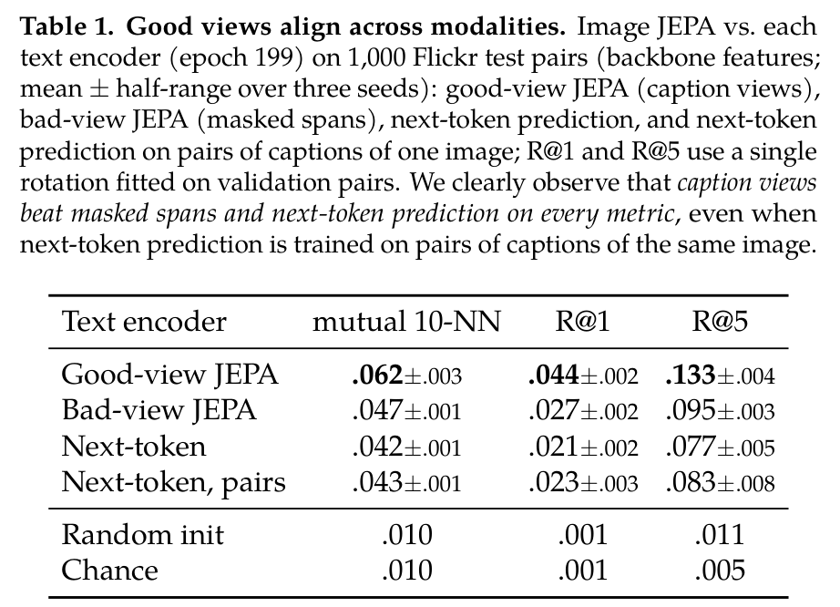

**B｜對上 frozen DINOv2 ViT-B/14（Table 2）**：good-view .246→.346（旋轉用 1k→30k 對擬），bad-view .133→.207，next-token .118→.213，Qwen2.5-0.5B .135→.240，BERT-base .149→.273；Recap 訓練（從未看過 Flickr／COCO 的 caption）一路升到 940M 影像 BERT-B 的 **.349→.464**。在 30k 對旋轉下 Flickr R@1 **.478**，與「用配對訓練出來的」CLIP text .489、all-mpnet .481 同級。[2]

**C｜PRH 官方協議（Table 3／15／16／18）——標題數字**：

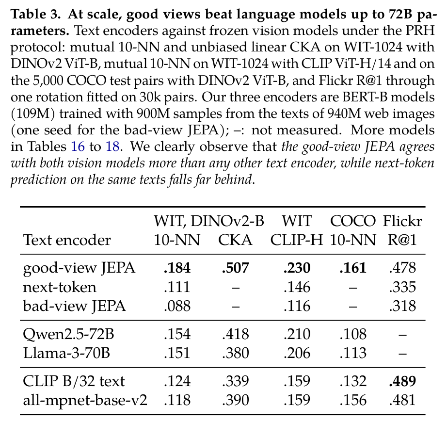

109M good-view text JEPA 對 DINOv2 ViT-S／B／L／g 的 mutual 10-NN 為 **.166／.184／.196／.197**，CKA(B) **.507**；Qwen2.5-72B 是 .138／**.154**／.166／.169（CKA .418），Llama-3-70B .136／**.151**／.166／.166（.380），Llama-3-8B .145，Mistral-7B .140，Qwen2.5-0.5B .102，CLIP text（400M 對）.124，all-mpnet（1B 對）.118，BERT-base .111。同一批文字上的控制組：next-token .111、bad views .088。對 CLIP ViT-H/14 則是 **.230**（Qwen2.5-72B .210、Llama-3-70B .206），對 MAE／I-JEPA 系是 .100–.129，COCO-5k **.161** vs Llama-3-70B .113。[2]

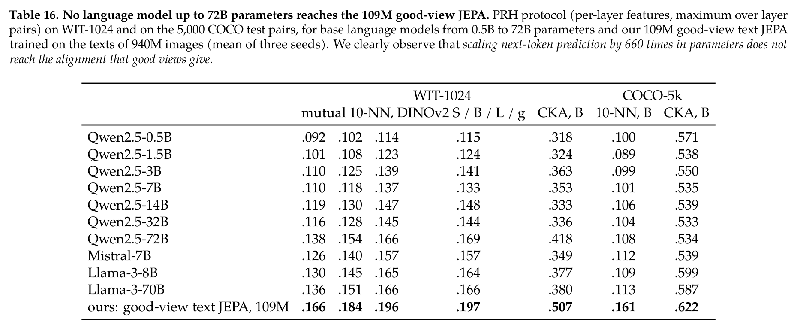

*這裡必須附上作者自己的兩段坦白，否則讀者會被 .184 誤導：* 一是**統計**——用 200 次重抽樣算 95% 區間後，33M 的 JEPA 對比語言模型其實是**平手**（50M-image 減 Qwen2.5-7B = +.010 [−.005,+.025]），真正決定性的是 **views 之間**的差距（+.037 [.025,.049]、+.054 [.041,.067]）。二是**超參選在測試集上**：因為 `stable-pretraining` 把 SIGReg 依每 GPU batch 縮放，第一個 940M run 的有效 $\lambda$ 是 .01；第二個 seed 按原訂 .02 只拿到 **.121**，作者寫道「我們在看過這個結果之後，為其餘所有 940M run 選了第一次的權重，所以那個權重是在 WIT 上選的」。把四個 seed 平均，是 **.168**（「仍然高於所有語言模型」）。[2] 我會在評價裡計分，但也要說：會自己寫下這段話的論文極少。

**D｜42× 樣本效率**：同為 109M BERT-B、同一語料、各自用自己規模的配方（good：lr $10^{-4}$、batch 256；next-token：lr $2\cdot10^{-4}$、batch 2,048）。good views 在 **21.6M samples** 到 .109，next-token 要到 **900M samples** 才 .111 → **42× 少樣本、14× 少文字 token（一個 good-view 樣本讀三段）、435× 少不重複影像**；同點位 Flickr R@1 .388 vs .335。若改成「同樣本數」比較差距更大：33M 在 21.6M samples 是 **.108 vs .071**。[2]

**E｜一條旋轉就是 captioner**：Flickr CIDEr **.396**（1,014 對擬旋轉）／**.431**（30k 對），random rotation 只有 .043；用同一映射去檢索最近 caption 是 .158，oracle（解碼真 caption 的 embedding）.628。COCO：**.668**（旋轉只在 Flickr 對上擬、decoder 用 Flickr+COCO 文字訓練）。堆疊到 **.838** 的路線是（Flickr／COCO）：.431/.668 → 換 Qwen2.5-1.5B decoder + web text JEPA + DINOv2 ViT-g .466/.720 → +mean-patch .480/.756 → +原始 captions .479/.765 → **+DINOv3 ViT-L 拼接 .496/.806** → +32 樣本共識解碼 **.519/.838**。[2]

*一個我認為比所有 SOTA 數字都重要的對照：* 用同樣的配對資料去擬**不受約束的線性映射**，Flickr 反而更好（.531 vs .504），但 **COCO 掉了五分之一（.635 vs .802）**；兩層 MLP 兩邊都比較差（.498/.585）。**正交結構買的是 transfer，不是 in-distribution 分數。** 另外解碼器的噪聲不是調出來的，是算出來的：$\sigma=(c^{-2}-1)^{1/2}$，$c$ 是擬完旋轉後的平均 cosine（$c\approx.3\Rightarrow\sigma=3$），CIDEr 隨 $\sigma$=0.5／1／2／3／4 為 .225／.304／.368／**.396**／.377，理論預測與實測峰值重合。[2]

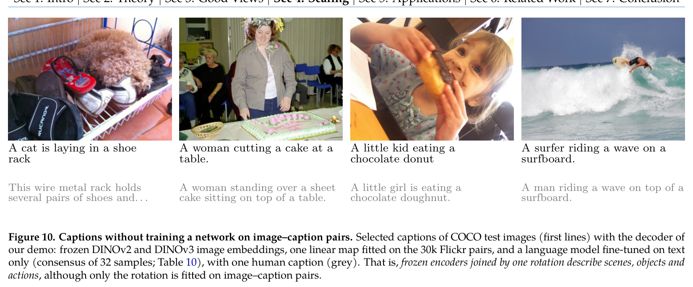

**F｜完全免配對（Table 4）**：沿用 Schnaus et al. 的 Wasserstein–Procrustes 協議、code、超參與五個 seed，DINOv2 ViT-B/14 與文字 encoder 用 COCO train2014 的**兩個互斥的未配對半邊**擬映射，在 40,504 個 val2014 對上評分：good-view 109M 得 FOSCTTM **.018**、CIFAR-10 top-1 **86.0**、CIFAR-100 top-5 **67.2**、ImageNet-100 top-5 **64.4**（±3.6，15 runs）；bad-view .026／78.1／55.3／46.7，**next-token .287／25.5／19.9／20.3（整個崩掉）**；Qwen3-8B 重跑 .018／83.4／61.7／47.6；MPNet 重跑 .043／70.2／45.6／45.4（對上他們原始報導 .04／70／46／45，複現成功）；對方「任何設定最佳」是 .01／82／62／56。與 Qwen3-8B 相比：FOSCTTM（$p=.053$）與 CIFAR-10（$p=.12$）平手，**CIFAR-100 +5.5（$p=.003$）、ImageNet-100 +16.8（$p<.001$，Mann–Whitney）**。[2] [12]

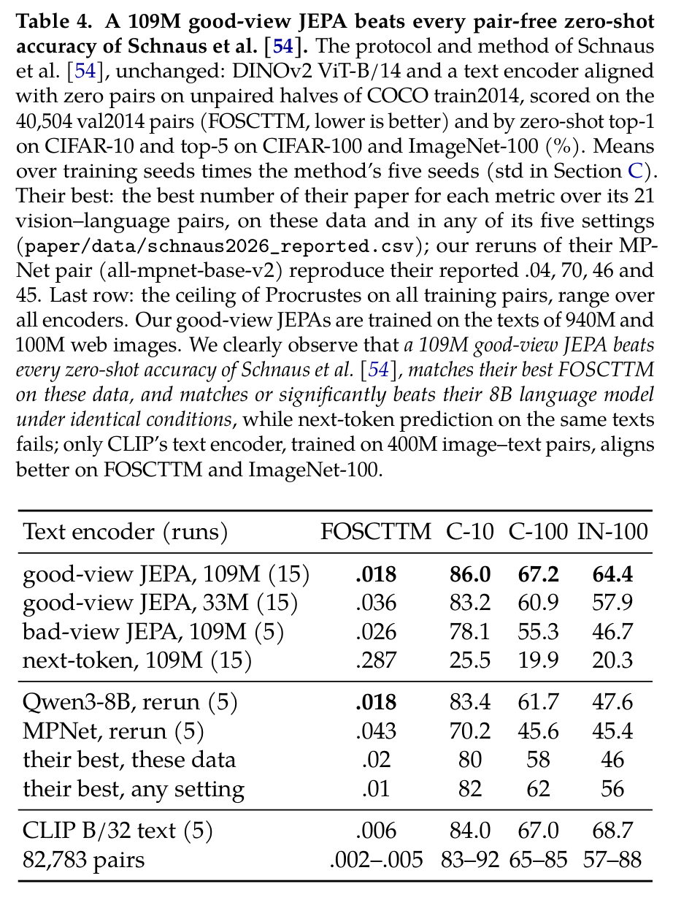

同一張表也提醒我們邊界：**CLIP text（400M 配對訓練）在 FOSCTTM .006 與 ImageNet-100 68.7 上更強**。而他們還獨立重擬了 35 條映射、並做了兩個殺手級控制：把文字座標洗牌（保留邊際、破壞幾何）後方法掉到 chance（FOSCTTM .57、CIFAR-10 11–15%），以及發現**該方法自己的未配對目標與測試 FOSCTTM 負相關**（Spearman −.78 對 85 組 COCO run、−.80 對 80 組 Flickr run）——這是對 benchmark 本身很有用的診斷。[2]

**G｜其他兩條值得記的證據**：(1) **文字側也變強**（Table 5）：STS-B Spearman good .579／bad .528／next-token .430，50M-image 版 **.632**；caption→caption R@1 good .606／bad .381／next-token .331／TF-IDF **.442**——bad views 幾乎只學到字面重疊，連 TF-IDF 都贏不過。[2] (2) **両側都做 good views（MSR-VTT，Table 13）**：.067（both）>.059（text only）>.043（image only）>.039（neither），且 frozen DINOv2（用 crop 訓練）跟「crop 訓練的 image JEPA」比較合（.144 vs .132）——**對齊追著 positives 的一致走**。[2] (3) **零樣本影像 captioning 影片**（從未用影片訓練）：MSR-VTT CIDEr **.246**（demo 版 .268）vs ZeroCap .058／MAGIC .074／DeCap .150–.186。[2]

**H｜消融把「怎麼造 good views」講得很具體（Table 8／Figure 7）**：default（2 global + 6 local、mask 15%、lr 5e-4）= .246；**完全不 trim（整段 caption）= .185（掉四分之一）**；溫和 trim .202；不 mask .242；mask 30% .254；view 數（2+2／2+10／4+4）幾乎不動；模型大小 .234–.260。所有不崩潰的 run 都在 **.18–.28**，對比 bad views 的 .13 與 next-token 的 .12。穩定性也記一筆：**沒有 gradient clipping 時 36 組 default 權重的 run 崩了 3 組**（在第 19–60 epoch 之間突然發生）；$\lambda=.005$／.05 不 clip 會崩，.1 甚至 clip 也崩。[2]

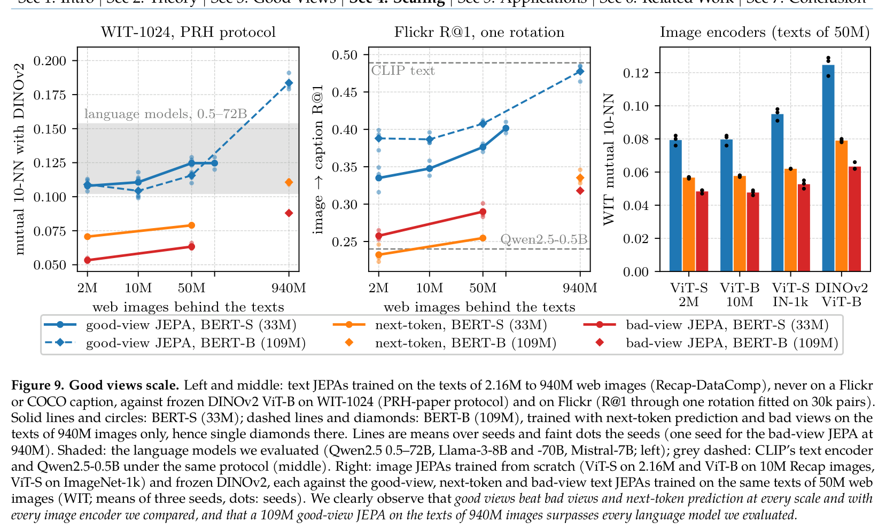

### 相關研究脈絡

**這條線的源頭與最近距離的先驅。** PRH 由 **Huh、Cheung、Wang、Isola（arXiv:2405.07987，ICML 2024）**提出，論證是一個理想化對照式學習者、其 kernel 走向共現事件的 PMI，並**假設觀察是雙射的、positives 由共現定義**；[7] 他們留下的「有損觀察」情況正是本文換個方式處理的（把 lossy 寫成 mismatched positives）。另一支是 **Ziyin & Chuang（arXiv:2507.01098）**「perfect PRH」的精解證明（embedded deep linear networks + SGD），本文稱它是「迄今最接近的證明」。[8] 語言側的近期理論是 **Doshi et al.（arXiv:2610.07168）**，解釋為什麼跨語言相似度在中間層達峰：不同語言在表面特徵之下共用層級結構。[9] 本文的定位很清楚：前兩者在「幾何收斂」上做文章，它在「**哪種訓練目標會讓 encoder 變得可對齊**」上做文章，Procrustes 只是借來的最簡單工具。[2]

**JEPA／能量視角的血統。** 直接的血統是 **LeJEPA（arXiv:2511.08544）**——invariance-to-mean + SIGReg 的全分佈高斯化反崩潰，本文所有 run 都用它；[10] 更早的「對照與非對照 SSL 分別恢復全域與區域性光譜 embedding」（**arXiv:2205.11508**）與 Laplacian eigenmaps 的觀點撐起 Thm 1；VICReg（2105.04906）、Barlow Twins（2103.04204）被當成 $\Omega$ 的退化特例；I-JEPA（2301.08243）、MAE（2111.06377）、DINOv2／v3 是被比較的視覺端。[2] [11] [13] 同群還有 **When Does LeJEPA Learn a World Model?（arXiv:2605.26379，Klindt／LeCun／Balestriero）**，證「alignment + 高斯正則」學到的必然是某動力學系統的表徵（被引 42 次），把今天的 Thm 1 與可辨識性接在一起。[11]

**Registration／免配對那一支。** Conneau et al. 的詞向量正交 Procrustes、Álvarez-Melis & Jaakkola 的 Gromov–Wasserstein、relative representations、anchor-pair coupling，以及本文直接採用的 **Schnaus et al.「Shared Geometry As A Rosetta Stone」（arXiv:2610.09411）**——它的 Wasserstein–Procrustes 完全不需要影像—文字配對就能粗對齊 DINOv2 與文字 encoder。[12] 本文對這支的態度是「它們對齊**給定的** encoder，我問**哪種目標讓 encoder 可對齊**」，並在對方自己的 benchmark 上取勝。[2]

**與本欄既有文章的接點。**（這幾個是我認為對照起來最有資訊量的）[16]–[31]

- **LeJEPA**（本欄 2026-05）[16]：SigReg／Epps–Pulley 那一套。今天這篇等於替它補上了「為什麼它能工作」的幾何解釋，順便暴露它**沒有**被證明的部分（$\mathrm{O}(k)$ 唯一性只在二階約束下成立）。
- **EBT／TEM**（本欄 2026-05、2026-10）[17] [18]：energy-based 的 $\Omega$ 是全分佈／學習式能量，而 Thm 1 需要「只透過 embedding 分佈依賴 $f$」的反崩潰項與旋轉不變性；這兩邊能不能共存，是一個可以正面打的題目。
- **LEF-JEPA／EBReg**（本欄 2026-11-11、2026-11-12）[19] [20]：前者用區域性能量場做 anti-collapse、後者用 score-based 熵最大化防崩潰，雨者都是「非 whitening 的 $\Omega$」。按今天的定理，它們的極小解結構不在 $\mathrm{O}(k)$ 軌道上——**所以「它們能不能被一條旋轉對齊」目前是開放問題，也正是可做的實驗。**
- **V-JEPA 2.1／TD-JEPA／A-JEPA／VL-JEPA／LocaLeJEPA／JEPA-TTT**（本欄 JEPA 系列）[21]–[24]：這些都有 learned predictor（或 action conditioning），而本文**明文把 learned／action-conditioned predictor 排除在分析外**。Thm 1 的「positives 決定 kernel」直接可以被改寫成「predictor 決定 kernel」，那是下一篇該寫的東西。
- **MS-pDiT／REPI**（本欄 2026-11、2026-10）[26] [28]：生成側的 representation alignment（把 DiT 特徵對到 DINOv2、或把外部特徵注入 DiT）。今天的結果對它們是一個警告也是一個方法：對齊**有可算的下界**（Eq 4），而且**只擬一條正交映射就夠，自由線性映射會傷 transfer**。
- **G-STAR／Any-Order-AR**（VAR 側）[27] [29]：next-scale／任意順序 AR 同樣是「一個 token 一個預測目標」，可以拿 Eq (6) 的分解去檢驗它們是不是另一種 bad-view JEPA。
- **Z-Cache／PreSTP／ReCR**（training-free 側）[30] [31]：本文是「免訓練跨模型拼接」的極端例子（只擬 0.22M 引數），提供了 inference-time 組裝多模型時「何處可免訓練」的判準。

### 個人評價、限制與意義

**我給這篇的高度，主要不是給定理，而是給「把一個哲學命題拆成可量測元件」這件事。** Thm 1 的證明是兩行、Thm 2 是教科書級的 Davis–Cahan、Thm 3 是 von Neumann trace 加 Schatten Hölder——都不是新數學，但組合方式把 PRH 從「等你 scale 上去看」變成「你可以先算 $\rho(f)$ 和 eigengap 再決定要不要花這 5,500 GPU-hours」。加上 300 組隨機世界的暴力驗證、CPU 上的定理測試、預先登記的 scaling law、重抽樣 CI、洩漏稽核，以及「權重在 WIT 上選過」的自白，這是一篇**方法論上比結論更值得學**的論文。[2] [4]

**但我對「proved」這個詞保持保留。** 它證的是 whitened-JEPA 理想化下的一個**充分條件**：有限世界、單射渲染、邊際相同、共享 positive-pair kernel、極小解在旋轉下唯一（而且這個唯一性只在二階約束下被 Prop 1 支撐）、predictor 是恆等。作者自己在 Known limitations 寫了「**沒有任何實驗完全滿足 Theorem 1 的假設**」。[2] 所以headline 應該是「在理想化模型下 PRH 成立，且其條件指向 positives」，而不是「PRH 被證明瞭」。

**三條我會在筆記上標紅的限制：**

1. **good views 的來源本身有 leak**：最大的 confound 不是模型，而是「誰造了 positives」。Recap-DataComp 的三段文字裡有兩段是 **LLaVA（骨幹是 LLaMA-3-8B + CLIP ViT-L/14）**recaption 出來的，所以視覺—語言資訊可以透過「正樣本的定義」進入對齊分數。作者量化了這點：只用 alt-text + 純文字 paraphrase 時 good views 只有 **WIT .060（對比 .107）**。因此**跨 72B 的比較（.184 vs .154）有資料混成的成分**，而「同一批文字上 good vs bad vs next-token」的比較才乾淨。這是解讀全篇的開關。[2]
2. **標題數字的 seed 依賴很大**：$\lambda=.02$ 那個 seed 只拿 .121；四 seed 平均 .168。而 33M 對語言模型的差距在 CI 內。我認同作者的處理方式（全部揭露），但引用時我寧可用 .168–.184 的區間說法。[2]
3. **影像側幾乎全是 bad views**：除了 MSR-VTT，他們的 image JEPA 都用 crop（按自己的定義就是 bad views），「good image views 的 scaling」被留給未來。也就是**這篇只驗了理論的一半**。[2]

另外兩個小刺：next-token／bad-view 基線**沒有調超參**（作者也承認只在 good-view 側調過，基線停在 .13／.12）；以及權重未釋出，外部要驗證 940M 那一檔幾乎不可能（492 GB 文字 + gated DINOv3）。[2] [4]

**對我而言真正的意義**是把設計權拿回來了：如果你在意跨模態表徵，你的第一根槓桿不是引數、不是資料量，而是**「positives 是不是同一場景的兩次觀察」**；而 $\rho(f)$、eigengap、以及「$k$ 個配對就解出一條旋轉」是三個能立刻用在你自己的模型上的工具。[2]

### 研究啟發：六個可直接開工的延伸

下面六條我都儘量寫成「能在本週開始、有明確成功判準」的形式。

**1｜$\rho(f)$ 當成免費的對齊感測器（training-free，零訓練成本）**
拿你手邊任何 encoder（DiT 中間層、VAR 的 latent、VAE、DINOv2），用 Eq (4) 的定義估 $\rho(f)=\mathrm{tr}\boldsymbol{C}_f^{1/2}/k$，再對它做「需要跨模態對齊的任務」（REPA-style alignment、Procrustes 接 captioner、JEPA critic 串接）。假設很清楚：**$\rho$ 高但 gap 小的模型，用一條旋轉就能接；$\rho$ 低的模型，怎麼訓練 attention 都接不上。**判準：$\rho$ 對下游對齊分數的 Spearman（本文 9 個 encoder 上是 .98），以及能否用它**在訓練前**預測。[2] 這條幾乎免費，而且能直接回答你「training-free 什麼時候真的可行」。

**2｜把 good views 搬到生成側：REPA 的 positive-graph 版本**
現在 DiT／VAR 的 representation alignment 是「生成特徵去貼 DINOv2 特徵」，用的是 pair-level 的對齊損失。按這篇的語言，那等於拿 **bad views**（同一張圖的 crop）去造 positives。可做的是把正樣本改成「**同一場景的兩次觀察**」：多視角渲染（3D／合成資料）、同一段影片的兩個時刻、同一 prompt 的不同渲染器輸出；損失改成 LeJEPA 的 mean-invariance + SIGReg，問：同一 GPU-hours 下 FID／GenEval 是否更好、以及 $\rho$ 是否上升。判準：對照「同 pair 數的 REPA」與「同 kernel 的 good-view REPA」。[2] [26]

**3｜能量式 $\Omega$ 的可辨識性缺口（最貼近你 energy-based 那條線）**
Thm 1 的「唯一 up to rotation」只在**二階 whitening**下成立；LEF-JEPA 的區域性能量場、EBReg 的 score 熵、EBT／TEM 的對比能量，都是**非 whitened 的 $\Omega$**，理論目前不涵蓋。具體題目：對 $\Omega(f)=D_{\mathrm{KL}}(f_{\#}p\,\|\,\mathcal{N})$ 或任意旋轉不變的能量泛函，證明（或反證）極小集合仍是單一 $\mathrm{O}(k)$ 軌道；若只有 $\mathrm{GL}(k)$（像 Eq (6) 那樣），那用 Procrustes 去接就註定失敗——**這是可以用一個週末在 toy 世界上做出來的否證實驗**（拿他們的 300-世界測試改 $\Omega$）。[2] [17]–[20]

**4｜在 nuisance 子空間上做 attention modulation（把你那條線接上理論）**
Prop 3 給了一個可操作的分解：embedding 維度分成「世界 $k$ 個方向」與「nuisance 方向」，而 $\boldsymbol{C}_f$ 的零特徵空間正是 nuisance 吃掉的維度。做法：先估 $\boldsymbol{C}_f$、取其 top-$k$ 與 null space，然後**推理時只在 null／nuisance 子空間重分配 attention 質量**（或反向：把被 nuisance 佔用的 head 抑制掉），保持世界子空間不變。假設：這比全序列的 temperature／scale 調整更省、且**不破壞跨模態可對齊性**（可以用 $\rho$ 前後不變當驗收條件）。這是把「attention modulation」從工程技巧升級成有幾何語意的控制。[2]

**5｜$k$ 個配對就夠 → 跨 backbone 的零樣本 critic／world-model 移植**
他們只用 0.22M 行正交引數就把 384 維 text JEPA 接到 768 維 DINOv2；且 30 個 pair + 未配對精進 ≈ 1,014 個 pair 的檢索。可做的：**把你的生成器的 latent 特徵用 $k$ 個 pair 旋轉接到一個現成 JEPA critic（或 world model），完全不微調 backbone**，然後測試這個 critic 能否做 inference-time reranking／guidance。判準要嚴格：對照「自由線性映射」與「MLP 映射」（本文的證據是自由映射 in-distribution 更好、跨集掉 21%），並報告 pair 數 $k$ 與 transfer 差距的曲線。[2] [30]

**6｜next-scale／any-order AR 也是 bad-view JEPA 嗎？**
Eq (6) 的「CE = prediction + 只看 logit 集的 anti-collapse、且只有 $\mathrm{GL}(k)$ 可辨識」對任何 softmax token 頭都成立，因此對 VAR 的 next-scale、G-STAR 的 group code、any-order AR 都該有同款預測：**它們的表徵對齊需要比 diffusion latent 更多的 scale，而且一條旋轉接不上。**實驗很便宜：拿 MAR／Infinity／VAR 的中間層，與同一個 DINOv2／JEPA target 做 mutual 10-NN + Procrustes R@1，畫「對齊 vs 引數／步數」曲線，再用 $\rho$ 解釋落差。這是能在 VAR 社群講得動、而且只有這篇能當參照點的問題。[2] [27] [29]

**最後一個「今天就能跑」的清單**：`git clone galilai-group/prh-proof && pytest -m "not slow"`（CPU，約 2 分鐘，把 Thm 1／2／3／Prop 1／2 全部數值驗一遍）；再跑一組 Flickr30k 三 arm（good／bad／next-token，每組 1–2 GPU-h）檢查排序是否重現 Table 1。[4] 這是我對「它到底是定理還是修辭」最快的判別方式，也是我這篇能寫得這麼具體的原因。

### References

[1]: https://arxiv.org/abs/2610.39302 "Proving and Improving the Platonic Representation Hypothesis with JEPAs — arXiv abstract (v1, 2026-10-29; cs.AI primary, cross cs.CV/stat.ML; no Comments field)"
[2]: https://arxiv.org/html/2610.39302v1 "arXiv HTML full text of 2610.39302v1 — Section 2 theory (Eq 1–7, Thm 1–4, Prop 1–4), Section 3–5 experiments, Sec 7 Known limitations, Appendix A proofs, B details, C extra tables"
[3]: https://arxiv.org/pdf/2610.39302v1 "arXiv PDF of 2610.39302v1 (37 pages; all figure/table crops in this report are taken from this PDF)"
[4]: https://github.com/galilai-group/prh-proof "galilai-group/prh-proof — MIT, 230 stars, CPU theorem tests, paper/runs.csv with 345 runs, docs/reproduce.md"
[5]: https://huggingface.co/spaces/galilai-group/prh_demo "Live demo Space (RUNNING on A100-large; weights loaded from a private repo via PRH_WEIGHTS)"
[6]: https://huggingface.co/papers/2610.39302 "Hugging Face paper page (79 upvotes at check time; comment thread contains an unrelated fake-bot prompt-injection payload)"
[7]: https://arxiv.org/abs/2405.07987 "Huh, Cheung, Wang, Isola — The Platonic Representation Hypothesis (ICML 2024), the originating hypothesis and the WIT-1024 / mutual 10-NN protocol"
[8]: https://arxiv.org/abs/2507.01098 "Ziyin & Chuang — Proof of a perfect platonic representation hypothesis (embedded deep linear networks; the closest prior proof)"
[9]: https://arxiv.org/abs/2610.07168 "Doshi et al. — A theory of platonic representations in language models (within-modality analogue)"
[10]: https://arxiv.org/abs/2511.08544 "Balestriero & LeCun — LeJEPA: Provable and Scalable Self-Supervised Learning Without the Heuristics (SIGReg; the objective used by every run here)"
[11]: https://arxiv.org/abs/2605.26379 "Klindt, LeCun, Balestriero — When Does LeJEPA Learn a World Model? (identifiability of alignment+Gaussian regularisation)"
[12]: https://arxiv.org/abs/2610.09411 "Schnaus et al. — Shared Geometry As A Rosetta Stone: Cross-Modal Alignment Without Paired Data (the pair-free benchmark and code reused in Table 4)"
[13]: https://arxiv.org/abs/2205.11508 "Balestriero & LeCun — Contrastive and non-contrastive SSL recover global and local spectral embedding methods (the spectral view behind Thm 1)"
[14]: https://www.statslab.cam.ac.uk/~rjs57/Biometrika-2015-Yu-315-23.pdf "Yu et al. 2015 — A useful variant of the Davis–Kahan theorem for statisticians (the perturbation bound used in Thm 2)"
[15]: https://huggingface.co/datasets/UCSC-VLAA/Recap-DataComp-1B "Recap-DataComp-1B texts (alt-text plus two LLaVA recaptions per image) — the corpus behind the 940M-image runs"
[16]: https://github.com/KaiCobra/AI_Daily/blob/main/papers/2026/2026-05/LeJEPA/AI_Daily_LeJEPA.md "AI Daily LeJEPA report (the objective family this paper builds on)"
[17]: https://github.com/KaiCobra/AI_Daily/blob/main/papers/2026/2026-05/EBT/AI_Daily_EBT.md "AI Daily EBT report — Energy-Based Transformers (non-whitened anti-collapse)"
[18]: https://github.com/KaiCobra/AI_Daily/blob/main/papers/2026/2026-10/TEM/AI_Daily_TEM.md "AI Daily TEM report — Scaling Transformer Energy-based Models"
[19]: https://github.com/KaiCobra/AI_Daily/blob/main/papers/2026/2026-11/LEF-JEPA/AI_Daily_LEF-JEPA.md "AI Daily LEF-JEPA report — latent energy fields as anti-collapse"
[20]: https://github.com/KaiCobra/AI_Daily/blob/main/papers/2026/2026-11/EBReg/AI_Daily_EBReg.md "AI Daily EBReg report — score-based entropy maximization collapse prevention"
[21]: https://github.com/KaiCobra/AI_Daily/blob/main/papers/2026/2026-11/V-JEPA-2.1/AI_Daily_V-JEPA_2_1.md "AI Daily V-JEPA 2.1 report (learned/dense JEPA variants outside this theorem's scope)"
[22]: https://github.com/KaiCobra/AI_Daily/blob/main/papers/2026/2026-11/TD-JEPA/AI_Daily_TD_JEPA.md "AI Daily TD-JEPA report (predictor-based JEPA; the gap this paper leaves open)"
[23]: https://github.com/KaiCobra/AI_Daily/blob/main/papers/2026/2026-09/VL-JEPA/AI_Daily_VL_JEPA.md "AI Daily VL-JEPA report"
[24]: https://github.com/KaiCobra/AI_Daily/blob/main/papers/2026/2026-10/LocaLeJEPA/AI_Daily_LocaLeJEPA.md "AI Daily LocaLeJEPA report (local Gaussian regularisation variant of SIGReg)"
[25]: https://github.com/KaiCobra/AI_Daily/blob/main/papers/2026/2026-09/Into-the-Rabbit-Hull/AI_Daily_Into_the_Rabbit_Hull.md "AI Daily Into the Rabbit Hull report (DINO geometry / task-relevant similarity, the empirical neighbour of PRH)"
[26]: https://github.com/KaiCobra/AI_Daily/blob/main/papers/2026/2026-11/MS-pDiT/AI_Daily_MS-pDiT.md "AI Daily MS-pDiT report (representation alignment in pixel-space diffusion)"
[27]: https://github.com/KaiCobra/AI_Daily/blob/main/papers/2026/2026-11/G-STAR/AI_Daily_G-STAR.md "AI Daily G-STAR report (discrete AR capacity scaling; next-scale prediction targets)"
[28]: https://github.com/KaiCobra/AI_Daily/blob/main/papers/2026/2026-10/REPI/AI_Daily_REPI.md "AI Daily REPI report — Scaffold Then Internalize: Representation Injection for Diffusion Transformers"
[29]: https://github.com/KaiCobra/AI_Daily/blob/main/papers/2026/2026-11/Any-Order-AR/AI_Daily_AnyOrder_AR.md "AI Daily Any-Order-AR report (autoregressive token objectives under arbitrary ordering)"
[30]: https://github.com/KaiCobra/AI_Daily/blob/main/papers/2026/2026-11/Z-Cache/AI_Daily_Z_Cache.md "AI Daily Z-Cache report (training-free trajectory repair; the cost accounting to compare against)"
[31]: https://github.com/KaiCobra/AI_Daily/blob/main/papers/2026/2026-11/ReCR/AI_Daily_ReCR.md "AI Daily ReCR report (training-free representation-guided context rewriting)"
[32]: https://phillipi.github.io/prh/ "Project page of the original Platonic Representation Hypothesis (Huh et al.), including the mutual-kNN / CKA protocol reused here"
