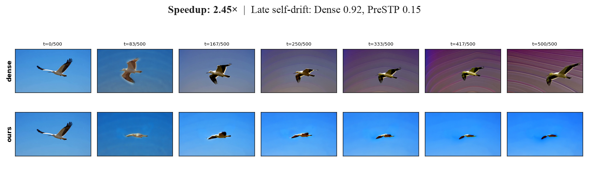

# AI Daily

## Training-Free Predictive Spatio-Temporal Token Pruning for Few-Step Autoregressive Video Diffusion

**研讀日期：2026-11-08**

### 論文資訊

作者為 Jia Li、Xurui Peng、Xing Wang、Hayden Kwok-Hay So，署名單位是香港大學與 ByteDance Seed。論文於 2026-11-05 以 arXiv:2611.07551v1 發表。截至本報告查核日，arXiv 記錄沒有列出正式會議或期刊，因此應標示為 **arXiv 預印本**，而不是已錄取的頂會論文。[1] [2]

## 一句話摘要

PreSTP 不重新訓練少步自回歸影片擴散模型，而是從生成器自己的去噪軌跡辨認兩種可跳過的計算：相鄰影格間幾乎不變的空間 token，以及同一影格內已收斂的去噪 token。被跳過的位置沿用最近一次實際計算值，必要時再以完整計算重新探測，因此它是一個接在既有模型上的 **training-free 推理加速器**，不是新的生成 backbone。[2] [3]

## 為何值得讀

這篇最有研究價值的問題很具體：在少步生成已大幅壓低「跨去噪步」冗餘後，能否再利用「跨影格」的靜態內容冗餘？PreSTP 把兩者合併成 token 級的時空遮罩，並在多種既有影片生成器上測試。這讓它適合研究速度、品質和長時間軌跡穩定性之間的實際取捨。

主題上它直接符合 training-free 與視覺自回歸推理，但要與 **VAR** 分清楚：PreSTP 的 backbone 是逐影格或逐 chunk 自回歸的影片擴散模型，不是以離散視覺 token 做 next-scale 預測的 VAR。它也沒有使用 JEPA 或 EBT；這些只適合作為後續研究的連接點，不應當成本文已有的方法。[2] [8] [9] [10]

本次候選池另涵蓋統一圖像生成、非對抗式 diffusion distillation、RoPE attention routing 與 JEPA world-model/control。六篇近四日新稿與 repo 的 `INDEX.md`、`README.md` 已按 arXiv ID 和標題比對；PreSTP 因最直接對應 training-free 與 autoregressive inference，且主文提供多種 backbone 的量化比較而入選。

## 方法：從軌跡中判斷哪些 token 可以暫停計算

令第 $i$ 個影格在去噪時間 $t_k$ 的 latent 為 $\mathbf{x}_{t_k}^{(i)}$，影片條件與歷史影格的 KV cache 一併提供給生成器 $\Phi_\theta$。一次 flow-matching 更新可寫成

$$
\hat{\mathbf{v}}_k^{(i)} = \Phi_\theta\!\left(\mathbf{x}_{t_k}^{(i)}, t_k, c, \mathcal{K}^{(<i)}\right),
\qquad
\mathbf{x}_{t_{k+1}}^{(i)} = \mathbf{x}_{t_k}^{(i)} + (t_{k+1}-t_k)\hat{\mathbf{v}}_k^{(i)}.
$$

模型也以目前的速度場估計 clean latent：

$$
\hat{\mathbf{x}}_{0\mid t_k}^{(i)} = \mathbf{x}_{t_k}^{(i)} - t_k\hat{\mathbf{v}}_k^{(i)}.
$$

PreSTP 使用這個估計作為「這個 token 是否還會改變」的代理訊號；它不是已知的真實 clean frame，也不是獨立訓練的預測器。[2] [3]

### 1. 跨影格：找近似靜態位置

對影格 $i$ 的 token $j$，令 $\mathbf{r}_j^{(i)}$ 為前一影格中該位置最近一次實際計算並保存的值。若目前影格的 early clean estimate 與它高度相似，就將該位置標成靜態：

$$
M_s^{(i)}(j) = \mathbb{1}\!\left[
\operatorname{cos}\!\left(\hat{\mathbf{x}}_{0\mid t_0,j}^{(i)},\mathbf{r}_j^{(i)}\right) > \tau_s
\right].
$$

$M_s^{(i)}(j)=1$ 表示跨影格冗餘，後續可略過；若物體或背景變化使相似度低於門檻 $\tau_s$，該 token 仍需計算。這讓靜態背景可能省下大量運算，但收益自然會依鏡頭運動和場景動態而變。[2]

### 2. 跨去噪步：凍結已收斂 token

對仍在計算的 token，比較相鄰去噪步的 clean estimate。若兩者的 cosine similarity 高於 $\tau_f$，就把該 token 標為已收斂：

$$
C^{(i,k)}(j) = \mathbb{1}\!\left[
\operatorname{cos}\!\left(
\hat{\mathbf{x}}_{0\mid t_k,j}^{(i)},
\hat{\mathbf{x}}_{0\mid t_{k-1},j}^{(i)}
\right) > \tau_f
\right],
\qquad
M_f^{(i,k)} = M_f^{(i,k-1)} \lor C^{(i,k)}.
$$

跨影格靜態遮罩與累積的跨步收斂遮罩合成目前的 active set：

$$
\mathcal{A}_{i,k} = \left\{j : M_s^{(i)}(j) \lor M_f^{(i,k-1)}(j) = 0\right\}.
$$

Transformer 只對 $\mathcal{A}_{i,k}$ 中的 token 執行當前步計算；其他位置沿用最近一次實際算出的值 $\boldsymbol{\ell}_j^{(i,k-1)}$：

$$
\mathbf{y}_j^{(i,k)} =
\begin{cases}
[\Phi_\theta(\cdot;\mathcal{A}_{i,k})]_j, & j\in\mathcal{A}_{i,k},\\
\boldsymbol{\ell}_j^{(i,k-1)}, & j\notin\mathcal{A}_{i,k}.
\end{cases}
$$

因此這是以 clean-estimate 相似度作出的近似計算，不是對被略過 token 不變的理論保證。實作還會完整計算第一個影格作為 anchor；當靜態比例足夠高時可以沿用之前的 static mask，但每隔指定影格仍會進行 dense probing，以降低 mask 過時的風險。[2] [3]

## 實驗結果：看加速，也要看計時範圍

作者在 Wan2.1-1.3B 上比較 CausVid、Self-Forcing、AnyFlow、LongLive 等四步生成模型；5 秒測試使用 832×480 影片、VBench 的 946 個 prompts，每個 prompt 使用 5 個 random seeds。以下是論文報告的代表性結果：

- **CausVid**：生成延遲由 7.86 秒降至 4.65 秒，speedup 為 1.69×；VBench Total score 從 82.85 到 82.91。PreSTP 結果的 LPIPS、PSNR、SSIM 分別為 0.092、21.03、0.934。
- **Self-Forcing**：speedup 為 1.52×，VBench Total score 為 83.92，dense baseline 為 83.99。
- **AnyFlow**：作者報告 3.20× speedup，VBench Total score 為 84.44，dense baseline 為 84.68。

這些數字顯示，報告設定下可少算不少 token，且 VBench 總分與 dense baseline 接近；它們不是每個資料集或每個 prompt 都不退化的證明。5 秒表中不同方法的模型、threshold 和 operating point 不同，也不能只按 headline speedup 排出普遍名次。[2]

在 30 秒 VBench-Long 測試中，作者報告 CausVid、Self-Forcing、LongLive 分別達到 1.96×、1.50×、1.44× speedup。對 one-step 模型，跨去噪步的遮罩不再適用，但跨影格 pruning 仍可用；One-Forcing 與 Causal Forcing++ 的 5 秒 speedup 分別為 1.19× 與 1.17×，30 秒則為 1.22× 與 1.10×。[2]

**計時口徑是解讀這些數字的關鍵。** 論文比較的是整個測試集 dense latency 總和與 PreSTP latency 總和之比，但排除模型載入、prompt/輸入編碼、影片解碼和評測時間。這是 diffusion latency 的加速，不等於端到端服務延遲。作者也指出，方法主要省下 query-side token 計算，歷史 KV context 仍完整參與 attention；因此它沒有同時解決長上下文 attention 或 KV memory 的成本。[2]

## 相關研究：方法邊界在哪裡

CausVid 將慢速雙向影片擴散蒸餾成少步 causal video generator，是 PreSTP 所加速的一類 backbone；Self-Forcing 則以 self-generated context 的訓練方式處理 AR video diffusion 的 train-test gap。PreSTP 不取代這些方法，而是在已訓練模型上加入推理期 token pruning。[4] [5]

TeaCache 以 timestep embedding 和輸出變化判斷何時重用 denoiser 計算，較偏向跨步的 feature/output caching；PreSTP 直接用 token 遮罩同時處理跨影格與跨去噪步的冗餘。它不是 attention modulation：論文沒有調整 attention logits、head weights 或 positional encoding。FlowCache 會進一步研究自回歸影片的 chunk/step caching 與 KV 壓縮；PreSTP 的歷史 KV 仍完整使用，因此兩者可作為互補基線，而非同一種壓縮。[6] [7]

和你關注的方向對照如下。**EBT** 以學得的 energy/compatibility function 做候選驗證及推理期能量最小化；PreSTP 沒有 energy model，只用 cosine threshold。**JEPA** 在 latent representation 空間預測未來特徵；PreSTP 使用生成器自身的 clean estimate，沒有 JEPA encoder 或 predictor。**VAR** 是影像 next-scale 自回歸生成；PreSTP 的 AR 是影片擴散 backbone 的因果影格生成。最後，**training-free 不等於 zero-shot**：此方法不重訓生成器，但仍需依模型與影片長度選 threshold、gate 和 refresh interval；論文沒有證明一組免校準門檻能遷移至未見 backbone、解析度或動態場景。[2] [8] [9] [10]

## 可延伸的研究問題

1. **以風險分數取代固定門檻。** 可以把跨步不一致與跨影格不一致合成 token risk：

   $$
   R_{i,k,j} = \alpha\!\left[1-\operatorname{cos}(\hat{\mathbf{x}}_{0\mid t_k,j}^{(i)},\hat{\mathbf{x}}_{0\mid t_{k-1},j}^{(i)})\right]
   + \beta\!\left[1-\operatorname{cos}(\hat{\mathbf{x}}_{0\mid t_0,j}^{(i)},\mathbf{r}_j^{(i)})\right].
   $$

   低風險 token 才跳算，高風險 token 觸發 dense compute 或提前刷新。這是可解釋的 energy-like risk score，**不是 EBT**；若再訓練 EBT 式 energy verifier，則須另計 verifier 的推理成本，且方法不再是純 training-free。

2. **用 JEPA 表徵預測決定 refresh。** 冷凍一個影片 JEPA，預測下一影格的 latent feature；若 JEPA 預測與生成器 clean estimate 分歧，就提高 motion 區域的計算預算。需要測量 JEPA 推理成本是否抵消省下的 DiT FLOPs，並與 optical flow、PreSTP cosine gate 做同硬體比較。

3. **把 token risk 搬到 VAR 的尺度軸。** 在 next-scale 生成時同時依據空間冗餘和尺度間預測穩定度配置計算量，檢查它對細節、構圖和組合式 prompt 的影響。這是將思想移植到 VAR 的研究假說，不是 PreSTP 論文結果。

4. **嚴格測試 zero-shot 與長片 drift。** 固定一組門檻，直接跨未見 backbone、解析度、鏡頭運動和高動態影片評估；同時報告端到端 latency、峰值記憶體、energy/sample、VBench、LPIPS 和失敗率。這可以檢驗目前的 model-specific tuning 是否真能轉化成可攜的推理原語。

## 限制與個人評價

PreSTP 的優點是問題定義簡單、能疊加在不同少步影片模型上，且論文同時提供 5 秒、30 秒、one-step、消融與定性案例。它的核心風險也清楚：相似度門檻是 heuristic，收益依內容而變；第一個影格要完整計算，mask 需要定期重探測；動態場景、鏡頭移動和長序列會增加 stale token 的風險。Speedup 僅計 diffusion latency，且目前查核到的性能數字都是作者在 arXiv v1 中報告，未找到獨立第三方復現或正式 venue。[1] [2]

我認為最值得跟進的不是把最高 3.20× 當成普遍結論，而是把「可凍結 token」改寫成可校準的風險預算問題：何時相信生成器自己的局部穩定訊號，何時用 JEPA 或 energy verifier 重新檢查，以及這些檢查是否仍然划算。若能在跨模型、動態場景與端到端能耗上維持 Pareto 優勢，PreSTP 才有機會從一個有效的 pruning heuristic，變成更一般的 inference-time compute controller。

## References

[1]: https://arxiv.org/abs/2611.07551 "arXiv record and version history for PreSTP"
[2]: https://arxiv.org/pdf/2611.07551v1 "PreSTP primary paper PDF version 1"
[3]: https://ar5iv.labs.arxiv.org/html/2611.07551 "PreSTP primary paper HTML rendering"
[4]: https://openaccess.thecvf.com/content/CVPR2025/html/Yin_From_Slow_Bidirectional_to_Fast_Autoregressive_Video_Diffusion_Models_CVPR_2025_paper.html "CausVid CVPR 2025 paper"
[5]: https://proceedings.neurips.cc/paper_files/paper/2025/hash/f4823f831af67a3ef15e41a85434422a-Abstract-Conference.html "Self-Forcing NeurIPS 2025 paper"
[6]: https://openaccess.thecvf.com/content/CVPR2025/html/Liu_Timestep_Embedding_Tells_Its_Time_to_Cache_for_Video_Diffusion_CVPR_2025_paper.html "TeaCache CVPR 2025 paper"
[7]: https://arxiv.org/html/2602.10825v1 "FlowCache for autoregressive video generation"
[8]: https://iclr.cc/virtual/2026/oral/10008833 "Energy-Based Transformers ICLR 2026 paper"
[9]: https://arxiv.org/abs/2301.08243 "I-JEPA primary paper"
[10]: https://neurips.cc/virtual/2024/poster/94115 "Visual Autoregressive Modeling NeurIPS 2024 poster"
