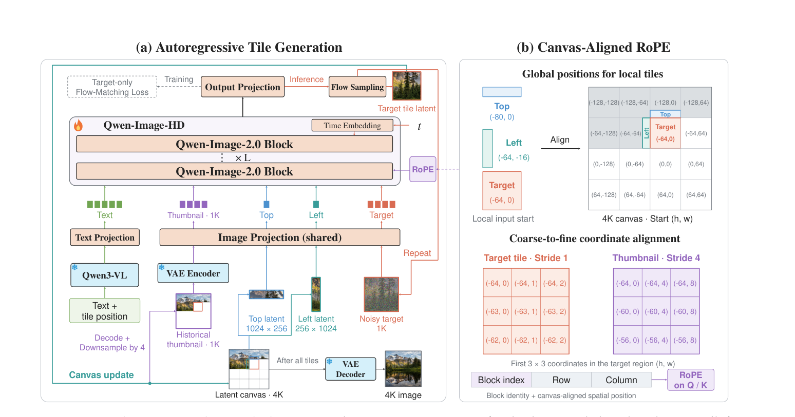
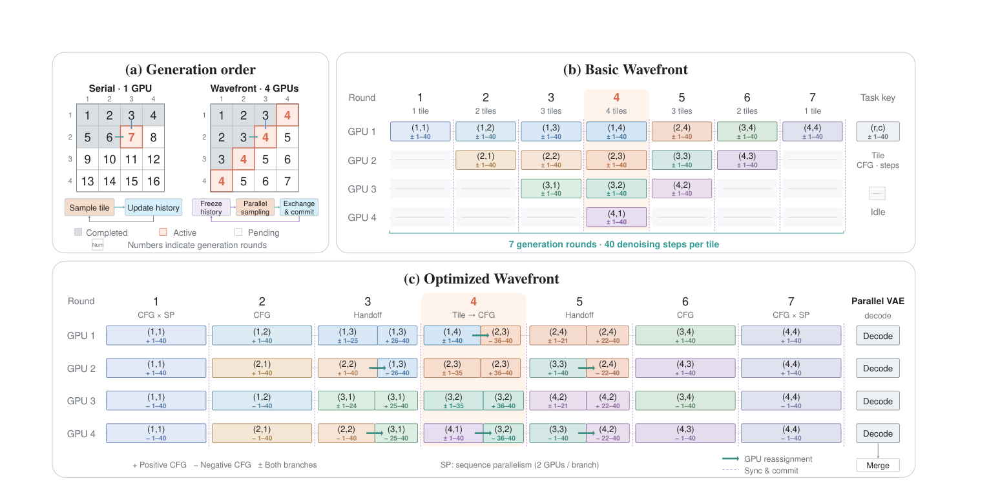

# AI Daily

2026-11-26

## 論文基本資料

**Qwen-Image-HD: Autoregressive Diffusion for High Definition Image Generation**（以自回歸擴散生成高解析度影像）。作者共 28 位：Zihao Liu、Zekai Zhang、Shengming Yin、Zikai Zhou、Donghao Zhou、Chenyang Zhu、Lihan Jiang、Ningyuan Tang、Bingxuan Zhao、Yanran Zhang、Yan Shu、Zhening Liu、Jiahao Li、Jie Zhang、Kaiyuan Gao、Kun Yan、Qihang Ai、Rui Song、Shuo Cao、Xiao Xu、Xiaoyue Chen、Yuxiang Chen、Zhendong Wang、Zhouyang Li、Bo Zheng、Jun Zhou、Xiu Li、Chenfei Wu；原文以星號標示 Chenfei Wu 為通訊作者。論文標題頁沒有列作者機構。[1] [2]

論文為 [arXiv:2611.32736v1](https://arxiv.org/abs/2611.32736v1)，2026-11-24 首次提交，分類 cs.CV。arXiv 記錄未提供會議、期刊、DOI 或正式錄用資訊，故應視為**尚未確認 venue 的預印本**，不能當成已經過頂會審查的成果。[1] [2]

本次候選來自 EBM、JEPA、Visual AR、免訓練／注意力調制，以及 diffusion／flow matching 等方向的平行掃描。TD-JEPA、TEM 和 Attention-Scoped Guidance 因已在本庫發布而排除；Qwen-Image-HD 的標題與 arXiv 編號則未出現在既有索引。它於 11 月 24 日剛提交，主題直接切中高解析生成、局部擴散與區塊自回歸，因此在沒有正式 venue 資訊的前提下，仍以時效性和方法相關性勝出；venue 優先這一條則尚未滿足。

## 核心貢獻

完整 4K 畫布一次送入生成 Transformer，會帶來很長的影像 token 序列；若只切成區塊，局部預測又容易失去全局構圖或在區塊邊界出現接縫。Qwen-Image-HD 從 Qwen-Image 2.0 初始化，改以約 1K 的 tile 作為 Rectified Flow 預測目標，並為每個 tile 提供兩種尺度的歷史：整張畫布的低解析縮圖，以及上方和左方相鄰 tile 的高解析邊界。它再把這些輸入映射到共同的畫布座標，使縮圖、鄰接區和目標 tile 在 RoPE 中保留相對位置與尺度。[1]

另一項貢獻是 Wavefront-AutoRegressive 推論。它沿著 4×4 tile 網格的反對角線分批生成；同一輪中沒有依賴關係的 tile 可並行取樣，輪末才一起更新共享歷史。作者另外結合 CFG 分支平行化、序列平行化與 GPU 工作交接，降低多 GPU 單張影像的等待時間。[1]

## 技術方法

令輸出畫布分成 \(R\) 列、\(C\) 欄，tile 高寬為 \(B_h=H/R\)、\(B_w=W/C\)，總 tile 數為 \(K=RC\)。第 \(i\) 塊的條件生成可寫成：

$$
p_\theta(Z\mid c,H,W)=\prod_{i=1}^{K}p_\theta\!\left(z_i\mid c_i,\mathcal{N}_i,M_{<i},P_i\right),
$$

其中 \(z_i\) 是目標 latent tile，\(c_i\) 是加入網格大小與目標列／欄資訊的文字條件，\(\mathcal{N}_i\) 是已完成的上、左鄰接 latent，\(M_{<i}\) 是截至當前 tile 的歷史縮圖，\(P_i\) 則包含各輸入區塊的畫布座標和 block ID。訓練時只對目標 tile 加噪並計算損失；鄰接 tile 和歷史縮圖保持乾淨。[1]

每塊使用 Rectified Flow。對乾淨 latent \(z_i\)、高斯噪聲 \(\epsilon\sim\mathcal{N}(0,I)\) 與 \(t\in[0,1]\)，作者採用直線機率路徑：

$$
z_i^t=(1-t)z_i+t\epsilon,\qquad v_i^t=\frac{\mathrm{d}z_i^t}{\mathrm{d}t}=\epsilon-z_i.
$$

條件速度場以均方誤差學習：

$$
\mathcal{L}(\theta)=\mathbb{E}_{(x,c,i,\epsilon,t)}\left[\left\|v_\theta\!\left(z_i^t,t;c_i,\mathcal{N}_i,M_{<i},P_i\right)-v_i^t\right\|_2^2\right].
$$

這代表模型一次只需學會生成一個局部區域，但其生成仍受同一張圖的構圖歷史和鄰接細節約束。[1]

*圖 1：原文 Figure 2 局部裁切。歷史縮圖提供低解析全局訊息，上方與左方 latent 邊界提供高解析鄰接訊息；右側示意兩種尺度如何映射到共同畫布座標。[1]*

### 雙尺度歷史與座標對齊

在 4096×4096 的方形 4K 設定下，模型採 4×4 網格，每個 tile 為 1024×1024 像素。VAE 下採樣因子為 16，因此全畫布 latent 是 256×256、單一 tile 是 64×64 token。完整畫布輸入有 65,536 個影像 token；對單一目標 tile 而言，歷史縮圖另有 4,096 token，而每一條 256 像素深的鄰接邊界約有 1,024 token。最多使用兩個鄰居時，單次模型呼叫的影像 token 上界是 \(4,096+4,096+2\times1,024=10,240\)，約為完整 4K 輸入序列的 \(1/6.4\)。這是**單次呼叫的條件序列長度**，不等於整張圖的總計算量：生成仍須取樣全部 tile，總工作量與 canvas 儲存仍會隨輸出尺寸增加。[1]

歷史縮圖保留整張畫布比例，未生成區域填白；每完成一塊，就將其解碼後縮小四倍寫回縮圖。上方鄰接區取自前一列 tile 的下緣，左方鄰接區取自前一欄 tile 的右緣。縮圖偏向提供場景配置、主體位置與色彩脈絡，窄邊界則保存縮圖會抹掉的細紋理和局部幾何。訓練時用真實前序區域建立歷史；推論時以模型已生成的區域建立歷史。[1]

方法的關鍵不只是把 RoPE 座標改成全畫布座標，也把不同尺度的步幅一併編進去。令 VAE 下採樣因子為 \(f\)，每個完整 tile 的 latent 尺寸為 \(b_h=B_h/f\)、\(b_w=B_w/f\)。tile \((r,c)\) 內位置 \((u,v)\) 的座標為：

$$
P_{\mathrm{tile}}^{r,c}(u,v)=\big((r-1)b_h+u+o_h,\;(c-1)b_w+v+o_w\big),
$$

其中 \(o_h,o_w\) 是居中畫布的偏移量。若縮圖 latent 與全畫布 latent 的尺度比為 \(s\)，則縮圖座標為：

$$
P_{\mathrm{thumb}}(u,v)=\big(su+o_h,\;sv+o_w\big).
$$

在論文 4K 配置中，tile 的 RoPE 座標步幅是 1，縮圖步幅是 4；相鄰 tile 的邊界 token 因而能共享正確的位置關係，粗尺度 token 也能對應到同一片實際畫布。[1]

### Wavefront-AutoRegressive 推論

令網格列、欄索引從 1 開始，第 \(d\) 輪包含反對角線上的 tile：

$$
\mathcal{W}_d=\{(r,c):r+c-2=d\},\qquad d=0,\ldots,R+C-2.
$$

每個 tile 的上、左鄰居都位於前一輪，因此同一反對角線上的 tile 可以讀取凍結的共同歷史並平行生成，整輪結束後才交換輸出、提交 latent 畫布並更新歷史。理想化地，若每塊耗時約 \(\tau\)、第 \(d\) 輪有 \(w_d\) 塊、可用 \(P\) 張 GPU，則：

$$
T_{\mathrm{serial}}\approx RC\tau,\qquad
T_{\mathrm{wave}}\approx\sum_{d=0}^{R+C-2}\left\lceil\frac{w_d}{P}\right\rceil\tau.
$$

這個估計只計 tile 平行度，未納入通訊、歷史更新、條件長度差異與最終解碼。實際最佳化排程會在單 tile 輪把四張 GPU 分配給兩條 CFG 分支與其序列平行工作；多 tile 輪則讓 GPU 動態接手尚未完成 tile 的 CFG 分支。每輪仍需同步提交，所以它不是取消因果依賴，而是重排原本可以並行的工作。[1]

*圖 2：原文 Figure 3 局部裁切。4×4 網格從 16 個 Serial 步驟改為 7 個 Wavefront 回合；最佳化方案再以 CFG 分支平行與工作交接填補閒置 GPU。[1]*

## 實驗結果

作者以 Qwen-Image 2.0 為生成 Transformer 初始化，更新 Transformer 全部參數，凍結文字編碼器與 VAE；訓練採 AdamW、全域 batch size 64、learning rate \(10^{-5}\)，共訓練 20,000 步。資料涵蓋肖像、自然景觀、動物、建築和城市影像，並包含不同解析度與長寬比，但主文沒有列出訓練影像總數。4K 評估涵蓋 Aesthetic-4K 的 195 個提示、DrawBench 的 200 個提示及 Qwen-Image-Bench 的 1,000 個提示；Qwen-Image-HD 使用 4×4 tile、每塊 40 個取樣步驟和 CFG scale 4。主要自動評估器是 Q-Judger，另在 Aesthetic-4K 和 DrawBench 使用 HPSv3、PickScore 與 ArtiMuse。[1]

在 Qwen-Image-Bench 的 4K 結果中，Qwen-Image-HD 的 Q-Judger Overall 為 **59.44**：比 FLUX-3-Image-Klein-Base 的 57.69 高 1.75 分，也比同骨幹的 Qwen-Image 2.0 全畫布 SFT 的 58.27 高 1.17 分。它在 Quality、Aesthetics、Alignment、Creative Generation 和 Overall 五項領先該表；Real-World Fidelity 則不是全表最高。與同骨幹 SFT 對照時，Qwen-Image-HD 的六項分數均較高。在 Aesthetic-4K 和 DrawBench，它的 Q-Judger Overall 分別為 58.83 和 55.32，較各自最強外部方法高 2.59 和 1.66 分。[1]

歷史表示和座標的消融結果，為方法設計提供較直接的支持。完整方法 Overall 為 59.44；移除歷史縮圖降至 **50.49**，少 8.95 分，為表中最大落差。移除鄰接 tile 降至 57.36；分別移除縮圖—畫布對齊或鄰居—目標對齊，則降至 57.38 和 57.41，約少 2 分。把鄰接輸入擴大到完整 1024 像素 tile 並未改善結果，分數反降至 59.07。這組消融顯示，較大的上下文不必然更好；全局縮圖、精簡邊界條件和相對位置編碼各自承擔不同功能。[1]

作者也以重複條紋為例，補充全畫布 SFT 的高解析缺陷。於 Nature-384 上，兩種模型各自最高 Overall checkpoint 的平均 Narrowband Spectral Excess（NSE）為 **0.0124**（Qwen-Image-HD）和 **0.0316**（SFT）；較低 NSE 表示和重複條紋相關的窄頻頻譜過量較弱。四位標註者比較 400 個例子時，Qwen-Image-HD 在視覺品質上的偏好比例為 53.3%，SFT 為 26.4%；在細節清晰度上則為 68.3% 對 7.2%。NSE 與人類對條紋嚴重程度的配對排序有 90.79% 一致率，95% bootstrap 信賴區間為 83.58%–97.01%。這些數據支持特定的高頻紋理主張，不能替代對所有視覺品質維度的人評。[1]

### 訓練成本與單張延遲

在同一骨幹的成本比較中，Qwen-Image-HD 於 750 EFLOPs 達到 Q-Judger Overall 59.44；全畫布 SFT 在 2,350 EFLOPs 時為 58.27。依作者計算，前者的累積 Transformer 訓練 FLOPs 少 **68.0%**，Overall 高 1.17 分。每步平均耗時為 2.7 秒對 41.5 秒，約 15.4 倍差距；全文另報告 Qwen-Image-HD 20,000 步訓練花費 966 GPU·h，SFT 6,000 步花費 4,426 GPU·h。這些是作者特定資料分布、訓練預算與 GPU 配置下的比較，不應讀成對所有生成器都成立的成本比。[1]

推論測試以四張 GPU 協同生成 4K 單張影像。Serial 模式平均 166 秒，最佳化 Wavefront 為 139 秒，約縮短 16%；基本 Wavefront 為 228 秒。相應的 GPU 正規化吞吐量為 5.44 與 6.45 張／GPU 小時。計時包含條件準備、取樣、通訊、歷史更新與解碼，但排除載入模型、warm-up 和 PNG 儲存。速度提升伴隨品質折衷：以 Serial 訓練的權重套用 Wavefront 時，Q-Judger Overall 從 59.44 降到 58.52，仍比 SFT 的 58.27 高 0.25 分；NSE 為 0.0123，與 Serial 的 0.0124 相近。另以 Wavefront 歷史訓練的版本 Overall 為 58.26，沒有追回 Serial 分數，表示訓練與推論歷史不匹配並非唯一原因；同輪 tile 不能互相條件化，也可能限制跨區域協調。[1]

## 相關研究

NUWA-Infinity 將長視覺生成拆成 patch 層級自回歸與 patch 內 token 自回歸，並以 Nearby Context Pool 重用已生成的相關 patch。它與 Qwen-Image-HD 一樣面對任意尺寸畫布的長程脈絡問題，但 Qwen-Image-HD 的歷史更明確地分成低解析全畫布縮圖和高解析邊界條件，並以共同座標對齊多尺度輸入。[1] [3]

ACDiT 將前序區塊作為條件，對當前區塊執行 diffusion denoising，以 Skip-Causal Attention Mask 組成標準 DiT 的區塊因果注意力，並在推論時使用 KV cache。Qwen-Image-HD 則把預訓練生成器改造成「一次預測一個 tile」的局部流匹配問題，讓完整高解析歷史透過固定 token 預算的縮圖加少量邊界輸入表達；其核心增量在歷史表示與跨尺度空間對齊，不是首度提出 blockwise AR-diffusion。[1] [4]

MADFormer 把空間區塊的全局條件化交給 AR layers，再由 diffusion layers 在區塊內做局部細化。Qwen-Image-HD 的主要設計不在混合兩套層，而是保留 Qwen-Image 2.0 生成 Transformer，改造其訓練目標與條件：只去噪局部 tile，並將先前生成內容壓進歷史縮圖和相鄰邊界。兩者都試圖在全局一致性與局部細節之間取平衡，但結構路徑不同。[1] [5]

## 個人評價與研究意義

這篇工作的主要價值，不是「分塊生成」或「自回歸擴散」本身，而是把全局構圖和邊界連續性轉成可分開調節的歷史輸入，再用共享畫布座標把兩者接到同一個生成器。最有說服力的證據是移除歷史縮圖造成 8.95 分落差，以及兩種位置對齊消融各掉約 2 分；它們比單純列出最終榜單更能解釋方法為何有效。單次模型呼叫的影像 token 上界由 65,536 降至 10,240，也為高解析度微調提供了清楚的序列長度控制方式。[1]

但定量結論目前應視為有前景、尚待獨立重現。論文只列 arXiv v1，標題頁沒有機構，亦未附 Qwen-Image-HD 程式碼或權重連結；訓練資料描述類別與長寬比分布，卻未列總量。主要 benchmark 的外部模型保留各自公開的取樣配置，骨幹亦不同，最有控制力的證據仍是同骨幹 SFT 比較。主表也未提供 Q-Judger 跨多個訓練 seed 的不確定性估計。作者展示一張 16K 生成案例，但量化比較以 4K 為主，因此不能把 16K 示意圖當作 16K benchmark 的性能證明。[1]

另一項實務邊界是它並非免訓練方法：作者更新生成 Transformer 全部參數，並報告近千 GPU 小時的訓練。局部方式讓每一步便宜許多，但生成全圖仍要逐塊執行。Wavefront 將四 GPU 延遲從 166 秒推進到 139 秒，屬於實用但有限的單張延遲改善；其代價是 Overall 下滑 0.92 分，而且同輪缺少相互條件化。這個品質—延遲前緣，是部署時需和生成任務的重要性一起考慮的設計選擇。[1]

對後續研究，值得優先做三個受控測試：第一，對照 ground-truth history、模型生成 history 與混合比例，量化訓練—推論曝光差異；第二，在 4K、8K、16K 與不同長寬比下，固定單次上下文預算，測接縫、構圖與品質是否維持；第三，將 Wavefront 的同輪歷史更新改為可選的跨 tile 通訊或輕量一致性分數，直接測速度—品質曲線。若希望連結本庫的主題，也可用 EBT 式能量為 tile 邊界連續性提供推論時排序器，或把雙尺度歷史條件移植到 VAR 的 next-scale 預測；這些是研究假說，並非本文已驗證的結果。

## References

[1]: https://arxiv.org/html/2611.32736v1 "Qwen-Image-HD: Autoregressive Diffusion for High Definition Image Generation, arXiv v1 full text"
[2]: https://export.arxiv.org/api/query?id_list=2611.32736 "Official arXiv Atom record for 2611.32736"
[3]: https://arxiv.org/abs/2207.09814 "NUWA-Infinity: Autoregressive over Autoregressive Generation for Infinite Visual Synthesis"
[4]: https://arxiv.org/abs/2412.07720 "ACDiT: Interpolating Autoregressive Conditional Modeling and Diffusion Transformer"
[5]: https://arxiv.org/abs/2506.07999 "MADFormer: Mixed Autoregressive and Diffusion Transformers for Continuous Image Generation"
