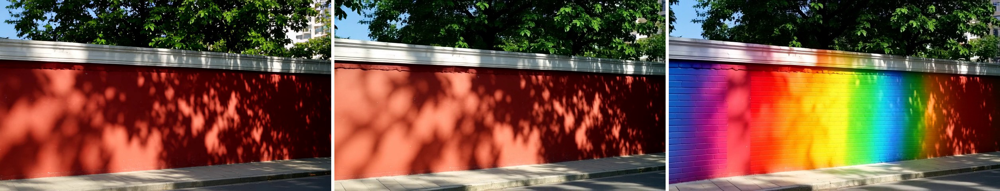

# AI Daily

## Residual Guidance for Real-Time Interactive Video Generation

**作者：** NaHyeon Park、Kyeong-Hwan Moon、Youjin Jeon、Hyunjung Shim。**狀態：** arXiv 預印本 v1，2026-11-24 首次發布；截至 2026-11-27，未找到正式會議或期刊錄用紀錄，投稿／錄用狀態未核實，本文不應稱為已錄用論文。論文：[arXiv:2611.32820](https://arxiv.org/abs/2611.32820)。[1] [3]

選它的理由是：五篇候選中，這篇最直接對上 training-free 推論與生成時的上下文／快取調制偏好。作者在七種既有串流影片生成基線上，以額外前向分支計算 residual，改善中途 prompt 切換；不需重新訓練或逐個基線調參。不過它不是「零計算」：每個受引導 chunk 仍需一次額外 forward pass；也不是已證實的跨域 zero-shot 泛化。[1] [2]

### 核心貢獻

作者將串流影片生成的 prompt-switch 失效稱為 **context inertia**：切換到新提示後，歷史影格的視覺內容仍在 KV cache 中，可能比舊文字提示更強地拉住生成結果。Residual Guidance（RG）不清空實際生成所用的快取，而是在一個不帶快取的輔助分支中，測量新提示會如何改變前一 chunk 的重建，再把這個差值加到目前 chunk 的早期去噪預測上。如此一來，主要生成分支仍保有歷史外觀資訊，同時取得朝新提示改變的訊號。[1]

*圖 1：原文 Figure 1 的 prompt-switch 局部例子。左為切換前畫面，中為未使用 RG 的基線輸出，右為 RG 輸出；新提示要求牆面變成彩虹色。這是定性示例，不是 benchmark 分數。[1]*

### 技術方法與公式

將第 `k` 個影片 chunk 的乾淨 latent 記為 `s_k`。先以雜訊層級 `t` 將它前向加噪：

$$x_k^t = \alpha_t s_k + \sigma_t \varepsilon, \qquad \varepsilon \sim \mathcal{N}(0,I).$$

其中，`x_k^t` 是加噪後的 latent；`α_t` 與 `σ_t` 分別控制訊號和雜訊的比例；`ε` 是從標準高斯分布抽樣的雜訊；`I` 是單位協方差矩陣。`x̂_θ` 表示以參數 `θ` 表示的去噪器所預測的乾淨 chunk。論文以此類預測位移量化上下文慣性：

$$\rho(C)=\frac{\|\hat{x}_\theta(C,y_{\mathrm{new}})-\hat{x}_\theta(C,y_{\mathrm{old}})\|}{\|\hat{x}_\theta(\varnothing,y_{\mathrm{new}})-\hat{x}_\theta(\varnothing,y_{\mathrm{old}})\|}.$$

`C` 是可見的歷史 KV cache；`y_new`、`y_old` 是新、舊提示；`∅` 代表不提供快取；`||·||` 是 latent 位移的範數。分子量度保留快取時換提示造成的預測位移，分母量度空快取時的位移。因此 `ρ` 越低，代表快取越壓制提示切換。這是 latent 預測變化比例，不是語意理解分數，也不是模型的能量函數。[1]

RG 再把前一 chunk `s_{k−1}` 依噪聲層級 `τ` 加噪，使用新提示但不提供歷史快取，取得輔助重建：

$$\tilde{x}_{k-1}^{\tau}=\alpha_{\tau}s_{k-1}+\sigma_{\tau}\varepsilon, \qquad r_k=\hat{x}_\theta(\tilde{x}_{k-1}^{\tau}\mid \varnothing,y_{\mathrm{new}})-s_{k-1}.$$

`x̃_{k−1}^τ` 是加噪的前一 chunk；`r_k` 是輔助重建相對原 chunk 的差值。它含有向新提示改變的訊號，也可能包含移除舊內容的效果；它不是精確的提示梯度或後驗能量梯度。`τ` 控制保留多少原結構，以及修正強度。作者報告預設 `τ=850`。[1]

實際生成仍使用帶完整快取 `C_<k` 的分支，並在早期去噪步驟將 residual 相加：

$$\hat{x}_k^{(i)}=\hat{x}_\theta(x_k^{t_i}\mid C_{<k},y_{\mathrm{new}})+\lambda_i r_k.$$

`i` 是去噪步驟索引；`t_i` 是該步使用的噪聲層級；`λ_i` 是 residual 注入力度。四步預設為 `λ=(1, 0.5, 0, 0)`：第一步全量注入、第二步半量、後兩步不注入。換言之，RG 將修正集中在較早的去噪階段，而不是重寫快取或持續擾動整段生成。[1]

### 實驗與量化結果

**主結果。** 單屬性切換測試使用 T2V-CompBench 的 200 組動態屬性提示，在 5 秒影片的第 2 秒切換提示；Achievement 是 VLM judge 判定切換後是否呈現新提示的比例。七個基線的基準值到加入 RG 後依序為：Self Forcing `0.106→0.568`、Causal Forcing `0.147→0.558`、MemFlow `0.210→0.493`、LongLive `0.296→0.622`、Infinity-RoPE `0.148→0.578`、Anchor Forcing `0.328→0.606`、SWIFT `0.252→0.667`。論文概括平均約由 `21%` 升至 `58%`。該結果支持「切換提示較常在生成中生效」，但依賴 judge 評分，不能等同人類對所有影片都認為切換成功。[1]

多事件 StoryEval 測試包含 100 個三事件故事，影片長 10 秒並於第 3、7 秒切換提示；五個基線的平均 Achievement 約由 `47%` 升至 `66%`。60 秒 InteractiveBench 測試包含 100 個腳本、六段影片及五次切換；五個基線平均約由 `66%` 升至 `81%`。這兩組長時結果只涵蓋五個模型，不應外推為七個基線都完成了相同長時測試。作者另在 LongLive 的 240 秒延伸測試中觀察到第四分鐘 CLIP 優勢 `+1.15`，但這不代表七個模型都驗證至 240 秒。[1]

**消融與診斷。** 在診斷設定中，切換後兩個 chunk 內即呈現新提示才算「立即成功」：Self Forcing 只有 `16%` 立即成功，`80%` 在整支影片中從未實現；LongLive 分別為 `25%`、`64%`。這支持慣性問題存在，但屬論文另外定義的診斷集，與主表的 Achievement 不能混算。完全清除快取可將兩個模型的 Achievement 提至 `1.000`、`0.963`，但 Quality 降至 `0.726`、`0.733`，且跨切換非預期變化增加；RG 的取捨是保留主要快取，同時修正舊內容拉力。只使用 prompt-dependent text residual 的版本也低於完整 RG，顯示作者方法不只是加強新文字提示。[1]

**品質、計時與額外成本。** 20 位評分者的成對偏好測試中，`73.1%` 選 RG 版本較遵循新提示、`70.7%` 偏好其整體品質；對跨切換一致性的偏好為 `44.3%`，未過半，故不能概括為每個品質面向都獲偏好。作者報告品質分數多在原模型 `0.01` 內，60 秒測試則在 `0.006` 內。RG 每個受引導 chunk 增加一次 forward pass；單次切換 5 秒影片的全程吞吐量約降 `6%`。H100 上 Self Forcing 為 `16.98→15.98 FPS`，LongLive 為 `14.02→13.11 FPS`。這些是論文指定測試設定的速度數字，不是所有解析度或硬體下的固定成本。[1]

### 相關研究脈絡

LongLive 會在提示切換時以新提示重新編碼歷史 KV cache；RG 的分析指出，即使如此，舊影格視覺內容仍可能抑制新提示，所以 RG 是疊加的預測修正，不是取代 recache。[4] MemFlow 以提示相關的歷史視覺記憶作檢索與稀疏啟用；SWIFT 採提示自適應記憶與注入快取；Infinity-RoPE 使用 KV Flush 與 RoPE Cut 等快取策略。RG 的相異處在於額外估算一個無快取 residual，再修正去噪預測；它不直接改寫主要分支的 attention weights。[1] [5] [6] [7]

對偏好的研究方向而言，RG 是一個有實驗支撐的 training-free 推論方法：不需重新訓練模型，代價是額外前向計算。它與 attention modulation 相鄰，因問題根源涉及視覺快取，但論文並未直接調制主要生成分支的 attention map。本文沒有 EBM 能量函數、JEPA predictor 或 VAR 多尺度生成實驗，因此這幾個連結只能視為後續研究假說。雖然作者在七種既有基線上測試且不逐模型調參，也不足以宣稱跨任務、跨架構的廣義 zero-shot 泛化；它們同屬 Wan2.1-1.3B 蒸餾影片生成體系。[1] [2]

### 限制與個人評價

RG 的價值在於提出簡潔、可插入既有系統的測試方式，並用多個基線與不同時間尺度檢查提示切換，而非只展示單一影片。證據強度仍受評估設定限制：Achievement 使用 VLM judge；主觀偏好樣本為 20 人；論文所述實驗未提供信賴區間或顯著性檢定。長影片結果也只在五個基線上報告，240 秒結果則限於 LongLive。[1]

方法本身仍有控制能力與保留舊場景間的張力。作者指出移除舊場景物件、全局光照變化及細緻姿勢修改較難處理；提高 `τ` 或將全量注入延長至更多步可能提升提示響應，卻可能破壞不應變動的主體或場景。也可能產生未要求的物件或外觀副作用。其公開 GitHub 專案採 MIT 授權並提供推論程式，但需自行取得上游模型權重；README 列出四個整合 wrapper，而論文主實驗測試七個基線，兩者範圍不可混為一談。[1] [2]

### 可驗證的延伸問題

1. **JEPA residual 是否能比像素／去噪器 latent residual 更精確地分離「新提示要求的變化」與「需保留的場景內容」？** 在同一組 prompt-switch 影片上比較目前 RG、凍結 JEPA predictor 的 latent 差值，以及二者融合；固定生成步數，報告 Achievement、Quality、跨切換非預期變化與額外延遲。
2. **把 residual 轉成 attention modulation，能否降低額外 forward 成本而保留效果？** 對主要分支 KV/attention logits 作分層、分 token 的調制，與原 RG 做等吞吐量比較；同時檢查不同 backbone 與切換強度下的提示遵循及主體一致性。這是新假說，並非本文已驗證的方法。
3. **RG 能否移植到 VAR 類多尺度自回歸生成？** 先明確定義各尺度對應的 residual 注入階段，再與不注入、只在粗尺度注入及各尺度注入比較；以相同生成計算預算量度 prompt-switch 成功率、細節品質和長時漂移。本文未包含 VAR 基線，因此需從頭建立對照。

## References

[1]: https://arxiv.org/html/2611.32820v1 "Residual Guidance for Real-Time Interactive Video Generation — arXiv full text v1"
[2]: https://github.com/nahyeonkaty/residual-guidance "Official PyTorch Implementation of Residual Guidance"
[3]: https://export.arxiv.org/api/query?id_list=2611.32820 "arXiv API record for 2611.32820"
[4]: https://arxiv.org/abs/2509.22622 "LongLive: Real-Time Interactive Long Video Generation"
[5]: https://arxiv.org/html/2512.14699v1 "MemFlow: Flowing Adaptive Memory for Consistent and Efficient Long Video Narratives"
[6]: https://arxiv.org/html/2605.09442v1 "SWIFT: Prompt-Adaptive Memory for Efficient Interactive Long Video Generation"
[7]: https://arxiv.org/abs/2511.20649 "Infinity-RoPE: Action-Controllable Infinite Video Generation Emerges From Autoregressive Self-Rollout"
