# AI Daily

## 2026-11-18: UMM-JEPA: Generative Pretraining via Masked Next-Scale Representation Prediction for Unified Multimodal Models

### 論文資訊

**標題：** UMM-JEPA: Generative Pretraining via Masked Next-Scale Representation Prediction for Unified Multimodal Models

**作者與單位：** Yucheng Zhou¹、Yunjia Xi²、Di Yin²、Jianbing Shen¹；¹University of Macau（澳門大學資訊科學學院；Shen 為該院全職教授，其 ResearchGate 個人頁記載曾任阿布達比 Inception Institute of AI 的 Lead Scientist）、²Tencent Youtu Lab（騰訊優圖實驗室）。PDF 唯一列出的信箱是第一作者的 `yucheng.zhou@connect.um.edu.mo`（論文未標明通訊作者），第一作者是大學生身分、中間兩位掛騰訊優圖。這個組合本身值得留意：它比較像「學校出方法、企業實驗室出算力與渲染器」的四人名單，而不是大型 lab 的量產論文。[1] [3] [16] [17]

**來源與狀態：** arXiv:2611.18668v1，`cs.CV`，v1。日期欄有歧義：PDF 頁首印 `2026-11-17`、arXiv 戳記寫 `26 Oct 2026`、arXiv recent 列表把它歸在 Tue, 17 Nov 2026 那批公告，Hugging Face Daily Papers 於 2026-11-17 收錄。沒有 v2。arXiv 的 Comments 欄位不存在，正文每頁無會議頁尾，Semantic Scholar 的 `venue` 是空字串、`publicationTypes` 是 null，所以目前**是純預印本**，沒有任何同儕審查背書，引用數（含 influential）為 0。[1] [2] [3] [4]

**連結：** [arXiv 摘要](https://arxiv.org/abs/2611.18668)｜[全文 HTML](https://arxiv.org/html/2611.18668v1)｜[PDF](https://arxiv.org/pdf/2611.18668v1)｜[HF 論文頁](https://huggingface.co/papers/2611.18668)｜[Semantic Scholar](https://api.semanticscholar.org/graph/v1/paper/arXiv:2611.18668)

**資源實際狀態（我逐項查證過）：** **查無任何程式碼或權重釋出**。22 頁全文沒有 code／URL／project page 段落，HF 的「Models／Datasets／Spaces／Collections citing this paper」四欄全部為 0，HF 論文頁唯一的 community 留言是 Librarian Bot 的自動推薦，連 upvote 計數都沒顯示出來。也就是說 Table 1／Table 4 那些 1.7B 重訓基線、四段訓練配方與 300-item 介入協議，目前**外部無法複算**。[3] [4]

**訓練成本口徑：** joint pretraining 為 batch 2000、8 GPUs（型號未具名）、報告 checkpoint 在 iteration 7,694；三段 rendering 各為 10k／10k／6k steps、8 GPUs、batch 256，只有約 48.2M 可訓練參數。全文無 FLOPs、無 wall-clock、無 seed、無變異數，訓練語料（10B text、45B multimodal、10B image-text pool）一詞未具名。是否 training-free／zero-shot：**都不是**——`training-free` 與 `zero-shot` 兩個字在全文從未出現。[3]

**為什麼挑這篇：** 它同時命中你點名的四個軸——**JEPA**（在表徵空間做預測，不重建像素）、**VAR based**（64→128→256→512 的 next-scale 階梯，但把 residual quantizer 拿掉）、**attention modulation**（visual span 雙向、text 因果、跨尺度因果，外加「切斷 text→vision 注意力」這種直接操作注意力的機制_probe），以及**training-free 的切入點**（它免費送你一個 per-scale 的表徵預測誤差訊號，可以直接當 test-time verifier，見 §6 的第 2 條）。更關鍵的是它給了一個可反駁的命題：「生成任務的價值不在於它能生圖，而在於它強迫模型**建立哪一種表徵**」——這句話可以直接搬到你正在想的 energy-based target 與 zero-shot 驗證器上。而且 2026 年 10–11 月已經出現三篇同命題、相反參數化的撞車工作（Know, then Draw 用離散語義 tokenizer 拿到 GenEval 86；What Generation Knows 反過來從生成側表徵**檢索**資訊給理解用），正是一個適合拿去激發想法的戰場。[1] [5] [6]

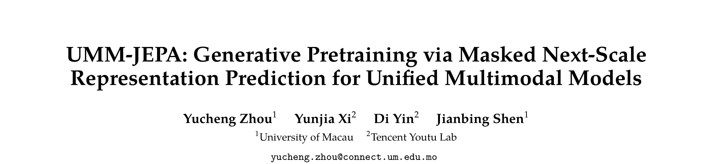

---

## 0｜基本信息速覽

| 項目 | 內容 |
|---|---|
| 標題 | UMM-JEPA: Generative Pretraining via Masked Next-Scale Representation Prediction for Unified Multimodal Models |
| 作者 | Yucheng Zhou¹、Yunjia Xi²、Di Yin²、Jianbing Shen¹ |
| 單位 | ¹ University of Macau（澳門大學，Shen 為 FIC 全職教授）；² Tencent Youtu Lab（騰訊優圖實驗室） |
| arXiv | 2611.18668v1（PDF 內頁首寫 2026-11-17，arXiv 戳記為 26 Oct 2026，v1 未見 v2） |
| 發表狀態 | **純預印本**。arXiv Comments 欄位為空、PDF 無會議頁尾、Semantic Scholar `venue` 為空字串、`publicationTypes: null`；目前不是任何頂會／期刊錄取論文 [2] |
| 代碼 | **未釋出**。論文全文無 code/URL 段落；Hugging Face 的 models / datasets / spaces / collections 「citing this paper」皆為 0 [4] |
| 引用 | Semantic Scholar citationCount = 0、influentialCitationCount = 0（發表約 3 週）[2] |
| 篇幅 | 22 頁、9 張圖、9 張表、9 個附錄（A–I） |
| 是否 training-free / zero-shot | **都不是**。全文從未出現 `training-free` 或 `zero-shot` 字樣；它是 65B token 從零 joint pretraining + 三段 rendering 的完整訓練管線，且依賴外部 `SigLIP2 v1 stage-1 alignment checkpoint` |
| 主要資源 | joint pretraining batch 2000、8 GPUs、iteration 7,694；三段 rendering 為 10k/10k/6k steps、8 GPUs、batch 256。未告知 GPU 型號、FLOPs、wall-clock、seed 與變異數 |

一句話定位：這是 **JEPA 的「在表徵空間做預測」× VAR 的「next-scale 由粗到細」× 統一多模態（UMM）的「理解與生成共享 backbone」** 三者的一張交集圖，而且它把交集的第三個要素拆成「預訓練只學表徵、渲染事後外掛」。

---

## 1｜核心貢獻與創新點

### 1.1 它要解的問題不是一個 loss 問題，而是一個「知識流向」問題

統一多模態模型（Chameleon／Transfusion／Janus／BAGEL／Show-o2 這一路）同時做理解與生成，但「同時存在」不等於「互相加成」。論文開篇引了三組受控研究（MetaMorph、Han et al. 2026 的 *Towards Physics of Multimodal Pretraining*、Zhou et al. 2026c），指出一個不對稱：**理解監督可以明顯幫助生成，但增加生成訓練並不穩定地幫助理解** [1]。作者把問題重述成一句很尖的話：

> "The key issue may therefore be not whether generation is introduced, but **what representation the generative objective forces the model to construct**."（Sec.1）

這是全文的命題。它把大家的注意力從「要不要加生成任務、loss 怎麼配權」轉移到「生成任務的**預測目標落在哪個空間**」。

### 1.2 真正的創新：把生成目標從「合成空間」搬到「理解空間」

傳統統一模型的生成目標住在 synthesis-oriented space：離散 VQ code（Chameleon 路線）、VAE／DC-AE latent（Transfusion、Show-o2 路線）、或像素。理解則讀 perceptual representation——vision encoder 輸出、被 LLM 消費的那組語義化視覺狀態。兩條路共享參數卻**不共享目標**，於是最優解可以是「把參數練成對理解頭無用的方向」。

UMM-JEPA 的做法是：**讓生成的預測目標就是理解要讀的那組表徵**，於是生成梯度直接雕刻理解消費的空間。具體化後就是四件事的組合：

1. **連續、非離散**：沒有 codebook、沒有 residual quantizer，目標是 frozen SigLIP2 layer-23 的真實影像特徵。
2. **next-scale 而非 next-token**：64²／128²／256²／512² 四個尺度，對應 4／16／64／256 個 token，每個 parent 預測它的四個 children（2×2 空間擴張）。
3. **masked prediction**：尺度內隨機遮罩，製造「必須靠文字＋空間＋跨尺度脈絡重建」的條件恢復任務。
4. **渲染完全解耦**：pretraining 階段根本不碰像素；事後凍住 backbone，只接一個 ~43.9M connector + 凍結的 FLUX.2 [klein] 4B DiT。

### 1.3 方法論上最值得學的一招：把「歸因」做成實驗設計

這篇文的實驗不是刷榜，而是一整條**控制鏈**，每一環堵掉一個備擇解釋：

* `Qwen-VL` vs `Qwen-VL data-matched`：堵「多給 10B 圖文資料」。結果只動 −0.26／+0.04／−0.04。
* `Qwen-VL + Bi-Attn`：堵「只是把視覺 span 改成雙向注意力」。只動 +0.49／+0.56／+0.12。
* `UMM-VQ`：同尺度階梯、同資料預算，但預測**離散 code**（block CE 4/16/256/512-way）——堵「paradigm vs target space」。
* `Show-o2`：同資料預算的 native latent flow matching——同上第二個對照。
* `w/o Mask`／`w/o Recon`：拆元件，而且作者老實寫出 recon 在 5 個 benchmark 上是**負貢獻**。
* Linear probe（mIoU／same-object acc）＋ wrong-image／corruption／layer-cut 三種介入：從「分數變高」走到「表徵真的變豐富、答案真的更依賴這張圖」。

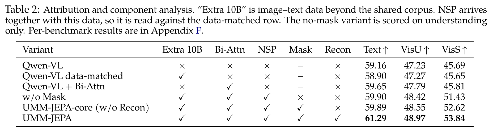
*圖：論文 Table 2（p.7）。六列設計把「額外資料」「雙向注意力」「next-scale 表徵預測」「masking」「重建旁支」拆開歸因。*

### 1.4 一個少見的自我設限

作者在 Sec.4.3 對自己的核心對比寫了一句很多人不肯寫的話：

> "Perceptual representation targets transfer more directly to understanding. **This comparison remains paradigm-level.**"

也就是承認：UMM-VQ／Show-o2 是他們在 1.7B 尺度自己重訓的實作，贏的是「這套配方下的三個範式」，不是「VQ／flow 這兩種範式本身」。

---

## 2｜技術方法（含公式推導）

### 2.1 三條形式化論證：它們各自只支撐一個設計決定

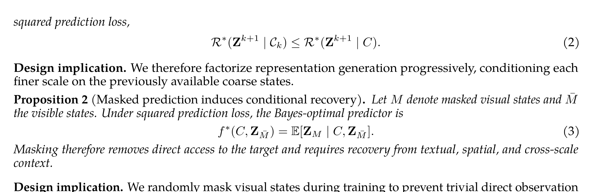
*圖：論文 Sec.3.1（p.3–4）。三個論證各自跟著一段 "Design implication"，這是這篇文寫作上很乾淨的地方。*

**(a) Proposition 1（目標對齊）。** 設感知表徵 $\mathbf{z}=E(\mathbf{x})$，下游理解映射 $h$ 在訓練走到的區域上是局部 $L$-Lipschitz，則

$$\|h(\hat{\mathbf{z}})-h(\mathbf{z})\|\le L\|\hat{\mathbf{z}}-\mathbf{z}\| \tag{1}$$

附錄 D.2 把它平方取期望寫成 $\mathbb{E}\|h(\hat{\mathbf z})-h(\mathbf z)\|^2\le L^2\,\mathbb{E}\|\hat{\mathbf z}-\mathbf z\|^2$（Eq.7），並給出「$h(\mathbf z)=W\mathbf z$、$\|W\|_2=L$、誤差對齊 $W$ 主奇異方向時取等號」的緊性例子，同時誠實地補一句：**"it does not compare this bound with the sensitivity of any other prediction target"**（附錄 D.2）——這條界對像素目標、VQ 目標一樣成立，它沒有證明「表徵目標比較好」，它只證明「直接最小化理解讀的那個空間的誤差，是控制下游偏移最短路徑」。整個附錄 D.1 也聲明 "Nothing below relies on a parametric form for $E$, $h$, or the data distribution."。

**(b) Lemma 1（由粗到細的條件化不會變差）。** 令 $\mathbf{Z}^{k+1}$ 是更細尺度的表徵、$\mathcal{C}_k=(C,\mathbf{Z}^{64},\dots,\mathbf{Z}^{k})$ 是文字條件加已有粗尺度狀態，平方損失下

$$\mathcal{R}^{*}(\mathbf{Z}^{k+1}\mid\mathcal{C}_k)\le\mathcal{R}^{*}(\mathbf{Z}^{k+1}\mid C) \tag{2}$$

證明是三步：平方損失的 Bayes 最優風險就是條件變異數

$$\mathcal{R}^{*}(\mathbf{Z}^{k+1}\mid U)=\mathbb{E}\big[\|\mathbf{Z}^{k+1}-\mathbb{E}[\mathbf{Z}^{k+1}\mid U]\|^2\big]=\mathbb{E}\big[\operatorname{Var}(\mathbf{Z}^{k+1}\mid U)\big] \tag{8}$$

再用全變異數定律展開，並靠假設 (A3) $\sigma(C)\subseteq\sigma(\mathcal{C}_k)$ 丟掉非負第一項：

$$\operatorname{Var}(\mathbf{Z}^{k+1}\mid C)=\underbrace{\operatorname{Var}\big(\mathbb{E}[\mathbf{Z}^{k+1}\mid\mathcal{C}_k]\mid C\big)}_{\ge 0}+\mathbb{E}\big[\operatorname{Var}(\mathbf{Z}^{k+1}\mid\mathcal{C}_k)\mid C\big] \tag{9}$$

$$\Rightarrow\ \mathcal{R}^{*}(\mathbf{Z}^{k+1}\mid C)\ \ge\ \mathbb{E}[\operatorname{Var}(\mathbf{Z}^{k+1}\mid\mathcal{C}_k)]=\mathcal{R}^{*}(\mathbf{Z}^{k+1}\mid\mathcal{C}_k) \tag{10}$$

這是一條**資訊性**而非**機制性**的引理。作者在 D.3 自己寫清楚："The lemma constrains the value of the conditioning variables, not which scales or how many of them are used; **the scale schedule is an implementation choice.**" 換句話說，64→128→256→512 這個四階梯是被測量選出來的，不是被證出來的。

**(c) Proposition 2（遮罩強制條件恢復）。** 令 $M$ 為被遮的視覺狀態、$\bar M$ 為可見狀態，平方損失下 Bayes 最優預測器是

$$f^{*}(C,\mathbf{Z}_{\bar M})=\mathbb{E}\big[\mathbf{Z}_{M}\mid C,\mathbf{Z}_{\bar M}\big] \tag{3}$$

推導（Eq.11–12）是逐點最小化：$\arg\min_v\mathbb{E}[\|\mathbf{Z}_M-v\|^2\mid C,\mathbf{Z}_{\bar M}]=\mathbb{E}[\mathbf{Z}_M\mid C,\mathbf{Z}_{\bar M}]$。退化情形 $M=$ 全部狀態時，$f^{*}(C)=\mathbb{E}[\mathbf{Z}\mid C]$，正好對應推理工第一步「只有 caption 要生 64-scale」——所以那 10% fully-masked 樣本是為了把推理的初始狀態放進訓練分佈。

### 2.2 尺度階梯與總目標

表徵目標：$\mathbf{z}^{k}$ = 真值影像在 $k\times k$ 解析度下 frozen SigLIP2（**layer 23**，24 層塔的最末層、經 LayerNorm）的表徵，$k\in\{64,128,256,512\}$，對應 4／16／64／256 個 token。生成樣本服從由粗到細的分解

$$p(\mathbf{z}^{64}\mid c),\quad p(\mathbf{z}^{128}\mid c,\mathbf{z}^{64}),\quad p(\mathbf{z}^{256}\mid c,\mathbf{z}^{64},\mathbf{z}^{128}),\quad p(\mathbf{z}^{512}\mid c,\mathbf{z}^{64},\mathbf{z}^{128},\mathbf{z}^{256}) \tag{4}$$

推理則把預測值自己回灌：

$$\hat{\mathbf{z}}^{64}\rightarrow\hat{\mathbf{z}}^{128}\rightarrow\hat{\mathbf{z}}^{256}\rightarrow\hat{\mathbf{z}}^{512} \tag{5}$$

總目標（Eq.6，附錄 C 給出實際權重）：

$$\mathcal{L}=\mathcal{L}_{\mathrm{LM}}+\lambda_{\mathrm{rep}}\mathcal{L}_{\mathrm{rep}}+\lambda_{\mathrm{rec}}\mathcal{L}_{\mathrm{rec}},\qquad \lambda_{\mathrm{rep}}=\lambda_{\mathrm{rec}}=0.55$$

實作損失是 cosine：$\mathcal{L}_{\mathrm{rep}}=1-\cos(\hat{\mathbf z},\mathbf z)$，「not MSE or L1」（附錄 C）。與 Eq.(1) 的銜接是那句 "$\ell_2$-normalized target $\Rightarrow$ squared Euclidean ≡ cosine up to a constant"，展開就是 $\|\hat{\mathbf z}-\mathbf z\|^2=2-2\langle\hat{\mathbf z},\mathbf z\rangle=2\big(1-\cos(\hat{\mathbf z},\mathbf z)\big)$（常數恰為 2）。**這裡有個要記著的不一致**：正文說 target 是 $\ell_2$-normalized，附錄 C 說 teacher 特徵是 LayerNorm 過的，兩者是不同運算；而 cosine 損失本身會同時歸一化兩側，所以 Eq.(1) 與 Eq.(3) 那套「平方損失」敘事與實作只差一個常數因子，理論不靠這個細節成立，但引用時不要把它當成嚴格的 $\ell_2$ 約束。

父節點 supervise 的配重是 $(\mathcal{L}_{\mathrm{masked}}+0.5\,\mathcal{L}_{\mathrm{visible}})/1.5$——可見 parent 也訓練，理由寫得很明白：「so that **the refinement mapping used at inference** is trained rather than only the hole-filling mapping」。遮罩比例 $r_k\sim\mathrm{Uniform}[0.25,0.75]$ 逐尺度獨立抽樣並 clamp 到 $[1,n-1]$，另加 10% 全遮與 10% 不遮；128/256 尺度的被遮 token 約 25% 是 inpaint（祖先也被遮）、75% 是 refine（祖先可見）。每尺度一個可學 mask token，local projection 跨尺度共享。

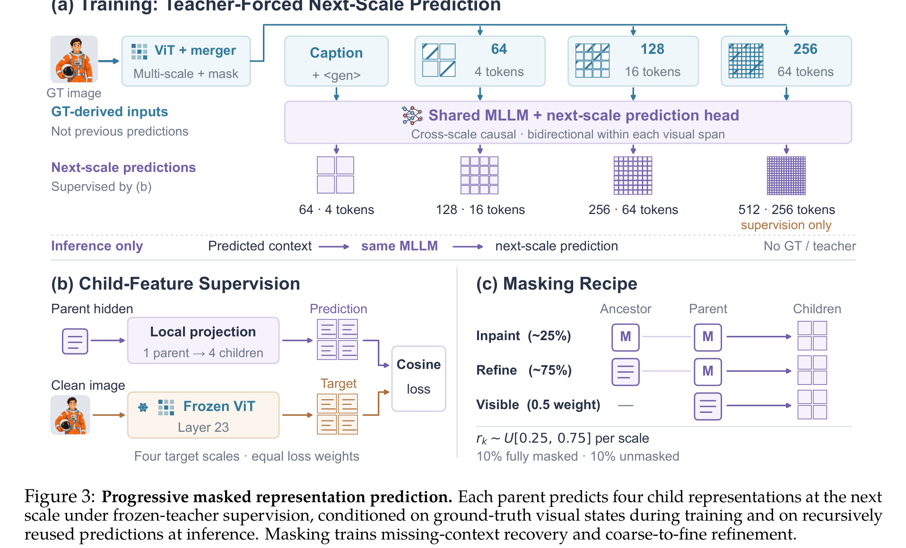
*圖：論文 Figure 3（p.5）。左「Training: Teacher-Forced Next-Scale Prediction」標明 GT-derived inputs / Not previous predictions；中「Child-Feature Supervision」為 1 parent → 4 children → 與 frozen ViT layer-23 clean-image target 算 cosine loss；右「Masking Recipe」標出 inpaint ~25%／refine ~75%／visible weight 0.5。*

### 2.3 渲染是「事後外掛」，而且只有渲染做 prediction feedback

backbone 練完就凍住，接一個 connector（LN→Linear(2048→4096)→SiLU→Linear(4096→7680)→LN，含 scale embedding、timestep AdaLN、10% CFG dropout，約 43.9M 參數）對上**凍結的 FLUX.2 [klein] base-4B**，條件序列按尺度切片（64-scale 出 4 個 token、128-scale 出 4+16、256-scale 出 4+16+64，512-scale 不編碼）。三段訓練：

* Stage 1（10k steps、8 GPU、batch 256、lr 1e-4→1e-5）：只練 connector，用 DiT 原生 rectified-flow 目標 $x_t=(1-t)z+t\epsilon$、v-prediction、logit-normal $t$、逐解析度權重 4:4:2:1，梯度穿過凍結 DiT 的 activation 回到 connector；$p_{\text{feedback}}$ 從 0 在 step 6,000 起約 1,000 步爬到 0.8。
* Stage 2（10k steps、lr 1e-5→1e-6）：加 DiT **文字條件路**上的 LoRA（$r=16,\alpha=16$、scaling=1，掛在 `txt_in` 與五個 double block 的 `txt_attn.qkv/proj`、`txt_mlp.0/2`，共 4,349,952 ≈ 4.3M），可訓練量 ≈48.2M。每步兩遍：第一遍用凍結表徵路徑**單步去噪**（$t\sim\mathcal U(0.15,0.45)$、no-grad）產生 64/128/256 的 one-step $\hat{x}_0$ 估計，拼回條件序列；第二遍從這個「模型自己生成的脈絡」重算前傳、評 diffusion velocity 目標，**只回傳第二遍的 loss**。
* Stage 3（6,000 steps）：generation instruction tuning，另在 Qwen 的 attention $q/k/v/o$ 上加 LoRA。

這裡是全文最該被追問的結構性不對稱：**作者非常認真地處理渲染端的 teacher-forcing ↔ recursive rollout gap（甚至稱其為 "condition errors between teacher-forced training and recursive rollouts"），卻對表徵路徑同樣的 gap 只留了一句「train–test distinction is therefore explicit」就沒再管**。Eq.(5) 的遞歸只在 inference 發生，訓練端「never obtained by feeding back the model's preceding predictions」。

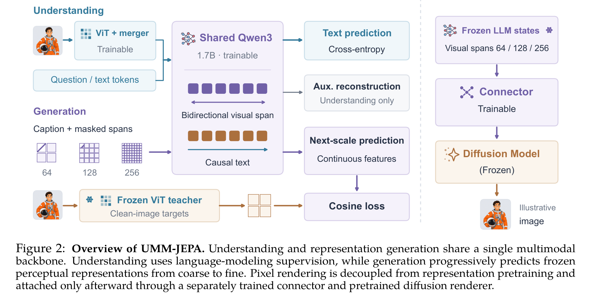
*圖：論文 Figure 2（p.3）。左半 (a) Unified Pretraining：Shared Qwen3 1.7B、bidirectional visual span / causal text、Next-scale prediction (Continuous features)、frozen ViT teacher 以 cosine loss 監督；右半 (b) Post-Pretraining：Frozen LLM states → Connector (trainable) → Diffusion Model (frozen)。圖中自己標了 "Illustrative image"。*

### 2.4 與 VAR 的分界（這點最容易被誤讀）

VAR 的 next-scale 是「在 residual-quantized code 上做由粗到細的 token 預測」；UMM-JEPA 把同一個 scale ladder 搬到**連續的、外來源的感知特徵**上，於是：沒有 codebook、沒有 CE、沒有 temperature/top-k 的 token 採樣、也沒有「碼字覆蓋率」這種問題。相對地它新增了一個 VAR 沒有的約束：**表徵空間的容量由 SigLIP2 決定，模型不可能生成 SigLIP 沒編碼的區分**。而它的 stochasticity 全被推到渲染端：表徵預測本身是 pure regression to the conditional mean（Proposition 2 講得很清楚），一個「平均狗在沙灘上」的特徵圖要去喂給 diffusion 才能變出多樣性。這是不是問題，論文完全沒有測（見 §4）。

---

## 3｜實驗結果與性能指標

### 3.1 理解：16 個 benchmark、全部自己從同一 Qwen3-1.7B checkpoint 重訓

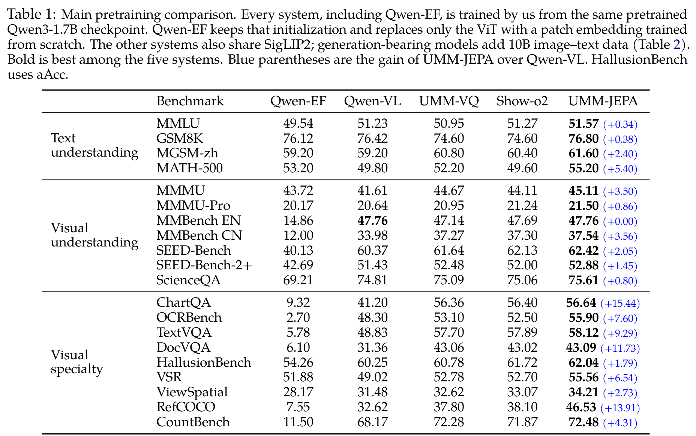
*圖：論文 Table 1（p.7）。五套系統皆由作者自行訓練，資料預算與 shot 協議一致。*

| 群組 | UMM-JEPA | Qwen-VL（只練理解） | 主要增益 |
|---|---|---|---|
| Visual（16 項平均） | **51.71** | 46.36 | +5.35 |
| Text（4 項） | **61.29** | 59.16 | +2.13 |
| Visual Understanding（7 項） | 48.97 | 47.23 | +1.74 |
| Visual Specialty（9 項） | **53.84** | 45.69 | **+8.15** |

單項最大落差：ChartQA 41.20→56.64（+15.44）、RefCOCO 32.62→46.53（+13.91）、DocVQA 31.36→43.09（+11.73）、TextVQA +9.29、OCRBench +7.60、VSR +6.54、MATH-500 49.80→55.20（+5.40）、CountBench +4.31。對照組 UMM-VQ 59.64／48.46／51.83、Show-o2 58.97／48.50／51.92（Sec.4.3 與 Table 1 一致，可複算）。值得注意的是 Qwen-EF（把預訓 ViT 換成從零 patch embedding）MMBench EN 14.86、OCRBench 2.70、CountBench 11.50——作者明確說它只是架構參照、**不是生成目標的對照**。

### 3.2 生成：在「同一套事後渲染配方」下反而更好

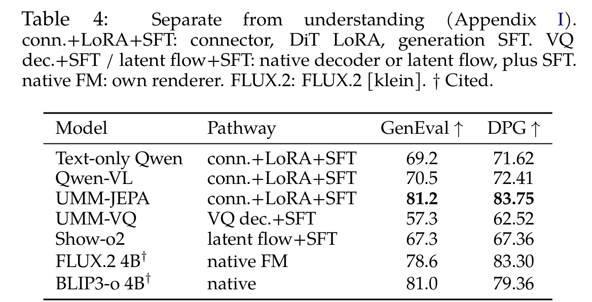
*圖：論文 Table 4（p.9）。GenEval 553 prompts 以本地 Mask2Former 評分、DPG 1065 prompts 以本地 mPLUG-large 評分，作者強調 no paid APIs。*

| 模型 | 路徑 | GenEval | DPG |
|---|---|---|---|
| Text-only Qwen | conn.+LoRA+SFT | 69.2 | 71.62 |
| Qwen-VL | conn.+LoRA+SFT | 70.5 | 72.41 |
| **UMM-JEPA** | conn.+LoRA+SFT | **81.2** | **83.75** |
| UMM-VQ | VQ dec.+SFT | 57.3 | 62.52 |
| Show-o2 | latent flow+SFT | 67.3 | 67.36 |
| FLUX.2 4B（引用†） | native FM | 78.6 | 83.30 |
| BLIP3-o 4B（引用†） | native | 81.0 | 79.36 |

最乾淨的一條對照是前三列：完全相同的 connector＋DiT LoRA＋generation SFT 配方、各自獨立擬合權重，UMM-JEPA 仍高出 10.7／11.3 分——**「把渲染從預訓練拆掉」並沒有損傷生成品質**。但兩個† 列是引用他人數字的 4B 級系統，BLIP3-o 的 GenEval 81.0 與 81.2 幾乎打平、FLUX.2 的 DPG 83.30 與 83.75 也幾乎打平，作者用的措辭也只有 "competitive with the generation-oriented references"；且**生成端的採樣步數、guidance、解析度、seed 全未交代**。

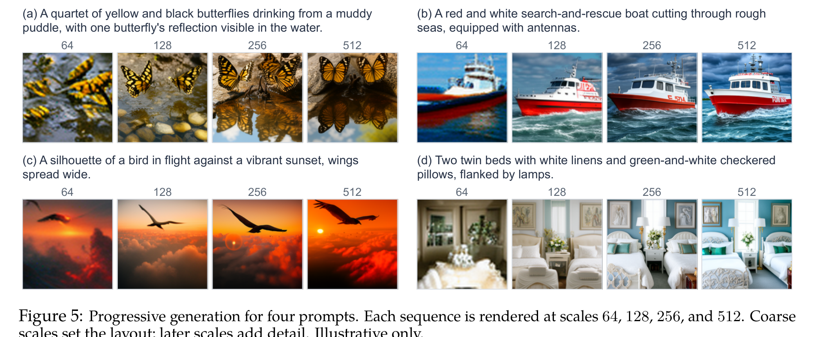
*圖：論文 Figure 5（p.8）。64／128 定 layout，256／512 補細節。圖註自己寫 "Illustrative only"。*

### 3.3 機制證據：不是只有分數變高

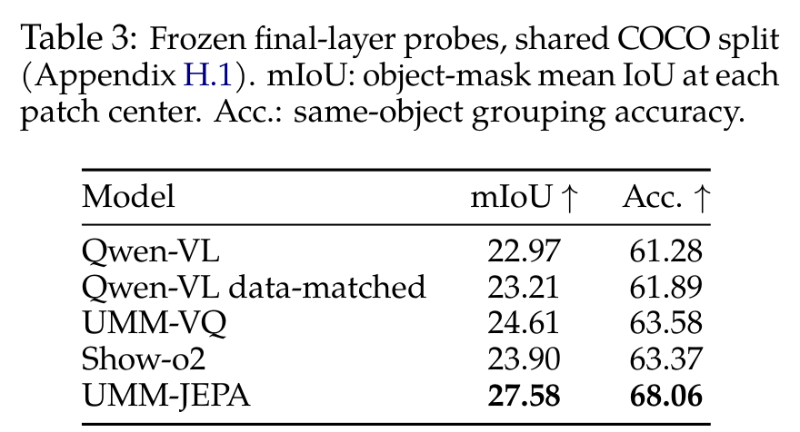
*圖：論文 Table 3（p.7），COCO 500/1000 分層 split、seed 42、AdamW lr 1e-3、20 epochs。*

| 模型 | object-mask mIoU | same-object Acc. |
|---|---|---|
| Qwen-VL | 22.97 | 61.28 |
| Qwen-VL data-matched | 23.21 | 61.89 |
| UMM-VQ | 24.61 | 63.58 |
| Show-o2 | 23.90 | 63.37 |
| **UMM-JEPA** | **27.58** | **68.06** |

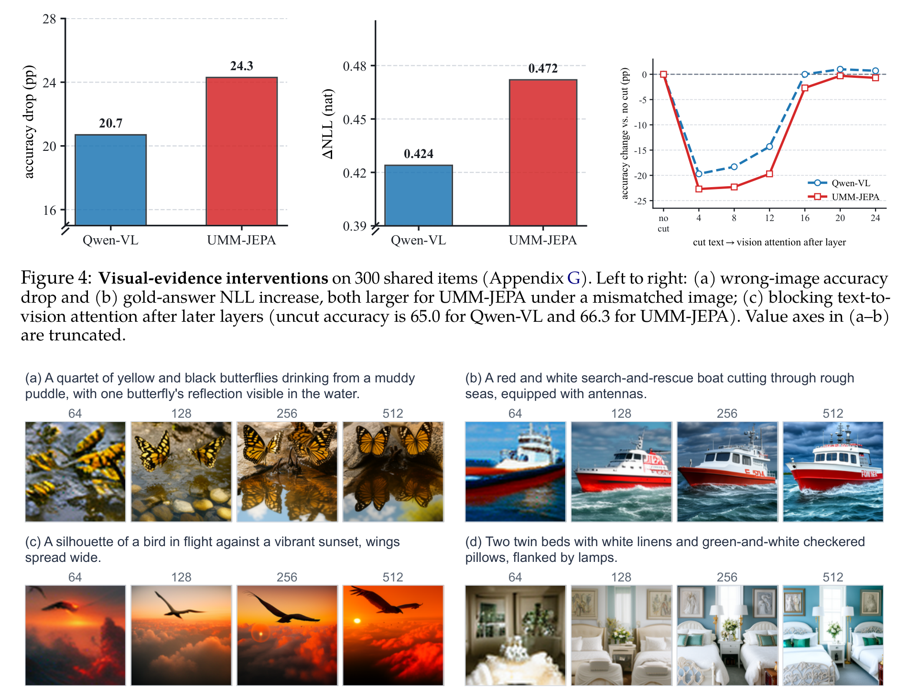
*圖：論文 Figure 4（p.8），300 個固定 items。(a) 換錯圖的準確率降幅 24.3（UMM-JEPA）vs 20.7（Qwen-VL）；(b) gold-answer NLL 增量 0.472 vs 0.424；(c) 在第 $k$ 層之後切斷 text→vision 注意力的準確率變化（未切基準 65.0／66.3）。*

三個介入的讀法：換掉那張圖，UMM-JEPA 掉得比較痛（更依賴「這張圖」而非語先驗）；切斷 text→vision 注意力，Qwen-VL 在 layer 16 之後回到基準（0.0，甚至 −1.0／−0.7），UMM-JEPA 還掉 2.7——**它的文字在 LLM 更深層仍持續向視覺 token 取證據**。晚層（23–27）visual token diversity（$1-$ 平均成對 cosine）0.486 vs 0.370（Fig.7）。附錄 H.3/H.4 給了最有趣的一條曲線：尺度越粗、預測誤差（$1-\cos$）越能區分答對與答錯的 items——64-scale 為 0.419（correct, n=199）vs 0.465（incorrect, n=101），到 512-scale 收斂成 0.396 vs 0.408；按 512-scale 誤差 tercile 分桶的理解準確率是 69.6／66.0／63.3。但作者自己加框：**"the effect is modest and correlational: these analyses do not establish that better prediction causes better understanding."**（附錄 H.4）

### 3.4 指令微調後，優勢縮水多少

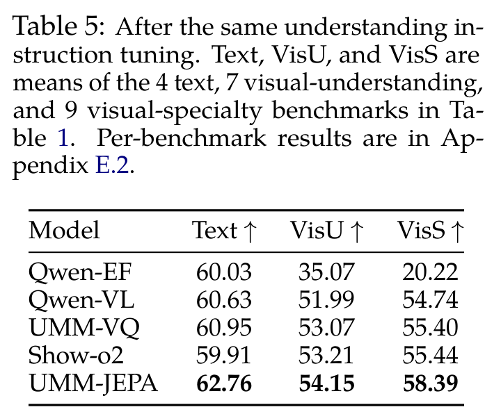
*圖：論文 Table 5（p.9），所有模型都在同一 Honey-120K（45,765 packed rows、2 epochs）上微調。*

| 模型 | Text | VisU | VisS |
|---|---|---|---|
| Qwen-VL | 60.63 | 51.99 | 54.74 |
| UMM-VQ | 60.95 | 53.07 | 55.40 |
| Show-o2 | 59.91 | 53.21 | 55.44 |
| **UMM-JEPA** | **62.76** | **54.15** | **58.39** |

從逐項（Table 7）看，預訓練的最大優勢被 SFT 抹掉一大半：ChartQA 的 +15.44 縮到 **+0.04**、RefCOCO 的 +13.91 縮到 +2.41、VSR 在三個控制組之間完全同分 48.53。留下來的耐用優勢集中在 OCRBench／TextVQA／DocVQA／CountBench（+4.6／+4.25／+6.92／+8.63）。這是全篇最該記住的「負面資訊」：**表徵預測帶來的增益有一部分是「baseline 還沒被資料教到的暫態差距」**。

---

## 4｜限制、地雷與我自己額外發現的三個問題

一、**沒有 Limitations 章節**（22 頁全文搜尋無）、無 seed／無變異數／無置信區間、每格都是點估計；關鍵差距裡有 +0.07（DocVQA vs Show-o2）、+0.00（MMBench EN 打平）、+0.04（ChartQA 微調後）這種量級。無 GPU 型號、無 wall-clock／FLOPs、無 human eval、無 FID／CLIP score、無 per-category GenEval 分解、訓練語料一詞未具名。

二、**「同一批資料但不同用法」的漏洞**。data-matched control 把 10B 圖文當「圖→字幕」的理解樣本消費，生成組把它當生成樣本消費，所以「same amount of data」不等於「same data-consumption pattern」。作者也承認 NSP 只能對 data-matched 那一列讀（"NSP arrives together with this data"）。

三、**probe 的目標空間有循環性風險（我的判斷）**。teacher 是 frozen SigLIP2 layer-23；而訓練把 backbone 的視覺狀態往這個空間推。若 linear probe 讀到的 token 更接近 teacher 本身，那 mIoU／same-object 的提升有一部分是「更接近 teacher 特徵」而非「語義結構更豐富」的同義反覆。論文的 wrong-image／corruption／layer-cut 三個介入不受此影響，所以機制結論的負重應當放在介入而非 probe。**最便宜的證偽實驗**：分別對 (i) LLM 末層視覺 token 與 (ii) student SigLIP2 輸出做同一組 probe，若增益只在 (ii) 出現，循環性成立。

四、**可見 token 的資訊洩漏讓「學習式條件預測」可能只是一條捷徑（我的判斷）**。訓練時 64/128/256 的輸入 span 由 GT 影像經 student 編碼器得到（非模型自身預測），而 cosine 損失在「可見 token」上同樣施加，可見 parent 還以 0.5 權重 supervise 其 children，另有 10% 完全不遮的樣本。在完全不遮的情形下，$\arg\min$ 的解幾乎就是「把粗尺度特徵插值／複製到細尺度」——這恰好與文中那句 "not interpolation or duplication of a coarse grid" 相衝。若要證明 4→16 的轉換學到了語義而非插值，需要的實驗是把**真值粗尺度**與**模型預測粗尺度**當條件做同一批細尺度預測的比較（作者只在渲染端做了這件事）。

五、**生成多樣性完全沒有被處理**。表徵預測是 $\mathbb{E}[\mathbf Z_M\mid C,\mathbf Z_{\bar M}]$ 的 pure regression，條件均值天生低多樣；隨機性全押在 FLUX.2 的採樣端。一篇以「生成」為主題的論文沒報告任何多樣性指標（同 prompt 多 seed 的感知差異、Recall、coverage），也沒有 pixel-fidelity 指標。附錄 G.2 那段 50% patch corruption 掉 7.3 分 vs Qwen-VL 掉 2.3 分，作者自己的註解很乾淨：**"This is not a robustness result and we do not present it as one… it is equally compatible with lower robustness to missing pixels."**

六、**內部不一致（複算記錄）**：HTML 版把生成表誤標成 Table 5（PDF 的 Table 4 才是對的）；Table 2 的 w/o Mask Text=59.90、Bi-Attn VisU=47.79 對逐項 Table 8 複算得 59.89／47.80；正文說 target 為 $\ell_2$-normalized、附錄 C 說 LayerNorm；頁首日期 2026-11-17 對 arXiv 戳記 26 Oct 2026；附錄圖檔名（fig4d_corruption.svg 對應 Figure 6、fig7_progressive.png 對應 Figure 5）顯示草稿期重新編號過。這些都不影響結論，但影響引用時的對應關係。

---

## 5｜相關研究脈絡，以及 2026 年 10–11 月那幾篇「撞車」

這篇文的三條血緣很好寫，但真正值得讀的是**同期撞車**。

**血緣。** JEPA 一側：I-JEPA（Assran et al., arXiv:2301.08243）把預測搬到表徵空間以避免重建不可預測的細節；本文把它從 self-supervised 搬到 conditional generation。VAR 一側：Tian et al., NeurIPS 2024 最佳論文（arXiv:2404.02905）把「next-token」改成「next-scale」；本文把 scale ladder 從離散碼搬到連續特徵。MAR 一側：Li et al.（arXiv:2406.11838）證明「去 codebook 的連續 token + 可學 diffusion head」可行，而本文**取連續、捨去 per-token 隨機 head**，把隨機性交給整體 renderer。REPA（arXiv:2410.06940）是把外部語義特徵當 diffusion 的**輔助對齊損失**；本文則把它升級成**生成的主體目標**，方向剛好相反。UMM 對照組：Show-o2（arXiv:2506.15564，NeurIPS 2025）、BAGEL／MetaMorph（arXiv:2505.14683）、MetaMorph（Tong et al., ICCV 2025）。

**撞車（同一個月內、同一命題、不同答案）：**

* **Know, then Draw: A New Learning Paradigm for Visual Generation**（arXiv:2610.37626，2026-10-27）。主張「知識取得」與「渲染」是兩件事、該用不同目標：**AR pretraining 取知識、diffusion post-training 做渲染**。它發現一個反直覺結果——**重建品質與 AR-only 生成品質都不預測最終生成品質，語義品質才會**；因此提出 Semantic-LM tokenizer：**只用語言監督訓練、沒有 image decoder、沒有重建損失**（rFID = ∞、AR-only GenEval = 0.00），事後接 diffusion 卻拿到 64.84 GenEval。最終 3B 模型用約 **6,600 H100 GPU-hours**（作者估約為 Z-Image-Base 的 1/48）拿到 GenEval 86／DPG 87.78，還擬了兩段 scaling law：$\hat{\mathcal L}_{\rm pre}=5.72+0.32(N/10^8)^{-0.47}+1.73(D/10^9)^{-0.44}$、$\hat{\mathcal L}_{\rm post}=0.070+0.022(N/10^8)^{-0.25}+0.013(D/10^{10})^{-0.60}$，且 $E_{\rm post}=0.070<E_{\rm scratch}=0.0788$（AR 預訓練把渲染的**漸近地板**壓低了，不只是收斂快）。它引 RandAR（Pang et al.）做任意順序 AR。
  **兩篇的張力**：結構完全同構（語義化中間表徵 + 事後 diffusion 渲染），但「表徵該離散還是連續」的答案相反——Know, then Draw 說**離散 AR 的 CE 是更強的知識取得目標**，UMM-JEPA 說**連續表徵 cosine 才是對理解transfer 較好的目標**。而且兩者測的不是同一個東西：一個看最終生成，一個看理解 transfer。這是我最想追的一題。
* **What Generation Knows: Unlocking Fine-Grained Understanding in Unified Multimodal Models**（arXiv:2610.23987，2026-10）。它反方向走：不去改生成目標，而是**把生成側的原生表徵壓成少量 $G$ tokens，讓理解路徑去檢索取用**（GAFU post-training），對 VStar-Bench／OmniSpatial／VSR-Bench 拿 +20.00%／+17.94%／+8.62% 相對提升。它與 UMM-JEPA 共享「生成路徑裡有理解用得著的互補資訊」這個前提，但 UMM-JEPA 用**雕刻**（讓生成梯度直接塑造理解讀的空間），GAFU 用**檢索**（把生成側表徵當可查詢的外部記憶）。兩條路可以疊加。
* **UniSpark-9B**（arXiv:2611.16517，2026-11-12；abstract 未列單位，專案頁掛在 Lucaria Academy 的 GitHub org 下）：Mixture-of-Transformer-Experts、每個分支約 9B，full attention 負責顯式 token 交互、GatedDeltaNet 線性注意力負責緊湊脈絡傳播，AR text prediction 與 visual flow matching 一起訓。interleaved 生成時把 noisy visual target 與後續預測隔離、只讓 clean 視覺表徵當脈絡，並用 blockwise 協議在 full-attention 層靠 attention mask、在 linear-attention 層靠 recurrent-state retention rule 強制這個區分。訓練資料 159.7M generation／213.4M understanding／624.8K interleaved，四階段 curriculum 把影像生成推到 2K，MME-S 2470.3、GenEval 0.83。它處理的正是 UMM-JEPA 那句「注意力設計不是驅動力」想繞開的東西（UMM-JEPA 自己的 Bi-Attn 對照只拿到 +0.49／+0.56／+0.12），也提供另一個尺度：9B vs 1.7B；而且它的視覺生成端走 flow matching，正好落在 UMM-JEPA 被比下去的那一側。
* 其他被 HF 推薦列點名的同期工作：Multimodal Flow（unified flow of language & vision in embedding spaces）、DiFuse（用原生 diffusion 表徵做空間推理）、Intern Lumina U2（multi-codebook diffusion LLM）、UniMore（fine-grained supervision for unified U&G）。**"generation 的預測目標應該落在哪個空間"已經是一個擁擠的題目，而不是一個孤立的洞見。**
* 與本庫既有收藏的對照：G-STAR（2611.13004）在離散 AR 側用 $(s,G)$ 共縮放買容量、把 AR/PAR 之間做連續插值；Read-It-Back（2607.11886）用 MLLM 的 image-conditioned prompt likelihood 做 zero-shot reward；TEM／EBReg 用能量做生成。UMM-JEPA 提供的是它們都沒有的東西：**一個「理解與生成共用空間」的表徵階梯，可以直接當 reward／energy verifier 的座標系。**

---

## 6｜個人評價與意義

**它最硬的貢獻不是 51.71 這個數字，而是把一個哲學問題變成了一個可以做的對照實驗。** 「生成任務到底能不能讓模型更會看」以前只能靠各家系統跨 paper 比較（backbone、資料、scale 全不同），這篇把五套系統釘在同一個 Qwen3-1.7B 起點、同一個 65B token 預算、同一套 shot 協議上，只換 loss 的形狀。這種「目標空間作為自變量」的實驗設計，比結果更值得複製。

**它的結果被我讀成三個不同強度的主張。** 最強的：生成端不必為渲染負責，把渲染事後外掛，GenEval/DPG 反而漲（70.5→81.2），而且資料對照（−0.26/+0.04/−0.04）幾乎完美排除「只是多了 10B 圖文」——這兩條是設計良好的實驗給出的。中強的：連續感知表徵在 1.7B 尺度上比離散碼與 latent flow 更能把生成訓練轉成理解增益（+1.28/+6.97 VisS 對 data-matched）。最弱但最有想像空間的：「理解增益來自生成目標與理解消費空間對齊」——這條只被 Proposition 1 的形式論證支持，而那條界「不與其他預測目標的敏感度比較」（作者自己寫的）。

**為激發想法，我認為有五個明確的、便宜的下一步：**

1. **Energy-based target alignment（把 cosine 回帰換成 critic）**。現在的問題是 $\mathbb{E}[\mathbf Z_M\mid C,\mathbf Z_{\bar M}]$ 天生回歸均值、無隨機性。把 Eq.(3) 的最優解從「條件均值」改寫成「從 $\propto e^{-E(\mathbf z|c)}$ 抽樣」，用 TEM／EBReg 那套對比式 critic 取代 frozen teacher 當目標，就能同時拿到：多樣性、可驗證性（energy 可微分，可直接做 guidance）、以及「teacher 容量上限」的解除——**SigLIP2 不再是天花板，只是一個初始化**。可驗收指標很明確：同 prompt 多 seed 的感知多樣性 + 不降 GenEval。
2. **JEPA-consistency 做 training-free test-time 驗證器**。UMM-JEPA 已經在推理時逐尺度預測 $\hat{\mathbf z}^k$，而 teacher 特徵是免費可算的：對同一張圖，$1-\cos(\hat{\mathbf z}^k_{\text{pred}},\mathbf z^k_{\text{real}})$ 就是一個**零訓練、零參數的 per-scale 可信度訊號**。附錄 H.4 那條 69.6→63.3 的 tercile 曲線其實是它有效性的前題證據，但作者只用它做了分析。把它接成 Best-of-$N$ 的路徑選擇器（對照 ATLAS 的做法）或接成渲染端的 timestep 提前停止訊號，是幾乎不需訓練就能做的實驗。
3. **Attention modulation on the scale ladder**。它的 4-to-16 child 預測頭把「粗→細」壓成一次局部射影；如果 refine（祖先可見）與 inpaint（祖先被遮）在特徵上真的需要不同機制，那就可以用「跨尺度注意力質量」當調制量：在 $\hat{\mathbf z}$ 誤差高的尺度上，提高對祖先 token 的注意力質量或把局部 head 降權，等於給 scale ladder 裝一個 confidence router。這與 G-STAR 的 semi-AR head、Logit-Refiner 對 VAR intra-scale 的批評是同一個問題的不同版本。
4. **把 teacher 從「一個 checkpoint」變成「一個頻譜」**。現在 layer-23 一個決定把 ceiling 釘死。真正有意思的是「理解需要哪種語義」：早期 SigLIP 層偏 text-aligned、深層偏密集空間語義（PRH-JEPA 的 $\rho(f)$、LocaLeJEPA 的局部性討論都在這條線上）。**同一個尺度階梯、逐尺度指定不同 encoder 深度**（coarse scale 用 text-aligned、fine scale 用 dense），可以檢驗「生成目標的語義頻段」而非「生成目標是不是表徵」才是 transfer 的真實變量。
5. **先補那個反事實：真值粗尺度 vs 預測粗尺度**。這是我在 §4 提的漏洞，也是最便宜的機制實驗：固定 512-scale 目標，比較 (a) teacher 真值 64/128/256、(b) 模型自身遞歸的 $\hat{\mathbf z}$、(c) 把粗尺度插值放大成細尺度（zero-parameter baseline）三種條件下的 cosine 誤差。如果 (c) 離 (a) 很近，「next-scale 學到的是語義條件預測」這個敘事就要改寫；如果 (b) 明顯比 (a) 差，那 representation 端的 prediction feedback（它已經在 rendering 端做了）就必須搬進預訓練，這是目前整篇最大的工程漏洞。

**一句話總結：** 這篇文用一整套乾淨的對照實驗說服我相信「**生成目標選在哪個表徵空間，是統一模型裡一個被低估的自由度**」，但它還沒說服我相信「連續感知表徵是這個自由度的最優取值」——而 Know, then Draw 那篇用離散 AR + 無 decoder 的語義 tokenizer 拿到 GenEval 86 的證據，正在往相反方向推。兩者同構於結構、相反於參數化，這正是接下來半年最值得盯的一場交手。

---

## References

- [1]: https://arxiv.org/abs/2611.18668 "UMM-JEPA: Generative Pretraining via Masked Next-Scale Representation Prediction for Unified Multimodal Models (arXiv 2611.18668v1)"
- [2]: https://api.semanticscholar.org/graph/v1/paper/arXiv:2611.18668 "Semantic Scholar record for arXiv:2611.18668 (venue 空、citationCount 0)"
- [3]: https://arxiv.org/pdf/2611.18668v1 "UMM-JEPA 完整 PDF（22 頁，含附錄 A–I，本報告所有截圖與表格取自此檔）"
- [4]: https://huggingface.co/papers/2611.18668 "Hugging Face papers page：community 僅 Librarian Bot 自動留言；models/datasets/spaces/collections 引用數皆 0"
- [5]: https://arxiv.org/abs/2610.37626 "Know, then Draw: A New Learning Paradigm for Visual Generation (arXiv 2610.37626)"
- [6]: https://arxiv.org/abs/2610.23987 "What Generation Knows: Unlocking Fine-Grained Understanding in Unified Multimodal Models (arXiv 2610.23987)"
- [7]: https://arxiv.org/html/2611.16517v1 "UniSpark: Exploring Hybrid Attention for Multimodal Understanding and Generation (arXiv 2611.16517)"
- [8]: https://lucaria-academy.github.io/UniSpark/ "UniSpark project page"
- [9]: https://arxiv.org/abs/2506.15564 "Show-o2: Improved Native Unified Multimodal Models (NeurIPS 2025, arXiv 2506.15564)"
- [10]: https://arxiv.org/abs/2505.14683 "Emerging Properties in Unified Multimodal Pretraining (BAGEL, arXiv 2505.14683)"
- [11]: https://openaccess.thecvf.com/content/ICCV2025/html/Tong_MetaMorph_Multimodal_understanding_and_generation_via_instruction_tuning_ICCV_2025_paper.html "MetaMorph: Multimodal Understanding and Generation via Instruction Tuning (ICCV 2025)"
- [12]: https://proceedings.neurips.cc/paper_files/paper/2024/hash/9a24e284b187f662681440ba15c416fb-Abstract-Conference.html "Visual Autoregressive Modeling: Scalable Image Generation via Next-Scale Prediction (NeurIPS 2024 Best Paper)"
- [13]: https://arxiv.org/abs/2301.08243 "Self-Supervised Learning from Images with a Joint-Embedding Predictive Architecture (I-JEPA)"
- [14]: https://arxiv.org/abs/2410.06940 "Representation Alignment for Generation: Training Diffusion Transformers Is Easier Than You Think (REPA)"
- [15]: https://arxiv.org/abs/2406.11838 "Autoregressive Image Generation without Vector Quantization (MAR)"
- [16]: https://fic.um.edu.mo/people/jianbingshen/ "Jianbing Shen — University of Macau, Faculty of Information Science and Technology"
- [17]: https://scholar.google.com/citations?user=_Q3NTToAAAAJ&hl=en "Jianbing Shen Google Scholar（Professor, University of Macau）"
- [18]: https://arxiv.org/abs/2610.31889 "Scaling Transformer Energy-based Models For High Quality Image Synthesis (TEM)"
- [19]: https://arxiv.org/abs/2611.13004 "G-STAR: Group-Scaled Token Capacity for Deeply Compressed Autoregressive Generation"
- [20]: https://arxiv.org/abs/2610.25390 "ATLAS: Attention-Guided Test-Time Latent Selection for Compositional Visual Autoregressive Generation"
- [21]: https://arxiv.org/abs/2607.11886 "Read It Back: Pretrained MLLMs Are Zero-Shot Reward Models for Text-to-Image Generation"
