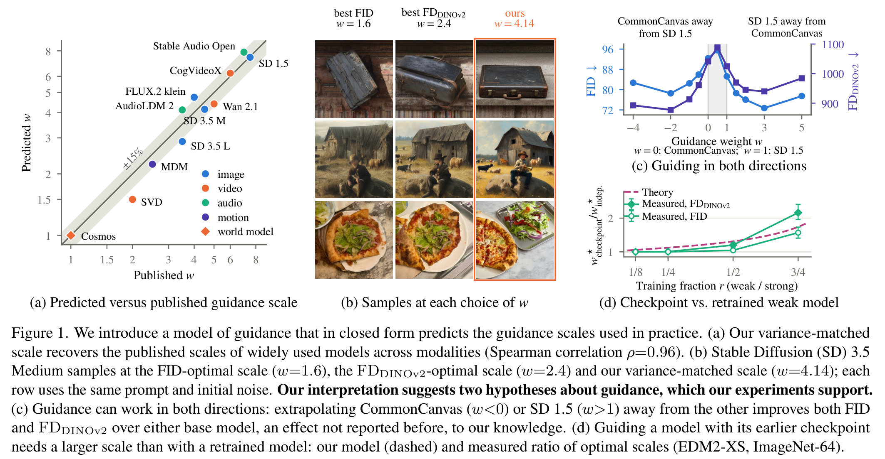
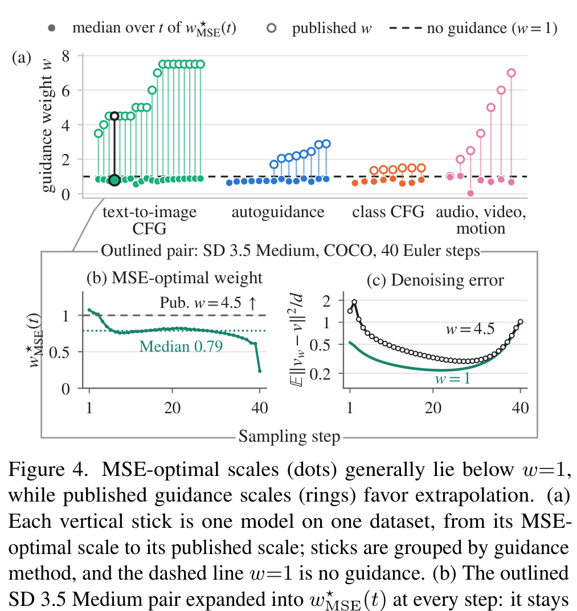
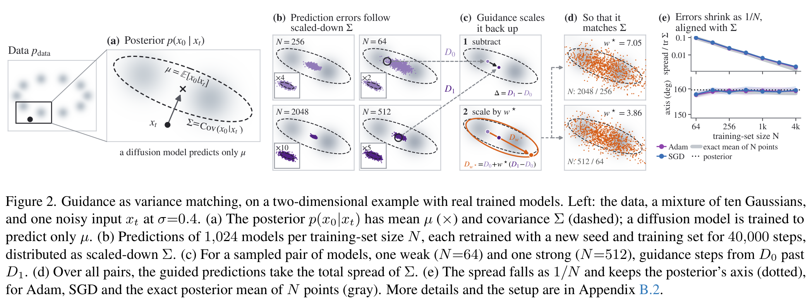
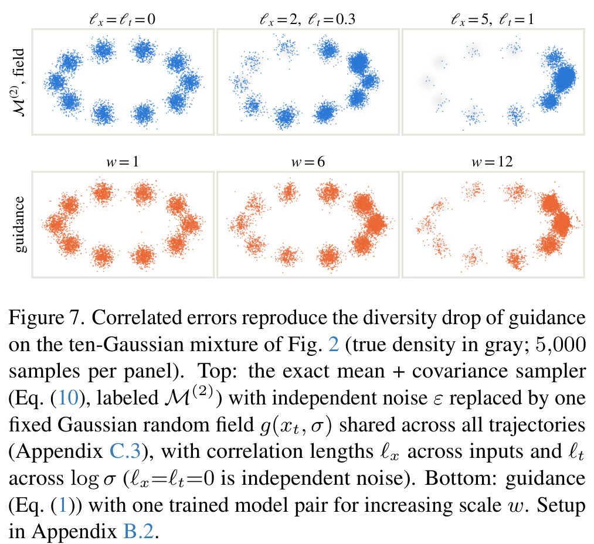
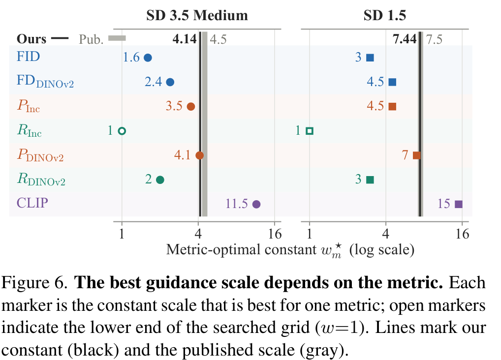
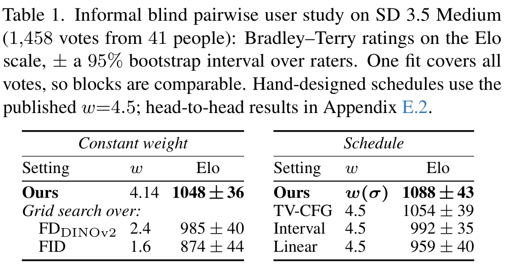

# AI Daily

## Guidance as Variance Matching

**作者：** Ali Backour（共同一作）、Artem Lukoianov（共同一作）、Frank Permenter、Tommi Jaakkola、Justin Solomon、Vincent Sitzmann。**單位：** MIT CSAIL、Toyota Research Institute。**狀態：** arXiv 預印本 v1，2026-11-25 提交，全文 41 頁（含附錄）；以 CVPR 模板排版、附錄使用 `[review]` 模式，但截至 2026-11-28 未列任何正式會議或期刊，錄用狀態未核實。程式碼與實驗腳本已開源（MIT）。論文：[arXiv:2611.34801](https://arxiv.org/abs/2611.34801)，專案頁：[ottogin.github.io/vmg](https://ottogin.github.io/vmg/)。[1] [2] [13]

選它的理由：這篇同時命中兩個偏好——**training-free**（不訓練、不掃描、不生成樣本調參）與**生成機制的可解釋性**。它處理的對象是所有 CFG／autoguidance 使用者每天手調的那個數字 $w$，主張 $w$ 不是「強化條件」的旋鈕，而是「把去噪器丟掉的後驗變異數補回來」的係數，並給出閉式解。對想做 EBT、JEPA、VAR 的人，這篇提供了一個可移植的量測工具：任何只回歸條件均值的預測器都會系統性低估變異數，而這個缺口可以用兩個獨立預測器之差去補。這個視角可以直接搬到 latent 預測、next-scale 預測與能量式取樣。

### 核心貢獻

先講一個容易被誤讀的點：論文的第一個觀察其實是**定理**而不是經驗發現。對任何以 $L_2$ 損失訓練、極小解為後驗均值的去噪器，全變異數定律直接給出

$$\operatorname{Cov}\bigl(\mathbb{E}[x_0\mid x_t]\bigr)=\operatorname{Cov}(x_0)-\mathbb{E}\bigl[\operatorname{Cov}(x_0\mid x_t)\bigr]\preceq \operatorname{Cov}(x_0),$$

也就是「後驗均值的分布一定比資料窄」，缺口恰是 $\mathbb{E}[\Sigma(x_t)]$。所以真正的問題不是「有沒有缺口」，而是「引導補了多少、補的方向對不對」。作者的三個貢獻都掛在這句話上：

第一，把 $w$ 從超參數變成可量的統計量：用「引導後預測的變異數 = 資料變異數」這一個條件解出 $w$，得到閉式解，不需要取樣、不需要掃描、不需要額外訓練。第二，用同一個式子去預測 11 個已發布模型的 $w$，橫跨圖像、影片、音訊、動作與世界模型，作者報 Spearman $\rho=0.96$。第三，把機制講成「兩個後驗均值估計 → 一個帶後驗協方差的樣本」，並由此推出兩個先前沒人報過的現象：引導可以**雙向**（$w<0$ 也有效），以及**用同一個模型自己的舊 checkpoint 當弱模型時需要更大的 $w$**。

*圖 1：原文 Figure 1。(a) 預測 $w$ 對已發布 $w$ 的散布，灰帶為 $\pm15\%$；(b) SD 3.5 Medium 在 FID 最佳 $w=1.6$、$\mathrm{FD}_{\mathrm{DINOv2}}$ 最佳 $w=2.4$ 與本文 $w=4.14$ 的同一提示／同一初始雜訊對照；(c) SD 1.5 與 CommonCanvas 互相引導，兩個方向都優於任一模型，而 $0<w<1$ 之間全部更差；(d) checkpoint 需要的 $w$ 倍率高於獨立重訓模型（虛線為理論）。[1]*

### 技術方法與公式

#### 1. 設定：去噪器 = 後驗均值，DDIM = 沿機率流走

採 variance-exploding 參數化 $x_t=x_0+\sigma_t\varepsilon$、$\varepsilon\sim\mathcal{N}(0,I)$，去噪器最小化

$$\mathcal{L}(D)=\mathbb{E}_{t,x_0,\varepsilon}\bigl\|D(x_0+\sigma_t\varepsilon)-x_0\bigr\|^2,\qquad D^\star(x_t)=\mathbb{E}[x_0\mid x_t],$$

DDIM 的一步是 $x_{t'}=\frac{\sigma_{t'}}{\sigma_t}x_t+\bigl(1-\frac{\sigma_{t'}}{\sigma_t}\bigr)D_\theta(x_t)$。關鍵在於：這一步只搬運均值，把「同一個 $x_t$ 可能來自哪些 $x_0$」的不確定性整個丟掉。作者把它換成「從後驗的高斯近似抽一個樣本」：

$$\tilde{x}_0=\mathbb{E}[x_0\mid x_t]+\Sigma(x_t)^{1/2}\varepsilon,\qquad \Sigma(x_t)=\operatorname{Cov}(x_0\mid x_t).$$

這個 $\mathcal{M}^{(2)}$ 取樣器在後驗動差精確時，單步就能對上 $p_{\mathrm{data}}$；附錄證明 $K$ 步下 DDIM 的 MMD 誤差是 $O(K^{-1})$，$\mathcal{M}^{(2)}$ 是 $O(K^{-2})$。問題是 $\Sigma(x_t)$ 在高維估不出來，而且需要每一步的 Jacobian-vector product。

#### 2. 動機：實務上的 $w$ 讓「預測更差」卻讓「樣本更好」

如果把 $w$ 當成降低去噪誤差的係數，會得到一個與實務完全相反的結論。對 $D_w=D_0+w(D_1-D_0)$，誤差是 $w$ 的二次式，極小解為

$$w^\star_{\mathrm{MSE}}(t)=\frac{\mathbb{E}_t\langle x_0-D_0(x_t),\,D_1(x_t)-D_0(x_t)\rangle}{\mathbb{E}_t\|D_1(x_t)-D_0(x_t)\|^2}.$$

用「共享誤差」模型 $D_i=D^\star+\alpha_i e+\beta_i e_i$（$e,e_0,e_1$ 正交）代入，得

$$w^\star_{\mathrm{MSE}}=\frac{\mathbb{E}\bigl[\beta_0^2+\alpha_0(\alpha_0-\alpha_1)\bigr]}{\mathbb{E}\bigl[\beta_0^2+\beta_1^2+(\alpha_0-\alpha_1)^2\bigr]}\le 1 \quad(\text{共享項 } \alpha \text{ 很小時}),$$

也就是**預測後驗均值的最佳 $w$ 幾乎總是小於 1**（SD 3.5 Medium 上逐步中位數 $0.79$），而實務用的是 $1.5$ 到 $8$。實測也一致：已發布的 $w=4.5$ 在每一個取樣步都把速度空間的去噪誤差抬到 $w=1$ 之上，最多約 $4$ 倍。這張圖是全文的動機——任何只盯著去噪誤差的解釋都不可能對，必須去看整個取樣過程。

*圖 2：原文 Figure 4。(a) 每個模型的「MSE 最佳 $w$」（實心點）與已發布 $w$（空心圈）之間的距離；(b) SD 3.5 Medium 逐步的 $w^\star_{\mathrm{MSE}}(t)$；(c) 同一對模型的速度空間去噪誤差：已發布的 $w=4.5$ 全程高於 $w=1$。[1]*

#### 3. 核心主張：引導＝用兩個模型的「差」免費造出 $\Sigma^{1/2}\varepsilon$

作者把訓練看成有限樣本的副產物：對同一個 $x_t$，網路只看過 $m(x_t)$ 個目標 $x_0$，於是它學到的是這 $m$ 個樣本的平均。若把重訓過程看成對 $p(\cdot\mid x_t)$ 抽 $m$ 個樣本取平均，則

$$\mathbb{E}_{D_N}\bigl[D_N(x_t)\bigr]=\mathbb{E}[x_0\mid x_t],\qquad \operatorname{Cov}_{D_N}\bigl(D_N(x_t)\bigr)=\frac{1}{m(x_t)}\operatorname{Cov}(x_0\mid x_t).$$

換句話說，**每個模型都帶著一個「縮小版的後驗協方差」當誤差**，縮放因子是 $1/m$。取弱模型 $D_0$（$m_0$ 小）與強模型 $D_1$（$m_1$ 大），線性組合 $D_w=wD_1+(1-w)D_0$ 的均值不變，協方差變成

$$\operatorname{Cov}(D_w)=\Bigl(\frac{w^2}{m_1}+\frac{(1-w)^2}{m_0}\Bigr)\Sigma(x_t)=c(w,m_1,m_0)\,\Sigma(x_t).$$

令 $c=1$，就得到「均值與協方差同時對上後驗」的 $w$，而這正是標準引導公式。**引導不是把分布銳化，而是把兩個均值估計的誤差差額放大成一個帶正確協方差的樣本。** 這裡有個容易忽略的關鍵：$w$ 只決定協方差的**大小**，不決定**形狀**；形狀由 $\Delta=D_1-D_0$ 的方向自動給出，而 $\Delta$ 的協方差正比於 $\Sigma$。這也解釋了為什麼「補變異數」不能隨便加高斯噪音。

*圖 3：原文 Figure 2。十個高斯的二維例子：(b) 每個訓練集大小 $N$ 重訓 1,024 個模型，預測誤差沿後驗主軸散布、形狀是縮小版的 $\Sigma$；(c) 取一弱（$N=64$）一強（$N=512$），先相減再乘 $w^\star$；(d) 引導後的散布達到 $\Sigma$ 的總量；(e) 散布隨 $1/N$ 收斂且保持後驗軸向。我用 (c)(d) 標的 $w^\star=3.86$ 與 $7.05$ 反推 $c(w)=1$，得到 $m_0\approx10$ 與 $43$，兩者都約為 $N$ 的 $0.16$ 倍，與「$m\propto N$」的模型自洽。[1]*

#### 4. 閉式解：一個二次方程、兩個根

對 $x_t\sim p_t$ 取跡（trace），令

$$a(t)=\operatorname{Var}_{x_t}[D_1-D_0],\quad b(t)=\operatorname{Var}_{x_t}[D_0]-\operatorname{tr}\operatorname{Cov}_{x_t}(D_0,D_1),\quad c(t)=\operatorname{Var}_{x_t}[D_0]-\operatorname{Var}_{x_0}[x_0],$$

則 $a w^2-2bw+c=\operatorname{Var}_{x_t}[D_w]-\operatorname{Var}_{x_0}[x_0]$ 是**恆等式**（我用隨機變數直接驗過，誤差在 $10^{-6}$ 內），匹配條件 $aw^2-2bw+c=0$ 給出

$$w^\star_{\mathrm{VM}}(t)=\frac{b(t)\pm\sqrt{b(t)^2-a(t)c(t)}}{a(t)}.$$

常數版則先把 $a,b,c$ 對取樣步平均，再解同一個二次式。這裡藏著全文最有意思的推論：$c(t)<0$ 等價於「弱模型的預測已經比資料窄」，此時兩根之積 $c/a<0$，**兩根必異號**。正根是平常的「把強模型推離弱模型」，負根是「把弱模型推離強模型」，兩者補的是同一個協方差。作者因此在 SD 1.5 與 CommonCanvas 這對「同 latent 空間、不同訓練資料」的模型上做雙向測試：$w$ 從 $-4$ 到 $5$，$0<w<1$ 之間全部比任一模型差，而兩個方向的外插都同時改善 FID 與 $\mathrm{FD}_{\mathrm{DINOv2}}$；SD 2.1 與 SD 1.5／CommonCanvas 的兩對、四個方向也一樣（$95\%$ 信賴區間不含 $0$）。[1]

#### 5. 兩個推論：checkpoint 需要更大 $w$，多樣性下降來自相關誤差

**（a）checkpoint 的情形。** autoguidance 的弱模型常是同一個模型的早期 checkpoint，此時強模型已經看過弱模型的全部 $N_0$ 個樣本，兩者的誤差在差值裡部分抵銷：

$$\operatorname{Cov}(\Delta_{\mathrm{cp}})=\Bigl(\frac{1}{m_0}-\frac{1}{m_1}\Bigr)\Sigma\;\prec\;\Bigl(\frac{1}{m_0}+\frac{1}{m_1}\Bigr)\Sigma=\operatorname{Cov}(\Delta_{\mathrm{id}}),$$

差值變異數比獨立模型小，所以要拉得更用力：$w^\star\approx(1/m_0\mp1/m_1)^{-1/2}$。EDM2-XS 兩個同配方不同 seed 的 run 證實了方向，但量級對不上：只有在弱模型至少完成強模型一半訓練量之後才需要更大的 $w$，而且比理論值小。作者用「指數移動平均、記憶長度 $L$」的訓練模型去擬合，得到 $L=0.69T$，也就是說 **SGD 會遺忘，早期 checkpoint 與最終模型共享的樣本比帳面上少。**

**（b）多樣性下降。** 作者的解釋不是「銳化」，而是誤差在鄰近 $x_t$ 之間**相關**：一對固定模型定義了一個平滑的誤差場，引導把這個共享誤差放大，於是鄰域內所有軌跡被推向後驗的同一個點。他們用可控實驗驗證：把 $\mathcal{M}^{(2)}$ 的獨立噪音 $\varepsilon$ 換成一個固定高斯隨機場 $g(x_t,\sigma)$（每個點的邊際仍是標準高斯，但鄰近輸入與鄰近噪音層級相關），結果與「加大 $w$」的坍縮形態一致。

*圖 4：原文 Figure 7。上排：把 $\mathcal{M}^{(2)}$ 的獨立噪音換成共享隨機場，相關長度 $\ell_x,\ell_t$ 越大，樣本越集中到少數模態；下排：真實模型對的引導，$w=1\to6\to12$ 產生同樣的坍縮形態。這是「多樣性下降＝相關誤差被放大」的乾淨證據，也順便說明引導不是「銳化條件」。[1]*

#### 6. 對照組：同樣的變異數量，方向錯了就全面變差

這是我認為全文最乾淨的一組控制實驗。在 SD 3.5 Medium 上不開引導，每一步把預測加上零均值高斯噪音，噪音量調到與本文排程相同（$10{,}000$ 張，$40$ 步 Euler）：

| 取樣方式 | FID ↓ | FD_DINOv2 ↓ | P_DINOv2 ↑ | R_DINOv2 ↑ | CLIP ↑ |
|---|---|---|---|---|---|
| 無引導（$w=1$） | 21.20 | 388.5 | 0.542 | 0.524 | 0.2409 |
| ＋等向噪音 | 31.68 | 422.0 | 0.507 | 0.502 | 0.2370 |
| ＋資料協方差形狀噪音 | 36.64 | 464.0 | 0.525 | 0.438 | 0.2369 |
| 本文 $w^\star_{\mathrm{VM}}(t)$ | 20.13 | 224.0 | 0.765 | 0.578 | 0.2749 |

同樣的變異數量，方向錯了就全面變差，而且「資料協方差」比「等向」更糟——因為 $\Sigma(x_t)$ 依賴 $x_t$：在 $x_t$ 已經確定的方向上它很小，在 $x_t$ 沒說清的方向上它很大，用與 $x_t$ 無關的噪音等於把變異數倒在已經收斂的方向上。

### 實驗與量化結果

**（1）$w$ 的預測。** 11 個模型、5 種模態：SD 1.5（$7.44$ 對發布 $7.5$）、SD 3.5 Medium（$4.14$ 對 $4.5$）、SD 3.5 Large（$2.88$ 對 $3.5$）、FLUX.2 [klein] 4B（$4.74$ 對 $4.0$）、SVD（$1.50$ 對 $2.0$）、Wan2.1（$4.40$ 對 $5.0$）、CogVideoX-2B（$6.22$ 對 $6.0$）、Cosmos-Predict2.5（$1.00$ 對 $1.0$）、AudioLDM 2（$4.11$ 對 $3.5$）、Stable Audio Open（$7.88$ 對 $7.0$）、MDM（$2.23$ 對 $2.5$）。我用這 11 組數字重算，Spearman 為 $0.964$、中位相對誤差 $12.0\%$，與論文一致。但要看分布：SD 1.5 誤差僅 $-0.8\%$、SD 3.5 Medium $-8.0\%$、CogVideoX $+3.7\%$，而 SVD 是 $-25\%$；Cosmos 的 $1.00$ 對 $1.0$ 是「不引導」的平凡解，對相關性沒有貢獻。

**（2）已發布的 $w$ 不對應任何單一指標的最佳值。** 同一組模型上，SD 3.5 Medium 的最佳常數從 $w=1$（Inception recall）一路到 $11.5$（CLIP）；FID 偏好 $1.6$、$\mathrm{FD}_{\mathrm{DINOv2}}$ 偏好 $2.4$、DINOv2 precision 偏好 $4.1$。作者因此主張已發布的 $w$ 多半是人眼挑的，而人眼挑的與指標掃出來的不是同一件事——這正是他們的規則能「預測已發布值」卻不一定在 FID 上取勝的原因。

*圖 5：原文 Figure 6。每個指標各有自己的最佳常數（對數軸），黑線是本文的常數、灰線是已發布值。SD 3.5 Medium 上兩者相距不遠，SD 1.5 上本文的 $7.44$ 幾乎壓在已發布的 $7.5$ 上。[1]*

**（3）人眼偏好。** 41 人、1,458 次盲測成對比較（Bradley–Terry，Elo）：常數版 $1048\pm36$，優於 $\mathrm{FD}_{\mathrm{DINOv2}}$ 掃描版 $985\pm40$ 與 FID 掃描版 $874\pm44$；排程版 $1088\pm43$，優於 TV-CFG $1054\pm39$、interval guidance $992\pm35$、線性排程 $959\pm40$。要保留的是：這是「非正式」研究、樣本小，$1048$ 與 $985$ 的信賴區間仍有小幅重疊（$1012$ 對 $1025$）；而「本文常數 vs 本文排程」的對決是 $50\%$（$n=75$）平手，反而是一個合理的一致性檢查。

*圖 6：原文 Table 1 的 Elo 匯總。這張表只涵蓋 SD 3.5 Medium 一個模型。[1]*

**（4）排程版跨模型是混合結果。** 無需調參的 $w(\sigma)$ 在 SVD 上把 FVD 由 $141.2$ 降到 $113.7$、Wan2.1 由 $261.0$ 降到 $220.0$、SD 3.5 Medium 的 $\mathrm{FD}_{\mathrm{DINOv2}}$ 由 $242.4$ 降到 $224.0$（FID $20.58\to20.13$、CLIP $0.2715\to0.2749$，但 Inception precision／recall 由 $0.685$／$0.461$ 降到 $0.667$／$0.440$）；但在 CogVideoX-2B 上 FVD 由 $236.3$ 升到 $262.1$、AudioLDM 2 的 FAD 由 $2.00$ 升到 $2.46$（KL 反而由 $1.47$ 降到 $1.29$）。作者自己的說法是「約一半的模型改善分布指標」，這個描述是誠實的。

**（5）最尖銳的反例：ImageNet-512 上直接失效。** EDM2-XXL 用 NVIDIA 為 FID 掃出來的 $w$（CFG 為 $1.20$、autoguidance 為 $2.05$）得到 FID $4.83$／$4.41$；換成本文常數（$5.73$／$9.45$）後 FID 變成 $11.98$／$30.20$，$\mathrm{FD}_{\mathrm{DINOv2}}$ 也從 $90.2$／$64.8$ 惡化到 $120.7$／$178.3$。作者的解釋是「FID 不等於人眼偏好、ImageNet 的 $w$ 是掃 FID 來的，所以兩者本來就不該一致」，並未在 ImageNet 上做人眼研究。這個辯護能解釋「為什麼數字不同」，不能解釋「為什麼兩個指標同時大幅變差」，我認為這是全文最需要後續工作補上的缺口。

**（6）成本。** 擬合不需要取樣：在 $5{,}705$ 張 COCO 照片、$40$ 個噪音層級上跑兩次前向即可，作者說「比生成一次評測集還便宜」。$256$ 張照片就能把常數定到標準差 $0.06$（$95\%$ 區間 $4.02$–$4.25$），約 $250$ 張可達 $\pm3\%$；音訊模型需要約 $3.5$ 倍的樣本才有同樣的相對精度。這對「拿不到發布 $w$ 的開源模型」是實用價值最高的一段。作者另外做了兩個消融：用完整 $16\times16$ latent 協方差矩陣擬合（而非只匹配跡）得到的 $w$ 幾乎相同；用 $L_1$／$L_2$ 擬合 $r_t(w)$ 得到的尺度比本文小，離已發布值更遠（中位誤差 $19\%$、$24\%$ 對本文的 $12\%$）。

**（7）一個順帶的診斷。** 在 ImageNet-64 上把 CFG 的差 $\Delta(x_t)=D(x_t,c)-D(x_t)$ 拆成「標籤資訊」與「近似誤差」：$\sigma\gtrsim5$ 時 $\|\Delta\|^2$ 是模型自身誤差的 $15$ 倍、幾乎全是標籤資訊，此處引導讓 FID 變差；$\sigma\lesssim3$ 時 $\Delta$ 落到模型誤差以下、其 seed 相依比例由 $17\%$ 升到 $42\%$，此處引導讓 FID 改善 $4$–$10\%$。這支持「CFG 有一部分其實是 strong-vs-weak 效果」的說法，也說明為什麼 interval guidance 有效。

### 相關研究脈絡

**引導的解釋之爭。** 主流說法有兩支：一支是「取樣自銳化後的分布」$p_w(x\mid c)\propto p(x\mid c)^w p(x)^{1-w}$，另一支是 Karras 等人的「弱模型犯的錯是強模型的放大版，外插可以抵銷」。近年對第一支的反證相當硬：Bradley 與 Nakkiran 把 CFG 讀成 predictor–corrector，Moufad 等人則指出引導後的 score **不是任何加噪分布的 score**。本文的立場是兩支都不完整：它承認共享誤差在方向上對，但指出**外插的量**不是由誤差抵銷決定，而是由變異數匹配決定，而且這個量可以算出來。[1] [3] [4] [5] [14]

**與協方差取樣器的關係。** Schioppa 與 Salimans 用 Tweedie 公式從去噪器取後驗協方差，做成 covariance-aware 的 DDIM 步；Akhtar 等人證明匹配後驗協方差可把 DDPM 的路徑空間 KL 由 $\Omega(1/K)$ 降到 $O(1/K^2)$，並用 Lanczos 迭代取樣。兩者都需要每一步的 Jacobian-vector product，成本高。本文的賣點是**引導模型本來就多算了一次前向**，於是「協方差」可以免費取得，代價是形狀只在 $\Delta$ 的方向上正確。這個對照我覺得是全文最有生產力的一句話。[1] [6] [7]

**與 $w$ 的工程技巧的關係。** CFG-Rescale 把引導後的預測重新縮放到條件預測的標準差、ReCFG 用資料算係數修正均值、APG 與 CFG++ 處理過飽和與 off-manifold 漂移、interval guidance 只在特定噪音區間引導、TV-CFG 讓 $w$ 在中段升高再下降——這些方法的共同點是「仍然要人手給一個 $w$」。本文的差異是同一個準則同時給出常數與排程，且不需要生成任何樣本。[1] [8] [9] [10] [11] [12]

**與本庫既有報告的關係。** 這篇與 [ActivSteer](../ActivSteer/AI_Daily_ActivSteer.md) 形成一組有趣的對照：ActivSteer 發現 RL 後訓練的增益可以被「一個與 prompt 無關的常數向量」復現，本文則發現引導的增益可以被「一個與 prompt 無關的純量」復現——兩者都在說「很多看起來是知識的東西，其實是分布的一階／二階動差」。它與 [CFM](../CFM/AI_Daily_CFM.md) 的 quality–coverage 前緣是同一件事的兩面：CFM 用競爭編碼把變異數還給模型，本文用引導把變異數還給取樣器。與 [Residual-Guidance](../Residual-Guidance/AI_Daily_Residual_Guidance.md) 的關係更直接：RG 注入的是「新提示造成的位移」，本文注入的是「兩個均值估計之差」，兩者都是把某個殘差加回早期去噪步，但一個針對語意切換、一個針對動差不足。

### 限制與個人評價

**這篇的價值在「換一個量測對象」。** 過去十年大家把 $w$ 當超參數，這篇把它變成「後驗變異數缺口的估計量」，於是 $w$ 有了單位、有了誤差條、也有了跨模型的可比性（同一個量在不同模態上落在 $1$ 到 $8$，恰好對上人類偏好的尺度）。我認為這是近期對 guidance 最實在的一次概念清理，比再提一個新的 guidance 變體更有用。

**但它的證據結構有一個明顯破口：ImageNet-512。** 作者用「FID 不是人眼」來解釋 5 倍的尺度差，可是同一張表裡 $\mathrm{FD}_{\mathrm{DINOv2}}$ 也一起崩了（$90.2\to120.7$、$64.8\to178.3$），而 $\mathrm{FD}_{\mathrm{DINOv2}}$ 正是他們在 SD 3.5 上用來主張「貼近人眼偏好」的指標。所以至少有一個情況是「規則給的 $w$ 真的太大」，而論文沒有診斷。我的猜測是：類別條件（$1{,}000$ 類）下的後驗支撐比 COCO 文字條件小得多，$m$ 模型抓不到「條件本身限制了支撐」這件事，於是 $\operatorname{Var}[x_0]$ 被高估、$w$ 被推大。這個猜測可以直接測：把 $\operatorname{Var}[x_0]$ 換成「同一類別內的變異數」，看 ImageNet 的 $w^\star$ 是否掉回 $1$–$2$。

**其他要保留的點。** 一是擬合只用一個純量（協方差的跡），形狀正確性是假設而非結論；作者只在 SD 3.5 Medium 的 $16\times16$ latent 協方差與二維混合高斯上驗證過形狀，而 CFG 在高噪音段的「協方差錯位」正是他們自己用來解釋失敗的機制——這意味著形狀假設在他們最需要的區間最可能不成立。二是 $\operatorname{Var}[x_0]$ 由校準集（COCO）估，$w$ 因此依賴提示分布；換一個提示分布，$w$ 應該會動，論文沒有報這個敏感度。三是誤差在模型間與輸入間獨立的假設明顯不成立（他們自己的多樣性實驗就是反例），所以 $w^\star$ 更應該被讀成「一階校正」而非「真值」。四是「雙向引導有效」只在共享 SD 1.5 latent 空間的模型對上驗證，作者也明說「哪些對會有效，留給未來工作」。五是預印本、無同儕審查、人眼研究非正式、LLM 也被當成額外評分者（作者有揭露）。

### 可驗證的延伸問題

1. **EBT：用能量 Hessian 取代後驗協方差。** 對 $p\propto e^{-E(z)}$，在極值附近 $\operatorname{Cov}(z\mid x_t)\approx(\nabla^2_zE)^{-1}$（Laplace 近似），所以本文的 $\Sigma^{1/2}\varepsilon$ 在 EBT 裡就是 $H^{-1/2}\varepsilon$，而 $H$ 可用 $\nabla E$ 的有限差分或 Gauss–Newton 的 $J^\top J$ 近似。**可測命題**：在 looped EBT 上，用「兩個 checkpoint 之差」做變異數匹配得到的步長／噪音尺度，是否優於手調的 $\alpha$？若 $E$ 真的學到一個景觀，$w^\star$ 應該隨 $\|\nabla E\|$ 下降而下降（越接近極值、缺口越小）。這是把本文的一階統計升級成能量幾何的直接測試。
2. **JEPA：online 與 EMA predictor 正好是「checkpoint」情形。** 依 $\operatorname{Cov}(\Delta_{\mathrm{cp}})$ 的式子，共享樣本會讓差值變異數變小、$w^\star$ 變大；所以對 I-JEPA／V-JEPA 的 online–EMA 這一對做 latent 變異數匹配，預測會得到比「兩個獨立 seed」更大的係數。**可測命題**：(a) 凍結 encoder，只對 predictor 做 $z\gets z_{\mathrm{EMA}}+w(z_{\mathrm{online}}-z_{\mathrm{EMA}})$，$w$ 由 latent 變異數匹配定；(b) 檢查 $w^\star$ 是否隨 EMA 動量單調上升；(c) 下游 linear probe 是否改善。更尖銳的對照是 **VICReg 的 variance 項**：它在訓練時把變異數拉起來，本文在取樣時補；如果兩者真是同一個缺口，那麼「關掉 variance 項、推論時用變異數匹配補回」應該能部分復現效能。
3. **VAR：逐尺度的變異數匹配。** next-scale 預測的條件變異數隨尺度變化（給定粗尺度後，細尺度的不確定性被壓縮），合理的做法是每個尺度一個 $w_s$，而不是全域一個。**可測命題**：從 tokenizer 的實際統計估 $\operatorname{Var}[x^{(s)}]$ 與 $\operatorname{Var}[D^{(s)}]$，解 $w_s^\star$，預測 $w_s^\star$ 隨尺度單調變化，且逐尺度匹配優於全域匹配（在 GenEval／FID 上）。這也順帶檢驗「VAR 的誤差是否也遵守 $1/m$ 律」。
4. **attention modulation：把全域純量換成逐 head 的增益。** 本文的 $w$ 是輸出空間的全域純量，但誤差其實是逐 head、逐 token 產生的。**可測命題**：對每個 head 的輸出做增益 $g_h$，用「該 head 輸出的變異數 = 資料在該子空間的變異數」逐個解出 $g_h$（一次前向即可，因為 head 輸出可分解），與單一全域 $w$ 在等算力下比較；預測是「已經匹配的 head 會得到 $g_h\approx1$」，而這些 head 可以用來解釋為什麼某些層對引導不敏感。這是我認為最值得做的一條，因為它把「training-free 的純量」變成「training-free 的空間調制」。
5. **zero-shot 與模型合併。** 「$w<0$ 也有效」意味著兩個獨立訓練的模型可以互相「推離」而同獲改善，概念上就是一種無需標註的模型合併。**可測命題**：把負根方向與 task arithmetic／model soup 在同樣的模型對上比較，並檢驗「兩個方向都改善」是否要求共享 latent 空間（本文證據全部落在 SD 1.5 latent 上，跨 tokenizer 的模型對應該失效——這是一個明確的否證條件）。
6. **把「變異數缺口」當成免訓練的診斷儀。** 定義 $g(t)=\bigl(\operatorname{Var}[D_1]-\operatorname{Var}[x_0]\bigr)/\operatorname{Var}[x_0]$，只需要兩次前向與一批資料。**可測命題**：$g(t)$ 的形狀是否能預測「interval guidance 該開在哪個噪音區間」？若能，就能把手調的 interval 換成自動判定的區間，而且不需要生成任何樣本。這條最便宜，也最容易在別人的模型上驗證。

## References

[1]: https://arxiv.org/abs/2611.34801 "Guidance as Variance Matching — arXiv full text"
[2]: https://ottogin.github.io/vmg/ "Guidance as Variance Matching — project page"
[3]: https://arxiv.org/abs/2406.02507 "Guiding a Diffusion Model with a Bad Version of Itself"
[4]: https://arxiv.org/abs/2408.09000 "Classifier-Free Guidance is a Predictor-Corrector"
[5]: https://arxiv.org/abs/2505.21101 "Conditional Diffusion Models with Classifier-Free Gibbs-like Guidance"
[6]: https://arxiv.org/abs/2605.13910 "Covariance-aware Sampling for Diffusion Models"
[7]: https://arxiv.org/abs/2605.22723 "The Value of Covariance Matching in Gaussian DDPMs and the Lanczos Sampler"
[8]: https://arxiv.org/abs/2305.08891 "Common Diffusion Noise Schedules and Sample Steps are Flawed"
[9]: https://arxiv.org/abs/2410.18737 "Rectified Diffusion Guidance for Conditional Generation"
[10]: https://arxiv.org/abs/2410.02416 "Eliminating Oversaturation and Artifacts of High Guidance Scales in Diffusion Models"
[11]: https://arxiv.org/abs/2404.07724 "Applying Guidance in a Limited Interval Improves Sample and Distribution Quality in Diffusion Models"
[12]: https://arxiv.org/abs/2509.22007 "Stage-wise Dynamics of Classifier-Free Guidance in Diffusion Models"
[13]: https://github.com/ottogin/guidance-as-variance-matching "Official implementation of Guidance as Variance Matching"
[14]: https://arxiv.org/abs/2207.12598 "Classifier-Free Diffusion Guidance"
