# AI Daily

## 2026-11-17｜What kills v-prediction? A Patch-wise PCA Perspective on Pixel-Space Flow Matching（RiT）

### 論文資訊

- **論文標題**：*What kills $v$-prediction? A Patch-wise PCA Perspective on Pixel-Space Flow Matching*
- **提出模型**：RiT（**R**aw-**i**njected **T**ransformer）
- **作者**：Tianze Luo$^{1,2}$、Haofeng Huang$^{1}$、Yuan Yao$^{1,2,*}$（* 通訊作者：`yaoyuanthu@mail.tsinghua.edu.cn`）
- **機構**：清華大學（Tsinghua University）、上海期智研究院（Shanghai Qi Zhi Institute）
- **發表**：**NeurIPS 2026（40th Conference on Neural Information Processing Systems）**，Spotlight；PDF 第一頁頁尾即印會議名，`neurips.cc/virtual/2026` 的 poster 頁面 id `154141` 亦可在 **Spotlights 清單頁**查到
- **arXiv ID:** 2611.12852v1（v1 上傳 2026-11-09，無 v2），25 頁，primary category `cs.CV`（跨 `cs.LG`）；摘要頁 [arxiv.org/abs/2611.12852](https://arxiv.org/abs/2611.12852)、[全文 HTML](https://arxiv.org/html/2611.12852v1)、[PDF](https://arxiv.org/pdf/2611.12852v1)
- **程式碼**：[github.com/THUMAI-Lab/RiT](https://github.com/THUMAI-Lab/RiT)（MIT，2026-11-13 釋出，含 `rit.py`／`train.py`／`inference.py`／`evaluator.py` 與 `analysis/draw_{eigens,embeds,r2}.py`）
- **權重與消融 checkpoint**：[huggingface.co/luotianze666/RiT_ckpts](https://huggingface.co/luotianze666/RiT_ckpts)（114 檔／約 400 GB，目錄命名與論文每張表一一對應，PCA 軌跡完整保留）
- **算力來源**：上海期智研究院創新計畫 `SQZ202410`，NVIDIA A800-80GB（RiT-B 用 8 張，RiT-L／H 各 16 張）
- **一個必須先講清楚的撞名問題**：本庫 2026-05 已寫過 [RiT: Vanilla Diffusion Transformers Suffice in Representation Space](../../2026-05/RiT/AI_Daily_RiT.md)（arXiv:2605.21981，Mila 的 Le Zhang 等人，在 DINOv2 特徵空間做 x-prediction）；本庫 2026-03 也寫過 [Just-in-Time (JiT)](../../2026-03/JiT/AI_Daily_JiT.md)（UESTC 的免訓練加速框架，arXiv:2603.10744）。而本文對話的 **JiT** 是 Li & He 的 *Back to Basics: Let Denoising Generative Models Denoise*（arXiv:2511.13720，CVPR 2026）[14]。三個縮寫互不相干，引用時務必標 arXiv 編號。

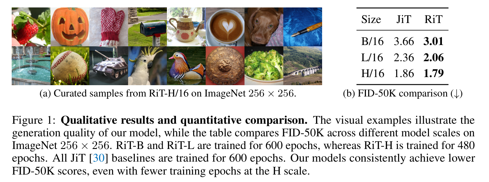

*RiT-H/16 的 curated samples（左）與 FID-50K 對照（右）：B/16 3.66→**3.01**、L/16 2.36→**2.06**、H/16 1.86→**1.79**。*

---

### 核心貢獻

這篇論文的貢獻重心**不在 SOTA 數字，而在把一個被當成「自然定律」的經驗法則改寫成可證偽、可被架構干預檢驗的機制命題**。四件事：

1. **拆掉「流形假設」的解釋壟斷地位。** JiT 把像素空間 $v$-prediction 的訓練崩潰歸因於「$x_0$ 在低維流形上，而雜訊 $x_1$ 與目標速度 $x_1-x_0$ 是 off-manifold 的」，因此主張改用 $x$-prediction。本文一句話點破其非排他性：**MSE 最佳的 $x$-預測本身就是條件期望 $\mathbb{E}[x_0\mid x_t,t,\ell]$，它也沒有理由落在資料流形上**（§1、§3）。既然兩個目標都不在流形上，流形敘事就無法解釋「為何只有一個會失敗」，於是必須另找機制。
2. **提出並驗證「架構資訊頻寬（bandwidth）」假說**：在 $16\times16\times3=768$ 維的像素 patch 上，$v$-prediction 的最佳解在**小方差主成分方向（minor components）上幾乎就是 raw noisy input 的 $1/t$ 縮放**，因此 backbone 必須把 768 維雜訊狀態一路搬運到深層，與「語意建模」爭搶同一份頻寬。受控實驗直接把假設變成開關：把資料與雜訊一起 PCA 投影到低維，$v$-prediction 不但復活、還在 $k=128/192/256$ **反勝** $x$-prediction；維度拉回 768 才崩到 FID 149.07。
3. **兩條可遷移的命題。** Proposition 1 給出 minor 方向上最佳仿射速度場的封閉式（含殘差標準差）；Proposition 2 證明：**在低秩線性觀測下，$x$-prediction + 未裁剪的速度恆等式，等價於一個「把被丟棄座標用條件均值補完」的解碼器**，而且初始雜訊項被 $t\cdot z(1)$ 自動消滅；同樣觀測下直接 $v$-prediction 則**必然保留單位方差的 minor 雜訊**、無法調整其分布。作者也在結論誠實補上刀口：這種補完「能表達對保留資訊的非線性依賴，但**不一般性地恢復完整條件分布**」[1]。
4. **RiT：用極便宜的架構改動讓 $v$-prediction 復活。** 兩個元件——(a) **raw-conditioned nonlinear decoder**：每個 backbone token 線性展開成 $(s_b/s_d)^2=4$ 個 patch-8 decoder token，並把 raw $x_t$ 的 decoder patch 直接加進 decoder 輸入；(b) **anchored fractional output shortcut**：把 Prop. 1 的有理式 $C_i(t)$ 直接做成可學習的端點錨定增益。ImageNet 256×256 上 RiT-H/16 以 979M／480 epochs 得到 **FID 1.79／IS 332.9**，並**不使用** PCA、感知、對抗、頻域或表徵對齊等任何附加損失。

---

### 技術方法

#### 0. 路徑、兩個目標與一個恆等式

本文用「$t=1$ 是雜訊、$t=0$ 是資料」的方向慣例（與許多 rectified flow 論文相反，閱讀時要特別注意）：

$$x_t=(1-t)\,x_0+t\,x_1,\qquad x_1\sim\mathcal N(0,\mathbf I),\quad x_0\sim p_{\text{data}},$$

$$v(x_t,t)=\mathbb{E}\!\left[x_1-x_0\mid x_t,t\right],\qquad \frac{\mathrm dX(t)}{\mathrm dt}=v\big(X(t),t\big),\quad X(1)=x_1. \tag{1,2}$$

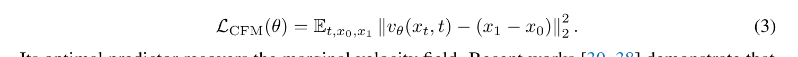

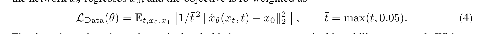

$$\mathcal L_{\text{CFM}}(\theta)=\mathbb{E}_{t,x_0,x_1}\big\|v_\theta(x_t,t)-(x_1-x_0)\big\|^2 \tag{3}$$

$$\mathcal L_{\text{Data}}(\theta)=\mathbb{E}_{t,x_0,x_1}\frac{1}{\bar t^{\,2}}\big\|\hat x_\theta(x_t,t)-x_0\big\|^2,\qquad \bar t=\max(t,0.05). \tag{4}$$

兩者的橋樑是一條代數恆等式：網路預測 $\hat x_\theta$ 後，用 $v_\theta=(x_t-\hat x_\theta)/t$ 換算速度。**Eq.(4) 的 $1/\bar t^2$ 權重正是 $x$-prediction 在像素空間有效的傳統解釋——把算力壓到低雜訊（高頻）端**；但本文關心的是那條恆等式的**資訊含義**：它讓 $x$-prediction 不必把 raw state 親手帶過 backbone。

#### 1. Patch-wise PCA：把「維度」變成實驗自變數

令 patch 維度 $p=3\times16\times16=768$，$\mu=\mathbb E[x_0]$，$\Sigma=\mathrm{Cov}(x_0)$，對角化 $\Sigma=V\Lambda V^\top$（$\lambda_1\ge\cdots\ge\lambda_{768}\ge0$），並對**資料與雜訊同時**施加同一個仿射投影：

$$P_k=V_kV_k^\top,\qquad P_k^{\mu}(x)=\mu+P_k(x-\mu). \tag{5}$$

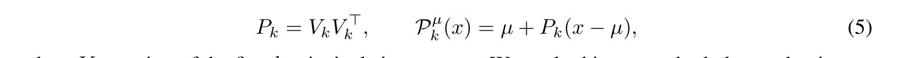

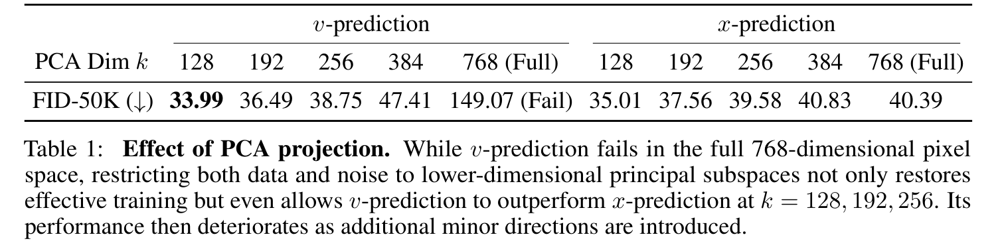

**Table 1 是全文的奠基實驗**（250K updates、global batch 1024、EMA 0.9996、50 步 Heun + 末步 Euler＝99 次速度評估、**CFG 關閉**、backbone 用無 bottleneck 的全寬 768 hidden JiT-B）：

| PCA Dim $k$ | 128 | 192 | 256 | 384 | 768 (Full) |
|---|---|---|---|---|---|
| $v$-prediction | **33.99** | 36.49 | 38.75 | 47.41 | 149.07 (Fail) |
| $x$-prediction | 35.01 | 37.56 | 39.58 | 40.83 | 40.39 |

讀法有三層：(i) 目標函數本身不是病灶——$v$-prediction 在低維子空間是**可用甚至更好**的；(ii) 病灶是「每引入一個 minor 方向就惡化」的單調趨勢；(iii) $x$-prediction 對維度幾乎不敏感（35→40），因為它要回歸的 $x_0$ 在 minor 方向上本來就接近常數。

#### 2. 兩個診斷量：線性重建保真度與有效秩

逐層擬一個仿射探針，量 $x_t$ 能否從第 $l$ 層特徵 $h_l$ 線性還原：

$$R^2(h_l,x_t)=1-\frac{\min_{W,b}\sum_n\|x_{t,n}-(Wh_{l,n}+b)\|_2^2}{\sum_n\|x_{t,n}-\bar x_t\|_2^2}. \tag{6}$$

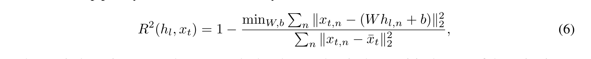

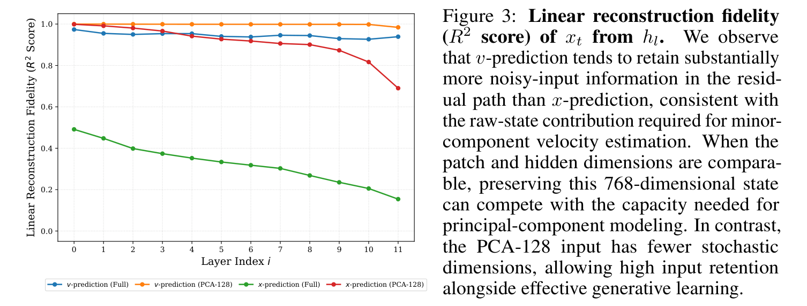

Figure 3 的形狀就是「raw-state 搬運」的直接顯影：$v$-prediction 在 12 層裡把 $R^2$ 維持在高檔（末層仍接近 1），而 $x$-prediction 隨訓練逐步把 $x_t$ 的線性資訊**丟掉**。作者的解讀很克制：這與 $x_1-x_0$ 這個目標「需要 minor-component 速度估計所需的當前雜訊狀態」一致。

第二組量用來看** learned input embedding 自己變得有多低秩**。 composed 輸入映射 $\mathbf W=W_2W_1$ 的奇異值熵有效秩 [20] 與其在 PCA 子空間上的算子能量：

$$\mathrm{erank}(\mathbf W)=\exp\!\Big(-\sum_i\pi_i\log\pi_i\Big),\quad \pi_i=\frac{\sigma_i(\mathbf W)}{\sum_j\sigma_j(\mathbf W)},\qquad E_K(\mathbf W)=\frac{\|\mathbf W V_K\|_F^2}{\|\mathbf W\|_F^2}. \tag{9}$$

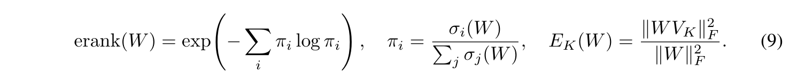

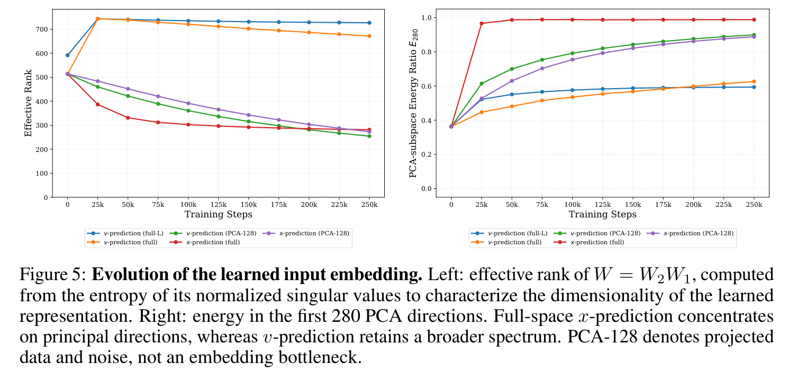

$K=280$ 是刻意對齊「full-space $x$-prediction 在 200 epochs 後的有效秩」，且用**單位範數 PCA 方向、不做特徵值加權**，才不會把對齊度量成能量重排。結果（Figure 5）：$x$-prediction 的 $\mathrm{erank}$ 自發下滑、$E_{280}$ 衝向 1（幾乎所有算子能量都集中在前 280 個主方向）；$v$-prediction 則維持較廣的譜。作者自己設防：**「較低的有效秩本身並不意味著資訊精確遺失」**，這是一支相關性探針，不是機制證明[1]。

#### 3. Proposition 1：minor 方向上的最佳速度就是 $x_t/t$

定義第 $i$ 個主成分座標（附錄 A）：

$$\mu_i=v_i^\top\mu,\quad U_i=v_i^\top(x_0-\mu),\quad N_i=v_i^\top x_1,\quad \tilde x_t=x_t-(1-t)\mu,$$

$$\mathbb E[U_i^2]=\lambda_i,\quad \mathbb E[N_i^2]=1,\quad \mathbb E[U_iN_i]=0,\quad Q_i(t)=v_i^\top\tilde x_t=(1-t)U_i+tN_i,\quad T_i=N_i-U_i,$$

$$\mathbb E[Q_i^2]=t^2+(1-t)^2\lambda_i,\qquad \mathbb E[T_iQ_i]=t-(1-t)\lambda_i.$$

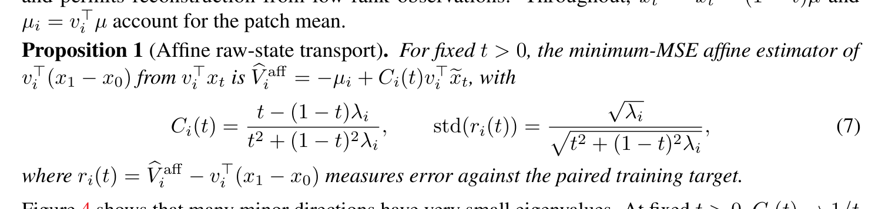

對「以 $Q_i$ 預測 $T_i-\mu_i$」這個最小 MSE 仿射估計，斜率就是協方差除以方差：

$$\boxed{\;C_i(t)=\frac{t-(1-t)\lambda_i}{t^{2}+(1-t)^{2}\lambda_i}\;},\qquad \hat V_i^{\mathrm{aff}}=-\mu_i+C_i(t)\,v_i^\top\tilde x_t, \tag{7}$$

$$\mathrm{std}\big(r_i(t)\big)=\frac{\sqrt{\lambda_i}}{\sqrt{t^{2}+(1-t)^{2}\lambda_i}},\qquad r_i(t)=\hat V_i^{\mathrm{aff}}-v_i^\top(x_1-x_0).$$

手算可驗殘差：$(1+\lambda_i)\big(t^2+(1-t)^2\lambda_i\big)-\big(t-(1-t)\lambda_i\big)^2=\lambda_i$，因此 $\mathrm{Var}(r_i)=\lambda_i/\big(t^2+(1-t)^2\lambda_i\big)$，與 Eq.(7) 右半完全一致。**兩個極限才是重點**：

$$\lambda_i\to0\ \Longrightarrow\ C_i(t)\to\frac{1}{t},\ \ \mathrm{std}(r_i)\to0,\ \ \hat V_i^{\mathrm{aff}}\to\frac{v_i^\top x_t-\mu_i}{t},$$

也就是**在雜訊主導的 minor 方向上，MSE 最佳速度場是 raw noisy state 的 $1/t$ 縮放，且幾乎沒有可學習的殘餘**——backbone 唯一該做的事就是「把 $x_t$ 原封不動送到出口」。同一方向上 $\mathbb E[x_0\mid x_t]\approx\mu_i$ 是常數，所以 $x$-prediction 只要輸出 $\mu_i$，經恆等式 $(x_t-\hat x_\theta)/t$ 就**自動**得到同一個 transport，不必在深度維度上搬 768 維雜訊。作者也誠實標註兩個不一致的極限：對任何固定 $\lambda_i>0$，$C_i(t)\to-1$ 當 $t\to0$，而 $C_i(1)=1$，所以 $1/t$ 不是全程最佳斜率[1]。

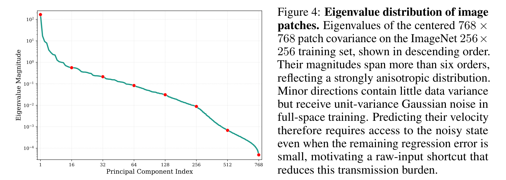

Figure 4 提供物理基礎：ImageNet $256\times256$ 的 $768\times768$ patch 協方差，$\lambda$ 從 $10^{2}$ 量級一路掉到 $10^{-4}$ 以下（**跨越六個以上數量級**），而雜訊在每個方向都是單位方差。於是 $k\gtrsim256$ 之後，資料訊號比雜訊還弱百倍——這正是「minor 方向」之所以致命的統計原因。

#### 4. Proposition 2：$x$-prediction 是隱式的 conditional-mean 解碼器

架構低秩：$\mathbf W=W_2W_1$（$W_1\in\mathbb R^{d_b\times p}$）使 $\mathrm{rank}(\mathbf W)\le d_b$，對 768 維 patch 與 JiT-B/L 的 128 bottleneck，**至少 640 個方向 backbone 根本觀測不到**：任何 $\delta\in\ker\mathbf W$ 使 $x_t$ 與 $x_t+\delta$ 的 embedding 完全相同。把座標分成保留（$P_1$）與丟棄（$P_2=\mathbf I-P_1$）兩塊：$Y_0=P_1(x_0-\mu),\,Z_0=P_2(x_0-\mu),\,Y_1=P_1x_1,\,Z_1=P_2x_1$，則

$$\mathrm{Cov}(Z_t\mid Y_t,t,\ell)=(1-t)^2\,\mathrm{Cov}(Z_0\mid Y_t,t,\ell)+t^2P_2,$$

即使被丟棄方向的 clean 值**完全可從保留座標推得**，$t>0$ 時每維仍殘留 $t^2$ 的獨立雜訊——這是「raw-state 資訊消失」與「clean 結構可預測」的兩件事被分離的關鍵一步。

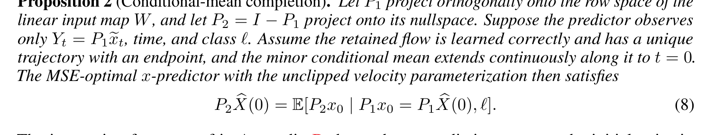

$$\boxed{\;P_2\hat X(0)=\mathbb E\big[P_2x_0\;\big|\;P_1x_0=P_1\hat X(0),\ \ell\big]\;}\tag{8}$$

附錄 B 用積分因子證明：沿保留軌跡 $y(t)$，被丟棄部分 $u(t)=(1-t)\mu_2+z(t)$ 滿足 $u'(t)=(u(t)-\mu_2-m_t)/t$，即

$$z'(t)-\frac{z(t)}{t}=-\frac{m_t}{t}\ \Longrightarrow\ z(t)=t\,z(1)+t\!\int_t^1\frac{m_s}{s^2}\,\mathrm ds \tag{45}$$

$t\downarrow0$ 時 $t\,z(1)=tZ_1\to0$（**初始雜訊被完全消除**），剩下的 $z(0)=m_0(y(0),\ell)$ 就是條件均值。對照組：**直接 $v$-prediction 在同樣觀測下給出 $z'(t)=-m_t$，於是 $z(0)=Z_1+\int_0^1 m_s\,\mathrm ds$、$\mathrm{Cov}(z(0)\mid y(\cdot),\ell)=P_2$——它把單位方差的 minor 高斯雜訊原封不動留在輸出上，而且無從調整**（因為網路根本看不到 $Z_1$）。裁剪 $\bar t=\max(t,\epsilon)$ 的殘留量被算出來：在 $t=\epsilon=0.05$ 處 $\epsilon Z_1$ 被乘上 $e^{-1}$，即每維殘留雜訊 std ≈ **0.0184**，對比 $v$-prediction 的 1.0。

這條是全文最可遷移的命題：**任何「低秩線性觀測 + 用恆等式把預測換算成向量場」的安排，末端都等價於一個條件平均解碼器**。它同時解釋了為什麼高壓縮 VAE 的 latent diffusion 細節偏「平滑」，也解釋了 RiT 為何需要一個**非線性** decoder 去補「條件變異」——因為條件均值不給出完整的條件分布。

#### 5. RiT：raw-conditioned decoder + anchored fractional shortcut

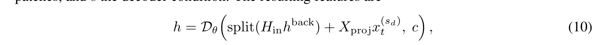

$$h=D_\theta\Big(\mathrm{split}\big(H_{\mathrm{in}}\,h_{\text{back}}\big)+X_{\mathrm{proj}}\,x_t^{(s_d)},\ c\Big),\qquad s_b=16,\ s_d=8,\ D_\theta\text{ 兩層}. \tag{10}$$

每個 backbone token 線性展開並重排成 $(s_b/s_d)^2=4$ 個 decoder token，raw RGB decoder patch 提供 $3s_d^2=192$ 維；深層 backbone 維持原解析度，**只有 decoder 處理更長的序列**。這對應 Prop. 2 的「條件變異需要非線性、且要有頻寬」。

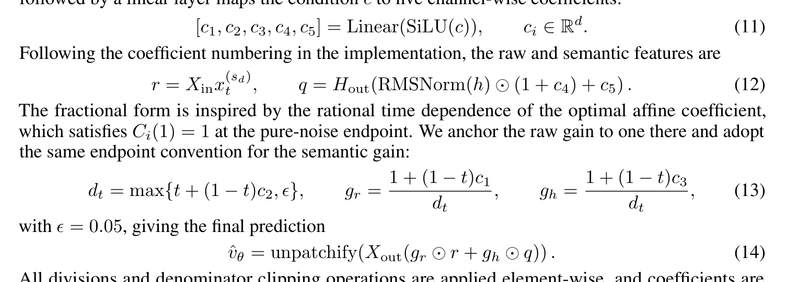

$$[c_1,c_2,c_3,c_4,c_5]=\mathrm{Linear}\big(\mathrm{SiLU}(c)\big),\quad c_i\in\mathbb R^{d}, \tag{11}$$

$$r=X_{\mathrm{in}}\,x_t^{(s_d)},\qquad q=H_{\mathrm{out}}\big(\mathrm{RMSNorm}(h)\odot(1+c_4)+c_5\big), \tag{12}$$

$$d_t=\max\{t+(1-t)c_2,\ \epsilon\},\qquad g_r=\frac{1+(1-t)c_1}{d_t},\qquad g_h=\frac{1+(1-t)c_3}{d_t}, \tag{13}$$

$$\hat v_\theta=\mathrm{unpatchify}\big(X_{\mathrm{out}}(g_r\odot r+g_h\odot q)\big),\qquad \epsilon=0.05. \tag{14}$$

設計上有兩處非常講究：**(a)** 分數形式不是拍腦袋——$\mathrm{Prop.1}$ 的 $C_i(t)$ 本身就是「一次多項式除以一次多項式」的有理結構，而 $(1-t)c$ 的項把**端點增益錨定**住（$c=0$ 時 $g_r\to1/d_t$ 復現 $1/t$ transport，同時控制 $t\to1$ 端），$d_t$ 的 $\epsilon$ 裁剪對應 Eq.(4) 的 $\bar t$。**(b)** 初始化：$H_{\mathrm{out}}$ 與係數輸出設 0、$X_{\mathrm{in}}$ 取正交列、$X_{\mathrm{out}}$ 用其轉置權重、bias 全 0，於是**初始預測器恰好就是 $x_t/\bar t$**——也就是 Prop.1 在 $\lambda_i\to0$ 的答案被當成訓練的起點。註明：轉置關係在訓練中不強制維持，decoder 與捷徑一起學，**最終模型不需要預先計算 PCA basis**。

---

### 實驗結果

所有診斷與消融的協定：ImageNet-1K $256\times256$（resize + center crop、水平翻轉 $p=0.5$、歸一化到 $[-1,1]$），patch 16（$p=768$）；AdamW，lr $2\times10^{-4}$，wd $0$，betas $(0.9,0.95)$，global batch 1024，前 6250 updates 線性 warmup；$\mathrm{logit}(t)\sim\mathcal N(\mu_t,\sigma_t^2)$，預設 $(0.8,0.8^2)$；class condition 以 $p=0.1$ 丟棄供 CFG；EMA 0.9996（並比較 0.9998／0.9999）；FID-50K + IS（ADM 評估實作）；**診斷表（Table 1–4）一律 250K updates、CFG 關閉**，最終模型才開 guidance（Table 8：200ep 時 B/L/H scale $3.1/2.5/2.4$，600／480ep 時 $2.8/2.6/2.35$，interval $[0.0,0.89]$，H 為 $[0.0,0.90]$）。

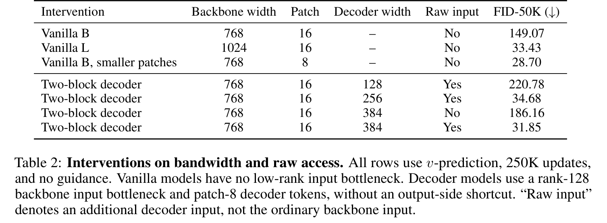

**Table 2（全 $v$-prediction、250K、無 guidance）是最乾淨的控制實驗**：

| 干預 | Backbone width | Patch | Decoder width | Raw input | FID↓ |
|---|---|---|---|---|---|
| Vanilla B | 768 | 16 | – | No | **149.07** |
| Vanilla L（加寬 backbone） | 1024 | 16 | – | No | 33.43 |
| Vanilla B，patch 縮到 8（raw 維 768→192） | 768 | **8** | – | No | **28.70** |
| 兩層 decoder，頻寬不足 | 768 | 16 | **128** | Yes | 220.78 |
| 兩層 decoder，頻寬 256 | 768 | 16 | 256 | Yes | 34.68 |
| 頻寬夠但**看不到 raw** | 768 | 16 | 384 | **No** | **186.16** |
| 頻寬夠且有 raw | 768 | 16 | 384 | Yes | 31.85 |

兩條軸都必要：**raw 可及性**與**注入之後的頻寬**缺一不可；加寬 backbone 或縮小 patch 也能救（但算力代價另算）。注意第 128 行「有 raw 但頻寬不足 → 220.78，比完全不給 raw 還差」，是很漂亮的反直覺證據。

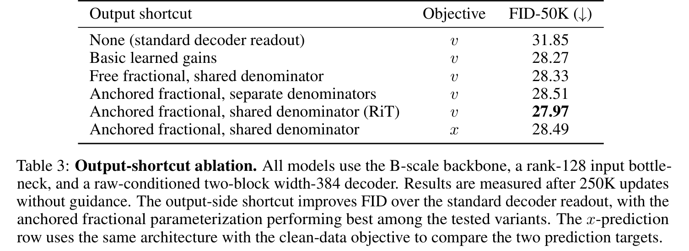

**Table 3（B-scale、rank-128 bottleneck、兩層 384 decoder、250K、無 guidance）**：標準 readout 31.85 → basic learned gains 28.27 → free fractional（去掉 $(1-t)$ 因子）28.33 → anchored fractional + 分支母欄 28.51 → **anchored fractional + 共享母欄（RiT）27.97**；同架構換成 $x$-prediction 是 **28.49**。這裡要老實說：修好之後 $v$ 與 $x$ 在同一架構下只差 **0.52 FID**，這支持了作者較弱的命題（$v$ 不必然較差），但也意味著「換目標」的淨獲利在受控設定下並不大。

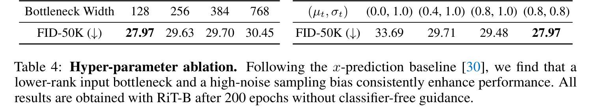

**Table 4（RiT-B、200 epochs、無 guidance）**：bottleneck $128/256/384/768\to 27.97/29.63/29.70/30.45$（**越低秩越好**）；$(\mu_t,\sigma_t)$ $(0,1)/(0.4,1)/(0.8,1)/(0.8,0.8)\to 33.69/29.71/29.48/27.97$（**偏向高雜訊端取樣較佳**）。兩個方向都和 JiT 的設計選擇同向——作者把它當成一個正向交叉驗證：**解除路由瓶頸之後，$v$-prediction 也同樣需要低秩 input embedding 與 noise-biased 的時間分布**，也就是說 JiT 的 recipe 並不是 $x$-prediction 的專利。

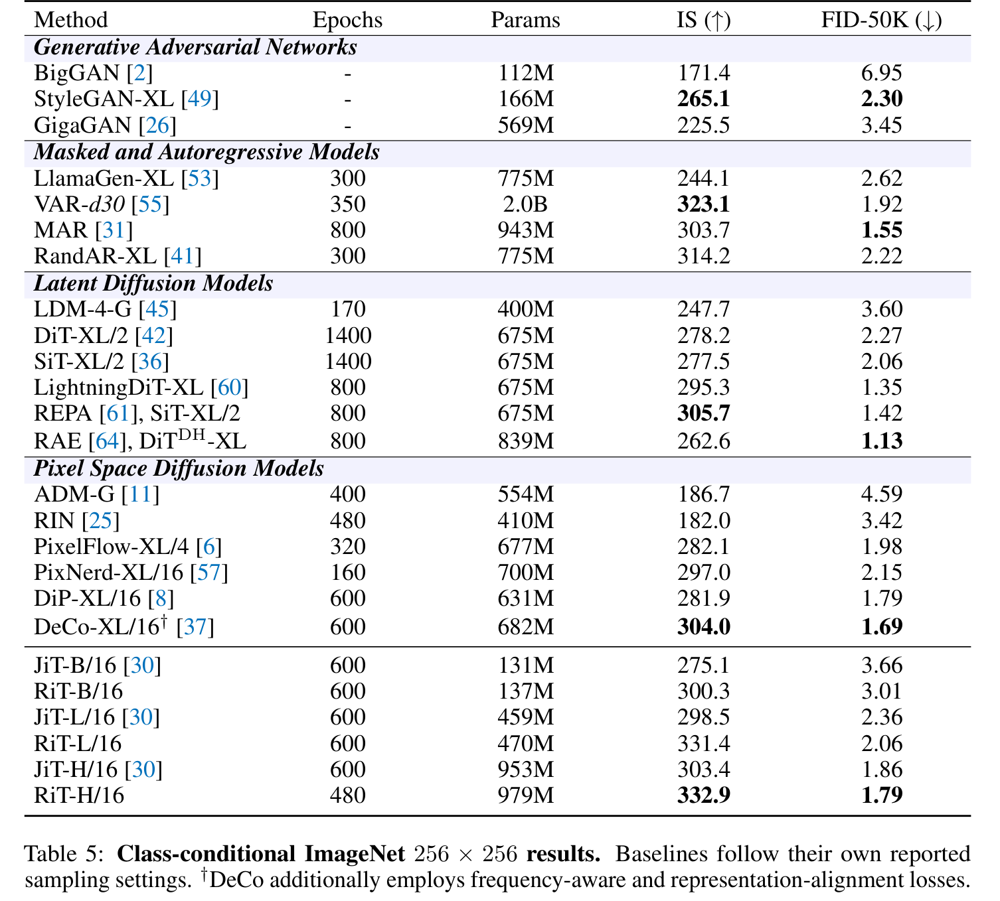

**Table 5 主表**（class-conditional ImageNet 256×256，baseline 沿用各自原文的取樣設定）：

| | Epochs | Params | IS↑ | FID↓ |
|---|---|---|---|---|
| JiT-B/16 → **RiT-B/16** | 600 | 131M → 137M | 275.1 → **300.3** | 3.66 → **3.01** |
| JiT-L/16 → **RiT-L/16** | 600 | 459M → 470M | 298.5 → **331.4** | 2.36 → **2.06** |
| JiT-H/16 → **RiT-H/16** | 600 → **480** | 953M → 979M | 303.4 → **332.9** | 1.86 → **1.79** |

對照族譜：latent 端 RAE（DiT$_{\text{DH}}$-XL）**1.13**、LightningDiT 1.35、REPA+SiT 1.42、SiT-XL/2 2.06、DiT-XL/2 2.27；AR／masked 端 MAR **1.55**、VAR-$d30$ 1.92、RandAR-XL 2.22、LlamaGen-XL 2.62；pixel 端 DeCo-XL/16 **1.69**（另有頻域與表徵對齊損失）、DiP-XL/16 1.79、PixelFlow-XL/4 1.98、PixNerd-XL/16 2.15、RIN 3.42、ADM-G 4.59。**200 epochs（250K updates）的早期結果**：RiT-B/L/H = **3.40／2.48／2.17**，對應 JiT 原文同段的 4.37／2.79／2.29——增益在訓練早期就出現，且三個 backbone scale 一致。

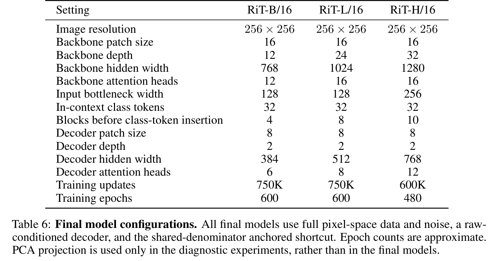

配置細節（Table 6）：RiT-B/16＝12 層／768／12 heads／bottleneck 128／32 個 in-context class token 插在第 4 層之後／decoder $8$/2 層/384/6 heads，750K updates；RiT-L/16＝24／1024／16／bn 128／第 8 層／decoder 512-8；RiT-H/16＝32／1280／16／bn 256／第 10 層／decoder 768-12，600K updates（≈480 epochs）。固定 2D sinusoidal 位置編碼 + 2D RoPE、RMSNorm、SwiGLU。RiT-H 另用一個**尺度專屬技巧**：375K updates 後把 raw shortcut 的 $X_{\mathrm{in}}/X_{\mathrm{out}}$ 及 $c_1,c_2,c_3$ 產生器的有效 lr 乘 0.01（作者自承不用於 B/L 與 250K 消融）。

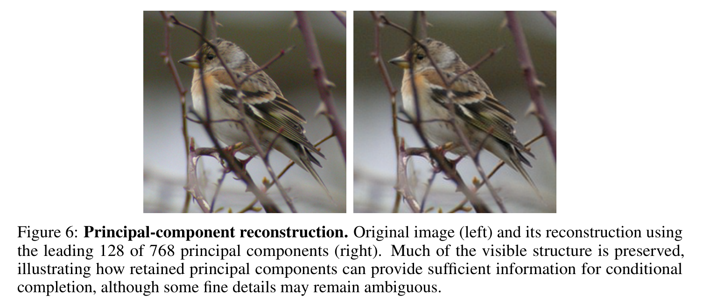

附錄 Figure 6 是給直覺用的：原圖與「只保留 768 個成分裡前 128 個」的仿射重建仍大致可辨——作者明確聲明這是**線性 PCA 投影、不是條件平均解碼器**，只當旁證，不構成決定性證據。這種自我設防在本篇很常見，值得尊重。

---

### 相關研究脈絡

- **JiT（Li & He, arXiv:2511.13720, CVPR 2026）[14]**：本文唯一的主對話對象。backbone、bottleneck 維度（B/L 128、H/G 256）、時間分布、評估協定全部沿用；本文反駁其「off-manifold noise」的因果解釋，改用頻寬。兩篇合起來的凈結論其實是：**JiT 的 recipe 是對的，但理由要換一個**。
- **PixelGen（arXiv:2602.02493）**：本文與 JiT 並列作「$x$-prediction 對像素空間有利」的文獻依據。
- **DDT（Wang et al., CVPR 2026）／DiP（2511.18822）／DeCo（2511.19365）／PixelDiT（2511.20645）**：同族「backbone 之後接像素 decoder／detailer head」。本文把 DDT 視為最接近的方法先例（把雜訊輸入直接供給專屬 decoder、語意編碼與速度解碼分離），但強調自己是在**高維像素 patch** 而非壓縮 VAE latent 上做，並把「為何需要」講成頻寬命題；作者自定位與 REPA／DiP／DeCo **互補**而非取代。值得注意的是 DeCo 仍以 **1.69** 勝過 RiT-H 的 1.79（且用了頻域＋表徵對齊損失）。
- **REPA（2410.06945）／RAE／LightningDiT**：latent 端「修 tokenizer」路線；本文反覆強調 RiT **不用** representation-alignment loss，這是在與 REPA 系爭奪同一個解釋權（相關本庫文章：[REPI](../../2026-10/REPI/AI_Daily_REPI.md)、[NEPA-DiT](../../2026-10/NEPA-DiT/AI_Daily_NEPA_DiT.md)、[MS-pDiT](../../2026-11/MS-pDiT/AI_Daily_MS-pDiT.md)、[FreqFlow](../../2026-11/FreqFlow/AI_Daily_FreqFlow.md)）。
- **SiD／SiD2（Hoogeboom et al.）**：像素空間 + 維度自適應 noise schedule 的血統來源，與本文 $\bar t$、$\mu_t$ 討論相承。
- **並行獨立發現（最有趣的一條）**：**U-JiT（arXiv:2611.04764，FAIR／Sorbonne，Vallaeys、Verbeek、Cord，ICLR 2027 在審）把幾乎同一個現象搬到影片**：對 $16\times16\times4\times3=3072$ 維時空 patch 做 PCA、用 Gavish–Donoho 閾值 $4/\sqrt3$ 估計「信號子空間維度」，得到真實 Kinetics-600 **1308**、U-JiT-B **1284**、latent **1258**、而 **JiT-B 只有 596**——即 JiT 只重現不到一半的真實信號維度。兩篇相隔僅 10 天、互不引用，卻指向同一診斷量。U-JiT 的處方是「把 encoder/decoder 塞進 denoiser 深度裡的 3 層 U 形拓樸」，RiT 的處方是「兩層 raw-conditioned decoder + 輸出捷徑」；同期同會還有一篇 **JVT**（ICLR 2027 投稿）主張「大 patch 的 plain DiT、不要 U-Net skip、不要 detailer 就夠」，正好是 RiT／U-JiT 的反命題。**「像素空間到底需不需要多尺度解碼路徑」這個戰爭才剛開始**，而本文的 Table 2 提供的是最可複用的裁判方法。
- **同名 RiT（2605.21981）**：在凍結 DINOv2 特徵空間做 $x$-prediction、主張 vanilla DiT 就夠；其圖 1 的 PCA 譜／條件數／峰度分析與本文是同一種「用協方差幾何解釋預測目標」的方法論，可對照本庫 [RiT 文章](../../2026-05/RiT/AI_Daily_RiT.md)。
- **表徵崩潰的親緣量**：$\mathrm{erank}$ 源自 Roy & Vetterli (2007)，在自監督圈由 RankMe 發揚；本庫 [EBReg（arXiv:2611.11379）](../../2026-11/EBReg/AI_Daily_EBReg.md) 用 score-based 熵最大化防崩潰、[PRH-JEPA（2610.39302）](../../2026-11/PRH-JEPA/AI_Daily_PRH_JEPA.md) 用 $\rho(f)=\mathrm{tr}\,C_f^{1/2}/k$ 當對齊感測器——**三篇用的是同一個譜幾何家族，但分屬生成、SSL、多模態三個題目**。
- **引用狀態**：發表僅 8 天，Semantic Scholar 目前引用數 **0**（`/citations` 回傳空陣列）；程式碼 2026-11-13 釋出、HF 權重 2026-11-11 上傳，尚無社群複現紀錄可查。

---

### 評價與研究啟發

**定位：一篇「診斷優於方法」的論文，我給 8/10。** RiT 的 1.79 大概半年內會被刷新，但 Eq.(6)／Eq.(9) 這支探針、以及「prediction 目標 × 架構資訊路徑 × patch 協方差各向異性」的三角交互視角，大概率會留下來。真正值得引用的是**可證偽性**：作者先給出一個具體、可測、且能被架構干預反轉的命題（minor 方向上最佳速度 $=x_t/t$），再用 Table 2 的四個開關去檢證——其中「有 raw、頻寬 384 → 31.85」對比「無 raw、同頻寬 → 186.16」幾乎是教科書級的對照實驗。可複現性也少見地扎實：每格消融都對應到 HF 上命名一一吻合的 checkpoint 目錄（含 PCA 各維度完整軌跡），repo 裡甚至有重繪 Figure 3/4/5 的 `analysis/*.py`。

以下是我認為能直接刺激你手上問題的幾條線索：

1. **把 Eq.(6) 的 $R^2$ raw-state probe 變成「資訊路徑體檢」，套到 JEPA／表徵空間生成上。** 這個量只需要每層擬一個 $768\times768$（或 $d\times d$）的仿射映射、在固定 batch 上解一次最小二乘，成本近零，却能把「網路到底在哪一層把哪類資訊丟掉」講成曲線。對 LEF-JEPA／EBT／TEM 這條 energy-based 線，可以直接做**雙條曲線**：$R^2(h_l,x_t)$（raw 是否被搬運）與 $R^2(h_l,x_0)$（clean 是否被解碼）並排畫；EBT 的 score head 若兩條都高，說明它在同一份頻寬裡同時做兩件事——那正是本文預測會失敗的配置。順帶一提：本文的 $C_i(t)$ 其實就是「energy/score 在協方差對角化坐標系裡的每坐標最優斜率」，把 Eq.(7) 逐坐標寫成 $s_i(x_t,t)=-C_i(t)/t\cdot(v_i^\top x_t-\mu_i)$ 形式，可以直接跟 EBT 學出來的 score 譜做逐坐標比對，檢驗它是否把 $1/t$ 的 transport 結構學進去了。
2. **VAR／next-scale prediction 的「誰負責哪個頻段」歸因表。** VAR 的多尺度 token 本質上就是按頻段分層的坐標系。把本文協定平移過去：對每個 scale $k$，量 $R^2(h^{(k)}, x_t)$、以及該 scale 生成對最終 PCA 子空間能量的貢獻 $E_K$（Eq.9 的坐標版），就能回答「高頻細節究竟是 late scales 生出來的，還是 coarse scale 的條件均值抹平的」。本庫 [G-STAR](../../2026-11/G-STAR/AI_Daily_G-STAR.md)（深度壓縮 AR 的 token 容量）與 [Any-Order-AR](../../2026-11/Any-Order-AR/AI_Daily_AnyOrder_AR.md) 都直接受這個問題影響：**如果 minor components 只能靠 raw 注入或 late scales 提供，那壓縮 token 數的極限就不是算力問題，而是資訊路徑問題。**
3. **一個廉價的 training-free 干預：給已訓練模型的後段注入 $x_t$ 並用 $1/\bar t$ 增益做速度重标定。** 本文 Table 2 的教訓是「raw 可及性 + 注入後的頻寬」兩者缺一不可；但在 inference 端，你至少可以做一個不需要重訓的反事實：把 backbone 末段特徵 $h_L$ 與 $x_t$ 以 Eq.(13) 形式的固定增益（$c_i$ 全設 0）做線性混合去替代 $\hat v_\theta$，看 FID／IS 是否移動。若移動明顯，說明一個未受訓練的 $x_t$ bypass 就有transport 價值（這正好落在你想要的 attention modulation／training-free 區間）；若沒移動，代表該模型早已把 transport 學進權重裡，$1/t$ 結構是多餘的。**兩種結果都是有用的機制資訊**，而代價是幾行 code。
4. **$E_K$ 可以當 zero-shot 品質／崩潰感測器。** 本文用 $E_{280}\to0.985$ vs $\to0.63$ 分離兩種目標，分離幅度極大、幾乎不受 batch 影響；這正是「不需要 label、不需要評測集」的診斷量。把 $\mathrm{erank}$／$E_K$ 套在生成器的 intermediate tokens 或 JEPA encoder 上，做 **training-free 的 model-selection／collapse 早期預警**（對照 EBReg 用 effective rank 當 SSL 指標、PRH-JEPA 用 $\rho(f)$），我認為是目前最有可能長出一篇「免訓練表徵健康度」文章的位置。
5. **條件均值 ≠ 條件分布，這是能量視角最該咬住的一口。** 作者在結論自己寫下 Eq.(8) 的補完「不一般性地恢復完整條件分布」，這與本庫 [CFM（2611.07055）](../../2026-11/CFM/AI_Daily_CFM.md) 的核心焦慮（一個 noisy 影像對應多個 clean image，模型只能預測平均）是**同一個問題的不同表述**。CFM 的處方是訓練端的 WTA 競爭與 Recall 型指標；本文則指出**在 minor 子空間，這個平均化其實是好事**（初始雜訊被 $t\,z(1)\to0$ 消滅），而在保留子空間才會付出代價。可操作的延伸：把 quality–coverage 的評估**按 PCA 坐標分解**——major 方向算 coverage／Recall，minor 方向算殘差噪聲能譜——檢驗「糊」到底是頻段問題還是模式問題。
6. **像素 vs latent 之戰的下一步不是刷 FID，而是补上「代價」與「分布」雨項。** 本文沒有任何 GFLOPs／GPU-hours 對照表，而最強的競争解釋恰恰是「多給了一條 raw 輸入與幾個參數」：Vanilla patch-8 的 28.70 與 RiT-B 的 27.97 只差 0.73，但序列長度差 4 倍。加上全表無 seed／誤差棒、IS 提升 25–33 點远超 FID 應有幅度、CFG scale 與 interval 逐 scale 逐 horizon 分別調、baseline 直接引用而非重訓，我的判讀是：**「RiT 優於 JiT」在 ImageNet-256 class-conditional 這個設定內成立，但幅度接近實務誤差，且隨模型變大而消失（H/16 只降 0.07）**——這反而 strengthen 了作者的機制命題（大 backbone 自己就能解頻寬瓶頸），却 weaken 了方法的實用性。

---

### 限制與判讀

- **範圍封閉**：僅 class-conditional ImageNet $256\times256$、僅 B/L/H 三個尺度；更高解析度、**text-conditioned**、其他資料分布、更大模型皆「remains to be studied」（附錄 D 作者自陳）。像素空間 Flow Matching 的商業價值恰在文生圖，本文完全缺席；而 Eq.(8) 裡的條件 $\ell$ 是 1000 個 one-hot 類標，語言條件的協方差結構完全不同。
- **診斷建立在較弱的 regime**：全部頻寬／PCA／$R^2$／erank 證據來自 250K updates、CFG 關閉、FID 28–149 的設定；與最終模型（600ep／有 guidance／FID 1.79–3.01）之間有巨大 gap，作者未在收斂 regime 重測兩條探針是否仍保持同樣分離。
- **探針方法學的已知瑕疵**：附錄 C.4 自陳 $R^2$ **在擬合用的同一批資料上計算**（無 held-out／交叉驗證），且仿射探針只能否證「線性可重建」，無法排除非線性保留資訊。作者自己用「reduced effective rank 不等於資訊遺失」把這兩條包進 disclaimer。
- **無算力／無顯著性／調參洩漏風險**：無 FLOPs 與 GPU-hours 表；無多次 run 與誤差棒；CFG scale 與 interval 逐設定網格搜尋（步長 0.5）；RiT-H 用了較少 epochs（480 vs 600）卻同時用了 scale-specific 的 late-stage lr $\times0.01$ 技巧，可比較性打折。
- **名詞與引用的地雷**：本庫已存在兩篇同名不同物的 JiT／RiT（見「論文資訊」節），後續引用極易串錯；本文自身亦未與同 10 天窗口內的 U-JiT／Raw-injected 平行發現對話，也漏掉 JVT 這個直接反命題。
- **對「$x$-prediction 較好」的弱化**：Table 3 顯示同架構下 $v$（27.97）與 $x$（28.49）只差 0.52，等於本文自己把「必須用 $x$-prediction」這條敘事降級為「目標與資訊路徑要匹配」；引用時請以命題為主、數字為輔。
- **尚未接受外部檢證**：發表 8 天、引用 0、程式碼釋出 4 天；目前所有結論仍以作者單方實驗為準。

---

### References

[1]: https://arxiv.org/pdf/2611.12852v1 "What kills v-prediction? A Patch-wise PCA Perspective on Pixel-Space Flow Matching (RiT) 全文 PDF"
[2]: https://arxiv.org/abs/2611.12852 "arXiv:2611.12852 abstract page（含 NeurIPS 2026 Spotlight 聲明）"
[3]: https://arxiv.org/html/2611.12852v1 "arXiv HTML 全文"
[4]: https://github.com/THUMAI-Lab/RiT "RiT 官方程式碼、訓練/推理/評估與 analysis 重繪腳本（MIT）"
[5]: https://huggingface.co/luotianze666/RiT_ckpts "RiT 全部 checkpoint 與消融權重（114 檔／約 400 GB）"
[6]: https://neurips.cc/virtual/2026/poster/154141 "NeurIPS 2026 virtual poster 頁面（作者、日期、keywords 與官方收錄身分）"
[7]: https://neurips.cc/virtual/2026/loc/sydney/events/spotlights-2026 "NeurIPS 2026 Spotlights 清單頁（可查到此文於 Spotlight 群）"
[8]: https://github.com/KaiCobra/AI_Daily/blob/main/papers/2026/2026-05/RiT/AI_Daily_RiT.md "AI Daily 2026-05 RiT：representation-space 的 vanilla DiT 與 DINOv2 協方差幾何分析（同名不同物）"
[9]: https://github.com/KaiCobra/AI_Daily/blob/main/papers/2026/2026-03/JiT/AI_Daily_JiT.md "AI Daily 2026-03 Just-in-Time：DiT 免訓練空間加速（同名不同物）"
[10]: https://github.com/KaiCobra/AI_Daily/blob/main/papers/2026/2026-11/EBReg/AI_Daily_EBReg.md "AI Daily 2026-11-12 EBReg：score-based 熵最大化與有效秩崩潰"
[11]: https://github.com/KaiCobra/AI_Daily/blob/main/papers/2026/2026-11/PRH-JEPA/AI_Daily_PRH_JEPA.md "AI Daily 2026-11-16 PRH-JEPA：rho(f) 對齊感測器與 good/bad views"
[12]: https://github.com/KaiCobra/AI_Daily/blob/main/papers/2026/2026-11/CFM/AI_Daily_CFM.md "AI Daily 2026-11-14 CFM：quality–coverage 前緣與「預測平均」問題"
[13]: https://github.com/KaiCobra/AI_Daily/blob/main/papers/2026/2026-11/MS-pDiT/AI_Daily_MS-pDiT.md "AI Daily 2026-11-13 MS-pDiT：多尺度像素空間 diffusion transformer"
[14]: https://arxiv.org/abs/2511.13720 "JiT: Back to Basics — Let Denoising Generative Models Denoise (Li & He, CVPR 2026)，本文的主對話對象"
[15]: https://arxiv.org/abs/2611.04764 "U-JiT: Pixel-space video generation with U-JiT（FAIR，ICLR 2027 在審）——10 天前獨立發現同一頻寬現象"
[16]: https://arxiv.org/abs/2511.19365 "DeCo: Frequency-Decoupled Pixel Diffusion（CVPR 2026），本文 pixel 端最強對照 1.69 FID"
[17]: https://arxiv.org/abs/2511.18822 "DiP: Taming Diffusion Models in Pixel Space（U-Net Patch Detailer Head）"
[18]: https://arxiv.org/abs/2410.06945 "REPA：Representation Alignment for diffusion training（本文強調不使用的附加損失）"
[19]: https://arxiv.org/abs/2602.02493 "PixelGen：像素空間 generated model 的另一支 x-prediction 文獻依據"
[20]: https://dl.acm.org/doi/10.1109/TSP.2007.892711 "Roy & Vetterli, The effective rank: A measure of effective dimensionality（Eq.(9) 的 erank 來源）"
[21]: https://github.com/KaiCobra/AI_Daily/blob/main/papers/2026/2026-10/REPI/AI_Daily_REPI.md "AI Daily 2026-10 REPI：representation encoder for pixel generators"
[22]: https://github.com/KaiCobra/AI_Daily/blob/main/papers/2026/2026-10/NEPA-DiT/AI_Daily_NEPA_DiT.md "AI Daily 2026-10 NEPA-DiT：representation alignment for generation"
[23]: https://github.com/KaiCobra/AI_Daily/blob/main/papers/2026/2026-11/G-STAR/AI_Daily_G-STAR.md "AI Daily 2026-11 G-STAR：深度壓縮自迴歸生成的 token 容量"
[24]: https://github.com/KaiCobra/AI_Daily/blob/main/papers/2026/2026-11/Any-Order-AR/AI_Daily_AnyOrder_AR.md "AI Daily 2026-11 Any-Order-AR：解開任意順序自迴歸生成"
[25]: https://github.com/KaiCobra/AI_Daily/blob/main/papers/2026/2026-05/EBT/AI_Daily_EBT.md "AI Daily 2026-05 EBT：Energy-Based Transformers"
[26]: https://github.com/KaiCobra/AI_Daily/blob/main/papers/2026/2026-10/TEM/AI_Daily_TEM.md "AI Daily 2026-10 TEM：Transformer Energy-Based Models"
